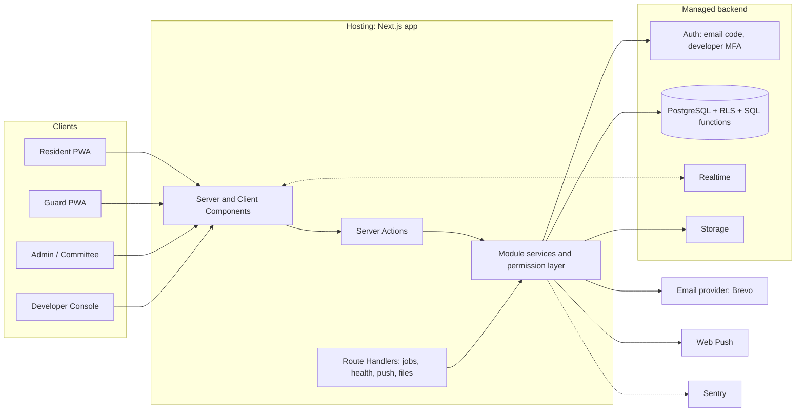
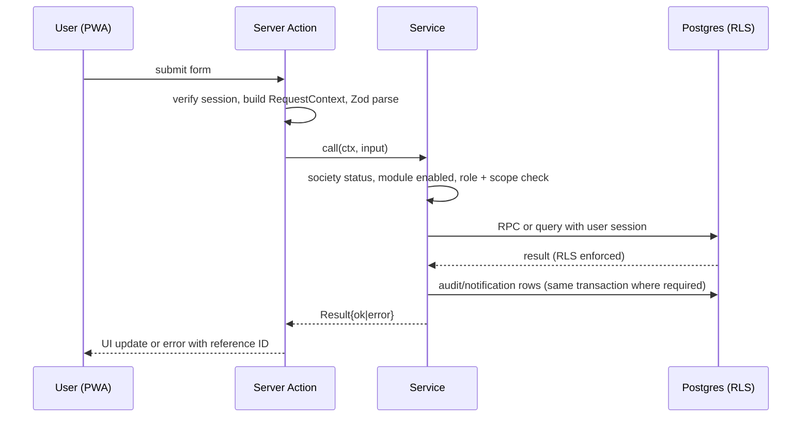
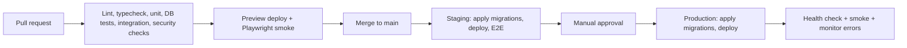

# Homeish — Architecture (ARCHITECTURE.md)

| Field | Value |
|---|---|
| Product | Homeish (PRD D-01 approved 2026-11-09) |
| Version | 0.1 (Draft for approval) |
| Date | 2026-11-09 |
| Depends on | [PRD.md](./PRD.md) (scope, roles, requirements), [DESIGN.md](./DESIGN.md) (UX, components) |
| Governs | Stack, boundaries, data flow, security, testing, deployment |

**Conventions**
- **[AA-nn]** = Architecture assumption. **[AD-nn]** = Architecture decision needing your approval (Section 22).
- PRD/DESIGN IDs (VIS-, BIL-, LOG-, D-nn, DD-nn) are referenced, not repeated.
- This file describes the **target** design. The initial project foundation is implemented as recorded in the root README; product behavior remains unimplemented. Distinguish *proposed*, *implemented*, *tested* and *approved* when updating it.
- Where this file conflicts with the PRD on behavior, the PRD wins. Where the PRD is silent on a technical choice, this file wins.
- Library versions are intentionally not pinned here. Pin them in the manifest at project setup and record them in the README.

---

## 1. Architecture Summary

A **modular monolith**: one Next.js application (UI + server logic) in front of one managed PostgreSQL database with row-level security, plus a small set of managed services (auth, email, storage, realtime, push, error tracking). No microservices, no message queue, no separate API server, no Kubernetes.



**Why this shape**
- Solo-developer-friendly: one repo, one deploy unit, one database to reason about.
- Multi-tenancy and module toggles are enforced in the database (RLS) and the service layer, so a UI bug cannot leak another society's data.
- Modules are folders with a registration point, so enabling/disabling and building module-by-module (PRD Section 3) fits the structure directly.

---

## 2. Recommended Tech Stack and Reasoning

| Layer | Choice | Why | Rejected alternative |
|---|---|---|---|
| Language | **TypeScript (strict)** everywhere | One language across UI, server, tests; compile-time safety for permission and money code | Separate backend language: two toolchains for one developer |
| Framework | **Next.js (App Router)** | Server Components + Server Actions remove the need for a hand-built REST layer; first-class PWA-friendly web app; one deploy | Separate React SPA + Express/Nest API: more code, more surface, duplicate validation |
| Styling | **Tailwind CSS** with design tokens from DESIGN.md | Tokens map 1:1 to Tailwind theme; no component-kit lock-in | Paid/heavy UI kits (conflict with DESIGN.md custom components) |
| Headless a11y primitives | **Radix UI primitives** (dialog, popover, tabs, select) only where native controls are insufficient | Accessible focus trapping and keyboard handling for dialogs/sheets/comboboxes without styling lock-in | Hand-built modals (high a11y risk) |
| Icons | **Lucide** | Matches DESIGN.md line-icon rule | Multiple icon sets |
| Forms/validation | **Zod** (shared schemas) + **React Hook Form** | Same schema validates on client and server; fewer bugs | Duplicate validators |
| Database | **PostgreSQL via Supabase** | Relational fit (units, ledgers, tenants); RLS for tenant isolation; managed backups; includes auth, storage, realtime in one vendor | Mongo/Firebase (weak relational/ledger integrity), self-hosted Postgres (ops burden) |
| Auth | **Supabase Auth**: email one-time code for society users (MVP); email + password + TOTP MFA for developers. Phone OTP, passwords and Google can be added later through the same service | PRD D-03/D-04; avoids building session/code storage; JWT integrates with RLS; extra login methods are configuration, not a rebuild | Custom auth (high security risk) |
| Realtime | **Supabase Realtime** (Postgres changes, RLS-filtered) with polling fallback | Needed for visitor approval < 5s (VIS acceptance) without running a websocket server | Self-hosted sockets |
| File storage | **Supabase Storage** (private buckets, signed URLs) | DAT-5 signed expiring URLs, per-society path scoping | Public buckets |
| Payments | **No payment gateway in MVP.** The society's UPI ID/QR (set by the RWA admin) is shown to residents; the admin confirms payments | PRD D-14/D-15/D-32; no fees, no per-society merchant onboarding, no webhooks | Payment gateway (adds fees and KYC per society; revisit after pilot) |
| Email | **Brevo** via Supabase Auth custom email settings (login codes) and an app email adapter (receipts, alerts) | PRD D-28; larger free allowance; swappable behind the adapter | Resend (smaller free allowance) |
| Push | **Web Push (VAPID)** via a small server library; subscriptions stored in Postgres | No third-party push vendor; works for installed PWAs (limits on iOS, PRD D-23) | FCM/OneSignal (extra vendor) |
| Error tracking | **Sentry** + in-app `error_logs` table | PRD D-09/LOG-7; alerting without building an alert engine | Custom alerting |
| PDF | Server-side PDF library (pure JS, no headless browser) | Receipts/invoices; no Chrome dependency | Headless Chromium (heavy, fragile on serverless) |
| SMS / WhatsApp | Not in MVP | Mobile OTP and critical alerts later (PRD D-06); India DLT registration needed at that point | Building it now |
| Testing | **Vitest** (unit/integration), **Playwright** (E2E + a11y via axe) | Standard, fast, one toolchain | Multiple frameworks |
| Hosting | **Vercel** (app) + **Supabase** (backend) | Zero server ops, preview deploys, managed TLS | Self-managed VMs |
| CI/CD | **GitHub Actions** | Lint, typecheck, tests, migrations, deploy gating | Manual deploys |

**[AD-01 — Approved 2026-11-09]** Stack: Next.js + Supabase + Vercel. If Supabase were ever replaced, RLS-based isolation (Section 8) must be re-implemented in an ORM-level tenant guard and Sections 7, 8, 14 change.

### 2.1 Dependency policy
- Add a dependency only if it replaces more than ~100 lines of hard-to-get-right code (auth, PDF, validation, accessibility primitives, payments SDK, web push).
- No state-management library, no GraphQL, no ORM in MVP (Section 7), no CSS-in-JS, no component kit, no job-queue system, no cache layer, no search engine.
- Each new dependency requires a one-line justification in the PR. Prefer platform features first.

---

## 3. MVP vs Future Scalability

| Concern | MVP (build now) | Future (only when triggered) | Trigger |
|---|---|---|---|
| Deployment | One Next.js app, one Supabase project per environment | Read replica, region pinning | p95 latency or load issues |
| Tenancy | Shared DB, `society_id` + RLS (PRD D-24) | Dedicated DB for a large/enterprise society | Contractual isolation request |
| Jobs | Set-based SQL functions + one daily scheduled endpoint + lazy expiry | Queue (e.g., a managed queue) | Jobs exceed function time limits or need retries at scale |
| Realtime | Supabase Realtime + polling fallback | Dedicated pub/sub | Connection limits reached |
| Search/reports | SQL queries with indexes, CSV export | Materialised views, read replica, analytics store | Reports > 2 s at target scale |
| Notifications | In-app + Web Push + email | SMS/WhatsApp for alerts and mobile OTP, preference center (PRD D-06) | User demand |
| Payments | UPI direct to society + admin confirmation | Payment gateway with automatic confirmation | Admin confirmation workload becomes a burden |
| Login methods | Email code | Mobile OTP, email + password, mobile + password, Google (PRD A-35) | User demand |
| Mobile | Responsive PWA | Native/React Native wrapper | PRD D-23 changes (iOS push limits) |
| Offline | None (clear offline state) | Guard offline queue | PRD D-25 changes |
| Files | Supabase Storage | CDN/image transformation | Storage/bandwidth cost |
| Observability | Sentry + `error_logs` + `audit_logs` | Metrics/tracing stack | Multiple on-call needs |
| Subscription billing | Manual (PRD D-08) | In-app plan billing | PRD change |
| Languages | English, strings externalised | i18n catalogs | PRD NFR-13 |

Scale target for MVP design (PRD NFR-4): 100 societies, 100k users, ≤ 1,500 units per society. This is comfortably within a single managed Postgres instance with proper indexes.

---

## 4. System Context and Trust Boundaries

| Zone | Contains | Trust |
|---|---|---|
| Browser/PWA | UI code, user session cookie | **Untrusted.** Nothing here is authoritative |
| Next.js server | Server Components, Server Actions, Route Handlers, services | Trusted code; acts with the **user's session** by default |
| Privileged server path | Service-role client used only by jobs, log writer, push sender | Highest privilege; isolated module, audited usage (Section 8.4) |
| Supabase Postgres | Tables, RLS, SQL functions | **Final authority** on tenant isolation and invariants |
| Third parties | Email provider, push services, Sentry | Untrusted inputs; responses validated and failures handled (Section 12) |

Principle: **the database enforces what must never happen; the service layer enforces what should not happen; the UI hides what the user cannot do.**

---

## 5. Frontend Architecture

### 5.1 Rendering model
- **Server Components by default** for data-bearing pages; **Client Components** only for interactivity (forms, dialogs, realtime widgets, pickers).
- Mutations use **Server Actions** calling module services. No client-side `fetch` to internal endpoints for ordinary reads/writes.
- Realtime subscriptions are client-side, scoped by society and RLS, and **only** for: visitor status (guard waiting panel, resident pending approvals), delivery response status, notification inbox count. Everything else uses fetch-on-navigation or refresh.
- No global client state library. State lives in the URL (filters, page, sort), server data, and local component state. Forms use React Hook Form.

### 5.2 App shells (DESIGN.md Section 5)
One Next.js app, role-specific route groups with distinct layouts:

| Route group | Audience | Shell |
|---|---|---|
| `(auth)` | Everyone unauthenticated | Centred narrow column |
| `(resident)` | Owners, tenants, family | Top bar + bottom tabs / left rail |
| `(guard)` | Guards | Big-action home, no tab bar |
| `(admin)` | Admin, committee, HK supervisor | Bottom tabs / sidebar |
| `developer` | Platform developer | Dark top bar, separate login, separate cookie/session policy |

The shell reads the **active society's enabled modules** and the user's roles, then builds navigation (DESIGN.md 5.3). A disabled module renders no nav item, and its routes return the module-disabled page.

### 5.3 PWA scope (PRD D-23)
- Web app manifest (install to home screen), service worker for **Web Push only**. No offline data caching in MVP (NFR-15); an "offline" banner is shown by connectivity detection.
- Guard devices run the same app; a guard installs it to the home screen. **[AA-01]**
- iOS Web Push works only for installed PWAs on supported iOS versions; fallback is the guard calling the resident; SMS/WhatsApp alerts are post-MVP (PRD D-06). Flagged risk in PRD Section 15.

### 5.4 Design-system implementation
- Tokens (colour, type, spacing, radius, motion) defined once in the Tailwind theme per DESIGN.md Section 2–4. No raw hex or arbitrary values in components.
- Manrope body text and Sora headings are bundled with the app by default; the signed-in user's `font_preference` may select the device-default font and follows the account across devices.
- Shared component library in `src/components/ui/` implements DESIGN.md Section 6; module-specific composites live inside their module (Section 9).
- Accessibility behaviours (focus return, trapping, live regions) are implemented once in the shared components, not per screen.

### 5.4.1 Client data rules
- Server returns **view models** shaped for the screen (no raw table rows); money is formatted from integer paise server-side or via one shared formatter.
- Never ship secrets or service-role capability to the client. Public env vars are limited to the Supabase URL and anon/publishable key, the VAPID public key.

---

## 6. Backend Architecture

### 6.1 Layers (inside each module)

```
UI (pages/components)
   ↓ calls
Server Action / Route Handler  — input parse (Zod), auth context, error mapping
   ↓ calls
Service  — business rules, permission check, module-enabled check, audit
   ↓ calls
Repository/queries — SQL via Supabase client or SQL functions
   ↓
PostgreSQL (RLS + constraints + functions)
```

- **Server Actions / Route Handlers** are thin: parse input, build the request context (user, active society, roles, request ID), call one service function, map the result/error.
- **Services** hold business rules and are the only code that coordinates multiple tables, notifications and audit writes. Services never import UI.
- **Queries** are the only code that talks to the database client. They never contain business rules beyond mapping.
- Atomic multi-step writes (bill generation, payment application, visitor decision, ledger posting) are **single SQL functions (RPC)** so they run in one transaction with row locks. The service calls the function; it does not stitch several client calls together.

### 6.2 Request context
Every server entry point constructs a **RequestContext** containing: request ID, authenticated user ID (from a verified session, not an unverified cookie), active society ID, the user's roles in that society (re-read from the database), enabled-modules snapshot, and a logger bound to the request ID. Services take the context as their first parameter. A service without a context is a defect.

### 6.3 Background and scheduled work
| Job | Mechanism | Idempotency |
|---|---|---|
| Visitor/delivery expiry | **Lazy**: status is derived on read (`created_at + timeout`) and finalised when touched; no per-minute scheduler | N/A |
| Late-fee calculation, reminder notifications, AMC expiry reminders, low-stock alerts, uncollected-parcel list | **One daily scheduled call** to a secured job endpoint (platform cron) that invokes SQL functions per enabled module/society | Each function records a `(society, job, period)` run key; re-running is a no-op |
| Log retention purge (LOG-6, DAT-4) | Same daily job | Date-bounded deletes |
| Bill generation (up to 1,500 units) | Admin-triggered, **set-based SQL function** (a single insert-select, chunked if needed), well under function time limits | Unique key on (unit, period, charge type) (BIL-2) |
| Stale payment alert | Daily job flags UPI submissions awaiting confirmation longer than N days and notifies admins (BIL-17) | Run key per (society, day) |
| CSV imports | Validate in app, write in batches via function; results persisted in `jobs` table so progress survives navigation (DESIGN.md 11.3) | Row-level results; confirm step before write |

**[AD-02]** Daily scheduler only (no minute-level cron) keeps this running on low-cost plans. If reminders must go out at a fixed time of day per society, a small per-hour schedule is added later. Confirm.

### 6.3.1 `jobs` table use
Long-running admin actions write a job row (type, status, progress, result summary, society, created by). The UI shows it in the Jobs list (DESIGN.md 11.3). No external queue is introduced in MVP.

---

## 7. Database Interaction

### 7.1 Access method
- **Supabase client (PostgREST/RPC) with the user's session** for normal reads and writes, so RLS applies automatically.
- **SQL functions (RPC)** for any operation that spans tables, needs locking, or enforces an invariant (decision on a visitor, bill generation, payment application, module toggle, role change).
- **No ORM in MVP**. Types come from generated database types; SQL lives in versioned migrations. **[AD-03]** An ORM adds a second source of truth for the schema and bypasses RLS patterns; revisit only if query code becomes unmanageable.
- Direct connection strings are used only by migration tooling and tests, never by app runtime.

### 7.2 Conventions
| Rule | Detail |
|---|---|
| Tenant key | Every tenant table has `society_id` (not null, indexed, first column in composite indexes) (DAT-1) |
| Identifiers | UUID primary keys |
| Money | `bigint` paise + currency code; no floats (DAT-2) |
| Time | `timestamptz` stored in UTC; society timezone in `societies`; display conversion in the app (NFR-9) |
| Audit columns | `created_at/by`, `updated_at/by` on tenant tables (DAT-1) |
| Deletion | Soft delete/deactivate by default; **no delete** on ledger, payments, bills (published), visitor entries, audit logs (DAT-3, DAT-7) |
| Enums | Status columns use constrained text or enum types matching DESIGN.md Section 4.4 vocabulary |
| Constraints | Unique, check and foreign-key constraints express invariants (no duplicate bills, no negative stock, one primary contact per unit, single-use codes) |
| Migrations | SQL migration files, forward-only, reviewed, run by CI against staging then production; one folder section per module |
| Seed data | Synthetic only; never copy production data to non-production |

### 7.3 Schema ownership by module
Core tables belong to `core`. Each module owns its tables, prefixed by module key (e.g., `visitor_entries`, `billing_bills`). A module never writes another module's tables; cross-module needs go through Core (notifications, units, memberships) or a published read function. This keeps module disable/enable free of side effects (MOD-4).

### 7.4 Indexing and performance guidance
- Composite indexes starting with `society_id` for every list screen's default filter/sort (e.g., `(society_id, status, created_at desc)`).
- Pagination is keyset-friendly where lists can be large (visitor log, error logs); offset pagination is acceptable for small admin tables (DESIGN.md 6.13 requires page X of Y and exact totals — use counted queries for those).
- RLS policy helpers (Section 8.3) are marked stable and rely on indexed lookups to keep policy checks cheap.

### 7.5 Files and storage
- Private buckets only. Object path: `{society_id}/{module}/{entity_id}/{file}`. Storage policies derive access from the path's society and the user's membership.
- Uploads validated server-side: type (JPG/PNG/PDF), size ≤ 5 MB (DAT-5). Access via short-lived signed URLs.
- Visitor photos and request photos may be personal data: retained per DAT-4/DAT-8; deletion removes both row and object.

### 7.6 Backups and data lifecycle
- Provider daily backups with ≥ 30-day retention (NFR-10); restore tested before first production society.
- Retention purge job (Section 6.3). Anonymisation of old visitor/staff records per DAT-4.

---

## 8. Authentication and Authorization

### 8.1 Authentication
| Actor | Method | Notes |
|---|---|---|
| Society users (resident, guard, admin, committee, HK supervisor) | **Email + one-time code** (Supabase Auth email OTP, sent through Brevo) | PRD D-03; codes never logged (LOG-5) |
| Developer | **Email + password + TOTP MFA**, separate login route (S-05) | `developer` platform role set only by direct database action, never through any UI; sessions require MFA assurance level before any `/developer` route or developer-only function runs |

- Sign-up is **closed**: an email address can sign in only if it has an invitation or approved membership (CORE-9). Unknown emails get the same generic message ("If this email is registered, a code has been sent"), so nobody can discover who is registered (DESIGN.md 7.3).
- Sessions: secure, HTTP-only, same-site cookies; 30-day society sessions (PRD A-06). Developer sessions are shorter. **[AA-02]**
- Identity is derived **server-side** from the verified session on every request; never from client-supplied IDs.
- Code abuse protection: provider/Supabase rate limits plus per-email and per-IP attempt counters in Postgres; lockout message states when to retry. Daily email-sending limits at the provider are a real constraint on free plans (PRD risk); monitor quota.
- **Login methods are pluggable (PRD A-35).** The app's own profile record is keyed by the Supabase user ID, not by the login method, and the email is the unique identity. Adding mobile OTP, passwords or Google later means enabling that method and adding a screen; existing users keep their accounts and can link a second method. **[AD-11]**
- **Gate login mode (PRD CORE-16).** A per-society setting chooses *individual guard accounts* or a *shared gate account*. In shared mode, a `guard_roster` (society, name, optional PIN hash, active) exists and every visitor/delivery entry stores the roster entry that handled it. The society setting chooses how the guard identifies themselves: pick their name or enter a personal PIN (hashed, attempts rate-limited), so "who let this person in" is always recorded. **[AD-12, PRD D-30 approved]**

### 8.2 Authorization model
Layered, evaluated in this order:

1. **Society status** (Active/Trial allow writes; Suspended = read-only; Archived = blocked) (SAAS-1, PRD D-07).
2. **Module enabled** for the society (MOD-2). Enforced in the service layer **and** in RLS for module tables via a stable helper, so direct API calls to a disabled module fail.
3. **Role permission** from the PRD matrix (Section 8.2 there).
4. **Ownership/scope** (own unit, own request, own staff).

The **permission matrix lives in code** as one typed map per module (`permissions.ts`), is the single source for service checks and UI visibility, and is mirrored by RLS policies and SQL function checks. A test asserts that every matrix cell has an allow/deny test (Section 18).

### 8.3 Tenant isolation (RLS)
- RLS is **enabled on every application table**, with no default-allow. New tables without a policy fail CI (a migration check lists tables lacking RLS).
- Policies call a small set of stable SQL helpers: `is_member(society)`, `has_role(society, roles)`, `module_enabled(society, key)`, `owns_unit(unit)`, `is_developer()`. Membership data, not JWT claims alone, is the source of truth, so role revocation is immediate (PRD CORE-10).
- Active society is chosen by the user (switcher) and carried as a **hint**; the server re-validates it against memberships on every request.
- Developer cross-society access goes through explicit developer-only functions/policies; it is audited (LOG-4). Developers have no impersonation (PRD D-27).
- Developer cross-society access goes through explicit developer-only functions/policies; it is audited (LOG-4). Developers have no impersonation or view-as access **[PRD D-27 — Approved 2026-11-09]**.

### 8.4 Privileged (service-role) usage — strict list
Allowed only in a single isolated server module (`src/core/privileged/`), never imported by components:
1. Scheduled job execution.
2. Error/audit log writer for events where the user session cannot write (e.g., pre-auth errors).
3. Push notification sender (reading subscriptions).
4. Sign-in invitation check: a service-role-only database function that tells the server whether an email has an invitation or membership, so codes are sent only to expected people while the user-visible answer stays generic (API 2.1).
5. Developer-console cross-society reads after the developer check passes.

Confirming a payment, changing UPI details and similar admin actions are **not** privileged: they run under the admin's own session and are checked by RLS and SQL functions.

Each privileged function takes an explicit society ID and re-checks it; none returns data across societies to non-developers.

---

## 9. Folder Structure

Single repository, single Next.js app. Module folders are self-contained and registered in one place.

```
homeish/
├─ .env.example                   Environment variable names and placeholders only
├─ .github/workflows/ci.yml       Static checks, browser smoke and build
├─ .gitignore
├─ .nvmrc
├─ .prettierrc.json
├─ docs/                          Project docs, including name-logo-options.svg (unapproved concepts)
├─ eslint.config.mjs
├─ next.config.ts
├─ package.json
├─ package-lock.json
├─ playwright.config.ts
├─ postcss.config.mjs
├─ README.md
├─ scripts/                       Header and public-environment checks
├─ supabase/
│  ├─ migrations/                 Forward-only SQL, ordered; sections per module
│  ├─ seed/                       Synthetic seed data
│  └─ tests/                      Database tests (RLS, functions)
├─ public/                        Homeish logo, manifest, icons, service worker
├─ src/
│  ├─ app/                        Next.js routes only (thin)
│  │  ├─ (auth)/                  S-01..S-04; thin host-aware root entry
│  │  ├─ (resident)/              R-xx screens, mounted per module
│  │  ├─ (guard)/                 G-xx screens
│  │  ├─ (admin)/                 A-xx screens
│  │  ├─ developer/               D-xx screens (separate layout/login)
│  │  └─ api/
│  │     ├─ jobs/daily/           Secured scheduled job entry
│  │     ├─ push/                 Subscribe/unsubscribe
│  │     ├─ client-errors/        Client error ingestion (LOG-1)
│  │     ├─ files/                Signed URL issuance, PDF downloads
│  │     └─ health/               Health check (NFR-11)
│  ├─ instrumentation.ts          Server environment validation on startup
│  ├─ proxy.ts                    Host allow-list and non-public noindex headers
│  ├─ core/                       Mandatory platform (cannot be disabled)
│  │  ├─ auth/                    Session, request context, OTP flow helpers
│  │  ├─ tenancy/                 Society, membership, active-society handling
│  │  ├─ website/                 Marketing copy/screens, society-address form, synthetic preview
│  │  ├─ permissions/             Role types, shared helpers
│  │  ├─ modules/                 Module registry, enabled-modules lookup, guards
│  │  ├─ notifications/           In-app + push dispatch, inbox
│  │  ├─ logging/                 Error log, audit log, request ID, Sentry adapter
│  │  ├─ errors/                  Error classes, result type, mapping
│  │  ├─ jobs/                    Job records and runner helpers
│  │  ├─ privileged/              Service-role client (restricted, Section 8.4)
│  │  ├─ db/                      Typed client factories, generated DB types
│  │  ├─ integrations/            One adapter per external service (Section 13)
│  │  └─ config/                  Validated public/server environment config
│  ├─ modules/                    One folder per module key
│  │  └─ <module>/                visitor, delivery, billing, service_request, ...
│  │     ├─ module.ts             Registration: key, name, nav items, settings schema, permissions
│  │     ├─ permissions.ts        Role → capability map
│  │     ├─ schemas.ts            Zod input/settings schemas
│  │     ├─ actions.ts            Server Actions (thin)
│  │     ├─ service.ts            Business rules
│  │     ├─ queries.ts            Database access
│  │     ├─ components/          Module composites (per DESIGN.md 6.20)
│  │     └─ __tests__/
│  ├─ components/
│  │  └─ ui/                      Shared design-system components (DESIGN.md Section 6)
│  ├─ styles/                     Tailwind theme/tokens
│  └─ lib/                        Pure utilities (money, dates, formatting)
├─ tests/
│  ├─ e2e/                        Playwright smoke + accessibility checks
│  ├─ unit/                       Vitest tests
│  └─ fixtures/
├─ tsconfig.json
└─ vitest.config.ts
```

Foundation status: the Next.js shell, route-group boundaries, health route, shared Button/TextInput primitives, design tokens, environment validation and baseline CI checks are implemented. Public marketing, host allow-listing, browser-only synthetic preview and beta entry are also implemented. Maplewood's host is reserved as a disabled placeholder; active society hosts, module routes, database configuration and role shells are still pending their planned phases.

Rules:
- `app/` contains routing and layout only; page files import from `modules/*` and `core/*`.
- A module imports from `core` and `components/ui`, **never from another module**. Cross-module links use Core notifications/units or a route link (PRD A-05).
- Adding a module = adding one folder, one registry line, its migrations, and its nav entries. No other file changes.

### 9.1 Module registry
`core/modules/` holds the list of known modules. Each module's `module.ts` declares: key, display name, whether it is core, default settings, settings schema (with a flag per setting for developer-only vs admin-editable, MOD-3), navigation items per role, and the permissions map. The registry drives: nav generation, route guards, the Developer Config page (D-03), job execution (jobs skip societies where the module is off), and notification routing.

### 9.2 Per-society module state
Stored in `module_configs` (PRD ModuleConfig): `society_id`, `module_key`, `enabled`, `settings` (JSON validated against the module's schema), audit fields. Core is always on. A toggle is a **single SQL function** that updates state and writes an audit entry in one transaction (MOD-5). The enabled-modules lookup is read per request and cached for the request only, so a toggle takes effect within seconds (target < 1 minute, PRD success criteria).

---

## 10. Data Flow (Key Journeys)

### 10.1 Standard request


### 10.2 Visitor approval (VIS-1..7), the latency-critical flow
```mermaid
sequenceDiagram
  participant G as Guard PWA
  participant S as Server (visitor service)
  participant DB as Postgres
  participant N as Notifications
  participant R as Resident PWA
  G->>S: create visitor entry
  S->>DB: insert entry (Pending) + notification rows (one RPC)
  DB-->>G: Realtime: entry status
  S->>N: send Web Push to unit approvers (best effort)
  N-->>R: push "Visitor at gate"
  R->>S: Allow / Deny (opens deep link)
  S->>DB: decision RPC (locks row; first response wins; rejects if already decided/expired)
  DB-->>G: Realtime: status change
  G->>S: Check in / out
```
- The decision RPC locks the entry, checks the approver belongs to the unit, applies "first response wins" (PRD A-11), and writes the audit row in the same transaction.
- Push is **best effort**; the in-app inbox and the guard's realtime/polling updates are the reliable path. If Realtime is unavailable the guard UI polls every few seconds.
- Expiry (no response after timeout) is derived from `created_at + timeout` on read; the guard override requires a reason and writes an audit row (VIS-4).

### 10.3 UPI payment (BIL-6)
```mermaid
sequenceDiagram
  participant R as Resident
  participant S as Billing service
  participant DB as Postgres
  participant A as Admin
  R->>S: Pay Now (bill ids)
  S->>R: society UPI ID, QR, exact amount (computed on server)
  R->>R: pays in own UPI app
  R->>S: submit UTR (+ optional screenshot)
  S->>DB: create payment (Awaiting confirmation); UTR unique per society
  S->>A: notification (review queue)
  A->>S: Confirm or Reject (with reason)
  S->>DB: confirm RPC (ledger credit, allocate oldest-first, receipt number) in one transaction
  S->>R: notification + receipt (or rejection reason)
```
- A payment becomes Confirmed **only** through the confirm function called by an authorised admin; the function re-checks role, society and that the payment is still Awaiting confirmation, so a double click or two admins cannot confirm twice.
- A unique constraint on (society, UTR) blocks duplicate submissions (BIL-16). Screenshots go to a private bucket and are shown through short-lived signed links.
- Society UPI details are changed through one function that validates the UPI ID format, writes an audit row with old and new values, and notifies all admins and committee members; the payment screen shows the "last changed" date (BIL-15). Residents cannot alter the payee or amount shown.
- No money moves through the platform and no external payment service is called in MVP (PRD D-15). If a payment gateway is added later, it adds a webhook route and a new payment source without changing the ledger.

### 10.4 Bill generation (BIL-2)
Admin previews (read-only query computing per-unit totals) → confirms → one SQL function inserts bills, bill lines and ledger debits set-based, keyed by (unit, period, charge type); a job row records totals and failures; notifications are queued for residents after commit. Re-running is safe.

### 10.5 Module toggle (MOD-1..5)
Developer toggles → `set_module_state` function validates developer + MFA level, updates `module_configs`, writes audit → next request reads the new state → nav hides, actions/queries reject, jobs skip. Data is untouched (MOD-4).

### 10.6 Error and logging flow
Any server/client error → mapped to an `AppError` → logged (Section 14) with request ID, society, user, module, route → user sees a safe message plus reference ID → Sentry receives the same event (scrubbed) → developer finds it by reference ID in the Error Log Viewer (D-05).

---

## 11. API Architecture

There is **no public API** and no REST/GraphQL layer for the app's own UI in MVP (PRD out-of-scope: public APIs).

| Interface | Mechanism | Used for |
|---|---|---|
| UI reads | Server Components calling module queries | All page data |
| UI writes | Server Actions | All mutations |
| Realtime | Supabase Realtime channels (RLS-filtered) | Visitor/delivery status, inbox badge |
| Webhooks in | None in MVP | A signed webhook route is added only if a payment gateway or similar external callback is introduced later |
| Scheduled job | Route Handler `POST /api/jobs/daily` | Daily jobs; requires secret header + platform cron origin; rejects otherwise |
| Push subscription | Route Handler | Register/remove a device subscription for the signed-in user |
| Client errors | Route Handler | Receives client error reports (validated, size-capped, rate-limited) |
| Files | Route Handler | Issue signed URLs / stream receipt PDFs after permission check |
| Health | Route Handler | Uptime monitor; returns only status, no internals |

### 11.1 Action contract
Every Server Action returns a discriminated result: success with data, or failure with `{ code, message, fieldErrors?, referenceId? }`. Codes come from one shared catalogue (Section 14). Actions never throw to the UI for expected failures. Input is validated with the module's Zod schema on the server (client validation is a convenience).

### 11.2 Rules
- Route Handlers exist only where an external system or non-UI client calls us (cron, health, client errors) or where a streamed/binary response is needed.
- Every Route Handler: verifies its caller (signature, secret or session), validates input, applies rate limits where public, returns no stack traces.
- No endpoint accepts a society ID as authority; it is always checked against the session's memberships.
- If a public/partner API is later needed, add a versioned `/api/v1` with API keys and a separate permission model (Section 3, Future).

---

## 12. External Services and Integration Rules

Each integration sits behind **one adapter** in `core/integrations/<service>/` exposing a small internal interface, so providers are replaceable (PRD INT-2).

| Service | Adapter responsibility | MVP | Failure behavior |
|---|---|---|---|
| Email provider (Brevo) | Send login codes (via Supabase Auth custom email settings) and receipts/alerts; verified sender domain (SPF/DKIM) | Yes | Log + generic user message + resend guidance; code content never logged |
| UPI payment link/QR | Build the UPI link and QR from the society's stored details; no network call | Yes (billing) | If details are missing: "Payment details not set up — contact your admin"; never guess a payee |
| Web Push | Send to stored subscriptions, prune expired ones | Yes | Best effort; failures logged at warning; inbox remains source of truth |
| Object storage | Upload, signed URL | Yes | Per-file retry in UI |
| Sentry | Capture scrubbed events with request ID | Yes | Never blocks a request |
| SMS / WhatsApp | Future mobile OTP and critical alerts | No (post-MVP) | Not built in MVP |
| PDF generation | Receipts/invoices (in-process) | Yes (billing) | Error with reference ID; data unaffected |

Cross-cutting integration rules (PRD INT-1..3):
- Timeout on every outbound call (short, explicit), limited retries only for idempotent calls, all failures logged with request ID.
- If webhooks are introduced later: verify signature, store raw event ID for idempotency, process in a transaction, respond quickly.
- Secrets only from server environment; never sent to the client; rotated through the host's secret store.
- Integration code never contains business rules; services decide what to do with the outcome.

---

## 13. AI Architecture

**Not required for MVP or the PRD's P2 scope.** PRD explicitly excludes AI features and chatbots. No AI SDK, model keys, vector store or prompt infrastructure is added.

If a future need is approved (e.g., request categorisation, notice drafting), the rule is: AI runs behind a single server-side adapter, receives only minimal, non-sensitive, society-scoped data, its output is advisory (a human confirms), failures degrade to the non-AI path, and it never touches money, entry decisions or permissions. A separate architecture addendum and PRD change are required first.

---

## 14. Error Handling and Logging

### 14.1 Error model
One error taxonomy shared by all modules:

| Class | Examples | User outcome | Logged as |
|---|---|---|---|
| `ValidationError` | Bad input, missing field | Field-level messages | Not logged (or debug) |
| `AuthError` | Not signed in, session expired, MFA required | Sign-in redirect / session-ended state | info |
| `PermissionError` | Role or scope denied | "You don't have access" | warning (audit-worthy attempts to cross boundaries) |
| `ModuleDisabledError` | Module off | Module-disabled page/banner | info |
| `SocietyStateError` | Suspended/archived | Read-only banner | info |
| `ConflictError` | Already decided, duplicate bill, stale edit | Specific explanation and next step | info |
| `NotFoundError` | Missing or not visible record | 404 state (no existence leak) | info |
| `RateLimitError` | OTP/code attempts | Wait message with timing | warning |
| `IntegrationError` | Email/push failure | Retry or pending state per DESIGN.md 9.3 | error |
| `InternalError` | Anything unexpected | Error panel + reference ID | error/critical |

Expected failures are returned as results, not thrown. Anything unexpected is caught at the boundary (action, route handler, error boundary), converted to `InternalError`, logged, and shown with a reference ID. No silent fallbacks, no swallowed errors, no success-shaped defaults.

### 14.2 Logging (PRD LOG-1..8)
| Stream | Storage | Content | Access |
|---|---|---|---|
| `error_logs` | Postgres table | Reference ID, timestamp, society, user, role, module, route/action, request ID, message, stack, severity, app version, device/browser, status (open/resolved/ignored) | Developer only (RLS + developer check) |
| `audit_logs` | Postgres table, append-only | Actor, action, entity, before/after, reason, request ID | Developer; society admin/committee for their society (LOG-4, matrix in PRD) |
| Sentry | External | Scrubbed exception events + alerts | Developer |
| Platform logs | Host logs | Request-level infrastructure logs | Developer |

- **Reference ID:** generated at error time, stored on the `error_logs` row and returned to the user (LOG-2). Short, human-copyable, non-guessable-enough to avoid enumeration use.
- **Request ID:** created in middleware, passed through actions, DB calls (as a setting/column), integration calls and logs (LOG-8).
- **Scrubbing (LOG-5):** a single scrubber removes OTPs, tokens, cookies, auth headers, payment data, full phone numbers (masked), document content and free-text PII fields before persistence or Sentry send.
- The log writer is **best-effort and non-throwing**: if logging fails, the request still completes its own error path and the failure is reported to Sentry/platform logs only. Logging must never create a new error.
- **Client errors:** an error boundary and global handler post to the client-error endpoint (validated, size-capped, per-session rate-limited); entries join the same `error_logs` stream with a `client` source.
- **Alerts:** Critical severity → Sentry alert and email to the developer (LOG-7).
- **Retention:** error logs 90 days, audit logs 2 years (PRD A-09), purged by the daily job.

---

## 15. Security Boundaries and Controls

| Area | Control |
|---|---|
| Tenant isolation | `society_id` on all tenant data; RLS on every table; CI check for tables without RLS; tests that attempt cross-tenant reads/writes (PRD success: zero leaks) |
| Authorization | Server-side only; permission map + RLS + SQL function checks (Section 8) |
| Authentication | Email one-time code; developer email + password + MFA; enumeration-safe messages; attempt limits |
| Input validation | Zod at every boundary; DB constraints as the backstop; parameterised access only (no string-built SQL) |
| Output safety | React escaping by default; no raw HTML rendering of user text; CSV exports escape formula-leading characters (`=`, `+`, `-`, `@`) |
| CSRF/session | SameSite cookies, Server Actions origin checks, no state-changing GET |
| Transport | HTTPS only, HSTS |
| Headers | Content Security Policy (strict, no unsafe inline beyond what the framework requires), frame-ancestors none, no sniffing, referrer policy, permissions policy (camera allowed for guard photo only) |
| Secrets | Host secret store; never in repo; separate keys per environment; service-role key only on the server and only in the privileged module |
| Payments | The app never handles money; UPI details changeable only by admins, audited, admins and committee notified, "last changed" shown to residents; payments confirmed only by admin action; duplicate UTR blocked by a database constraint; amounts computed on the server |
| Files | Private buckets, signed expiring URLs, type/size validation, society-scoped paths, no executable types |
| Rate limiting | OTP requests/verifications, pre-approval code validation (brute-force guard), client-error endpoint, login; counters in Postgres (no extra infra). **[AD-05]** Confirm Postgres counters vs. a managed rate-limit service |
| Personal data | Minimum collection; masked phones in lists; no PII in logs; DPDP-aligned consent, export and deletion handled per PRD DAT-8; retention jobs |
| Auditability | Money, role, module, override and export actions write audit rows in the same transaction |
| Dependencies | Lockfile committed; automated vulnerability alerts; no unvetted packages; updates through PRs with CI |
| Developer console | Separate route/layout/cookie scope, MFA required, no impersonation, all actions audited, optional IP allow-list at the host if available |
| Backups | Encrypted at rest by provider; restore drill before production launch |

Threats specifically considered: cross-tenant ID tampering, role escalation via stale JWT claims (mitigated by membership re-checks), UPI-detail tampering (audited, committee notified), pre-approval code guessing, login-code flooding and email bombing (rate limits + per-email caps + provider quota alerts), double submission (idempotency), file-upload abuse, log injection (structured logging, scrubbing), and open redirects after login (allow-list of internal paths).

---

## 16. Environment Configuration

### 16.1 Environments

Approved D-34 hosting: shared Vercel project `homeish` builds `main` and serves the bare product host and `demo` host. Separate project `beta-homeish` builds `beta` and serves `beta.homeish.vercel.app`. Each uses Vercel's Production target; beta is nevertheless a testing environment. Society activation is deferred until MVP and a future create-society script; Maplewood is reserved in `src/core/config/societies.ts` with status `disabled` and serves only a placeholder. Feature branches deploy to neither project; merge into beta for hosted testing, then merge verified beta into main. This replaces the earlier per-pull-request deployment assumption below.

External setup status, 2026-11-09: projects (still named `dwello` and `beta-dwello`) are created and Git-linked with the correct release branches, but have zero deployments and automatic Git deployments disabled at the owner's request. `dwello.vercel.app` is assigned to another project, which led to the Homeish rename (PRD D-01). `homeish.vercel.app` returned "deployment not found" on 2026-11-09 but is unclaimed until the projects are renamed and the host attached. No nested demo/beta host or real society host is attached. The topology above is the requested design, not an available or live-domain claim. See README for the resume checklist.

`APP_DEPLOYMENT` selects `shared` or `beta`; `APP_BASE_DOMAIN` defines the parent host. `core/config/host-routing.ts` accepts exact known hosts and provider-supplied deployment aliases only. Localhost variants are accepted only outside Vercel. Proxy rejects unknown hosts before app routes; dynamic rendering and private/no-store responses prevent cross-host page caching. Page rendering resolves the host again rather than trusting a client-supplied tenant header. This is entry routing only: future authenticated operations still require membership checks and RLS.

Maplewood is a real society whose address is reserved but disabled: its host (shared project only, never beta) renders a noindexed "not open yet" page and 404s every other path. No onboarding, identity, login or data access is created. The public demo is currently an in-memory synthetic illustration, reset every 15 minutes while open or manually. No reset touches a database. Full demo writes/reset jobs require the backend foundation and a verified synthetic-only isolation boundary. Beta requires its own Supabase project before connected testing; production society data is never copied down. No backend is provisioned by this entry-page implementation. Hosted scaffold pages use application environment `preview` until real integrations and launch gates are complete; do not weaken staging/production validation to deploy them.

| Environment | Purpose | Backend | Data |
|---|---|---|---|
| Local | Development | Supabase local stack (CLI) | Synthetic seed |
| Preview | Entry-page scaffold or future explicitly enabled previews | None for scaffold; isolated synthetic backend before workflows | Synthetic |
| Staging / beta | Pre-release UAT on the beta branch/project | Own Supabase project (not yet configured) | Synthetic |
| Production | Live societies | Own Supabase project | Real; never copied down |

Separate Supabase projects, email sender settings and Sentry environments per environment.

### 16.2 Configuration variables (names only; values live in the host secret store)
| Group | Variables | Client-exposed? |
|---|---|---|
| App | App base URL, environment name, app version (build-injected) | Partly (environment name, version) |
| Supabase | Project URL, anon/publishable key, **service-role key**, database URL (migrations/tests only) | URL + anon only |
| Email (Brevo) | SMTP credentials or API key (also entered in Supabase Auth's custom email settings), verified sender address, developer alert address | No |
| Push | VAPID public key, **VAPID private key**, contact address | Public key only |
| Observability | Sentry DSN (client + server), auth token (CI) | DSN only |
| Society UPI details | Not environment variables: stored per society in the database and edited by the RWA admin (PRD BIL-15) | n/a |
| Jobs | Job endpoint secret | No |
| Feature | Not environment variables: limits, retention periods and defaults are code constants and per-society settings (API 11) | No |

Rules:
- One **validated config module** (`core/config`) reads and validates all variables at startup/build with a schema; missing or malformed values fail fast with a clear message.
- Only variables explicitly marked public are available to browser code (a naming convention enforces this).
- A committed example file lists variable names with placeholders, never real values.
- Per-society business settings (timeouts, due day, reminder schedule, late fee) are **data** in `module_configs`, not environment variables (MOD-3, MOD-6).

---

## 17. Observability and Operations (MVP-level)

- Uptime check against the health endpoint (alerts to the developer).
- Sentry for errors/performance sampling at a low rate; platform logs retained per host plan.
- Developer Health page (D-07) is built from `error_logs` aggregates; no separate metrics system.
- Email provider quota and bounce alerts configured at the provider.
- Runbook basics (written in a later OPERATIONS.md): how to find an error by reference ID, restore a backup, rotate a secret, disable a module for a society, suspend a society.

---

## 18. Testing Approach

| Level | Tool | Scope | Gate |
|---|---|---|---|
| Static | TypeScript strict, ESLint, formatter | Whole repo | Every PR |
| Unit | Vitest | Pure logic: money, date/timezone, late-fee and allocation rules, permission map, Zod schemas, error mapping, scrubber | Every PR |
| Database | SQL test suite against local Supabase | **RLS and SQL functions**: tenant isolation, role matrix cells, module-disabled denial, bill uniqueness, ledger immutability, visitor decision race (first response wins), duplicate-UTR rejection, idempotent payment confirmation, no negative stock | Every PR touching migrations |
| Integration | Vitest + local Supabase | Services end-to-end through the real database with a fake integration adapters (email, push) | Every PR |
| E2E | Playwright (phone and desktop viewports) | Key journeys per module (PRD Section 6), module toggle on/off, error/empty/loading states, offline banner | Before each module release; nightly on staging |
| Accessibility | axe in Playwright + manual keyboard/screen reader (TalkBack, VoiceOver) | DESIGN.md Section 14 and 15 | Manual pass per module UAT |
| Security | Dependency audit, secret scanning, RLS-presence check, header check | CI | Every PR |
| Payment | UPI flow: submit, duplicate UTR, confirm, reject and resubmit, double-click confirm, UPI-detail change audit and notification | Billing module | Before billing release |
| Manual UAT | Pilot society checklist per module | Real device on low-end Android and iOS Safari | Per module release |

Rules:
- **Permission matrix tests are generated from the same map the app uses**, so a new capability without an allow/deny test fails CI.
- Test data is synthetic; fixtures never contain real phone numbers or production dumps.
- External services are replaced by adapter fakes in automated tests; one smoke test per integration runs against staging sandboxes.
- A module is releasable only when its acceptance criteria (PRD), design acceptance checklist (DESIGN.md Section 15) and the tests above pass.

---

## 19. Deployment Approach

### 19.1 Pipeline


- **Migrations before code**: backward-compatible migrations (add before use, remove after) so the app can roll back independently of the database. Destructive changes are split across two releases.
- **Rollback**: redeploy the previous app build; database rolled forward with a corrective migration (never edited in place). Backups are the last resort.
- **Feature release by module**: a new module ships dark (disabled for all societies), is enabled for a pilot society by the developer, then for others (PRD Section 14 release gating). The module toggle doubles as the feature flag; no separate flag service.
- **Scheduled job**: platform cron calls the daily job endpoint with the secret header; failures log to `error_logs` and Sentry.
- **Domain and TLS**: one parent product domain with configured website/demo/society hosts, managed certificates; beta on a separate project; developer console on a distinct path or subdomain with its own cookie scope. **[AA-03, D-34]** Domain selection and live deployment are currently paused.
- **Cost posture**: free tiers are limited to local development and synthetic-data staging. Use paid production tiers before the first live society, regardless of whether that society pays a Homeish subscription; the first-ten society offer does not cover hosting costs. **[AD-06 — Approved 2026-11-09; PRD D-33]**

### 19.2 First-society go-live checklist (summary)
Production project created and backups verified → sender email domain verified (SPF/DKIM) and login email tested → society admin enters UPI details → secrets set → migrations applied → developer account with MFA created → society created with only ready modules enabled → admin invited → pilot UAT → monitoring and alerts confirmed.

---

## 20. Non-Functional Mapping

| PRD NFR | How the architecture meets it |
|---|---|
| NFR-1 Platform | Responsive PWA, one codebase |
| NFR-2 Performance | Indexed tenant queries, set-based SQL for heavy work, Server Components, small client bundles |
| NFR-3 Availability | Managed hosting/DB; gate flows rely on few moving parts; Realtime has polling fallback |
| NFR-4 Scalability | Shared DB with tenant indexes; scale-up path in Section 3 |
| NFR-5 Multi-tenancy | `society_id` + RLS (Section 8.3) |
| NFR-6 Security | Section 15 |
| NFR-7 Privacy | Minimal data, scrubbing, retention, masked display |
| NFR-8 Payments | UPI direct to society, admin confirmation, duplicate-UTR block, audited UPI details |
| NFR-9 Data integrity | Append-only ledger/audit, constraints, UTC timestamps |
| NFR-10 Backup | Provider daily backups, restore drill |
| NFR-11 Observability | Section 14 and 17 |
| NFR-12 Accessibility/low-end | Server rendering, light client JS, DESIGN.md requirements |
| NFR-13 Localisation | Strings externalised, font fallback ready |
| NFR-14 Compatibility | Latest 2 browser versions, Android 9+, iOS 15+ (push needs installed PWA on supported iOS) |
| NFR-15 Offline | Not supported; explicit offline state |
| NFR-16 Testing | Section 18 |
| NFR-17 Maintainability | Module folders + registry, thin actions, single privileged module |
| NFR-18 Cost control | Managed services, no extra infrastructure |

---

## 21. Assumptions Register (Architecture)

| ID | Assumption |
|---|---|
| AA-01 | Guards use the installed PWA on an Android phone/tablet with camera and Web Push support |
| AA-02 | Developer sessions are shorter than society sessions and require recent MFA |
| AA-03 | One parent product domain with marketing, demo and society subdomains (D-34); beta has a separate project/branch; developer console remains isolated by path/cookie scope or subdomain |
| AA-04 | Society count and size stay within PRD NFR-4 for the first year; one database instance suffices |
| AA-05 | Realtime delivers status in under ~5 seconds; polling fallback covers outages |
| AA-06 | Brevo's sending limits (and Supabase's custom email settings) support the expected login-code volume; a paid plan may be needed as societies grow |
| AA-07 | The sender email domain can be verified (SPF/DKIM) before go-live |
| AA-08 | The developer is the sole operator for MVP; no on-call rotation tooling needed |

---

## 22. Decisions Requiring Your Approval

| ID | Decision | Recommendation | Priority |
|---|---|---|---|
| AD-01 | Stack: Next.js + Supabase + Vercel (TypeScript, Tailwind) | **Approved 2026-11-09** | Closed |
| AD-02 | Daily scheduler only + lazy expiry (no minute-level cron) | **Approved 2026-11-09:** daily recurring jobs; visitor approvals remain real-time | Closed |
| AD-03 | No ORM; SQL migrations + generated types + RPC for transactional operations | **Approved 2026-11-09:** SQL migrations and generated types, no ORM | Closed |
| AD-04 | Payments: UPI direct to society, admin confirms (PRD D-14/D-15/D-32) | **Approved 2026-11-09** | Closed |
| AD-05 | Rate limiting with Postgres counters (no extra service) | **Approved 2026-11-09:** hashed counters in Postgres | Closed |
| AD-06 | Use paid lowest tiers for production (backups, no pausing); free tier only for local/staging with synthetic data | **Approved 2026-11-09** | Closed |
| AD-07 | Web Push (own VAPID) instead of FCM/OneSignal | **Approved 2026-11-09:** browser push with Homeish keys; PWA install required on supported iPhones | Closed |
| AD-08 | Email login codes via Brevo through Supabase custom email settings (PRD D-03/D-28); SMS later | **Approved 2026-11-09** | Closed |
| AD-09 | Module enforcement in both service layer and RLS | **Approved 2026-11-09:** check in the app and database | Closed |
| AD-10 | Keep Radix primitives for accessible dialogs/popovers/tabs only | **Approved 2026-11-09:** use only when native controls are not sufficient | Closed |
| AD-11 | Login methods pluggable; email is the unique identity, mobile optional (PRD A-34/A-35) | **Approved 2026-11-09** (per your answer) | Closed |
| AD-12 | Shared gate account uses a guard roster recorded on each entry; name-pick or PIN chosen by RWA admin (PRD CORE-16, D-30) | **Approved 2026-11-09** | Closed |

Closed on 2026-11-09: D-02, D-03, D-06, D-14/D-15/D-16, D-23, D-24, D-25, D-28, D-30, D-31, D-32. Schema details are in DATABASE.md.

---

## 23. Out of Scope (Architecture)

- Microservices, message queues, event buses, Kubernetes, containers beyond local tooling
- Separate API gateway, public/partner APIs, GraphQL
- ORM layer, cache layer (Redis), search engine, data warehouse
- Multi-region deployment, per-society databases (until a trigger in Section 3)
- AI/ML infrastructure
- Native mobile apps and offline sync
- White-label domains per society
- Developer impersonation and in-app subscription billing
