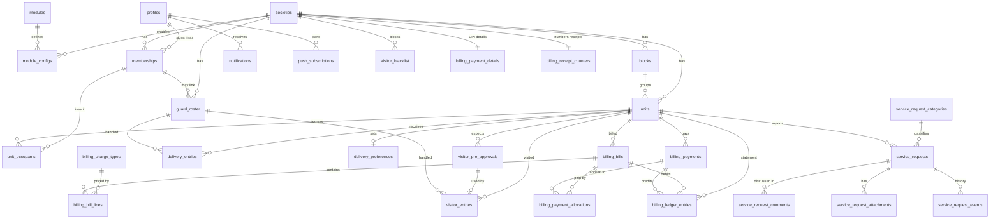

# Homeish — Database Design (DATABASE.md)

| Field      | Value                                                                                                                                                           |
| ---------- | --------------------------------------------------------------------------------------------------------------------------------------------------------------- |
| Product    | Homeish (PRD D-01 approved 2026-11-09)                                                                                                                          |
| Version    | 0.1 (Draft for approval)                                                                                                                                        |
| Date       | 2026-11-09                                                                                                                                                      |
| Depends on | [PRD.md](./PRD.md) (data, roles, journeys), [ARCHITECTURE.md](./ARCHITECTURE.md) (stack, security model), [DESIGN.md](./DESIGN.md) (screens that drive queries) |
| Covers     | MVP data model in full detail (Core, Visitor, Delivery, Billing, Service Request); post-MVP modules outlined only                                               |

**Conventions**

- **[DBA-nn]** = Database assumption. **[DBD-nn]** = Database decision (Section 18).
- Names: `snake_case`; tables are plural; module tables are prefixed with the module key (`visitor_`, `delivery_`, `billing_`, `service_request_`).
- This file defines structure and rules in tables, not SQL. The real DDL lives in versioned migrations (Section 14), which must match this document. Update this file in the same change as any migration.
- Where PRD and this file disagree on behavior, the PRD wins.

---

## 1. Database Technology

D-34 environment boundary (approved 2026-11-09): society subdomains do not change D-24's shared live database/RLS design. Beta must have a separate synthetic-only backend. The public demo needs a synthetic-only reset boundary before database-backed writes are introduced. Current marketing/demo/beta entry pages make no database calls; demo state is browser memory only. Maplewood's hostname is reserved in code as a disabled placeholder. Real societies are provisioned with `scripts/create-society.mjs` (OPERATIONS "Society onboarding"), which sets the unique, immutable `societies.slug` that matches the host (migration `20261114090000`). No database projects, migrations, live society records or reset jobs are created by this website work.

| Item               | Choice                                                                                                            | Reason                                                                                                |
| ------------------ | ----------------------------------------------------------------------------------------------------------------- | ----------------------------------------------------------------------------------------------------- |
| Engine             | **PostgreSQL** (managed by **Supabase**)                                                                          | Approved stack (ARCHITECTURE AD-01). Relational integrity for ledgers and tenants; row-level security |
| Auth store         | Supabase **`auth`** schema (`auth.users`)                                                                         | Users and login methods live here; the app never writes to it directly                                |
| Application schema | **`public`** (tables, exposed to the API only through RLS and grants)                                             | Standard Supabase pattern                                                                             |
| Private schema     | **`private`** (helper and maintenance functions, not exposed to the API)                                          | Keeps security helpers out of the public API surface                                                  |
| File storage       | Supabase Storage (private buckets); the database stores **paths only**                                            | Section 12                                                                                            |
| Extensions         | `pgcrypto` (UUIDs, PIN hashing), `citext` (case-insensitive email), both in the unexposed `extensions` schema     | Minimal set. No other extensions in MVP                                                               |
| ORM                | None (ARCHITECTURE AD-03). Generated TypeScript types from the schema; transactional operations are SQL functions | One source of truth for the schema                                                                    |

### 1.1 Conventions that apply to every table

| Rule                          | Detail                                                                                                                                                                                                                                                                                                                           |
| ----------------------------- | -------------------------------------------------------------------------------------------------------------------------------------------------------------------------------------------------------------------------------------------------------------------------------------------------------------------------------- |
| Primary keys                  | `uuid`, generated by the database. Exceptions: log tables use `bigint identity` for cheap, ordered append-only inserts                                                                                                                                                                                                           |
| Tenant key                    | Every tenant table has `society_id uuid NOT NULL` referencing `societies` (DAT-1)                                                                                                                                                                                                                                                |
| **Same-society foreign keys** | Every parent table that tenant tables point at has a unique key on `(society_id, id)`; children reference the parent by `(society_id, parent_id)`. A row can therefore never point at another society's row, even by mistake or tampering                                                                                        |
| Standard columns ("Std")      | `id`, `society_id`, `created_at timestamptz default now()`, `created_by uuid → profiles`, `updated_at`, `updated_by`. Tables marked **AO** (append-only) have only `id`, `society_id`, `created_at`, `created_by`                                                                                                                |
| Time                          | `timestamptz` (UTC); society timezone is stored on `societies` (NFR-9)                                                                                                                                                                                                                                                           |
| Money                         | `bigint` **paise**, never decimals or floats; currency is the society's currency (DAT-2)                                                                                                                                                                                                                                         |
| Status/enum fields            | `text` with a `CHECK` constraint listing allowed values (easier to evolve than enum types) **[DBD-5]**                                                                                                                                                                                                                           |
| Text limits                   | Every free-text column has a length `CHECK` (names ≤ 120, descriptions ≤ 2,000, reasons ≤ 500)                                                                                                                                                                                                                                   |
| Soft delete                   | `active boolean` or a status value. Hard delete is blocked on money, entry, request history and audit tables                                                                                                                                                                                                                     |
| Deletion of parents           | `ON DELETE RESTRICT` everywhere, except notification and subscription rows owned by a user                                                                                                                                                                                                                                       |
| Updated timestamps            | `updated_at` maintained by `private.set_updated_at()`                                                                                                                                                                                                                                                                            |
| Double-submit protection      | The tables for user-created records (`visitor_entries`, `delivery_entries`, `billing_payments`, `service_requests`, `service_request_comments`) also carry `client_request_id uuid` (nullable); unique `(society_id, created_by, client_request_id)` where not null, so a repeated submission returns the original row (API 3.6) |
| Naming of keys                | Primary `…_pkey`, foreign `…_fkey`, unique `…_key`, check `…_check`, index `…_idx`                                                                                                                                                                                                                                               |

---

## 2. Entity Overview

### 2.1 Table inventory (MVP: 36 tables)

| Module                         | Tables                                                                                                                                                                                                                                                                   |
| ------------------------------ | ------------------------------------------------------------------------------------------------------------------------------------------------------------------------------------------------------------------------------------------------------------------------ |
| **Core (18)**                  | `profiles`, `developers`, `societies`, `modules`, `module_configs`, `blocks`, `units`, `memberships`, `unit_occupants`, `guard_roster`, `notifications`, `push_subscriptions`, `audit_logs`, `error_logs`, `jobs`, `job_run_keys`, `rate_limits`, `auth_code_challenges` |
| **Visitor (3)**                | `visitor_entries`, `visitor_pre_approvals`, `visitor_blacklist`                                                                                                                                                                                                          |
| **Delivery (2)**               | `delivery_entries`, `delivery_preferences`                                                                                                                                                                                                                               |
| **Billing (8)**                | `billing_charge_types`, `billing_bills`, `billing_bill_lines`, `billing_payments`, `billing_payment_allocations`, `billing_ledger_entries`, `billing_payment_details`, `billing_receipt_counters`                                                                        |
| **Service Request (5)**        | `service_request_categories`, `service_requests`, `service_request_comments`, `service_request_attachments`, `service_request_events`                                                                                                                                    |
| **Directory (P17 foundation)** | `directory_preferences`, `directory_vehicles`, `directory_emergency_contacts`                                                                                                                                                                                            |
| **Expense (P16)**              | `expense_accounts`, `expense_categories`, `expenses`, `expense_book_entries`, `expense_month_locks`                                                                                                                                                                      |
| **Polls (P22)**                | `poll_votes`, `poll_vote_blocks`, `poll_options`, `poll_offices`, `poll_candidates`, `poll_unit_representatives`, `poll_electorate`, `poll_participation`, `poll_public_responses`, `poll_private_tallies`                                                               |
| **Meetings (P23)**             | `meetings`, `meeting_agenda_items`, `meeting_invitee_selections`, `meeting_invited_units`, `meeting_invited_members`, `meeting_attendance`, `meeting_resolutions`, `meeting_minutes`, `meeting_action_items`                                                             |
| **Analytics (P27, Core)**      | `analytics_preferences`                                                                                                                                                                                                                                                  |
| **Events (P30)**               | `events`, `event_audience_blocks`, `event_rsvps`, `event_rsvp_charges`                                                                                                                                                                                                   |
| **Community (P29)**            | `community_groups`, `community_group_members`, `community_posts`, `community_listings`, `community_replies`, `community_photos`, `community_reports`, `community_mutes`, `community_preferences`                                                                         |

Inventory above: **36 MVP tables + 3 P17 directory tables + 5 P16 expense tables + 10 P22 poll tables + 9 P23 meeting tables + 1 P27 analytics table + 4 P30 event tables + 9 P29 community tables**; other post-MVP module tables are described in Section 9.

Post-MVP modules (staff, housekeeping, AMC, notice, amenity, directory, expense, poll and meeting) and committee analytics are outlined in Section 9. P17, P16, P22, P23 and P27 have been tested locally only; module status follows the implementation plan.

### 2.2 Entity relationship diagram (MVP)

Not drawn (to keep the diagram readable): every tenant table also points to `societies` through `society_id`, and user-owned actions point to `profiles` through `created_by`/`updated_by`. Logs (`audit_logs`, `error_logs`, `jobs`) reference `societies` and `profiles` loosely (nullable).

---

## 3. Core Tables

### 3.1 `profiles` — one row per account or anonymized history identity

| Column                 | Type        | Null | Notes                                                                                                                                                                |
| ---------------------- | ----------- | ---- | -------------------------------------------------------------------------------------------------------------------------------------------------------------------- |
| id                     | uuid        | PK   | Same value as the Supabase user ID while the account exists; retained as an anonymized history identity after erasure                                                |
| email                  | citext      | no   | Unique. Copy of the sign-in email, kept in sync by one trigger. Intentional duplication: needed for display and invite matching without exposing `auth` **[DBA-01]** |
| full_name              | text        | no   | 1–120 chars                                                                                                                                                          |
| phone                  | text        | yes  | Optional profile field (A-34). Format check `^\+?[0-9]{10,15}$`                                                                                                      |
| photo_path             | text        | yes  | Storage path                                                                                                                                                         |
| font_preference        | text        | no   | `manrope_sora` or `device_default`; default `manrope_sora` (CORE-18)                                                                                                 |
| language_preference    | text        | no   | `en` or `hi`; default `en` (P33, D-66)                                                                                                                               |
| status                 | text        | no   | `active`, `disabled`, `anonymized`; default `active`                                                                                                                 |
| created_at, updated_at | timestamptz | no   |                                                                                                                                                                      |

Constraints: unique `email`; check `font_preference` and `language_preference` against their documented values. A profile is created after the auth email is confirmed, initially with the placeholder name `Homeish member`; the user can supply their name in profile onboarding. An auth trigger keeps the email copy synchronized without overwriting profile fields or reactivating a disabled profile. Active and disabled profiles must have a matching `auth.users` row; only `anonymized` tombstones may remain after the Auth account is deleted. The database enforces this rule with a profile trigger. An anonymized profile's language is reset to English, and a trigger keeps it English if a stale authenticated session attempts to change it later.

### 3.2 `developers` — platform operators

| Column     | Type        | Null | Notes        |
| ---------- | ----------- | ---- | ------------ |
| user_id    | uuid        | PK   | → `profiles` |
| created_at | timestamptz | no   |              |

No API grants: rows are added only by a database administrator (ARCHITECTURE 8.1). `private.developer_mfa_sessions` records the verified MFA time against the stable `auth.sessions.id`; `private.is_developer()` requires AAL2, verification within 15 minutes, and the four-hour auth-session cap.

### 3.3 `societies`

| Column                       | Type    | Null | Notes                                                                                                                                                                                                                                                         |
| ---------------------------- | ------- | ---- | ------------------------------------------------------------------------------------------------------------------------------------------------------------------------------------------------------------------------------------------------------------- |
| id                           | uuid    | PK   |                                                                                                                                                                                                                                                               |
| name                         | text    | no   | 2–120                                                                                                                                                                                                                                                         |
| unit_label                   | text    | no   | Default `Unit`; trimmed, 1–24 letters or spaces (CORE-17, DD-05)                                                                                                                                                                                              |
| address, city                | text    | yes  |                                                                                                                                                                                                                                                               |
| contact_email                | citext  | yes  |                                                                                                                                                                                                                                                               |
| contact_phone                | text    | yes  |                                                                                                                                                                                                                                                               |
| timezone                     | text    | no   | Default `Asia/Kolkata`                                                                                                                                                                                                                                        |
| hindi_available              | boolean | no   | Default `false`; effective Hindi also requires the non-core `language` module to be enabled (P33, D-67)                                                                                                                                                       |
| currency                     | text    | no   | Default `INR`; check = 3 letters                                                                                                                                                                                                                              |
| logo_path                    | text    | yes  |                                                                                                                                                                                                                                                               |
| status                       | text    | no   | `trial`, `active`, `suspended`, `archived`; default `trial` (SAAS-1)                                                                                                                                                                                          |
| plan                         | text    | yes  | Free text label set by developer (PRD D-08: manual)                                                                                                                                                                                                           |
| gate_login_mode              | text    | no   | `individual` or `shared`; default `individual` (PRD CORE-16)                                                                                                                                                                                                  |
| join_code                    | text    | yes  | Society code that lets an un-invited resident ask to join (self-registration). Unique; random, 8 characters, upper-case letters and digits without look-alikes; null = self-registration switched off. Rotatable by admin (audited) **[API APD-1, approved]** |
| guard_identification         | text    | no   | `pick_name` or `pin`; default `pick_name`. Only used when `gate_login_mode = shared` **[DBD-3, approved]**                                                                                                                                                    |
| created_at/by, updated_at/by |         |      | Std                                                                                                                                                                                                                                                           |

Constraints: unique `(id)` and implicit tenant root; `unit_label`, `status`, `gate_login_mode`, `guard_identification` checks. Editable by: developer (all columns); admin (profile columns, `unit_label`, `gate_login_mode`, `guard_identification`, `hindi_available` only) through a function.

Authenticated members can read `hindi_available` through a column-only grant and the existing own-society row policy, including while Language Support is off so request-context loading keeps working. Grant each additional request-context column explicitly; never replace these grants with whole-table SELECT, which would expose restricted columns such as `join_code`.

`hindi_available` is changed only by `admin_set_hindi_availability(society_id, hindi_available, expected_updated_at, request_id)`. The security-definer function requires an admin of the writable society and an enabled `language` module, locks the row, rejects a stale `updated_at`, and writes an audit row when the value changes. API roles cannot update this column directly. Disabling the module or this setting affects signed-in display only; saved profile preferences are retained.

Daily jobs discover trial and active society IDs through the service-role-only `daily_job_societies()` function; direct table access remains revoked.

### 3.4 `modules` — reference data

| Column     | Type    | Null | Notes                                                                                                                                                                                                                                                                                            |
| ---------- | ------- | ---- | ------------------------------------------------------------------------------------------------------------------------------------------------------------------------------------------------------------------------------------------------------------------------------------------------ |
| key        | text    | PK   | `core`, `visitor`, `delivery`, `billing`, `service_request`, `staff`, `housekeeping`, `amc`, `notice`, `amenity`, `directory`, `expense`, `tenancy`, `document`, `parking`, `sos`, `vendor`, `patrol`, `metering`, `asset`, `home_services`, `poll`, `meeting`, `event`, `community`, `language` |
| name       | text    | no   | Display name                                                                                                                                                                                                                                                                                     |
| is_core    | boolean | no   | `core` only is true; cannot be disabled                                                                                                                                                                                                                                                          |
| sort_order | int     | no   |                                                                                                                                                                                                                                                                                                  |

Maintained only by migrations (Section 14). Gives `module_configs` a real foreign key instead of free text.

### 3.5 `module_configs`

| Column                 | Type    | Null    | Notes                                                                                                                                                 |
| ---------------------- | ------- | ------- | ----------------------------------------------------------------------------------------------------------------------------------------------------- |
| society_id             | uuid    | PK part | → `societies`                                                                                                                                         |
| module_key             | text    | PK part | → `modules.key`                                                                                                                                       |
| enabled                | boolean | no      | Default `false` (a new module ships disabled); `core` rows are always `true` (check)                                                                  |
| settings               | jsonb   | no      | Default `{}`. Validated against the module's settings schema in the application **and** by the toggle/settings function. Reference keys in Section 10 |
| updated_at, updated_by |         |         |                                                                                                                                                       |

Rules: the primary key is `(society_id, module_key)`; every society gets a `core` row on creation. Toggling goes through one function that writes the audit log in the same transaction (MOD-5). Data in disabled modules is never touched (MOD-4).

### 3.6 `blocks`

| Column | Type    | Null | Notes          |
| ------ | ------- | ---- | -------------- |
| Std    |         |      |                |
| name   | text    | no   | 1–60           |
| active | boolean | no   | Default `true` |

Unique `(society_id, name)`; unique `(society_id, id)` (same-society FK rule). `created_by` defaults to the signed-in user; updates set `updated_by` from the active session.

### 3.7 `units`

| Column    | Type         | Null | Notes                                                          |
| --------- | ------------ | ---- | -------------------------------------------------------------- |
| Std       |              |      |                                                                |
| block_id  | uuid         | yes  | → `blocks` (same society). Null when the society has no blocks |
| number    | text         | no   | 1–20 (e.g., `101`)                                             |
| floor     | int          | yes  |                                                                |
| unit_type | text         | yes  | Free label (e.g., `2BHK`) up to 30 chars                       |
| area_sqft | numeric(8,2) | yes  | Must be > 0 when set. Used by per-sq-ft billing (BIL-1)        |
| active    | boolean      | no   | Default `true`                                                 |

Unique `(society_id, block_id, number)` treating a null block as one value (so `101` can exist once per society without a block); unique `(society_id, id)`. Units with history are never deleted (deactivate only, PRD edge cases). `created_by` defaults to the signed-in user; updates set `updated_by` from the active session.

### 3.8 `memberships` — a person's access to one society

| Column                  | Type        | Null | Notes                                                                                                                              |
| ----------------------- | ----------- | ---- | ---------------------------------------------------------------------------------------------------------------------------------- |
| Std                     |             |      |                                                                                                                                    |
| user_id                 | uuid        | yes  | → `profiles`. Null until an invited person signs in                                                                                |
| invited_email           | citext      | yes  | Set when the admin invites before the person has an account                                                                        |
| roles                   | text[]      | no   | Non-empty subset of `admin`, `committee`, `guard`, `hk_supervisor`, `resident` (check). `admin` and `committee` may combine (A-25) |
| status                  | text        | no   | `invited`, `pending_approval`, `active`, `deactivated`                                                                             |
| invited_by, approved_by | uuid        | yes  | → `profiles`                                                                                                                       |
| joined_at, left_at      | timestamptz | yes  |                                                                                                                                    |

Constraints:

- At least one of `user_id`, `invited_email` is set.
- Unique `(society_id, user_id)` where `user_id` is not null; unique `(society_id, invited_email)` where `user_id` is null.
- Unique `(society_id, id)`.
- On first sign-in, `public.claim_memberships()` links invited rows whose `invited_email` matches the verified auth email (CORE-9). It activates the invitation and records `joined_at`; it skips a society where the user already has a membership, so sign-in never silently changes existing roles.
- `public.has_signin_access(email)` returns only a boolean to the service role. It allows outstanding invitations and active or pending memberships for active profiles; deactivated memberships and disabled profiles do not qualify. The server uses this check before requesting a code, while returning the same generic response for eligible and ineligible addresses.

Resident sub-types (owner, tenant, family) are **per unit**, so they live on `unit_occupants`, not here. Permission checks combine both (PRD matrix).

### 3.9 `unit_occupants` — who lives in which unit

| Column               | Type    | Null | Notes                                                                |
| -------------------- | ------- | ---- | -------------------------------------------------------------------- |
| Std                  |         |      |                                                                      |
| unit_id              | uuid    | no   | → `units` (same society)                                             |
| membership_id        | uuid    | no   | → `memberships` (same society)                                       |
| relationship         | text    | no   | `owner`, `tenant`, `family`                                          |
| is_primary           | boolean | no   | Default `false`                                                      |
| is_approver          | boolean | no   | Default `true` for owner/tenant, `false` for family (PRD A-11, A-26) |
| status               | text    | no   | `pending`, `active`, `ended`                                         |
| started_at, ended_at | date    |      | `ended_at` ≥ `started_at`                                            |

Constraints: unique `(unit_id, membership_id)` among non-ended rows; **at most one active primary per unit** (partial unique on `unit_id` where `is_primary` and `status = 'active'`); a primary must be an owner or tenant. A person may occupy several units. Move-out sets `status = 'ended'` and `ended_at` (history preserved, CORE-10, PERM-3: tenants see only data from their tenancy period via `started_at`/`ended_at`).

### 3.10 `guard_roster` — who can be named as having handled a gate entry

| Column        | Type        | Null | Notes                                                                                                                                                                            |
| ------------- | ----------- | ---- | -------------------------------------------------------------------------------------------------------------------------------------------------------------------------------- |
| id            | uuid        | PK   |                                                                                                                                                                                  |
| society_id    | uuid        | no   |                                                                                                                                                                                  |
| created_at    | timestamptz | no   |                                                                                                                                                                                  |
| created_by    | uuid        | no   | → `profiles`                                                                                                                                                                     |
| updated_at    | timestamptz | no   |                                                                                                                                                                                  |
| updated_by    | uuid        | yes  | → `profiles`                                                                                                                                                                     |
| name          | text        | no   | 1–80                                                                                                                                                                             |
| membership_id | uuid        | yes  | Set in individual mode (the guard's own account); null for named-only guards in shared mode                                                                                      |
| pin_hash      | text        | yes  | Salted slow hash of the guard's PIN (bcrypt via `pgcrypto`). Required when the society's `guard_identification = pin`; never returned to the API; PIN never stored in plain text |
| active        | boolean     | no   | Default `true`                                                                                                                                                                   |

Rules: every gate entry (visitor/delivery) stores the roster entry that handled it, so "who let this person in" is always answerable in both gate-login modes **[DBD-3, approved: RWA admin chooses name-pick or PIN in settings]**. Unique `(society_id, name)` among active rows; unique `(society_id, id)`. Five incorrect PIN attempts lock the guard for 15 minutes from the fifth failure. The `pin_hash` column has no read grant for any API role.

### 3.11 `notifications`

| Column                 | Type        | Null | Notes                                                                                        |
| ---------------------- | ----------- | ---- | -------------------------------------------------------------------------------------------- |
| id                     | uuid        | PK   |                                                                                              |
| society_id             | uuid        | no   |                                                                                              |
| user_id                | uuid        | no   | → `profiles`, `ON DELETE CASCADE`; composite FK also requires this user's society membership |
| type                   | text        | no   | e.g., `visitor_pending`, `bill_issued`, `payment_confirmed` (catalogue in code)              |
| title, body            | text        | no   | ≤ 120 / ≤ 300. **No sensitive details** beyond what the lock screen may show (DESIGN 8.3)    |
| entity_type, entity_id | text, uuid  | yes  | Deep-link target                                                                             |
| read_at                | timestamptz | yes  |                                                                                              |
| created_at             | timestamptz | no   |                                                                                              |
| request_id             | text        | yes  | Request correlation for best-effort post-commit push delivery                                |

Inserted by `private.create_notification` inside the same transaction as the event that causes it (ARCHITECTURE 10); the helper only accepts an active society membership. Push sending happens after commit and is best effort. A recipient can read only their own rows and update only `read_at`.

### 3.12 `push_subscriptions`

| Column                      | Type        | Null | Notes                                        |
| --------------------------- | ----------- | ---- | -------------------------------------------- |
| id                          | uuid        | PK   |                                              |
| user_id                     | uuid        | no   | → `profiles`, cascade                        |
| endpoint                    | text        | no   | Unique                                       |
| p256dh, auth_secret         | text        | no   | **Secret** (lets someone push to the device) |
| user_agent                  | text        | yes  |                                              |
| created_at, last_success_at | timestamptz |      |                                              |

Signed-in users add/remove their own subscription through authenticated RPCs; **no API role can read the table or key columns**. The row-level policy is owner-scoped, but client roles have no direct table grants. Only the privileged push sender reads the keys. At most ten endpoints can be registered for one user. Provider responses 404/410 prune stale subscriptions; transient errors receive one retry. This is a user-owned table, not a society-owned table.

### 3.13 `audit_logs` (AO)

| Column        | Type            | Null | Notes                                                                      |
| ------------- | --------------- | ---- | -------------------------------------------------------------------------- |
| id            | bigint identity | PK   |                                                                            |
| society_id    | uuid            | yes  | Null for platform-level actions                                            |
| actor_id      | uuid            | yes  | Null for system jobs                                                       |
| actor_role    | text            | yes  | Role used for the action                                                   |
| action        | text            | no   | e.g., `module.toggle`, `payment.confirm`, `upi_details.change`             |
| entity_type   | text            | no   |                                                                            |
| entity_id     | text            | yes  |                                                                            |
| before, after | jsonb           | yes  | Only the changed fields; **never** secrets, OTPs or full documents (LOG-5) |
| reason        | text            | yes  | Required for waive, override, reject, cancel                               |
| request_id    | text            | yes  | Correlation with `error_logs` (LOG-8)                                      |
| created_at    | timestamptz     | no   |                                                                            |

Append-only: no UPDATE/DELETE privilege for any API role, plus a trigger that rejects both. Retention 2 years then purged by the daily job (A-09).

### 3.14 `error_logs` (AO-style, developer-only)

| Column                                 | Type        | Null | Notes                                                        |
| -------------------------------------- | ----------- | ---- | ------------------------------------------------------------ |
| id                                     | uuid        | PK   |                                                              |
| reference_id                           | text        | no   | Unique, short, human-copyable code shown to the user (LOG-2) |
| society_id, user_id                    | uuid        | yes  | Null for pre-sign-in errors                                  |
| role                                   | text        | yes  |                                                              |
| module_key                             | text        | yes  |                                                              |
| route                                  | text        | yes  | Route or action name                                         |
| source                                 | text        | no   | `server`, `client`, `job`                                    |
| severity                               | text        | no   | `critical`, `error`, `warning`, `info`                       |
| message                                | text        | no   | Scrubbed (LOG-5)                                             |
| stack                                  | text        | yes  | Scrubbed                                                     |
| app_version, device                    | text, jsonb | yes  |                                                              |
| request_id                             | text        | yes  |                                                              |
| status                                 | text        | no   | `open`, `resolved`, `ignored`; default `open`                |
| resolved_by, resolved_at, resolve_note |             | yes  |                                                              |
| created_at                             | timestamptz | no   |                                                              |

Only the developer can read or update `status`/`resolve_*` columns. Inserted by the privileged log writer (best effort, never throws). Retention 90 days.

### 3.15 `jobs`

| Column      | Type        | Null | Notes                                                                                  |
| ----------- | ----------- | ---- | -------------------------------------------------------------------------------------- |
| Std         |             |      |                                                                                        |
| type        | text        | no   | `bill_generation`, `csv_import_units`, `csv_import_residents`, `export`                |
| status      | text        | no   | `queued`, `running`, `succeeded`, `partial`, `failed`                                  |
| progress    | int         | no   | 0–100                                                                                  |
| summary     | jsonb       | yes  | Counts and a bounded list of row errors (the full error report is a downloadable file) |
| finished_at | timestamptz | yes  |                                                                                        |

Shown in the Jobs list (DESIGN 11.3). Retention 90 days.

### 3.16 `job_run_keys`

| Column     | Type        | Null    | Notes                                  |
| ---------- | ----------- | ------- | -------------------------------------- |
| society_id | uuid        | PK part |                                        |
| job_name   | text        | PK part | e.g., `late_fee`, `reminders`, `purge` |
| period_key | text        | PK part | e.g., `2026-11-09`                     |
| ran_at     | timestamptz | no      |                                        |

A daily job inserts its key first; a duplicate means it already ran, so re-running is a no-op (ARCHITECTURE 6.3). No API access.

### 3.17 `rate_limits`

| Column       | Type        | Null    | Notes                                                                          |
| ------------ | ----------- | ------- | ------------------------------------------------------------------------------ |
| key          | text        | PK part | e.g., `login:email:<hash>`, `code:validate:<society>:<ip-hash>`, `pin:<guard>` |
| window_start | timestamptz | PK part |                                                                                |
| count        | int         | no      |                                                                                |

Hashed keys (no raw emails/IPs). Cleared daily. No direct API access (ARCHITECTURE AD-05); a service-role-only atomic function increments fixed-window counters.

The P1 operational-table migrations enforce the documented API boundaries: audit rows are immutable, error-log details are immutable while developer resolution fields may change, and jobs are visible only to their creator/admin/developer. The service role alone writes operational records; `job_run_keys`, `rate_limits` and `auth_code_challenges` have no user-facing grants.

### 3.18 `auth_code_challenges`

| Column             | Type        | Null   | Notes                                                                  |
| ------------------ | ----------- | ------ | ---------------------------------------------------------------------- |
| email_key          | text        | PK     | Salted hash of the normalized email; never raw email                   |
| challenge_id       | uuid        | unique | Replaced whenever a new code is requested                              |
| created_at         | timestamptz | no     |                                                                        |
| expires_at         | timestamptz | no     | Ten minutes after creation                                             |
| failed_attempts    | smallint    | no     | 0–5; fifth failure consumes the challenge                              |
| in_flight_attempts | smallint    | no     | Reserved atomically to prevent concurrent attempts bypassing the limit |
| consumed_at        | timestamptz | yes    | Set after success or the fifth failed attempt                          |

RLS is enabled, with no user-facing grants. Only service-role functions create challenges, reserve an attempt, and record its outcome. A superseded challenge cannot complete a verification reserved against its prior ID; expired rows are cleaned during later challenge creation.

---

## 4. Visitor Module Tables

### 4.1 `visitor_entries`

| Column                  | Type        | Null | Notes                                                                                                              |
| ----------------------- | ----------- | ---- | ------------------------------------------------------------------------------------------------------------------ |
| Std                     |             |      |                                                                                                                    |
| unit_id                 | uuid        | no   | → `units` (same society)                                                                                           |
| visitor_name            | text        | no   | 1–120                                                                                                              |
| visitor_phone           | text        | yes  | Personal data (Section 11). Optional by society setting                                                            |
| purpose                 | text        | no   | `guest`, `cab`, `service`, `official`, `other`                                                                     |
| vehicle_no              | text        | yes  | ≤ 20, stored upper-case without spaces                                                                             |
| people_count            | int         | no   | 1–50, default 1                                                                                                    |
| photo_path              | text        | yes  | Private upload at `{society_id}/{unit_id}/visitors/{random_uuid}.jpg                                               | png`; verified again before entry creation |
| source                  | text        | no   | `walk_in`, `pre_approved`                                                                                          |
| pre_approval_id         | uuid        | yes  | → `visitor_pre_approvals`; required when `source = pre_approved`, unique (one entry per approval)                  |
| status                  | text        | no   | `pending`, `approved`, `denied`, `expired`, `checked_in`, `checked_out`                                            |
| respond_by              | timestamptz | yes  | `created_at` + the timeout in effect at creation; makes "No response" deterministic. Null for pre-approved entries |
| decision_source         | text        | yes  | `resident`, `guard_override`, `pre_approved`                                                                       |
| decided_by              | uuid        | yes  | → `profiles` (the resident who decided; null for override/pre-approved)                                            |
| decided_at              | timestamptz | yes  |                                                                                                                    |
| override_reason         | text        | yes  | **Required** when `decision_source = guard_override` (VIS-4)                                                       |
| handled_by_guard_id     | uuid        | no   | → `guard_roster` (who logged it)                                                                                   |
| checked_in_at           | timestamptz | yes  |                                                                                                                    |
| checked_out_at          | timestamptz | yes  |                                                                                                                    |
| checked_out_by_guard_id | uuid        | yes  | → `guard_roster`                                                                                                   |

Constraints (checks): `checked_in_at` set when status is `checked_in`/`checked_out`; `checked_out_at ≥ checked_in_at`; `override_reason` present iff `decision_source = guard_override`; a decision (`approved`/`denied`) has `decided_at`. **Status transitions** (`pending → approved/denied/expired → checked_in → checked_out`; first response wins) are enforced by the decision function with a row lock (ARCHITECTURE 10.2). A pending entry past `respond_by` is shown as "No response" by deriving it on read and is finalised to `expired` when next touched (lazy expiry, ARCHITECTURE AD-02). Unique `(society_id, id)`.

### 4.2 `visitor_pre_approvals`

| Column               | Type        | Null | Notes                                                               |
| -------------------- | ----------- | ---- | ------------------------------------------------------------------- |
| Std                  |             |      |                                                                     |
| unit_id              | uuid        | no   |                                                                     |
| visitor_name         | text        | no   |                                                                     |
| valid_from, valid_to | timestamptz | no   | `valid_to > valid_from`                                             |
| vehicle_no           | text        | yes  |                                                                     |
| code                 | text        | no   | 6 digits (check `^[0-9]{6}$`)                                       |
| status               | text        | no   | `active`, `used`, `cancelled`. "Expired" is derived from `valid_to` |
| used_at              | timestamptz | yes  |                                                                     |

Constraints: **unique `(society_id, code)` among `active` rows** so a code identifies exactly one pending approval; single use (A-30, PRD D-11). The QR encodes this same code and does not create a separate approval. Codes are low-sensitivity and short-lived, so stored as plain text. Guards validate through a function that returns only the matched visitor's details (they cannot browse this table). Validation attempts are rate-limited (`rate_limits`).

### 4.3 `visitor_blacklist`

| Column | Type    | Null | Notes             |
| ------ | ------- | ---- | ----------------- |
| Std    |         |      |                   |
| phone  | text    | no   | Normalised format |
| name   | text    | yes  |                   |
| reason | text    | yes  |                   |
| active | boolean | no   | Default `true`    |

Unique `(society_id, phone)` among active rows. MVP warns only (A-12).

### 4.4 `visitor_frequent_visitors` (MVP+, A-10)

A unit's saved list of regular visitors for faster pre-approval. Migration `20261114070000_visitor_frequent_visitors.sql`. All occupants of the unit share one list. Residents read only rows for units they occupy, and only while the visitor module is enabled. Changes go through the RPCs `visitor_frequent_save`, `visitor_frequent_remove` and `visitor_frequent_pre_approve`, which check society writability and the module and write `audit_logs`. `visitor_frequent_pre_approve` creates a normal `visitor_pre_approvals` row from a saved visitor; repeating it with the same request ID returns the same pre-approval. `visitor_frequent_list` reads the list.

---

## 5. Delivery Module Tables

### 5.1 `delivery_entries`

| Column              | Type        | Null | Notes                                                                                                                              |
| ------------------- | ----------- | ---- | ---------------------------------------------------------------------------------------------------------------------------------- |
| Standard columns    |             |      | Includes `created_by`, `updated_at`, `updated_by`                                                                                  |
| unit_id             | uuid        | no   | Same-society FK to an active unit                                                                                                  |
| company             | text        | no   | Platform/company or custom value; 1–60 characters                                                                                  |
| delivery_person     | text        | yes  | Optional; at most 120 characters                                                                                                   |
| delivery_type       | text        | no   | `food`, `parcel`, `grocery`, `other`                                                                                               |
| photo_path          | text        | yes  | Private `delivery-photos` bucket; society/unit-scoped path                                                                         |
| status              | text        | no   | `pending_response`, `allowed`, `left_at_gate`, `denied`, `collected`, `closed`; a guard may close an expired request with a reason |
| client_request_id   | uuid        | no   | Idempotency key unique per society and creator                                                                                     |
| respond_by          | timestamptz | yes  | Required while `pending_response`; computed from the society response timeout                                                      |
| decision_source     | text        | yes  | `resident`, `preference` (standing rule applied), or `guard_override`                                                              |
| decided_by          | uuid        | yes  | Set for resident, standing-preference and guard decisions                                                                          |
| decided_at          | timestamptz | yes  | Required after a decision                                                                                                          |
| override_reason     | text        | yes  | Required for `guard_override`, at most 500 characters                                                                              |
| handled_by_guard_id | uuid        | no   | Same-society FK to `guard_roster`                                                                                                  |
| received_at         | timestamptz | yes  | Set when a delivery is left at the gate/security desk                                                                              |
| collected_at        | timestamptz | yes  | Set only when moving from `left_at_gate` to `collected`                                                                            |
| collected_by        | uuid        | yes  | → `profiles` (resident or guard who marked it)                                                                                     |

Uncollected parcels are `left_at_gate` rows with `received_at` older than the society's threshold (default 3 days).

### 5.2 `delivery_preferences`

| Column     | Type        | Null    | Notes                                                          |
| ---------- | ----------- | ------- | -------------------------------------------------------------- |
| society_id | uuid        | PK part |                                                                |
| unit_id    | uuid        | PK part | One row per unit                                               |
| rule       | text        | no      | `ask` (default), `always_allow`, `always_leave_at_gate` (A-13) |
| updated_at | timestamptz | no      | Maintained by the common update trigger                        |
| updated_by | uuid        | yes     | → `profiles`                                                   |

### 5.3 `delivery_pre_announcements` (MVP+, A-14 / DEL-4)

A resident tells the gate that a delivery is expected. Migration `20261114080000_delivery_pre_announce.sql`.

| Column            | Type        | Null | Notes                                                        |
| ----------------- | ----------- | ---- | ------------------------------------------------------------ |
| Standard columns  |             |      | Includes `created_by`, `updated_at`, `updated_by`            |
| unit_id           | uuid        | no   | Same-society FK to a unit                                    |
| platform          | text        | no   | Free text, 1–60 characters                                   |
| expected_from/to  | timestamptz | no   | `to` is after `from`; the window is at most 24 hours         |
| status            | text        | no   | `expected` or `cancelled`; `cancelled_at` set when cancelled |
| client_request_id | uuid        | no   | Idempotency key, unique per society and creator              |

RLS lets admins, committee members and guards read rows, and occupants read their own unit's rows, while the delivery module is enabled. Writes go only through these RPCs:

- `delivery_pre_announce_create`: an active resident occupant of the unit in a writable society. The window must end in the future and start within 30 days. There is a limit of 20 upcoming announcements per unit (`54000`). A repeat with the same `client_request_id` returns the original row.
- `delivery_pre_announce_cancel`: occupants of the unit only. Repeating it is safe.
- `delivery_pre_announce_list`: returns active announcements whose window has not ended. Staff get the whole society; occupants pass their unit.

Create and cancel are audited (`delivery.pre_announce.create` / `.cancel`).

---

## 6. Billing Module Tables

### 6.1 Money model in one paragraph

A **bill** (also used for fines and late fees) creates a **debit** on the unit's **ledger**. A confirmed **payment** creates a **credit** and is **allocated** to bills, oldest due first. Waivers create credits. The ledger is the unit's statement and is **append-only**; corrections are new entries, never edits (BIL-13, DAT-3). A payment larger than the open bills leaves the remainder as **credit**, which is applied automatically to the unit's next bills **[DBD-1, approved]**.

### 6.2 `billing_charge_types`

| Column       | Type    | Null | Notes                                                                                                     |
| ------------ | ------- | ---- | --------------------------------------------------------------------------------------------------------- |
| Std          |         |      |                                                                                                           |
| name         | text    | no   | e.g., `Monthly Maintenance`. Unique `(society_id, name)`                                                  |
| method       | text    | no   | `fixed`, `per_sqft`, `custom` (PRD D-12)                                                                  |
| amount_paise | bigint  | yes  | `fixed`: amount per unit; `per_sqft`: rate per sq ft in paise; `custom`: null. Check: > 0 when not custom |
| active       | boolean | no   | Default `true`                                                                                            |

P7A creates this table with minimal read grants and module-aware RLS for administrators and committee. `billing_charge_save` handles create/update/deactivate and its audit row in one transaction; direct API writes are denied. Updates require the last-read timestamp so stale editors cannot overwrite another administrator's change. Non-custom amounts must be positive safe-integer paise (at most `9007199254740991`); custom amounts must be null. Deactivation retains the row for bill history.

### 6.3 `billing_bills`

| Column                                    | Type   | Null | Notes                                                                                                                                                                  |
| ----------------------------------------- | ------ | ---- | ---------------------------------------------------------------------------------------------------------------------------------------------------------------------- |
| Std                                       |        |      |                                                                                                                                                                        |
| unit_id                                   | uuid   | no   |                                                                                                                                                                        |
| kind                                      | text   | no   | `regular`, `fine`, `late_fee`                                                                                                                                          |
| title                                     | text   | no   | e.g., `Maintenance — Nov 2026`, or the fine reason                                                                                                                     |
| period_start                              | date   | no   | First day of the billing month (for `late_fee`: the month assessed)                                                                                                    |
| due_date                                  | date   | no   |                                                                                                                                                                        |
| total_paise                               | bigint | no   | > 0. Equals the sum of its lines (**intentional denormalization**, verified by an invariant test, Section 15.3)                                                        |
| paid_paise                                | bigint | no   | Default 0; maintained only by the payment-confirm and credit-apply functions                                                                                           |
| waived_paise                              | bigint | no   | Default 0; maintained only by the waive function                                                                                                                       |
| related_bill_id                           | uuid   | yes  | For `late_fee`: the overdue bill it penalises                                                                                                                          |
| cancelled_at, cancelled_by, cancel_reason |        | yes  | Only when nothing was paid and the full amount is waived                                                                                                               |
| status                                    | text   | no   | **Generated** from amounts: `cancelled`, `paid`, `waived`, `partially_paid`, `due`. "Overdue" is derived at query time from `due_date` + grace days (`module_configs`) |

Constraints: `paid_paise + waived_paise ≤ total_paise`; `late_fee` requires `related_bill_id`; **unique `(related_bill_id, period_start)` for late fees** (the daily job is idempotent, BIL-3); unique `(id, unit_id, period_start)` (used by the lines table). After creation, only the maintained columns may change (trigger), so published bills are immutable (BIL-13).

### 6.4 `billing_bill_lines` (AO)

| Column                                 | Type   | Null | Notes                                                                                                         |
| -------------------------------------- | ------ | ---- | ------------------------------------------------------------------------------------------------------------- |
| id, society_id, created_at, created_by |        |      | AO                                                                                                            |
| bill_id                                | uuid   | no   |                                                                                                               |
| unit_id                                | uuid   | no   | Copy kept consistent by a composite key `(bill_id, unit_id, period_start) → bills(id, unit_id, period_start)` |
| period_start                           | date   | no   |                                                                                                               |
| charge_type_id                         | uuid   | yes  | Null for fines/late fees                                                                                      |
| description                            | text   | no   | Snapshot of the charge name or the fine reason                                                                |
| amount_paise                           | bigint | no   | > 0                                                                                                           |

**Unique `(unit_id, period_start, charge_type_id)`** (nulls excluded) — this is exactly BIL-2: no duplicate charge for the same unit, period and charge type, even across separate generation runs. The unit/period columns exist only to enforce this rule; the composite key makes drift impossible.

### 6.5 `billing_payments`

| Column                     | Type   | Null | Notes                                                                                                                                   |
| -------------------------- | ------ | ---- | --------------------------------------------------------------------------------------------------------------------------------------- |
| Std                        |        |      |                                                                                                                                         |
| unit_id                    | uuid   | no   |                                                                                                                                         |
| amount_paise               | bigint | no   | > 0. For a submission it starts as the amount submitted; the admin may correct it on confirm (the change is audited)                    |
| mode                       | text   | no   | `upi`, `cash`, `cheque`, `bank_transfer`                                                                                                |
| source                     | text   | no   | `resident_submitted`, `admin_recorded`                                                                                                  |
| reference                  | text   | yes  | UPI UTR or cheque/transfer number. **Required** for `upi` and `bank_transfer`/`cheque`; format `^[A-Za-z0-9]{6,30}$`; stored upper-case |
| paid_on                    | date   | no   | Not after today in the society timezone; RPC validation and the table check do not depend on the session timezone                       |
| proof_path                 | text   | yes  | Screenshot in a private bucket (optional, BIL-6)                                                                                        |
| status                     | text   | no   | `awaiting_confirmation`, `confirmed`, `rejected`. Admin-recorded payments are inserted as `confirmed`                                   |
| submitted_by               | uuid   | no   | → `profiles`                                                                                                                            |
| confirmed_by, confirmed_at |        | yes  | Required when `confirmed`                                                                                                               |
| reject_reason              | text   | yes  | Required when `rejected`                                                                                                                |
| receipt_no                 | text   | yes  | Set on confirmation; unique per society (e.g., `R-2026-000123`)                                                                         |

**Duplicate protection (BIL-16): unique `(society_id, reference)` where `mode = 'upi'` and `status` is `awaiting_confirmation` or `confirmed`.** A rejected reference may be submitted again. Only the confirm/reject functions can change `status`; after `confirmed`, the row is immutable.

### 6.6 `billing_payment_allocations` (AO)

| Column       | Type        | Null    | Notes |
| ------------ | ----------- | ------- | ----- |
| payment_id   | uuid        | PK part |       |
| bill_id      | uuid        | PK part |       |
| society_id   | uuid        | no      |       |
| amount_paise | bigint      | no      | > 0   |
| created_at   | timestamptz | no      |       |

Created by the confirm function (oldest due first, A-15) and by credit application when a new bill is generated. Invariants: the allocations of a payment never exceed its amount; `paid_paise` on a bill equals the sum of its allocations. The unallocated remainder of a confirmed payment is the unit's credit.

### 6.7 `billing_ledger_entries` (AO)

| Column                 | Type            | Null | Notes                                      |
| ---------------------- | --------------- | ---- | ------------------------------------------ |
| id                     | bigint identity | PK   | Orders entries                             |
| society_id, unit_id    | uuid            | no   |                                            |
| kind                   | text            | no   | `bill`, `payment`, `waiver`, `adjustment`  |
| direction              | text            | no   | `debit` (unit owes more) or `credit`       |
| amount_paise           | bigint          | no   | > 0                                        |
| bill_id                | uuid            | yes  | For `bill`, `waiver`                       |
| payment_id             | uuid            | yes  | For `payment`                              |
| reason                 | text            | yes  | **Required** for `waiver` and `adjustment` |
| created_at, created_by |                 |      |                                            |

Checks: `bill` ⇒ debit with `bill_id`; `payment` ⇒ credit with `payment_id`; `waiver` ⇒ credit with `bill_id` and reason. The **running balance is never stored**; statements compute it with a running sum ordered by `id`. Updates and deletes are rejected by trigger.

### 6.8 `billing_payment_details` — the society's UPI details (BIL-15)

| Column                 | Type | Null | Notes                                   |
| ---------------------- | ---- | ---- | --------------------------------------- |
| society_id             | uuid | PK   | One row per society                     |
| upi_id                 | text | no   | Format check `name@handle`, 5–100 chars |
| payee_name             | text | no   | 2–100                                   |
| qr_path                | text | yes  | Optional uploaded QR                    |
| updated_at, updated_by |      |      |                                         |

Changed only by one function that writes an `audit_logs` row (old and new values), notifies all admins and committee members, and lets residents see "last changed on" from `updated_at` (PRD D-31, approved). Readable by every member of the society (residents need it to pay). History lives in the audit log (no duplicate history table).

P7A implements `billing_payment_details_get/update` with the billing module and society state checked again in SQL. A society-row lock serializes even concurrent first saves; an expected update timestamp prevents stale overwrites. Unchanged saves create no new history or notifications. The update function rechecks optional QR object existence, ownership path, MIME type and size. QR paths are `{society_id}/billing-qr/{random_uuid}.jpg|png` in `society-assets`; published objects cannot be overwritten or removed. Members can read the published image, while only administrators can read unattached drafts. Disabling billing hides these rows and QR images; suspension keeps reads but denies writes; archival denies access.

### 6.9 `billing_receipt_counters`

| Column     | Type | Null    | Notes                                                    |
| ---------- | ---- | ------- | -------------------------------------------------------- |
| society_id | uuid | PK      |                                                          |
| year       | int  | PK part | Receipts restart each calendar year **[DBA-02]**         |
| last_no    | int  | no      | Incremented under a row lock when a payment is confirmed |

Guarantees gap-free, unique receipt numbers per society and year without a global sequence.

P7A provisions the counter table with no API table privileges and a deny policy. Receipt issuance and the row-locking increment are implemented in P7C, not by setup operations.

### 6.10 Billing implementation notes (P7B–P7F)

- **Migrations:** `20261110190000_billing_bills_ledger`, `20261110193000_billing_payments`, `20261110200000_billing_fines_late_fees` and `20261110203000_billing_reminders_reports`, after the P7A `20261110183000_billing_foundations`.
- **Fines and waivers:** `billing_fine_add` creates a `fine` bill with one line and its ledger debit, plus an audit row, in a single transaction. `billing_bill_waive` locks the bill. It rejects waivers that exceed the outstanding amount, and when `amount` is null it waives the whole outstanding amount. Cancellation is allowed only when nothing has been paid; otherwise it raises `23505` with hint `not_unpaid`. Every waiver writes a ledger entry and an audit row with the reason. Admins act directly; there is no committee approval step.
- **Late fees:** `billing_late_fees_run(society, today, request)` is executed only by the service role (daily runner). It charges at most one `late_fee` bill per overdue `regular`/`fine` bill per calendar month, after `due_date + grace_days`. Fees are a flat amount or a percentage of the outstanding amount, rounded per the society rule. Late-fee bills are never charged late fees (no compounding). The unique `(related_bill_id, period_start)` keeps re-runs idempotent. System-generated late fees have a null `created_by`; check constraints allow this only for `late_fee` bills and for lines without a charge type.
- **Reminders and stale payments:** `billing_reminders_run` sends at most one notification per unit and reminder type per day: before due (default 3 days), on the due date, and every N days when overdue (default 7). `billing_stale_payments_run` alerts active admins once, on the day a submission reaches `pending_confirmation_alert_days` (default 3).
- **Dashboard and exports:** `billing_dashboard(society, from, to)` returns aggregates and the top defaulters for A/C. `billing_report_export` builds a `dues_by_unit`, `collections` or `defaulters` CSV payload into a `jobs` row of type `export` and audits the export (LOG-4). `export_job_get` returns the job only to its creator or A/C of that society.
- **Receipts:** `billing_receipt_get` returns a confirmed payment's receipt to the payer, unit occupants and A/C. `billing_receipt_email_recipients` (service role) lists payer email addresses for the receipt email.
- **Utility charges (P26):** when Utility Metering is enabled, `billing_bills_generate` (as replaced by `20261116232000_metering_billing_hook`) also posts the generated units' pending utility charges in the same transaction, as a separate `regular` bill per unit titled "Utility charges – Mon YYYY" whose lines have no charge type, using the society's `rounding` rule per line. Each reading is billed once (section 9.14).

---

## 7. Service Request Module Tables

### 7.1 `service_request_categories`

| Column     | Type    | Null | Notes                          |
| ---------- | ------- | ---- | ------------------------------ |
| Std        |         |      |                                |
| name       | text    | no   | Unique `(society_id, name)`    |
| sla_hours  | int     | yes  | Target resolution time (SRQ-6) |
| sort_order | int     | no   |                                |
| active     | boolean | no   | Default `true`                 |

A new society gets the default categories (Plumbing, Electrical, Lift, Cleaning, Security, Parking, Noise, Other) created by the society-creation function from a template (Section 14.3).

### 7.2 `service_requests`

| Column                                      | Type        | Null | Notes                                                                                                                      |
| ------------------------------------------- | ----------- | ---- | -------------------------------------------------------------------------------------------------------------------------- |
| Std                                         |             |      |                                                                                                                            |
| category_id                                 | uuid        | no   |                                                                                                                            |
| location_type                               | text        | no   | `unit`, `common_area`                                                                                                      |
| unit_id                                     | uuid        | yes  | Required iff `location_type = unit` (check)                                                                                |
| description                                 | text        | no   | 1–2,000                                                                                                                    |
| priority                                    | text        | no   | `normal`, `urgent`                                                                                                         |
| status                                      | text        | no   | `open`, `assigned`, `in_progress`, `resolved`, `closed`, `rejected`, `reopened`                                            |
| assigned_membership_id                      | uuid        | yes  | Internal staff member (→ `memberships`)                                                                                    |
| assigned_vendor_name, assigned_vendor_phone | text        | yes  | External vendor (A-18). At most one of member/vendor                                                                       |
| sla_due_at                                  | timestamptz | yes  | Computed at creation from the category's SLA. "Overdue" is derived: past due and status not `resolved`/`closed`/`rejected` |
| resolved_at                                 | timestamptz | yes  | Drives auto-close after the society's days (default 3)                                                                     |
| closed_at                                   | timestamptz | yes  |                                                                                                                            |
| reject_reason                               | text        | yes  | Required when `rejected`                                                                                                   |
| rating                                      | smallint    | yes  | 1–5, only after `closed` (SRQ-5)                                                                                           |
| rating_comment                              | text        | yes  | ≤ 500                                                                                                                      |

Status changes happen only through functions, which also add a `service_request_events` row and a notification (SRQ-8).

### 7.3 `service_request_comments`

| Column     | Type | Null | Notes                      |
| ---------- | ---- | ---- | -------------------------- |
| Std (AO)   |      |      | `created_by` is the author |
| request_id | uuid | no   |                            |
| body       | text | no   | 1–2,000                    |

### 7.4 `service_request_attachments`

| Column       | Type | Null | Notes                                 |
| ------------ | ---- | ---- | ------------------------------------- |
| Std (AO)     |      |      |                                       |
| request_id   | uuid | no   |                                       |
| comment_id   | uuid | yes  | Null for photos on the request itself |
| storage_path | text | no   |                                       |
| content_type | text | no   | `image/jpeg`, `image/png`             |
| size_bytes   | int  | no   | ≤ 5,242,880 (DAT-5)                   |

At most 3 attachments on the request itself (function check).

### 7.5 `service_request_events` (AO) — resident-visible history

| Column                 | Type | Null | Notes                                                                      |
| ---------------------- | ---- | ---- | -------------------------------------------------------------------------- |
| Std (AO)               |      |      |                                                                            |
| request_id             | uuid | no   |                                                                            |
| event_type             | text | no   | `created`, `assigned`, `status_changed`, `reassigned`, `reopened`, `rated` |
| from_status, to_status | text | yes  |                                                                            |
| note                   | text | yes  | ≤ 500                                                                      |

Exists because residents must see the timeline (DESIGN 6.15) but cannot read `audit_logs`. Routine request transitions are **not** duplicated in `audit_logs`.

### 7.6 `service_request_upvotes` (MVP+, D-17 / SRQ-7)

One row per resident vote on a common-area request. Migration `20261114083000_service_request_upvotes.sql`. The primary key is `(society_id, request_id, user_id)`, so each user has at most one vote. The FK to `service_requests` cascades on delete. RLS shows users only their own votes, so voter identities are never exposed.

- `request_upvote_set(p_society_id, p_request_id, p_upvoted, p_request_trace)` sets or removes the caller's vote and returns `{request_id, upvote_count, has_upvoted}`.
  - Only residents of a writable society with the module enabled can vote.
  - Only common-area requests can be voted on. Other requests, including those in another society, return `P0002`.
  - New votes on closed or rejected requests are refused (`23514`), but an existing vote can still be removed.
  - An audit entry is written only when the vote changes.
- `request_list` has a new `p_sort` argument: `default` keeps the old order, and `votes` puts the most upvoted first.
- `request_list` and `request_get` now also return `upvote_count` and `has_upvoted`.

### 7.7 SLA escalation (P32; D-59)

Migration `20261117130000_service_request_sla_escalation.sql` (part of the core `service_request` module; no new module key).

- `service_request_categories.committee_escalation_days` (1–30, default 2) sets how many whole days after the admin escalation a still-open request escalates to the committee. `request_category_save` gained it as a ninth argument (NULL keeps the current value).
- `service_request_escalation_settings`: one row per society, `delivery` `in_app` (default) or `in_app_email`. Every recipient always gets the in-app notification; email is only added on top, so a failed email never loses an escalation.
- `service_request_escalations`: one row per request and level (`admin | committee`; unique), with `escalated_on` (India date), the delivery used and `recipient_count` (0–10). It is the daily job's idempotency record. The FK to `service_requests` cascades, so retention can delete old closed requests. Recipients are never exposed.
- `service_request_events.event_type` gained `escalated`; the requester sees the escalation on the timeline with no recipient names and no separate notification.
- `request_escalation_run(society, today, trace)` is service-role-only and runs from the daily job after auto-close. `today` must be the India date of today or yesterday (`22023` otherwise); suspended or archived societies are skipped. It escalates up to 200 open, assigned, in-progress or reopened requests per level whose SLA has passed to up to 10 active admins, then those escalated to admins at least `committee_escalation_days` earlier to up to 10 active committee members. A society without committee members still records the step with 0 recipients. Each request escalates at most once per level for its whole life, so a reopened request is not escalated to admins again. Email addresses for `in_app_email` are returned to the application, which sends them through the transactional email service.
- `request_escalation_settings_get` and `request_escalation_settings_save` (admin) read and change the delivery setting; changes are audited.
- `request_list` (rebuilt from the P10.3 paged version, `20261114100000`) and `request_get` also return `escalation_level` (`none | admin | committee`).

### 7.8 Helpdesk additions (P49; D-70)

Migrations `20261124120000_service_request_helpdesk.sql` (priorities, targets, hold, feedback, intake, escalation responses and vendor link) and `20261124130000_service_request_rounds.sql` (daily common-area checks). Both are part of the core `service_request` module; no new module key. All tables enable RLS and revoke direct access; security-definer RPCs check the enabled module, the role and, for writes, a writable society.

- **Priority:** `service_requests.priority` becomes `critical | high | medium | low` (check). The migration maps `urgent` → `high` and `normal` → `medium`; `sla_due_at` is not recalculated for existing rows (SRQ-12). `request_priority_change` (admin) needs a reason, adds a `priority_changed` event and recalculates `sla_due_at` from `created_at` plus the new target plus `held_seconds`.
- **`service_request_priority_targets`:** primary key `(society_id, category_id, priority)`, `target_days` 1–365, same-society FK to the category (cascade), actor/timestamps. Seeded per SRQ-11 from `sla_hours`: Medium = `ceil(sla_hours / 24)` (minimum 1), High = `ceil(Medium / 2)` (minimum 1), Critical = 1, Low = 2 × Medium. Categories with no `sla_hours` get no rows. New categories and new societies also get no rows until an admin sets them. A request with no matching row has no due time. `service_request_categories.sla_hours` stays for history but is no longer read; `request_category_targets_save` (admin) replaces all four values for one category at once and is audited.
- **Committee wait:** `service_request_escalation_settings.committee_wait_mode` `per_category | per_priority` (check). The column default is `per_priority`; the migration sets `per_category` for every society that exists when it runs, inserting a settings row where none exists (SRQ-13). `service_request_committee_waits` (primary key `(society_id, priority)`, `wait_days` 1–30, default 2) holds the per-priority values; missing rows count as 2. `request_escalation_run` reads the wait from the category or this table according to the mode. `request_escalation_settings_save` gains the mode and the four waits.
- **On Hold:** `service_requests.on_hold_since` (timestamptz), `on_hold_reason` (1–500, required while on hold; check) and `held_seconds` (integer ≥ 0, default 0). `request_hold` (admin) is allowed only for `open`, `assigned`, `in_progress` and `reopened`; `request_release` adds the held time to `held_seconds`, moves `sla_due_at` later by the same time and clears the hold. Both add `held` / `released` events (the reason is the event note) and notify the requester. Overdue is derived as past due, not on hold and not finished; `request_escalation_run` skips requests on hold. Status changes other than reject are refused while on hold; rejecting clears the hold.
- **Feedback:** `service_requests.rating_quality`, `rating_speed`, `rating_behaviour` (smallint 1–5, null) and `feedback_follow_up` (`needed | done`, null). `rating` remains the overall score, so earlier single ratings read as the overall score (SRQ-17). `request_rate` gains the three scores (all or none). `request_feedback_follow_up_set` (admin) records the follow-up and is audited. `request_get` returns `rating_comment` only to admins and the requester.
- **Intake:** `service_requests.intake_source` `walk_in | phone | whatsapp | email | helpdesk_app | daily_rounds` (check, default `helpdesk_app`; existing rows become `helpdesk_app`). `request_create_for_unit` (admin, `hk_supervisor`) creates a unit or common-area request with a chosen source; `created_by` is the person who logged it, and the unit's residents see it under the existing unit visibility rules. `request_intake_options` (admin, `hk_supervisor`, guard) returns the active categories and the society's open common-area requests (ID, category and the first 80 characters of the description) for the log form and the daily-check link picker.
- **Escalation responses:** `service_request_escalations` gains `response_status` (`pending_response | action_taken | resolved | further_escalated`, default `pending_response`), `responded_by`, `responded_at` and `response_note` (≤ 1,000). `request_escalation_respond` (admin for the admin level; admin or committee for the committee level) sets them and is audited. Days to respond is derived from `escalated_on` and `responded_at`. These fields are not shown to residents.
- **Vendor link:** `service_requests.assigned_vendor_id` (nullable, same-society FK to `vendors`, `ON DELETE RESTRICT`). `request_assign` gains `p_vendor_id`; when set, the vendor must be active and in the same society, and its name and phone are copied into `assigned_vendor_name/phone` so the request keeps them if the vendor changes later. It is accepted only when `vendor` is enabled. The picker warns for blacklisted vendors but does not block assignment.
- **Events:** `service_request_events.event_type` gains `priority_changed`, `held` and `released`.
- **Report:** `request_report` adds resolution %, on-time %, average days by category, priority and month, open load per assignee, monthly volume with closing backlog, and repeat issues (the same category and unit with three or more requests in 90 days; unit-level rows only for admins). Feedback score averages go to admins and committee; written comments go to admins only.
- **Daily checks (`20261124130000`):** `service_request_inspection_points` (name 1–120, case-insensitively unique per society; location note ≤ 200; `sort_order`; `active`; actor/timestamps; deactivated, never deleted) and `service_request_round_checks` (point, `check_date` in the society's local date, `result` `ok | issue`, note ≤ 500 required for `issue`, optional same-society `request_id` with `ON DELETE SET NULL`, `checked_by`, `created_at`, `client_request_id`; unique `(society_id, point_id, check_date)`). `request_inspection_point_save` is admin-only. `request_round_check_record` (admin, `hk_supervisor`, guard) records today's check and may create a common-area request with source `daily_rounds` or link an open common-area request. `checked_by` is the signed-in account that recorded the check. `request_rounds_today` returns inactive points to admins only. `request_rounds_report` returns the OK rate and the points with the most issues for admins and committee. Round checks follow the module's retention rule for closed requests; no new purge job.

---

## 8. Constraint and Validation Summary

| Rule                                                                                                      | Where enforced                                                                                                                              |
| --------------------------------------------------------------------------------------------------------- | ------------------------------------------------------------------------------------------------------------------------------------------- |
| No cross-society references                                                                               | Same-society composite foreign keys (Section 1.1)                                                                                           |
| One bill line per unit, period and charge type (BIL-2)                                                    | Unique constraint on `billing_bill_lines`                                                                                                   |
| Late fee generated once per overdue bill and month                                                        | Unique `(related_bill_id, period_start)`                                                                                                    |
| Duplicate UPI reference blocked (BIL-16)                                                                  | Partial unique on `billing_payments`                                                                                                        |
| Receipts gap-free and unique                                                                              | `billing_receipt_counters` + unique `(society_id, receipt_no)`                                                                              |
| Money amounts positive, settled ≤ total                                                                   | `CHECK` constraints                                                                                                                         |
| Ledger and audit immutable (BIL-13, LOG-4)                                                                | No privileges + rejecting triggers                                                                                                          |
| One active primary contact per unit (CORE-8)                                                              | Partial unique on `unit_occupants`                                                                                                          |
| Pre-approval codes unique among active ones                                                               | Partial unique on `visitor_pre_approvals`                                                                                                   |
| Visitor/delivery decisions: first response wins                                                           | Row lock in the decision function; status checks                                                                                            |
| Guard override needs a reason (VIS-4)                                                                     | `CHECK` tying `decision_source` and `override_reason`                                                                                       |
| Unit-vs-common-area consistency (SRQ-1)                                                                   | `CHECK` on `service_requests`                                                                                                               |
| Core module cannot be disabled                                                                            | `CHECK` on `module_configs`                                                                                                                 |
| File size/type limits (DAT-5)                                                                             | `CHECK` on attachments + storage bucket rules + server validation                                                                           |
| Allowed values for every status                                                                           | `CHECK` constraints (Section 1.1)                                                                                                           |
| Module settings shape                                                                                     | Application schema + toggle/settings function                                                                                               |
| Business rules involving several rows (allocation, credit use, late fee amounts, cancel only when unpaid) | **SQL functions** that run in one transaction, covered by database tests (ARCHITECTURE Section 18) and the integrity checks in Section 15.3 |

---

## 9. Post-MVP Modules

| Module                | Tables                                                                                                | Key notes                                                                                                                |
| --------------------- | ----------------------------------------------------------------------------------------------------- | ------------------------------------------------------------------------------------------------------------------------ |
| `staff` (P2-1)        | `staff_members`, `staff_unit_links`, `staff_attendance`, `staff_day_blocks`, `staff_shift_attendance` | Built in P12; ID type + last four only (D-18); guard entry/exit; one open visit; unit-only day blocks; no payroll (D-19) |
| `housekeeping` (P2-2) | `housekeeping_items`, `housekeeping_transactions`                                                     | Append-only transactions; stock = sum; check blocks negative stock (HKP-3)                                               |
| `amc` (P2-3)          | `amc_contracts`, `amc_visits`                                                                         | "Expiring soon/Expired" derived from `end_date`; documents in a private bucket                                           |
| `notice` (P2-4)       | `notices`, `notice_blocks`, `notice_reads`                                                            | Built in P11; see Section 9.1                                                                                            |
| `amenity` (P2-5)      | `amenities`, `amenity_bookings`                                                                       | Exclusion constraint prevents overlapping bookings per amenity                                                           |

Each follows the same rules: `society_id`, same-society keys, RLS plus module-enabled check, append-only where money or stock is involved.

### 9.1 Notice board tables (P11)

Migration `20261115110000_notice_board.sql`. Every function checks that the notice module is enabled; writes also need a writable society.

- `notices`: title (1–120 characters), body (1–5000), `audience` (`all`, `blocks` or `owners`), `pinned`, optional `expires_at` (after `created_at`), `status` (`published` or `withdrawn`, with `withdrawn_at`/`withdrawn_by`), `edited_at`, and an optional attachment (path, JPEG/PNG/PDF type, 1 byte to 5 MiB). `(society_id, created_by, client_request_id)` is unique, so a resubmitted create returns the original notice.
- `notice_blocks`: the target blocks of a `blocks` notice, with same-society keys to `notices` and `blocks`. Only active blocks can be chosen.
- `notice_reads`: one row per audience member who opened the notice. Users see only their own rows; managers get counts only.
- `private.notice_visible` lets admins and committee members see every notice. Other members see only published, unexpired notices whose audience includes them. Guards never see notices.
- RPCs:
  - `notice_create` and `notice_update` validate and save a notice. Create notifies the audience in the app and by push. Update needs `expectedUpdatedAt` (`23505` with hint `stale_record` when stale), sets `edited_at` and sends nothing.
  - `notice_set_pinned` and `notice_withdraw`. Admins manage every notice; committee members manage only their own.
  - `notice_list(p_view)`: `current` (pinned first, newest first) or `archive` (withdrawn or expired, newest first, managers only).
  - `notice_get` adds `audience_count` for managers.
  - `notice_mark_read` records a read for audience members and clears the caller's in-app alert for the notice. It does nothing when the society is read-only.
- Every notice response includes `has_read`, `read_count` (managers only) and `can_manage`. Changes are audited.
- P53.1 extends this lifecycle (Section 9.23): `notices.status` also allows `draft` and `scheduled`, `notice_update` edits published notices only, and `notice_list` adds a manager-only `planned` view.

### 9.2 Staff management tables (P12)

Migration `20261115130000_staff_module.sql`. All staff RPCs check the `staff` module; writes also require a writable society and the relevant role. Direct table access is revoked.

- `staff_members` stores domestic or society staff. Domestic phone numbers are unique per society to detect a matching profile; staff codes are unique per society. Only ID type and last four characters are stored. Staff photos are private objects in `staff-photos`.
- `staff_unit_links` represents unit-specific access and review. A resident submission is pending by default; a matching domestic profile always creates a pending link. Administrators may activate or reject submissions, and may mark an active link inactive when unlinking a unit.
- `staff_attendance` stores guard entry/exit with guard identities and one partial-unique open visit per staff member. A unit-day block is checked against the destination unit only. Closed gate attendance older than one year is removed by `staff_retention_run`; open visits are retained.
- `staff_day_blocks` is keyed by society, staff, unit and local date. Residents may create a block only for a domestic staff member actively linked to their occupied unit.
- `staff_shift_attendance` has one row per society staff member and date, with `present`, `absent` or `leave`. Administrators can correct a prior date; future dates are rejected. Payroll is out of scope.
- `staff_settings_update` changes the audited `resident_approval_required` setting (default `true`). `staff_list` limits residents to their unit-linked domestic staff and hides a duplicate profile until its link is approved. `staff_gate_list` returns only name, photo, role, status and unit/day-block state; phone and ID details are omitted.
- The database RPCs implement registration, settings, profile/link management, review, day blocks, gate entry/exit, monthly attendance, society shifts and retention. The daily retention job removes expired closed staff attendance.

**P48 additions (D-68).** Migration `20261124100000_staff_employment_notes.sql`.

- `staff_members` gains society-staff-only employment columns: `department` and `designation` (1–80, trimmed), `employment_type` (`permanent | contract | daily_wage | part_time`), `joining_date`, `weekly_off` (`monday`–`sunday`), `employment_status` (`active | on_notice | left`, default `active`) and `exit_date`. A check keeps the optional columns null for domestic staff, requires `exit_date` exactly when `left`, and requires `exit_date` on or after `joining_date`. There are no pay columns (D-19).
- `staff_admin_save` is replaced with a version that takes seven optional trailing employment parameters (existing 13-argument callers keep working) and records them in its audit payload. `staff_list` returns the employment fields to admins only; committee members also get `employment_status`.
- `staff_list` also lets committee members read society staff (not domestic staff), with photo and ID fields returned as null.
- `left` is the STF-14 blocked state. Employment fields exist only for society staff, and the gate entry RPCs handle domestic staff only (whose status is always `active`), so no gate RPC changes. Admin and committee lists show Left with the blocked chip. Setting the employment status back to `active` removes it; the separate society-wide `status` is unchanged. If society staff ever gain gate entry, that flow must refuse `left` with the STF-7 warning.
- `staff_performance_notes`: same-society FK to a society staff member (`ON DELETE RESTRICT`), `note_date`, `category` (`training_needed | warning | appraisal | appreciation | other`), optional `rating` 1–5, `note` 1–2,000, optional `action` ≤ 500 and `follow_up_date`, `status` `open | closed` (default `open`), actor/timestamps. Direct access is revoked.
- `staff_note_list(society, staff)` returns notes to admins and committee members. `staff_note_save` (admin) creates a note or edits one the caller wrote; `staff_note_delete` (admin) removes any note. All three writes are audited with the note ID, staff ID, category, rating, status and dates, never the note, action text or the deleted content (STF-15). Residents, guards and the staff member have no path to notes.

### 9.3 Housekeeping inventory tables (P13)

Migration `20261115140000_housekeeping_inventory.sql`. Both tables deny direct authenticated access; security-definer RPCs authorize the enabled module and writable society where required.

- `housekeeping_items` contains society-unique names, category, unit, exact `numeric(16,3)` minimum stock, active state, optimistic edit timestamp and last low-stock alert date. Units cannot change after transactions exist.
- `housekeeping_transactions` is append-only, with signed exact quantity, effective date, insertion sequence, optional receipt vendor/cost or issue purpose, actor and client retry UUID. Opening stock is a receipt; adjustments need a reason. Future dates are rejected.
- An item row lock serializes writes. The cumulative balance ordered by `(effective_date, sequence)` must never be negative, including after a backdated entry. A unique actor/society/client UUID and advisory lock prevent duplicate committed transactions after retries.
- Stock is derived, not independently editable. Notifications are created atomically and deduplicated per item/society-local day. `housekeeping_low_stock_run` is service-role-only and skips disabled or unwritable societies.
- Admins and housekeeping supervisors manage inventory; committee members may read quantities, costs and reports. No resident or guard access is granted.

Hosted inventory migrations require owner approval and the normal release checks; local verification does not constitute production go-live approval.

### 9.4 AMC management tables (P14)

Migration `20261115150000_amc_management.sql` adds `amc_contracts`, `amc_visits`, `amc_request_links` and private `amc-files`. Direct table writes are revoked. Admins manage contracts and optimistically versioned visit corrections; committee members read contracts, costs, documents and reports. Changes are audited.

Renewals create a single successor through a same-society predecessor FK; old contracts, documents and visits remain intact. File paths are uploader-owned, metadata is reverified at both application and database boundaries, and residents cannot read documents. `amc_request_label` reuses the existing request authorization and returns only a label when both modules are enabled.

`amc_reminders_run` is service-role-only. It selects the most urgent due threshold from developer-managed `reminder_days` (default `[60,30,7]`), deduplicates reminders and skips superseded contracts. Status uses `expiring_soon_days` (default 30). Delivery is in-app and push, with no email or vendor accounting.

Since P28, `assets.amc_contract_id` may reference a contract (same society, `ON DELETE RESTRICT`); the asset module only reads AMC data (Section 9.15).

### 9.5 Amenity booking tables (P15)

Migration `20261115160000_amenity_booking.sql` adds `amenities`, retained recurring `amenity_slots` and immutable `amenity_bookings`. `btree_gist` supports exclusion constraints for active weekday schedules and confirmed reservation time ranges. Capacity limits guests per exclusive reservation, not concurrent bookings.

- Slot times use the society timezone; nonexistent DST times are rejected. Creation requires active unit occupancy and at least 24 hours' lead. No horizon or daily unit cap is imposed.
- Bookings snapshot times, name, capacity, guests, fee and acknowledged rules. Schedule edits retire prior slots rather than altering existing bookings.
- Paid creation requires billing enabled and atomically appends an `adjustment` debit to `billing_ledger_entries`. Cancellation appends a matching full credit, including after billing is disabled. Same-society/unit ledger FKs and stable request UUIDs prevent cross-unit charges and duplicate financial entries.
- Residents cancel only their own booking while still occupying the unit and before the slot begins. Admins can cancel with a reason and notify residents. Row locks make repeated and competing cancellations idempotent. No ledger row is edited or deleted.
- Admins and committee read society bookings. Household members read their occupied units' bookings; the availability payload for other units contains only amenity and time interval, never booking IDs, unit, booker, fee or rules.

P14 and P15 migrations are local only; hosted application requires separate owner approval.

### 9.6 Resident & vehicle directory tables (P17)

Migration `20261115170000_directory_foundation.sql` registers `directory` disabled by default and adds the first three P17 tables. Directory data tables revoke direct access from all API roles; narrow security-definer functions return only the fields needed by each audience.

- `directory_preferences` stores one membership's resident visibility choices. Defaults are name and unit visible, phone hidden. A resident may change only their own settings through `directory_set_visibility`; changes are audited.
- `directory_vehicles` links a vehicle to one current unit occupant. Registration values are stored uppercase without spaces or hyphens; an active registration is unique within a society. Guard lookup only returns verified vehicles and returns vehicle type + unit number, never the owner's name, email or phone.
- `directory_emergency_contacts` stores a unit occupant's contact name, relationship and phone; it is private, soft-deactivated and has no direct table access.
- `directory_resident_list` returns active occupants to active residents using visibility preferences; admin/committee see full resident contact data. A hidden name removes that entry from the resident list; hidden unit/phone values return NULL.
- `directory_vehicle_save` and `directory_emergency_contact_save` enforce active unit membership, support request-ID retries, and audit changes without copying names, registration numbers, contact phones or free-text relationships into the audit payload. Residents edit only their own records; admins may manage any active occupant's records. `directory_vehicle_verify` is admin-only; changes to plate/type/unit/occupant, deactivation and reactivation clear verification.
- `directory_vehicle_list` returns vehicles to residents for their units and to admin/committee for the society. `directory_emergency_contacts_list` exposes contacts to the owning unit's active residents and to admin/committee (D-46); guards never receive contact details.
- Migration `20261115180000_directory_lifecycle_pagination.sql` adds bounded `{ items, total, limit, offset }` list RPCs (1–100 rows, default 25). Resident name/unit search runs after privacy filtering, with hidden unit IDs also returned as NULL. Resident self-service reads use `directory_my_preferences` and `directory_my_households`; management uses bounded resident pages for target selection.
- Core `move_unit_occupant` transfers only the moving person's active vehicles/contacts and clears verification, with one audit entry per transfer. Preferences survive a move. Core `end_unit_occupancy` immediately deactivates all records for that person/unit, including previously inactive records, and sets `purge_after` to recorded `ended_at` plus one year. Preferences are scheduled only after the last occupancy ends. Existing ended occupancies are reconciled during migration.
- Lifecycle maintenance runs even when the optional directory module is disabled; toggling the module alone neither erases nor deactivates records. Membership deactivation (including erasure preparation) schedules the same cleanup using `left_at`, or today when missing. Directory writes, moves, occupancy ends and membership cleanup serialize through a society-scoped advisory lock; household writes also lock the active occupancy.
- The service-role-only `directory_retention_run` deletes eligible inactive vehicles/contacts and expired preferences, never records protected by a current active membership/occupancy. Reactivation clears a record's old purge date. Counts are validated by the daily privileged runner; purge audits contain counts only and repeat runs do not generate duplicate deletion events.
- All lookups require the module enabled and an active society membership with the relevant role. Resident/admin/committee/guard routes and Server Actions enforce this boundary. Generated TypeScript types come from the fully migrated disposable local schema.

Both directory migrations have been tested only against disposable local PostgreSQL; neither has been applied to a hosted database. Owner UAT and launch gates still precede live enablement.

### 9.7 Society expenses & accounts (P16)

Migration `20261115190000_expense_foundation.sql` adds the master data and expense records:

- `expense_accounts`: named cash/bank accounts, signed integer-paise opening balance and opening date, active flag and actor/timestamps. A partial unique index permits one active cash account per society; multiple bank accounts are allowed.
- `expense_categories`: society-defined, case-insensitively unique names with active flag and actor/timestamps.
- `expenses`: date, payee, positive integer-paise amount, cash/bank/UPI/cheque mode, optional reference/description/receipt path, same-society account/category, status `pending_approval | posted | rejected`, approval flag, decision actor/note/time and unique `(society_id, created_by, client_request_id)`.

Migration `20261115200000_expense_workflows.sql` registers `expense` (disabled by default, sort order 11) and adds:

- `expense_book_entries`: the append-only cash and bank book. Each row is one `in` or `out` movement on one account with source `expense`, `income` (donation/interest/other), `billing_payment` or `reversal`. Uniques prevent a second posting per expense, billing payment or reversed entry and make client retries idempotent. A trigger rejects update, delete and truncate, serializes postings with a per-society advisory lock, and rejects entry dates before the account opened or inside a closed month.
- `expense_month_locks`: one row per closed month. Only finished months can be closed, and not while expenses dated in that month await approval. Reopening deletes the lock and requires an audited reason.
- Enabling the module seeds the ten standard categories (D-44). Confirmed `billing_payments` post as income to the admin-chosen account (`settings.billing_income_account_id`); payments confirmed before the setting was chosen are not backfilled. If a payment date precedes the account opening or falls in a closed month, the entry is booked on the society's local date, or skipped if that is also invalid. The chosen account cannot be deactivated.
- Private bucket `expense-files` (JPEG/PNG/PDF, 5 MB) for receipts; administrators upload, administrators and committee read through five-minute signed links.
- Security-definer RPCs, granted only to `authenticated`: `expense_settings_update`, `expense_account_save`, `expense_category_save`, `expense_record`, `expense_decide`, `expense_income_record`, `expense_entry_reverse`, `expense_month_close`, `expense_month_reopen`, `expense_workspace`, `expense_expenses_page`, `expense_entries_page` and `expense_report`. Admins manage; committee members read and approve; residents, guards and supervisors have no access. All writes require a writable society and are audited.

Expenses at or below the threshold (default ₹50,000, `settings.approval_threshold_paise`) post immediately. Larger expenses wait until a committee member who did not record them approves; rejection needs a note. Expenses are not edited: reject or reverse and record again. Only expense and income entries can be reversed, once each. Opening details are fixed once an account has entries or pending expenses, or when the opening date falls in a closed month. Balances are opening balance plus entries up to the requested date. Reports cover up to two years, default to the April–March financial year, and include outstanding billing dues when billing is enabled. Every table enables RLS and revokes direct table access from every API role. These migrations and the generated types were verified against disposable local PostgreSQL only.

**P39 additions (D-69).** Migration `20261124110000_expense_vouchers_reconciliation.sql`. No function in this migration inserts, changes or deletes an `expense_book_entries` row.

- **Running balance (EXP-7):** `expense_entries_page` returns `running_balance_paise` when it is filtered to one account. It is the opening balance plus every entry on that account ordered by `entry_date`, then `created_at`, then `id`, calculated per request and never stored.
- **`expense_vouchers` (EXP-8):** one append-only row per book entry (`entry_id` primary key and same-society FK), `voucher_type` `rv | pv` from the entry's direction (`in` → RV, `out` → PV), `financial_year` (the April–March start year of `entry_date`) and `sequence` ≥ 1, unique `(society_id, voucher_type, financial_year, sequence)`. An `AFTER INSERT` trigger on `expense_book_entries` assigns the next sequence under the existing per-society posting lock. The migration numbers every existing entry once, ordered by `entry_date`, `created_at`, `id`. Update, delete and truncate are rejected. Entry lists and exports display `RV/2026-27/12`.
- **`expense_statement_items` (EXP-9):** bank account only (check through the account type), `statement_date`, `reference` ≤ 80, `party` ≤ 120, `direction` `in | out`, positive integer-paise `amount_paise`, `status` `unmatched | matched | cancelled`, `matched_entry_id` (same-society, same-account FK; unique while matched), `cancel_reason` (required when cancelled), decision actor/time, `client_request_id`. Items are never deleted. `expense_statement_item_record`, `expense_statement_item_match` (amount and direction must equal the entry's) and `expense_statement_item_cancel` are admin-only and audited. `expense_reconciliation_page` (admin, committee) lists items with `is_old` for unmatched items dated more than 30 days before the society's local date, plus unmatched book entries for the same account.
- **Petty cash (EXP-10):** `expense_accounts.is_petty_cash` (boolean, default false; only on the cash account; at most one per society). `expense_petty_cash_custodians`: account, `custodian_user_id` (must have an active membership in the society), `started_at`, `ended_at`, `started_by` and the opening `count_id`; one open row per society (partial unique). `expense_cash_counts` (append-only): account, `count_date`, counted `counted_paise` ≥ 0, `book_paise` captured from the entries at that moment, `note` ≤ 500, `kind` `routine | handover`, `counted_by`, `client_request_id`. `expense_petty_cash_assign` (admin) marks the account and names or changes the custodian; changing an existing custodian requires a handover count in the same call. `expense_cash_count_record` (current custodian or admin) records a routine count dated on or after the account's opening date and not in the future; retries with the same `client_request_id` return the first count. `expense_petty_cash_view` returns the book amount, counts with differences and custodian history to the current custodian, admins and committee; only admins also receive the cash account and active members for assigning. `expense_petty_cash_custodian_check` returns whether the caller is the current custodian and never raises, for showing the navigation link. Differences are shown, never posted. All writes are audited; audit entries never include note text.
- **Net flow (EXP-11):** `expense_report` returns every month in the range, including months without entries, and adds `net_paise` per month and `cumulative_net_paise` from the start of the financial year that contains each month (up to the report end date).

**P38 additions (D-71 approved for P38.2–P38.4):** No interest schema or calculation is added until an accountant/legal review approves the rate, basis and late-fee interaction. `billing_payment_plans` stores terms for one unit; bill links snapshot selected open bills' remaining balances on the plan date. A bill can have only one link to a non-cancelled plan. Bill links and snapshots are immutable after creation; admins may update terms and remarks. Cancellation requires a reason, retains the plan and links, and releases its bills for another plan. Equal monthly installments start on the first due date, with the last installment absorbing paise rounding. Progress is derived only from confirmed allocations for payments dated on or after the plan date and confirmed after plan creation, applied to the down-payment term and then installments in order. Current ledger due remains authoritative. A plan has no in-app approval step and never posts or changes a bill, allocation, reminder, fee or ledger entry. Admins create, edit and cancel; committee members read.

`billing_recovery_actions` stores internal action date (`phone_call | in_person_discussion | meeting | other_internal`), outcome (`reached | no_response | follow_up_needed | resolved | other`), next-action date, optional active same-society admin assignee and open/closed state. Admins manage the records; committee members read them. They are retained with financial records, and are not legal-service evidence; legal notices are not recorded or sent. The read-only as-of collection report uses bills due on or before the selected date: its numerator is confirmed payment allocations to those bills where both `paid_on` and `confirmed_at` are on or before the selected date; advance or unallocated credit is excluded. Its denominator is original billed amount less approved waivers effective by that date. These additions do not change BIL-11 or P27.

---

### 9.8 Tenancy and moves (P18; D-50)

The approved local build uses `tenancy`, disabled by default, with the optional move domain under `src/core/tenancy/moves/`. The existing always-on `core/tenancy/request-context.ts` and `session.ts` remain platform infrastructure, not optional module services.

- `tenancy_moves`: same-society unit, tenant membership and Core occupancy; `move_in | move_out`; scheduled UTC start/end, optional linked amenity booking and move-in agreement expiry; `awaiting_consent | pending_review | approved | rejected | cancelled | completed`; integer optimistic version; consent occupancy, decision/completion actors and timestamps; client request UUID. One open request per occupancy. No backdated requests. Requests and their event history are not hard-deleted.
- `tenancy_documents`: same-society move, `rental_agreement | police_verification | noc`, private path, checked MIME/size, uploader, retention/deletion timestamps and NOC dues snapshot. Files are immutable once attached; cancel and resubmit to correct a request/document. Agreement is mandatory; police proof is required only when configured. NOCs are PDF and admin-issued only.
- `tenancy_events`: append-only move timeline, actor, action/status, bounded reason and request correlation. Direct table access is revoked for every API role; security-definer RPCs expose purpose-built projections.
- Admins manage; the targeted tenant and current active unit owners read their requests/files. Committee receives request status, not identities or files. Guards receive only move kind, unit, scheduled date/window and status, never tenant documents, names or contact details. All reads require an active membership, an unarchived society and the enabled module; writes additionally require a writable society.
- Any one active owner consents to move-in. Admin approval schedules the move without granting/removing access. Actual admin-confirmed completion rechecks consent, documents, tenant membership, unit/booking and current state, then activates/ends the Core occupancy atomically. Future moves cannot complete early. Completion dates use the society's current local date, never a backdated access change. Move-out needs no owner consent.
- Core invitation claiming/registration approval leaves tenant occupancies pending while Tenancy is enabled. A database activation backstop prevents direct Core assign/move operations from bypassing the move-in workflow; module-off Core behavior and existing active occupancies are preserved. Move-out uses Core's existing end function so directory deactivation/retention still happens immediately.
- Move-out completion and NOC issue read the authoritative unit ledger when Billing is enabled. A positive balance blocks, with no override; query failures propagate. Disabled Billing returns `not_checked`, never zero/cleared. There are no move fees/deposits. NOC content follows PRD §5.10.3, not an invented legal/financial clearance.
- File retention is one year after the recorded Core occupancy end, or 30 days after rejection/cancellation. File cleanup still runs with the module disabled; disabling alone deletes nothing. Storage removal precedes marking a file deleted. Occupancy/financial history and existing audit retention remain unchanged.
- NOC issuance uses an admin-bound, ten-minute preparation snapshot on the completed move. The server renders/uploads the approved PDF, then `tenancy_noc_issue` rechecks the version, current authoritative dues and Billing availability under the same ledger lock before attaching it. Preparations cannot cross the society's local day or the one-year retention deadline; issuance clears the temporary identity snapshot. Retries reuse an identical preparation or an already-issued document, never replace an issued NOC.
- `tenancy_reminders_run` sends in-app-only 30/7/0-day expiry reminders to current active unit owners and admins for completed move-ins with active occupancy. It sends the most urgent reached threshold after an outage, once, and skips disabled or non-writable societies. No extra channel is introduced.
- `tenancy_workspace_get` supplies current local date, time zone, configured unit label and capabilities. Admin selectors contain same-society resident memberships and active units; owner selectors contain only existing tenant contexts in actively owned units, and tenant selectors only their own pending/active occupancies. Occupancy rows remain individually scoped. Guard/committee and target-free calls receive no identities or selector records. Linked amenity options are existing confirmed bookings for the permitted units; nothing is reserved automatically.
- The owner-approved service-only `tenancy_noc_attest` records server verification of the exact approved PDF bytes, bound to the society/move/path/version/issuer. Preparation resets this attestation; issue/expiry clears it. Authenticated users cannot attest, update or delete Storage objects, or issue an unverified NOC; final issuance still uses the administrator's session and current dues checks.
- Service-only `tenancy_retention_files_list` includes expired documents and unattached uploads older than 24 hours, across enabled and disabled societies. Proof attachment rejects expired uploads. For orphan candidates, listing takes the society key-share lock before its directory lifecycle lock, waits for in-flight attachments, then rechecks committed metadata in a fresh snapshot with a fixed cutoff. The existing privileged retention runner removes Storage objects before `tenancy_retention_run` marks missing expired documents deleted and clears expired preparations. Future job dates cannot delete files before their actual deadline. Core ending and proof attachment share the lifecycle lock, so late attachments cannot escape retention.

The authoritative completion and verification status is in IMPLEMENTATION_PLAN.md; approval of this contract is not evidence that P18 is finished or hosted.

### Shared registration for P19–P21

Migration `20261116000000_core_register_safety_modules.sql` extends `modules_key_check` and registers `document` (Document Repository, sort order 13), `parking` (Parking, 14) and `sos` (Emergency & SOS, 15), all disabled by default. Private validators back `module_configs` CHECK constraints: `document_settings_valid` accepts only `{}`; `parking_settings_valid` accepts only an integer `photo_retention_days` from 1 to 90; `sos_settings_valid` accepts only boolean `notify_guards`, `notify_admins`, `notify_committee` and `resident_scope` (`off | floor | block | society`).

Every P19–P21 table enables RLS with a deny-all `*_no_direct_access` policy, has all grants revoked and rejects delete/truncate through `reject_append_only_mutation`. Access is only through security-definer RPCs granted to `authenticated`, which check the enabled module, active membership and role; writes also require a writable society.

### 9.9 Document repository (P19)

Migration `20261116100000_document_foundation.sql`.

- `document_folders`: name (1–80 characters, case-insensitively unique among active folders), `audience` (`all_residents | owners_only | committee_admins`), optional `system_key` (`bylaws | minutes | audit_reports | circulars | nocs`, unique per society), `sort_order` 0–100000, optimistic `version` and `archived_at`/`archived_by`. A creator is required except for system folders.
- `documents`: exactly one of `folder_id` or `unit_id`. Unit documents need `unit_audience` (`all_occupants | owners_only`); folder documents inherit the folder audience. Title 1–120 characters, description up to 500, optimistic `version`, archive fields and `client_request_id` unique per `(society, created_by)`.
- `document_versions`: `version_number`, unique private `path`, `file_name` (up to 200 characters), PDF/JPEG/PNG `content_type`, size 1 byte to 5 MiB, optional note (up to 500) and archive fields. Trigger `document_version_guard` keeps rows immutable except for the archive markers.
- Private helpers: `document_available`, `document_user_has_role`, `document_user_is_owner`, `document_user_is_staff` (admin or committee), `document_in_folder_audience`, `document_in_unit_audience`, `document_user_can_see_folder`, `document_user_can_see`, `document_current_version_id`, `document_user_can_see_version` (residents see only the current version; staff see full history), `document_authorize`, `document_lock_writer` (admin only), `document_assert_version`, `document_audit`, `document_notify`, `document_file_access`, `document_uploaded_file` and text/JSON builders.
- Enabling the module fires `module_configs_document_seed_folders`, which runs `document_seed_folders` only when the society has no folders: Bylaws, Minutes, Circulars and NOCs (all residents) and Audit reports (owners only). Societies that already had the module enabled are backfilled.
- RPCs: `document_folder_save` (at most 50 active folders), `document_folder_set_archived`, `document_create` (folder or unit target; idempotent on the client UUID; creates version 1), `document_version_add` (idempotent on path), `document_update` (title, description, unit audience), `document_set_archived`, `document_version_set_archived` (the only active version cannot be archived), `document_workspace_get` (capabilities, `tenancy_enabled`, folders, up to 3000 units), `document_list` (paged 1–100, default 25), `document_get` and `document_download_issue`. Admins manage; admin, committee and residents read within the audience. Guards have no access.
- `document_uploaded_file` checks the uploaded object's metadata, a 24-hour upload window and that the extension matches the MIME type. Publishing and new versions send in-app `document_published` notifications to the audience (excluding the actor, at most 5000), with entity `document_admin` for committee/admin folders and `document` otherwise.
- Unit lists include read-only `tenancy_nocs` (up to 50, via `tenancy_can_read_move`) when Tenancy is enabled. Nothing is ever deleted: folders, documents and versions are archived and restorable.
- Audit actions: `document.folder_create`, `.folder_update`, `.folder_archive`, `.folder_restore`, `document.create`, `.version_add`, `.update`, `.archive`, `.restore`, `.version_archive`, `.version_restore` and `document.download` (entity `document_version`), written by `document_download_issue` before every signed link.
- Service-only `document_retention_files_list(date)` returns unattached uploads older than 24 hours (Asia/Kolkata cutoff). Attached versions are kept.

### 9.10 Parking management (P20)

Migrations `20261116120000_parking_foundation.sql` and `20261116121000_parking_passes_reports.sql`.

- `parking_slots`: label (1–40 characters, case-insensitively unique among active slots), `slot_type` (`car | two_wheeler | visitor | ev`, never changed), optional `location_note` (up to 200), optimistic `version` and `client_request_id`. Trigger `parking_slot_guard` requires the allocation to end before archiving; archived slots cannot be restored.
- `parking_requests`: the FIFO waitlist. Identity `queue_seq`, `slot_type` (`car | two_wheeler | ev`), note up to 300 characters, `status` (`waiting | fulfilled | cancelled`) with a closed-state check. A partial unique index allows one waiting request per unit and type.
- `parking_allocations`: slot, unit, optional `waitlist_request_id`, `skip_reason` (up to 500) and start/end. At most one active allocation per slot. The guard trigger allows only ending an allocation and never allocates visitor or archived slots. There is no limit per unit and no fee.
- `parking_vehicle_links`: links an allocation to a `directory_vehicles` row, with trigger-checked `slot_type` and `vehicle_class` (`four_wheeler | two_wheeler`). Capacity rule: a two-wheeler slot holds two-wheelers only (CHECK); a car or EV slot holds at most one four-wheeler (partial unique index) plus any number of two-wheelers; a vehicle is actively linked to one slot only.
- `parking_visitor_passes`: active visitor slot, unit, `visitor_name` (1–120), optional `vehicle_number` (4–16, A–Z/0–9), optional `visitor_entry_id`, `starts_at`/`ends_at` (at most 24 hours) and `status` (`active | cancelled`). A gist exclusion constraint prevents overlapping active passes on a slot; passes can only be cancelled.
- `parking_reports`: slot or vehicle number required, note up to 500, optional JPEG/PNG photo (path, type, size up to 5 MiB, `photo_deleted_at`), `matched_unit_id`, `reporter_role` (`guard | resident`), `status` (`open | resolved`) and a resolution note up to 500.
- Private helpers: `parking_authorize`, `parking_write_begin`, `parking_is_unit_resident`, `parking_actor_role`, `parking_audit` (`parking.*` actions), `parking_notify_unit`, `parking_normalize_vehicle`, `parking_vehicle_matchable` (verified vehicle and active occupant, as the directory guard lookup), `parking_photo_retention_days` (default 3), `parking_can_read_report`, `parking_file_access`, `parking_photo_visible_path` and JSON builders.
- RPCs: `parking_settings_update`, `parking_slot_save`, `parking_slot_archive`, `parking_allocate` and `parking_allocation_end` (admin); `parking_request_create` (idempotent, advisory queue lock) and `parking_request_cancel` (unit resident); `parking_vehicle_link_set` (admin or unit resident; Directory must be enabled); `parking_pass_create` and `parking_pass_cancel` (resident; Visitor must be enabled); `parking_report_create` (guard or resident); `parking_report_resolve` (admin); `parking_photo_upload_path` and `parking_photo_access`; and the read models `parking_resident_workspace`, `parking_admin_workspace` (admin and committee; up to 500 slots and 100 reports) and `parking_guard_board(query)` (query up to 40 characters, up to 20 matches plus passes in the next 12 hours).
- Allocation fulfils the unit's own waiting request. Allocating ahead of the head of that type's queue requires a skip reason, audited with `skipped_request_id`. Allocation and ending notify the unit (`parking_allocated`, `parking_allocation_ended`); ending also ends its vehicle links.
- Passes start no earlier than 15 minutes ago and within 30 days, may link a same-unit visitor entry that is pending, approved or checked in, and pick a free visitor slot when none is given.
- Reports are limited to 10 per user per hour (SQLSTATE `54000`). The matched unit comes from the slot's active allocation first, then a matchable directory vehicle. The unit's residents (`parking_report`) and all admins (entity `parking_admin`) are notified; resolution notifies the reporter. `matched_unit_number` is returned only to admin, committee and residents of the matched unit, never to another reporter.
- Service-only `parking_retention_files_list` lists report photos past `photo_retention_days` and unattached uploads older than 24 hours; `parking_retention_run` then sets `photo_deleted_at` for photos whose Storage object is gone and returns `{photos_deleted}`. Slots, allocations, passes and reports are kept.

### 9.11 Emergency and SOS (P21; D-41)

Migration `20261116140000_sos_foundation.sql`.

- `sos_alerts`: optional `unit_id` (required for resident-raised alerts; a guard may raise one "at the gate" with no unit), `category` (`medical | fire | security | other`), note up to 280 characters, `status` (`raised | acknowledged | closed | cancelled`), `raised_role` (`resident | guard`), acknowledgement and close fields, `close_reason` (`resolved | false_alarm | duplicate | test | other`, or `raised_by_mistake` for a cancellation), close note up to 500 (required for `false_alarm` and `other`) and `client_request_id`. Closing requires prior acknowledgement; only the raiser can cancel, before acknowledgement. Partial unique index `sos_alerts_one_open_unit_idx` allows one open alert per unit.
- `sos_alert_recipients`: primary key `(alert, user)`, `audience` (`guard | admin | committee | resident`), `notified_at` and `acknowledged_at` (the recipient dismissed their own banner).
- `sos_alert_events`: append-only, immutable timeline (`raised | acknowledged | updated | closed | cancelled`).
- `sos_contacts`: label 1–60 characters, phone 2–20 characters, `sort_order` 0–999 and `archived_at`. Trigger `societies_seed_sos_contacts` seeds Emergency 112, Ambulance 108, Fire 101 and Police 100 on society creation; existing societies are backfilled.
- Private helpers: `sos_authorize`, `sos_settings` (defaults: guards and admins on, committee off, residents `off`), `sos_actor_role`, `sos_unit_label`, `sos_my_unit_ids`, `sos_entity_type`, `sos_category_label`, `sos_notify`, `sos_notify_pending_recipients`, `sos_event` (event row plus audit `sos.<action>`), `sos_resident_cap()` (5000), `sos_route` and `sos_lock_for_response`.
- `sos_route` fixes recipients when the alert is raised: one row per person at their highest-priority audience, excluding the raiser. Resident scope is the whole society, the same block, or the same block and floor (units without a floor are skipped). Responders are never dropped; residents beyond the cap are dropped and audited as `sos.recipients_truncated` with `{resident_cap, dropped}`. Each recipient gets an in-app `sos_alert` notification only (D-41).
- RPCs: `sos_settings_update` (admin; at least one responder group on), `sos_raise` (resident for their own unit, auto-selected when they have one; guard for any active unit or none), `sos_acknowledge`, `sos_add_update` (after acknowledgement) and `sos_close` (acknowledged alerts; admin, committee or guard), `sos_cancel` (raiser, before acknowledgement), `sos_alert_dismiss` (own banner; audit `sos.alert_dismissed`), `sos_my_alerts()` (undismissed open alerts across societies, up to 20; note hidden from resident-audience recipients), `sos_workspace(limit, offset)` (open alerts, paged history, contacts; units only for guards) and `sos_contact_save`/`sos_contact_set_archived` (admin).
- `sos_raise` allows one open alert per unit, or per guard when there is no unit (SQLSTATE `55000`), and at most three per unit per hour (`54000`). There is no guard shift or on-duty concept. Alerts, recipients, events and contacts are kept.

The authoritative completion and verification status for P19–P21 is in IMPLEMENTATION_PLAN.md; these migrations have been verified against disposable local PostgreSQL only.

### 9.12 Vendors and purchase approvals (P24; D-54)

Migrations `20261116210000_vendor_foundation.sql` and `20261116211000_vendor_purchases.sql`. The shared registration `20261116200000` registers `vendor` (Vendors & Purchases, sort order 16, disabled by default) with validator `vendor_settings_valid`. As in P19–P21, every table enables RLS with a deny-all `*_no_direct_access` policy, has all grants revoked and rejects delete/truncate; access is only through security-definer RPCs for admin and committee. Residents, guards and vendors have no access (VEN-4).

- `vendors`: name 1–120 characters (case-insensitively unique per society), category 1–60, optional contact person, phone, email, GSTIN (stored upper-case; format `^[0-9]{2}[A-Z]{5}[0-9]{4}[A-Z][1-9A-Z]Z[0-9A-Z]$`) and notes up to 1000, `active`, optimistic `version` and `client_request_id`. Vendors are deactivated, never deleted.
- `vendor_documents`: title 1–120, unique private `path`, PDF/JPEG/PNG `content_type`, size 1 byte to 5 MiB, archive fields and `client_request_id`.
- `vendor_ratings`: 1–5 `stars` and an optional comment up to 500; unique per `(society, vendor, rater)`, so a rater updates their own rating.
- `vendor_purchase_requests`: title 1–120, description up to 2000, optional category up to 60, `estimated_amount_paise`, `status` (`draft | submitted | approved | rejected | cancelled`), `selected_quote_id` (composite FK to a quote of the same request), override fields (`quote_override_reason` 5–500 characters, `_by`, `_at`, all or none), `quotes_required` and `approvals_required` snapshotted at submission, submit/decide/cancel actors and timestamps, rejection and cancel reasons, `expense_id` and `expense_draft_status` (`created | skipped_disabled | skipped_no_account | skipped_no_category | skipped_month_closed`). A lifecycle CHECK ties each status to exactly the fields of the steps that led to it. The unique index `vendor_purchase_requests_expense_key (society_id, expense_id)` keeps one expense per request.
- `vendor_quotes`: request, vendor, `amount_paise`, optional note up to 500 and an optional private file (path, type, size; all or none), with `removed_at`/`removed_by` instead of deletion. Partial unique index `vendor_quotes_live_vendor_key` allows one live quote per vendor per request, so quotes count by distinct vendor.
- `vendor_approvals`: append-only `(request, approver, approver_role admin | committee)`, unique per approver. Trigger `vendor_approval_guard` rejects an approval from whoever raised, submitted or overrode the quote rule on the request.
- Private helpers: `vendor_authorize`, `vendor_write_begin`, `vendor_actor_role`, `vendor_audit` (`vendor.*` actions), `vendor_settings`, `vendor_clean_text`, `vendor_file_access`, `vendor_uploaded_file`, `vendor_is_admin`, `vendor_conflict_reason`, `vendor_clear_stale_override`, `vendor_quote_rule`, `vendor_lock_draft`, `vendor_notify`, `vendor_expense_draft` and `vendor_person`.
- RPCs: `vendor_settings_update`, `vendor_save`, `vendor_set_active`, `vendor_document_add` and `vendor_document_archive` (admin); `vendor_rating_save`, `vendor_request_save`, `vendor_quote_add`, `vendor_quote_remove`, `vendor_quote_select`, `vendor_request_submit`, `vendor_request_approve`, `vendor_request_reject` and `vendor_request_cancel` (admin and committee); `vendor_quote_override` and `vendor_expense_draft_retry` (admin); `vendor_file_issue`; and the read models `vendor_workspace_get` (up to 500 vendors and 200 requests), `vendor_get` (up to 100 ratings and 50 quotes) and `vendor_request_get`.
- Quote rule (`vendor_quote_rule`): the basis is the selected quote, else the estimate. Below `quote_threshold_paise` one quote is enough; at or above it `quotes_above_threshold` quotes are needed. An admin override (audited reason) waives the count; it is cleared and audited as `vendor.quote_rule.override_cleared` whenever the estimate changes, a quote is added or removed, or a different quote is selected. Submission requires a selected quote and a met rule, and locks the details and quotes.
- Approvals: distinct admin or committee approvals up to the snapshotted `approvals_required` (0–5). With 0, one admin approves alone (`vendor.request.approve_alone`). Whoever raised, submitted or overrode the request cannot approve or reject it; the requester cancels instead. Only the requester or an admin cancels, before approval.
- Expense hand-off: the final approval calls `vendor_expense_draft`, which, when Expenses is enabled and the month is open, inserts a `pending_approval` expense (payee = vendor, amount = selected quote, `client_request_id` = request id; bank account preferred; category matching the request, else Other, else the first) and notifies committee. Otherwise it records the skip reason; an admin can retry. It never creates a second expense.
- Notifications (in-app, at most 50 per event): `vendor_approval_needed` on submit, `vendor_request_approved` and `vendor_request_rejected` to the requester, with entity `vendor_purchase_request`.
- Service-only `vendor_retention_files_list(date)` returns `vendor-files` uploads never attached within 24 hours (Asia/Kolkata cutoff). Vendors, documents, ratings, requests, quotes and approvals are kept.

The authoritative completion and verification status for P24 is in IMPLEMENTATION_PLAN.md; these migrations have been verified against disposable local PostgreSQL only.

**P47 additions (D-71 approved for Batch 2 implementation):**

- `vendors` gains optional `pan` (10-character Indian PAN format, normalized uppercase), `payment_terms_days` (null or 0–365; 0 means due immediately) and `onboarded_date`, plus blacklisted state with a required reason. A missing payment term uses five days when a bill is created. The reason and state change are audited. Blacklisted vendors produce warnings on new purchase requests and service-request assignment but are not blocked; historical requests, quotes and ratings do not change. PAN is admin-only.
- General `vendor_contracts` are distinct from `amc_contracts`. They store vendor, scope, start/end dates, annual value in paise, payment frequency, auto-renew label, notice days, one private document, optional default sanctioned days and deduction per missing day, a `predecessor_id` for renewals, early termination date/reason/actor and the last reminder step. Edits are audited and rows are never deleted; AMC contracts remain in P14 and are joined for display, not copied. A service-role reminder run sends the 60/30/7 steps counted from `end_date − notice_days` (or `end_date`) to admins and committee, skipping renewed or terminated contracts.
- AMC records gain optional structured type, asset category (`asset_categories`) and 1–12 services-per-year fields. Next service is derived from the latest recorded visit plus `round(365 / services_per_year)` days; it remains null until a visit exists. Existing `visit_frequency` text is not converted without an admin value.
- AMC module settings store admin-editable `due_soon_days` (default 60) and `urgent_days` (default 30), with Urgent shorter than Due Soon. The AMC admin page manages these settings. Upcoming means a future start date; Expired means end date before today; otherwise the windows select Urgent, Due Soon or Active. Migrate the existing `expiring_soon_days` cutoff to `urgent_days` when it is 30 or fewer days, or to `due_soon_days` when it is over 30 days; use the other window's 30/60-day default. Remove the legacy setting after migration. Existing reminder days `[60,30,7]` do not change.
- A monthly agency staff-day record stores sanctioned/actual days, shortfall, contracted amount, applied deduction and bill-raised amount. A contract may store a deduction rate per missing day; the calculated deduction is shortfall × rate, capped at the contracted amount. Without a configured rate, an admin may enter a deduction with a reason, also capped at the contracted amount. Payable and variance are derived; this record creates no expense or payment. There is one row per contract and month; an edit requires a reason and the previous values are kept in the audit log.
- Work orders link to an approved P24 purchase request and its selected vendor; a partial unique index allows one non-cancelled work order per request. A society-locked counter produces `WO-YYYY-0001`, restarting per society and calendar year. Description, value, issue date, nullable due date and completion date are stored; status is `issued | in_progress | completed | cancelled` and only moves forward (`issued` may go straight to `completed`); days open is derived, and delay is derived only when a due date is set. Description and due-date edits are audited; value and vendor are fixed.
- Vendor bills-owed records store invoice number/date/amount, due date and effective-terms snapshot. At creation, due date is invoice date plus the vendor's saved payment terms, or five days if absent; snapshot the effective terms. Payment status (`pending | partly_paid | paid`) is derived from linked payment amounts; due-state warnings (`due_soon | overdue`) are derived separately for bills with an outstanding balance. Due Soon covers the seven calendar days through the due date and Overdue starts the next day, so a partly paid overdue bill shows both `partly_paid` and `overdue`. A same-society link table associates one or more P16 outgoing cash-book entries and amounts with the bill, supporting partial payments. Outstanding is derived from the invoice amount less linked entries; a manual paid flag is prohibited. Existing P16 entries are never altered. Linkable entries are unreversed `out` entries with `source = 'expense'`; a link amount can never exceed the bill's outstanding or the entry's unlinked amount, and a link whose entry is later reversed is kept but no longer counts. An admin unlink is a soft change (`unlinked_at`, `unlinked_by`, `unlink_reason`, audited) that keeps the row and stops it counting. Invoice numbers are unique per vendor among non-cancelled bills. Bill edits are audited and allowed only while no link counts; cancellation needs a reason and no counting link.
- Vendor summaries are read models over vendor, contract, AMC, work-order and bill records. They add no P27 metric. AMC figures for one vendor match its name to `amc_contracts.vendor_name`, ignoring case and surrounding spaces.
- Admins manage P47 additions; committee members read them. Existing D-54 purchase-request permissions are unchanged.
- P27 adds `amc.expiry_bands` after `amc.expiring` (default off, not money): a today snapshot of started, unexpired, unrenewed AMCs in the Urgent and Due Soon windows from the AMC settings. `amc.expiring` keeps its fixed 30/60-day definition.

### 9.13 Guard patrol and incident log (P25; D-55)

Migrations `20261116220000_patrol_foundation.sql` and `20261116221000_patrol_incidents_handover.sql`. The shared registration `20261116200000` registers `patrol` (Guard Patrol, sort order 17, disabled by default) with validator `patrol_settings_valid`. As in P19–P21, every table enables RLS with a deny-all `*_no_direct_access` policy and has all grants revoked; access is only through security-definer RPCs that check the enabled module, role and (for writes) a writable society. Residents have no access.

- `patrol_checkpoints`: `code` (six characters from `ABCDEFGHJKLMNPQRSTUVWXYZ23456789`, no 0/O/1/I; unique per society and immutable), name 1–80 characters (case-insensitively unique per society), optional `location_note` up to 200, `active`, optimistic `version` and `client_request_id`. Codes are printed on stickers and are not secret; the QR payload is `homeish-patrol:<code>`. Checkpoints are turned off, never deleted.
- `patrol_schedules`: name 1–80 (case-insensitively unique), `shift_start`/`shift_end` (whole minutes, different; an end not after the start runs past midnight in the society timezone), `interval_minutes` 15–720 (no longer than the shift), `grace_minutes` 0–120 (no longer than the interval), `active`, `effective_from` (reset whenever the timing changes, so earlier windows are never judged by the new timing), optimistic `version` and `client_request_id`.
- `patrol_schedule_checkpoints`: configuration rows `(schedule, checkpoint)` with same-society composite keys; `created_at` marks when the checkpoint joined, so earlier rounds never miss it. Removing a checkpoint from a schedule deletes its row.
- `patrol_scans`: append-only and immutable (`patrol_scan_guard`); checkpoint, `method` (`qr | typed`), `scanned_at`, `scanned_by` and `client_request_id` (unique per scanner). Repeat scans are recorded and harmless.
- `patrol_incidents`: `category` (`suspicious_activity | unauthorised_entry | theft | fire_safety | medical | property_damage | dispute | other`), `severity` (`low | medium | high | critical`), description 1–1000, optional location up to 200, `status` (`open | closed`) with resolution (1–1000), `closed_at`/`closed_by` required exactly when closed, and `client_request_id`. Trigger `patrol_incident_guard` allows only closing.
- `patrol_incident_photos`: up to three per incident (`photo_order` 1–3), unique private `path`, JPEG/PNG `content_type`, size 1 byte to 5 MiB and `deleted_at`, the only field that may change (`patrol_photo_guard`).
- `patrol_incident_notes`: admin follow-up, body 1–1000; immutable.
- `patrol_handover_notes`: body 1–1000, `acknowledged_at`/`acknowledged_by` (set together, once, by a guard other than the writer; `patrol_handover_guard`) and `client_request_id`.
- Private helpers: `patrol_authorize`, `patrol_write_begin`, `patrol_audit` (`patrol.*` actions), `patrol_society_timezone`, `patrol_new_code`, `patrol_shift_minutes`, `patrol_photo_retention_days` (default 90), `patrol_file_access`, `patrol_admin_alert_cap()` (50), `patrol_profile_name` and JSON builders.
- RPCs: `patrol_settings_update`, `patrol_checkpoint_save` (at most 200 checkpoints per society, counted under a per-society advisory lock), `patrol_checkpoint_set_active`, `patrol_schedule_save` (1–50 checkpoints per schedule; at most 50 schedules per society, counted under a per-society advisory lock), `patrol_schedule_set_active`, `patrol_incident_note_add` (up to 100 per incident, open incidents only), `patrol_incident_close` and `patrol_print_sheet` (admin); `patrol_scan`, `patrol_photo_upload_path`, `patrol_incident_create`, `patrol_handover_create` and `patrol_handover_acknowledge` (guard); `patrol_photo_access` (admin, committee, guard); and the read models `patrol_admin_workspace` (admin and committee: checkpoints, schedules, scans from the last 48 hours up to 5000, the latest 100 incidents with notes, handover notes) and `patrol_guard_workspace` (guard: active checkpoints without codes, active schedules, scans from the last 24 hours up to 2000, the guard's own latest 20 incidents, handover notes).
- `patrol_scan` accepts the typed code or the full QR payload (case, spaces and dashes ignored) and records a scan only for an active checkpoint of the guard's society; it is idempotent on the client UUID. Round windows and missed checkpoints are computed on read in `src/core/patrol/rounds.ts` from schedules and scans (no cron): each window needs one scan per included checkpoint between the window start and its deadline (start + interval + grace), and scans are matched in window order so one late scan never covers two rounds.
- `patrol_incident_create` attaches only the guard's own uploads from the last 24 hours whose extension matches the stored JPEG/PNG type. High and critical incidents send an in-app `patrol_incident` notification (entity `patrol_admin`) to at most 50 active admins; any overflow is logged and audited as `patrol.incident.alerts_truncated` with `{admin_cap, dropped}`. Closing notifies the reporter (`patrol_incident_closed`, entity `patrol_guard`).
- Handover notes from the last 7 days (up to 50) are visible to guards, admins and committee; only another guard can acknowledge one.
- Rate limits (SQLSTATE `54000`, per user, rolling hour): 240 scans, 20 incidents and 20 handover notes.
- Audit actions: `patrol.settings.update`, `.checkpoint.create`, `.checkpoint.update`, `.checkpoint.activate`/`.checkpoint.deactivate`, `.schedule.create`, `.schedule.update`, `.schedule.activate`/`.schedule.deactivate`, `.incident.create`, `.incident.alerts_truncated`, `.incident.note`, `.incident.close`, `.handover.create` and `.handover.acknowledge`. Scans are recorded in `patrol_scans` rather than the audit log.
- Service-only `patrol_retention_files_list(date)` lists `patrol-photos` objects for photos past `photo_retention_days` and uploads never attached within 24 hours (Asia/Kolkata cutoff); `patrol_retention_run` then sets `deleted_at` for expired photos whose Storage object is gone and returns `{photos_deleted}`. Checkpoints, schedules, scans, incidents, notes and handover notes are kept.

The authoritative completion and verification status for P25 is in IMPLEMENTATION_PLAN.md; these migrations have been verified against disposable local PostgreSQL only.

### 9.14 Utility metering (P26; D-56)

Migrations `20261116230000_metering_foundation.sql`, `20261116231000_metering_readings_billing.sql` and `20261116232000_metering_billing_hook.sql`. The shared registration `20261116200000_core_register_operations_modules.sql` registers `metering` (Utility Metering, sort order 18, disabled by default); `metering_settings_valid` accepts only `{}`. All four tables follow the P19–P21 rules: RLS with no direct access, grants revoked, delete/truncate rejected; access only through security-definer RPCs.

- `metering_meters`: `meter_type` (`water | electricity | dg | gas`), `scope` (`unit | common`; `unit_id` required exactly for unit meters), label 1–60 characters (case-insensitively unique per society), optional serial up to 60, `initial_reading` `numeric(14,3)` ≥ 0, `active`, optimistic `version` and `client_request_id`. Trigger `metering_meter_guard` keeps type, scope and unit fixed and freezes the initial reading once readings exist. Meters are deactivated, never deleted.
- `metering_rates`: append-only rate history. `rate_paise` integer 0–10,000,000 paise per unit of consumption (kWh, kL or SCM). The current rate for a type is its latest row. Slab rates are out of scope.
- `metering_readings`: `reading_value` `numeric(14,3)` ≥ 0 (up to 3 decimals), `reading_date`, `source` (`admin | guard | resident`), `status` (`pending | approved | rejected`), optional `lower_reason` and `rejection_reason` (3–300), optional JPEG/PNG photo (path, type, size up to 5 MiB; required for residents), and, once approved, `previous_reading_id`, `previous_value`, `consumption` and `is_reset`. A state check ties these together. Partial unique indexes keep the approved readings of a meter a single chain and allow one pending reading per meter.
- **Consumption rule:** consumption = this approved reading − the previous approved reading (or the meter's initial reading). A reading lower than that baseline needs a reason (for example meter replaced or rolled over), is marked `is_reset`, consumes exactly 0 and becomes the new baseline; consumption is never negative. Readings cannot be dated in the future (society local date), more than 366 days back, or on or before the day of the meter's latest approved reading (one reading per meter per day).
- `metering_charges`: one per approved unit-meter reading with consumption above 0, created only while Billing is enabled. Common-area meters are never charged. `status` (`pending | billed | no_charge`); billing stores `rate_id`/`rate_paise` (the rate used), `amount_paise` (the exact charge) and `billed_paise` (the bill line), plus `bill_id`, `billed_at` and `billed_by`. Trigger `metering_charge_guard` freezes billed and no-charge rows.
- **Charge arithmetic and rounding:** `amount_paise = round(consumption × rate_paise)` to whole paise, half up. `billed_paise` applies Billing's `rounding` setting the same way late fees do: `round(amount_paise / 100) × 100` when `rupee` (the default), else `amount_paise`. Rounding is per charge line. A charge whose billed amount is 0 becomes `no_charge` (exact amount kept). A rate change applies to every charge not yet billed; a type with no rate stays pending.
- Private helpers: `metering_authorize`, `metering_write_begin`, `metering_is_unit_resident`, `metering_today` (society local date), `metering_audit` (`metering.*` actions), `metering_file_access`, `metering_photo_check`, `metering_head` (latest approved reading), `metering_charge_create`, `metering_reading_insert`, `metering_billing_post`, `metering_current_rates`, `metering_meter_json` and `metering_report`.
- RPCs: `metering_meter_save` and `metering_rate_set` (admin); `metering_reading_record` (admin, guard; approved at once); `metering_reading_submit` (resident of the meter's unit; photo required; pending, admins notified with `metering_reading_submitted`); `metering_reading_review` (admin; approve, or reject with a reason; the submitter gets `metering_reading_reviewed`); `metering_billing_run` (admin; manual catch-up); `metering_photo_upload_path` and `metering_photo_access`; and the read models `metering_resident_workspace`, `metering_admin_workspace` (admin and committee; meters up to 500, queue up to 100, rate history, charge totals and the report) and `metering_guard_board(query)` (up to 30 matches by label, serial or unit).
- **Utility billing:** `metering_billing_post(society, bill_date, request, period_start, unit_ids)` bills every pending charge dated on or before the bill date. Per unit it creates one `regular` bill titled "Utility charges – Mon YYYY" with one line per reading (no charge type), a ledger debit and a `billing_bill_generated` notification; due date is the later of Billing's due date for the period and today. It locks each unit row (in unit id order, like bill generation) before locking its pending charges and re-checks `status = 'pending'`, so repeated, concurrent and generation-plus-manual runs bill each charge exactly once. It processes at most 1000 units per call (`has_more`, matching bill generation's limit) and returns at once when Billing is off or nothing is pending.
- **Billing hook:** `20261116232000_metering_billing_hook.sql` replaces `billing_bills_generate` with an exact copy of its definition in `20261110190000_billing_bills_ledger.sql` plus one call: when Utility Metering is enabled, it runs `metering_billing_post` for the generated units with bill date = the earlier of today and the period's last day, and writes a `metering.billing.generate` audit row (with the billing job id) when it bills or closes charges; the manual run audits `metering.billing.run`. The job summary and the `billing.bills.generate` audit row include `utility: {bills, charges, has_more}` (`null` when metering is disabled). When metering is disabled or nothing is pending, generation is otherwise unchanged. `metering_billing_run` remains for units beyond the batch.
- **Report:** `metering_report` returns approved consumption per meter per calendar month for the last 9 months (6 shown, 3 more for the average), with reading and reset counts and whether the unit has an active occupant. The unusual-usage flag is computed in `src/core/metering/presentation.ts`: **high** when a month's consumption is more than 2× the average of the previous 3 months (each with a reading, average above 0); **no usage** when an occupied unit's meter used nothing in a month with at least one non-reset reading. Months without readings are never flagged.
- Storage: private bucket `metering-photos` (5 MiB, JPEG/PNG), path `{society}/readings/{uploader}/{uuid}.{ext}`. Admins, committee and the reading's creator can read an attached photo; only the uploader can read an unattached one. `metering_photo_check` accepts only the caller's own upload from the last 24 hours ("Photo upload expired. Upload it again." otherwise) whose extension matches the stored type (`.jpg` for JPEG, `.png` for PNG).
- Retention: reading photos are kept with the reading (no automatic deletion). Service-only `metering_retention_files_list(date)` returns uploads never attached within 24 hours (Asia/Kolkata cutoff). Meters, rates, readings and charges are kept.

The authoritative completion and verification status for P26 is in IMPLEMENTATION_PLAN.md; these migrations have been verified against disposable local PostgreSQL only.

### Shared registration for P28 and P31

Migration `20261117100000_core_register_asset_home_services_modules.sql` registers `asset` (Asset Register) and `home_services` (Home Services), both disabled by default and with no settings. As in P19–P21, every new table enables RLS with a deny-all `*_no_direct_access` policy, has all grants revoked and rejects delete/truncate; access is only through security-definer RPCs that check the signed-in member, the enabled module, the role and (for writes) a writable society before any argument is read.

### 9.15 Asset register (P28; D-57)

Migration `20261117110000_asset_foundation.sql`. Admins manage; committee members read; residents and guards have no access.

- `asset_categories`: society-defined, name 1–60 characters (case-insensitively unique per society), `active`, optimistic `version` and `client_request_id`. At most 200 categories per society, counted under a per-society lock (`22023` beyond). Categories are deactivated, never deleted.
- `assets`: category (same-society FK), name 1–120, location 1–120, optional make, model and serial (up to 80), supplier (up to 120), purchase date, `purchase_cost_paise`, warranty end date (on or after the purchase date), `status` (`active | under_repair | retired`), notes up to 1000, an optional `amc_contract_id` and optimistic `version`. Assets are retired, never deleted.
- `asset_maintenance_entries`: `performed_on`, description 1–1000, optional `cost_paise`, `done_by` 1–120; removal sets `removed_at`/`removed_by` instead of deleting.
- **AMC link:** `assets (society_id, amc_contract_id)` references `amc_contracts (society_id, id)` with `ON DELETE RESTRICT`, so an asset can only link to its own society's contract and a linked contract cannot be deleted. The asset module only reads AMC data. When `amc` is disabled, the contract, its details, its visits and the contract picker are hidden, and saving leaves an existing link untouched. `asset_save` takes `p_expected_amc_enabled`; if the AMC setting changed since the form was loaded it fails with `40001` so a stale form cannot remove the link. The contract picker lists up to 200 contracts and always includes the currently linked one.
- Maintenance history combines the manual entries (up to 200) with the linked contract's AMC visits when `amc` is enabled. There is no depreciation.
- RPCs: `asset_category_save`, `asset_category_set_active`, `asset_save`, `asset_maintenance_add` and `asset_maintenance_remove` (admin); the read models `asset_workspace_get` (admin and committee; categories with counts and up to 1000 assets, with `truncated` when more exist), `asset_get` and `asset_form_options_get`. Creates are idempotent on `(society, actor, client_request_id)` with `ON CONFLICT … DO NOTHING` and a re-read.
- Audit actions are `asset.*`; an update records the full before and after business fields.

### 9.16 Home-services directory (P31; D-58)

Migration `20261117120000_home_services_foundation.sql`. Admins, committee and residents can read approved providers; guards have no access.

- `home_services_providers`: name 1–120, `service_type` (`plumber | electrician | carpenter | painter | pest_control | appliance_repair | cleaning | other`), phone, optional area (up to 120) and notes (up to 500), `origin` (`admin | suggestion`), `status` (`pending | approved | rejected`) with review fields and a rejection reason (up to 300), `archived_at`/`archived_by`, optimistic `version` and `client_request_id`. Admin-added providers are approved at once; committee suggestions stay pending until an admin approves or rejects them. Providers are archived, never deleted.
- `home_services_ratings`: one per resident per provider (`stars` 1–5, optional comment up to 500); the resident can change it. An admin can hide or show a comment (`comment_hidden_at`/`_by`); a hidden comment stays hidden through later edits and its stars still count in the average.
- **Who sees what:** other residents see comments without names. Admins and committee members see who wrote each rating. The text of a hidden comment is returned only to admins and its author; committee members see that it is hidden with no text.
- RPCs: `home_services_provider_save`, `home_services_suggestion_review`, `home_services_provider_archive` and `home_services_comment_visibility_set` (admin); `home_services_provider_suggest` (committee; notifies up to 20 admins in-app); `home_services_rating_save` (resident); and the read models `home_services_directory`, `home_services_provider_detail` and `home_services_admin_workspace` (lists up to 500 with `truncated` when more exist). Creates and suggestions are idempotent with `ON CONFLICT … DO NOTHING` and a re-read; a rating's audit action (`rating.create` or `rating.update`) comes from the upsert result.

The authoritative completion and verification status for P28, P31 and P32 is in IMPLEMENTATION_PLAN.md; these migrations have been verified against disposable local PostgreSQL only.

### 9.17 Polls & Voting (P22; D-60)

Migrations `20261118100000_core_register_poll_module.sql`, `20261118110000_poll_foundation.sql`,
`20261118120000_poll_lifecycle_ballots.sql` and `20261118130000_poll_reads_retention.sql`. The module is disabled
by default. Every poll table is society-scoped, has RLS with a deny-all direct-access policy, and revokes direct
API-role table privileges; access is through authorized security-definer RPCs.

- `poll_votes`: PUBLIC or PRIVATE voting, draft/scheduled/active/completed/cancelled lifecycle, selection rules,
  optional block scope, revision and client idempotency key, required cancellation/completion reasons, and frozen
  final counts. Drafts carry a nullable `tenant_voting_override`; the effective value follows the society setting
  otherwise, and is frozen with the electorate on schedule or immediate activation. Withdrawing a schedule clears
  that frozen value but keeps the override.
- `poll_vote_blocks` scopes a vote to selected active blocks; no rows means the whole society. `poll_options` holds
  PUBLIC choices and final counts. `poll_offices` and `poll_candidates` hold PRIVATE election configuration.
- `poll_unit_representatives` stores an optional, versioned per-unit designation. The default is the active primary
  occupant if eligible, otherwise the earliest active owner; tenants are eligible only when the frozen vote setting
  permits it. Family members never vote.
- `poll_electorate` freezes one eligible representative per unit plus the representative name and unit-label
  snapshots. `poll_participation` records whether that unit voted and contains no choice.
- `poll_public_responses` stores only the current PUBLIC selection set. `poll_private_tallies` stores aggregate
  candidate/NOTA counters only; it has no unit, voter or ballot identity.
- Private helpers enforce module/role/writable-society authorization, representative resolution, parent-aware
  configuration freezes, guarded deletes, deferred ballot invariants, audit and capped in-app notifications.
  Direct reads of ballot storage and private counters are denied.
- RPCs: draft create/save/delete, settings update, representative set, activate, schedule/withdraw, deadline extend,
  early complete, cancel and ballot submit; member list/detail/results; admin list/detail, participation, export and
  representative read models. Public writes are audited and lock the vote/representative rows before validating the
  deadline. PUBLIC ballots may replace their complete selection set before close; PRIVATE ballots are one-time and
  atomically update aggregate counters without storing the selections.
- `poll_reconcile_due` is service-role-only and opens due schedules, completes due votes at their frozen deadline,
  and sends idempotent in-app notifications. When the module is disabled, it returns zero counts without changing
  due votes or sending notifications. Authorized reads/submissions also reconcile due state under the vote lock.
  `poll_retention_run` is service-role-only and, after two years, removes named responses, participation and
  electorate snapshots while preserving aggregate totals and configuration.
- If a deadline-extension request arrives after its deadline, `poll_deadline_extend` commits completion and returns
  `outcome: completed`; the application maps that committed result to an expired conflict. It returns
  `outcome: extended` when the deadline changes.

The database and application tests cover society isolation, role/module gates, ballot integrity, private-choice
separation, lifecycle races, results and exports. The load test targets 500 units, 100 concurrent voters and a
20-connection pool. Local test results and outstanding manual accessibility acceptance are recorded in
IMPLEMENTATION_PLAN.md.

### 9.18 Meetings & AGM (P23; D-61)

Migrations `20261119100000_core_register_meeting_module.sql`, `20261119110000_meeting_foundation.sql`,
`20261119120000_meeting_lifecycle_attendance.sql` and `20261119130000_meeting_minutes_actions_reads.sql`. The module
is disabled by default. Every meeting table is society-scoped, carries the society id on every link, has RLS with a
deny-all direct-access policy, revokes direct table privileges (including `service_role`) and rejects `TRUNCATE`;
access is through authorized security-definer RPCs. Records are kept permanently.

- `meetings`: AGM, SGM or committee type; draft/scheduled/held/cancelled lifecycle; time, venue or HTTPS online link;
  `invitee_scope` default or custom; notice required/given days and quorum percent snapshotted at schedule; admin
  check-in window; optimistic `version`; idempotent create through `client_request_id`. Held and cancelled meetings
  are frozen by trigger (error 55000).
- `meeting_agenda_items` (at most 50) are editable while draft or scheduled. `meeting_invitee_selections` stores a
  custom list (units or committee members); `meeting_invited_units` and `meeting_invited_members` hold the
  materialised invite list. Default AGM/SGM invites all active units; committee meetings invite active admin and
  committee members. Re-materialising an edited scheduled meeting audits any attendance it removes
  (`attendance.remove`).
- `meeting_attendance`: one row per invited unit or member; in person, online or proxy (proxy needs a name and
  counts toward quorum). Admin marks or removes any row; while check-in is open an owner or tenant occupant (never
  family) can check their own unit in once. Quorum is an indicator only: present × 100 ≥ percent × invited.
- `meeting_resolutions` (at most 50): pending/passed/failed/deferred with optional counts and an optional link to a
  P22 poll in the same society (`ON DELETE SET NULL`). Resident reads never show a linked draft poll.
- `meeting_minutes`: one draft per meeting written by admin or committee with an optimistic version; the admin
  publishes. Published minutes are immutable except a one-time `document_id` link to the Documents copy (committee
  minutes may link only to a `committee_admins` folder).
- `meeting_action_items` (at most 200): only on scheduled or held meetings; owner eligibility follows
  `action_owner_scope`, and committee-meeting actions may only be owned by admin or committee members. Owners are
  notified on assignment; `meeting_action_reminders_run` (service-role only, capped at 2000, `SKIP LOCKED`) sends one
  overdue reminder per item per society-local day and skips disabled modules and non-writable societies.
- Resident reads (`meeting_member_list`, `meeting_member_get`, `meeting_my_actions`) return only non-draft AGM/SGM
  meetings for units the caller actively occupies, plus the caller's own action items (meeting titles of draft or
  committee meetings are hidden). Invisible meetings return `P0002`, including on self check-in. Notification
  fan-out is capped at 2000 recipients per event; no email addresses are read or returned.
- RPCs: create/update/draft delete, schedule, cancel, check-in open/close, mark held, attendance set/remove, self
  check-in, resolution save/delete/outcome/poll link, minutes save/publish/document link, action save/status,
  settings get/update; read models `meeting_admin_list`, `meeting_admin_get`, `meeting_invitee_options`,
  `meeting_owner_options`, `meeting_member_list`, `meeting_member_get` and `meeting_my_actions`.

Notice days are calendar days in the society time zone. Short notice is a warning only. The integration tests cover
society isolation, role and module gates, lifecycle and protection triggers, attendance and quorum, resolutions,
minutes, actions and reminders; they have run against disposable local PostgreSQL only.

### 9.19 Committee analytics (Core, P27; D-62)

Migrations `20261120100000_core_analytics_foundation.sql`, `20261120110000_core_analytics_operations_metrics.sql`
and `20261120120000_core_analytics_community_metrics.sql`. Analytics is part of Core (always on); each metric shows
only while its own module is enabled. Figures are calculated live on every request from the module tables; there
are no summary, snapshot or materialised tables and no new indexes.

- `analytics_preferences`: one row per society with the admin's chosen `metric_keys` (stored in catalogue order,
  at most 100, no nulls), an optimistic `version`, `updated_by` and `updated_at`. No row means the six ANL-1 defaults.
  RLS with a deny-all direct-access policy, no table privileges for any client role (including `service_role`) and
  `TRUNCATE` rejected (55000).
- `private.analytics_catalogue()` is the closed list of 50 metrics (key, module, order, default on, money). It must
  match `src/core/analytics/catalogue.ts`; an integration test compares them.
- `private.analytics_metric_<module>_<name>(society, from, to)` (one per metric) and the shaping helpers
  (`analytics_ops_*`, `analytics_community_*`) are security-definer or immutable functions with `search_path = ''`
  and no grants to any client role. Each reads only the given society's rows and returns totals and buckets only —
  never person names, unit labels, emails or phone numbers. Output kinds: `trend` (one point per society-local month,
  zero-filled), `breakdown` (top 20 plus "Other" for additive units) and `stat` (a snapshot for today). Units:
  count, paise, percent, days, minutes, rating and quantity.
- Rules worth knowing: request SLA counts only requests with a deadline; staff attendance is present ÷ (present +
  absent), leave excluded; notice read rate estimates recipients from today's audience because past audiences are not
  stored; document downloads come from `document.download` audit rows; patrol completion rebuilds round windows from
  schedules and scans, and one scan inside two overlapping grace periods counts for both rounds; hidden ratings still
  count their stars (hiding only hides the comment).
- Public RPCs (authenticated only, authorise first): `analytics_settings_get` (admin, committee),
  `analytics_settings_update` (admin; writable society; 22023 unknown, duplicate or null key; 40001 stale version;
  audited `analytics.settings_update`), `analytics_dashboard` (admin, committee; `p_months` 3, 6 or 12;
  `p_money_range` `months` or `fy`, where money metrics use 1 April of the current financial year) and
  `analytics_export_record` (admin; audits `analytics.export` with the metrics actually exported).

The opt-in performance test (`PERF_ANALYTICS=1`) seeds 500 units and 12 months of data and requires the full
49-metric dashboard in under 2 s; it measured about 1.2 s locally. The integration tests have run against disposable
local PostgreSQL only.

### 9.20 Events & RSVPs (P30; D-63)

Migrations `20261121100000_core_register_event_module.sql`, `20261121110000_event_foundation.sql`,
`20261121120000_event_lifecycle_rsvp.sql`, `20261121130000_event_reads_reminders.sql` and
`20261123100000_event_audience_withdraw.sql`. The module is disabled by
default and has no settings. Every event table is society-scoped, carries the society id on every link, has RLS with a
deny-all direct-access policy, revokes direct table privileges (including `service_role`) and rejects `TRUNCATE`;
access is through authorized security-definer RPCs. Records are kept permanently because they back ledger entries.

- `events`: draft/published/cancelled lifecycle ("past" is derived from `ends_at`); title, description, venue, start
  and end (at most 14 days apart), optional RSVP deadline (on or before the start), optional `capacity` and
  `max_per_unit`; `contribution_type` none/per_unit/per_head with `contribution_paise`; audience `all` or `blocks`;
  optimistic `version`; idempotent create through `client_request_id`; `reminder_sent_at`. A trigger freezes the
  contribution and publish fields once published, freezes cancelled events and allows deleting drafts only.
- `event_audience_blocks`: the chosen blocks when the audience is `blocks`.
- `event_rsvps`: one row per event and unit; `going` with headcount 1–100 or `not_going` with 0; optimistic version.
  Rows are never deleted. When an organiser narrows a published event's audience, any excluded flat's answer is
  automatically changed to `not_going`, its headcount becomes 0, and the flat loses access to the event.
- `event_rsvp_charges` (append-only): every contribution debit and refund credit, each linked once to its
  `billing_ledger_entries` row (`adjustment`, reasons `Event contribution: <title>` and `Event refund: <title>`);
  reason codes include `audience_removed`
  through the same-society, same-unit composite key. Going charges immediately (per flat, or per person × headcount);
  a per-person headcount change refunds the previous charge and charges the new amount; withdrawing before the
  deadline refunds the net; narrowing the audience refunds an excluded flat's net in full regardless of the deadline;
  cancelling refunds every unit with a net charge (in unit order, even if billing was later switched off). These
  automatic refunds do not require billing to be enabled. The net per RSVP never goes below zero.
- RSVPs, edits and cancellation lock the event row before reading the going total, so parallel answers never exceed
  capacity, and capacity cannot be lowered below the going headcount for flats remaining in the audience.
  Contributions require `billing` enabled at publish and at each Going answer.
- RPCs: `event_create`, `event_update`, `event_draft_delete`, `event_publish`, `event_cancel` (admin, committee),
  `event_rsvp_set` (resident occupant), read models `event_admin_list`, `event_admin_get`, `event_block_options`,
  `event_member_list` and `event_member_get`, and the service-role-only `event_reminders_run` (published events
  starting on society-local tomorrow, once per event via `reminder_sent_at` and `SKIP LOCKED`; reset when the start
  changes). Resident list reads return an answer for each of the caller's occupied flats; detail reads return each
  invited flat separately plus total going headcount and spots left. Drafts and events outside the caller's current
  audience return `P0002`. Narrowing an audience withdraws excluded answers, refunds their net contribution and
  notifies their active occupants. Notification fan-out is capped at 2000 recipients.

The integration tests cover society isolation, role and module gates, lifecycle triggers, audience by blocks, limits
including 10 parallel RSVPs, every charge and refund path with billing on and off, and reminder idempotency; they have
run against disposable local PostgreSQL only.

### 9.21 Resident Community & Marketplace (P29; D-64)

Migrations `20261122100000_core_register_community_module.sql`, `20261122110000_community_foundation.sql`,
`20261122120000_community_content.sql`, `20261122130000_community_moderation_reads.sql` and
`20261123110000_community_mute_settings_restore.sql`. The module is disabled by
default. Its only settings control muted-resident pending edits, reports and listing renewals. Every table is
society-scoped with same-society composite foreign keys, RLS with a
deny-all direct-access policy, direct privileges revoked (including `service_role`), guard triggers that freeze
identity and author columns, and `TRUNCATE` rejected; access is through security-definer RPCs that authorise the
caller before checking arguments.

- `community_groups` (name unique per society among active groups; active/archived; optimistic version) and
  `community_group_members` (one row per group and membership).
- `community_posts` (group, body up to 4000) and `community_listings` (`sale`, `give_away`, `wanted`, `lost`, `found`;
  title, description, price only for sale, optional shared phone; `approved_at`, `expires_at`, `closed_at`) share the
  status set `pending`, `approved`, `rejected`, `hidden`, `removed`, `withdrawn`, author and flat snapshots, moderation
  reason and an idempotent `client_request_id`. A listing is expired when `expires_at` has passed (30 days after
  approval or renewal) and closed when `closed_at` is set.
- `community_replies` (on exactly one post or listing; `visible`, `hidden`, `removed`), `community_photos` (up to 3
  per post or listing; unique storage path), `community_reports` (exactly one target; unique per reporter and per
  reporting flat), `community_mutes` (`7d`, `30d`, `until_lifted`; one un-lifted mute per membership) and
  `community_preferences` (`new_listing_alerts`, default on).
- Pre-moderation: pending, rejected, hidden, removed and withdrawn content and moderation reasons are returned only to
  the author and admins; group posts only to group members. Reports lock the target, count distinct flats among open
  reports and hide the item at 3. Restore dismisses open reports; remove marks them actioned. Restoring hidden content
  notifies its author. Muted residents can read, withdraw their own posts/listings and close their own listings.
  Creating posts/listings/replies and uploading photos stays blocked while muted. Editing pending posts/listings,
  reporting, and renewing are disabled by default and can each be enabled in the admin's Community settings;
  mutes are serialised per membership.
- RPCs: participant `community_photo_upload_path`, `community_group_join`/`_leave`, `community_post_create`/`_update`/
  `_withdraw`, `community_listing_create`/`_update`/`_withdraw`/`_close`/`_renew`, `community_reply_create`/`_delete`,
  `community_report`, `community_preferences_set`; admin `community_group_save`/`_archive`, `community_moderate`
  (`approve`, `reject`, `remove`, `restore`), `community_mute`/`_unmute`; reads `community_home`,
  `community_group_feed`, `community_post_get`, `community_marketplace`, `community_listing_get`,
  `community_my_items`, `community_admin_queue`, `community_admin_item_get`, `community_admin_groups`,
  `community_admin_mutes`, `community_settings_get`, `community_settings_update`, `community_member_options` and
  `community_photo_access`. Community settings accept only `muted_can_edit_pending`, `muted_can_report` and
  `muted_can_renew` boolean keys; missing keys default to false. Pages are 1–100 rows (default 20).
- Notifications: replies to the author, moderation outcomes and mutes to the affected resident, pending items to
  admins (cap 50) and approved listings to residents with alerts on (cap 2000; overflow logged and audited).
- Retention (service role only, every society): `community_retention_files_list` returns photos of items rejected,
  removed or withdrawn more than 30 days ago plus unattached uploads older than 1 day; `community_retention_run`
  deletes those items (cascading photos, replies and reports) and removed replies older than 30 days, with one audit
  row per society. Attaching a photo accepts only uploads from the last 24 hours (or photos already on the item), so
  the clean-up never deletes a file that is being attached. Audit rows never store post, listing or reply text.

The integration tests cover isolation, role and module gates, pre-moderation visibility, group membership, photos,
reports and auto-hide by distinct flats, restore and remove, mutes, alert opt-out and caps, and due-only retention;
they have run against disposable local PostgreSQL only.

### 9.22 Core toolkit additions (P35; D-71 approved 2026-11-20)

Built in migration `20261124180000_core_p35_toolkit.sql`; RLS is enabled on every table and writes go through the listed security-definer RPCs.

Forward amendment `20261124200000_core_action_task_removal.sql` adds task `deleted_at`, `deleted_by` and required trimmed `deletion_reason` (1–300 characters), an actor index and an admin-only, version-checked `committee_action_plan_task_delete` RPC. Rows/audit remain; subsequent task edits are refused. Normal getters exclude removed rows for every role and add `can_delete_tasks`; meeting-action rows are unchanged.

- **Society profile (`society_reference_profiles`, one row per society; `society_reference_profile_get` / `society_reference_profile_save`):** stores only the new reference fields (for example society type, registration number/date/authority, PAN, state, PIN, governance, property and finance references, bank name, last four account digits, IFSC, and chairman/secretary/treasurer names and mobiles), with actor/timestamps and audit. Name, address, city, `contact_email` and `contact_phone` are read from `societies`, never copied; no column duplicates existing society, structure, financial or membership sources. Empty values stay null (shown as "Not added"), never zero. Admins write; committee reads ordinary fields through a read path that omits society PAN, bank identifiers and office-bearer mobiles. No full bank account number or unsupported default is stored. The setup checklist is derived from these values and stores nothing.
- **Module adoption rows (`society_capability_adoptions`; `society_capability_adoptions_get` / `society_capability_adoption_save`):** society-scoped, unique per `(society_id, module key)`, with the module key taken from the module registry; status (`not_started | exploring | in_use | mastered`), priority (`high | medium | low`), responsible owner, review date and notes. Admins write; committee reads. Not a module toggle, access grant or usage tracker.
- **Action plans and plan tasks (`committee_action_plans`, `committee_action_plan_tasks`; `committee_action_plans_get`, `committee_action_plan_save`, `committee_action_plan_set_archived`, `committee_action_plan_task_save`, `committee_action_plan_create_sample`):** society-scoped and separate from meeting records; many named plans per society. Plans store name and start date; tasks store task/category, owner (an active membership of the same society), priority, start/end day offsets, derived dates, status, progress, notes and permitted evidence references. Admins and committee read and write all plans; a task owner who is not an admin or committee member can read only their own assigned task rows and cannot write. Assigning an owner creates one in-app notification with link type `committee_action_plan` (opens `/action-plans`); no overdue notification is stored. Evidence access remains that of the source file.
- **Letter generation log (`letter_generation_logs`; `letter_generation_record` / `letter_generation_logs_get`):** society-scoped, append-only rows recording actor, letter type (one of the 11 P35.13 types), source record reference where there is one, and timestamp. Insert by admins and committee only; letter text and PDFs are not stored, and no send state or channel exists.
- **Help:** app-shipped static content in English and Hindi; no table.

### 9.23 Communication additions (P53; D-71 approved 2026-11-20)

Built in migration `20261124190000_notice_p53_communication.sql`, with forward amendments `20261124210000_notice_planning_proposals.sql` and `20261124220000_notice_timed_scheduling.sql`; RLS is enabled on every new table with no direct access, and every write goes through a security-definer RPC. Calendar dates use India time; scheduled publication is a timestamp.

- **Notice drafts and scheduling (P53.1):** `notices.scheduled_for` is `timestamptz`; existing date schedules convert to midnight India time. `published_at` retains the original P11 backfill/default; immediate publication is unchanged. `status` allows `draft`, `scheduled`, `published` and `withdrawn`; scheduled rows require a timestamp, retained after publication, and published rows require `published_at`. `scheduled_notified_at` tracks once-only daily alert processing, with a pending-alert index. Every response adds `planning_status`: `draft`, `scheduled`, `posted` (published and not expired) or `removed` (withdrawn or expired). Drafts and schedules waiting for their time are hidden from residents and send nothing.
  - `notice_draft_save` creates (idempotent on `client_request_id`) or edits a draft/schedule with explicit `p_post_mode: draft | schedule`. A schedule requires a future timestamp (later today is allowed); a draft rejects a timestamp. Expiry must be after publication. Admins manage every notice; committee members manage their own.
  - `notice_draft_publish` posts a draft or scheduled notice now with the normal P11 notification.
  - `notice_scheduled_publish_run` (service role, daily job) catches up due notices and pending alerts. Expired schedules are published with their intended timestamp and original expiry in the archive, without alerts. It does nothing when the module is off or the society is read-only.
  - `notice_list` and `notice_get` reconcile due publication under row locks before returning the existing audience-filtered response. They record the intended publication timestamp and one system audit, without sending notifications. The daily job processes pending alerts once, suppressing expired notices; alerts may be delayed. Existing private getters and their grants remain inaccessible to API roles.
  - Upgrading marks previously published scheduled notices as already notified, preventing replay of legacy alerts. Authentication, society membership, module and writable checks precede draft-save input validation.
  - `notice_withdraw` also accepts drafts and scheduled notices, which then appear in the archive.
- **Notice planning fields (`notice_plans`, one row per notice; `notice_plan_save`):** prepared by (≤ 80 characters), notice-board location (≤ 120), priority (`high | medium | low`) and next action (≤ 200) with an optional date that needs an action. Stored outside `notices` because residents can read notices; only admins and committee members receive the `plan` object. Admin-only write guards apply even to existing RPCs. Audited as `notice.plan_update`.
- **Planning proposals (`notice_plan_proposals`):** society/notice-scoped rows with the same field limits, immutable submitted content, proposer/time, retry key unique per society/proposer, baseline official-plan timestamp, `pending | accepted | rejected`, reviewer/time and indexed foreign keys. No direct access, deletion or truncation. Committee submission on any notice uses `notice_plan_proposal_save`; admin/committee read the latest 100 via `notice_plan_proposals_get`; admin review uses `notice_plan_proposal_review`. Acceptance locks notice/proposal, refuses a changed official baseline and copies all proposed fields atomically through `notice_plan_save`. Rejection leaves official fields unchanged. Same review retries are safe; an opposite review conflicts. Submitted content and completed review history cannot be edited; proposal/review actions are audited without field content.
- **Member contact log (`member_contact_logs`; `member_contact_log_save` / `member_contact_logs_get`):** core, society-scoped entries for contacts that are not service requests: contact date, optional unit, type (`query | complaint | request | information | feedback | other`), channel (`in_person | phone | email | letter | whatsapp | other`), direction (`incoming | outgoing`), summary (1–300 characters), handled by (an active admin or committee member), optional follow-up date (not before the contact date and required for `follow_up`), status (`open | follow_up | closed`, with `closed_at` set exactly when closed) and an optional same-society service-request link. Admins write every entry; admins and committee read; nobody else has access. Admin-only write guards protect existing RPCs too. Creates are idempotent on `(society_id, created_by, client_request_id)`; edits need `expectedUpdatedAt`. Responses add `days_open` and `follow_up_overdue`. `member_contact_logs_get(p_status)` returns up to 200 entries newest first (`open` includes follow-ups) plus handler, unit and request pick-lists. Changes are audited as `contact_log.create` / `contact_log.update`. An entry is not proof that a message was delivered or received.
- **Communication dashboard (`communication_dashboard_get(p_society_id, p_month)`):** read-only figures for one India calendar month, admins and committee only; future months raise `22023`. Sections for disabled modules return null. Notices: posted (published in the month), removed (posted notices withdrawn or expired in the month) and planned now (drafts plus scheduled). Meetings: meetings scheduled in the month. Events: events published in the month. SOS: alerts raised, excluding cancelled ones. Service requests: received and resolved in the month (rejected excluded) and the average days to resolve, using the P49.3 report definitions. Contact log: entries dated or closed in the month, plus open and follow-up-overdue entries today. Nothing is typed in or stored.
- **Retention:** `communication_retention_run(p_today)` (service role, daily retention) deletes contact log entries closed more than three years before that India day and writes one audit row per affected society.

## 10. Reference: Module Settings Keys (`module_configs.settings`)

Defaults apply when a key is absent. Editable by developer unless marked **A** (admin-editable, audited).

| Module          | Key                                                             | Default                                                     | Notes                                                                                                                                                                    |
| --------------- | --------------------------------------------------------------- | ----------------------------------------------------------- | ------------------------------------------------------------------------------------------------------------------------------------------------------------------------ |
| visitor         | `approval_timeout_minutes`                                      | 3                                                           | VIS-4                                                                                                                                                                    |
| visitor         | `overstay_hours`                                                | 12                                                          | VIS-9                                                                                                                                                                    |
| visitor         | `photo_required`                                                | false                                                       |                                                                                                                                                                          |
| visitor         | `guard_override_allowed`                                        | true                                                        |                                                                                                                                                                          |
| visitor         | `visitor_phone_required`                                        | false                                                       |                                                                                                                                                                          |
| delivery        | `response_timeout_minutes`                                      | 3                                                           |                                                                                                                                                                          |
| delivery        | `uncollected_days`                                              | 3                                                           | DEL-5                                                                                                                                                                    |
| delivery        | `leave_at_gate_enabled`                                         | true                                                        |                                                                                                                                                                          |
| billing         | `due_day_of_month`                                              | 10                                                          |                                                                                                                                                                          |
| billing         | `grace_days`                                                    | 5                                                           |                                                                                                                                                                          |
| billing         | `late_fee`                                                      | `null` (off)                                                | `{type: "flat", value: integer_paise}` or `{type: "percent", value: percentage}`; percentage > 0, at most 100, up to 2 decimals (BIL-3, D-35)                            |
| billing         | `reminders`                                                     | `{before_due_days: 3, on_due: true, overdue_every_days: 7}` | BIL-10; before may be 0; overdue interval must be positive                                                                                                               |
| billing         | `pending_confirmation_alert_days`                               | 3                                                           | BIL-17                                                                                                                                                                   |
| service_request | `auto_close_days`                                               | 3                                                           | SRQ-3                                                                                                                                                                    |
| staff           | `resident_approval_required`                                    | `true`                                                      | **A**; audited. Matching profiles always require administrator review (PRD D-37)                                                                                         |
| expense         | `approval_threshold_paise`                                      | 5000000 (₹50,000)                                           | **A** via `expense_settings_update`; audited. Expenses above it need committee approval (EXP-6, D-44)                                                                    |
| expense         | `billing_income_account_id`                                     | `null` (off)                                                | **A**; audited. Active account that receives confirmed billing payments as income (EXP-4)                                                                                |
| tenancy         | `police_verification_required`                                  | `false`                                                     | **A**; audited. Rental agreement and owner consent remain mandatory; no general ID collection (D-50)                                                                     |
| parking         | `photo_retention_days`                                          | 3                                                           | **A**; audited. Integer 1–90; days a wrong-parking report photo is kept                                                                                                  |
| sos             | `notify_guards`                                                 | `true`                                                      | **A**; audited. At least one of guards, admins or committee must stay on                                                                                                 |
| sos             | `notify_admins`                                                 | `true`                                                      | **A**; audited                                                                                                                                                           |
| sos             | `notify_committee`                                              | `false`                                                     | **A**; audited                                                                                                                                                           |
| sos             | `resident_scope`                                                | `off`                                                       | **A**; audited. `off`, `floor`, `block` or `society`; residents beyond 5000 are dropped and audited                                                                      |
| vendor          | `quote_threshold_paise`                                         | 2500000 (₹25,000)                                           | **A** via `vendor_settings_update`; audited. 0 to ₹100 crore; below it one quote is enough (D-54)                                                                        |
| vendor          | `quotes_above_threshold`                                        | 3                                                           | **A**; audited. 1–5 quotes needed at or above the threshold                                                                                                              |
| vendor          | `approvals_required`                                            | 1                                                           | **A**; audited. 0–5 distinct admin/committee approvals; 0 means an admin approves alone                                                                                  |
| patrol          | `photo_retention_days`                                          | 90                                                          | **A** via `patrol_settings_update`; audited. Integer 30–365; days an incident photo is kept (D-55)                                                                       |
| poll            | `tenant_voting_default`                                         | `false`                                                     | **A** via `poll_settings_update`; audited. Draft votes can override it; the effective value freezes with the electorate at schedule or immediate activation (D-42, D-60) |
| meeting         | `notice_days_agm` / `notice_days_sgm` / `notice_days_committee` | 14 / 7 / 3                                                  | **A** via `meeting_settings_update`; audited. Integer 0–90; short notice warns only (D-61)                                                                               |
| meeting         | `quorum_percent_units` / `quorum_percent_committee`             | 33 / 50                                                     | **A**; audited. Integer 1–100; snapshotted at schedule; indicator only                                                                                                   |
| meeting         | `action_owner_scope`                                            | `any_member`                                                | **A**; audited. `any_member` (resident, committee, admin) or `management` (admin, committee)                                                                             |

UPI details are **not** settings: they have their own table with a format check (Section 6.8).

P7A registers billing settings as developer-managed, validates the same closed shape at the TypeScript and database boundaries, and preserves the defaults when a key is absent. Due day is 1-31, grace days are non-negative, and pending-confirmation alert days must be positive. These settings do not activate billing or run fees/reminders in P7A.

---

## 11. Sensitive Data Handling

### 11.1 Classification

| Class                | Data                                                              | Tables/columns                                                                                                                                 |
| -------------------- | ----------------------------------------------------------------- | ---------------------------------------------------------------------------------------------------------------------------------------------- |
| **Personal**         | Name, email, phone, photo, vehicle number                         | `profiles`, `visitor_entries`, `visitor_pre_approvals`, `visitor_blacklist`, `unit_occupants` (via profile), `service_requests` (vendor phone) |
| **Personal – image** | Visitor, parcel and request photos                                | Storage buckets; paths in rows                                                                                                                 |
| **Financial**        | UPI ID, payee name, UTR/reference, amounts, receipts, screenshots | `billing_payment_details`, `billing_payments`, ledger tables, `payment-proofs` bucket                                                          |
| **Secret**           | Push subscription keys, guard PIN hash                            | `push_subscriptions`, `guard_roster.pin_hash`                                                                                                  |
| **Operational**      | Logs, jobs                                                        | `error_logs`, `audit_logs`, `jobs`                                                                                                             |

### 11.2 Handling rules

| Rule                           | Detail                                                                                                                                                                                                                                                                           |
| ------------------------------ | -------------------------------------------------------------------------------------------------------------------------------------------------------------------------------------------------------------------------------------------------------------------------------- |
| Collect minimum                | No government ID copies; visitor phone optional; resident phone optional. P18 alone permits private rental agreements and optional society-required police-verification proof under D-50 and §9.8; this does not permit Aadhaar/general ID collection.                           |
| Access by role only            | Via RLS (Section 13). Guards see the visitor and parcel data of their society; residents see their unit's; admins/committee see their society's; nobody sees another society's                                                                                                   |
| Masking                        | Lists show masked phones (`+91 98••• ••210`) except where an action needs the number (DESIGN 11.6). Masking is applied in the server layer, because RLS decides **rows**, not column formatting. Server code returns full numbers only to roles that need them                   |
| Resident contact for the guard | The guard never reads `profiles`; a function returns only the name and phone of the unit's active approvers for "Call Resident"                                                                                                                                                  |
| Names for display              | A small same-society view returns only `id` and `full_name` so residents can see who wrote a comment, without exposing email or phone                                                                                                                                            |
| Never in logs                  | OTPs/codes, tokens, push keys, PINs, full phone numbers, UPI IDs beyond what the audit row legitimately needs, screenshots (LOG-5). The scrubber runs before any log write                                                                                                       |
| Encryption                     | Provider-managed encryption at rest and in transit. No custom column encryption in MVP (nothing stored that needs it: UPI IDs are public payment addresses, not credentials). PIN is hashed, not encrypted                                                                       |
| Files                          | Private buckets, signed short-lived links, society-scoped paths (Section 12)                                                                                                                                                                                                     |
| Right to erasure (DAT-8, DPDP) | Handled by one function: overwrites the profile's name/phone/photo, replaces the Auth email with a non-identifying placeholder, disables sign-in, and leaves the row ID so history stays valid. Money and ledger rows are kept (they reference the ID, not the person's details) |
| Test data                      | Synthetic only; production data is never copied to other environments                                                                                                                                                                                                            |

### 11.3 Retention (PRD A-09, A-28, DAT-4; your decision on financial records)

| Data                                                                                    | Retention                                                                                                         | Action at end                                                                                                   |
| --------------------------------------------------------------------------------------- | ----------------------------------------------------------------------------------------------------------------- | --------------------------------------------------------------------------------------------------------------- |
| Visitor entries, delivery entries                                                       | 1 year (A-28)                                                                                                     | Anonymise: clear visitor name, phone, vehicle, photo (file deleted); keep counts/timestamps                     |
| Pre-approvals                                                                           | 1 year after validity                                                                                             | Delete                                                                                                          |
| Service requests, comments, attachments                                                 | 2 years after closing **[DBA-03]**; retain while linked to an AMC contract                                        | Delete eligible files and rows after the link is removed                                                        |
| Notifications                                                                           | 180 days **[DBA-04]**                                                                                             | Delete                                                                                                          |
| Error logs                                                                              | 90 days                                                                                                           | Delete                                                                                                          |
| Audit logs                                                                              | 2 years                                                                                                           | Delete                                                                                                          |
| Jobs                                                                                    | 90 days                                                                                                           | Delete                                                                                                          |
| Bills, payments, allocations, ledger, receipts, UPI details                             | **Kept forever in MVP** **[DBD-2, approved]**                                                                     | None                                                                                                            |
| Rate-limit counters                                                                     | 1 day                                                                                                             | Delete                                                                                                          |
| Closed staff gate attendance                                                            | 1 year (A-28)                                                                                                     | Delete; open visits remain until checked out                                                                    |
| Directory vehicles, emergency contacts and preferences                                  | 1 year after recorded occupancy end; preferences after the last occupancy; membership deactivation uses `left_at` | Delete eligible inactive records; protect current active memberships/occupancies; retain required audit records |
| Tenancy uploads and NOC files                                                           | 1 year after recorded move-out; 30 days after rejection/cancellation                                              | Delete private files; preserve Core occupancy, financial records and request/event history (D-50)               |
| Wrong-parking report photos                                                             | `parking.photo_retention_days` (default 3, 1–90)                                                                  | Delete the Storage object, then set `photo_deleted_at`; keep the report                                         |
| Unattached parking photo and document uploads                                           | 24 hours                                                                                                          | Delete the Storage object                                                                                       |
| Unattached vendor document and quote uploads                                            | 24 hours                                                                                                          | Delete the Storage object (`vendor_retention_files_list`)                                                       |
| Unattached meter reading photo uploads                                                  | 24 hours                                                                                                          | Delete the Storage object (`metering_retention_files_list`)                                                     |
| Patrol incident photos                                                                  | `patrol.photo_retention_days` (default 90, 30–365)                                                                | Delete the Storage object, then set `deleted_at` (`patrol_retention_run`); keep the incident                    |
| Unattached patrol incident photo uploads                                                | 24 hours                                                                                                          | Delete the Storage object (`patrol_retention_files_list`)                                                       |
| Rejected, removed and withdrawn community posts, listings and replies with their photos | 30 days after the status change                                                                                   | Delete the Storage objects, then the rows (`community_retention_run`); audit rows stay without content          |
| Unattached community photo uploads                                                      | 1 day                                                                                                             | Delete the Storage object (`community_retention_files_list`)                                                    |
| Closed member contact log entries (P53)                                                 | 3 years after closing                                                                                             | Delete (`communication_retention_run`); one audit row per society records the count                             |
| Patrol checkpoints, schedules, scans, incidents, handovers                              | Kept                                                                                                              | None; checkpoints and schedules are turned off, incidents closed                                                |
| Meters, rates, readings with their photos, utility charges                              | Kept                                                                                                              | None; meters are deactivated, rates are append-only and reading photos stay with the reading                    |
| Vendors, vendor documents, ratings, purchase requests, quotes                           | Kept                                                                                                              | None; vendors are deactivated, documents archived and quotes marked removed                                     |
| Documents and versions, parking slots/passes/reports, SOS                               | Kept                                                                                                              | None; documents and versions are archived, never deleted                                                        |
| Push subscriptions                                                                      | Until the push service reports them gone or the user removes them                                                 | Delete                                                                                                          |

All purges are performed by the daily job (idempotent, logged). It removes expired visitor, delivery and request files through the Supabase Storage API before changing or deleting their database rows. If Storage removal fails, the database purge is not attempted; if a file still has a Storage object row, its owning record is retained for a later retry. The audit entry reports unreferenced files by private bucket but does not delete them. Purging a pre-approval detaches any retained visitor entry from that approval while preserving the entry's `pre_approved` source. The retention function is service-role-only; its narrowly scoped append-only trigger exception is enabled only inside that function's transaction.

P38 recovery-action records follow the financial-record retention decision and are kept with the financial records; no separate purge is scheduled.

### 11.4 User erasure

A developer with a current MFA-verified session can request erasure. The process first replaces the profile's email, name, phone and photo with anonymous values, resets its language to English, marks it `anonymized`, deactivates memberships, disables linked guard access, and removes notifications and push subscriptions. It then deletes the Auth account through Supabase's Admin API and records completion. The profile tombstone remains so retained audit, error, visitor, delivery, service-request and financial records keep valid foreign keys; their content is preserved, and profile joins resolve to `Deleted user`. The operation is retry-safe if Auth deletion or completion logging fails, and self-erasure is refused.

---

## 12. Storage (files)

| Bucket             | Content                                     | Path                                                                            | Who reads                                                                                                                     | Who writes                                                                |
| ------------------ | ------------------------------------------- | ------------------------------------------------------------------------------- | ----------------------------------------------------------------------------------------------------------------------------- | ------------------------------------------------------------------------- |
| `visitor-photos`   | Visitor photos                              | `{society_id}/{unit_id}/visitors/{random_uuid}.jpg or .png`                     | Admin, committee, guard                                                                                                       | Guard/admin when logging the entry                                        |
| `delivery-photos`  | Parcel photos                               | `{society_id}/{entry_id}/…`                                                     | Same as above                                                                                                                 | Guard/admin                                                               |
| `request-files`    | Request photos                              | `{society_id}/{user_id}/requests/{client_request_id}/{random_uuid}.jpg or .png` | Members allowed to read the parent request, and the uploader before it is attached                                            | Requester or admin                                                        |
| `notice-files`     | Notice attachments                          | `{society_id}/notices/{upload_id}/{random_uuid}.jpg, .png or .pdf`              | Admin, committee, and members who can see the notice                                                                          | Admin or committee; they can delete only files no notice references       |
| `staff-photos`     | Staff photos                                | `{society_id}/staff/{uploader_user_id}/{random_uuid}.jpg or .png`               | Admin, linked residents, and guards with active staff links                                                                   | Admin or uploader; only while no staff profile references the file        |
| `payment-proofs`   | UPI screenshots                             | `{society_id}/{payment_id}/…`                                                   | Admin, committee, the submitter                                                                                               | Submitter                                                                 |
| `society-assets`   | Logo, UPI QR                                | `{society_id}/…`                                                                | Every member of the society                                                                                                   | Admin                                                                     |
| `tenancy-files`    | Rental agreement, police proof, NOC         | `{society_id}/moves/{move_id}/{kind}/{random_uuid}.jpg, .png or .pdf`           | Target tenant, current active unit owners, admin; never committee/guard                                                       | Tenant/owner/admin for required proofs; admin only for NOC                |
| `document-files`   | Document versions (PDF/JPG/PNG)             | `{society_id}/documents/{random_uuid}.pdf, .jpg or .png`                        | Users who can see the version and have a `document.download` audit row for it from the last 5 minutes                         | Admin, writable society, path not yet used by a version                   |
| `parking-photos`   | Wrong-parking report photos                 | `{society_id}/reports/{uploader_user_id}/{random_uuid}.jpg or .png`             | Uploader before attachment; afterwards users who can read the report, until deleted or past retention                         | Guard or resident, own path, not yet attached                             |
| `vendor-files`     | Vendor documents and quote files            | `{society_id}/vendors/{uploader_user_id}/{random_uuid}.pdf, .jpg or .png`       | Uploader before attachment; afterwards admin/committee with a `vendor.file.download` audit row for it from the last 5 minutes | Admin (documents) or admin/committee (quotes), own path, not yet attached |
| `metering-photos`  | Meter reading photos (JPG/PNG)              | `{society_id}/readings/{uploader_user_id}/{random_uuid}.jpg or .png`            | Uploader before attachment; afterwards admin, committee and the reading's creator                                             | Admin, guard or resident, own path, not yet attached                      |
| `patrol-photos`    | Patrol incident photos (JPG/PNG)            | `{society_id}/incidents/{uploader_user_id}/{random_uuid}.jpg or .png`           | Uploader before attachment; afterwards admin, committee and the reporting guard, until deleted or past retention              | Guard, own path, not yet attached                                         |
| `community-photos` | Community post and listing photos (JPG/PNG) | `{society_id}/{uploader_user_id}/{random_uuid}.jpg or .png`                     | Uploader, admin, and residents who can see the approved item (group members for posts)                                        | Resident participant who is not muted, own path                           |

Every bucket is provisioned private, with a 5 MiB limit and an allow-list of MIME types. `storage.objects` RLS derives the society UUID only from a valid first path segment and uses `private.is_member`, `private.has_role`, and `private.is_developer`; malformed and cross-society paths fail closed. These policies are a database backstop: route handlers additionally authorize the owning record before minting a signed URL. The upload route supports society logos, visitor/delivery photos, billing QR images, request photos and staff photos. Request uploads require a writable society, an enabled service-request module and `request:create`; their owner/request-scoped paths are verified again for object existence, image MIME type and actual size before attachment. Request photo reads are checked through the parent request's row policy; before the photo is attached, only its uploader (the owner segment of the path) can read it, so the save can verify it. Replacing or removing a notice attachment deletes the former file after the notice is saved; a failed delete is logged and left for the orphan report. Entry photo uploads require their enabled module, an authorized guard/admin, and an active same-society unit. Billing QR uploads require a writable, billing-enabled society and its administrator, and allow one pending image alongside the saved image. Unattached QR images can be removed from Payment Settings; no automatic orphan sweep is registered. Other bucket/owner combinations are denied rather than treated as generic society access. Entry photo reads are limited to admin, committee and guard roles by Storage RLS.

The P4G logo path is `{society_id}/logos/{random_uuid}.jpg|png`. Upload URL issuance checks the signed-in admin or MFA-verified developer, the society, the image MIME type, declared byte size, and the per-society pending/stored logo count. The society update operation rechecks the path, object metadata, MIME type and actual stored size before saving it. Replacing or clearing a logo audits the path change and then removes the former object; unattached uploads can be deleted through the upload-url route. An automatic scheduled orphan sweep is not registered yet.

View links expire after five minutes. Supabase Storage's signed-upload tokens are scoped to one path and, with upsert disabled, cannot replace an existing object; they expire after two hours. The Storage SDK does not expose a shorter upload-token lifetime. Avoid issuing tokens before the user is ready to upload. Upload limits are enforced at the bucket, issue-route and attach-time boundaries; accepted types are JPG/PNG/PDF as appropriate to each bucket (DAT-5).

P19 document uploads are issued by the admin's Server Action, not the generic upload route; downloads first call `document_download_issue`, which writes the audit row the `document-files` read policy requires, then mint a five-minute link with a download filename. P20 parking photo uploads and views use the `parking-photos` branches of the shared file routes, checked by `parking_photo_upload_path` and `parking_photo_access`. P24 vendor uploads are issued by Server Actions (`prepareVendorDocumentUploadAction`, `prepareVendorQuoteUploadAction`) under the per-user hourly file-upload rate limit; links first call `vendor_file_issue`, which writes the audit row the `vendor-files` read policy requires, then mint a five-minute download link. P26 meter reading photo uploads and views use the `metering-photos` branches of the shared file routes, checked by `metering_photo_upload_path` and `metering_photo_access`.

P25 patrol incident photo uploads and views use the `patrol-photos` branches of the shared file routes, checked by `patrol_photo_upload_path` (guard) and `patrol_photo_access` (admin, committee and guard); `patrol_incident_create` attaches only the guard's own uploads from the last 24 hours whose extension matches the stored type.

P29 community photos do not use the shared file routes: a community Server Action calls `community_photo_upload_path`
and issues the signed upload, and pages sign five-minute view links on the server after `community_photo_access`
confirms the caller may see the photo.

---

## 13. Ownership and Authorization

### 13.1 Roles in the database

| Postgres role   | Used by                                          | Notes                                                                        |
| --------------- | ------------------------------------------------ | ---------------------------------------------------------------------------- |
| `anon`          | Not signed in                                    | **No grants** on any application table                                       |
| `authenticated` | Every signed-in user                             | Table privileges are the minimum needed; row access is decided by RLS        |
| `service_role`  | Privileged server module only (ARCHITECTURE 8.4) | Bypasses RLS; used for jobs, log/push writers, developer cross-society reads |
| Migration owner | CI migration tool only                           | Owns the schema; never used at runtime                                       |

The application roles (`admin`, `guard`, resident, etc.) are **data** (`memberships.roles` + `unit_occupants`), not Postgres roles.

### 13.2 Helper functions used by policies (in `private`, stable, fast)

| Helper                         | Meaning                                                                           |
| ------------------------------ | --------------------------------------------------------------------------------- |
| `is_developer()`               | Signed-in user is in `developers` and the session has passed MFA                  |
| `is_member(society)`           | Active membership in that society                                                 |
| `has_role(society, roles)`     | Active membership with at least one of the roles                                  |
| `occupies_unit(unit)`          | Active `unit_occupants` row for the current user's membership                     |
| `is_household_manager(unit)`   | Current active owner or primary resident for that unit                            |
| `module_enabled(society, key)` | `module_configs.enabled` is true (always true for `core`)                         |
| `society_writable(society)`    | Society status is `trial` or `active` (suspended = read-only, archived = blocked) |

Policies check **membership data in the database**, not JWT claims alone, so revoking a role or deactivating a person takes effect on the next request (PRD CORE-10).

The initial helper migration defines fail-closed stubs. The membership migration replaces `is_member`, `has_role`, `module_enabled` and `society_writable` with checks against current database state; `is_developer` remains false until the developer MFA flow is implemented. The member-and-occupant migration adds `occupies_unit` and `is_household_manager`, both of which recheck active membership and occupancy state from the database. Core is always enabled, while other modules require an enabled `module_configs` row. The `private` schema is not exposed through PostgREST. Only `authenticated` and `service_role` can execute the helpers; `anon` has no schema access.

Helpers are security definer functions, so PostgreSQL calls them once per row when they appear in a row filter. On large tables, call a helper whose arguments do not depend on the row once per query: as a sub-select in policies (`(SELECT private.is_developer())`) or a variable in list functions. Resident list functions first narrow rows with `private.current_user_unit_ids(society)` (units the caller actively occupies; it never grants access), then keep the `occupies_unit` check (P10.3, OPERATIONS "Performance at target scale").

The base-table migration adds identity and society profile constraints, the ten module reference rows, and RLS/grants on the initial five tables. The membership migration adds self/manager-only reads and no direct membership writes. Society and module-config reads now require an active membership. Society/module configuration writes and developer registration remain reserved for later database functions or administrator migrations.

Member invitations, role changes, deactivation and occupancy changes use checked RPCs with fixed search paths. Each state change and its audit row share one transaction. Claiming an invitation activates its pending occupancy; deactivation ends active occupancy records without deleting their history. The `unit_occupants` read policy is limited to society managers, the occupant's own account, or an active household manager.

### 13.3 Write paths

Two kinds, chosen per table:

- **Direct (RLS-checked)**: simple admin-maintained data without cross-row rules.
- **Function (RPC)**: everything that has invariants, notifications or audit. Functions are `security definer` only where elevated access is needed; each sets a fixed search path, checks the caller explicitly (society, role, module, status), and has no public execute grant.

Notification rows are created in the event RPC transaction, so the event, audit entry and inbox row commit or roll back together. The private `email_daily_quota` table is updated only by `record_email_send`; its daily count and 80% alert marker are not readable through API roles.

`record_email_send(p_daily_limit)` atomically reserves a send against the configured daily limit, returns whether the send is allowed, and marks the first 80% threshold crossing for one developer alert. The operational alert also reserves from the same quota; sends over the cap are held.

### 13.4 Row-level security matrix

RLS is **enabled on every table**; with no policy, access is denied. "Occupant" = active `unit_occupants` row for that unit. A module's tables also require `module_enabled(society, '<module>')` in every policy (defence in depth, ARCHITECTURE AD-09). Writes also require `society_writable(society)`.

| Table                                                                                          | Read                                                                                                                 | Write path                                                                                                                                                                   |
| ---------------------------------------------------------------------------------------------- | -------------------------------------------------------------------------------------------------------------------- | ---------------------------------------------------------------------------------------------------------------------------------------------------------------------------- |
| `profiles`                                                                                     | Self; admin/committee of a shared society get name only through a view/function; developer all                       | Self (name, phone, photo, font and language preferences) direct; status/anonymise by function                                                                                |
| `developers`                                                                                   | Nobody via API                                                                                                       | Database admin only                                                                                                                                                          |
| `societies`                                                                                    | Members of the society; developer all                                                                                | Function (developer: all columns; admin: whitelisted profile/setting columns)                                                                                                |
| `modules`                                                                                      | Any signed-in user                                                                                                   | Migrations only                                                                                                                                                              |
| `module_configs`                                                                               | Members of the society                                                                                               | Function (developer; admin only for keys flagged **A**)                                                                                                                      |
| `blocks`, `units`                                                                              | Members                                                                                                              | Admin direct; CSV import by function                                                                                                                                         |
| `memberships`                                                                                  | Self (all own rows); admin/committee of that society                                                                 | Function (invite, approve, role change, deactivate; audited)                                                                                                                 |
| `unit_occupants`                                                                               | Admin/committee; occupants of the same unit; self                                                                    | Function                                                                                                                                                                     |
| `guard_roster`                                                                                 | Admin, committee, guard (no `pin_hash` column)                                                                       | Admin direct (name/active); PIN set/reset by function                                                                                                                        |
| `notifications`                                                                                | Owner only                                                                                                           | Owner updates `read_at`; inserts by functions                                                                                                                                |
| `push_subscriptions`                                                                           | No client reads                                                                                                      | Authenticated owner-only registration/deletion RPCs; only privileged sender reads keys                                                                                       |
| `audit_logs`                                                                                   | Admin/committee of that society; developer all                                                                       | Functions/triggers only; never updated or deleted                                                                                                                            |
| `error_logs`                                                                                   | Developer only                                                                                                       | Privileged writer inserts; developer updates status/resolve fields                                                                                                           |
| `jobs`                                                                                         | Creator, admin; developer                                                                                            | Functions                                                                                                                                                                    |
| `job_run_keys`, `rate_limits`                                                                  | Nobody via API                                                                                                       | Privileged/functions only                                                                                                                                                    |
| `visitor_entries`                                                                              | Admin, committee, guard (society-wide); occupants (own unit)                                                         | Functions: create (guard/admin), decide (occupant approver), check-in/out (guard/admin), override; authenticated column grants exclude phone, photo path and override reason |
| `visitor_pre_approvals`                                                                        | Creator, occupants of the unit, admin/committee. **Not guards**                                                      | No authenticated direct table reads; create/cancel/list through functions; guard validates only through the validate function                                                |
| `visitor_blacklist`                                                                            | Admin, committee, guard                                                                                              | No authenticated direct table reads; list function masks phone outside admin; writes through admin functions                                                                 |
| `delivery_entries`                                                                             | As `visitor_entries`                                                                                                 | Functions                                                                                                                                                                    |
| `delivery_preferences`                                                                         | Occupants of the unit, admin/committee                                                                               | Occupant approvers direct for own unit                                                                                                                                       |
| `billing_charge_types`                                                                         | Admin, committee                                                                                                     | Checked save function with transactional audit; no direct API writes                                                                                                         |
| `billing_bills`, `billing_bill_lines`, `billing_ledger_entries`, `billing_payment_allocations` | Admin, committee; occupants of that unit (family: own unit read, A-26)                                               | Functions only (generate, fine, waive, confirm)                                                                                                                              |
| `billing_payments`                                                                             | Admin, committee; the submitter; occupants of the unit                                                               | Functions only (submit, record, confirm, reject)                                                                                                                             |
| `billing_payment_details`                                                                      | Every member of the society                                                                                          | Function (admin; audited; committee notified)                                                                                                                                |
| `billing_receipt_counters`                                                                     | Nobody via API                                                                                                       | Confirm function                                                                                                                                                             |
| `service_request_categories`                                                                   | Members                                                                                                              | Admin direct                                                                                                                                                                 |
| `service_requests`                                                                             | Admin, committee; occupants of the request's unit; any resident for common-area requests (D-17); the assignee member | Functions (create, assign, status, rate, reopen)                                                                                                                             |
| `service_request_comments`, `_attachments`, `_events`                                          | Anyone who can read the parent request                                                                               | Functions; comment writes are limited to the requester, admin and assignee, not other residents reading a common-area request (D-17)                                         |

Cross-checks guaranteed by RLS + same-society keys: a user of society A can never read or write society B rows; a resident can never read another unit's visitors, bills or payments; a guard can never read bills, payments or requests; the developer's cross-society access goes through explicit, audited paths.

### 13.5 Realtime

Only `visitor_entries`, `delivery_entries` and `notifications` are published to Realtime (ARCHITECTURE 5.1). Realtime respects the same RLS, so subscribers receive only rows they are allowed to read. P21 adds no published table: the SOS banner treats new rows on the caller's `notifications` channel as a hint and reloads `sos_my_alerts`.

---

## 14. Migration and Seed Strategy

### 14.1 Migrations

| Rule                               | Detail                                                                                                                                                                                                                                                |
| ---------------------------------- | ----------------------------------------------------------------------------------------------------------------------------------------------------------------------------------------------------------------------------------------------------- |
| Tooling                            | Supabase CLI migrations, kept in `supabase/migrations/`, committed to Git                                                                                                                                                                             |
| Naming                             | `YYYYMMDDHHMMSS_<module>_<short_description>.sql`                                                                                                                                                                                                     |
| Direction                          | **Forward-only.** Never edit a migration that has run on staging or production; fix forward with a new one                                                                                                                                            |
| Granularity                        | One concern per file (one table with its constraints, indexes, RLS, grants, triggers)                                                                                                                                                                 |
| Safety rule                        | A table is created **with RLS enabled and its policies and grants in the same migration** (never "add security later")                                                                                                                                |
| Compatibility                      | Expand/contract: add columns/tables first, deploy code, remove old ones in a later release. App rollback must still work with the new schema                                                                                                          |
| Reviewed checks (CI)               | Every table has RLS enabled and at least one policy; no grants to `anon`; every tenant table has `society_id` and an index starting with it; every foreign key is indexed; append-only tables have rejecting triggers; generated types are up to date |
| Environments                       | Local reset → CI database tests → staging → manual approval → production (ARCHITECTURE 19)                                                                                                                                                            |
| Before risky production migrations | Take a manual backup (Section 15) first                                                                                                                                                                                                               |
| Module introduction                | A module's tables ship in its own migrations; the `modules` row already exists, so it can be shipped **disabled** and enabled for a pilot society by the developer                                                                                    |

The redesign's fresh start (empty databases installed migration by migration, no
upgrade of older data) is described in
[DEPLOYMENT Section 3](./DEPLOYMENT.md#3-database-migrations); later releases
follow the rule above.

The disposable-PostgreSQL integration suite enforces these catalog rules in CI. Its explicit global-table allowlist is `profiles`, `developers`, `societies`, `modules`, `rate_limits` and `auth_code_challenges`; all other public tables must be society-scoped. Foreign-key indexes may be partial only when the predicate requires every indexed foreign-key column to be non-null. The append-only trigger check enumerates append-only tables and must be extended when one is added.

Forward repair `20261124230000_core_foreign_key_index_coverage.sql` adds the expense statement-entry index on `(society_id, account_id, matched_entry_id)` and rebuilds the existing service-request vendor and round-check request indexes with explicit non-null predicates for every foreign-key column. Existing names and filtered row coverage are retained; data, constraints, uniqueness, RLS and grants are unchanged. The database-wide index check remains unchanged.

Local verification (2026-11-20): all five schema checks and the full disposable database suite passed (`npm run test:integration:local`: 445 passed, 11 unchanged skips, zero failures). Types regenerated locally are unchanged. This is not a hosted migration or release approval.

Order of the first migrations: 1) extensions, schemas, shared triggers; 2) helper functions; 3) `profiles`, `developers`, `societies`, `modules`, `module_configs`; 4) structure and membership tables; 5) logs, jobs, notifications; 6) one migration group per module in the order Visitor → Delivery → Billing → Service Request.

The first migration installs `pgcrypto` and `citext` in the unexposed `extensions` schema, creates the unexposed `private` schema, and defines `private.set_updated_at()` and `private.reject_append_only_mutation()` for tables added by later migrations. The latter raises SQLSTATE `55000` on either update or delete. The society-structure migration adds `private.set_updated_at_and_actor()` for admin-edited blocks and units.

### 14.2 Reference data (in migrations, never in seed scripts)

- `modules` rows (all ten keys, `core` marked as core).
- Default request-category template and default settings per module (used by the society-creation function).

### 14.3 Seed data (non-production only)

- **Local/staging seed:** two demo societies with a few blocks and about 20 units, one developer, one admin, two guards (one society per gate-login mode), several residents, sample visitors, deliveries, bills, UPI details, payments in each state and requests in each status.
- All emails use a reserved example domain; names and numbers are synthetic; no real people.
- **Production:** created only through the developer console (create society → function creates the `core` row, default categories and settings).
- Test fixtures for automated tests are built per test through the same functions, not by loading shared dumps.

---

## 15. Backup and Recovery

### 15.1 What the platform provides (checked against Supabase's published plans on 2026-11-09; re-check before purchase)

| Plan                                     | Backups                                                                                                            | Other points that matter                                      |
| ---------------------------------------- | ------------------------------------------------------------------------------------------------------------------ | ------------------------------------------------------------- |
| **Free**                                 | **No automatic backups.** Projects are paused after about 1 week of inactivity; 500 MB database; 1 GB file storage | Suitable only for local-like development or throwaway staging |
| **Pro** (about US$25/month plus compute) | **Daily backups kept 7 days**; never paused                                                                        | Production baseline                                           |
| Point-in-time recovery (Pro add-on)      | Restore to any moment, about 2 minutes of data at risk; **about US$100/month for 7 days**; replaces daily backups  | Optional; see decision below                                  |

Database backups **do not include stored files** (photos, screenshots, logos). Restoring an old backup does not bring back files deleted after it.

### 15.2 Targets and plan

| Item                          | Target / approach                                                                                                                                                                                                                                                                                |
| ----------------------------- | ------------------------------------------------------------------------------------------------------------------------------------------------------------------------------------------------------------------------------------------------------------------------------------------------ |
| Objectives                    | PRD NFR-10: RPO ≤ 24 h, RTO ≤ 4 h                                                                                                                                                                                                                                                                |
| Production plan               | `homeish-live` (AD-14) starts on the free plan, paused until go-live, and moves to the Pro plan when the first society starts paying (ARCHITECTURE AD-06 as amended 2026-11-09). Until then there are no provider backups, so our own nightly off-site copy must run from the first live society |
| Own off-site copy             | Google Drive selected on 2026-11-12, replacing disabled R2 support. OAuth setup, activation, first verified encrypted backup, and restore drill remain pending; see the Google Drive setup guide                                                                                                 |
| Files                         | Weekly copy of `payment-proofs` and `society-assets` remains planned; deferred until a least-privilege source-storage credential is approved. Visitor, delivery and request photos are not copied                                                                                                |
| Before risky migrations       | Manual dump first                                                                                                                                                                                                                                                                                |
| Restore drill                 | Before the first production society, and then every quarter: restore to a **new** project, run the integrity checks below, time it                                                                                                                                                               |
| Money records after a restore | Anything confirmed after the restore point is re-derivable: residents' UTRs and the bank/UPI statement identify the payments, and admins re-confirm them. Document this runbook in OPERATIONS.md                                                                                                 |

**Off-site target status (2026-11-12): Google Drive selected; setup pending.** R2 activation was declined because of usage-billed subscription requirements. A dedicated Google account is the replacement destination; no account password is used by the tooling. Follow [the phone-friendly Google API setup guide](GOOGLE_DRIVE_BACKUP_SETUP.md).

The main-branch backup job remains opt-in via `GOOGLE_DRIVE_BACKUPS_ENABLED=true`. It uses OAuth `drive.file` access to a private, app-created folder. PostgreSQL 17 custom-format dumps are encrypted with AES-256-GCM before upload. Remote size and MD5 transport-checksum verification must pass before matching app-marked archives strictly older than 30 days are permanently removed. Retain the recovery key separately; old archives require their original key after rotation. OAuth settings, workflow credentials, limitations, and authenticated decryption/restore commands are documented in [OPERATIONS.md](OPERATIONS.md#database-backups-and-restore). No off-site backup has yet been produced or restored; do not treat an unconfigured or skipped workflow as an operational backup.

The weekly file copy is intentionally deferred. Supabase's generated Storage S3 key grants access to every Storage bucket and bypasses RLS; that credential has not been approved for GitHub Actions. Do not add a Supabase service-role key to the backup workflow. Revisit the file-copy design when a narrower source credential or a separately approved execution environment is available.

### 15.3 Integrity checks (run after any restore, and monthly)

1. Every bill's `paid_paise` equals the sum of its allocations.
2. A payment's allocations never exceed its amount.
3. A bill's `total_paise` equals the sum of its lines.
4. Each unit's ledger balance equals bills − payments − waivers + adjustments.
5. Every confirmed payment has a receipt number and a confirming admin.
6. No unit has two active primary occupants; no membership without a profile or invited email.
7. No row references a different society than its parent (same-society keys make this a guard against manual edits).
8. Every supported file path stored in a row exists in storage, and vice versa (orphan report, including unattached `notice-files`). A non-null `profiles.photo_path` is separately reported as unmapped because no profile-photo bucket is configured.

Run the read-only suite with `npm run integrity:check` after setting
`SUPABASE_DB_URL` for the intended database. Use
`npm run integrity:check:testdb` for the configured local test database. The
main-branch GitHub Actions workflow runs the same checks monthly against the
verified `homeish-testdb` project and supports manual dispatch. It reports
counts only and exits nonzero on any violation; it never changes data. The
profile `photo_path` field currently has no associated Storage bucket, so a
non-null value is reported as unmapped and needs an explicitly approved storage
design before it can be treated as valid.

### 15.4 Data corrections

Because ledger, payments, bills, visitor entries and audit logs are append-only, a mistake is fixed by a new, reasoned entry (adjustment, waiver, reversal) — never by editing history. Developers do not edit production rows by hand; if a repair is unavoidable it is done through a reviewed migration or function and recorded in `audit_logs`.

---

## 16. Indexes (based on real queries)

Principle: every index below serves a named screen or job from the PRD/DESIGN. Every tenant table also has an index that starts with `society_id`. No speculative indexes; add more only after a slow query is measured.

| Query (screen / job)                                                | Table                                                                               | Index                                                                                                                                                                                                                                                                  |
| ------------------------------------------------------------------- | ----------------------------------------------------------------------------------- | ---------------------------------------------------------------------------------------------------------------------------------------------------------------------------------------------------------------------------------------------------------------------- |
| Sign-in: find my memberships; RLS membership check on every request | `memberships`                                                                       | `(user_id, society_id)` where `status = 'active'` (plus the unique keys)                                                                                                                                                                                               |
| Link invited emails on first sign-in                                | `memberships`                                                                       | unique `(society_id, invited_email)` where `user_id` is null                                                                                                                                                                                                           |
| Unit approvers for a visitor/delivery notification (VIS-2)          | `unit_occupants`                                                                    | `(unit_id)` where `status = 'active'` and `is_approver`                                                                                                                                                                                                                |
| My units (resident home, RLS `occupies_unit`)                       | `unit_occupants`                                                                    | `(membership_id)` where `status = 'active'`                                                                                                                                                                                                                            |
| Units list, unit picker (block then unit)                           | `units`                                                                             | unique `(society_id, block_id, number)`                                                                                                                                                                                                                                |
| Guard: waiting for response / inside now / today (G-01, G-04)       | `visitor_entries`                                                                   | `(society_id, status, created_at desc)`                                                                                                                                                                                                                                |
| Resident visitor history (R-02)                                     | `visitor_entries`                                                                   | `(society_id, unit_id, created_at desc)`                                                                                                                                                                                                                               |
| Admin visitor log by date (A-05, VIS-8)                             | `visitor_entries`                                                                   | `(society_id, created_at desc)`                                                                                                                                                                                                                                        |
| Validate pre-approval code (VIS-6)                                  | `visitor_pre_approvals`                                                             | unique `(society_id, code)` where `status = 'active'`                                                                                                                                                                                                                  |
| Resident's pre-approvals (R-02)                                     | `visitor_pre_approvals`                                                             | `(society_id, unit_id, created_at desc)`                                                                                                                                                                                                                               |
| Blacklist check at entry                                            | `visitor_blacklist`                                                                 | unique `(society_id, phone)` where `active`                                                                                                                                                                                                                            |
| Guard waiting/uncollected deliveries (G-05)                         | `delivery_entries`                                                                  | `(society_id, status, created_at desc)`                                                                                                                                                                                                                                |
| Resident delivery history (R-03)                                    | `delivery_entries`                                                                  | `(society_id, unit_id, created_at desc)`                                                                                                                                                                                                                               |
| Notification inbox and unread badge (S-11)                          | `notifications`                                                                     | `(user_id, created_at desc)`; and `(user_id)` where `read_at` is null                                                                                                                                                                                                  |
| Resident dues list (R-04)                                           | `billing_bills`                                                                     | `(society_id, unit_id, due_date desc)`                                                                                                                                                                                                                                 |
| Defaulters, overdue reminders, late-fee job (BIL-3, BIL-10, BIL-11) | `billing_bills`                                                                     | `(society_id, due_date)` where `cancelled_at` is null and `paid_paise + waived_paise < total_paise`                                                                                                                                                                    |
| Oldest-due-first allocation                                         | `billing_bills`                                                                     | covered by the dues index                                                                                                                                                                                                                                              |
| Bill detail lines                                                   | `billing_bill_lines`                                                                | `(bill_id)`                                                                                                                                                                                                                                                            |
| Duplicate charge protection (BIL-2)                                 | `billing_bill_lines`                                                                | unique `(unit_id, period_start, charge_type_id)`                                                                                                                                                                                                                       |
| Unit statement / ledger (R-04, A-07)                                | `billing_ledger_entries`                                                            | `(unit_id, id)`                                                                                                                                                                                                                                                        |
| Payment review queue (A-07, BIL-17)                                 | `billing_payments`                                                                  | `(society_id, created_at)` where `status = 'awaiting_confirmation'`                                                                                                                                                                                                    |
| Resident payment history                                            | `billing_payments`                                                                  | `(society_id, unit_id, created_at desc)`                                                                                                                                                                                                                               |
| Duplicate UTR check                                                 | `billing_payments`                                                                  | unique `(society_id, reference)` where `mode = 'upi'` and `status` in (`awaiting_confirmation`, `confirmed`)                                                                                                                                                           |
| Receipt lookup                                                      | `billing_payments`                                                                  | unique `(society_id, receipt_no)` where not null                                                                                                                                                                                                                       |
| Allocation lookups                                                  | `billing_payment_allocations`                                                       | primary key `(payment_id, bill_id)`; and `(bill_id)`                                                                                                                                                                                                                   |
| Admin request list by status/category (A-08)                        | `service_requests`                                                                  | `(society_id, status, created_at desc)`                                                                                                                                                                                                                                |
| Resident requests (R-05) and common-area list                       | `service_requests`                                                                  | `(society_id, unit_id, created_at desc)`; `(society_id, created_at desc)` where `location_type = 'common_area'`                                                                                                                                                        |
| Assignee's work                                                     | `service_requests`                                                                  | `(society_id, assigned_membership_id)` where status is open/assigned/in progress/reopened                                                                                                                                                                              |
| Overdue SLA list and dashboard (SRQ-6)                              | `service_requests`                                                                  | `(society_id, sla_due_at)` where status is open/assigned/in progress/reopened                                                                                                                                                                                          |
| Auto-close job (SRQ-3)                                              | `service_requests`                                                                  | `(resolved_at)` where `status = 'resolved'`                                                                                                                                                                                                                            |
| Request thread and timeline                                         | `service_request_comments`, `service_request_events`, `service_request_attachments` | `(request_id, created_at)` each                                                                                                                                                                                                                                        |
| Audit viewer (D-06, admin history)                                  | `audit_logs`                                                                        | `(society_id, created_at desc)`; `(society_id, entity_type, entity_id)`                                                                                                                                                                                                |
| Error viewer and reference lookup (D-05)                            | `error_logs`                                                                        | unique `(reference_id)`; `(status, severity, created_at desc)`; `(society_id, created_at desc)`; `(request_id)`                                                                                                                                                        |
| Retention purge                                                     | `error_logs`, `audit_logs`, `notifications`, `jobs`                                 | `(created_at)` (the log tables reuse the indexes above where leading columns allow; otherwise a plain `(created_at)` index); `rate_limits(window_start)`, `job_run_keys(ran_at)`, `visitor_pre_approvals(society_id, valid_to)`, `service_requests(status, closed_at)` |
| Jobs list                                                           | `jobs`                                                                              | `(society_id, created_at desc)`                                                                                                                                                                                                                                        |

Foreign-key columns not covered above get their own index (CI rule), because RLS and joins filter on them.

**Deliberately not built:** full-text search, materialised views, partitioning, covering indexes, caching tables. Add them only after measured need (ARCHITECTURE Section 3).

---

## 17. Query-to-Journey Check

Every PRD journey can be served from the model above:

The P4D registration migration adds `lookup_registration_society`, which resolves
only an exact active join code and is executable only through the service-role
boundary. Its result contains the society name and active unit picker data, not a
society directory. Authenticated table reads cannot select `societies.join_code`;
administrators read it through `get_society_join_code`. The application enforces
fail-closed hourly and daily IP limits before calling lookup.
`submit_society_registration` binds the verified authenticated user to a pending
membership and occupancy in one transaction. Administrators rotate or disable
join codes and approve or reject applications through audited SQL functions;
approval activates the pending occupancy, while rejection deactivates the
membership and ends the occupancy before commit.

| Journey (PRD Section 6)                                                                      | Served by                                                                                     |
| -------------------------------------------------------------------------------------------- | --------------------------------------------------------------------------------------------- |
| Society onboarding                                                                           | `societies`, `module_configs`, `blocks`, `units`, `memberships`, `guard_roster`, `jobs` (CSV) |
| Resident onboarding / self-registration                                                      | `memberships` (`invited`/`pending_approval`), `unit_occupants` (`pending`)                    |
| Visitor at the gate, pre-approval, override, check-out, blacklist                            | `visitor_*`, `guard_roster`, `unit_occupants`, `notifications`                                |
| Delivery allow/leave/deny/collect, preferences                                               | `delivery_*`                                                                                  |
| Monthly billing, fines, waivers, late fees, UPI submit/confirm, credit, receipts, defaulters | `billing_*`                                                                                   |
| Raise and resolve a request, SLA, rating                                                     | `service_request*`                                                                            |
| Debugging with a reference ID                                                                | `error_logs`, `audit_logs`                                                                    |
| Module toggle                                                                                | `modules`, `module_configs`, `audit_logs`                                                     |
| Shared vs individual gate login, name pick or PIN                                            | `societies`, `guard_roster`, `rate_limits`                                                    |

---

## 18. Assumptions and Decisions

### 18.1 Assumptions

| ID     | Assumption                                                                                                                                                                                                       |
| ------ | ---------------------------------------------------------------------------------------------------------------------------------------------------------------------------------------------------------------- |
| DBA-01 | `profiles.email` is a synchronised copy of the Auth email (the only deliberate identity duplication)                                                                                                             |
| DBA-02 | Receipt numbers restart each calendar year                                                                                                                                                                       |
| DBA-03 | Service requests and comments are kept 2 years after closing, then deleted unless an AMC contract link requires the request history to remain                                                                    |
| DBA-04 | Notifications are kept 180 days                                                                                                                                                                                  |
| DBA-05 | Intentional denormalizations are limited to `profiles.email`, and `total_paise`/`paid_paise`/`waived_paise` on bills (plus the unit/period copy on bill lines used to enforce BIL-2); each has an invariant test |
| DBA-06 | One society uses one currency (INR in MVP), stored on `societies`                                                                                                                                                |
| DBA-07 | A unit's bills are billed to the unit, not to a person (PRD D-29 recommendation); occupants see their unit's bills                                                                                               |

### 18.2 Decisions

| ID    | Decision                                                                                                                                                                                                                                                                                                                                                                                                                                                   | Status                                      |
| ----- | ---------------------------------------------------------------------------------------------------------------------------------------------------------------------------------------------------------------------------------------------------------------------------------------------------------------------------------------------------------------------------------------------------------------------------------------------------------- | ------------------------------------------- |
| DBD-1 | Extra payment becomes credit and is applied automatically to the unit's next bills                                                                                                                                                                                                                                                                                                                                                                         | **Approved 2026-11-09**                     |
| DBD-2 | Payment, bill, ledger and receipt records are kept forever in MVP                                                                                                                                                                                                                                                                                                                                                                                          | **Approved 2026-11-09**                     |
| DBD-3 | Shared gate account: RWA admin chooses in settings whether guards identify themselves by picking their name or entering a personal PIN (closes PRD D-30)                                                                                                                                                                                                                                                                                                   | **Approved 2026-11-09**                     |
| DBD-4 | Backup level: paid (Pro) plan for production with daily backups plus our own nightly off-site copy; point-in-time recovery added later if needed. Free plan is used only for local/staging/demo with synthetic data. **Amended 2026-11-09 (owner):** production stays on the free plan until the first society starts paying; the owner accepts no provider backups until then, and the own nightly off-site copy is mandatory from the first live society | **Approved 2026-11-09; amended 2026-11-09** |
| DBD-5 | Status fields use text with CHECK constraints, not Postgres enum types                                                                                                                                                                                                                                                                                                                                                                                     | Recommended (easier to change); low risk    |

**DBD-4 in plain terms (approved).** The free Supabase plan takes **no automatic backups**, so it can't hold real society data. The first paid plan (about US$25/month) takes a backup every day and keeps 7. An optional extra ("point-in-time recovery", about US$100/month) lets us rewind to any minute, so a disaster loses minutes instead of up to a day. Chosen: **paid plan + daily backups + our own nightly off-site copy**, with point-in-time recovery added later if payment volume or committee expectations grow. Every payment is also visible in the society's bank/UPI statement, so a day of lost confirmations can be rebuilt. The free plan is acceptable only for local development and a staging project with synthetic data (it pauses after about a week of inactivity, which staging can tolerate). **Amendment (2026-11-09):** the owner chose to keep production on the free plan until a society starts paying, accepting the risk; during that period our nightly off-site copy is the only backup, so it must be working before the first society is onboarded.

---

## 19. Out of Scope (Database)

- Separate databases per society, read replicas, partitioning, sharding
- Search engine, analytics warehouse, materialised reporting tables
- Double-entry accounting, expense tracking, vendor payments (PRD out of scope)
- Payment-gateway tables (added only if a gateway is introduced later; the ledger does not change)
- Column-level encryption and a key management system
- Multi-currency and multi-language data
- Offline/sync tables
- Storing Aadhaar or other government ID copies. The only police-proof exception is the owner-approved P18 policy (D-50, §9.8); no general identity-document repository is authorised.
