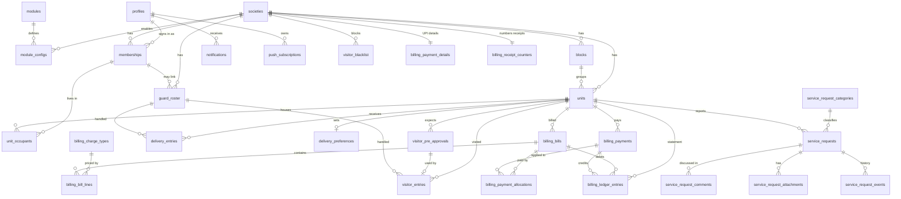

# Homeish — Database Design (DATABASE.md)

| Field      | Value                                                                                                                                                           |
| ---------- | --------------------------------------------------------------------------------------------------------------------------------------------------------------- |
| Product    | Homeish (PRD D-01 approved 2026-11-09)                                                                                                                          |
| Version    | 0.1 (Draft for approval)                                                                                                                                        |
| Date       | 2026-11-09                                                                                                                                                      |
| Depends on | [PRD.md](./PRD.md) (data, roles, journeys), [ARCHITECTURE.md](./ARCHITECTURE.md) (stack, security model), [DESIGN.md](./DESIGN.md) (screens that drive queries) |
| Covers     | MVP data model in full detail (Core, Visitor, Delivery, Billing, Service Request); post-MVP modules outlined only                                               |

**Conventions**

- **[DBA-nn]** = Database assumption. **[DBD-nn]** = Database decision (Section 18).
- Names: `snake_case`; tables are plural; module tables are prefixed with the module key (`visitor_`, `delivery_`, `billing_`, `service_request_`).
- This file defines structure and rules in tables, not SQL. The real DDL lives in versioned migrations (Section 14), which must match this document. Update this file in the same change as any migration.
- Where PRD and this file disagree on behavior, the PRD wins.

---

## 1. Database Technology

D-34 environment boundary (approved 2026-11-09): society subdomains do not change D-24's shared live database/RLS design. Beta must have a separate synthetic-only backend. The public demo needs a synthetic-only reset boundary before database-backed writes are introduced. Current marketing/demo/beta entry pages make no database calls; demo state is browser memory only. Maplewood's hostname is reserved in code as a disabled placeholder; all real society provisioning is deferred until MVP and a future create-society script. No database projects, migrations, live society records or reset jobs are created by this website work.

| Item               | Choice                                                                                                            | Reason                                                                                                |
| ------------------ | ----------------------------------------------------------------------------------------------------------------- | ----------------------------------------------------------------------------------------------------- |
| Engine             | **PostgreSQL** (managed by **Supabase**)                                                                          | Approved stack (ARCHITECTURE AD-01). Relational integrity for ledgers and tenants; row-level security |
| Auth store         | Supabase **`auth`** schema (`auth.users`)                                                                         | Users and login methods live here; the app never writes to it directly                                |
| Application schema | **`public`** (tables, exposed to the API only through RLS and grants)                                             | Standard Supabase pattern                                                                             |
| Private schema     | **`private`** (helper and maintenance functions, not exposed to the API)                                          | Keeps security helpers out of the public API surface                                                  |
| File storage       | Supabase Storage (private buckets); the database stores **paths only**                                            | Section 12                                                                                            |
| Extensions         | `pgcrypto` (UUIDs, PIN hashing), `citext` (case-insensitive email), both in the unexposed `extensions` schema    | Minimal set. No other extensions in MVP                                                               |
| ORM                | None (ARCHITECTURE AD-03). Generated TypeScript types from the schema; transactional operations are SQL functions | One source of truth for the schema                                                                    |

### 1.1 Conventions that apply to every table

| Rule                          | Detail                                                                                                                                                                                                                                                                                                                           |
| ----------------------------- | -------------------------------------------------------------------------------------------------------------------------------------------------------------------------------------------------------------------------------------------------------------------------------------------------------------------------------- |
| Primary keys                  | `uuid`, generated by the database. Exceptions: log tables use `bigint identity` for cheap, ordered append-only inserts                                                                                                                                                                                                           |
| Tenant key                    | Every tenant table has `society_id uuid NOT NULL` referencing `societies` (DAT-1)                                                                                                                                                                                                                                                |
| **Same-society foreign keys** | Every parent table that tenant tables point at has a unique key on `(society_id, id)`; children reference the parent by `(society_id, parent_id)`. A row can therefore never point at another society's row, even by mistake or tampering                                                                                        |
| Standard columns ("Std")      | `id`, `society_id`, `created_at timestamptz default now()`, `created_by uuid → profiles`, `updated_at`, `updated_by`. Tables marked **AO** (append-only) have only `id`, `society_id`, `created_at`, `created_by`                                                                                                                |
| Time                          | `timestamptz` (UTC); society timezone is stored on `societies` (NFR-9)                                                                                                                                                                                                                                                           |
| Money                         | `bigint` **paise**, never decimals or floats; currency is the society's currency (DAT-2)                                                                                                                                                                                                                                         |
| Status/enum fields            | `text` with a `CHECK` constraint listing allowed values (easier to evolve than enum types) **[DBD-5]**                                                                                                                                                                                                                           |
| Text limits                   | Every free-text column has a length `CHECK` (names ≤ 120, descriptions ≤ 2,000, reasons ≤ 500)                                                                                                                                                                                                                                   |
| Soft delete                   | `active boolean` or a status value. Hard delete is blocked on money, entry, request history and audit tables                                                                                                                                                                                                                     |
| Deletion of parents           | `ON DELETE RESTRICT` everywhere, except notification and subscription rows owned by a user                                                                                                                                                                                                                                       |
| Updated timestamps            | `updated_at` maintained by `private.set_updated_at()`                                                                                                                                                                                                                                                                           |
| Double-submit protection      | The tables for user-created records (`visitor_entries`, `delivery_entries`, `billing_payments`, `service_requests`, `service_request_comments`) also carry `client_request_id uuid` (nullable); unique `(society_id, created_by, client_request_id)` where not null, so a repeated submission returns the original row (API 3.6) |
| Naming of keys                | Primary `…_pkey`, foreign `…_fkey`, unique `…_key`, check `…_check`, index `…_idx`                                                                                                                                                                                                                                               |

---

## 2. Entity Overview

### 2.1 Table inventory (MVP: 35 tables)

| Module                  | Tables                                                                                                                                                                                                                                           |
| ----------------------- | ------------------------------------------------------------------------------------------------------------------------------------------------------------------------------------------------------------------------------------------------ |
| **Core (17)**           | `profiles`, `developers`, `societies`, `modules`, `module_configs`, `blocks`, `units`, `memberships`, `unit_occupants`, `guard_roster`, `notifications`, `push_subscriptions`, `audit_logs`, `error_logs`, `jobs`, `job_run_keys`, `rate_limits` |
| **Visitor (3)**         | `visitor_entries`, `visitor_pre_approvals`, `visitor_blacklist`                                                                                                                                                                                  |
| **Delivery (2)**        | `delivery_entries`, `delivery_preferences`                                                                                                                                                                                                       |
| **Billing (8)**         | `billing_charge_types`, `billing_bills`, `billing_bill_lines`, `billing_payments`, `billing_payment_allocations`, `billing_ledger_entries`, `billing_payment_details`, `billing_receipt_counters`                                                |
| **Service Request (5)** | `service_request_categories`, `service_requests`, `service_request_comments`, `service_request_attachments`, `service_request_events`                                                                                                            |

Total: 17 + 3 + 2 + 8 + 5 = **35**.

Post-MVP modules (staff, housekeeping, AMC, notice, amenity) are outlined in Section 9 and get migrations only when their module starts.

### 2.2 Entity relationship diagram (MVP)

Not drawn (to keep the diagram readable): every tenant table also points to `societies` through `society_id`, and user-owned actions point to `profiles` through `created_by`/`updated_by`. Logs (`audit_logs`, `error_logs`, `jobs`) reference `societies` and `profiles` loosely (nullable).

---

## 3. Core Tables

### 3.1 `profiles` — one row per person who can sign in

| Column                 | Type        | Null | Notes                                                                                                                                                                |
| ---------------------- | ----------- | ---- | -------------------------------------------------------------------------------------------------------------------------------------------------------------------- |
| id                     | uuid        | PK   | Same value as the Supabase user ID (`auth.users.id`); foreign key to it                                                                                              |
| email                  | citext      | no   | Unique. Copy of the sign-in email, kept in sync by one trigger. Intentional duplication: needed for display and invite matching without exposing `auth` **[DBA-01]** |
| full_name              | text        | no   | 1–120 chars                                                                                                                                                          |
| phone                  | text        | yes  | Optional profile field (A-34). Format check `^\+?[0-9]{10,15}$`                                                                                                      |
| photo_path             | text        | yes  | Storage path                                                                                                                                                         |
| font_preference        | text        | no   | `manrope_sora` or `device_default`; default `manrope_sora` (CORE-18)                                                                                                 |
| status                 | text        | no   | `active`, `disabled`, `anonymized`; default `active`                                                                                                                 |
| created_at, updated_at | timestamptz | no   |                                                                                                                                                                      |

Constraints: unique `email`; check `font_preference` against the documented values. A profile is created automatically when a user first signs in (trigger); name is collected on first sign-in (S-04/profile).

### 3.2 `developers` — platform operators

| Column     | Type        | Null | Notes        |
| ---------- | ----------- | ---- | ------------ |
| user_id    | uuid        | PK   | → `profiles` |
| created_at | timestamptz | no   |              |

No API grants: rows are added only by a database administrator (ARCHITECTURE 8.1). An RLS helper checks membership of this table plus the MFA assurance level of the session.

### 3.3 `societies`

| Column                       | Type   | Null | Notes                                                                                                                                                                                                                                                         |
| ---------------------------- | ------ | ---- | ------------------------------------------------------------------------------------------------------------------------------------------------------------------------------------------------------------------------------------------------------------- |
| id                           | uuid   | PK   |                                                                                                                                                                                                                                                               |
| name                         | text   | no   | 2–120                                                                                                                                                                                                                                                         |
| unit_label                   | text   | no   | Default `Unit`; trimmed, 1–24 letters or spaces (CORE-17, DD-05)                                                                                                                                                                                              |
| address, city                | text   | yes  |                                                                                                                                                                                                                                                               |
| contact_email                | citext | yes  |                                                                                                                                                                                                                                                               |
| contact_phone                | text   | yes  |                                                                                                                                                                                                                                                               |
| timezone                     | text   | no   | Default `Asia/Kolkata`                                                                                                                                                                                                                                        |
| currency                     | text   | no   | Default `INR`; check = 3 letters                                                                                                                                                                                                                              |
| logo_path                    | text   | yes  |                                                                                                                                                                                                                                                               |
| status                       | text   | no   | `trial`, `active`, `suspended`, `archived`; default `trial` (SAAS-1)                                                                                                                                                                                          |
| plan                         | text   | yes  | Free text label set by developer (PRD D-08: manual)                                                                                                                                                                                                           |
| gate_login_mode              | text   | no   | `individual` or `shared`; default `individual` (PRD CORE-16)                                                                                                                                                                                                  |
| join_code                    | text   | yes  | Society code that lets an un-invited resident ask to join (self-registration). Unique; random, 8 characters, upper-case letters and digits without look-alikes; null = self-registration switched off. Rotatable by admin (audited) **[API APD-1, approved]** |
| guard_identification         | text   | no   | `pick_name` or `pin`; default `pick_name`. Only used when `gate_login_mode = shared` **[DBD-3, approved]**                                                                                                                                                    |
| created_at/by, updated_at/by |        |      | Std                                                                                                                                                                                                                                                           |

Constraints: unique `(id)` and implicit tenant root; `unit_label`, `status`, `gate_login_mode`, `guard_identification` checks. Editable by: developer (all columns); admin (profile columns, `unit_label`, `gate_login_mode`, `guard_identification` only) through a function.

### 3.4 `modules` — reference data

| Column     | Type    | Null | Notes                                                                                                            |
| ---------- | ------- | ---- | ---------------------------------------------------------------------------------------------------------------- |
| key        | text    | PK   | `core`, `visitor`, `delivery`, `billing`, `service_request`, `staff`, `housekeeping`, `amc`, `notice`, `amenity` |
| name       | text    | no   | Display name                                                                                                     |
| is_core    | boolean | no   | `core` only is true; cannot be disabled                                                                          |
| sort_order | int     | no   |                                                                                                                  |

Maintained only by migrations (Section 14). Gives `module_configs` a real foreign key instead of free text.

### 3.5 `module_configs`

| Column                 | Type    | Null    | Notes                                                                                                                                                 |
| ---------------------- | ------- | ------- | ----------------------------------------------------------------------------------------------------------------------------------------------------- |
| society_id             | uuid    | PK part | → `societies`                                                                                                                                         |
| module_key             | text    | PK part | → `modules.key`                                                                                                                                       |
| enabled                | boolean | no      | Default `false` (a new module ships disabled); `core` rows are always `true` (check)                                                                  |
| settings               | jsonb   | no      | Default `{}`. Validated against the module's settings schema in the application **and** by the toggle/settings function. Reference keys in Section 10 |
| updated_at, updated_by |         |         |                                                                                                                                                       |

Rules: the primary key is `(society_id, module_key)`; every society gets a `core` row on creation. Toggling goes through one function that writes the audit log in the same transaction (MOD-5). Data in disabled modules is never touched (MOD-4).

### 3.6 `blocks`

| Column | Type    | Null | Notes          |
| ------ | ------- | ---- | -------------- |
| Std    |         |      |                |
| name   | text    | no   | 1–60           |
| active | boolean | no   | Default `true` |

Unique `(society_id, name)`; unique `(society_id, id)` (same-society FK rule).

### 3.7 `units`

| Column    | Type         | Null | Notes                                                          |
| --------- | ------------ | ---- | -------------------------------------------------------------- |
| Std       |              |      |                                                                |
| block_id  | uuid         | yes  | → `blocks` (same society). Null when the society has no blocks |
| number    | text         | no   | 1–20 (e.g., `101`)                                             |
| floor     | int          | yes  |                                                                |
| unit_type | text         | yes  | Free label (e.g., `2BHK`) up to 30 chars                       |
| area_sqft | numeric(8,2) | yes  | Must be > 0 when set. Used by per-sq-ft billing (BIL-1)        |
| active    | boolean      | no   | Default `true`                                                 |

Unique `(society_id, block_id, number)` treating a null block as one value (so `101` can exist once per society without a block); unique `(society_id, id)`. Units with history are never deleted (deactivate only, PRD edge cases).

### 3.8 `memberships` — a person's access to one society

| Column                  | Type        | Null | Notes                                                                                                                              |
| ----------------------- | ----------- | ---- | ---------------------------------------------------------------------------------------------------------------------------------- |
| Std                     |             |      |                                                                                                                                    |
| user_id                 | uuid        | yes  | → `profiles`. Null until an invited person signs in                                                                                |
| invited_email           | citext      | yes  | Set when the admin invites before the person has an account                                                                        |
| roles                   | text[]      | no   | Non-empty subset of `admin`, `committee`, `guard`, `hk_supervisor`, `resident` (check). `admin` and `committee` may combine (A-25) |
| status                  | text        | no   | `invited`, `pending_approval`, `active`, `deactivated`                                                                             |
| invited_by, approved_by | uuid        | yes  | → `profiles`                                                                                                                       |
| joined_at, left_at      | timestamptz | yes  |                                                                                                                                    |

Constraints:

- At least one of `user_id`, `invited_email` is set.
- Unique `(society_id, user_id)` where `user_id` is not null; unique `(society_id, invited_email)` where `user_id` is null.
- Unique `(society_id, id)`.
- On first sign-in, a function links all memberships whose `invited_email` equals the verified sign-in email (CORE-9, ARCHITECTURE 8.1). Unknown emails link nothing and sign-in is refused with the generic message.

Resident sub-types (owner, tenant, family) are **per unit**, so they live on `unit_occupants`, not here. Permission checks combine both (PRD matrix).

### 3.9 `unit_occupants` — who lives in which unit

| Column               | Type    | Null | Notes                                                                |
| -------------------- | ------- | ---- | -------------------------------------------------------------------- |
| Std                  |         |      |                                                                      |
| unit_id              | uuid    | no   | → `units` (same society)                                             |
| membership_id        | uuid    | no   | → `memberships` (same society)                                       |
| relationship         | text    | no   | `owner`, `tenant`, `family`                                          |
| is_primary           | boolean | no   | Default `false`                                                      |
| is_approver          | boolean | no   | Default `true` for owner/tenant, `false` for family (PRD A-11, A-26) |
| status               | text    | no   | `pending`, `active`, `ended`                                         |
| started_at, ended_at | date    |      | `ended_at` ≥ `started_at`                                            |

Constraints: unique `(unit_id, membership_id)` among non-ended rows; **at most one active primary per unit** (partial unique on `unit_id` where `is_primary` and `status = 'active'`); a primary must be an owner or tenant. A person may occupy several units. Move-out sets `status = 'ended'` and `ended_at` (history preserved, CORE-10, PERM-3: tenants see only data from their tenancy period via `started_at`/`ended_at`).

### 3.10 `guard_roster` — who can be named as having handled a gate entry

| Column        | Type    | Null | Notes                                                                                                                                                                            |
| ------------- | ------- | ---- | -------------------------------------------------------------------------------------------------------------------------------------------------------------------------------- |
| Std           |         |      |                                                                                                                                                                                  |
| name          | text    | no   | 1–80                                                                                                                                                                             |
| membership_id | uuid    | yes  | Set in individual mode (the guard's own account); null for named-only guards in shared mode                                                                                      |
| pin_hash      | text    | yes  | Salted slow hash of the guard's PIN (bcrypt via `pgcrypto`). Required when the society's `guard_identification = pin`; never returned to the API; PIN never stored in plain text |
| active        | boolean | no   | Default `true`                                                                                                                                                                   |

Rules: every gate entry (visitor/delivery) stores the roster entry that handled it, so "who let this person in" is always answerable in both gate-login modes **[DBD-3, approved: RWA admin chooses name-pick or PIN in settings]**. Unique `(society_id, name)` among active rows; unique `(society_id, id)`. PIN attempts are rate-limited (`rate_limits`). The `pin_hash` column has no read grant for any API role.

### 3.11 `notifications`

| Column                 | Type        | Null | Notes                                                                                     |
| ---------------------- | ----------- | ---- | ----------------------------------------------------------------------------------------- |
| id                     | uuid        | PK   |                                                                                           |
| society_id             | uuid        | no   |                                                                                           |
| user_id                | uuid        | no   | → `profiles`, `ON DELETE CASCADE`                                                         |
| type                   | text        | no   | e.g., `visitor_pending`, `bill_issued`, `payment_confirmed` (catalogue in code)           |
| title, body            | text        | no   | ≤ 120 / ≤ 300. **No sensitive details** beyond what the lock screen may show (DESIGN 8.3) |
| entity_type, entity_id | text, uuid  | yes  | Deep-link target                                                                          |
| read_at                | timestamptz | yes  |                                                                                           |
| created_at             | timestamptz | no   |                                                                                           |

Inserted by the same transaction as the event that causes it (ARCHITECTURE 10); push sending happens afterwards and is best effort.

### 3.12 `push_subscriptions`

| Column                      | Type        | Null | Notes                                        |
| --------------------------- | ----------- | ---- | -------------------------------------------- |
| id                          | uuid        | PK   |                                              |
| user_id                     | uuid        | no   | → `profiles`, cascade                        |
| endpoint                    | text        | no   | Unique                                       |
| p256dh, auth_secret         | text        | no   | **Secret** (lets someone push to the device) |
| user_agent                  | text        | yes  |                                              |
| created_at, last_success_at | timestamptz |      |                                              |

Residents can add/remove their own subscription; **no API role can read the key columns**. Only the privileged push sender reads them. Subscriptions returning "gone" are deleted.

### 3.13 `audit_logs` (AO)

| Column        | Type            | Null | Notes                                                                      |
| ------------- | --------------- | ---- | -------------------------------------------------------------------------- |
| id            | bigint identity | PK   |                                                                            |
| society_id    | uuid            | yes  | Null for platform-level actions                                            |
| actor_id      | uuid            | yes  | Null for system jobs                                                       |
| actor_role    | text            | yes  | Role used for the action                                                   |
| action        | text            | no   | e.g., `module.toggle`, `payment.confirm`, `upi_details.change`             |
| entity_type   | text            | no   |                                                                            |
| entity_id     | text            | yes  |                                                                            |
| before, after | jsonb           | yes  | Only the changed fields; **never** secrets, OTPs or full documents (LOG-5) |
| reason        | text            | yes  | Required for waive, override, reject, cancel                               |
| request_id    | text            | yes  | Correlation with `error_logs` (LOG-8)                                      |
| created_at    | timestamptz     | no   |                                                                            |

Append-only: no UPDATE/DELETE privilege for any API role, plus a trigger that rejects both. Retention 2 years then purged by the daily job (A-09).

### 3.14 `error_logs` (AO-style, developer-only)

| Column                                 | Type        | Null | Notes                                                        |
| -------------------------------------- | ----------- | ---- | ------------------------------------------------------------ |
| id                                     | uuid        | PK   |                                                              |
| reference_id                           | text        | no   | Unique, short, human-copyable code shown to the user (LOG-2) |
| society_id, user_id                    | uuid        | yes  | Null for pre-sign-in errors                                  |
| role                                   | text        | yes  |                                                              |
| module_key                             | text        | yes  |                                                              |
| route                                  | text        | yes  | Route or action name                                         |
| source                                 | text        | no   | `server`, `client`, `job`                                    |
| severity                               | text        | no   | `critical`, `error`, `warning`, `info`                       |
| message                                | text        | no   | Scrubbed (LOG-5)                                             |
| stack                                  | text        | yes  | Scrubbed                                                     |
| app_version, device                    | text, jsonb | yes  |                                                              |
| request_id                             | text        | yes  |                                                              |
| status                                 | text        | no   | `open`, `resolved`, `ignored`; default `open`                |
| resolved_by, resolved_at, resolve_note |             | yes  |                                                              |
| created_at                             | timestamptz | no   |                                                              |

Only the developer can read or update `status`/`resolve_*` columns. Inserted by the privileged log writer (best effort, never throws). Retention 90 days.

### 3.15 `jobs`

| Column      | Type        | Null | Notes                                                                                  |
| ----------- | ----------- | ---- | -------------------------------------------------------------------------------------- |
| Std         |             |      |                                                                                        |
| type        | text        | no   | `bill_generation`, `csv_import_units`, `csv_import_residents`, `export`                |
| status      | text        | no   | `queued`, `running`, `succeeded`, `partial`, `failed`                                  |
| progress    | int         | no   | 0–100                                                                                  |
| summary     | jsonb       | yes  | Counts and a bounded list of row errors (the full error report is a downloadable file) |
| finished_at | timestamptz | yes  |                                                                                        |

Shown in the Jobs list (DESIGN 11.3). Retention 90 days.

### 3.16 `job_run_keys`

| Column     | Type        | Null    | Notes                                  |
| ---------- | ----------- | ------- | -------------------------------------- |
| society_id | uuid        | PK part |                                        |
| job_name   | text        | PK part | e.g., `late_fee`, `reminders`, `purge` |
| period_key | text        | PK part | e.g., `2026-11-09`                     |
| ran_at     | timestamptz | no      |                                        |

A daily job inserts its key first; a duplicate means it already ran, so re-running is a no-op (ARCHITECTURE 6.3). No API access.

### 3.17 `rate_limits`

| Column       | Type        | Null    | Notes                                                                          |
| ------------ | ----------- | ------- | ------------------------------------------------------------------------------ |
| key          | text        | PK part | e.g., `login:email:<hash>`, `code:validate:<society>:<ip-hash>`, `pin:<guard>` |
| window_start | timestamptz | PK part |                                                                                |
| count        | int         | no      |                                                                                |

Hashed keys (no raw emails/IPs). Cleared daily. No direct API access (ARCHITECTURE AD-05); a service-role-only atomic function increments fixed-window counters.

The P1 operational-table migrations enforce the documented API boundaries: audit rows are immutable, error-log details are immutable while developer resolution fields may change, and jobs are visible only to their creator/admin/developer. The service role alone writes operational records; `job_run_keys` and `rate_limits` have no user-facing grants.

---

## 4. Visitor Module Tables

### 4.1 `visitor_entries`

| Column                  | Type        | Null | Notes                                                                                                              |
| ----------------------- | ----------- | ---- | ------------------------------------------------------------------------------------------------------------------ |
| Std                     |             |      |                                                                                                                    |
| unit_id                 | uuid        | no   | → `units` (same society)                                                                                           |
| visitor_name            | text        | no   | 1–120                                                                                                              |
| visitor_phone           | text        | yes  | Personal data (Section 11). Optional by society setting                                                            |
| purpose                 | text        | no   | `guest`, `cab`, `service`, `official`, `other`                                                                     |
| vehicle_no              | text        | yes  | ≤ 20, stored upper-case without spaces                                                                             |
| people_count            | int         | no   | 1–50, default 1                                                                                                    |
| photo_path              | text        | yes  |                                                                                                                    |
| source                  | text        | no   | `walk_in`, `pre_approved`                                                                                          |
| pre_approval_id         | uuid        | yes  | → `visitor_pre_approvals`; required when `source = pre_approved`, unique (one entry per approval)                  |
| status                  | text        | no   | `pending`, `approved`, `denied`, `expired`, `checked_in`, `checked_out`                                            |
| respond_by              | timestamptz | yes  | `created_at` + the timeout in effect at creation; makes "No response" deterministic. Null for pre-approved entries |
| decision_source         | text        | yes  | `resident`, `guard_override`, `pre_approved`                                                                       |
| decided_by              | uuid        | yes  | → `profiles` (the resident who decided; null for override/pre-approved)                                            |
| decided_at              | timestamptz | yes  |                                                                                                                    |
| override_reason         | text        | yes  | **Required** when `decision_source = guard_override` (VIS-4)                                                       |
| handled_by_guard_id     | uuid        | no   | → `guard_roster` (who logged it)                                                                                   |
| checked_in_at           | timestamptz | yes  |                                                                                                                    |
| checked_out_at          | timestamptz | yes  |                                                                                                                    |
| checked_out_by_guard_id | uuid        | yes  | → `guard_roster`                                                                                                   |

Constraints (checks): `checked_in_at` set when status is `checked_in`/`checked_out`; `checked_out_at ≥ checked_in_at`; `override_reason` present iff `decision_source = guard_override`; a decision (`approved`/`denied`) has `decided_at`. **Status transitions** (`pending → approved/denied/expired → checked_in → checked_out`; first response wins) are enforced by the decision function with a row lock (ARCHITECTURE 10.2). A pending entry past `respond_by` is shown as "No response" by deriving it on read and is finalised to `expired` when next touched (lazy expiry, ARCHITECTURE AD-02). Unique `(society_id, id)`.

### 4.2 `visitor_pre_approvals`

| Column               | Type        | Null | Notes                                                               |
| -------------------- | ----------- | ---- | ------------------------------------------------------------------- |
| Std                  |             |      |                                                                     |
| unit_id              | uuid        | no   |                                                                     |
| visitor_name         | text        | no   |                                                                     |
| valid_from, valid_to | timestamptz | no   | `valid_to > valid_from`                                             |
| vehicle_no           | text        | yes  |                                                                     |
| code                 | text        | no   | 6 digits (check `^[0-9]{6}$`)                                       |
| status               | text        | no   | `active`, `used`, `cancelled`. "Expired" is derived from `valid_to` |
| used_at              | timestamptz | yes  |                                                                     |

Constraints: **unique `(society_id, code)` among `active` rows** so a code identifies exactly one pending approval; single use (A-30, PRD D-11). The QR encodes this same code and does not create a separate approval. Codes are low-sensitivity and short-lived, so stored as plain text. Guards validate through a function that returns only the matched visitor's details (they cannot browse this table). Validation attempts are rate-limited (`rate_limits`).

### 4.3 `visitor_blacklist`

| Column | Type    | Null | Notes             |
| ------ | ------- | ---- | ----------------- |
| Std    |         |      |                   |
| phone  | text    | no   | Normalised format |
| name   | text    | yes  |                   |
| reason | text    | yes  |                   |
| active | boolean | no   | Default `true`    |

Unique `(society_id, phone)` among active rows. MVP warns only (A-12).

---

## 5. Delivery Module Tables

### 5.1 `delivery_entries`

| Column              | Type        | Null | Notes                                                                          |
| ------------------- | ----------- | ---- | ------------------------------------------------------------------------------ |
| Std                 |             |      |                                                                                |
| unit_id             | uuid        | no   |                                                                                |
| company             | text        | no   | From the list or free text, ≤ 60                                               |
| delivery_type       | text        | no   | `food`, `parcel`, `grocery`, `other`                                           |
| photo_path          | text        | yes  |                                                                                |
| status              | text        | no   | `pending_response`, `allowed`, `left_at_gate`, `denied`, `collected`, `closed` |
| respond_by          | timestamptz | yes  | As for visitors                                                                |
| decision_source     | text        | yes  | `resident`, `preference` (unit rule applied automatically), `guard_override`   |
| decided_by          | uuid        | yes  |                                                                                |
| decided_at          | timestamptz | yes  |                                                                                |
| override_reason     | text        | yes  | Required for `guard_override`                                                  |
| handled_by_guard_id | uuid        | no   | → `guard_roster`                                                               |
| received_at         | timestamptz | yes  | When left at the gate/security desk                                            |
| collected_at        | timestamptz | yes  | Set only from `left_at_gate` (DEL-5)                                           |
| collected_by        | uuid        | yes  | → `profiles` (resident or guard who marked it)                                 |

Uncollected parcels are `left_at_gate` rows with `received_at` older than the society's threshold (default 3 days).

### 5.2 `delivery_preferences`

| Column                 | Type | Null    | Notes                                                          |
| ---------------------- | ---- | ------- | -------------------------------------------------------------- |
| society_id             | uuid | PK part |                                                                |
| unit_id                | uuid | PK part | One row per unit                                               |
| rule                   | text | no      | `ask` (default), `always_allow`, `always_leave_at_gate` (A-13) |
| updated_at, updated_by |      |         |                                                                |

---

## 6. Billing Module Tables

### 6.1 Money model in one paragraph

A **bill** (also used for fines and late fees) creates a **debit** on the unit's **ledger**. A confirmed **payment** creates a **credit** and is **allocated** to bills, oldest due first. Waivers create credits. The ledger is the unit's statement and is **append-only**; corrections are new entries, never edits (BIL-13, DAT-3). A payment larger than the open bills leaves the remainder as **credit**, which is applied automatically to the unit's next bills **[DBD-1, approved]**.

### 6.2 `billing_charge_types`

| Column       | Type    | Null | Notes                                                                                                     |
| ------------ | ------- | ---- | --------------------------------------------------------------------------------------------------------- |
| Std          |         |      |                                                                                                           |
| name         | text    | no   | e.g., `Monthly Maintenance`. Unique `(society_id, name)`                                                  |
| method       | text    | no   | `fixed`, `per_sqft`, `custom` (PRD D-12)                                                                  |
| amount_paise | bigint  | yes  | `fixed`: amount per unit; `per_sqft`: rate per sq ft in paise; `custom`: null. Check: > 0 when not custom |
| active       | boolean | no   | Default `true`                                                                                            |

### 6.3 `billing_bills`

| Column                                    | Type   | Null | Notes                                                                                                                                                                  |
| ----------------------------------------- | ------ | ---- | ---------------------------------------------------------------------------------------------------------------------------------------------------------------------- |
| Std                                       |        |      |                                                                                                                                                                        |
| unit_id                                   | uuid   | no   |                                                                                                                                                                        |
| kind                                      | text   | no   | `regular`, `fine`, `late_fee`                                                                                                                                          |
| title                                     | text   | no   | e.g., `Maintenance — Nov 2026`, or the fine reason                                                                                                                     |
| period_start                              | date   | no   | First day of the billing month (for `late_fee`: the month assessed)                                                                                                    |
| due_date                                  | date   | no   |                                                                                                                                                                        |
| total_paise                               | bigint | no   | > 0. Equals the sum of its lines (**intentional denormalization**, verified by an invariant test, Section 15.3)                                                        |
| paid_paise                                | bigint | no   | Default 0; maintained only by the payment-confirm and credit-apply functions                                                                                           |
| waived_paise                              | bigint | no   | Default 0; maintained only by the waive function                                                                                                                       |
| related_bill_id                           | uuid   | yes  | For `late_fee`: the overdue bill it penalises                                                                                                                          |
| cancelled_at, cancelled_by, cancel_reason |        | yes  | Only when nothing was paid and the full amount is waived                                                                                                               |
| status                                    | text   | no   | **Generated** from amounts: `cancelled`, `paid`, `waived`, `partially_paid`, `due`. "Overdue" is derived at query time from `due_date` + grace days (`module_configs`) |

Constraints: `paid_paise + waived_paise ≤ total_paise`; `late_fee` requires `related_bill_id`; **unique `(related_bill_id, period_start)` for late fees** (the daily job is idempotent, BIL-3); unique `(id, unit_id, period_start)` (used by the lines table). After creation, only the maintained columns may change (trigger), so published bills are immutable (BIL-13).

### 6.4 `billing_bill_lines` (AO)

| Column                                 | Type   | Null | Notes                                                                                                         |
| -------------------------------------- | ------ | ---- | ------------------------------------------------------------------------------------------------------------- |
| id, society_id, created_at, created_by |        |      | AO                                                                                                            |
| bill_id                                | uuid   | no   |                                                                                                               |
| unit_id                                | uuid   | no   | Copy kept consistent by a composite key `(bill_id, unit_id, period_start) → bills(id, unit_id, period_start)` |
| period_start                           | date   | no   |                                                                                                               |
| charge_type_id                         | uuid   | yes  | Null for fines/late fees                                                                                      |
| description                            | text   | no   | Snapshot of the charge name or the fine reason                                                                |
| amount_paise                           | bigint | no   | > 0                                                                                                           |

**Unique `(unit_id, period_start, charge_type_id)`** (nulls excluded) — this is exactly BIL-2: no duplicate charge for the same unit, period and charge type, even across separate generation runs. The unit/period columns exist only to enforce this rule; the composite key makes drift impossible.

### 6.5 `billing_payments`

| Column                     | Type   | Null | Notes                                                                                                                                   |
| -------------------------- | ------ | ---- | --------------------------------------------------------------------------------------------------------------------------------------- |
| Std                        |        |      |                                                                                                                                         |
| unit_id                    | uuid   | no   |                                                                                                                                         |
| amount_paise               | bigint | no   | > 0. For a submission it starts as the amount submitted; the admin may correct it on confirm (the change is audited)                    |
| mode                       | text   | no   | `upi`, `cash`, `cheque`, `bank_transfer`                                                                                                |
| source                     | text   | no   | `resident_submitted`, `admin_recorded`                                                                                                  |
| reference                  | text   | yes  | UPI UTR or cheque/transfer number. **Required** for `upi` and `bank_transfer`/`cheque`; format `^[A-Za-z0-9]{6,30}$`; stored upper-case |
| paid_on                    | date   | no   |                                                                                                                                         |
| proof_path                 | text   | yes  | Screenshot in a private bucket (optional, BIL-6)                                                                                        |
| status                     | text   | no   | `awaiting_confirmation`, `confirmed`, `rejected`. Admin-recorded payments are inserted as `confirmed`                                   |
| submitted_by               | uuid   | no   | → `profiles`                                                                                                                            |
| confirmed_by, confirmed_at |        | yes  | Required when `confirmed`                                                                                                               |
| reject_reason              | text   | yes  | Required when `rejected`                                                                                                                |
| receipt_no                 | text   | yes  | Set on confirmation; unique per society (e.g., `R-2026-000123`)                                                                         |

**Duplicate protection (BIL-16): unique `(society_id, reference)` where `mode = 'upi'` and `status` is `awaiting_confirmation` or `confirmed`.** A rejected reference may be submitted again. Only the confirm/reject functions can change `status`; after `confirmed`, the row is immutable.

### 6.6 `billing_payment_allocations` (AO)

| Column       | Type        | Null    | Notes |
| ------------ | ----------- | ------- | ----- |
| payment_id   | uuid        | PK part |       |
| bill_id      | uuid        | PK part |       |
| society_id   | uuid        | no      |       |
| amount_paise | bigint      | no      | > 0   |
| created_at   | timestamptz | no      |       |

Created by the confirm function (oldest due first, A-15) and by credit application when a new bill is generated. Invariants: the allocations of a payment never exceed its amount; `paid_paise` on a bill equals the sum of its allocations. The unallocated remainder of a confirmed payment is the unit's credit.

### 6.7 `billing_ledger_entries` (AO)

| Column                 | Type            | Null | Notes                                      |
| ---------------------- | --------------- | ---- | ------------------------------------------ |
| id                     | bigint identity | PK   | Orders entries                             |
| society_id, unit_id    | uuid            | no   |                                            |
| kind                   | text            | no   | `bill`, `payment`, `waiver`, `adjustment`  |
| direction              | text            | no   | `debit` (unit owes more) or `credit`       |
| amount_paise           | bigint          | no   | > 0                                        |
| bill_id                | uuid            | yes  | For `bill`, `waiver`                       |
| payment_id             | uuid            | yes  | For `payment`                              |
| reason                 | text            | yes  | **Required** for `waiver` and `adjustment` |
| created_at, created_by |                 |      |                                            |

Checks: `bill` ⇒ debit with `bill_id`; `payment` ⇒ credit with `payment_id`; `waiver` ⇒ credit with `bill_id` and reason. The **running balance is never stored**; statements compute it with a running sum ordered by `id`. Updates and deletes are rejected by trigger.

### 6.8 `billing_payment_details` — the society's UPI details (BIL-15)

| Column                 | Type | Null | Notes                                   |
| ---------------------- | ---- | ---- | --------------------------------------- |
| society_id             | uuid | PK   | One row per society                     |
| upi_id                 | text | no   | Format check `name@handle`, 5–100 chars |
| payee_name             | text | no   | 2–100                                   |
| qr_path                | text | yes  | Optional uploaded QR                    |
| updated_at, updated_by |      |      |                                         |

Changed only by one function that writes an `audit_logs` row (old and new values), notifies all admins and committee members, and lets residents see "last changed on" from `updated_at` (PRD D-31, approved). Readable by every member of the society (residents need it to pay). History lives in the audit log (no duplicate history table).

### 6.9 `billing_receipt_counters`

| Column     | Type | Null    | Notes                                                    |
| ---------- | ---- | ------- | -------------------------------------------------------- |
| society_id | uuid | PK      |                                                          |
| year       | int  | PK part | Receipts restart each calendar year **[DBA-02]**         |
| last_no    | int  | no      | Incremented under a row lock when a payment is confirmed |

Guarantees gap-free, unique receipt numbers per society and year without a global sequence.

---

## 7. Service Request Module Tables

### 7.1 `service_request_categories`

| Column     | Type    | Null | Notes                          |
| ---------- | ------- | ---- | ------------------------------ |
| Std        |         |      |                                |
| name       | text    | no   | Unique `(society_id, name)`    |
| sla_hours  | int     | yes  | Target resolution time (SRQ-6) |
| sort_order | int     | no   |                                |
| active     | boolean | no   | Default `true`                 |

A new society gets the default categories (Plumbing, Electrical, Lift, Cleaning, Security, Parking, Noise, Other) created by the society-creation function from a template (Section 14.3).

### 7.2 `service_requests`

| Column                                      | Type        | Null | Notes                                                                                                                      |
| ------------------------------------------- | ----------- | ---- | -------------------------------------------------------------------------------------------------------------------------- |
| Std                                         |             |      |                                                                                                                            |
| category_id                                 | uuid        | no   |                                                                                                                            |
| location_type                               | text        | no   | `unit`, `common_area`                                                                                                      |
| unit_id                                     | uuid        | yes  | Required iff `location_type = unit` (check)                                                                                |
| description                                 | text        | no   | 1–2,000                                                                                                                    |
| priority                                    | text        | no   | `normal`, `urgent`                                                                                                         |
| status                                      | text        | no   | `open`, `assigned`, `in_progress`, `resolved`, `closed`, `rejected`, `reopened`                                            |
| assigned_membership_id                      | uuid        | yes  | Internal staff member (→ `memberships`)                                                                                    |
| assigned_vendor_name, assigned_vendor_phone | text        | yes  | External vendor (A-18). At most one of member/vendor                                                                       |
| sla_due_at                                  | timestamptz | yes  | Computed at creation from the category's SLA. "Overdue" is derived: past due and status not `resolved`/`closed`/`rejected` |
| resolved_at                                 | timestamptz | yes  | Drives auto-close after the society's days (default 3)                                                                     |
| closed_at                                   | timestamptz | yes  |                                                                                                                            |
| reject_reason                               | text        | yes  | Required when `rejected`                                                                                                   |
| rating                                      | smallint    | yes  | 1–5, only after `closed` (SRQ-5)                                                                                           |
| rating_comment                              | text        | yes  | ≤ 500                                                                                                                      |

Status changes happen only through functions, which also add a `service_request_events` row and a notification (SRQ-8).

### 7.3 `service_request_comments`

| Column     | Type | Null | Notes                      |
| ---------- | ---- | ---- | -------------------------- |
| Std (AO)   |      |      | `created_by` is the author |
| request_id | uuid | no   |                            |
| body       | text | no   | 1–2,000                    |

### 7.4 `service_request_attachments`

| Column       | Type | Null | Notes                                        |
| ------------ | ---- | ---- | -------------------------------------------- |
| Std (AO)     |      |      |                                              |
| request_id   | uuid | no   |                                              |
| comment_id   | uuid | yes  | Null for photos on the request itself        |
| storage_path | text | no   |                                              |
| content_type | text | no   | `image/jpeg`, `image/png`, `application/pdf` |
| size_bytes   | int  | no   | ≤ 5,242,880 (DAT-5)                          |

At most 3 attachments on the request itself (function check).

### 7.5 `service_request_events` (AO) — resident-visible history

| Column                 | Type | Null | Notes                                                                      |
| ---------------------- | ---- | ---- | -------------------------------------------------------------------------- |
| Std (AO)               |      |      |                                                                            |
| request_id             | uuid | no   |                                                                            |
| event_type             | text | no   | `created`, `assigned`, `status_changed`, `reassigned`, `reopened`, `rated` |
| from_status, to_status | text | yes  |                                                                            |
| note                   | text | yes  | ≤ 500                                                                      |

Exists because residents must see the timeline (DESIGN 6.15) but cannot read `audit_logs`. Routine request transitions are **not** duplicated in `audit_logs`.

---

## 8. Constraint and Validation Summary

| Rule                                                                                                      | Where enforced                                                                                                                              |
| --------------------------------------------------------------------------------------------------------- | ------------------------------------------------------------------------------------------------------------------------------------------- |
| No cross-society references                                                                               | Same-society composite foreign keys (Section 1.1)                                                                                           |
| One bill line per unit, period and charge type (BIL-2)                                                    | Unique constraint on `billing_bill_lines`                                                                                                   |
| Late fee generated once per overdue bill and month                                                        | Unique `(related_bill_id, period_start)`                                                                                                    |
| Duplicate UPI reference blocked (BIL-16)                                                                  | Partial unique on `billing_payments`                                                                                                        |
| Receipts gap-free and unique                                                                              | `billing_receipt_counters` + unique `(society_id, receipt_no)`                                                                              |
| Money amounts positive, settled ≤ total                                                                   | `CHECK` constraints                                                                                                                         |
| Ledger and audit immutable (BIL-13, LOG-4)                                                                | No privileges + rejecting triggers                                                                                                          |
| One active primary contact per unit (CORE-8)                                                              | Partial unique on `unit_occupants`                                                                                                          |
| Pre-approval codes unique among active ones                                                               | Partial unique on `visitor_pre_approvals`                                                                                                   |
| Visitor/delivery decisions: first response wins                                                           | Row lock in the decision function; status checks                                                                                            |
| Guard override needs a reason (VIS-4)                                                                     | `CHECK` tying `decision_source` and `override_reason`                                                                                       |
| Unit-vs-common-area consistency (SRQ-1)                                                                   | `CHECK` on `service_requests`                                                                                                               |
| Core module cannot be disabled                                                                            | `CHECK` on `module_configs`                                                                                                                 |
| File size/type limits (DAT-5)                                                                             | `CHECK` on attachments + storage bucket rules + server validation                                                                           |
| Allowed values for every status                                                                           | `CHECK` constraints (Section 1.1)                                                                                                           |
| Module settings shape                                                                                     | Application schema + toggle/settings function                                                                                               |
| Business rules involving several rows (allocation, credit use, late fee amounts, cancel only when unpaid) | **SQL functions** that run in one transaction, covered by database tests (ARCHITECTURE Section 18) and the integrity checks in Section 15.3 |

---

## 9. Post-MVP Modules (outline only — no migrations until the module starts)

| Module                | Tables (planned)                                        | Key notes                                                                                                |
| --------------------- | ------------------------------------------------------- | -------------------------------------------------------------------------------------------------------- |
| `staff` (P2-1)        | `staff_members`, `staff_unit_links`, `staff_attendance` | Store ID type + last 4 digits only (PRD D-18); entry/exit created by the guard roster; no payroll (D-19) |
| `housekeeping` (P2-2) | `housekeeping_items`, `housekeeping_transactions`       | Append-only transactions; stock = sum; check blocks negative stock (HKP-3)                               |
| `amc` (P2-3)          | `amc_contracts`, `amc_visits`                           | "Expiring soon/Expired" derived from `end_date`; documents in a private bucket                           |
| `notice` (P2-4)       | `notices`, `notice_reads`                               | Audience filter by block/owner; read receipts aggregate-only                                             |
| `amenity` (P2-5)      | `amenities`, `amenity_bookings`                         | Exclusion constraint prevents overlapping bookings per amenity                                           |

Each follows the same rules: `society_id`, same-society keys, RLS plus module-enabled check, append-only where money or stock is involved.

---

## 10. Reference: Module Settings Keys (`module_configs.settings`)

Defaults apply when a key is absent. Editable by developer unless marked **A** (admin-editable, audited).

| Module          | Key                               | Default                           | Notes                                 |
| --------------- | --------------------------------- | --------------------------------- | ------------------------------------- |
| visitor         | `approval_timeout_minutes`        | 3                                 | VIS-4                                 |
| visitor         | `overstay_hours`                  | 12                                | VIS-9                                 |
| visitor         | `photo_required`                  | false                             |                                       |
| visitor         | `guard_override_allowed`          | true                              |                                       |
| visitor         | `visitor_phone_required`          | false                             |                                       |
| delivery        | `response_timeout_minutes`        | 3                                 |                                       |
| delivery        | `uncollected_days`                | 3                                 | DEL-5                                 |
| delivery        | `leave_at_gate_enabled`           | true                              |                                       |
| billing         | `due_day_of_month`                | 10                                |                                       |
| billing         | `grace_days`                      | 5                                 |                                       |
| billing         | `late_fee`                        | none                              | `{type: flat/percent, value}` (BIL-3) |
| billing         | `reminders`                       | before 3 / on due / every 7 after | BIL-10                                |
| billing         | `pending_confirmation_alert_days` | 3                                 | BIL-17                                |
| service_request | `auto_close_days`                 | 3                                 | SRQ-3                                 |

UPI details are **not** settings: they have their own table with a format check (Section 6.8).

---

## 11. Sensitive Data Handling

### 11.1 Classification

| Class                | Data                                                              | Tables/columns                                                                                                                                 |
| -------------------- | ----------------------------------------------------------------- | ---------------------------------------------------------------------------------------------------------------------------------------------- |
| **Personal**         | Name, email, phone, photo, vehicle number                         | `profiles`, `visitor_entries`, `visitor_pre_approvals`, `visitor_blacklist`, `unit_occupants` (via profile), `service_requests` (vendor phone) |
| **Personal – image** | Visitor, parcel and request photos                                | Storage buckets; paths in rows                                                                                                                 |
| **Financial**        | UPI ID, payee name, UTR/reference, amounts, receipts, screenshots | `billing_payment_details`, `billing_payments`, ledger tables, `payment-proofs` bucket                                                          |
| **Secret**           | Push subscription keys, guard PIN hash                            | `push_subscriptions`, `guard_roster.pin_hash`                                                                                                  |
| **Operational**      | Logs, jobs                                                        | `error_logs`, `audit_logs`, `jobs`                                                                                                             |

### 11.2 Handling rules

| Rule                           | Detail                                                                                                                                                                                                                                                                           |
| ------------------------------ | -------------------------------------------------------------------------------------------------------------------------------------------------------------------------------------------------------------------------------------------------------------------------------- |
| Collect minimum                | No ID documents in MVP; visitor phone optional; resident phone optional                                                                                                                                                                                                          |
| Access by role only            | Via RLS (Section 13). Guards see the visitor and parcel data of their society; residents see their unit's; admins/committee see their society's; nobody sees another society's                                                                                                   |
| Masking                        | Lists show masked phones (`+91 98••• ••210`) except where an action needs the number (DESIGN 11.6). Masking is applied in the server layer, because RLS decides **rows**, not column formatting. Server code returns full numbers only to roles that need them                   |
| Resident contact for the guard | The guard never reads `profiles`; a function returns only the name and phone of the unit's active approvers for "Call Resident"                                                                                                                                                  |
| Names for display              | A small same-society view returns only `id` and `full_name` so residents can see who wrote a comment, without exposing email or phone                                                                                                                                            |
| Never in logs                  | OTPs/codes, tokens, push keys, PINs, full phone numbers, UPI IDs beyond what the audit row legitimately needs, screenshots (LOG-5). The scrubber runs before any log write                                                                                                       |
| Encryption                     | Provider-managed encryption at rest and in transit. No custom column encryption in MVP (nothing stored that needs it: UPI IDs are public payment addresses, not credentials). PIN is hashed, not encrypted                                                                       |
| Files                          | Private buckets, signed short-lived links, society-scoped paths (Section 12)                                                                                                                                                                                                     |
| Right to erasure (DAT-8, DPDP) | Handled by one function: overwrites the profile's name/phone/photo, replaces the Auth email with a non-identifying placeholder, disables sign-in, and leaves the row ID so history stays valid. Money and ledger rows are kept (they reference the ID, not the person's details) |
| Test data                      | Synthetic only; production data is never copied to other environments                                                                                                                                                                                                            |

### 11.3 Retention (PRD A-09, A-28, DAT-4; your decision on financial records)

| Data                                                        | Retention                                                         | Action at end                                                                               |
| ----------------------------------------------------------- | ----------------------------------------------------------------- | ------------------------------------------------------------------------------------------- |
| Visitor entries, delivery entries                           | 1 year (A-28)                                                     | Anonymise: clear visitor name, phone, vehicle, photo (file deleted); keep counts/timestamps |
| Pre-approvals                                               | 1 year after validity                                             | Delete                                                                                      |
| Service requests, comments, attachments                     | 2 years after closing **[DBA-03]**                                | Delete files and rows                                                                       |
| Notifications                                               | 180 days **[DBA-04]**                                             | Delete                                                                                      |
| Error logs                                                  | 90 days                                                           | Delete                                                                                      |
| Audit logs                                                  | 2 years                                                           | Delete                                                                                      |
| Jobs                                                        | 90 days                                                           | Delete                                                                                      |
| Bills, payments, allocations, ledger, receipts, UPI details | **Kept forever in MVP** **[DBD-2, approved]**                     | None                                                                                        |
| Rate-limit counters                                         | 1 day                                                             | Delete                                                                                      |
| Push subscriptions                                          | Until the push service reports them gone or the user removes them | Delete                                                                                      |

All purges are performed by the daily job (idempotent, logged).

---

## 12. Storage (files)

| Bucket            | Content             | Path                          | Who reads                                                                                      | Who writes                         |
| ----------------- | ------------------- | ----------------------------- | ---------------------------------------------------------------------------------------------- | ---------------------------------- |
| `visitor-photos`  | Visitor photos      | `{society_id}/{entry_id}/…`   | Admin, committee, guard, occupants of that unit                                                | Guard/admin when logging the entry |
| `delivery-photos` | Parcel photos       | `{society_id}/{entry_id}/…`   | Same as above                                                                                  | Guard/admin                        |
| `request-files`   | Request photos/PDFs | `{society_id}/{request_id}/…` | Admin, committee, requester, occupants of the unit (common-area: any resident, D-17), assignee | Requester, admin                   |
| `payment-proofs`  | UPI screenshots     | `{society_id}/{payment_id}/…` | Admin, committee, the submitter                                                                | Submitter                          |
| `society-assets`  | Logo, UPI QR        | `{society_id}/…`              | Every member of the society                                                                    | Admin                              |

Rules: all buckets private; access through short-lived signed links issued after a permission check; storage policies parse the first path segment as the society and use the same helper functions as table policies; upload limits 5 MB and JPG/PNG/PDF only (DAT-5); deleting a row deletes its file (a cleanup step in the delete/anonymise functions, plus an orphan check in the weekly operations list).

---

## 13. Ownership and Authorization

### 13.1 Roles in the database

| Postgres role   | Used by                                          | Notes                                                                        |
| --------------- | ------------------------------------------------ | ---------------------------------------------------------------------------- |
| `anon`          | Not signed in                                    | **No grants** on any application table                                       |
| `authenticated` | Every signed-in user                             | Table privileges are the minimum needed; row access is decided by RLS        |
| `service_role`  | Privileged server module only (ARCHITECTURE 8.4) | Bypasses RLS; used for jobs, log/push writers, developer cross-society reads |
| Migration owner | CI migration tool only                           | Owns the schema; never used at runtime                                       |

The application roles (`admin`, `guard`, resident, etc.) are **data** (`memberships.roles` + `unit_occupants`), not Postgres roles.

### 13.2 Helper functions used by policies (in `private`, stable, fast)

| Helper                         | Meaning                                                                           |
| ------------------------------ | --------------------------------------------------------------------------------- |
| `is_developer()`               | Signed-in user is in `developers` and the session has passed MFA                  |
| `is_member(society)`           | Active membership in that society                                                 |
| `has_role(society, roles)`     | Active membership with at least one of the roles                                  |
| `occupies_unit(unit)`          | Active `unit_occupants` row for the current user's membership                     |
| `module_enabled(society, key)` | `module_configs.enabled` is true (always true for `core`)                         |
| `society_writable(society)`    | Society status is `trial` or `active` (suspended = read-only, archived = blocked) |

Policies check **membership data in the database**, not JWT claims alone, so revoking a role or deactivating a person takes effect on the next request (PRD CORE-10).

The initial helper migration defines fail-closed stubs. The membership migration replaces `is_member`, `has_role`, `module_enabled` and `society_writable` with checks against current database state; `is_developer` remains false until the developer MFA flow is implemented. Core is always enabled, while other modules require an enabled `module_configs` row. The `private` schema is not exposed through PostgREST. Only `authenticated` and `service_role` can execute the helpers; `anon` has no schema access.

The base-table migration adds identity and society profile constraints, the ten module reference rows, and RLS/grants on the initial five tables. The membership migration adds self/manager-only reads and no direct membership writes. Society and module-config reads now require an active membership. Society/module configuration writes and developer registration remain reserved for later database functions or administrator migrations.

### 13.3 Write paths

Two kinds, chosen per table:

- **Direct (RLS-checked)**: simple admin-maintained data without cross-row rules.
- **Function (RPC)**: everything that has invariants, notifications or audit. Functions are `security definer` only where elevated access is needed; each sets a fixed search path, checks the caller explicitly (society, role, module, status), and has no public execute grant.

### 13.4 Row-level security matrix

RLS is **enabled on every table**; with no policy, access is denied. "Occupant" = active `unit_occupants` row for that unit. A module's tables also require `module_enabled(society, '<module>')` in every policy (defence in depth, ARCHITECTURE AD-09). Writes also require `society_writable(society)`.

| Table                                                                                          | Read                                                                                                                 | Write path                                                                                                                           |
| ---------------------------------------------------------------------------------------------- | -------------------------------------------------------------------------------------------------------------------- | ------------------------------------------------------------------------------------------------------------------------------------ |
| `profiles`                                                                                     | Self; admin/committee of a shared society get name only through a view/function; developer all                       | Self (name, phone, photo) direct; status/anonymise by function                                                                       |
| `developers`                                                                                   | Nobody via API                                                                                                       | Database admin only                                                                                                                  |
| `societies`                                                                                    | Members of the society; developer all                                                                                | Function (developer: all columns; admin: whitelisted profile/setting columns)                                                        |
| `modules`                                                                                      | Any signed-in user                                                                                                   | Migrations only                                                                                                                      |
| `module_configs`                                                                               | Members of the society                                                                                               | Function (developer; admin only for keys flagged **A**)                                                                              |
| `blocks`, `units`                                                                              | Members                                                                                                              | Admin direct; CSV import by function                                                                                                 |
| `memberships`                                                                                  | Self (all own rows); admin/committee of that society                                                                 | Function (invite, approve, role change, deactivate; audited)                                                                         |
| `unit_occupants`                                                                               | Admin/committee; occupants of the same unit; self                                                                    | Function                                                                                                                             |
| `guard_roster`                                                                                 | Admin, committee, guard (no `pin_hash` column)                                                                       | Admin direct (name/active); PIN set/reset by function                                                                                |
| `notifications`                                                                                | Owner only                                                                                                           | Owner updates `read_at`; inserts by functions                                                                                        |
| `push_subscriptions`                                                                           | No client reads                                                                                                      | Owner inserts/deletes own                                                                                                            |
| `audit_logs`                                                                                   | Admin/committee of that society; developer all                                                                       | Functions/triggers only; never updated or deleted                                                                                    |
| `error_logs`                                                                                   | Developer only                                                                                                       | Privileged writer inserts; developer updates status/resolve fields                                                                   |
| `jobs`                                                                                         | Creator, admin; developer                                                                                            | Functions                                                                                                                            |
| `job_run_keys`, `rate_limits`                                                                  | Nobody via API                                                                                                       | Privileged/functions only                                                                                                            |
| `visitor_entries`                                                                              | Admin, committee, guard (society-wide); occupants (own unit)                                                         | Functions: create (guard/admin), decide (occupant approver), check-in/out (guard/admin), override                                    |
| `visitor_pre_approvals`                                                                        | Creator, occupants of the unit, admin/committee. **Not guards**                                                      | Create/cancel by occupant via function; guard validates only through the validate function                                           |
| `visitor_blacklist`                                                                            | Admin, committee, guard                                                                                              | Admin direct                                                                                                                         |
| `delivery_entries`                                                                             | As `visitor_entries`                                                                                                 | Functions                                                                                                                            |
| `delivery_preferences`                                                                         | Occupants of the unit, admin/committee                                                                               | Occupant approvers direct for own unit                                                                                               |
| `billing_charge_types`                                                                         | Admin, committee                                                                                                     | Admin direct                                                                                                                         |
| `billing_bills`, `billing_bill_lines`, `billing_ledger_entries`, `billing_payment_allocations` | Admin, committee; occupants of that unit (family: own unit read, A-26)                                               | Functions only (generate, fine, waive, confirm)                                                                                      |
| `billing_payments`                                                                             | Admin, committee; the submitter; occupants of the unit                                                               | Functions only (submit, record, confirm, reject)                                                                                     |
| `billing_payment_details`                                                                      | Every member of the society                                                                                          | Function (admin; audited; committee notified)                                                                                        |
| `billing_receipt_counters`                                                                     | Nobody via API                                                                                                       | Confirm function                                                                                                                     |
| `service_request_categories`                                                                   | Members                                                                                                              | Admin direct                                                                                                                         |
| `service_requests`                                                                             | Admin, committee; occupants of the request's unit; any resident for common-area requests (D-17); the assignee member | Functions (create, assign, status, rate, reopen)                                                                                     |
| `service_request_comments`, `_attachments`, `_events`                                          | Anyone who can read the parent request                                                                               | Functions; comment writes are limited to the requester, admin and assignee, not other residents reading a common-area request (D-17) |

Cross-checks guaranteed by RLS + same-society keys: a user of society A can never read or write society B rows; a resident can never read another unit's visitors, bills or payments; a guard can never read bills, payments or requests; the developer's cross-society access goes through explicit, audited paths.

### 13.5 Realtime

Only `visitor_entries`, `delivery_entries` and `notifications` are published to Realtime (ARCHITECTURE 5.1). Realtime respects the same RLS, so subscribers receive only rows they are allowed to read.

---

## 14. Migration and Seed Strategy

### 14.1 Migrations

| Rule                               | Detail                                                                                                                                                                                                                                                |
| ---------------------------------- | ----------------------------------------------------------------------------------------------------------------------------------------------------------------------------------------------------------------------------------------------------- |
| Tooling                            | Supabase CLI migrations, kept in `supabase/migrations/`, committed to Git                                                                                                                                                                             |
| Naming                             | `YYYYMMDDHHMMSS_<module>_<short_description>.sql`                                                                                                                                                                                                     |
| Direction                          | **Forward-only.** Never edit a migration that has run on staging or production; fix forward with a new one                                                                                                                                            |
| Granularity                        | One concern per file (one table with its constraints, indexes, RLS, grants, triggers)                                                                                                                                                                 |
| Safety rule                        | A table is created **with RLS enabled and its policies and grants in the same migration** (never "add security later")                                                                                                                                |
| Compatibility                      | Expand/contract: add columns/tables first, deploy code, remove old ones in a later release. App rollback must still work with the new schema                                                                                                          |
| Reviewed checks (CI)               | Every table has RLS enabled and at least one policy; no grants to `anon`; every tenant table has `society_id` and an index starting with it; every foreign key is indexed; append-only tables have rejecting triggers; generated types are up to date |
| Environments                       | Local reset → CI database tests → staging → manual approval → production (ARCHITECTURE 19)                                                                                                                                                            |
| Before risky production migrations | Take a manual backup (Section 15) first                                                                                                                                                                                                               |
| Module introduction                | A module's tables ship in its own migrations; the `modules` row already exists, so it can be shipped **disabled** and enabled for a pilot society by the developer                                                                                    |

The disposable-PostgreSQL integration suite enforces these catalog rules in CI. Its explicit global-table allowlist is `profiles`, `developers`, `societies`, `modules` and `rate_limits`; all other public tables must be society-scoped. Foreign-key indexes may be partial only when the predicate requires every indexed foreign-key column to be non-null. The append-only trigger check enumerates append-only tables and must be extended when one is added.

Order of the first migrations: 1) extensions, schemas, shared triggers; 2) helper functions; 3) `profiles`, `developers`, `societies`, `modules`, `module_configs`; 4) structure and membership tables; 5) logs, jobs, notifications; 6) one migration group per module in the order Visitor → Delivery → Billing → Service Request.

The first migration installs `pgcrypto` and `citext` in the unexposed `extensions` schema, creates the unexposed `private` schema, and defines `private.set_updated_at()` and `private.reject_append_only_mutation()` for tables added by later migrations. The latter raises SQLSTATE `55000` on either update or delete.

### 14.2 Reference data (in migrations, never in seed scripts)

- `modules` rows (all ten keys, `core` marked as core).
- Default request-category template and default settings per module (used by the society-creation function).

### 14.3 Seed data (non-production only)

- **Local/staging seed:** two demo societies with a few blocks and about 20 units, one developer, one admin, two guards (one society per gate-login mode), several residents, sample visitors, deliveries, bills, UPI details, payments in each state and requests in each status.
- All emails use a reserved example domain; names and numbers are synthetic; no real people.
- **Production:** created only through the developer console (create society → function creates the `core` row, default categories and settings).
- Test fixtures for automated tests are built per test through the same functions, not by loading shared dumps.

---

## 15. Backup and Recovery

### 15.1 What the platform provides (checked against Supabase's published plans on 2026-11-09; re-check before purchase)

| Plan                                     | Backups                                                                                                            | Other points that matter                                      |
| ---------------------------------------- | ------------------------------------------------------------------------------------------------------------------ | ------------------------------------------------------------- |
| **Free**                                 | **No automatic backups.** Projects are paused after about 1 week of inactivity; 500 MB database; 1 GB file storage | Suitable only for local-like development or throwaway staging |
| **Pro** (about US$25/month plus compute) | **Daily backups kept 7 days**; never paused                                                                        | Production baseline                                           |
| Point-in-time recovery (Pro add-on)      | Restore to any moment, about 2 minutes of data at risk; **about US$100/month for 7 days**; replaces daily backups  | Optional; see decision below                                  |

Database backups **do not include stored files** (photos, screenshots, logos). Restoring an old backup does not bring back files deleted after it.

### 15.2 Targets and plan

| Item                          | Target / approach                                                                                                                                                                                                                                                                                |
| ----------------------------- | ------------------------------------------------------------------------------------------------------------------------------------------------------------------------------------------------------------------------------------------------------------------------------------------------ |
| Objectives                    | PRD NFR-10: RPO ≤ 24 h, RTO ≤ 4 h                                                                                                                                                                                                                                                                |
| Production plan               | `homeish-live` (AD-14) starts on the free plan, paused until go-live, and moves to the Pro plan when the first society starts paying (ARCHITECTURE AD-06 as amended 2026-11-09). Until then there are no provider backups, so our own nightly off-site copy must run from the first live society |
| Own off-site copy             | A scheduled job exports the database nightly to separate, encrypted storage, kept 30 days, so one provider problem cannot lose everything **[DBD-4, approved]**                                                                                                                                  |
| Files                         | Weekly copy of the `payment-proofs` and `society-assets` buckets to the same off-site location; photos of visitors/parcels/requests are short-lived and not copied                                                                                                                               |
| Before risky migrations       | Manual dump first                                                                                                                                                                                                                                                                                |
| Restore drill                 | Before the first production society, and then every quarter: restore to a **new** project, run the integrity checks below, time it                                                                                                                                                               |
| Money records after a restore | Anything confirmed after the restore point is re-derivable: residents' UTRs and the bank/UPI statement identify the payments, and admins re-confirm them. Document this runbook in OPERATIONS.md                                                                                                 |

### 15.3 Integrity checks (run after any restore, and monthly in production)

1. Every bill's `paid_paise` equals the sum of its allocations.
2. A payment's allocations never exceed its amount.
3. A bill's `total_paise` equals the sum of its lines.
4. Each unit's ledger balance equals bills − payments − waivers + adjustments.
5. Every confirmed payment has a receipt number and a confirming admin.
6. No unit has two active primary occupants; no membership without a profile or invited email.
7. No row references a different society than its parent (same-society keys make this a guard against manual edits).
8. Every file path stored in a row exists in storage, and vice versa (orphan report).

### 15.4 Data corrections

Because ledger, payments, bills, visitor entries and audit logs are append-only, a mistake is fixed by a new, reasoned entry (adjustment, waiver, reversal) — never by editing history. Developers do not edit production rows by hand; if a repair is unavoidable it is done through a reviewed migration or function and recorded in `audit_logs`.

---

## 16. Indexes (based on real queries)

Principle: every index below serves a named screen or job from the PRD/DESIGN. Every tenant table also has an index that starts with `society_id`. No speculative indexes; add more only after a slow query is measured.

| Query (screen / job)                                                | Table                                                                               | Index                                                                                                                       |
| ------------------------------------------------------------------- | ----------------------------------------------------------------------------------- | --------------------------------------------------------------------------------------------------------------------------- |
| Sign-in: find my memberships; RLS membership check on every request | `memberships`                                                                       | `(user_id, society_id)` where `status = 'active'` (plus the unique keys)                                                    |
| Link invited emails on first sign-in                                | `memberships`                                                                       | unique `(society_id, invited_email)` where `user_id` is null                                                                |
| Unit approvers for a visitor/delivery notification (VIS-2)          | `unit_occupants`                                                                    | `(unit_id)` where `status = 'active'` and `is_approver`                                                                     |
| My units (resident home, RLS `occupies_unit`)                       | `unit_occupants`                                                                    | `(membership_id)` where `status = 'active'`                                                                                 |
| Units list, unit picker (block then unit)                           | `units`                                                                             | unique `(society_id, block_id, number)`                                                                                     |
| Guard: waiting for response / inside now / today (G-01, G-04)       | `visitor_entries`                                                                   | `(society_id, status, created_at desc)`                                                                                     |
| Resident visitor history (R-02)                                     | `visitor_entries`                                                                   | `(society_id, unit_id, created_at desc)`                                                                                    |
| Admin visitor log by date (A-05, VIS-8)                             | `visitor_entries`                                                                   | `(society_id, created_at desc)`                                                                                             |
| Validate pre-approval code (VIS-6)                                  | `visitor_pre_approvals`                                                             | unique `(society_id, code)` where `status = 'active'`                                                                       |
| Resident's pre-approvals (R-02)                                     | `visitor_pre_approvals`                                                             | `(society_id, unit_id, created_at desc)`                                                                                    |
| Blacklist check at entry                                            | `visitor_blacklist`                                                                 | unique `(society_id, phone)` where `active`                                                                                 |
| Guard waiting/uncollected deliveries (G-05)                         | `delivery_entries`                                                                  | `(society_id, status, created_at desc)`                                                                                     |
| Resident delivery history (R-03)                                    | `delivery_entries`                                                                  | `(society_id, unit_id, created_at desc)`                                                                                    |
| Notification inbox and unread badge (S-11)                          | `notifications`                                                                     | `(user_id, created_at desc)`; and `(user_id)` where `read_at` is null                                                       |
| Resident dues list (R-04)                                           | `billing_bills`                                                                     | `(society_id, unit_id, due_date desc)`                                                                                      |
| Defaulters, overdue reminders, late-fee job (BIL-3, BIL-10, BIL-11) | `billing_bills`                                                                     | `(society_id, due_date)` where `cancelled_at` is null and `paid_paise + waived_paise < total_paise`                         |
| Oldest-due-first allocation                                         | `billing_bills`                                                                     | covered by the dues index                                                                                                   |
| Bill detail lines                                                   | `billing_bill_lines`                                                                | `(bill_id)`                                                                                                                 |
| Duplicate charge protection (BIL-2)                                 | `billing_bill_lines`                                                                | unique `(unit_id, period_start, charge_type_id)`                                                                            |
| Unit statement / ledger (R-04, A-07)                                | `billing_ledger_entries`                                                            | `(unit_id, id)`                                                                                                             |
| Payment review queue (A-07, BIL-17)                                 | `billing_payments`                                                                  | `(society_id, created_at)` where `status = 'awaiting_confirmation'`                                                         |
| Resident payment history                                            | `billing_payments`                                                                  | `(society_id, unit_id, created_at desc)`                                                                                    |
| Duplicate UTR check                                                 | `billing_payments`                                                                  | unique `(society_id, reference)` where `mode = 'upi'` and `status` in (`awaiting_confirmation`, `confirmed`)                |
| Receipt lookup                                                      | `billing_payments`                                                                  | unique `(society_id, receipt_no)` where not null                                                                            |
| Allocation lookups                                                  | `billing_payment_allocations`                                                       | primary key `(payment_id, bill_id)`; and `(bill_id)`                                                                        |
| Admin request list by status/category (A-08)                        | `service_requests`                                                                  | `(society_id, status, created_at desc)`                                                                                     |
| Resident requests (R-05) and common-area list                       | `service_requests`                                                                  | `(society_id, unit_id, created_at desc)`; `(society_id, created_at desc)` where `location_type = 'common_area'`             |
| Assignee's work                                                     | `service_requests`                                                                  | `(society_id, assigned_membership_id)` where status is open/assigned/in progress/reopened                                   |
| Overdue SLA list and dashboard (SRQ-6)                              | `service_requests`                                                                  | `(society_id, sla_due_at)` where status is open/assigned/in progress/reopened                                               |
| Auto-close job (SRQ-3)                                              | `service_requests`                                                                  | `(resolved_at)` where `status = 'resolved'`                                                                                 |
| Request thread and timeline                                         | `service_request_comments`, `service_request_events`, `service_request_attachments` | `(request_id, created_at)` each                                                                                             |
| Audit viewer (D-06, admin history)                                  | `audit_logs`                                                                        | `(society_id, created_at desc)`; `(society_id, entity_type, entity_id)`                                                     |
| Error viewer and reference lookup (D-05)                            | `error_logs`                                                                        | unique `(reference_id)`; `(status, severity, created_at desc)`; `(society_id, created_at desc)`; `(request_id)`             |
| Retention purge                                                     | `error_logs`, `audit_logs`, `notifications`, `jobs`                                 | `(created_at)` (the log tables reuse the indexes above where leading columns allow; otherwise a plain `(created_at)` index) |
| Jobs list                                                           | `jobs`                                                                              | `(society_id, created_at desc)`                                                                                             |

Foreign-key columns not covered above get their own index (CI rule), because RLS and joins filter on them.

**Deliberately not built:** full-text search, materialised views, partitioning, covering indexes, caching tables. Add them only after measured need (ARCHITECTURE Section 3).

---

## 17. Query-to-Journey Check

Every PRD journey can be served from the model above:

| Journey (PRD Section 6)                                                                      | Served by                                                                                     |
| -------------------------------------------------------------------------------------------- | --------------------------------------------------------------------------------------------- |
| Society onboarding                                                                           | `societies`, `module_configs`, `blocks`, `units`, `memberships`, `guard_roster`, `jobs` (CSV) |
| Resident onboarding / self-registration                                                      | `memberships` (`invited`/`pending_approval`), `unit_occupants` (`pending`)                    |
| Visitor at the gate, pre-approval, override, check-out, blacklist                            | `visitor_*`, `guard_roster`, `unit_occupants`, `notifications`                                |
| Delivery allow/leave/deny/collect, preferences                                               | `delivery_*`                                                                                  |
| Monthly billing, fines, waivers, late fees, UPI submit/confirm, credit, receipts, defaulters | `billing_*`                                                                                   |
| Raise and resolve a request, SLA, rating                                                     | `service_request*`                                                                            |
| Debugging with a reference ID                                                                | `error_logs`, `audit_logs`                                                                    |
| Module toggle                                                                                | `modules`, `module_configs`, `audit_logs`                                                     |
| Shared vs individual gate login, name pick or PIN                                            | `societies`, `guard_roster`, `rate_limits`                                                    |

---

## 18. Assumptions and Decisions

### 18.1 Assumptions

| ID     | Assumption                                                                                                                                                                                                       |
| ------ | ---------------------------------------------------------------------------------------------------------------------------------------------------------------------------------------------------------------- |
| DBA-01 | `profiles.email` is a synchronised copy of the Auth email (the only deliberate identity duplication)                                                                                                             |
| DBA-02 | Receipt numbers restart each calendar year                                                                                                                                                                       |
| DBA-03 | Service requests and comments are kept 2 years after closing, then deleted                                                                                                                                       |
| DBA-04 | Notifications are kept 180 days                                                                                                                                                                                  |
| DBA-05 | Intentional denormalizations are limited to `profiles.email`, and `total_paise`/`paid_paise`/`waived_paise` on bills (plus the unit/period copy on bill lines used to enforce BIL-2); each has an invariant test |
| DBA-06 | One society uses one currency (INR in MVP), stored on `societies`                                                                                                                                                |
| DBA-07 | A unit's bills are billed to the unit, not to a person (PRD D-29 recommendation); occupants see their unit's bills                                                                                               |

### 18.2 Decisions

| ID    | Decision                                                                                                                                                                                                                                                                                                                                                                                                                                                   | Status                                      |
| ----- | ---------------------------------------------------------------------------------------------------------------------------------------------------------------------------------------------------------------------------------------------------------------------------------------------------------------------------------------------------------------------------------------------------------------------------------------------------------- | ------------------------------------------- |
| DBD-1 | Extra payment becomes credit and is applied automatically to the unit's next bills                                                                                                                                                                                                                                                                                                                                                                         | **Approved 2026-11-09**                     |
| DBD-2 | Payment, bill, ledger and receipt records are kept forever in MVP                                                                                                                                                                                                                                                                                                                                                                                          | **Approved 2026-11-09**                     |
| DBD-3 | Shared gate account: RWA admin chooses in settings whether guards identify themselves by picking their name or entering a personal PIN (closes PRD D-30)                                                                                                                                                                                                                                                                                                   | **Approved 2026-11-09**                     |
| DBD-4 | Backup level: paid (Pro) plan for production with daily backups plus our own nightly off-site copy; point-in-time recovery added later if needed. Free plan is used only for local/staging/demo with synthetic data. **Amended 2026-11-09 (owner):** production stays on the free plan until the first society starts paying; the owner accepts no provider backups until then, and the own nightly off-site copy is mandatory from the first live society | **Approved 2026-11-09; amended 2026-11-09** |
| DBD-5 | Status fields use text with CHECK constraints, not Postgres enum types                                                                                                                                                                                                                                                                                                                                                                                     | Recommended (easier to change); low risk    |

**DBD-4 in plain terms (approved).** The free Supabase plan takes **no automatic backups**, so it can't hold real society data. The first paid plan (about US$25/month) takes a backup every day and keeps 7. An optional extra ("point-in-time recovery", about US$100/month) lets us rewind to any minute, so a disaster loses minutes instead of up to a day. Chosen: **paid plan + daily backups + our own nightly off-site copy**, with point-in-time recovery added later if payment volume or committee expectations grow. Every payment is also visible in the society's bank/UPI statement, so a day of lost confirmations can be rebuilt. The free plan is acceptable only for local development and a staging project with synthetic data (it pauses after about a week of inactivity, which staging can tolerate). **Amendment (2026-11-09):** the owner chose to keep production on the free plan until a society starts paying, accepting the risk; during that period our nightly off-site copy is the only backup, so it must be working before the first society is onboarded.

---

## 19. Out of Scope (Database)

- Separate databases per society, read replicas, partitioning, sharding
- Search engine, analytics warehouse, materialised reporting tables
- Double-entry accounting, expense tracking, vendor payments (PRD out of scope)
- Payment-gateway tables (added only if a gateway is introduced later; the ledger does not change)
- Column-level encryption and a key management system
- Multi-currency and multi-language data
- Offline/sync tables
- Storing ID documents, Aadhaar or police-verification data
