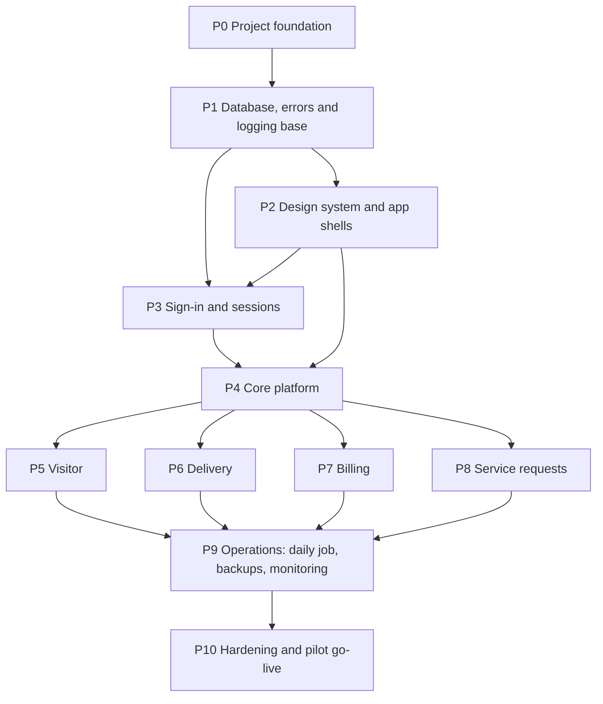
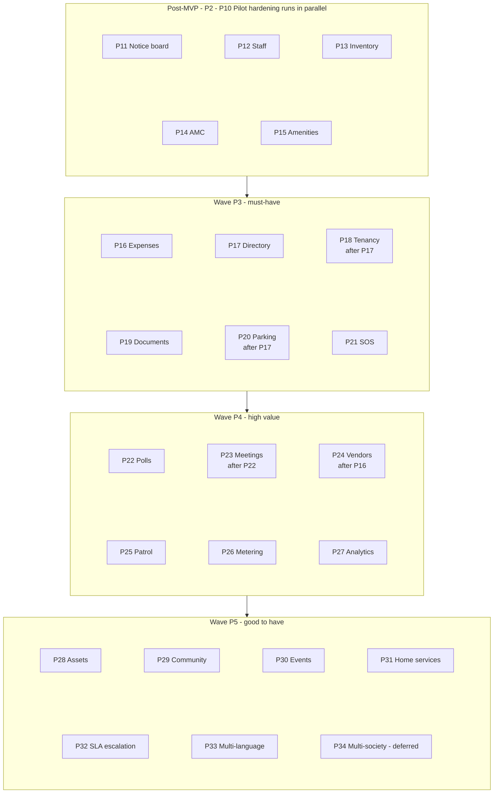
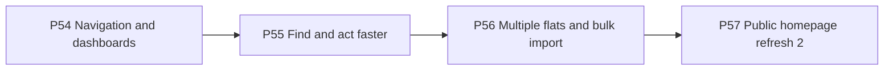

# Homeish — Implementation Plan (IMPLEMENTATION_PLAN.md)

| Field      | Value                                                                                                                                                                                                                                                                                                                                                                                                                                                                                                                                                                                                                                                                                                                                                                                                                                                                                                                                                                                                                                                                                                                                                                                                                                                                                                                            |
| ---------- | -------------------------------------------------------------------------------------------------------------------------------------------------------------------------------------------------------------------------------------------------------------------------------------------------------------------------------------------------------------------------------------------------------------------------------------------------------------------------------------------------------------------------------------------------------------------------------------------------------------------------------------------------------------------------------------------------------------------------------------------------------------------------------------------------------------------------------------------------------------------------------------------------------------------------------------------------------------------------------------------------------------------------------------------------------------------------------------------------------------------------------------------------------------------------------------------------------------------------------------------------------------------------------------------------------------------------------- |
| Product    | Homeish (PRD D-01 approved 2026-11-09)                                                                                                                                                                                                                                                                                                                                                                                                                                                                                                                                                                                                                                                                                                                                                                                                                                                                                                                                                                                                                                                                                                                                                                                                                                                                                           |
| Version    | 0.30 (redesign phases P54–P56 fully decided under PRD D-91–D-93, not built; all of B1–B7 that is not deferred or gated is on beta/testdb, including the B7 additions merged 2026-11-24)                                                                                                                                                                                                                                                                                                                                                                                                                                                                                                                                                                                                                                                                                                                                                                                                                                                                                                                                                                                                                                                                                                                                          |
| Date       | 2026-11-24 (first draft 2026-11-09)                                                                                                                                                                                                                                                                                                                                                                                                                                                                                                                                                                                                                                                                                                                                                                                                                                                                                                                                                                                                                                                                                                                                                                                                                                                                                              |
| Depends on | [PRD.md](./PRD.md), [DESIGN.md](./DESIGN.md), [ARCHITECTURE.md](./ARCHITECTURE.md), [DATABASE.md](./DATABASE.md), [API.md](./API.md), [AGENTS.md](./AGENTS.md)                                                                                                                                                                                                                                                                                                                                                                                                                                                                                                                                                                                                                                                                                                                                                                                                                                                                                                                                                                                                                                                                                                                                                                   |
| Scope      | MVP: Core, Visitor, Delivery, Billing, Service Request (PRD D-02, approved). Post-MVP modules (P11–P15) and the approved expansion phases P16–P34 (PRD D-38) follow P10. Accepted M25 housing-toolkit additions are planned in P35, M03 unit/ownership additions in P36, M08 billing additions in P37, M09 dues additions in P38, M11 accounts additions in P39, M10 funds additions in P40, M12 financial-report additions in P41, M13 expense-control additions in P42, M01 command-center additions in P43, M04 registration/governing-document additions in P44, M06 agenda additions in P45, and M07 election-governance/gated official-voting additions in P46, M14 vendor/contract/AMC additions in P47, M15 non-pay staff-record additions in P48, M16 helpdesk additions in P49, M17 repairs/redevelopment additions in P50, M18 transfer/clearance additions in P51, M19 tenant/parking/facility additions in P52, and M23 communication additions in P53 and P35.13; M24 insurance/legal items were all rejected; M06's meeting-summary addition extends P43.5, and M20 audit/compliance additions extend P41/P43/P44. Budget management remains out of MVP; D-83's P42.5, P41.3 and P42.2 are on beta/testdb. The navigation and dashboard redesign (PRD D-91, DESIGN DD-10) is planned in P54–P56 and is not built. |

## Quick navigation

- **Phase overviews:** [MVP (P0–P10)](#overview-mvp) · [Post-MVP and expansion (P11–P34)](#overview-expansion) · [Toolkit additions (P35–P53)](#overview-toolkit) · [Redesign (P54–P56)](#overview-redesign)
- **Planning and delivery:** [How to read this plan](#how-to-read-this-plan) · [Rules that apply to every phase](#2-rules-that-apply-to-every-phase) · [Build batches](#build-batches) · [Current next steps](#current-next-steps)
- **Reference:** [Future Android app](#future-android-app) · [Documents to write](#documents-to-write-alongside-the-build) · [Assumptions and decisions](#plan-decisions) · [Toolkit review decisions](#toolkit-review-decisions)

Click a phase ID in an overview table to open its details. Click a task ID on an exception line to jump to that task. Use **Back to phase overview** to return to the relevant overview.

## How to read this plan

- Phases are in build order. A phase starts only when its prerequisites are complete. Tasks inside a phase are small enough to implement, verify and review on their own.
- Task IDs: `P<phase>.<task>` (e.g., `P5.4`). Sizes are relative effort, not time: **S** small, **M** medium, **L** large (split further if it grows).
- Every phase uses the same sections: goal, prerequisites (with kickoff decisions from P11), task table, database and API changes, tests, completion criteria and status. Built phases (P11–P18) show no size. Phases planned in 6-hour blocks (Section 2.5) show the block each task belongs to (for example T1, D1). P23–P34 descriptions began as drafts from the PRD; their current status lines below show what was implemented, released or deferred. Any remaining work is revisited at the relevant phase kickoff.
- **Status marks** (every task table and overview tables), in the order work moves through them:
  - ⬜ **Planned:** accepted, not started.
  - 🔵 **In progress:** being built on a feature branch.
  - 🟡 **Built locally:** implemented; local verification is not yet recorded for the full agreed scope.
  - 🟡 **Verified locally:** the agreed scope passed local checks; does not imply owner sign-off or release.
  - 🟠 **On beta:** merged to `beta` with CI green; waiting for owner testing.
  - ✅ **Released:** on `main`; any pending owner acceptance is noted beside the mark.
  - 🏁 **Accepted:** released and signed off by the owner after testing.
  - ⏸ **Deferred:** parked by an owner decision; may return later.
  - ⛔ **Blocked:** cannot continue until a named decision, phase or external step happens.
  - ❌ **Dropped:** decided not to build; the row stays for history.
- Update the relevant task, overview and status summary before starting work and after each activity, recording actual progress and verification even when the status mark stays the same. Record beta only after its CI is green; beta does not imply owner acceptance.

- **Overview task exceptions:** the first line in each overview status cell is the main phase status. Each exception appears on its own line underneath:
  - 🚧 **Blocked:** waiting for a prerequisite, even if a future batch is listed.
  - 💤 **Deferred:** set aside, including unscheduled Pro work.
  - 📝 **Planned:** no batch or phase is listed for the task.
  - 📅 **Scheduled:** assigned to another batch or phase.

  A blocked task does not make the whole phase **Blocked** if other work can proceed. See the linked phase or task for reasons, verification evidence, owner sign-off and release details.

- Requirement IDs (e.g., `VIS-4`), screen IDs (e.g., `G-02`) and operation names (e.g., `visitor.decide`) come from the PRD, DESIGN and API documents.
- **No code is described here.** Each task says _what_ to deliver and _how to know it is done_.
- The agent follows [AGENTS.md](./AGENTS.md) for every task: inspect existing code first, smallest change, tests, documents updated in the same task, ask the owner when something is unclear.
- No feature or technology is added to the plan without project documentation or an explicit owner decision. Accepted toolkit work is planned below; it does not replace the owning documents. P35–P53 sizes (Section 1.2 and each task table) are proposals using the Section 2.5 rule, not approved estimates; they are confirmed or re-split at each slice's kickoff (Section 2.6). The same applies to the P54–P56 redesign sizes (Section 1.3 and Section 2.7).
- **Toolkit planning:** accepted toolkit decisions are recorded in this plan for future work, not as changes already made to the app. Before implementing them, update and obtain any required approval for the owning PRD/DESIGN/DATABASE/API contracts. Existing guarantees remain in force until the corresponding replacement is approved and built.

---

## 1. Plan at a Glance

| Phase       | Name                              | Delivers                                                                               | PRD release | Status                                                                    |
| ----------- | --------------------------------- | -------------------------------------------------------------------------------------- | ----------- | ------------------------------------------------------------------------- |
| [P0](#p0)   | Project foundation                | Running skeleton, tooling, pipelines, development database (AD-13)                     | MVP-0       | ✅ Released                                                               |
| [P1](#p1)   | Database, errors and logging base | Core tables, security helpers, error/audit logging, rate limits                        | MVP-0       | ✅ Released                                                               |
| [P2](#p2)   | Design system and app shells      | Tokens, shared components, navigation shells                                           | MVP-0       | ✅ Released                                                               |
| [P3](#p3)   | Sign-in and sessions              | Email-code login, sessions, developer MFA                                              | MVP-0       | ✅ Released                                                               |
| [P4](#p4)   | Core platform                     | Developer console, structure, people, registration, guards, notifications, files, jobs | MVP-0       | ✅ Released                                                               |
| [P5](#p5)   | Visitor                           | Visitor module                                                                         | MVP-1       | ✅ Released                                                               |
| [P6](#p6)   | Delivery                          | Delivery module                                                                        | MVP-2       | ✅ Released                                                               |
| [P7](#p7)   | Billing                           | Charges, bills, UPI payments, ledger, receipts, reports                                | MVP-3       | ✅ Released                                                               |
| [P8](#p8)   | Service requests                  | Requests module                                                                        | MVP-4       | ✅ Released                                                               |
| [P9](#p9)   | Operations                        | Daily job, retention, backup export, monitoring                                        | MVP         | ✅ Released 💤 Deferred: [production backups](#p9-4)                   |
| [P10](#p10) | Hardening and pilot               | Security/accessibility/performance review, production setup, pilot                     | MVP         | ⛔ Blocked 📝 Planned: [P10.5](#p10-5)/[P10.8](#p10-8)/[P10.9](#p10-9) |

P5, P6, P7 and P8 depend only on P4, not on each other. They are listed in the PRD's order; the owner may re-order them.

### 1.1 Post-MVP and expansion phases (P11–P34)

Arrows are recommended build order; "after Pxx" inside a box marks a phase that builds on another phase. At runtime every module works on its own; links to other optional modules activate only when those are enabled (PRD A-36). Blocks are 6-hour work blocks (Section 2.5).

| Phase       | Module / enhancement              | Key               | PRD           | Size | Blocks | Builds on                                   | Status      |
| ----------- | --------------------------------- | ----------------- | ------------- | ---- | ------ | ------------------------------------------- | ----------- |
| [P11](#p11) | Notice board                      | `notice`          | §5.8, D-21    | —    | —      | Core                                        | ✅ Released |
| [P12](#p12) | Staff                             | `staff`           | §5.5, P2-1    | —    | —      | Core                                        | ✅ Released |
| [P13](#p13) | Housekeeping inventory            | `housekeeping`    | §5.6, P2-2    | —    | —      | Core                                        | ✅ Released |
| [P14](#p14) | AMC                               | `amc`             | §5.7, P2-3    | —    | —      | Core                                        | ✅ Released |
| [P15](#p15) | Amenity booking                   | `amenity`         | §5.9, D-22    | —    | —      | Core; `billing` for paid amenities          | ✅ Released |
| [P16](#p16) | Society expenses & accounts       | `expense`         | 5.10.1, P3-1  | L    | —      | Core; reads `billing` payments when enabled | ✅ Released |
| [P17](#p17) | Resident & vehicle directory      | `directory`       | 5.10.2, P3-2  | M    | —      | Core unit occupants                         | ✅ Released |
| [P18](#p18) | Move-in / move-out & tenancy      | `tenancy`         | 5.10.3, P3-3  | L    | 3      | Core occupants, files; `billing` dues check | ✅ Released |
| [P19](#p19) | Document repository               | `document`        | 5.10.4, P3-4  | M    | 2      | Core files                                  | ✅ Released |
| [P20](#p20) | Parking management                | `parking`         | 5.10.5, P3-5  | M    | 2      | `directory` vehicles; `visitor` passes      | ✅ Released |
| [P21](#p21) | Emergency & SOS                   | `sos`             | 5.10.6, P3-6  | M    | 2      | Core notifications and Realtime             | ✅ Released |
| [P22](#p22) | Polls & voting (Civic Pulse port) | `poll`            | 5.10.7, P4-1  | L    | 3      | Core units/occupants                        | ✅ Released |
| [P23](#p23) | Meetings & AGM                    | `meeting`         | 5.10.8, P4-2  | M    | 2      | `poll` resolutions; `document` minutes      | ✅ Released |
| [P24](#p24) | Vendors & purchase approvals      | `vendor`          | 5.10.9, P4-3  | M    | 2      | `expense` drafts                            | ✅ Released |
| [P25](#p25) | Guard patrol & incident log       | `patrol`          | 5.10.10, P4-4 | M    | 2      | Core guards and gate settings               | ✅ Released |
| [P26](#p26) | Utility metering                  | `metering`        | 5.10.11, P4-5 | M    | 2      | `billing` charges                           | ✅ Released |
| [P27](#p27) | Committee analytics dashboard     | Core              | 5.10.12, P4-6 | M    | 2      | Read models of enabled modules              | ✅ Released |
| [P28](#p28) | Asset register                    | `asset`           | 5.10.13, P5-1 | S    | 1      | `amc` contracts                             | ✅ Released |
| [P29](#p29) | Resident community & marketplace  | `community`       | 5.10.13, P5-2 | L    | 3      | Core files, notifications                   | ✅ Released |
| [P30](#p30) | Events & RSVPs                    | `event`           | 5.10.13, P5-3 | M    | 2      | `billing` contributions                     | ✅ Released |
| [P31](#p31) | Home-services directory           | `home_services`   | 5.10.13, P5-4 | S    | 1      | Core                                        | ✅ Released |
| [P32](#p32) | Service-request SLA escalation    | `service_request` | 5.10.13, P5-5 | S    | 1      | `service_request`, daily runner             | ✅ Released |
| [P33](#p33) | Multi-language (Hindi first)      | Core              | 5.10.13, P5-6 | L    | 3+     | All screens                                 | ✅ Released |
| [P34](#p34) | Multi-society overview            | Core              | 5.10.13, P5-7 | —    | —      | Existing admin/committee memberships        | ⏸ Deferred  |

Block totals: P3 wave (P18–P21) 9 planned, all four phases released to beta and main; P4 wave (P22–P27) 13 blocks, all six phases released to beta and main; P5 wave about 11 blocks, with P28–P33 released and P34 deferred to the future (PRD D-65).

### 1.2 Accepted toolkit additions (P35–P53)

Arrows only stack the groups for reading; they are not a build order (Section 2.6). "after Pxx" inside a box marks a selected task-level prerequisite: P35 profile inputs for P44 and clearance-contract work for P51; P37's estimate source and P39's shared fund map and deposit register for P40; P40's approved measures for P41, sanction source for P42 and repair forecast for P50; P23 meeting and agenda records for P45.1; P44's governing-document source for P46; and P49's definitions and source records for P53. P43.5 remains a separate existing summary, not a P45.1 prerequisite. It does not mean finishing every task in one phase before starting another. The phase task tables remain authoritative; phases without a mark have no direct phase dependency shown here. P35.10 uses the M18 policy decisions recorded in P51 as planning input, not as a dependency on P51 implementation. P51.3/P51.4 clearance implementation coordinates with P35.10–P35.12 after the clearance contracts are approved. M23 template formats extend P35.13 but do not gate P53.1–P53.3.

| Phase       | Module / enhancement                           | Key                                                      | PRD                                                                                   | Size               | Blocks | Builds on                                                              | Source                        | Status                                                                                                                                                                                      |
| ----------- | ---------------------------------------------- | -------------------------------------------------------- | ------------------------------------------------------------------------------------- | ------------------ | ------ | ---------------------------------------------------------------------- | ----------------------------- | ------------------------------------------------------------------------------------------------------------------------------------------------------------------------------------------- |
| [P35](#p35) | Toolkit housing additions                      | Core; `amenity`, `tenancy`                               | D-71 core approved; changes D-50; D-84 on beta/testdb                                 | 2 S, 8 M, 3 L (+2) | 29     | Core registry, units, files; P51 clearance policy                      | Toolkit-M25                   | 🟠 Core scope and [P35.10](#p35-10)–[12](#p35-12) on beta/testdb 🟠 [P35.8](#p35-8)–[9](#p35-9) deposits on beta/testdb (D-84, [B7](#batch-b7))                                          |
| [P36](#p36) | Unit and ownership records                     | Core                                                     | CORE-29–31, TEN-6; CORE-32, D-85 approved                                             | 2 S, 8 M, 1 L      | 21     | Core units/occupants; `tenancy`, `document`, `billing`, `parking`, P26 | Toolkit-M03                   | 🟠 Approved scope on beta 💤 Deferred: [P36.6](#p36-6)/[8](#p36-8) 🟠 [P36.7](#p36-7) on beta/testdb (D-85, [B7](#batch-b7)) 💤 Deferred: [P36.4](#p36-4)/[5](#p36-5) (Pro)        |
| [P37](#p37) | Billing additions                              | `billing`                                                | D-12, D-72 approved; BIL-27/D-88 approved and P37.5 on beta/testdb                    | 1 S, 3 M, 1 L      | 10     | `billing` charges, bills and ledger; P35.1                             | Toolkit-M08                   | 🟠 P37.1–P37.4 on beta 🟠 [P37.5](#p37-5) on beta/testdb (D-88, [B7](#batch-b7))                                                                                                         |
| [P38](#p38) | Dues and arrears                               | `billing`                                                | D-71 approved for P38.2–P38.4; BIL-18/D-89 on beta/testdb                             | 3 M, 1 L           | 9      | `billing` due dates, payments and unit ledger                          | Toolkit-M09                   | 🟠 P38.2–P38.4 on beta 🟠 [P38.1](#p38-1) on beta/testdb (D-89); accountant review recommended                                                                                           |
| [P39](#p39) | Accounts and cash book                         | `expense`                                                | D-69; D-74 for P39.7                                                                  | 3 S, 4 M           | 11     | P16 books and reports; P40 fund list                                   | Toolkit-M11                   | 🟠 P39.1–P39.7 on beta                                                                                                                                                                      |
| [P40](#p40) | Fund management                                | `expense`                                                | D-73, D-74; beta separately approved; EXP-36, D-87 approved                           | 3 S, 10 M          | 23     | P16; P39.7, P39.5; P37.3; M17 review                                   | Toolkit-M10 + Toolkit-M13     | 🟠 P40.1a–P40.7, partial [P40.8](#p40-8) and [P40.9](#p40-9) on beta/testdb 🟠 [P40.8b](#p40-8b)–[c](#p40-8c) on beta/testdb (D-87, [B7](#batch-b7))                                     |
| [P41](#p41) | Financial statements and reports               | `expense`; Core analytics                                | EXP-21–EXP-26, D-77; EXP-33/35, D-83 approved for local coding; D-84 report extension | 2 S, 2 M, 3 L      | 15     | P16, P27; P39, P40; P47; P42.5 budget                                  | Toolkit-M12 + Toolkit-M20     | 🟠 P41.1, P41.2 and P41.4–P41.7 on beta/testdb 🟠 [P41.3](#p41-3) on beta/testdb (D-83/D-84, [B7](#batch-b7))                                                                            |
| [P42](#p42) | Expense control and reporting                  | `expense`                                                | EXP-27–EXP-29, D-80; EXP-31/32/34, D-83 approved; D-84 actuals extension              | 1 S, 3 M, 1 L      | 10     | P16, P24, P27, P47.7; P41 statement rules                              | Toolkit-M13                   | 🟠 P42.1, P42.3, P42.4 and [P42.5](#p42-5) on beta/testdb 🟠 [P42.2](#p42-2) on beta/testdb (D-83/D-84)                                                                                  |
| [P43](#p43) | Command center and governance summaries        | Core                                                     | BIL-25/26, MTG-5; CORE-33/D-86 on beta/testdb                                         | 2 S, 3 M           | 8      | P16, P23, P27; P38.4                                                   | Toolkit-M01 + Toolkit-M06/M20 | 🟠 On beta: [P43.1](#p43-1)/[2](#p43-2)/[3](#p43-3)/[5](#p43-5) 🟠 [P43.4](#p43-4) on beta/testdb (D-86)                                                                                 |
| [P44](#p44) | Registration, bye-laws and governing documents | `document`                                               | DOC-5–DOC-9, D-75; DOC-8/D-86 on beta/testdb                                          | 2 S, 5 M, 5 L      | 27     | P19, P14, P23; P18 for NOCs; P35.2/P35.3                               | Toolkit-M04 + Toolkit-M20     | 🟠 Buildable scope on beta/testdb; owner UAT pending 🟠 [P44.5](#p44-5) on beta/testdb (D-86) 🚧 Rule publication: legal review 💤 Deferred: [P44.4](#p44-4)/[P44.7](#p44-7) (Pro) |
| [P45](#p45) | Meeting agenda enhancements                    | `meeting`                                                | MTG-6/7 and D-76                                                                      | 1 L                | 3      | P23                                                                    | Toolkit-M06                   | 🟠 On beta/testdb; owner UAT and live enablement pending                                                                                                                                    |
| [P46](#p46) | Election governance and gated official voting  | `poll`; links `meeting`, `notice`, `document`, `expense` | POL-7–POL-11, D-81; changes POL-4, CORE-9                                             | 3 M, 2 L           | 12     | P19, P22, P23, P44; admin legal-type confirmation                      | Toolkit-M07                   | 🟠 On beta/testdb; owner UAT and live enablement pending                                                                                                                                    |
| [P47](#p47) | Vendor, contract and AMC additions             | `vendor`, `amc`                                          | D-71 approved; changes AMC-2, AMC-7                                                   | 3 S, 5 M           | 13     | P14, P24, P16, P28                                                     | Toolkit-M14                   | 🟠 P47.1–P47.8 on beta                                                                                                                                                                      |
| [P48](#p48) | Staff record additions                         | `staff`                                                  | D-68 approved                                                                         | 2 S                | 2      | P12                                                                    | Toolkit-M15                   | 🟠 P48.1–P48.2 on beta                                                                                                                                                                      |
| [P49](#p49) | Helpdesk additions                             | `service_request`                                        | D-70 approved; changes SRQ-1/3/5/6, D-59                                              | 4 S, 4 M           | 12     | P8, P32, P24                                                           | Toolkit-M16                   | 🟠 P49.1–P49.8 on beta                                                                                                                                                                      |
| [P50](#p50) | Repairs and redevelopment                      | New optional module `major_works`                        | MWK-1–MWK-8, D-82 approved; extends POL-1                                             | 1 S, 5 M, 2 L      | 15     | P40.9; P16, P40.4, P24, P22, P23                                       | Toolkit-M17                   | 🟠 P40.9 and P50.1–P50.6 on beta/testdb; owner UAT and live enablement pending                                                                                                              |
| [P51](#p51) | Transfer and clearance                         | `tenancy`                                                | TEN-7–TEN-11, D-78; changes TEN-3, D-50                                               | 2 S, 1 M, 1 L      | 7      | P18, `billing`, P23; P35.10–P35.12                                     | Toolkit-M18                   | 🟠 On beta/testdb with [P35.10](#p35-10)–[P35.12](#p35-12); owner UAT and legal review pending                                                                                              |
| [P52](#p52) | Tenant, parking and facilities                 | `tenancy`, `parking`, `amenity`                          | TEN-12/13, PRK-5, AMN-4, FAC-1, D-79; changes D-22                                    | 2 S, 3 M           | 8      | P18, P20, P15, P17, P14, P28, P13, P16                                 | Toolkit-M19                   | 🟠 On beta/testdb; owner UAT and live enablement pending                                                                                                                                    |
| [P53](#p53) | Communication additions                        | `notice`                                                 | D-71 approved; adds NTC-4/5, CORE-27/28                                               | 1 S, 2 M           | 5      | P11, P8/P32/P49, P21, P23, P30                                         | Toolkit-M23                   | 🟠 P53.1–P53.3 on beta                                                                                                                                                                      |

Proposed totals: 125 tasks, about 240 blocks. Sizes and blocks are first estimates using the Section 2.5 rule (S ≈ 1, M ≈ 2, L ≈ 3 blocks per task); **Size** shows the mix of task sizes, with explicit additions where cross-domain work exceeds the base estimate. They are not approved and are confirmed or re-split at each slice's kickoff. **Key** shows the existing module or Core area a phase extends; the only new module is P50's optional "Major repairs & redevelopment" module (owner decision 2026-11-19; key `major_works` set at the P50 kickoff, D-82). The build order is in the Section 2.6 build batches. **PRD** “Not yet” means the PRD has no requirement for this work; listed IDs are existing PRD rules the phase would change or must re-check, and they must be updated and approved before implementation. Phase scope, planning notes, gates and task sizes are in each phase section. Acceptance is planning only and does not authorize implementation, release or live use (Section 2.6).

### 1.3 Navigation and dashboard redesign (P54–P56)

The owner approved this redesign on 2026-11-24 (PRD D-91, CORE-34–CORE-37; DESIGN DD-10) after comparing Homeish with the Multi School ERP and AcadLynk demos. It changes how existing features are grouped and reached; it adds no new module. The option sheets are in [docs/proposals](./proposals/).

| Phase       | Redesign step                  | Key                                                    | PRD                                                                  | Size           | Blocks | Builds on                                                                                                  | Source      | Status     |
| ----------- | ------------------------------ | ------------------------------------------------------ | -------------------------------------------------------------------- | -------------- | ------ | ---------------------------------------------------------------------------------------------------------- | ----------- | ---------- |
| [P54](#p54) | Navigation and dashboards      | Core registry and app shells                           | CORE-34, CORE-35, CORE-37, CORE-40, MOD-7, MOD-8; D-91–D-94 approved | 4 S, 10 M, 2 L | 30     | P2 shells, P4A module registry, P27/P43 dashboard data, P7 billing                                         | D-91, DD-10 | ⬜ Planned |
| [P55](#p55) | Find and act faster            | Core; reads `event`, `meeting`, `amenity`, `billing`   | CORE-37–CORE-39, CORE-41, CORE-42; D-91–D-93 approved                | 1 S, 4 M, 3 L  | 18     | P54 action list, groups and preference store; P4A registry; MOD-1, MOD-7                                   | D-91        | ⬜ Planned |
| [P56](#p56) | Multiple flats and bulk import | Core units, occupants and households; billing charges  | CORE-36, CORE-43; D-91, D-93 approved                                | 1 S, 1 M, 3 L  | 12     | P54 place picker; P4B/P4C units and people; P36 unit records; existing CSV imports                         | D-91        | ⬜ Planned |
| [P57](#p57) | Public homepage refresh 2      | Public website (`src/core/website/`); developer portal | WEB-1–WEB-8; D-95 approved                                           | 2 S, 3 M, 1 L  | 11     | P54 topic groups and new look; P55/P56 setup features; P0.9 homepage; rate limiter and transactional email | D-95        | ⬜ Planned |

Redesign totals: 29 tasks, about 60 blocks, estimates like the Section 1.2 sizes (S = 1, M = 2, L = 3 blocks). Every redesign question is answered (PRD D-93), so only coding remains. P57 follows the redesign with 6 more tasks and about 11 blocks (PRD D-95); its questions are answered too. They are not part of the 125 toolkit tasks or 240 blocks above. Build order, branch and release rules are in Section 2.7.

---

## 2. Rules That Apply to Every Phase

### 2.1 Task rules

1. Every task starts with the AGENTS.md start-of-task steps (read documents, inspect code, restate the task, ask if unclear).
2. One task = one focused change that builds, passes checks and can be reviewed alone. Split anything larger.
3. Tests are part of the task, not a later phase (AGENTS Section 13). A task is not finished until its tests pass.
4. Database changes: forward-only migrations with row-level security, constraints, indexes and generated types in the **same** change (AGENTS Section 11).
5. Documents are updated in the same task (AGENTS Section 15). No new markdown files.
6. Nothing runs against staging or production without the owner's approval.

### 2.2 Module completion gate (applies to P5–P8, the module phases P11–P34, toolkit additions P35–P53, the platform modules in P4, and redesign tasks P54–P56 that change a module's screens)

A module is **done** only when all of the following are true:

- [ ] Every PRD requirement for the module is implemented or explicitly marked deferred by the owner.
- [ ] All its screens exist with loading, empty, error and no-permission states (DESIGN Section 9).
- [ ] The DESIGN acceptance checklist (DESIGN Section 15) passes.
- [ ] Database tests prove tenant isolation, every role-permission cell (allowed and denied), module-disabled denial and the module's special rules.
- [ ] Automated end-to-end tests cover the main journeys on phone and desktop sizes; the automated accessibility check passes.
- [ ] Manual checks done and recorded: keyboard use, screen reader (TalkBack and VoiceOver), 200% text zoom, a low-end Android phone and iPhone Safari.
- [ ] The module ships **switched off** (disabled) and can be switched on for one pilot society by the developer.
- [ ] DATABASE.md, API.md, DESIGN.md and PRD.md match the code.
- [ ] The owner has tried it and approved it (approval is recorded; it is never assumed).

### 2.3 Owner decisions needed along the way

| Needed before         | Item                                                                                                                                                                                                   | Status                                                                                                                    |
| --------------------- | ------------------------------------------------------------------------------------------------------------------------------------------------------------------------------------------------------ | ------------------------------------------------------------------------------------------------------------------------- |
| P0                    | Accounts created (GitHub, Supabase, Vercel, Sentry, Brevo)                                                                                                                                             | Owner action                                                                                                              |
| P0.4                  | Docker Desktop cannot be installed; one free Supabase project `homeish-testdb` is used for development, testing and staging (synthetic data only)                                                      | **Approved and created 2026-11-09 (ARCHITECTURE AD-13)**                                                                  |
| P0.4                  | Three Supabase projects (`homeish-testdb`, `homeish-demo`, `homeish-live`), demo and live paused until needed; separate Vercel project `demo-homeish` for the demo                                     | **Approved and Supabase projects created 2026-11-09 (ARCHITECTURE AD-14)**; `demo-homeish` Vercel project not yet created |
| P0.7                  | Connect beta Vercel variables to `homeish-testdb` now or wait until backend work begins                                                                                                                | **Owner chose to defer until P1 on 2026-11-09**                                                                           |
| P3                    | How development sign-in emails are read without the local mail catcher (Docker-only)                                                                                                                   | Open; decide before P3.3                                                                                                  |
| P2                    | Product logo (DESIGN DD-07; Homeish wordmark + concept-15 mark)                                                                                                                                        | **Approved 2026-11-09:** selected logo asset added                                                                        |
| P3 (staging)          | Your own domain with email sender verification (SPF/DKIM) so login emails are not marked as spam                                                                                                       | Owner action                                                                                                              |
| P7                    | A pilot society's UPI ID and payee name for testing (a test UPI ID is fine until the real one is entered by the society's admin)                                                                       | Owner action                                                                                                              |
| P10                   | Production accounts; `homeish-live` resumed for go-live and upgraded to the paid plan when the first society starts paying (AD-06 amended); the first-ten no-subscription offer does not cover hosting | Owner action                                                                                                              |
| Before society eleven | Homeish subscription price and offer terms after the first ten free societies                                                                                                                          | Open                                                                                                                      |
| P10                   | Pilot society and admin contact                                                                                                                                                                        | Owner action                                                                                                              |

### 2.4 Post-MVP and expansion phases (P11–P34)

- **Pattern:** each module phase records its kickoff decisions with the owner first (PRD D-43; answers go in the PRD module section, as for P12–P15), then delivers one migration group with RLS and database tests, module registration and permission map, screens with all states, unit/integration/end-to-end/accessibility tests and the module completion gate (2.2). The module ships switched off.
- **Order:** P11–P15 follow the PRD and the owner's decision (2026-11-13). P16–P34 are the approved roadmap (PRD D-38, 2026-11-14); their requirements are in PRD Section 5.10.
- **Timing:** these phases may be built in parallel with P10 pilot hardening, but no expansion module is enabled for a live society until P10.5, P10.6 and the production Storage-file recovery plan are complete ([pilot-readiness audit](./audits/pilot-readiness-audit.md)). P10 work takes priority when both compete.
- **Release:** commit promotion and hosted migrations follow the owner-approved release process in [DEPLOYMENT.md](./DEPLOYMENT.md). Released post-MVP migrations are applied to `homeish-testdb` only; `homeish-live` stays paused and unmigrated until production go-live (Section 7 of DEPLOYMENT). Local verification does not constitute owner UAT or production go-live approval.
- **Deferred until triggered:** SMS/WhatsApp and mobile-number login (PRD D-06, A-35), payment gateway, native apps, offline mode (ARCHITECTURE Section 3). A reference draft for a future Android app is at the end of this plan ("Future — Android App"); it is not scheduled.

### 2.5 Working in 6-hour blocks

**Added 2026-11-15.** Remaining work is cut into blocks of about 6 focused hours. The sizes follow the observed P16/P17 pace: **S ≈ 1 block, M ≈ 2 blocks, L ≈ 3 blocks**. Each block must:

- start from a green baseline, with that phase's kickoff decisions already answered (asked before the block, not during it);
- end at a safe pause point: the local gate passes (`npm run check`, the phase's local integration tests, targeted Playwright with axe, `npm run build`) and docs record the status;
- cut screens or polish if time runs short, never privacy, role checks or tests;
- stay local: no commits, pushes, hosted migrations or live enablement without separate owner approval.

Block counts per phase are in Section 1.1; P35–P53 proposed counts are in Section 1.2 and P54–P56 in Section 1.3. Phases without a block plan are split into tasks at kickoff.

Block codes in a phase's task table are the module's letter plus the block number, for example T1–T3 for Tenancy (P18), D1–D2 for Documents (P19), K1–K2 for parKing (P20) and S1–S2 for SOS (P21). They are for planning only; status lines describe the phase as a whole.

### 2.6 Toolkit addition phases (P35–P53)

- **What they are:** accepted toolkit-review decisions that extend existing modules and Core. They add no new module key, dependency or privileged-client expansion unless the owner approves one; the owner approved P50 as a new optional module on 2026-11-19, and automatic WhatsApp sending is not approved (P37.5 uses email plus a user-started share, D-88). Acceptance is planning only and does not authorize implementation, release or live use.
- **Pattern:** each slice first closes its named kickoff gates, then updates the owning PRD/DESIGN/DATABASE/API contracts and obtains approval (the PRD has no requirements for these phases yet; Section 1.2 lists the existing PRD rules each phase would change). It then delivers forward-only, society-scoped migrations with row-level security, generated types and database tests; screens with all states; unit, integration, end-to-end and accessibility tests; and the Section 2.2 gate. New capabilities ship off where applicable, and existing data keeps its agreed meaning.
- **Order:** work follows the build batches below. Task-level prerequisites in the Section 1.2 diagram and each task table still apply inside and across batches.
- **Sizing:** task sizes are proposals using the Section 2.5 rule (S ≈ 1, M ≈ 2, L ≈ 3 blocks). Re-estimate and split at kickoff, especially blocked or legally gated tasks whose scope may change.
- **Priority and release:** P10 pilot/go-live gates and all existing release approvals remain unchanged. Legal or statutory points are verified against the state co-operative act and the society's bye-laws before use.

#### Build batches (owner decisions 2026-11-19)

The owner approved this build order and these decisions on 2026-11-19. They are a plan for building, not approval to release or enable anything live. Each phase follows the Pattern above: its PRD, DESIGN, DATABASE and API changes are written and approved before coding starts.

**How the work runs**

- All work happens on one branch, `feature-build-2`. One worker writes code; up to two helpers may read, draft contract changes and review in parallel, but do not edit code.
- Only the lead worker changes migrations, the module registry (`src/core/modules/index.ts`) and generated database types, one change at a time and in order.
- Full checks run one at a time, because the local test database and Playwright use fixed ports.
- Gather the current phase's foreseeable questions and prepare the implementation plan and proposed contract changes in the planning slice. Present them and pause for the owner's explicit go-ahead before writing code, migrations or tests, allowing a model change first. Pause and ask if a new consequential decision appears during implementation.
- Complete and verify the agreed phase scope before proposing local commits; do not make intermediate documentation or code commits. After committing with the owner's approval, wait for a separate go-ahead before starting the next phase. Pushes, `beta`/`main` merges and `homeish-testdb` changes happen only when the owner asks.
- No P35–P53 capability is enabled for a live society until P10 pilot hardening is complete (Section 2.4).

| Batch                   | Order                                                        | Tasks                                                                                       | Blocks |
| ----------------------- | ------------------------------------------------------------ | ------------------------------------------------------------------------------------------- | ------ |
| B1 | [P48](#p48) → [P39](#p39) → [P49](#p49)                      | P48; P39 except P39.5 and P39.7; P49                                                        | 21     |
| B2 | [P47](#p47) → [P38](#p38) → [P35](#p35) core                 | P47; P38.2–P38.4 (P38.1 carried over, D-89); P35.1–P35.7 and P35.13                         | 38     |
| B3 | [P37](#p37) → [P53](#p53) → [P36](#p36)                      | P37.1–P37.4; P53; P36.1–P36.3, P36.9 and P36.10 (P36.6/P36.8 deferred)                      | 25     |
| B4 | [P40](#p40) with [P39.5](#p39-5) → [P43](#p43) → [P44](#p44) | P40.1a–P40.7 and partial P40.8 with P39.7 and P39.5; P43; P44 except P44.4 and P44.7        | 55     |
| B5 | [P45](#p45) → [P41](#p41) → clearance                        | P45; P41 except P41.3; P35.10–P35.12 with P51                                               | 29     |
| B6 | [P42](#p42) → [P52](#p52) → [P46](#p46)                      | P42 except P42.2; P52; P46 including P46.2 official voting                                  | 25     |
| B7 | [P50](#p50) and follow-ups                                   | P50; P40.9; P35.8–P35.9 deposits; P36.7a–b; P42.5, P41.3 and P42.2 budgets; P37.5; P40.8b–c | 40     |
| Pro version             | Not scheduled                                                | P36.4, P36.5, P44.4, P44.7                                                                  | 7      |

B1–B7 hold 233 blocks and the Pro version 7, matching the 240 proposed blocks in Section 1.2. Batches run in order, starting with B1; inside a batch, phases follow the order shown. **Formerly carried-over items:** P38.1 (L, counted in B2) and P43.4/P44.5 (counted in B4) were blocked when those batches ran; D-89 and D-86 are now on beta/testdb, so those batch counts are complete rather than remaining-work estimates.

**Progress:** The implemented B1–B3 scopes are on beta; later or deferred tasks are still identified in their phase rows. The B3 block estimate retains the originally planned P36.6/P36.8 work, which the owner later deferred; it is not a remaining-effort estimate. B4's remaining buildable local scope is complete: P43.4 and P44.5 are on beta/testdb under D-86, while the earlier P43/P44 scope remains on beta/testdb and house-rule publication stays locked pending legal review. B5's P45, P41.1–P41.7 and P51 with P35.10–P35.12 are on beta/testdb. B6's P52, P42.1/P42.3/P42.4 and P46.1–P46.3 are on beta/testdb. P35.8–P35.9, P36.7, P37.5, P38.1 and full P40.8 are on beta/testdb; the remaining P42/P50/P40.9 B7 items already on beta/testdb keep their separate owner UAT/release gates. Beta/testdb release does not imply owner acceptance or live release.

**Owner decisions for the batches.** These become proposed PRD and contract changes in each batch's paperwork and still need that approval.

- **P46.2 official voting (B6):** the app counts the votes and the returning officer declares the result; ballots are secret; the admin prepares the voter list, which is locked before voting opens. A society switches official voting on with an admin confirmation that its rules allow online voting; no proof is uploaded.
- **P50 (B7):** a new optional module, "Major repairs & redevelopment" (key `major_works`, set at kickoff under D-82). For P50.2 the committee sets the criteria and weights for each project, the app never picks the winner, and the admin may leave a project or quote out of scoring. P50.3 levies are what-if scenarios only and never create a bill. P50.4–P50.5 redevelopment records are visible only to admins and the committee; each member sees only their own consent status.
- **P40.9 forecast (B7):** a 10-year forecast from admin-entered cost, repair cycle and inflation %, always shown as an estimate.
- **Deposits, P35.8–P35.9 (B7):** on beta/testdb under D-84; deposits stay off by default, snapshot per-amenity terms, support payment-before-confirmation or society-wide immediate confirmation, and record externally completed partial receipts/refunds and post-booking deductions. Held deposits are cash movements, not income; retained deductions become non-cash Other income, without a second cash entry. Residents of the booking's unit see their breakdown and deduction evidence. On cancellation all deposit money received must be refunded, separately from the P15 usage-fee credit.
- **P37.5 bill sharing (B7):** on beta/testdb under D-88, it emails the bill PDF automatically on publish (on by default; an admin can switch it off) and adds a Share button for residents (own unit) and admins (any unit) that opens the phone's share menu with the PDF, or a WhatsApp/email link with text only. The app records "share started", never "delivered". No WhatsApp Business provider and no change to D-06.
- **Budgets, P42.5, P41.3 and P42.2 (B7):** D-83's limited yearly plan, recorded changes, budget-against-actual, cash flow and resident summary are on beta/testdb for P42.5/P41.3. P42.2 warnings and projections are on beta/testdb. D-84 includes retained deposit deductions under Other income without counting held receipts/refunds as budget income. Budgets stay out of MVP.
- **P36.7 handover (B7):** on beta/testdb under D-85; it adds an admin-recorded handover checklist for move-in, move-out, owner transfer or any unit, with linked P26 meter readings, optional photos and optional party acknowledgement; an unfinished handover only warns.
- **P40.8 full reconciliation (B7):** on beta/testdb under D-87; it adds a derived Reconciled/Needs review status, typed monthly bank-statement closing balances, optional fund targets with an estimate, factual labels and an admin CSV.
- **P43.4 and P44.5 (formerly carried over from B4):** on beta/testdb under D-86, with the accepted-risk acknowledgement, permanent retention by default and an opt-in Settings → Data cleanup tab.
- **P38.1 interest (formerly carried over from B2):** on beta/testdb under D-89, adding optional simple daily interest on overdue regular bills as a separate monthly bill, off by default.
- **Pro version:** P36.4, P36.5, P44.4 and P44.7 move to a possible future paid Pro version and are not scheduled.

**Risks to close before live use**

1. Official voting relies on an admin confirmation only, not checked proof that the society's rules allow online voting.
2. Manual fund, fixed-deposit, corpus, transfer and interest rules (P39.5, P40.1–P40.8) follow the owner's answers without a prior professional review. An accountant and, where relevant, a legal adviser should check them; statutory/bye-law checks and separate live-release approval still apply.
3. P41.2 goes beyond PRD D-39; D-77 (approved 2026-11-22 for local coding) updates D-39 for read-only statements and the limited summary only.
4. P37.5 automatic bill emails are on by default, so existing beta societies start receiving them after release unless an admin switches them off; bulk publishing may hit email-provider rate limits.
5. Issued certificates and staff notes are kept until an admin deletes them; the app should record who deleted what and when.
6. P38.1 interest (D-89) is planned at the owner's request without a prior accountant/legal review; the 24% cap is an app safety limit, not a legal limit. An accountant review is strongly recommended before live use.
7. P43.4 compliance and P44.5 case records (D-86) rely on an admin's accepted-risk acknowledgement; they are not legal advice or certification.
8. Budget approval (D-83) is typed by an admin and not checked against the meeting or resolution; the resident summary is shared by default once a budget is approved.

### 2.7 Redesign phases (P54–P56)

- **What they are:** the navigation and dashboard redesign approved in PRD D-91 and DESIGN DD-10. They regroup and resurface existing features; they add no module key and do not change who may switch modules on or off (MOD-1). They change module data rules only where the owner decided it in D-93: the per-society choice of admin-editable settings (MOD-8) and the opening-dues charge (CORE-43).
- **Developer and admin settings stay apart (MOD-7, D-92):** what the developer agrees offline with a society lives only in the developer portal; what the society decides lives only in its admin Settings pages. Admins may see module on/off state as read-only text and ask for a switched-off feature (CORE-38), never change it. P54.9 checks the existing app against this rule.
- **Branch and release:** built and checked on beta/testdb like the rest of the redesign. `main` keeps the existing app until the owner confirms the redesign and these phases are complete and separately approves promotion (PRD, AGENTS release workflow).
- **Order:** P54 → P55 → P56 → P57, after the B7 follow-ups already in progress. P57 (public homepage refresh 2, PRD D-95) follows the redesign so its screenshots show the new look. Each phase follows the build-batch working rules in Section 2.6 (planning slice, owner go-ahead before code, one lead worker for the module registry and migrations, approval before commits).
- **Decisions:** every phase's questions were answered by the owner on 2026-11-24 and recorded in PRD D-93 and each phase's "Phase decisions"; only coding remains. Before coding a phase, its new tables and functions are added to DATABASE and API. P54 adds a per-person preference store, quick-action defaults, the managing-body name and per-society setting access; P55 adds the onboarding record, feature requests and the Getting started dismiss flag; P56 adds import-run records and the opening-dues lock. Each is a forward-only migration with row-level security.
- **Checks:** every phase keeps all existing pages reachable (no feature is lost from the menus), keeps permission and module filtering identical to today, and runs the Section 2.2 accessibility, phone/laptop and browser checks on the changed shells.

| Batch                     | Order       | Tasks        | Blocks |
| ------------------------- | ----------- | ------------ | ------ |
| B8   | [P54](#p54) | P54.1–P54.16 | 30     |
| B9   | [P55](#p55) | P55.1–P55.8  | 18     |
| B10 | [P56](#p56) | P56.1–P56.5  | 12     |
| B11 | [P57](#p57) | P57.1–P57.6  | 11     |

B8–B10 hold about 60 blocks, matching Section 1.3, and are separate from the B1–B7 totals. B11 (P57) adds about 11 blocks after them.

---

# Phase P0 — Project Foundation

[Back to phase overview](#overview-mvp)

**Goal:** an empty-but-correct project that builds, lints, tests and deploys to a preview, with the development database running and the rules in AGENTS.md enforced by tooling.

**Prerequisites:** owner actions in 2.3 (accounts, development Supabase project per AD-13). Documents LOCAL_SETUP.md (to be written alongside P0.4) and DEPLOYMENT.md (before P10).

| ID   | Task                                                                                                                                                                                                       | Size | Status |
| ---- | ---------------------------------------------------------------------------------------------------------------------------------------------------------------------------------------------------------- | ---- | ------ |
| P0.1 | Create the Next.js project (App Router, strict TypeScript) with the folder skeleton from ARCHITECTURE Section 9; record the real tool versions in README                                                   | M    | ✅     |
| P0.2 | Configure Tailwind (empty theme placeholder), formatter, linter with strict rules (no `any`, no suppressions), and the header-comment check                                                                | S    | ✅     |
| P0.3 | Build the validated configuration module: reads environment variables only here, fails fast with variable _names_, separates public from server-only (API Section 11); commit the placeholder example file | S    | ✅     |
| P0.4 | Set up the Supabase CLI (project dev dependency), link the development Supabase project (AD-13), the migration folder, naming rules and type generation; document the commands in LOCAL_SETUP.md           | M    | ✅     |
| P0.5 | Set up test tooling: unit test runner, database test runner (against the development database), end-to-end runner with accessibility check, a controllable clock for tests                                 | M    | ✅     |
| P0.6 | Create the continuous-integration pipeline: lint, typecheck, unit, database tests, build; checks for secrets in the repo and for secret-looking names with the public prefix                               | M    | ✅     |
| P0.7 | Connect Vercel preview deployments (staging variables only, no secrets in the repo) to the shared `homeish-testdb` Supabase project (AD-13)                                                                | S    | ✅     |
| P0.8 | Create the project README (setup, commands, structure, document links)                                                                                                                                     | S    | ✅     |
| P0.9 | D-34: build the marketing root, allow-listed demo and isolated beta entry; synthetic browser preview with resets; configure main/beta hosting and document actual external verification                    | M    | ✅     |

P0.9 local implementation includes public marketing, exact-host routing, an illustrative browser-memory demo and beta entry. It does not complete P1-P4 or activate real workflows. The owner approved implementation, documentation and live Git/Vercel setup on 2026-11-09, then deferred Maplewood onboarding until after MVP, when the owner will run the create-society script (`scripts/create-society.mjs`, OPERATIONS "Society onboarding"); its address is reserved in code as a disabled placeholder. External deployment status is recorded in README after verification. Full interactive society demo/reset jobs and real society activation remain gated on backend/auth/module completion and isolation tests. No real society data is seeded.

**P0.9 status, 2026-11-09:** the foundation passed local formatting/lint/type checks, 33 unit tests, four browser tests and production build. Projects `homeish`/`beta-homeish` are linked to `abhishek-r-patel/homeish` under team `arp-dev`, tracking `main`/`beta` respectively, with scaffold-only configuration. The owner approved resuming hosting after a temporary pause and committing/pushing the deployment changes through feature branch -> beta -> main. `vercel.json` enables the two release branches; the existing build gate isolates each project. Preview branch tracking is disabled and Production domain assignment is automatic. The attached addresses are `homeish.vercel.app` and `beta-homeish.vercel.app`; no nested demo/beta or Maplewood host is attached. Verify both automatic releases and hosted HTTPS/routing during this release sequence. Full backend/auth workflows and real society launch approval remain open.

**P0.4 status, 2026-11-09:** done. The Supabase CLI (dev dependency) is initialised in `supabase/` and linked to `homeish-testdb`; `supabase/migrations/` and `seed/` exist; migration naming is enforced by `npm run check:migrations` (part of `npm run check`); `npm run db:new`, `db:list`, `db:push`, `db:types` and `db:types:check` run against the profile's database and refuse `homeish-live`. Empty-schema types are generated into `src/core/db/database.types.ts`. Commands and the company-network certificate workaround (`NODE_USE_SYSTEM_CA=1`) are documented in LOCAL_SETUP.md.

**P0.5 status, 2026-11-09:** done. Vitest covers unit tests, Playwright covers browser smoke and axe accessibility checks, and tests use the controllable clock fixture. Database integration tests are Vitest files in `tests/integration/` run against a throwaway local PostgreSQL 17 (`npm run test:integration:local`), replacing the earlier `psql` SQL tests against testdb.

**P0.6 status, 2026-11-09:** done. CI runs three parallel jobs with timeouts and no persisted Git credentials: Gitleaks full-history secret scan, static checks and build; database integration tests on a disposable `postgres:17` service container with a Supabase stand-in (same approach as Civic Pulse; replaces the slower Supabase CLI stack); and browser tests. A separate CodeQL workflow runs on pushes, pull requests and weekly. CI holds no database credentials. A deliberately broken migration was confirmed to fail the integration tests locally.

**P0.7 status, 2026-11-09:** deferred by the owner until P1. Beta remains scaffold-only; connect its environment to testdb when backend work begins.

**Files/modules affected:** repository root configuration, `src/core/config/`, `src/core/db/`, `supabase/`, `scripts/`, `tests/`, `.github/workflows/`, README, LOCAL_SETUP.md.

**Database/API changes:** none (empty migration folder and generated types only).

**Tests required:** configuration validation unit tests (missing, malformed, public/server mix-up); a smoke test proving the app starts; the pipeline itself must fail on a deliberately bad sample (lint error, type error, leaked-secret pattern) and then be returned to green.

**Completion criteria:**

- A fresh checkout runs the app, the unit tests, the database tests and the end-to-end smoke test with the documented commands.
- The pipeline is green on the main branch and blocks bad changes.
- No secrets exist in the repository; the example file contains names and placeholders only.
- Scaffold hosting is approved: verify the website at `homeish.vercel.app` and beta at `beta-homeish.vercel.app`, with unknown hosts failing closed. Nested demo/beta domains require separate attachment and verification. Real society launch is not approved by this scaffold release.

## P0.9 follow-up — Public homepage refresh

**Status (2026-11-15): H1/H2 implemented, verified and released to `main` on 2026-11-15; owner approved the copy and three synthetic screenshots.** Real-device/manual acceptance, demo hosting and live activation remain pending. The owner requested inspiration from [Multi-School ERP](https://multischoolerp.com/) for Homeish's society-management homepage and confirmed the kickoff choices below. The reference observations, section hierarchy and product/brand/privacy guardrails are in PRD Section 4.0.1. This is a bounded follow-up to P0.9, not a new numbered phase or society module.

**Scope:** the existing public marketing homepage only, with **Try demo** as its only marketing CTA. **Owner clarification 2026-11-15 (D-49):** the separate demo is not set up; set it up after product readiness and connect it then. Until a separately authorised rollout verifies it, show native disabled **Try demo** buttons with **Demo coming soon**, no demo URL and no inline substitute. Preserve D-34 host routing, society-address utility entry and synthetic-demo boundaries. No request-walkthrough/contact CTA, enquiry form, new society activation, authentication flow, backend module, lead-storage system, tracking service or pricing decision is included.

**Authorised homepage work:**

1. **Content and evidence:** inventory what is released, awaiting owner UAT/live activation, in development or planned using the phase records and release evidence. Record the actual linked demo's behavior and reachable destination; do not assume an example nested demo domain is live. Prepare original Homeish copy for committees/admins with resident benefits, synthetic product screenshots only and a compact wireframe following PRD 4.0.1; get owner approval of the final claims and assets.
2. **Design and delivery:** update DESIGN Section 18 before or alongside a separate homepage implementation task. Reuse approved Homeish branding, tokens/components and responsive patterns; do not reproduce the reference's text, assets, brand or pixel layout. Put planned modules in a separate clearly labelled roadmap section; no promised release dates or fabricated social proof. Use **Try demo** only as the marketing CTA; no enquiry/contact flow.
3. **Homepage acceptance:** verify every **Try demo** action is disabled with the coming-soon note and no destination; check existing-society entry, policy links, synthetic screenshot labels, correct availability wording and unchanged public/demo/society host behavior. Preserve and test the existing local sample's resets; hosted demo interactions/reset verification wait for the separately authorised setup. Run targeted phone/desktop browser and accessibility checks; record keyboard, screen-reader, 200% zoom/320px reflow and reduced-motion checks. Confirm screenshot-only proof, no testimonials/customer logos/society references or fabricated adoption/statistics, no enquiry form, and no real society/resident data or new third-party collection.

**Homepage kickoff decisions (owner-confirmed 2026-11-14; delivery authorised 2026-11-15):** no unresolved implementation kickoff questions remain. D-49 authorises H1/H2 only, not demo hosting, release or live activation. Approved branding, platform, pricing boundaries and society-activation gates are unchanged.

1. **Lead audience — Approved:** society committees/admins first, with resident benefits.
2. **Marketing CTA — Approved:** **Try demo** only, disabled with **Demo coming soon** until the separately verified demo is ready (D-49). No request-walkthrough/contact CTA or enquiry form in this refresh; existing-society entry remains utility navigation.
3. **Enquiry destination — Deliberately deferred:** decide later, outside this demo-only scope. This is not a blocker for the homepage refresh or directory work. **Decided 2026-11-24 for [P57](#p57) (PRD D-95):** a **Talk to us** email link and an enquiry form saved for the developer; this H1/H2 page is unchanged until P57 is built.
4. **Roadmap prominence — Approved:** show planned modules in a separate clearly labelled roadmap section, distinct from delivered functionality.
5. **Public proof and assets — Approved:** synthetic product screenshots only, while retaining approved Homeish branding. No testimonials, customer/society logos or references, or fabricated adoption/statistics in this refresh.

**Tasks (2 blocks, Section 2.5):**

| ID     | Block | Task                                                                                                                                                                                                                            | Status                                                 |
| ------ | ----- | ------------------------------------------------------------------------------------------------------------------------------------------------------------------------------------------------------------------------------- | ------------------------------------------------------ |
| P0.9.1 | H1    | Inventory released vs. planned modules and the real demo destination; update DESIGN §18; new committee-first copy; hero with **Try demo**, delivered-module sections, resident benefits, separate labelled roadmap, FAQ refresh | ✅ Released 2026-11-15; real-device acceptance pending |
| P0.9.2 | H2    | Synthetic product screenshots from fixture pages, screenshot gallery, disabled closing CTA, final polish; homepage acceptance checks above                                                                                      | ✅ Released 2026-11-15; real-device acceptance pending |

**H1/H2 evidence (2026-11-15):** local engineering complete. The owner explicitly approved the final copy and three synthetic screenshots. `npm run check` passed (60 files, 447 unit tests); 14 focused browser/accessibility tests passed; the production build and 3 additional production-server smoke tests passed; `git diff --check` passed. Tests cover disabled demo actions, availability wording, actual screenshot decoding, utility/policy navigation, keyboard/skip link, native FAQs, reduced motion, axe and 320/390/768/1280px reflow, existing host boundaries and manual/15-minute browser-demo resets. No database changes were made, so database integration tests were not run for this refresh. Real-device TalkBack/VoiceOver, actual 200% zoom/enlarged text, low-end Android/iPhone Safari, release and live enablement remain pending.

**Availability evidence:** P5-P8 and P11-P33 code has been released to beta and main, with the corresponding testdb migration status recorded in each phase. Some released modules remain disabled by default and require owner UAT or separate live approval before use by a real society; a release is not live enablement. Retrieval attempts for the old `https://demo.homeish.vercel.app/` destination failed at the transport/TLS level; the owner explicitly deferred setup instead of authorising an inline substitute. Demo hosting and CTA connection require separate approval and verification.

---

# Phase P1 — Database, Errors and Logging Base

[Back to phase overview](#overview-mvp)

**Goal:** the database foundation and the error/logging backbone every later feature relies on.

**Prerequisites:** P0 complete. [ERROR_LOGGING.md](./ERROR_LOGGING.md) (written before P1.6).

| ID    | Task                                                                                                                                                                                                                                                                                                            | Size | Status |
| ----- | --------------------------------------------------------------------------------------------------------------------------------------------------------------------------------------------------------------------------------------------------------------------------------------------------------------- | ---- | ------ |
| P1.1  | Migration group 1: extensions (UUID/crypto, case-insensitive text), the `private` schema, shared triggers (updated-at, reject-update/delete for append-only tables)                                                                                                                                             | S    | ✅     |
| P1.2  | Migration group 2: security helper functions in `private` as fail-closed stubs; membership/role, module-enabled and society-writable checks are completed with P1.8, while the developer/MFA check stays closed until P3.7                                                                                      | M    | ✅     |
| P1.3  | Migration group 3: `profiles` (including `font_preference`), `developers`, `societies` (including `unit_label`, `gate_login_mode`, `guard_identification`, `join_code`), `modules` (reference rows for all ten module keys), `module_configs`, with constraints, indexes, RLS and grants per DATABASE Section 3 | L    | ✅     |
| P1.4  | Migration group 5 (part): `audit_logs`, `error_logs`, `rate_limits`, `job_run_keys`, `jobs` per DATABASE 3.13–3.17                                                                                                                                                                                              | M    | ✅     |
| P1.5  | Error model: error classes, the response envelope, the closed lists of error codes and conflict reasons (API 3.2, 3.5); request ID creation                                                                                                                                                                     | M    | ✅     |
| P1.6  | Logging core: the scrubber, the error-log writer (best effort, never throws), the audit-log writer, Sentry adapter with scrubbing                                                                                                                                                                               | L    | ✅     |
| P1.7  | Privileged module isolation (service-role client only in `src/core/privileged/`) with an automated check that nothing else imports it                                                                                                                                                                           | S    | ✅     |
| P1.8  | Request context builder (verified user, active society, roles, enabled modules) and the authorization pipeline helper (API 2.5), with the per-module permission-map framework; membership schema/helpers pulled forward from P3.1/P3.8                                                                          | L    | ✅     |
| P1.9  | Rate-limit service on the `rate_limits` table with the fail-closed / fail-open rules (API Section 10)                                                                                                                                                                                                           | M    | ✅     |
| P1.10 | Routes: `/api/health` and `/api/client-errors`; the browser error boundary showing the reference ID                                                                                                                                                                                                             | M    | ✅     |
| P1.11 | CI database checks from DATABASE 14.1: every table has RLS and a policy, no grants to the anonymous role, every tenant table indexed by society, foreign keys indexed, append-only triggers present                                                                                                             | M    | ✅     |

**Files/modules affected:** `supabase/migrations/`, `tests/integration/`, `src/core/{errors,logging,privileged,permissions,tenancy,db,config}/`, `src/app/api/{health,client-errors}/`.

**Database changes:** tables `profiles`, `developers`, `societies`, `modules`, `module_configs`, `audit_logs`, `error_logs`, `rate_limits`, `job_run_keys`, `jobs`; helper functions; triggers; seed of `modules` reference data in migrations.

**API changes:** routes `/api/health`, `/api/client-errors`; shared envelope and error codes.

**Tests required:**

- Unit: scrubber (codes, tokens, phones, UPI IDs, bodies removed), error mapping, envelope, rate-limit windows and fail-closed/open behavior, permission-map framework.
- Database: RLS on every new table (a user of one society cannot read another's; anonymous role gets nothing); append-only tables reject update/delete; `module_configs` core row cannot be disabled; unique and check constraints; helper functions return correct answers for each role.
- Integration: a thrown error becomes a logged entry with a reference ID and a safe user message; logging failure does not break the request.

**Completion criteria:**

- Every new table passes the CI database checks.
- An intentionally raised server error and client error each appear in the error log with a reference ID, and nothing sensitive is stored.
- The privileged-import guard fails the build when misused.
- DATABASE.md and API.md match what was built.

---

# Phase P2 — Design System and App Shells

[Back to phase overview](#overview-mvp)

**Goal:** the shared look, components and navigation frames so every later screen is built from the same parts (DESIGN Sections 2–6, 9, 14).

**Prerequisites:** P0 complete; brand colour, product name and logo approved on 2026-11-09 (DD-06, DD-07, D-01). P1.8 for permission-aware navigation (P2.8 only).

| ID    | Task                                                                                                                                                                                        | Size | Status |
| ----- | ------------------------------------------------------------------------------------------------------------------------------------------------------------------------------------------- | ---- | ------ |
| P2.1  | Design tokens in the Tailwind theme: colour, type scale, spacing, radius, motion, breakpoints, containers; bundled Manrope/Sora fonts and device-default preference                         | M    | ✅     |
| P2.2  | Core controls: button variants (with loading), text input and specialised inputs (email, code, phone, amount, search), select/combobox, checkbox/radio/switch/option card                   | L    | ✅     |
| P2.3  | Overlays and feedback: dialog/bottom sheet, confirm dialog (with required-reason variant), banner, toast, error summary, error panel with reference ID, empty state, skeleton, spinner      | L    | ✅     |
| P2.4  | Data display: status chip with the single mapping table (DESIGN 4.4), list item, stat tile, card, avatar, timeline, code display                                                            | M    | ✅     |
| P2.5  | Tables and lists: data table with stacked mobile rows, pagination, filter bar with applied-filter chips, tabs/segmented control, sort headers (API Section 3.8)                             | L    | ✅     |
| P2.6  | Forms: field layout, validation display, error summary focus handling, unsaved-changes prompt, file upload component (UI only), date/time pickers                                           | L    | ✅     |
| P2.7  | Module registry skeleton in `core/modules/` (key, name, navigation items, permission map, settings schema hooks) and the module-disabled page                                               | M    | ✅     |
| P2.8  | App shells and navigation per role: top bar, bottom tabs/More, sidebar/rail, guard home frame, developer dark shell; navigation built from enabled modules + permissions with no empty gaps | L    | ✅     |
| P2.9  | Installable-app basics: manifest and icons (no offline caching, offline banner only)                                                                                                        | S    | ✅     |
| P2.10 | Component states fixture page (excluded from production builds) used by automated visual and accessibility tests                                                                            | M    | ✅     |

**Files/modules affected:** `src/styles/`, `src/components/ui/`, `src/core/modules/`, `src/app/` layouts for each role group, `public/`.

**Database/API changes:** none.

**Tests required:** component tests for each state (default, hover, pressed, focus, disabled, loading, error); automated accessibility check on every component and shell; keyboard and focus-return tests for dialogs and sheets; responsive checks at the DESIGN widths (320, 390, 768, 1280, 1440, 200% text); navigation test proving a disabled module leaves no item or gap.

**Completion criteria:**

- Every component in DESIGN Section 19 "Foundation" exists, uses tokens only and passes accessibility checks.
- All five shells render with the correct navigation for a sample set of roles and module settings.
- No raw colour values or arbitrary sizes exist in component code (automated check).

**Option C follow-up, approved for implementation 2026-11-20:** replace the bundled Homeish fonts with Nunito and Quicksand, use the cool background and softer radius scale, and build resident home R-01 with household-scoped activity and accurate open-bill totals. The owner approved the two Fontsource font packages and chose household activity rather than a notification-only feed. This supersedes P2.1's original font choices without changing its historical completion record. Implementation, local verification and owner visual acceptance are separate; no hosted migration or release is approved by this decision.

For visual review with a synthetic local configuration, start `npm run dev` and open `/fixtures/home`. The `state=empty`, `state=disabled`, `state=no-unit`, `state=suspended`, and `locale=hi` query options show additional states. This preview is development-only and contains no real household data.

---

# Phase P3 — Sign-in and Sessions

[Back to phase overview](#overview-mvp)

**Goal:** people can sign in with an emailed code, stay signed in, switch societies; developers sign in separately with a second factor.

**Prerequisites:** P1 and P2 complete. Staging email sender verified (owner action in 2.3); the local mail catcher is used for development.

| ID   | Task                                                                                                                                                                                  | Size | Status |
| ---- | ------------------------------------------------------------------------------------------------------------------------------------------------------------------------------------- | ---- | ------ |
| P3.1 | First-sign-in membership linking and the service-role-only invitation-check function (ARCHITECTURE 8.4 item 4); the `memberships` table and read policies were pulled forward to P1.8 | M    | ✅     |
| P3.2 | Automatic profile creation and email synchronisation from the auth service                                                                                                            | S    | ✅     |
| P3.3 | Auth service configuration: sign-up closed, email code template (code only, no links), session lifetimes; Brevo SMTP configured on staging; local mail catcher for development        | M    | ✅     |
| P3.4 | Operations `auth.requestCode`, `auth.verifyCode`, `auth.signOut` with the generic answers and rate limits from API Section 10                                                         | L    | ✅     |
| P3.5 | Screens S-01 and S-02 (email entry, code entry, resend cooldown, lockout messages, spam hint) with all states                                                                         | M    | ✅     |
| P3.6 | `session.get`, `session.switchSociety`, society picker S-03, no-membership and waiting-for-approval screens, session-expired page returning to the original destination               | M    | ✅     |
| P3.7 | Developer sign-in route (S-05): password, authenticator enrolment and verification, short sessions, the "developer with recent MFA" check in the helper functions                     | L    | ✅     |
| P3.8 | Complete the developer/MFA helper from P1.2 and verify the full role combinations; membership, module and society helpers were implemented and tested in P1.8                         | M    | ✅     |

**Files/modules affected:** `src/core/auth/`, `src/core/tenancy/`, `src/app/(auth)/`, `src/app/developer/` (sign-in only), `supabase/migrations/`, auth-service settings documented in LOCAL_SETUP.md.

**Database changes:** `memberships`; linking and invitation-check functions; policies using the real helpers.

**API changes:** `auth.requestCode`, `auth.verifyCode`, `auth.signOut`, `auth.developerSignIn`, `auth.developerVerifyMfa`, `session.get`, `session.switchSociety`.

**Tests required:**

- Unit/integration: unknown email gets the identical response as a known one; code single use; five wrong tries invalidate; resend cooldown; rate limits trigger and fail closed; invited membership links on first sign-in; closed sign-up (no account without invitation or registration flow).
- Database: membership policies (self sees own rows; admin sees society rows; no cross-society); helper functions per role.
- End-to-end: full sign-in with the mail catcher; developer cannot reach developer operations without MFA; session expiry returns to the saved destination.
- Security: no code or email appears in logs; no redirect to a client-supplied address.

**Completion criteria:**

- An invited person can sign in with the emailed code on staging and lands in the right place; an uninvited email gets no access and no information.
- A developer account (created by direct database action) signs in with MFA; without MFA it is refused.
- All role-combination tests for the helper functions pass.

---

# Phase P4 — Core Platform

[Back to phase overview](#overview-mvp)

**Goal:** everything the modules stand on: the developer console, society structure, people and roles, registration, guards, notifications, files, jobs and the daily-job runner. Built as sub-phases that each end working and tested.

**Prerequisites:** P1, P2, P3 complete.

## P4A — Developer console and module registry

| ID    | Task                                                                                                                                                                                                                                    | Size | Status |
| ----- | --------------------------------------------------------------------------------------------------------------------------------------------------------------------------------------------------------------------------------------- | ---- | ------ |
| P4A.1 | `developer.societies.*`: list, create (creates the core module row, default settings; default request categories are added in P8), update, set status (standard confirmation stating the effect of suspend/archive); screens D-01, D-02 | L    | ✅     |
| P4A.2 | Module toggle function (one transaction + audit) and `developer.modules.list/toggle/updateSettings`; Society Config → Modules screen D-03 with confirm dialogs; settings validated against each module's schema                         | L    | ✅     |
| P4A.3 | Enforce module-enabled in navigation, server checks and database policies; module-disabled responses                                                                                                                                    | M    | ✅     |
| P4A.4 | `developer.members.createFirstAdmin` (invitation for the first admin) and screen D-04                                                                                                                                                   | M    | ✅     |
| P4A.5 | Error log viewer D-05 (filters, reference-ID lookup, detail, resolve/ignore) and audit viewer D-06                                                                                                                                      | L    | ✅     |
| P4A.6 | Health summary D-07 built from the error log                                                                                                                                                                                            | S    | ✅     |

_Files:_ `src/modules/` registry entries for `core`, `src/app/developer/`, `src/core/modules/`, `src/core/logging/`.
_Database:_ toggle and society-creation functions; policies for developer reads; no new tables.
_API:_ `developer.*` operations (API 5.4).
_Tests:_ developer-only access, MFA requirement, toggle takes effect on the next request in navigation, API and database; toggle is audited; disabled module data untouched; error lookup by reference ID returns the right entry.
_Done when:_ a developer can create a society, switch modules on and off and find an error by reference ID; a non-developer cannot do any of it.

## P4B — Society structure

| ID    | Task                                                                                                                                          | Size | Status |
| ----- | --------------------------------------------------------------------------------------------------------------------------------------------- | ---- | ------ |
| P4B.1 | Migration: `blocks`, `units` with same-society keys, uniqueness and indexes; RLS                                                              | M    | ✅     |
| P4B.2 | `structure.blocks.*` and `structure.units.*` operations and admin screen A-02                                                                 | M    | ✅     |
| P4B.3 | Jobs list screen and `jobs.list/get`                                                                                                          | S    | ✅     |
| P4B.4 | CSV units import: template download, validate-only preview with per-row errors, confirm creating a job, results and downloadable error report | L    | ✅     |

_Database:_ `blocks`, `units`. _API:_ `structure.*`, `jobs.*`.
_Tests:_ duplicate unit numbers (with and without block), deactivate-only when history exists, tenant isolation, CSV edge cases (bad rows, duplicates, huge file limit), preview writes nothing.
_Done when:_ an admin imports 300 sample units and sees correct results and an error report for bad rows.

## P4C — People, roles and households

| ID    | Task                                                                                                                                            | Size | Status |
| ----- | ----------------------------------------------------------------------------------------------------------------------------------------------- | ---- | ------ |
| P4C.1 | Migration: `unit_occupants` with the one-active-primary rule; indexes; RLS                                                                      | M    | ✅     |
| P4C.2 | `members.*` operations: invite by email, list, change roles, deactivate (immediate revoke), occupancy assign/move/end; all audited; screen A-03 | L    | ✅     |
| P4C.3 | `members.importPreview/importConfirm` (resident CSV)                                                                                            | M    | ✅     |
| P4C.4 | Household screen R-08 (`household.members.*`) and profile screen S-12 with `profile.update`, including account-saved font preference            | M    | ✅     |
| P4C.5 | Permission maps for `core` operations wired to the helper functions and tests                                                                   | M    | ✅     |

_Database:_ `unit_occupants`; role-change and deactivate functions. _API:_ `members.*`, `household.*`, `profile.update`.
_Tests:_ only one active primary per unit; deactivation takes effect on the next request; family cannot become approver by default; role changes audited; resident sees only own household; matrix tests for A/C/R.
_Done when:_ an admin invites residents, assigns them to units and deactivates one, with the change taking effect immediately and recorded in the audit history.

## P4D — Self-registration with society code

| ID    | Task                                                                                                             | Size | Status |
| ----- | ---------------------------------------------------------------------------------------------------------------- | ---- | ------ |
| P4D.1 | `society.rotateJoinCode/disableJoinCode` and the admin setting screen                                            | S    | ✅     |
| P4D.2 | `registration.lookupSociety`, `registration.submit`, screen S-04 and the waiting-for-approval state; rate limits | M    | ✅     |
| P4D.3 | `members.approve/reject` with notifications to admins and the applicant                                          | M    | ✅     |

_Database:_ uses `societies.join_code` and pending membership/occupancy rows. _API:_ `registration.*`, `members.approve/reject`.
_Tests:_ wrong or disabled code returns nothing useful; lookup rate limits fail closed; approval activates access immediately; rejected user has no access; no society list is ever exposed.
_Done when:_ a new resident registers with the code, an admin approves, and the resident can sign in to that society.

## P4E — Guards and gate settings

| ID    | Task                                                                                                                                                 | Size | Status |
| ----- | ---------------------------------------------------------------------------------------------------------------------------------------------------- | ---- | ------ |
| P4E.1 | Migration: `guard_roster` (hashed PIN, never readable by the API roles); RLS                                                                         | M    | ✅     |
| P4E.2 | `guards.*` operations: add/update/deactivate, set PIN, society gate settings (`society.updateGateSettings`) with the admin settings screen           | M    | ✅     |
| P4E.3 | `guards.identify` (name pick or PIN), the signed on-duty cookie, `GUARD_NOT_IDENTIFIED` handling and the "Handled by" control; `guards.unitContacts` | L    | ✅     |

_Database:_ `guard_roster`. _API:_ `guards.*`, `society.updateGateSettings`.
_Tests:_ PIN stored only as hash and never returned or logged; five failures lock for 15 minutes; cookie expires and is tied to the session; individual-mode guard resolves automatically; `unitContacts` returns only approvers' name and phone.
_Done when:_ in both gate-login modes, a guard can be identified and a test entry would record the correct guard.

## P4F — Notifications (in-app, push, email adapter)

| ID    | Task                                                                                                                               | Size | Status |
| ----- | ---------------------------------------------------------------------------------------------------------------------------------- | ---- | ------ |
| P4F.1 | Migration: `notifications`, `push_subscriptions`; RLS (owner only; no key reads)                                                   | M    | ✅     |
| P4F.2 | In-app inbox: `notifications.*`, screen S-11, unread badge, Realtime inbox channel                                                 | M    | ✅     |
| P4F.3 | Web Push: service worker, subscribe/unsubscribe route, privileged sender with retry/prune rules, minimal payloads (DESIGN 8.3)     | L    | ✅     |
| P4F.4 | Email adapter for the transactional email API (timeout, one retry, scrubbing) and the daily email-quota counter with the 80% alert | M    | ✅     |
| P4F.5 | Notification creation helper used inside transactions (so a notification row commits with its event)                               | S    | ✅     |

_Database:_ `notifications`, `push_subscriptions`. _API:_ `notifications.*`, `/api/push/subscriptions`.
_Tests:_ a user only sees and updates own notifications; subscription keys never returned; expired subscriptions deleted; push and email failures never break the user's action; payload contains no sensitive data; adapter fakes for timeout and error cases.
_Done when:_ a test event creates an inbox item and a push to a subscribed device, and failures of push/email are invisible to the user but logged.

## P4G — Files

| ID    | Task                                                                                                                                | Size | Status |
| ----- | ----------------------------------------------------------------------------------------------------------------------------------- | ---- | ------ |
| P4G.1 | Private storage buckets and path-based policies using the same helper functions (DATABASE Section 12)                               | M    | ✅     |
| P4G.2 | `/api/files/upload-url` and `/api/files/url` with type/size/count checks; the attach-time re-check helper used by owning operations | L    | ✅     |
| P4G.3 | Wire the upload component to the routes (per-file progress, retry, remove) and the society logo upload                              | M    | ✅     |

_API:_ the two file routes. _Tests:_ cross-society paths denied; wrong type/size rejected twice (issue time and attach time); links expire; storage policy tests per bucket; failed upload leaves no row.
_Done when:_ a test image uploads, is viewable only by permitted roles and fails safely for everyone else.

## P4H — Daily job runner skeleton

| ID    | Task                                                                                                                             | Size | Status |
| ----- | -------------------------------------------------------------------------------------------------------------------------------- | ---- | ------ |
| P4H.1 | `/api/jobs/daily` with the secret-token check, run-key idempotency and per-task isolation; each module registers its tasks later | M    | ✅     |

_Tests:_ wrong/missing token rejected and logged; second call same day does nothing; one failing task does not stop others.
_Done when:_ the route runs an empty task list safely and idempotently on staging.

**P4 completion criteria (whole phase):**

- Developer, admin, committee, resident and guard shells work end to end for the Core module with correct permissions.
- A full onboarding journey works: developer creates a society → invites first admin → admin imports units and residents → guards added → resident registers by code and is approved.
- The module completion gate (2.2) passes for `core`.

---

# Phase P5 — Visitor Module (`visitor`)

[Back to phase overview](#overview-mvp)

**Goal:** guards log visitors, residents approve from their phone, pre-approved codes work, and the gate has a reliable audit trail (PRD 5.1, VIS-1 to VIS-10).

**Prerequisites:** P4 complete (units, occupants, guard roster, notifications, files, Realtime channel basics).

| ID    | Task                                                                                                                                                                                                                                            | Size | Status |
| ----- | ----------------------------------------------------------------------------------------------------------------------------------------------------------------------------------------------------------------------------------------------- | ---- | ------ |
| P5.1  | Migration: `visitor_entries`, `visitor_pre_approvals`, `visitor_blacklist` with checks, partial unique code index, `client_request_id`, indexes from DATABASE Section 16, RLS including the module-enabled rule                                 | L    | ✅     |
| P5.2  | Module registration (`visitor`), permission map, settings schema (timeout, overstay hours, photo required, override allowed, phone required)                                                                                                    | S    | ✅     |
| P5.3  | Functions: create entry (blacklist warning, notify approvers, response deadline), decide (row lock, first response wins), guard override (reason required), check-in, check-out, lazy expiry on read                                            | L    | ✅     |
| P5.4  | Pre-approval functions and operations: create (code generation with collision handling and QR encoding that same code), cancel, list, validate (typed or scanned code; distinct invalid/expired/used reasons, rate limited), check-in from code | L    | ✅     |
| P5.5  | Blacklist operations and admin screen section                                                                                                                                                                                                   | S    | ✅     |
| P5.6  | Guard screens: gate home G-01, new visitor G-02 with waiting panel, validate QR by camera or code manually in G-03, inside now / today G-04, "Can't reach server" banner and the on-screen retry that never drops an entry                      | L    | ✅     |
| P5.7  | Resident screens: approval card via notification deep link and pending list, pre-approve form with QR and matching code plus share/copy, history (R-02), final-status view for stale alerts                                                     | L    | ✅     |
| P5.8  | Admin visitor log A-05 with filters, "still inside" overstay indicator, dashboard tile                                                                                                                                                          | M    | ✅     |
| P5.9  | Realtime visitor channel with 5-second polling fallback; guard alert sound/haptic setting with a global mute control (DESIGN DD-03 approved 2026-11-09)                                                                                         | M    | ✅     |
| P5.10 | Notification wording and deep links for visitor events                                                                                                                                                                                          | S    | ✅     |

**Database changes:** the three visitor tables, their functions and policies. **API changes:** `visitor.*` operations (API 5.5).

**Tests required:**

- Database: a resident cannot read another unit's visitors; guard cannot read pre-approval rows directly; first response wins under simultaneous approval; override requires reason; checked-in time rules; code unique among active codes and its QR represents that same code; module disabled blocks all access; suspended society blocks writes.
- Integration: end-to-end lifecycle (create → approve → check in → check out); expiry derived correctly; duplicate submit via the same `clientRequestId` creates one entry; notifications created in the same transaction.
- End-to-end: walk-in journey and pre-approval journey on phone sizes; guard flow completable under 30 seconds with realistic input; failure and offline banner states; accessibility check.
- Security: code-guessing limits; visitor phone masked in lists for roles that do not need it; nothing personal in URLs or logs.

**Completion criteria:** module gate (2.2) passes; PRD acceptance examples met (resident approval visible to the guard within 5 seconds in normal conditions; expired code rejected and logged); both gate-login modes record the handling guard.

---

# Phase P6 — Delivery Module (`delivery`)

[Back to phase overview](#overview-mvp)

**Goal:** guards log deliveries; residents choose allow, leave at gate or deny; parcels left at the gate are tracked until collected (PRD 5.2, DEL-1 to DEL-7).

**Prerequisites:** P4 complete. P5 is not required (modules are independent, PRD A-05) but its gate-screen patterns are reused if already built.

| ID   | Task                                                                                                                           | Size | Status |
| ---- | ------------------------------------------------------------------------------------------------------------------------------ | ---- | ------ |
| P6.1 | Migration: `delivery_entries`, `delivery_preferences` with constraints, indexes, RLS                                           | M    | ✅     |
| P6.2 | Module registration, permission map, settings (response timeout, uncollected days, leave-at-gate toggle)                       | S    | ✅     |
| P6.3 | Functions and operations: create (applies the unit's standing rule automatically), respond, override, mark collected, list/get | L    | ✅     |
| P6.4 | Delivery preference screen for approvers of a unit                                                                             | S    | ✅     |
| P6.5 | Guard screens: new delivery G-05, waiting list, uncollected parcels with Mark Collected                                        | M    | ✅     |
| P6.6 | Resident screens: respond via notification, history R-03; admin log A-06                                                       | M    | ✅     |
| P6.7 | Realtime delivery channel and notifications                                                                                    | S    | ✅     |

**Database:** the two delivery tables and functions. **API:** `delivery.*` (API 5.6).

**Tests:** preference rule produces the right decision source; only `left_at_gate` parcels can be collected; first response wins; tenant and unit isolation; module-disabled denial; duplicate-submit protection; end-to-end journeys; accessibility; uncollected-parcel list uses the configured threshold.

**Completion criteria:** module gate (2.2) passes; PRD DEL-1 to DEL-7 verified; works in both gate-login modes.

---

# Phase P7 — Billing Module (`billing`)

[Back to phase overview](#overview-mvp)

**Goal:** societies bill residents, residents pay the society's UPI directly and submit the reference, admins confirm, and everyone sees an exact, append-only statement (PRD 5.3, BIL-1 to BIL-17).

**Prerequisites:** P4 complete (units, occupants, notifications, files for screenshots, jobs). Test UPI details (owner action).

This is the largest module; it is built in nine sub-steps that each work and are tested.

### P7A — Charges and payment details

| ID    | Task                                                                                                                                                               | Size | Status |
| ----- | ------------------------------------------------------------------------------------------------------------------------------------------------------------------ | ---- | ------ |
| P7A.1 | Migration: `billing_charge_types`, `billing_payment_details`, `billing_receipt_counters`; RLS                                                                      | M    | ✅     |
| P7A.2 | Module registration, permission map, settings schema (due day, grace days, late fee rule, reminders, alert days)                                                   | S    | ✅     |
| P7A.3 | `billing.charges.*` and screen (Charge Types tab)                                                                                                                  | M    | ✅     |
| P7A.4 | `billing.paymentDetails.get/update`: UPI ID format check, audit with old/new values, notify all admins and committee, "last changed" date; Payment Settings screen | M    | ✅     |

### P7B — Bills and ledger

| ID    | Task                                                                                                                                                                                                                   | Size | Status |
| ----- | ---------------------------------------------------------------------------------------------------------------------------------------------------------------------------------------------------------------------- | ---- | ------ |
| P7B.1 | Migration: `billing_bills` (generated status), `billing_bill_lines` (composite key and duplicate-charge rule), `billing_ledger_entries`, `billing_payment_allocations`; immutability and append-only triggers; indexes | L    | ✅     |
| P7B.2 | Preview function and `billing.bills.preview` (fixed, per sq ft, custom methods; rounding rules written down and tested)                                                                                                | M    | ✅     |
| P7B.3 | Generation function: set-based, idempotent, ledger debits, automatic use of existing credit, job record, notifications after commit; `billing.bills.generate` and the four-step generator screen                       | L    | ✅     |
| P7B.4 | `billing.bills.list/get`, `billing.ledger.get` with running balance                                                                                                                                                    | M    | ✅     |

**Approved billing rules (D-36):** each society may set the monthly due day to 1–31 or the last day of the month, and choose nearest-rupee or nearest-paise rounding for per-square-foot charges; ties round up. New societies default to the 10th and nearest rupee.

### P7C — Payments

| ID    | Task                                                                                                                                                                                                                                        | Size | Status |
| ----- | ------------------------------------------------------------------------------------------------------------------------------------------------------------------------------------------------------------------------------------------- | ---- | ------ |
| P7C.1 | Migration: `billing_payments` with duplicate-reference rule and `client_request_id`; indexes; RLS                                                                                                                                           | M    | ✅     |
| P7C.2 | `billing.submitPayment` (resident, optional screenshot path re-checked, reference format, duplicate protection, notify admins)                                                                                                              | M    | ✅     |
| P7C.3 | Confirm function: lock, oldest-first allocation, ledger credit, receipt number, optional amount correction (audited), notify payer; `billing.confirmPayment`, `billing.rejectPayment` (reason), `billing.recordPayment` (confirmed at once) | L    | ✅     |
| P7C.4 | `billing.payments.list/get` and the admin review queue with stale highlighting                                                                                                                                                              | M    | ✅     |

### P7D — Fines, waivers, late fees

| ID    | Task                                                                                                                | Size | Status |
| ----- | ------------------------------------------------------------------------------------------------------------------- | ---- | ------ |
| P7D.1 | `billing.fines.add` and `billing.bills.waive` (reason, partial/full, cancel only when unpaid), audit                | M    | ✅     |
| P7D.2 | Late-fee task for the daily runner (one per overdue bill and month, per the society rule; late fees never compound) | M    | ✅     |

### P7E — Screens

| ID    | Task                                                                                                                                                  | Size | Status |
| ----- | ----------------------------------------------------------------------------------------------------------------------------------------------------- | ---- | ------ |
| P7E.1 | Resident dues R-04: amount-due hero, bills, ledger, receipts tabs, bill detail                                                                        | L    | ✅     |
| P7E.2 | UPI payment screen: exact amount, payee, UPI ID with Copy, QR, "Pay with UPI App" button, last-changed line, reference form, awaiting/rejected states | L    | ✅     |
| P7E.3 | Admin billing A-07: tabs, review queue, record payment, fines/waive dialogs                                                                           | L    | ✅     |

### P7F — Reminders, receipts, reports

| ID    | Task                                                                                                                                                | Size | Status |
| ----- | --------------------------------------------------------------------------------------------------------------------------------------------------- | ---- | ------ |
| P7F.1 | Reminder and stale-payment tasks for the daily runner (BIL-10, BIL-17)                                                                              | M    | ✅     |
| P7F.2 | Receipt and bill PDFs (`/api/billing/receipts/{id}`, `/api/billing/bills/{id}`), print layout, receipt email to the payer through the email adapter | L    | ✅     |
| P7F.3 | `billing.dashboard` and `billing.reports.export` (CSV job, formula-safe, audited)                                                                   | M    | ✅     |

**Database changes:** the eight billing tables, functions (preview, generate, confirm, reject, record, waive, fine, late fee, credit apply, UPI update) and policies per DATABASE Section 6. **API changes:** `billing.*` operations and the two PDF routes, plus `/api/exports/{jobId}`.

**Implementation status:** P7A–P7F are implemented in five migrations (`20261110183000` to `20261110203000`; see DATABASE 6.10) and validated against a local PostgreSQL integration run. Approved decisions made during the build:

- Admins waive or cancel directly with a required reason and audit entry; there is no committee approval step.
- Billing rules are developer-configured; there is no settings editor in P7.
- PDFs are generated with `pdf-lib` standard fonts, so amounts print as "Rs." and non-Latin text is replaced.

Tests cover the module gate's required set: unit tests (money, CSV, PDFs, validation, log safety), database tests in `tests/integration/database-billing*.test.ts` (300-unit generation, concurrent confirms, partial and corrected payments, visibility, suspended and disabled states, the DATABASE 15.3 consistency checks) and Playwright journeys on synthetic fixture pages (`/fixtures/billing`, `/fixtures/billing-payments`). Only the owner walkthrough remains before the module gate.

**Tests required (in addition to the module gate):**

- Unit: bill calculation for each method; rounding; allocation oldest-first; credit application; late-fee month logic and non-compounding behavior; receipt numbering.
- Database: duplicate bill-line rule; duplicate UTR blocked while pending/confirmed and allowed after rejection; paid + waived never exceed total; ledger and payments immutable; allocations never exceed payment; two admins confirming simultaneously produce one confirmation; resident sees only own unit; guard sees nothing; committee read-only; module disabled; suspended society read-only.
- Invariant checks from DATABASE 15.3 implemented as automated tests: bill paid equals allocations; bill total equals lines; ledger balance equals bills minus payments minus waivers plus adjustments.
- Integration: full cycle: generate → submit → confirm → receipt; reject → resubmit; partial payment; overpayment becomes credit and applies to the next generation; UPI detail change audited and notified.
- End-to-end: resident pay-and-submit journey and admin review journey; phone layouts; accessibility; failure states for screenshot upload and PDF generation.
- Security: UPI details editable only by admin; amounts never taken from the browser; no UTR, UPI ID or amounts in logs; CSV formula safety; receipt PDFs only for permitted users.

**Completion criteria:** module gate (2.2) passes; PRD acceptance (admin generates 300-unit bills in under 30 minutes of effort; no duplicates on re-run; every confirmed payment has a receipt and appears in the ledger); the owner has walked through the money flow with a test society and approves wording on every payment screen.

---

# Phase P8 — Service Requests Module (`service_request`)

[Back to phase overview](#overview-mvp)

**Goal:** residents raise requests, admins assign and track them against SLA, residents confirm and rate (PRD 5.4, SRQ-1 to SRQ-9).

**Prerequisites:** P4 complete (files, notifications, jobs, daily runner).

| ID   | Task                                                                                                                                                                                                                                                                     | Size | Status |
| ---- | ------------------------------------------------------------------------------------------------------------------------------------------------------------------------------------------------------------------------------------------------------------------------ | ---- | ------ |
| P8.1 | Migration: `service_request_categories`, `service_requests`, `service_request_comments`, `service_request_attachments`, `service_request_events`; checks, indexes, RLS (including common-area visibility)                                                                | L    | ✅     |
| P8.2 | Module registration, permission map, settings (auto-close days); default categories created by the society-creation function (update P4A.1)                                                                                                                              | S    | ✅     |
| P8.3 | Functions and operations: create (SLA due time, up to 3 attachments), assign (member or vendor), update status, reject (reason), confirm close, reopen, rate, add comment (requester, admin or assignee only); timeline events and notifications in the same transaction | L    | ✅     |
| P8.4 | Categories admin screen and operations                                                                                                                                                                                                                                   | S    | ✅     |
| P8.5 | Resident screens R-05: new request, my requests, detail with timeline, comments, attachments, rating/reopen prompt                                                                                                                                                       | L    | ✅     |
| P8.6 | Admin screen A-08: filters, SLA overdue highlighting, assign, status change, comments; dashboard tiles                                                                                                                                                                   | L    | ✅     |
| P8.7 | Auto-close task for the daily runner                                                                                                                                                                                                                                     | S    | ✅     |
| P8.8 | Request report (counts by category/status, average resolution time and rating)                                                                                                                                                                                           | S    | ✅     |

**Database changes:** five tables and functions per DATABASE Section 7. **API changes:** `request.*` operations (API 5.8).

**Tests:** only valid status transitions; timeline event and notification on every change; resident sees own-unit and common-area requests only; other residents may read common-area requests but cannot comment; unit consistency check; attachment limits; assignee access; auto-close timing with the controllable clock; rating only once and only after closing; matrix tests; end-to-end resident and admin journeys; accessibility.

**Completion criteria:** module gate (2.2) passes; PRD SRQ-1 to SRQ-9 verified; overdue requests visible on the admin dashboard.

---

# Phase P9 — Operations: Daily Job, Retention, Backups, Monitoring

[Back to phase overview](#overview-mvp)

**Goal:** the unattended parts run reliably and the developer can see when they do not.

**Prerequisites:** P5–P8 (or whichever modules exist) complete. OPERATIONS.md and ERROR_LOGGING.md written.

**Status: complete for the approved testdb/staging scope (2026-11-13).** Scheduled
backups remain paused; production backup activation and Storage-file backup
remain explicitly deferred as described below.

| ID                    | Task                                                                                                                                                                                                                                                        | Size | Status                                              |
| --------------------- | ----------------------------------------------------------------------------------------------------------------------------------------------------------------------------------------------------------------------------------------------------------- | ---- | --------------------------------------------------- |
| P9.1                  | Register every module's daily tasks in the runner (late fees, reminders, stale payments, expired visitor entries, request auto-close); delivery overdue status is computed on read, not by a daily task. Verify run-key idempotency across the tasks        | M    | ✅                                                  |
| P9.2                  | Retention and anonymisation task per DATABASE 11.3 (visitor/delivery anonymise, pre-approvals, requests, notifications, logs, jobs, rate-limit counters, orphan file report)                                                                                | L    | ✅                                                  |
| P9.3                  | Developer-run user erasure: delete Auth identity, retain an anonymized profile tombstone, revoke access, preserve historical content, and audit                                                                                                             | M    | ✅                                                  |
| P9.4 | Google Drive encrypted database export and compatible restore drill verified for homeish-testdb; scheduled backups remain paused pending production safeguards. Weekly file copy is deferred for lack of an approved least-privilege credential             | M    | ✅ testdb scope; production backups and file copy ⏸ |
| P9.5                  | Health and developer surfaces expose daily-job freshness; uptime, Sentry, and email-quota alerts are configured. The day cycle, idempotency, resident reminder, uptime outage/recovery email, and application-originated critical alert/email were verified | M    | ✅                                                  |
| P9.6                  | Read-only integrity suite, deliberate-corruption tests, and monthly workflow implemented; guarded testdb workflow passed in GitHub Actions on 2026-11-12                                                                                                    | M    | ✅                                                  |

**Database changes:** retention/anonymise functions; no new tables. **API changes:** none beyond the daily route's task list.

**Tests:** each task idempotent (run twice, same result); retention removes exactly what the schedule says and keeps money records; anonymise keeps history valid; integrity checks detect a deliberately corrupted sample on a test database; alert rules fire in staging.

**Completion criteria:** a full day cycle runs on staging with representative test data and no unintended real notifications; a missed run is detected; a backup restores to a new isolated compatible target (DATABASE 15.2). The approved testdb backup/restore drill is complete; production backup activation and Storage-file backup remain explicitly deferred.

**P9 external setup status, 2026-11-13:** beta (`beta-homeish`, on the shared
`homeish-testdb` project) has the P8/P9 release, an external uptime monitor, a
Sentry critical-error alert, Brevo transactional email, and the daily schedule.
The monitor's setup notification, Sentry's synthetic critical event, and a
real Brevo delivery were verified (OPERATIONS.md). The active validation
society's 2026-11-13 IST cycle completed all six tasks; two authenticated local
repeats skipped them, confirming run-key idempotency. The INR 1 test bill was
generated after that cycle; its reminder was later run directly and appeared in
the resident Notifications page. The stale-health test returned 503 and
recovered to 200; the owner confirmed receipt of its UptimeRobot outage/recovery
email. A one-off synthetic failure through the real application runner locally,
using testdb and staging Sentry configuration, persisted a critical log and
reached Sentry. The owner confirmed its alert email; the matching Sentry issue
and Developer Console error were resolved (OPERATIONS.md). All six real job
keys were unchanged by that drill. The guarded testdb integrity workflow passed
on 2026-11-12. The request-dashboard grouping error was fixed by migration
`20261113060000` and verified against the existing synthetic request.

**Backup status:** a manual encrypted homeish-testdb archive was downloaded,
authenticated, restored into a disposable Supabase-compatible PostgreSQL 17
target, and passed all 13 integrity checks in GitHub Actions run 43222943511. Keep scheduled backups disabled. Before production activation,
verify the production source and recovery path and isolate production retention
from test archives. Weekly Storage-file backup remains deferred as noted in
DATABASE 15.2.

---

# Phase P10 — Hardening and Pilot Go-Live

[Back to phase overview](#overview-mvp)

**Goal:** prove the MVP is safe, accessible, fast enough and operable, then enable it for one pilot society.

**Prerequisites:** P9 complete; owner actions in 2.3; DEPLOYMENT.md and OPERATIONS.md finished; LOCAL_SETUP.md current.

| ID                      | Task                                                                                                                                                                                                                                                                                                                                                     | Size | Status                                                 |
| ----------------------- | -------------------------------------------------------------------------------------------------------------------------------------------------------------------------------------------------------------------------------------------------------------------------------------------------------------------------------------------------------- | ---- | ------------------------------------------------------ |
| P10.1                   | Security review: row-level security audit of every table, cross-society attack tests on every operation, header and cookie checks, secrets scan, dependency vulnerability scan, privileged-usage review                                                                                                                                                  | L    | ✅                                                     |
| P10.2                   | Accessibility pass: manual keyboard, TalkBack, VoiceOver, 200% zoom, outdoor-brightness contrast check on a guard device; fix findings                                                                                                                                                                                                                   | L    | ⛔ Automated part ✅; waits for owner device checks    |
| P10.3                   | Performance check with generated data at target scale (1,500 units, large visitor/log tables): list queries, bill generation, dashboards; add indexes only where measured slow                                                                                                                                                                           | M    | ✅                                                     |
| P10.4                   | Failure drills: database unreachable, realtime down, email/push failure, scheduler missed, duplicate submissions, concurrent decisions; confirm the documented behavior                                                                                                                                                                                  | M    | ✅                                                     |
| P10.5 | Production setup: resume `homeish-live` (AD-14); paid plan with backups once the first society pays, with the own nightly off-site copy verified before the first society (AD-06 amended); Vercel plan per the owner's decision, your domain and sender verification, production secrets set, regions chosen (API APA-04), Sentry and uptime alerts live | M    | ⬜                                                     |
| P10.6                   | Restore drill from the production-like backup; integrity checks pass                                                                                                                                                                                                                                                                                     | M    | ⛔ testdb drills ✅; production repeat waits for P10.5 |
| P10.7                   | Seed a demo/test society (synthetic) and run the full UAT script per module with the owner                                                                                                                                                                                                                                                               | M    | ⛔ Script ready; waits for owner UAT run on beta       |
| P10.8 | Go-live: create the pilot society, enable modules one at a time (visitor, delivery, billing, requests) as each passes UAT, onboard the admin, monitor errors daily                                                                                                                                                                                       | M    | ⬜                                                     |
| P10.9 | Pilot review against PRD success criteria (PRD 14.4) and a prioritised list of fixes and post-MVP items                                                                                                                                                                                                                                                  | S    | ⬜                                                     |

**Tests/verification:** all earlier suites green on staging; manual checklists recorded; PRD success metrics collected.

**Status (2026-11-14):**

| ID    | Status                                                                                                                                                                                                                                                                          |
| ----- | ------------------------------------------------------------------------------------------------------------------------------------------------------------------------------------------------------------------------------------------------------------------------------- |
| P10.1 | Done; see OPERATIONS.md "Security re-check". No open critical or high findings; four low findings fixed.                                                                                                                                                                        |
| P10.2 | Automated part done: `tests/e2e/accessibility.spec.ts` (WCAG 2.2 AA with axe, 640px and 320px reflow, visible focus) passes on all public and fixture pages. Owner's TalkBack, VoiceOver and outdoor checks pending ([ACCESSIBILITY_CHECKLIST.md](ACCESSIBILITY_CHECKLIST.md)). |
| P10.3 | Done; see OPERATIONS.md "Performance at target scale". One migration fixed per-row checks; no indexes needed.                                                                                                                                                                   |
| P10.4 | Done; see OPERATIONS.md "Failure drills". Five fixes made.                                                                                                                                                                                                                      |
| P10.5 | Not started (production; waits for the first society).                                                                                                                                                                                                                          |
| P10.6 | Local drill from a testdb dump and the guarded GitHub drill both passed (OPERATIONS.md "Restore drill results"). Repeat from the production backup during P10.5.                                                                                                                |
| P10.7 | Script ready ([UAT_SCRIPT.md](UAT_SCRIPT.md)); the owner runs it on Beta.                                                                                                                                                                                                       |
| P10.8 | Not started. Onboarding script ready (`npm run society:create`, OPERATIONS.md "Society onboarding").                                                                                                                                                                            |
| P10.9 | Not started.                                                                                                                                                                                                                                                                    |

**Completion criteria:**

- No open critical or high security findings; no cross-tenant leakage in tests.
- Manual accessibility and low-end-device checks recorded for every module.
- Restore drill passed and the integrity checks are clean.
- The pilot society's admin can run daily operations; errors are being captured with reference IDs and reviewed.
- The owner signs off the MVP.

**MVP+ in-module additions (owner-approved, 2026-11-14):** frequent visitors (A-10), delivery pre-announce (A-14 / DEL-4) and upvotes on common-area service requests (D-17 / SRQ-7). Each one adds a single migration and its database tests, and stays behind its module toggle. The P10.4 duplicate-submission drill found that a lost unique-key race (`23505`) showed "already decided". The visitor, delivery and service-request create calls now retry once, so the user gets the original record.

---

# Phase P11 — Notice Board (`notice`)

[Back to phase overview](#overview-expansion)

**Goal:** admins and committee publish notices to chosen audiences; residents read them with pinned notices first; authors see aggregate read counts (PRD 5.8, D-21, NTC-1 to NTC-3).

**Prerequisites:** P4 complete (structure, people, notifications, files). Kickoff decisions recorded in PRD 5.8 "P11 decisions (owner, 2026-11-13)": audiences, unlimited pins, edits labelled without re-notifying, push and in-app only, expiry and archive, optional attachment, author permissions, withdraw-never-delete.

| ID    | Task                                                                                                                                                                                                                                                                     | Status |
| ----- | ------------------------------------------------------------------------------------------------------------------------------------------------------------------------------------------------------------------------------------------------------------------------ | ------ |
| P11.1 | Migration `20261115110000_notice_board.sql`: `notices`, `notice_blocks` and `notice_reads`, the private `notice-files` bucket, and the RPCs `notice_create`, `notice_update`, `notice_set_pinned`, `notice_withdraw`, `notice_list`, `notice_get` and `notice_mark_read` | ✅     |
| P11.2 | Core layer in `src/core/notices/` and permissions `notice:list`, `notice:create`, `notice:manage` and `notice:archive`                                                                                                                                                   | ✅     |
| P11.3 | Resident screens `/notices` and `/notices/{id}`                                                                                                                                                                                                                          | ✅     |
| P11.4 | Admin and committee screens `/admin/notices` (current and archive), `/admin/notices/new`, `/admin/notices/{id}` and `/admin/notices/{id}/edit`                                                                                                                           | ✅     |

**Database changes:** the three notice tables, the private bucket and the RPCs above. **API changes:** `notice.*` operations.

**Tests:** `tests/integration/database-notices.test.ts`, `tests/unit/notice-board.test.ts`, `tests/e2e/notices.spec.ts` and the `/fixtures/notices` screen in the accessibility sweep.

**Completion criteria:** module gate (2.2) passes; PRD NTC-1 to NTC-3 and the P11 decisions verified; ships disabled.

**Status:** released to beta and main on 2026-11-14 with CI and CodeQL green; migrated to `homeish-testdb` only; owner UAT pending.

---

# Phase P12 — Staff Management (`staff`)

[Back to phase overview](#overview-expansion)

**Goal:** residents register domestic staff, guards record explicit entry and exit, admins manage society staff and shift attendance (PRD 5.5, P2-1, STF-1 to STF-12).

**Prerequisites:** P4 complete (units, occupants, guards, files). Kickoff decisions recorded in PRD 5.5 (D-18, D-19, STF-9 to STF-12).

| ID    | Task                                                                                                                                                                                         | Status |
| ----- | -------------------------------------------------------------------------------------------------------------------------------------------------------------------------------------------- | ------ |
| P12.1 | Migration `20261115130000_staff_module.sql`: domestic and society staff profiles, unit links and review state, private photos, unit-day blocks, gate attendance and society-shift attendance | ✅     |
| P12.2 | Resident workflows under `/staff`: approval required by default; duplicate-phone matches create pending unit links; resident day blocks are unit-only                                        | ✅     |
| P12.3 | Admin workflows under `/admin/staff`: review, society-wide blocks and society-shift attendance                                                                                               | ✅     |
| P12.4 | Guard workflows under `/guard/staff`: guards receive no phone or ID details; entry and exit are explicit                                                                                     | ✅     |

**Database changes:** the staff tables, private photo storage and their RPCs. **API changes:** `staff.*` operations.

**Tests:** `tests/integration/database-staff.test.ts`, `tests/unit/staff-validation.test.ts` and `tests/e2e/staff.spec.ts`. Staff browser workflows use a development-only in-memory fixture; database integration tests exercise the RPCs against local PostgreSQL.

**Completion criteria:** module gate (2.2) passes; PRD STF-1 to STF-12 verified; ships disabled.

**Status:** released to beta and main on 2026-11-14; migrated to `homeish-testdb` only; owner UAT pending. Local validation passed: the full repository gate (including 411 unit tests), 105 PostgreSQL integration tests (9 skipped), 71 browser tests and the optimized production build.

---

# Phase P13 — Housekeeping Inventory (`housekeeping`)

[Back to phase overview](#overview-expansion)

**Goal:** supervisors and admins track cleaning and consumable stock, get low-stock alerts and report usage (PRD 5.6, P2-2, HKP-1 to HKP-7).

**Prerequisites:** P4 complete. Kickoff decisions recorded in PRD 5.6 "P13 owner decisions" (D-20 scope).

| ID    | Task                                                                                                                                        | Status |
| ----- | ------------------------------------------------------------------------------------------------------------------------------------------- | ------ |
| P13.1 | Migration `20261115140000_housekeeping_inventory.sql`: items and exact three-decimal, historically nonnegative, append-only stock movements | ✅     |
| P13.2 | Signed adjustments with a reason; low-stock notifications per the P13 owner decisions                                                       | ✅     |
| P13.3 | Supervisor screen `/housekeeping` and admin screen `/admin/housekeeping`; read-only committee access                                        | ✅     |

**Database changes:** inventory tables and RPCs. **API changes:** `housekeeping.*` operations.

**Tests:** `tests/integration/database-housekeeping.test.ts`, `tests/unit/housekeeping-validation.test.ts` and `tests/e2e/housekeeping.spec.ts` (unit, PostgreSQL and development-only browser workflow tests).

**Completion criteria:** module gate (2.2) passes; PRD HKP-1 to HKP-7 verified; ships disabled.

**Status:** released to beta and main on 2026-11-14; migrated to `homeish-testdb` only; owner UAT pending. Evidence is the combined P13–P15 local gate recorded under P15.

---

# Phase P14 — AMC Management (`amc`)

[Back to phase overview](#overview-expansion)

**Goal:** admins track annual maintenance contracts, visits and renewals so contracts do not lapse (PRD 5.7, P2-3, AMC-1 to AMC-7).

**Prerequisites:** P4 complete. Kickoff decisions recorded in PRD 5.7 "P14 owner decisions".

| ID    | Task                                                                                                                                         | Status |
| ----- | -------------------------------------------------------------------------------------------------------------------------------------------- | ------ |
| P14.1 | Migration `20261115150000_amc_management.sql`: contracts with preserved successor contracts, audited visit corrections and private documents | ✅     |
| P14.2 | Renewal reminders with catch-up reminders per the P14 owner decisions; optional service-request link when both modules are enabled           | ✅     |
| P14.3 | Admin screen `/admin/amc`; read-only committee access                                                                                        | ✅     |

**Database changes:** AMC tables, private document storage and RPCs. **API changes:** `amc.*` operations.

**Tests:** `tests/integration/database-amc.test.ts`, `tests/unit/amc-validation.test.ts` and `tests/e2e/amc.spec.ts`.

**Completion criteria:** module gate (2.2) passes; PRD AMC-1 to AMC-7 verified; ships disabled.

**Status:** released to beta and main on 2026-11-14; migrated to `homeish-testdb` only; owner UAT pending. Evidence is the combined P13–P15 local gate recorded under P15.

---

# Phase P15 — Amenity Booking (`amenity`)

[Back to phase overview](#overview-expansion)

**Goal:** admins define amenities and slots; residents book and cancel; paid bookings post to the unit ledger (PRD 5.9, D-22, AMN-1 to AMN-3).

**Prerequisites:** P4 complete; `billing` for paid amenities. Kickoff decisions recorded in PRD 5.9 "P15 owner decisions".

| ID    | Task                                                                                                                     | Status |
| ----- | ------------------------------------------------------------------------------------------------------------------------ | ------ |
| P15.1 | Migration `20261115160000_amenity_booking.sql`: amenities with exclusive recurring slots and immutable booking snapshots | ✅     |
| P15.2 | Atomic unit-ledger debit and full-credit entries for paid bookings and cancellations                                     | ✅     |
| P15.3 | Resident screen `/amenities` and admin screen `/admin/amenities`; read-only committee access                             | ✅     |

**Database changes:** amenity tables and RPCs with ledger integration. **API changes:** `amenity.*` operations.

**Tests:** `tests/integration/database-amenity.test.ts`, `tests/unit/amenity-validation.test.ts` and `tests/e2e/amenity.spec.ts`. Amenity database cases include concurrent booking/cancellation, full credits after billing is disabled, unlimited horizon, cancellation at the start boundary and DST-invalid local slots.

**Completion criteria:** module gate (2.2) passes; PRD AMN-1 to AMN-3 and the P15 decisions verified; ships disabled.

**Status:** released to beta and main on 2026-11-14; migrated to `homeish-testdb` only; owner UAT pending.

**Combined P13–P15 evidence:** the final combined local gate passed: `npm run check` (Prettier, ESLint, TypeScript, 425 unit tests and repository boundary checks), `npm run test:integration:local` (108 passed, 9 skipped), `npx playwright test` (74 passed) and `npm run build`. Browser fixtures use simulated actions; real RPC authorization, concurrency, history and financial behavior are tested against disposable local PostgreSQL.

---

# Phase P16 — Society Expenses and Accounts (`expense`)

[Back to phase overview](#overview-expansion)

**Goal:** simple society bookkeeping — expenses, receipts, cash and bank books, billing income and reports — without double-entry accounting (PRD 5.10.1, P3-1, D-39, EXP-1 to EXP-6).

**Prerequisites:** Core; reads `billing` payments when enabled. **Kickoff decisions (resolved, D-44):** standard categories; cash and one or more banks with opening balances; committee approval over ₹50,000 (society-configurable); closed months locked, admin reopen with audited reason; financial year 1 April–31 March. Decisions taken at kickoff (2026-11-15): any one other committee member approves; billing income posts to an admin-chosen account; residents see nothing.

| ID    | Task                                                                                                                                                                                                                                                                                   | Status |
| ----- | -------------------------------------------------------------------------------------------------------------------------------------------------------------------------------------------------------------------------------------------------------------------------------------- | ------ |
| P16.1 | Migration `20261115190000_expense_foundation.sql`: account, category and expense tables (the draft table later became `expenses`); storage only, staged after the P17 local gate passed                                                                                                | ✅     |
| P16.2 | Migration `20261115200000_expense_workflows.sql`: registers `expense`, seeds the ten standard categories on enable, adds the append-only cash and bank book, month locks, the `expense-files` receipt bucket, billing-income posting and audited RPCs (DATABASE.md §9.7, API.md §5.15) | ✅     |
| P16.3 | Admin workflows: record expenses and income, reverse entries, manage accounts/categories/settings and close or reopen finished months                                                                                                                                                  | ✅     |
| P16.4 | Committee workflows: read everything and approve or reject expenses above the threshold that someone else recorded                                                                                                                                                                     | ✅     |
| P16.5 | Screens `/admin/expenses`, `/admin/expenses/reports` and `/admin/expenses/setup`, with CSV/PDF export                                                                                                                                                                                  | ✅     |

**Database changes:** two migrations above. **API changes:** `expense.*` operations (API.md §5.15).

**Tests:** `tests/integration/database-expense.test.ts`, `tests/unit/expense.test.ts` and `tests/e2e/expense.spec.ts` (setup, threshold approval, reversal, 320–1280 px, zero axe violations).

**Assumptions to confirm in UAT:** billing payments confirmed before the income account was chosen are not backfilled; expenses are corrected by reversal, not edits; an expense above the threshold stays pending if no other committee member exists.

**Completion criteria:** module gate (2.2) passes; PRD EXP-1 to EXP-6 verified; ships disabled.

**Local verification before release:** full disposable-PostgreSQL suite (45 files passed, 1 skipped; 111 tests passed, 9 skipped), `npm run check`, the full Playwright suite (82 tests, including the expense flow) and the production build; types were generated from a disposable local schema.

**Status (2026-11-15):** released to beta and main and migrated to `homeish-testdb`. Owner review of the assumptions and UAT remain pending. The module remains disabled by default; no live migration or enablement was performed.

---

# Phase P17 — Resident and Vehicle Directory (`directory`)

[Back to phase overview](#overview-expansion)

**Goal:** residents manage household vehicles and emergency contacts with privacy controls; admins verify; committee reviews read-only; guards identify resident vehicles without seeing phones (PRD 5.10.2, P3-2, DIR-1 to DIR-6).

**Prerequisites:** Core unit occupants. **Kickoff decisions (resolved, D-45/D-46/D-47/D-48, 2026-11-14):** name and unit visible by default; phone hidden unless opted in; admins and committee may see verified phone data despite resident-directory opt-out; committee remains read-only; guards see vehicle unit but no phone and cannot see emergency contacts; no vehicle cap; Core occupancy end deactivates directory access immediately and the one-year retention clock uses recorded `ended_at`; use the standard authenticated-action guard lookup rate limit; the target society size is unknown, so add database-side pagination; when a resident moves units within a society, transfer active vehicles and emergency contacts with audited changes, require vehicle re-verification and keep visibility preference attached to the person. No kickoff decisions remain open.

| ID    | Task                                                                                                                                                                                                                                                                                                                                                                                                                                                                                                                                                                     | Status |
| ----- | ------------------------------------------------------------------------------------------------------------------------------------------------------------------------------------------------------------------------------------------------------------------------------------------------------------------------------------------------------------------------------------------------------------------------------------------------------------------------------------------------------------------------------------------------------------------------ | ------ |
| P17.1 | Migrations `20261115170000_directory_foundation.sql` and `20261115180000_directory_lifecycle_pagination.sql`; direct directory-table access remains revoked                                                                                                                                                                                                                                                                                                                                                                                                              | ✅     |
| P17.2 | Resident self-service under `/directory`: privacy settings and active-household vehicle/emergency-contact add, edit and deactivate                                                                                                                                                                                                                                                                                                                                                                                                                                       | ✅     |
| P17.3 | Admin directory workspace and management under `/admin/directory`; committee read-only review. Manager target selection uses bounded resident search pages rather than an unbounded Core member download                                                                                                                                                                                                                                                                                                                                                                 | ✅     |
| P17.4 | Guard exact-registration lookup under `/guard/directory` with the standard authenticated-action rate limit; only verified vehicle type and unit are exposed                                                                                                                                                                                                                                                                                                                                                                                                              | ✅     |
| P17.5 | Core integration: unit moves transfer only the moving person's active vehicles/contacts, clear verification and preserve visibility preferences; occupancy end deactivates records immediately and anchors one-year retention to recorded `ended_at`, including backdated/future dates and previously inactive records; lifecycle cleanup also runs with the module disabled; membership deactivation/erasure schedules cleanup; reactivation clears old purge dates; the daily service-role purge protects active memberships/occupancies and validates deletion counts | ✅     |
| P17.6 | Database-side pagination: filtering/counting/pagination in PostgreSQL (1–100 rows); the UI uses 10/25/50/100 rows, explicit search submission, clear/reset behavior and recoverable read errors; types generated from a disposable local schema                                                                                                                                                                                                                                                                                                                          | ✅     |

**Database changes:** the two directory migrations, lifecycle hooks into Core occupancy and the daily purge. **API changes:** `directory.*` operations.

**Tests:** `tests/integration/database-directory.test.ts`, `tests/unit/directory-operations.test.ts` and `tests/e2e/directory.spec.ts`. Local database tests cover transfers/re-verification, co-occupants, move-out timing, cutoff boundary, repeat runs and audit PII exclusions; required audits exclude names, phones, plates and free-text contact relationships. Seven targeted Chromium cases cover CRUD/retry-ID preservation, read-error recovery, admin verification/editing, committee read-only UI, guard field minimization, search/paging, focus, responsive layout and zero axe violations.

**Completion criteria:** module gate (2.2) passes; PRD DIR-1 to DIR-6 verified; ships disabled.

**Local verification before release:** `npm run check` passed with 441 unit tests and all formatting/lint/type/boundary checks. The full disposable-PostgreSQL suite passed (44 files; 109 tests passed, 9 skipped); a later re-verification passed 45 files (1 skipped; 110 tests passed, 9 skipped) with all 7 directory Playwright tests and `npm run build`. Resident browsing was checked at 320/390/768/1280 pixels; all four workflow roles at 320/1280 pixels. Database types were generated from the migrated disposable local schema, not hosted Supabase.

**Status (2026-11-15):** released to beta and main and migrated to `homeish-testdb`. Owner UAT, real-device assistive-technology checks and live enablement remain outstanding; the module remains disabled by default. No live migration or enablement was performed.

---

# Phase P18 — Tenancy: Move-in and Move-out (`tenancy`)

[Back to phase overview](#overview-expansion)

**Goal:** residents and admins run move-in and move-out requests with owner consent, private proofs, a dues check, a NOC and Core occupancy changes on actual completion (PRD 5.10.3, P3-3, TEN-1 to TEN-5).

**Prerequisites:** Core occupants and files; `billing` dues check when enabled. **Kickoff decisions (resolved, D-50, 2026-11-15):** rental agreement required, police proof configurable/off by default; private 5 MiB PDF/JPG/PNG with one-year/30-day file retention; admin approval and actual-completion step, one active owner consent for move-in; no fee/deposit; positive dues block completion/NOC when Billing is on, otherwise explicitly not checked; approved NOC text in PRD §5.10.3. The owner approved all policies in PRD §5.10.3, the narrow police-proof storage exception and the NOC template. Approval schedules a move; admin-confirmed actual completion changes Core occupancy/access. Any one active unit owner must consent to move-in, without bypass; move-out needs no separate owner consent. Core invitations cannot activate a tenant occupancy early. Preserve existing Core/P17 lifecycle guarantees. The initial implementation was authorised as a local five-hour block (T1 first, then only complete, verified T2/T3 slices), limited to the necessary local tenancy schema, RPCs, private storage and authenticated screens; release required and received separate approval, recorded below.

| ID    | Block | Task                                                                                                                                                                              | Status |
| ----- | ----- | --------------------------------------------------------------------------------------------------------------------------------------------------------------------------------- | ------ |
| P18.1 | T1    | Module registration (disabled by default) and settings (rental agreement required, police proof configurable, admin approval, no fees/deposits)                                   | ✅     |
| P18.2 | T1    | Forward-only schema/RPCs and scoped selectors; move-request state machine; owner consent and lifecycle rules; atomic Core occupancy activation/ending on actual completion        | ✅     |
| P18.3 | T2    | Private proof handling; authoritative billing dues check when enabled; the approved NOC with server-only exact-byte artifact attestation                                          | ✅     |
| P18.4 | T2    | Scheduled-move guard notifications; agreement-expiry reminders in the daily job; Storage-first retention; server operations and actions                                           | ✅     |
| P18.5 | T3    | Resident/owner, admin/committee and guard schedules; resident/admin private details; loading and other required states; confirmations; private-file controls; thin Server Actions | ✅     |
| P18.6 | T3    | Development-only synthetic fixture `/fixtures/tenancy`; docs                                                                                                                      | ✅     |

**Database changes:** migrations `20261115210000_tenancy_foundation.sql`, `20261115220000_tenancy_documents_and_jobs.sql` and `20261115230000_tenancy_workspace_options.sql`. **API changes:** `tenancy.*` operations. Screens: `/tenancy`, `/tenancy/{id}`, `/admin/tenancy`, `/admin/tenancy/{id}` and `/guard/tenancy`.

**Tests:** `tests/integration/database-tenancy.test.ts`, `tests/unit/tenancy-operations.test.ts`, `tests/unit/tenancy-documents.test.ts` and `tests/e2e/tenancy.spec.ts`. Database tests cover roles, society isolation, module-off denial, retries, concurrent changes, consent, state transitions and the existing directory lifecycle; unit and database tests cover uploads, dues check with billing on/off, NOC content, reminders and repeat runs; Playwright covers flows per role with axe and 320 px.

**NOC font boundary:** the owner chose to preserve font-supported NFC text and explicitly block unsupported scripts before upload; full-script fonts remain a follow-up, and saved names are never changed. Committee/guard projections remain status-only. Responsive tests also caught and fixed clipped native time selections without weakening shared control semantics.

**Completion criteria:** module gate (2.2) passes; PRD TEN-1 to TEN-5 and D-50 verified; ships disabled.

**Local verification before release:** `npm run check` passed (64 files, **548 unit tests**). The complete database suite ran against the actual migrations on a uniquely owned disposable local PostgreSQL instance: **46 files passed, 1 skipped; 130 tests passed, 9 skipped**. The nine skipped cases are the existing opt-in P10.3 performance-scale suite (`PERF_SCALE=1`), not Storage/Auth coverage. Local generated-type drift verification passed. The complete Playwright suite passed (**102 tests**), including synthetic tenancy journeys, role/privacy states, file failure/retry cases, axe, keyboard focus and 320/390/768/1280px coverage. `npm run build` passed and included all five authenticated tenancy pages without fixture routes. Three additional public production-server smoke cases passed, including actual preview-image decoding; `/fixtures/tenancy` returned **404** in production.

**Status (2026-11-15):** released to beta and main and migrated to `homeish-testdb`. **Still required before owner acceptance/live enablement:** owner UAT of the new tenancy screens; explicitly authorised real Storage HTTP and Auth/provider verification; real-device TalkBack/VoiceOver, actual 200% zoom/enlarged text and low-end-phone checks. Synthetic fixture transport and disposable PostgreSQL stand-ins do not establish provider behaviour. The module remains off by default; no live migration or enablement was performed.

---

# Phase P19 — Document Repository (`document`)

[Back to phase overview](#overview-expansion)

**Goal:** admins publish society documents to the right audience with versions and audited access; residents download documents issued to their unit (PRD 5.10.4, P3-4, DOC-1 to DOC-4).

**Prerequisites:** Core files. Size M, about 2 blocks. **Kickoff decisions (resolved, PRD D-51, 2026-11-15):** admin-managed folders seeded with Bylaws, Minutes, Audit reports, Circulars and NOCs; one audience per folder (all residents, owners only, committee and admins); PDF/JPEG/PNG up to 5 MB; every download audited; no resident uploads or requests; unit-issued documents for all occupants or owners only; P18 NOCs shown read-only when Tenancy is enabled; versions kept, archive never delete; signed private links.

| ID    | Block | Task                                                         | Status |
| ----- | ----- | ------------------------------------------------------------ | ------ |
| P19.1 | D1    | Folders and audiences (all/owners/committee)                 | ✅     |
| P19.2 | D1    | Versions and archive-not-delete                              | ✅     |
| P19.3 | D1    | Private storage, signed links and download audit             | ✅     |
| P19.4 | D2    | Admin and resident screens                                   | ✅     |
| P19.5 | D2    | Unit-issued documents (links P18 NOCs when both are enabled) | ✅     |

**Database changes:** migrations `20261116000000_core_register_safety_modules.sql` (shared P19–P21 registration) and `20261116100000_document_foundation.sql`: `document_folders`, `documents`, `document_versions`, private `document-files` bucket whose read policy needs a recent `document.download` audit row, folder seeding on enable, and 24-hour cleanup of unattached uploads. **API changes:** `document.*` operations and admin upload/download actions (API §5.17). Screens: `/documents` and `/admin/documents`.

**Tests:** D1 — database tests for audience isolation, versioning and audit. D2 — Playwright + axe; full local gate. Added: `tests/integration/database-document.test.ts`, `tests/unit/document.test.ts` and `/fixtures/document` in `tests/e2e/accessibility.spec.ts`.

**Completion criteria:** module gate (2.2) passes; PRD DOC-1 to DOC-4 verified; ships disabled.

**Status (2026-11-15): released to beta and main and migrated to testdb (CI and CodeQL green); the module ships disabled.** Code implements every task above. The full local gate passed on the combined P19–P21 change (see P21 status for the evidence). Still required: dedicated Playwright journeys beyond the fixture axe/reflow/focus checks, owner UAT and real-device assistive-technology checks. No live (production) migration or enablement was performed.

---

# Phase P20 — Parking Management (`parking`)

[Back to phase overview](#overview-expansion)

**Goal:** admins allocate parking slots with a fair waitlist; residents issue visitor passes; anyone can report wrong parking (PRD 5.10.5, P3-5, PRK-1 to PRK-4).

**Prerequisites:** `directory` vehicles; `visitor` passes. Size M, about 2 blocks. **Kickoff decisions (resolved, PRD D-52, 2026-11-15):** car, two-wheeler, visitor and EV slots; unlimited allocation per unit, no fees; FIFO waitlist per type, with an audited reason to skip; optional directory vehicle links (car/EV slot: at most one four-wheeler plus any two-wheelers; two-wheeler slot: two-wheelers only; visitor slots never allocated); visitor passes up to 24 hours linked to visitor entries, off when Visitor is off; wrong-parking reports by guards and residents notify the matched unit and admins, hiding the unit from a non-matched reporter; photos kept 3 days by default (1–90).

| ID    | Block | Task                                                        | Status |
| ----- | ----- | ----------------------------------------------------------- | ------ |
| P20.1 | K1    | Slots and allocation                                        | ✅     |
| P20.2 | K1    | Waitlist in request order                                   | ✅     |
| P20.3 | K1    | Links to directory vehicles                                 | ✅     |
| P20.4 | K2    | Visitor parking passes (with `visitor`)                     | ✅     |
| P20.5 | K2    | Wrong-parking reports with optional photo and notifications | ✅     |
| P20.6 | K2    | Screens                                                     | ✅     |

**Database changes:** migrations `20261116120000_parking_foundation.sql` and `20261116121000_parking_passes_reports.sql`: `parking_slots`, `parking_requests`, `parking_allocations`, `parking_vehicle_links`, `parking_visitor_passes`, `parking_reports`, private `parking-photos` bucket and photo retention. **API changes:** `parking.*` operations and the `parking-photos` file-route branches (API §5.18). Screens: `/parking`, `/admin/parking` and `/guard/parking`.

**Tests:** K1 — database tests for allocation, waitlist order and concurrency. K2 — Playwright + axe; module on/off combinations; full local gate. Added: `tests/integration/database-parking.test.ts`, `tests/unit/parking.test.ts` and `/fixtures/parking` in `tests/e2e/accessibility.spec.ts`.

**Completion criteria:** module gate (2.2) passes; PRD PRK-1 to PRK-4 verified; ships disabled.

**Status (2026-11-15): released to beta and main and migrated to testdb (CI and CodeQL green); the module ships disabled.** Code implements every task above. The full local gate passed on the combined P19–P21 change (see P21 status for the evidence). Still required: dedicated Playwright journeys (including module on/off combinations) beyond the fixture axe/reflow checks, owner UAT and real-device checks. No live (production) migration or enablement was performed.

---

# Phase P21 — Emergency and SOS (`sos`)

[Back to phase overview](#overview-expansion)

**Goal:** a resident raises an SOS in one confirmed tap and on-duty responders see a persistent alert until it is acknowledged and closed (PRD 5.10.6, P3-6, SOS-1 to SOS-5). Delivered through in-app notifications and Realtime only (D-41).

**Prerequisites:** Core notifications and Realtime. Size M, about 2 blocks. **Kickoff decisions (resolved, PRD D-53, 2026-11-15):** residents and guards raise; medical, fire, security or other, unit attached automatically plus an optional note; admin-configurable recipients (guards on, admins on, committee off, residents off/floor/block/society); in-app and Realtime only (D-41); persistent banner until seen, with the guard sound every 30 seconds; audited acknowledge/update/close; close reasons Resolved, False alarm, Duplicate, Test, Other (note required for False alarm and Other); raiser may cancel before acknowledgement; one open SOS per unit and at most three per unit per hour; admin-managed emergency contacts seeded with 112, 108, 101 and 100; no guard shift concept.

| ID    | Block | Task                                                                                     | Status                                      |
| ----- | ----- | ---------------------------------------------------------------------------------------- | ------------------------------------------- |
| P21.1 | S1    | SOS table and RPCs: raise, acknowledge, update, close with reason; per-unit rate limit   | ✅                                          |
| P21.2 | S1    | Realtime and in-app alerts to on-duty guards, admins and committee                       | ✅ (all signed-in guards; no shift concept) |
| P21.3 | S2    | One-tap resident SOS with confirmation                                                   | ✅                                          |
| P21.4 | S2    | Persistent responder alert with sound                                                    | ✅                                          |
| P21.5 | S2    | Society emergency-contact list and the "not a replacement for emergency services" notice | ✅                                          |

**Database changes:** migration `20261116140000_sos_foundation.sql`: `sos_alerts`, `sos_alert_recipients`, `sos_alert_events`, `sos_contacts`, contact seeding on society creation and RPCs; residents beyond 5000 are dropped and audited (`sos.recipients_truncated`). **API changes:** `sos.*` operations (API §5.19) and the app-shell SOS alert banner. Screens: `/sos`, `/admin/sos` and `/guard/sos`.

**Tests:** S1 — database tests for routing, rate limit and audit trail. S2 — Playwright + axe including alert persistence and acknowledgement; full local gate. Added: `tests/integration/database-sos.test.ts`, `tests/unit/sos.test.ts` and `/fixtures/sos` in `tests/e2e/accessibility.spec.ts`.

**Completion criteria:** module gate (2.2) passes; PRD SOS-1 to SOS-5 verified; ships disabled.

**Status (2026-11-15): released to beta and main and migrated to testdb (CI and CodeQL green); the module ships disabled.** Code implements every task above; "on-duty guards" means all signed-in guards, as there is no shift concept. Evidence on the combined P19–P21 change: `npm run check` passed (67 files, **571 unit tests**); the complete database suite on a disposable local PostgreSQL passed (**49 files passed, 1 skipped; 160 tests passed, 9 skipped**, the skips being the opt-in performance suite); generated types were regenerated locally; `npm run build` passed; the complete Playwright suite passed (**114 tests**, including axe, 320/640px reflow and keyboard focus on `/fixtures/document`, `/fixtures/parking` and `/fixtures/sos`). A database safety review was done and its findings fixed. Still required: dedicated Playwright journeys for alert persistence and acknowledgement beyond the fixture axe/reflow checks, owner UAT and real-device checks of the banner and alarm sound. No live (production) migration or enablement was performed.

---

# Phase P22 — Polls and Voting (`poll`)

[Back to phase overview](#overview-expansion)

**Goal:** a native Homeish voting module ported from the Civic Pulse design: PUBLIC polls and PRIVATE elections with one vote per unit and zero duplicate, partial or late ballots (PRD 5.10.7, P4-1, D-40, D-42, POL-1 to POL-6).

**Prerequisites:** Core units/occupants. Size L, about 3 blocks.

**Port approach (PRD D-40):** Civic Pulse (`arp-civic-pulse`) remains a standalone product with one Supabase project per society. Homeish reuses its **design and rules**, not its runtime:

- **Reuse:** PUBLIC poll and PRIVATE election rules, lifecycle (Draft, Scheduled, Active, Completed, Cancelled) and freezing, atomic submission and deadline enforcement, the privacy boundary (participation stored separately from aggregate counters; no PRIVATE per-ballot rows), result visibility rules, export content rules, and its test cases as the acceptance baseline.
- **Adapt:** every table gains `society_id` with same-society foreign keys and Homeish RLS; Civic Pulse's household register is replaced by Homeish units and occupants; Civic Pulse roles map to Homeish roles (`rwa-admin` → admin, `rwa-readonly` → committee read-only, `voter` → the unit's voting representative); sign-in uses Homeish's existing email code and memberships; PDF exports use Homeish's existing `pdf-lib` instead of `pdfkit`, so no new dependency is added; notifications use Homeish's in-app channel.
- **Do not port:** per-society project provisioning, tenant routing, Civic Pulse's own sign-in, register CSV import (Homeish already has unit/resident import), SMTP relay and operator scripts.
- **No data migration** from Civic Pulse societies is planned. A society moving from Civic Pulse to Homeish starts new votes in Homeish; past results stay in Civic Pulse or are archived as PDFs in `document`.
- **Divergence:** after the port, the two codebases evolve separately. Security fixes to voting rules found in either product are reviewed for the other.

**Kickoff decisions (resolved 2026-11-16, PRD D-60):** representative = primary occupant, else earliest owner, changeable by admin or owner; tenant voting follows the society setting (off by default, D-42), can be overridden per vote while a draft and is fixed when the vote is scheduled or immediately activated; committee sees live turnout counts only; per-person records deleted 2 years after completion or cancellation, totals kept; load test at 500 units and 100 concurrent voters. See PRD §5.10.7.

| ID    | Task                                                                                                                                       | Size | Status |
| ----- | ------------------------------------------------------------------------------------------------------------------------------------------ | ---- | ------ |
| P22.1 | Map Civic Pulse tables, functions and privacy rules to the Homeish schema; record the mapping in DATABASE.md; owner approves               | M    | ✅     |
| P22.2 | Migration: votes, options, offices/candidates, electorate, participation, public responses, closed tallies; RLS and same-society keys      | L    | ✅     |
| P22.3 | Lifecycle and submission functions (activate, schedule, submit, change PUBLIC response, complete, cancel) with atomic, deadline-safe rules | L    | ✅     |
| P22.4 | Port Civic Pulse's database tests for duplicate, partial and late ballots and PRIVATE privacy; add cross-society and role-matrix tests     | L    | ✅     |
| P22.5 | Admin screens (create, preview, schedule, monitor, results) and resident voting screens                                                    | L    | ✅     |
| P22.6 | PDF/CSV exports with `pdf-lib`, following the Civic Pulse privacy rules                                                                    | M    | ✅     |
| P22.7 | Load test at the agreed scale; module gate; ships disabled                                                                                 | M    | ✅     |

**Database changes:** P22.2. **API changes:** `poll.*` operations.

**Tests:** P22.4 and P22.7, plus end-to-end admin and resident voting journeys with axe.

**Completion criteria:** module gate (2.2) passes; PRD POL-1 to POL-6 verified, including zero duplicate, partial or post-deadline ballots under load; ships disabled.

**Status (2026-11-16): released to beta and main and migrated to testdb (CI and CodeQL green); the module ships disabled.** The owner approved the database mapping. Owner UAT and manual screen-reader/zoom checks remain pending. No live (production) migration or enablement was performed.

**Verification:** `npm run check` passed (638 unit tests); `npm run test:integration:local` passed (61 files, 245 tests; 2 files and 10 tests skipped as configured); `$env:PERF_POLL='1'; npm run test:integration:local -- tests/integration/performance-poll.test.ts` passed with the opt-in 500-unit/100-voter capacity check (62 files, 246 tests; 1 file and 9 tests skipped); `npx playwright test --workers=4` passed (140 tests); and `npm run build` passed. A first full browser run exposed a 320px overflow in the Polls list, which was fixed and verified by the passing full suite. The focused Polls journey covers resident private-ballot review/submission without choice leakage, administrator draft editing and committee read-only access. The database mapping is in DATABASE.md.

---

# Phase P23 — Meetings and AGM (`meeting`)

[Back to phase overview](#overview-expansion)

**Goal:** admins schedule meetings with agenda and notice-period checks, record unit attendance and quorum, link resolutions to votes and publish minutes (PRD 5.10.8, P4-2, MTG-1 to MTG-4).

**Prerequisites:** `poll` resolutions and `document` minutes when enabled. Size M, about 2 blocks. **Kickoff decisions:** approved 2026-11-16 (PRD D-61, §5.10.8).

**Tasks:**

| ID    | Task                                                                                                    | Status |
| ----- | ------------------------------------------------------------------------------------------------------- | ------ |
| P23.1 | Migration: meetings, agenda items, unit attendance, resolutions, minutes and action items; RLS          | ✅     |
| P23.2 | Schedule a meeting (AGM, SGM, committee) with agenda, venue/online link and notice-period check (MTG-1) | ✅     |
| P23.3 | Attendance by unit with a quorum indicator (MTG-2)                                                      | ✅     |
| P23.4 | Link resolutions to a `poll` vote when enabled (MTG-3)                                                  | ✅     |
| P23.5 | Minutes and action items with owners and due dates; publish minutes to `document` when enabled (MTG-4)  | ✅     |
| P23.6 | Admin, committee and resident screens                                                                   | ✅     |

**Tests:** quorum calculation, notice-period check, module on/off combinations for `poll` and `document`, role matrix, end-to-end journeys with axe.

**Completion criteria:** module gate (2.2) passes; PRD MTG-1 to MTG-4 verified; ships disabled.

**Status (2026-11-16): released to beta and main and migrated to testdb (CI and CodeQL green); the module ships disabled.** A database-safety review found no critical or high issues; its one medium and three low findings (resident visibility through action items, self check-in existence leak, draft polls in resident reads, unaudited attendance removal) were fixed with tests, and the resolution limit was aligned to 50. Owner UAT and manual screen-reader/zoom checks remain pending. No live (production) migration or enablement was performed. Deferred: a poll picker for linking resolutions (the admin pastes a poll ID) and a test of the 2000-recipient notification cap.

**Verification:** `npm run check` passed (661 unit tests); `npm run test:integration:local` passed (66 files, 290 tests; 2 files and 10 tests skipped as configured); `npx playwright test --workers=4` passed (146 tests), and after the final fixes the meeting and accessibility specs passed again (90 tests); `npm run build` passed.

---

# Phase P24 — Vendors and Purchase Approvals (`vendor`)

[Back to phase overview](#overview-expansion)

**Goal:** a society vendor directory and quote-based purchase approvals that feed expenses (PRD 5.10.9, P4-3, VEN-1 to VEN-4).

**Prerequisites:** `expense` drafts. Size M, about 2 blocks. **Kickoff decisions:** approved 2026-11-16 (PRD D-54, §5.10.9).

**Draft tasks — revisit at kickoff:**

| ID    | Task                                                                                                          | Status |
| ----- | ------------------------------------------------------------------------------------------------------------- | ------ |
| P24.1 | Migration: vendors, private vendor documents, ratings, purchase requests, quotes and approvals; RLS           | ✅     |
| P24.2 | Vendor directory with category, contact, optional GST number, documents and an admin/committee rating (VEN-1) | ✅     |
| P24.3 | Purchase request with quotes; approval by a society-configured number of committee approvers (VEN-2)          | ✅     |
| P24.4 | Approved purchases create an expense draft when `expense` is enabled (VEN-3)                                  | ✅     |
| P24.5 | Admin and committee screens; no vendor logins (VEN-4)                                                         | ✅     |

**Tests:** approval count and separation of duties, quote thresholds, `expense` on/off combinations, role matrix, end-to-end journeys with axe.

**Completion criteria:** module gate (2.2) passes; PRD VEN-1 to VEN-4 verified; ships disabled.

**Status (2026-11-16): released to beta and main and migrated to testdb (CI and CodeQL green); the module ships disabled.** The full local gate passed on the combined P24–P26 change: `npm run check` (**606 unit tests**), the complete database suite on a disposable local PostgreSQL (**186 tests passed, 9 skipped**), `npm run build` and the complete Playwright suite (**126 tests**). Database safety reviews were done and their findings fixed. Still required: owner review of the assumptions below, owner UAT and real-device checks. No live (production) migration or enablement was performed.

**Assumptions for owner review:**

- Quotes lock when a request is submitted; to change them, cancel it and raise a new request.
- Whoever raised, submitted or overrode a request can never approve or reject it; the requester cancels instead. Admin approvals count toward "approvals required".
- With 0 approvals required, a different administrator approves alone. If not enough eligible approvers remain, an admin rejects or cancels the request.
- The threshold, quote count and approvals required are snapshotted at submission; later setting changes do not affect submitted requests.
- A vendor's quote counts once per request towards the quote rule.
- A quote-rule override is cleared (and audited) when the estimate, quotes or selected quote change.
- The expense draft is a `pending_approval` expense on a bank account (else any active account) under the matching category (else "Other", else the first alphabetically). Another committee member posts it through the existing expense approval; a pending expense blocks month close. When no account or category exists or the month is closed, the skip reason is shown and an admin can retry.

---

# Phase P25 — Guard Patrol and Incident Log (`patrol`)

[Back to phase overview](#overview-expansion)

**Goal:** guards complete checkpoint rounds, report incidents and hand over shifts; admins see missed checkpoints and serious incidents (PRD 5.10.10, P4-4, PAT-1 to PAT-4).

**Prerequisites:** Core guards and gate settings. Size M, about 2 blocks. **Kickoff decisions:** approved 2026-11-16 (PRD D-55, §5.10.10).

**Draft tasks — revisit at kickoff:**

| ID    | Task                                                                                                                  | Status |
| ----- | --------------------------------------------------------------------------------------------------------------------- | ------ |
| P25.1 | Migration: checkpoints, patrol schedules, rounds and scans, incidents with private photos, handover notes; RLS        | ✅     |
| P25.2 | Admin checkpoints with printable QR codes and patrol schedules (PAT-1)                                                | ✅     |
| P25.3 | Guard round scanning; missed checkpoints flagged (PAT-2)                                                              | ✅     |
| P25.4 | Incident reports with category, description, photos and follow-up; serious incidents notify admin immediately (PAT-3) | ✅     |
| P25.5 | Shift handover notes between guards (PAT-4); guard and admin screens                                                  | ✅     |

**Tests:** missed-checkpoint detection, incident notification routing, guard-only and admin access, end-to-end guard journeys on phone sizes with axe.

**Completion criteria:** module gate (2.2) passes; PRD PAT-1 to PAT-4 verified; ships disabled.

**Status (2026-11-16): released to beta and main and migrated to testdb (CI and CodeQL green); the module ships disabled.** The full local gate passed on the combined P24–P26 change: `npm run check` (**606 unit tests**), the complete database suite on a disposable local PostgreSQL (**186 tests passed, 9 skipped**), `npm run build` and the complete Playwright suite (**126 tests**). Database safety reviews were done and their findings fixed. Still required: owner review of the assumptions below, owner UAT and real-device checks. No live (production) migration or enablement was performed.

**Assumptions for owner review:**

- Missed checkpoints are computed on read from schedules and scans (no cron), only for round windows after the schedule's timing last changed; admins see the last 48 hours.
- Schedules repeat every 15–720 minutes with 0–120 minutes grace (never longer than the interval); caps are 200 checkpoints and 50 schedules per society, 1–50 checkpoints per schedule.
- Checkpoint codes are 6 characters without 0/O/1/I; the QR encodes only `homeish-patrol:<code>`. Guards never see the codes list.
- Every guard counts as on duty (no shift roster); handover notes show the last 7 days (up to 50) and only a different guard can acknowledge one.
- High and critical incidents alert admins in-app only, capped at 50 recipients with overflow audited; committee is read-only but can view photos.
- Per-user hourly limits: 240 scans, 20 incidents, 20 handover notes. Photos are kept 90 days by default (30–365); unattached uploads are removed after 24 hours.

---

# Phase P26 — Utility Metering (`metering`)

[Back to phase overview](#overview-expansion)

**Goal:** societies record meter readings and bill consumption through the existing bills (PRD 5.10.11, P4-5, MTR-1 to MTR-4).

**Prerequisites:** `billing` charges. Size M, about 2 blocks. **Kickoff decisions:** approved 2026-11-16 (PRD D-56, §5.10.11).

**Draft tasks — revisit at kickoff:**

| ID    | Task                                                                                                          | Status |
| ----- | ------------------------------------------------------------------------------------------------------------- | ------ |
| P26.1 | Migration: meters, rates, readings with optional photo and consumption; RLS                                   | ✅     |
| P26.2 | Meters (water, electricity, DG/gas) per unit or common area with a rate per unit of consumption (MTR-1)       | ✅     |
| P26.3 | Readings by staff, admin or resident (with photo); readings lower than the previous one need a reason (MTR-2) | ✅     |
| P26.4 | Consumption charges added to the next bill when `billing` is enabled (MTR-3)                                  | ✅     |
| P26.5 | Consumption reports and unusual-usage flags (MTR-4); screens                                                  | ✅     |

**Tests:** exact paise calculation, lower-reading reason rule, billing on/off combinations and repeat-run safety, role matrix, end-to-end journeys with axe.

**Completion criteria:** module gate (2.2) passes; PRD MTR-1 to MTR-4 verified; ships disabled.

**Status (2026-11-16): released to beta and main and migrated to testdb (CI and CodeQL green); the module ships disabled.** The full local gate passed on the combined P24–P26 change: `npm run check` (**606 unit tests**), the complete database suite on a disposable local PostgreSQL (**186 tests passed, 9 skipped**), `npm run build` and the complete Playwright suite (**126 tests**). Database safety reviews were done and their findings fixed. Still required: owner review of the assumptions below, owner UAT and real-device checks. No live (production) migration or enablement was performed.

**Assumptions for owner review:**

- Consumption = approved reading − previous approved reading (or the initial reading). A lower reading needs a reason, consumes 0 and becomes the new baseline (meter replaced or rolled over); readings must be on a later day than the latest approved one and never in the future.
- Rates are whole paise per unit (kWh, kL, SCM). The exact charge is consumption × rate rounded half up to whole paise; Billing's `rounding` setting is then applied per line (rupee by default), and a charge that rounds to ₹0 is closed as "No charge". The rate in force when a charge is billed applies.
- Monthly bill generation bills the generated units' utility charges automatically, as a separate "Utility charges – Mon YYYY" bill per unit; the admin's manual run is a catch-up. A reading is billed once even when both run. Readings approved while Billing is off are never billed later.
- Unusual usage: "Unusually high" is more than 2× the average of the previous 3 months that each had readings; "No usage" is zero consumption on an occupied unit's meter in a month with a non-reset reading. Computed on read; no notification.
- Reading photos (JPG/PNG, 5 MB) are kept with the reading with no automatic deletion; unattached uploads are removed after 24 hours. Admins, committee and the reading's creator can view an attached photo.
- One pending resident reading per meter; staff readings are approved immediately. The module has no settings.

---

# Phase P27 — Committee Analytics Dashboard (Core)

[Back to phase overview](#overview-expansion)

**Goal:** one aggregate dashboard for admin and committee covering only enabled modules (PRD 5.10.12, P4-6, ANL-1 to ANL-2).

**Prerequisites:** read models of enabled modules. Size M, about 2 blocks (the D-62 metric catalogue makes it closer to L). **Kickoff decisions:** approved 2026-11-16 (PRD D-62, §5.10.12).

**Tasks:**

| ID    | Task                                                                                                                                    | Status |
| ----- | --------------------------------------------------------------------------------------------------------------------------------------- | ------ |
| P27.1 | Aggregate queries for dues ageing, collection trend, expense vs income, request SLA performance, amenity use and visitor trends (ANL-1) | ✅     |
| P27.2 | Dashboard screen for admin and committee showing only sections for enabled modules                                                      | ✅     |
| P27.3 | Privacy boundary: aggregate figures only; no personal data beyond what the viewer can already see (ANL-2)                               | ✅     |

**Tests:** module on/off combinations, aggregate-only output, role visibility of financial figures, performance at target scale, accessibility.

**Completion criteria:** applicable parts of the module gate (2.2) pass; PRD ANL-1 to ANL-2 verified.

**Status (2026-11-16): released to beta and main and migrated to testdb (CI and CodeQL green).** Analytics is part of Core: the admin picks from the 49-metric catalogue in PRD §5.10.12 (six on by default), the committee can view, and only the admin can change settings or export CSV/PDF. Figures are calculated live; no summary tables. Evidence: `npm run check` (**683 unit tests**), the complete database suite on a disposable local PostgreSQL (**316 tests passed, 11 skipped**), the opt-in performance test (full dashboard about 1.2 s at 500 units; target under 2 s), `npm run build` and the complete Playwright suite (**155 tests**, including axe, reflow and keyboard checks on `/fixtures/analytics`). A database-safety review found no critical or high issues; the blocking audit-log index was removed and the export audit now lists only metrics of enabled modules. Still required: owner review of the metric catalogue and its assumptions (DATABASE §9.19) and owner UAT. Not fixed: dashboard reads are not rate limited (like other reads), and retrying an already-saved settings change shows the version-conflict message. No live (production) migration was performed.

---

# Phase P28 — Asset Register (`asset`)

[Back to phase overview](#overview-expansion)

**Goal:** a register of common assets with warranty details, AMC links and maintenance history (PRD 5.10.13, P5-1).

**Prerequisites:** `amc` contracts. Size S, about 1 block. **Kickoff decisions:** closed by PRD D-57 (society-defined categories; admin edits, committee views, residents and guards cannot see; history is manual entries plus AMC visits; no depreciation).

| ID    | Task                                                                                                                                                                       | Status |
| ----- | -------------------------------------------------------------------------------------------------------------------------------------------------------------------------- | ------ |
| P28.1 | Migration `20261117110000_asset_foundation.sql`: society-defined categories, assets with location, purchase and warranty details, maintenance entries; RLS (DATABASE 9.15) | ✅     |
| P28.2 | Same-society AMC contract link; maintenance history merges manual entries with AMC visits when `amc` is enabled; stale-form guard keeps the link (API 5.23)                | ✅     |
| P28.3 | Admin screens under `/admin/assets` (register, detail, form, categories); committee read-only; fixture `/fixtures/asset` (DESIGN 12.13)                                    | ✅     |

**Tests:** `amc` on/off combinations, role matrix, end-to-end journey with axe.

**Completion criteria:** module gate (2.2) passes; ships disabled.

**Status (2026-11-16): released to beta and main and migrated to testdb (CI and CodeQL green); the module ships disabled.** The full local gate passed on the combined P28/P31/P32 change: `npm run check` (**627 unit tests**), the complete database suite on a disposable local PostgreSQL (**216 tests passed, 9 skipped**), `npm run build` and the complete Playwright suite (**134 tests**, including axe, 320/640px reflow and keyboard focus on `/fixtures/asset` and `/fixtures/home-services`). A database safety review was done and its findings fixed (stale-form AMC link guard, linked contract always in the picker, 200-category cap, `truncated` flag, full update audit, race-safe creates). Still required: owner review of the assumptions below and owner UAT. No live (production) migration or enablement was performed.

**Assumptions for owner review:**

- Statuses are Active, Under repair and Retired; assets are retired, never deleted. Category names are unique per society (up to 200 categories).
- "Warranty ending soon" means within 30 days. Purchase and maintenance dates cannot be in the future.
- Removing a maintenance entry hides it from history but keeps it in the audit log. AMC visits cannot be edited from the asset screen.
- When AMC is turned off, the link is kept but hidden, and returns when AMC is turned on again.

---

# Phase P29 — Resident Community and Marketplace (`community`)

[Back to phase overview](#overview-expansion)

**Goal:** moderated discussion groups and buy/sell/give-away and lost-and-found listings, with no payments (PRD 5.10.13, P5-2).

**Prerequisites:** Core files and notifications. Size L, about 3 blocks. **Kickoff decisions (settled, D-64):** pre-moderation by the admin only (replies are not pre-moderated); admin-created groups residents join; sale, give-away, wanted, lost and found listings with up to 3 private photos and no payments; reports from 3 different flats hide an item until review; mutes for 7 days, 30 days or until lifted; listings expire after 30 days and can be renewed; rejected, removed and withdrawn content deleted after 30 days; new-listing alerts residents can turn off.

| ID    | Task                                                                                                                                               | Status |
| ----- | -------------------------------------------------------------------------------------------------------------------------------------------------- | ------ |
| P29.1 | Migrations `20261122100000`–`20261122130000` and follow-up `20261123110000`: community data, mute settings, RLS and private bucket (DATABASE 9.21) | ✅     |
| P29.2 | Discussion groups with join/leave, pre-moderated posts and replies                                                                                 | ✅     |
| P29.3 | Sale, give-away, wanted, lost and found listings with close, renew and 30-day expiry; no payments                                                  | ✅     |
| P29.4 | Admin moderation, reports, mutes, configurable muted actions, restore notices and retention (API 5.29)                                             | ✅     |
| P29.5 | Resident `/community` and admin `/admin/community` screens; fixture `/fixtures/community`                                                          | ✅     |

**Tests:** moderation states, reporting and removal, retention, role matrix, end-to-end journeys with axe.

**Completion criteria:** module gate (2.2) passes; ships disabled.

**Status (2026-11-18): base phase and approved follow-up released to beta and main and migrated to testdb (CI and CodeQL green).** The combined P33/follow-up release gate passed: `npm run check` (**799 unit tests**), the complete database suite on disposable local PostgreSQL (**410 passed, 11 skipped**), `npm run build` and Playwright (**182 passed**). A database safety review found one low-severity documentation mismatch, which was corrected; no blocking findings. The exact code-release revisions and workflow runs are recorded under P33 below. The module remains disabled by default. No live (production) migration or enablement was performed.

**Owner-approved follow-up behavior:**

- Muted residents cannot edit pending items, report items or renew listings unless an admin enables each action; withdrawal and close always remain available.
- Restoring a hidden item notifies its author.
- Retention runs for every society even when the module is turned off, because it only deletes content that is already due.

---

# Phase P30 — Events and RSVPs (`event`)

[Back to phase overview](#overview-expansion)

**Goal:** event announcements with RSVPs and optional contributions billed through the existing bills (PRD 5.10.13, P5-3).

**Prerequisites:** `billing` contributions. Size M, about 2 blocks. **Kickoff decisions (settled, D-63):** admin and committee manage events for the whole society or chosen blocks; one answer per flat (Going with a headcount, or Not going); optional capacity, per-flat limit and deadline, no waitlist; optional per-flat or per-person contribution charged to the flat's bill when `billing` is on, refunded on withdrawal before the deadline or cancellation; in-app and push notices plus a day-before reminder; records kept permanently.

| ID    | Task                                                                                                                                        | Status |
| ----- | ------------------------------------------------------------------------------------------------------------------------------------------- | ------ |
| P30.1 | Migrations `20261121100000`–`20261121130000` and follow-up `20261123100000`: events, RSVPs, audience withdrawal and refunds (DATABASE 9.20) | ✅     |
| P30.2 | Publish, edit, cancel and RSVP with headcount, capacity, per-flat limit and deadline; notifications and the `event.reminders` daily job     | ✅     |
| P30.3 | Contribution charged and refunded through billing ledger adjustments when `billing` is enabled (API 5.28)                                   | ✅     |
| P30.4 | Resident `/events` and admin `/admin/events` screens; fixture `/fixtures/event`                                                             | ✅     |

**Tests:** RSVP limits, billing on/off combinations, role matrix, end-to-end journeys with axe.

**Completion criteria:** module gate (2.2) passes; ships disabled.

**Status (2026-11-18): base phase and approved follow-up released to beta and main and migrated to testdb (CI and CodeQL green).** The combined P33/follow-up release gate passed: `npm run check` (**799 unit tests**), the complete database suite on disposable local PostgreSQL (**410 passed, 11 skipped**), `npm run build` and Playwright (**182 passed**). A database safety review found one low-severity documentation mismatch, which was corrected; no blocking findings. The exact code-release revisions and workflow runs are recorded under P33 below. The module remains disabled by default. No live (production) migration or enablement was performed.

**Owner-approved follow-up behavior:**

- Narrowing the audience automatically withdraws excluded flats, refunds each full outstanding contribution, and ends their access to the event.
- Cancelling refunds every paid answer even if `billing` was switched off after people answered.
- Changing the start time sends a fresh day-before reminder.

---

# Phase P31 — Home-Services Directory (`home_services`)

[Back to phase overview](#overview-expansion)

**Goal:** a society-curated list of local service providers with resident ratings; no provider logins or bookings (PRD 5.10.13, P5-4).

**Prerequisites:** Core. Size S, about 1 block. **Kickoff decisions:** closed by PRD D-58 (admins add; committee suggests, admin approves; residents rate 1–5 once per provider, editable, optional comment an admin can hide; raters named to admins and committee; hidden text visible to admins and the author only).

| ID    | Task                                                                                                                                                              | Status |
| ----- | ----------------------------------------------------------------------------------------------------------------------------------------------------------------- | ------ |
| P31.1 | Migration `20261117120000_home_services_foundation.sql`: providers with suggestion review and archive, one rating per resident per provider; RLS (DATABASE 9.16)  | ✅     |
| P31.2 | Curated provider list; no provider logins or bookings (API 5.24)                                                                                                  | ✅     |
| P31.3 | Resident directory and ratings under `/home-services`; admin and committee screens under `/admin/home-services`; fixture `/fixtures/home-services` (DESIGN 12.14) | ✅     |

**Tests:** rating rules, role matrix, end-to-end journey with axe.

**Completion criteria:** module gate (2.2) passes; ships disabled.

**Status (2026-11-16): released to beta and main and migrated to testdb (CI and CodeQL green); the module ships disabled.** The full local gate passed on the combined P28/P31/P32 change: `npm run check` (**627 unit tests**), the complete database suite on a disposable local PostgreSQL (**216 tests passed, 9 skipped**), `npm run build` and the complete Playwright suite (**134 tests**, including axe, 320/640px reflow and keyboard focus on `/fixtures/asset` and `/fixtures/home-services`). A database safety review was done and its findings fixed (committee sees rater names, hidden comment text limited to admins and the author, race-safe rating audit and creates, `truncated` flag on lists). Still required: owner review of the assumptions below and owner UAT. No live (production) migration or enablement was performed.

**Assumptions for owner review:**

- Service types are Plumber, Electrician, Carpenter, Painter, Pest control, Appliance repair, Cleaning and Other.
- Archived providers disappear from the residents' list; their ratings are kept. A rejected suggestion keeps the admin's reason.
- Suggestions notify up to 20 admins in the app; rating changes notify nobody.
- Guards have no access; the phone number is shown as a tap-to-call link.

---

# Phase P32 — Service-Request SLA Escalation (`service_request`)

[Back to phase overview](#overview-expansion)

**Goal:** service requests past their SLA escalate to the next level (admin → committee, PRD D-59) at configurable intervals (PRD 5.10.13, P5-5).

**Prerequisites:** `service_request` and the daily runner. Size S, about 1 block. **Kickoff decisions:** closed by PRD D-59 (admins first, then committee after N days per category, default 2; daily job; always in-app, admin may add email; requester sees the timeline entry).

| ID    | Task                                                                                                                                           | Status |
| ----- | ---------------------------------------------------------------------------------------------------------------------------------------------- | ------ |
| P32.1 | Migration `20261117130000_service_request_sla_escalation.sql`: committee interval per category and the society delivery setting (DATABASE 7.7) | ✅     |
| P32.2 | Daily task `service_request.escalate` (admin → committee) with run-key and per-request-level idempotency                                       | ✅     |
| P32.3 | Escalation timeline events, chips and notifications (in-app, plus email when chosen) (API 5.8, DESIGN 12.15)                                   | ✅     |

**Tests:** interval boundaries with the controllable clock, repeat runs, notification routing, request timeline.

**Completion criteria:** escalation verified for every level; existing service-request tests stay green.

**Status (2026-11-16): released to beta and main and migrated to testdb (CI and CodeQL green).** The full local gate passed on the combined P28/P31/P32 change: `npm run check` (**627 unit tests**), the complete database suite on a disposable local PostgreSQL (**216 tests passed, 9 skipped**), `npm run build` and the complete Playwright suite (**134 tests**, including axe, 320/640px reflow and keyboard focus on `/fixtures/asset` and `/fixtures/home-services`). A database safety review was done and its findings fixed (escalation rows cascade with retention, `request_list` keeps the P10.3 paged query, in-app always sent, bounded run date, suspended societies skipped, constraint changes added without a long lock). Still required: owner review of the assumptions below and owner UAT. No live (production) migration or enablement was performed.

**Assumptions for owner review:**

- Up to 10 active admins and 10 active committee members are notified per escalation; up to 200 requests per level per society per day.
- A society with no committee members still records the committee step, silently.
- Each request escalates at most once per level for its whole life; a reopened request is not escalated to admins again, and the committee wait counts from the admin escalation date.
- Requests without an SLA never escalate; escalation stops once a request is resolved, closed or rejected.

---

# Phase P33 — Multi-language (Core)

[Back to phase overview](#overview-expansion)

**Goal:** English/Hindi for all society-facing screens, chosen by each user (PRD 5.10.13, P5-6, D-66). Hindi is available to signed-in society users only when the developer enables the Language Support module and an admin allows Hindi for that society (D-67). Regional languages require a later decision; user content is never translated.

**Prerequisites:** existing screens and approved D-66 scope. Size L; reserve roughly 3-5 six-hour blocks (18-30 hours, provisional, not a deadline). Re-estimate after the string/screen inventory; parallel workers do not divide the shared integration and review work by three.

**Kickoff decisions:** answered on 2026-11-17 (D-66). Include residents, guards, admins, committee, housekeeping supervisors, login/registration, account settings and all user-facing screen states. Keep developer/logs, marketing/privacy and the synthetic demo English. Keep notification bodies, push, emails, PDFs, CSV and print outputs English, with translated controls and an explanation where needed. No historical content rewrite. Default English; no browser auto-detection. Saved account preference spans devices/roles/societies; signed-out/shared-gate device choice stays separate. Confirm before changing language with unsaved edits; failed saves retain the old language and display an error. Use 0-9 digits, Indian grouping, rupee amounts, translated month names and a 12-hour clock without changing time zones, calculations or storage.

**Implementation (released; owner acceptance tracked separately):**

| ID    | Task                                                                                                                         | Status                                         |
| ----- | ---------------------------------------------------------------------------------------------------------------------------- | ---------------------------------------------- |
| P33.1 | Inventory in-scope strings; establish typed English/Hindi dictionaries, server/client access and missing-key checks          | ✅ Released                                    |
| P33.2 | Add profile language preference and separate device choice; reuse existing selectors/settings routes; preserve unsaved edits | ✅ Released                                    |
| P33.3 | Translate all in-scope screens/states and accessible labels; bundle approved Noto font/licence; preserve English outputs     | ✅ Released; Hindi draft awaiting owner review |
| P33.4 | Apply approved display formats; verify both languages, tenant/role boundaries, layouts and failure handling                  | ✅ Released; manual acceptance pending         |

The profile and availability migrations, locally regenerated types, account/device save paths, selectors, shared controls, reusable domain components, society-facing routes, display formats and local Noto font assets/licence are integrated. Feedback follows language changes without translating user data or rewriting English-only outputs. Role-group error boundaries retain the active language. The shared upload control no longer uses timestamp-based IDs; same-time selections remain independently removable. Unsaved-form checks cover early login edits, SOS drafts and newly rendered prefilled selects without warning for untouched choices.

**Verified local release gate:**

- `npm run check`: passed, including **799 unit tests**, formatting, lint, types and repository checks. Literal catalog coverage is split by source area without excluding files or increasing test timeouts.
- `npm run test:integration:local`: **410 passed, 11 pre-existing skips** on a fresh disposable local PostgreSQL with UTC connections. Hindi tests cover authenticated reads even with the module off, cross-society denial, restricted-column denial, role permissions, audit and concurrent edits. The narrow `hindi_available` read grant was corrected before this clean run. Two additional billing date-boundary regressions cover the approved timezone repair below.
- `npm run build`: passed using loopback services and synthetic local configuration; development-only fixtures remain excluded.
- `npx playwright test --workers=3`: **182 passed**, including Hindi event/directory journeys and ten language regressions for save failure, draft preservation, upload feedback/IDs, local font delivery, critical SOS text, keyboard/axe and 320px/200% zoom checks.
- Redacted local Gitleaks scanning and the managed pre-commit scans found no secrets. Local gates used synthetic app configuration and disposable databases; the separately approved testdb rollout is recorded below.

**Still required:** owner Hindi wording review, physical-device and screen-reader acceptance. Hindi remains an unreviewed local/beta draft, not approved for live societies. Live database changes and Hindi activation need separate explicit approval. Local and CI results are not deployment verification or owner acceptance.

**Code-release and testdb evidence (2026-11-18):**

- Verified code-release revisions: feature `350ba86`, beta `168e934` and main `5ee2f5a`, all with the same tested tree.
- Beta [CI](https://github.com/abhishek-r-patel/homeish/actions/runs/44176960039) (checks, database and e2e) and [CodeQL](https://github.com/abhishek-r-patel/homeish/actions/runs/44176960140) passed on `168e934`.
- Main [CI](https://github.com/abhishek-r-patel/homeish/actions/runs/44178320359) (checks, database and e2e) and [CodeQL](https://github.com/abhishek-r-patel/homeish/actions/runs/44178321216) passed on `5ee2f5a`.
- Testdb applied the five explicitly approved versions: `20261123100000` (event audience/refunds), `20261123110000` (community mute/restore), `20261123120000` (profile language), `20261123130000` (language availability) and `20261123140000` (billing payment dates). `npm run db:list` confirmed migration parity and `npm run db:types:check` passed. No seeds, resets, roles or Vault updates were performed.
- The first beta CI exposed a database-day/society-day mismatch. The approved repair uses the society day for payment-date limits, UTC integration connections and the India job date in request/tenancy fixtures. Both new payment boundary tests failed before the repair and passed afterwards; no permissions changed in that repair.

**Data flow and permissions:** a developer enables the optional module, then an admin may allow Hindi for the society; both default off. A signed-in choice -> validate and save only the caller's profile -> use Hindi dictionaries only when both gates are on, otherwise render English without changing the saved preference. Signed-out/shared-gate choice stays in its separate device cookie. Committee members can read the setting but cannot change it. Authentication and authorisation stay unchanged; language is a display preference, not access to a society. Reuse the current profile/font-preference pattern. Never share user-specific rendered language through another user's cache or include another person's preference in a shared gate session.

**Technical scope delivered:** existing React/Intl with typed dictionaries, forward-only migrations for the profile preference and two-stage society availability gate, regenerated database types and controls on existing routes. No new dependency/vendor/route structure or top-level folder. Official Noto Sans Devanagari assets and their SIL Open Font License 1.1 are bundled locally. DESIGN, ARCHITECTURE, DATABASE, API and PRD are updated alongside implementation.

**Delivery split (at most three concurrent contributors):**

1. The coordinator established the shared dictionary, preference and formatting contracts and owned shared controls, authentication/settings, operational domains and documentation.
2. One worker completed the engagement domains (events, polls, meetings, community, home services and patrol); a second completed management domains (billing, vendors, directory, members, structure, guards, tenancy and documents), with disjoint component/catalog/test ownership.
3. The coordinator integrated the work, resolved catalog/feedback and browser regressions, repaired the database-safety finding and ran the complete local gate. No worker committed, pushed or touched hosted resources.

**States/failures:** keep current loading, empty, error, no-permission and module-disabled behaviour, with translated text. Language saving has explicit pending/success/error feedback; failure retains the old choice. Unsaved edits are not discarded without confirmation. Unsupported stored/device values must not break sign-in; validate and handle them with the standard logged error path. Missing dictionary keys fail static/tests rather than creating a partly English screen. Outputs deliberately retained in English are not missing translations.

**Tests:** dictionary coverage, interpolation/plurals and missing-key checks; locale resolution and account/device isolation; authenticated-only preference writes and another-user denial; role/society switches; failed saves and unsaved-form confirmation; amounts/dates unchanged except display; English-only output boundaries; module-off and permission denials in both languages; correct document and untranslated-content language attributes; no server/client rendering mismatch; 320px reflow, 200% zoom, keyboard/focus and axe checks with longer Hindi text. Run `npm run check`, `npm run test:integration:local`, `npm run build` and the complete Playwright suite before calling the implementation locally verified.

**Rollout:** the owner-approved testdb rollout applied the event/community follow-ups and both additive language migrations, `20261123120000_core_profile_language_preference.sql` then `20261123130000_core_language_module.sql`, before their code promotion. The later approved billing date repair was also migrated before promotion. Existing accounts default to English and both availability gates default off; neither gate was activated. Local browser tests verified bundled font delivery without third-party font requests. Keep Hindi available for local/beta review but unavailable on live until the owner's explicit language approval. Roll back application code if necessary while retaining the additive fields; do not reverse/drop data. No live migration or activation was performed or authorised; a future live rollout needs separate approval.

**Completion criteria:** every in-scope screen translated and locally verified with the DESIGN checklist in both languages. AI-drafted translations are labelled unreviewed until owner review. Manual Hindi/device acceptance and live enablement are separate from implementation verification. Regional languages remain future work.

**Status (2026-11-18): code released to beta and main with green CI and CodeQL; approved testdb migrations and type parity verified.** P33 is green for code release under this plan's status legend. Owner Hindi wording, physical-device and screen-reader acceptance remain pending, separately from implementation verification. Both signed-in Hindi availability gates default off and were not activated by this release. Live database changes and Hindi activation are not authorised.

---

# Phase P34 — Multi-society Overview (Deferred)

[Back to phase overview](#overview-expansion)

**Status:** ⏸ deferred to the future on 2026-11-17 (PRD D-65). The owner is not sure it is needed. Not planned, not estimated, no tasks. The number stays reserved so earlier references still make sense.

The scope options (existing-admin overview, outside operator accounts, read-only admin screens), their rough effort, the figures the owner had selected and the open questions are kept in [deferred-features.md](roadmap/deferred-features.md#multi-society-overview-and-operators-was-p34). Users with several society memberships keep using the existing society switcher. Bring it back only on an explicit owner decision, then re-plan it at kickoff.

---

# Phase P35 — Toolkit Housing Additions (M25 review)

[Back to phase overview](#overview-toolkit)

**Goal:** enrich the existing app with the accepted setup/help/working tools and the explicitly selected financial/clearance additions, without replacing working modules or treating workbook examples as requirements.

**Prerequisites:** existing Core, module registry, units/memberships, files, role checks and current domain services. P34 is not a dependency. Build in independently verified slices; estimate and split into 6-hour blocks only after each slice's kickoff decisions are resolved. **Proposed size:** about 29 blocks (2 S, 8 M, 3 L tasks, plus 2 cross-domain blocks for D-84); not approved, confirm or re-split at kickoff.

**Source and approval:** M25 Tools 289–300, reviewed at detail level; decisions accepted for planning on 2026-11-18 in the [Toolkit Review Decisions](#toolkit-review-decisions) register below. Tools 293/294 add no work: synthetic housing examples are already covered at feature level; credit examples are outside scope. Narrow Tool 85/98 and M18 follow-ups are evidence, not completed reviews of those modules.

**Planning notes:** Scope — Society reference/setup, manual adoption, committee action plan, help, scoped letters, optional booking deposits and exit/owner-sale clearance. P35 is the first accepted toolkit batch, not approval of all other housing modules. Financial and clearance work waits for its named review gates; independent items need not wait for unrelated deferred work. P10 pilot/go-live gates and all existing release approvals remain unchanged.

**Kickoff gates:** D-71 records the B2 profile access decision: admins edit; committee sees ordinary fields; society PAN, bank identifiers and office-bearer personal mobile numbers are admin-only. Admins edit the adoption register; committee reads. Admins/committee edit action plans, committee sees all plans and an assigned owner only their task. Help is app-authored, with no personal notes. Each implemented profile field is mapped to its authoritative source; unavailable values stay absent. B2 templates are English preview/download drafts, follow source permissions and add no send channel; legal/rights-affecting text requires separate approval. D-84 proposes the P35.8–P35.9 deposit rules and P16/P41/P42 reporting extensions; coding still requires a separate go-ahead. The P35.10–P35.12 clearance/M02/M03 contracts were approved and implemented with P51; qualified legal wording review and live enablement remain open.

**Phase decisions (owner-approved 2026-11-20, before building P35 core):** the society profile shows the existing `societies` name, address, city, contact email and contact phone without copying them, and one new profile record per society stores only the new reference fields; missing values show "Not added", never zero. The advisory setup checklist requires name, society type, registration number and date, address, city, state, PIN, official email, phone and financial-year start; registration authority, statutory members and auditor are required only when the type is Co-operative housing society; the checklist never blocks anything. Admins type the chairman, secretary and treasurer names and mobiles; committee members see the names, and the mobiles stay admin-only. The adoption tracker has one row per Homeish module from the module registry with status Not started/Exploring/In use/Mastered, priority High/Medium/Low, responsible owner, review date and notes; it never toggles a module, admins edit and committee members read. A society may have many named action plans; admins and committee members manage and see all of them. A task owner may be any active society member, including residents; an owner who is not an admin or committee member can only view their own assigned tasks and cannot edit them. Assigning a task sends the owner an in-app notification; there are no overdue alerts. A new plan may optionally start from a sample plan of the toolkit Foundation/Systems/Growth tasks, all editable. Help has about 25 app-authored articles in English and Hindi, filtered by role and module and covering only built, enabled features; Hindi articles appear only when Hindi is available to the society. Letters (P35.13) cover all 11 formats: dues reminder, dues final notice, member welcome, complaint acknowledgement, rule-violation warning, hall booking confirmation, vendor work order (from P47 work orders), water/power shutdown, general circular, festival/event announcement and annual newsletter. Each letter is pre-filled from records the user may already see, its text is editable before download, and it is previewed and then downloaded as a PDF using the existing PDF rendering; the PDF is not stored, and a log entry records who made which letter type, for which record and when. Admins and committee members make letters. Dues reminders and final notices use neutral, factual wording with no penalties or legal threats. Letters stay English-only with no sending channel (D-71).

**Tasks:**

| ID                        | Task                                                                                                       | Size | Depends on                                                                                                                                                             | Sources                                                | Status |
| ------------------------- | ---------------------------------------------------------------------------------------------------------- | ---- | ---------------------------------------------------------------------------------------------------------------------------------------------------------------------- | ------------------------------------------------------ | ------ |
| P35.1   | Record unchanged finance, controlled-list and tenant-privacy rules in the implementation kickoff/contracts | S    | Existing behavior; GAP-M25-03-A/04-A/08-A                                                                                                                              | 291, 292, 300 Template 10; 85/98 clarification         | 🟠     |
| P35.2   | Society reference-profile mapping and permitted data/operations                                            | M    | P35.1; field-purpose/access decisions                                                                                                                                  | 291                                                    | 🟠     |
| P35.3   | Reference-profile and advisory setup-completeness screens/reports                                          | M    | P35.2                                                                                                                                                                  | 291                                                    | 🟠     |
| P35.4   | Manual capability-adoption register and progress summaries                                                 | M    | Existing society/module data; agreed access                                                                                                                            | 289                                                    | 🟠     |
| P35.5   | Standalone committee action-plan records and date/status rules                                             | M    | Existing memberships and meeting-action patterns; agreed access                                                                                                        | 297                                                    | 🟠     |
| P35.6   | Committee plan screens, weekly timeline and summaries                                                      | M    | P35.5; P35.3 only for a setup-readiness link                                                                                                                           | 297                                                    | 🟠     |
| P35.7   | Searchable app-specific help and getting-started content                                                   | M    | Existing routes, role checks and language approach; future-feature topics wait for delivery                                                                            | 290, 295, 296, 298, 299                                | 🟠     |
| P35.8   | Optional booking-deposit configuration, original-term snapshots and accounting contracts                   | M    | P35.1; existing amenity/billing; D-84 on beta/testdb                                                                                                                   | 300 Template 11                                        | 🟠     |
| P35.9   | Deposit receipt, deduction and refund records, authorized screens and reconciliation                       | L    | P35.8; D-84 P16/P41/P42 report contracts on beta/testdb                                                                                                                | 300 Template 11                                        | 🟠     |
| P35.10 | Update and approve clearance contracts using the M18 decisions recorded in P51                             | S    | M18 decisions in P51 are planning input, not a P51 implementation dependency; M02/M03 ownership/member mapping; approve contracts before P35.11–P35.12 and P51.3–P51.4 | 300 Template 6 distinction; 207, 208, 209, 214         | 🟠     |
| P35.11 | Clearance cases, settlement/handover evidence, scoped approvals and completion integration                 | L    | P35.10; existing authoritative unit dues, Core occupancy/access and tenancy services                                                                                   | 207, 209, 214                                          | 🟠     |
| P35.12 | Separately identified no-dues/conditional-clearance outputs and issue history                              | M    | P35.11; approved legal wording, access and file policy                                                                                                                 | 208, 209, 214; 300 application/certificate distinction | 🟠     |
| P35.13 | Supported correspondence formats using existing rendering/download patterns                                | L    | Existing source records; P35.2 only for new letterhead fields; P35.9 for deposit-specific booking output; P35.12 owns clearance outputs                                | 300; M23 266–271, 273–275                              | 🟠     |

**Acceptance by task:**

- **P35.1 — keep current rules (GAP-M25-03-A/04-A/08-A).** Preserve fixed, per-area and manually entered per-unit charge heads; optional monthly flat/percentage late fees after due date plus grace, at most once per source bill/calendar month, on eligible regular bills/manual fines and never fee-on-fee; percentage uses outstanding, not daily proration. Preserve current permissions, immutable published history and April–March expense-report defaults. P35.1 does not adopt annual daily interest; optional future-bill simple interest is separately planned under P38.1, subject to its gates. The optional fourth percentage-of-Maintenance basis is planned separately in P37.1; no other charge basis is adopted. Keep domain category editors and validated payment/role/relationship/workflow values, not a central free-list editor. Legal membership is not occupancy. Keep digital tenancy and its existing permitted evidence/access/retention; add no extra tenant-information sheet, printable summary, ID-copy request or other personal fields. Future clearance changes are separately gated under P35.10–P35.12.
- **P35.2 — reference data (GAP-M25-02).** Map all 39 source fields instead of creating 39 duplicate columns. Identity: society name/type, registration number/date/authority, society PAN, address/city/state/PIN and official email/phone. Governance: bye-laws adoption, committee size/term, last AGM/election, auditor/category and financial-year start. Property: wings/units/statutory members/parking counts, construction year and built-up area. Finance: maintenance/sinking-fund rates, annual-arrears-interest/grace references, bank name, last four account digits only and IFSC. Office bearers: chairman/secretary/treasurer names and mobiles. Existing profile/configuration/registers remain authoritative: no single summary rate overrides charge heads or current late-fee rules; no reference financial-year field changes reporting. Do not equate resident count with legal members or the current area field with verified built-up area. Name, address, city, contact email and contact phone are shown from the existing `societies` record, not copied; one new profile record per society stores only the new reference fields, and admins type office-bearer names and mobiles. Admins edit; committee sees ordinary fields only, including office-bearer names. PAN, bank identifiers and office-bearer personal mobile numbers are admin-only. No full bank-account number; missing values show "Not added", never an invented zero.
- **P35.3 — completeness (GAP-M25-02).** Show source-linked, advisory Filled/Missing/Optional/Not applicable information and section/required-field completion. Source rule: `=IF(D8<>"","Filled",IF(E8="Yes","Missing","Optional"))`; use the approved required set instead of blanket workbook flags: name, society type, registration number and date, address, city, state, PIN, official email, phone and financial-year start; registration authority, statutory members and auditor are required only when the type is Co-operative housing society, otherwise Not applicable. The checklist is advisory: existing societies are never blocked by missing reference data. Do not invent an AGM/election deadline or default term.
- **P35.4 — manual adoption (GAP-M25-01).** Persist one row per society and Homeish module from the module registry with `Adoption Status` (`Not Started, Exploring, In Use, Mastered`), `Priority` (`High, Medium, Low`), responsible owner, review date and notes. Show module-wise progress and in-use/mastered, exploring, review-pending and high-priority-pending summaries. Clarify what is built/enabled/unavailable; do not present all 300 tools as app features. Adoption status never toggles a module, grants access or proves readiness. Admins edit; committee members read. No usage tracking is introduced.
- **P35.5 — action-plan rules (GAP-M25-05).** A society may have many named plans; plans stand alone without a fake meeting. Include plan name and start; task/action, phase/category, responsible person/priority, start/end day, start/due date, status, progress, notes and evidence/link. Display statuses: `Not started, In progress, Done, Work held up`; the existing database `blocked` value is unchanged. Priorities: `High, Medium, Low`; categories: `Governance, Finance, Compliance, Operations, Communication, Technology, Safety`. Start/due date = plan start + respective day offset − 1; days left = due date − today. Timeline precedence: Done, otherwise Overdue after due date, Upcoming before start, otherwise On Track. Foundation/Systems/Growth at start-day ≤30/≤60/later are editable examples, not legal periods. Admins and committee members create, edit and see all plans; admins alone remove tasks with a reason and confirmation, retaining row/audit and leaving meeting sources untouched. Removed tasks are excluded from normal reads and summaries. Owners outside admin/committee see only their own tasks, read-only. Assignment sends an in-app notification; there are no overdue alerts. Plan/task saves keep success feedback after their form closes; Hindi task labels use responsible-person/held-up-work wording.
- **P35.6 — action-plan use (GAP-M25-05).** Provide weekly timeline and total/completed/in-progress/overdue/high-priority-open, progress and next-seven-day summaries. Link/reuse an existing meeting action instead of keeping conflicting completion states. Preserve existing meeting `open/done` behavior; owners who are not admins or committee members see only their own assigned tasks, view-only, and evidence links follow existing file permissions. Source tasks are editable suggestions, not approval to build their referenced payroll/funds/redevelopment features. A plan never enables a module or alters financial/legal history.
- **P35.7 — help (GAP-M25-06).** Ship about 25 app-authored articles in English and Hindi, covering only built features and shown only for modules enabled for the society; Hindi articles appear only when Hindi is available to the society (D-67), otherwise English only. Search/filter them by category and relevant role/module using Tool 299's category, question, answer, applies-to and level (`Beginner, Intermediate, Advanced`) concepts. No personal notes, new CMS, search service or translation platform. Adapt “set up once → enter data → read dashboard” to real app screens and current English/Hindi patterns. Existing marketing FAQ/runbooks remain. Do not present spreadsheet cell instructions, unavailable features, unconfirmed payments or deferred messaging/demo features as working app functionality.
- **P35.8 — deposit opt-in (GAP-M25-09-D; D-84 on beta/testdb).** Deposits are optional and off by default; when off, retain current fee-only behavior. Each amenity can set a standard deposit and whether it is required before confirmation. The society defaults to `per_amenity`; an admin can choose `immediate` confirmation instead. New bookings snapshot their terms; an admin may override the amount only before confirmation and before any receipt. Required bookings reserve the slot as `awaiting_deposit` and confirm only after full receipts. The existing amenity fee stays separate and is charged only on confirmation. Prior bookings are not backfilled or changed.
- **P35.9 — deposit lifecycle and accounting (GAP-M25-09-D; D-84 on beta/testdb).** Admins record external partial receipts/refunds, post-booking deductions with reason and evidence, and a reasoned void plus replacement for corrections. Receipts cannot exceed the deposit; refunds plus deductions cannot exceed receipts. Cancellation returns all deposit money received with no deduction, while the existing full P15 usage-fee credit remains separate. Held receipt/refund movements affect the P16 account balance but are not income or expense; retained deductions become Other income by a non-cash reclassification with no second cash entry. P41 separates held cash and reclassification; P42.5 budget actuals include retained amounts under Other income. Admins manage; committee reads; active residents of the booking's unit read their own records/evidence; others and guards see none. Records/evidence are permanent. Turning deposits off does not remove history, and Amenity or Accounts cannot be disabled while a deposit remains unsettled. No gateway, automatic refund or full liability ledger is added; accountant review is recommended before real use.
- **P35.10 — clearance policy (GAP-M25-10-E).** Scope is tenant move-out and owner sale/transfer, not general mortgage/loan applications. M18 recorded the selected scope and roles in P51: outgoing/incoming parties agree, the unit owner also consents for tenant handover, and society admin approves. Owner consent here is for handover, not an added requirement for every settled tenant move-out. P51 also records that only verified money owed blocks; other pending action items do not; Billing-off paperwork is conditional and says “Not checked,” while failed checks block for retry. Define eligible incoming parties, dues/responsibility mapping, approval evidence, access/retention and legal text at kickoff. An app ownership relationship or NOC is not proof or execution of legal title transfer.
- **P35.11 — clearance workflow (GAP-M25-10-E).** The approved contracts support settlement or the owner-approved, society-approved conditional handover of identified obligations recorded in P51. Agreement and approval history stays tied to the unit, parties and authoritative dues; the app exposes only the relevant agreed obligations, not unrestricted previous-occupant history. Handover is not payment, waiver or deletion of the unit balance. It coordinates with existing Core owner/access changes and tenant actual-completion rules; issuing a document alone does not grant/remove occupancy or access. D-50's no-override dues block is replaced only through the implemented P51 path for this scope.
- **P35.12 — honest certificates (GAP-M25-10-E).** The implemented beta/testdb flow creates a distinctly labelled conditional NOC listing outstanding obligations and accepted handover; no-dues claims are reserved for verified clearance and unconditional exit clearance remains limited to all applicable obligations being settled. For either selected case type, Billing-off paperwork says “Not checked / conditional”; it never means zero/cleared. A failed check blocks for retry. It identifies case/purpose, parties/unit, issue date, issuing authority, dues/obligation snapshot, conditions and agreement/approval reference. Issue history and old PDF wording/meaning are kept; past certificates are not relabelled or regenerated. Existing private-file, exact-artifact and font-support safeguards remain. A request/application is not an issued certificate.
- **P35.13 — correspondence (GAP-M25-07).** Reuse existing meeting notices/minutes and financial PDFs. Adapt supported source formats for dues reminders/final notices, member welcome, complaint acknowledgement, rule-violation warnings, hall confirmation, vendor work order and water/power shutdown. Exclude source Template 10 under 08-A; do not enable Template 6 as a generic mortgage/loan application. Required clearance outputs belong to P35.12. Booking confirmations reflect actual saved fee/deposit terms and confirmed amounts only, not assumed receipts/refunds. The vendor work order comes from P47 work orders. Admins and committee members make letters; each letter is pre-filled only from records that user may already see, its text is editable before download, and it is previewed and then downloaded as an English PDF using the existing PDF rendering and society letterhead. The PDF is not stored; a log entry records who made which letter type, for which record and when. Rendering does not publish money, approve recovery action, widen repository requests or introduce a sending channel. Use actual app priorities. Dues reminders and final notices use neutral, factual wording with no penalties or legal threats; any other statutory or rights-affecting wording/deadlines still need separate approval. GAP-M23-03 (2026-11-19) adds general circular, festival/event announcement and annual newsletter formats, making 11 letter types in total; meeting invitations reuse existing P23 meeting notices. These remain preview/download drafts only: no sending channel, and P37.5/D-06 are unchanged.

**Database and API changes:** P35.1–P35.7 and P35.13 use the approved Core and existing domain boundaries. P35.10–P35.12 use the implemented P51 tenancy migration, caller-session operations and documented clearance/certificate controls. D-84 adds forward-only, society-scoped amenity/deposit/event records, P16 held-cash movements, P41 report extensions and private resident-authorized evidence for P35.8–P35.9; it is on beta/testdb. Future schema changes use row-level security, generated types and database tests; money/history stays append-only. No new module key, dependency or privileged-client expansion is proposed.

**Verification expectations:** targeted regressions cover unchanged policy/defaults and old booking/certificate meaning; setup-source/completeness and action-date boundaries; role/society/module isolation; clearance agreement/approval, fresh dues checks, unpaid-versus-cleared and failed/disabled-check behavior, concurrent changes and historical documents; and authorized phone/desktop journeys with all required states and accessibility checks. Proposed deposit tests cover pending-slot contention, full/partial receipts, idempotent writes, amount/refund/deduction caps, cancellation refund obligation, P16 atomicity and closed-month failures, reports/budget separation, private evidence access and disabled-module safeguards. The clearance and other delivered scopes passed the beta release gate. Reuse the app's local runners and synthetic data.

**Completion criteria:** each delivered slice satisfies Section 2.2 and its approved acceptance criteria; owning documents match the implemented behavior; unresolved slice-specific gates are closed explicitly. New module capabilities ship dark/off as applicable; defaults and existing data retain their agreed meaning. Legal/statutory points: **verify against the state co-operative act / our bye-laws**. No live collection, rollout or financial action follows from plan acceptance.

**Build batch:** B2 — P35.1–P35.7 and P35.13; B5 — P35.10–P35.12 with P51; B7 — P35.8–P35.9 deposits, using the implemented D-84 contracts in the Section 2.6 build batches.

**Status:** 🟠 P35.1–P35.7, P35.10–P35.12 and P35.13 are on beta/testdb with CI and CodeQL green. Owner UAT, qualified legal wording review for P35.12/P51, main release and live enablement remain pending. 🟠 P35.8–P35.9 are on beta/testdb under D-84 with partial receipt/refund/deduction history, private evidence, pending-booking reservation, cash/retained-income reporting and disposable PostgreSQL/browser coverage. Accountant review, hosted migration and owner UAT remain separate.

---

# Phase P36 — Unit and Ownership Records (M03 review)

[Back to phase overview](#overview-toolkit)

**Goal:** enrich Core unit records and provide linked property/occupancy views while keeping app access, occupancy, legal ownership, documents and financial records distinct.

**Prerequisites:** Core blocks/units, memberships/occupants, existing Tenancy, Document Repository, Billing, Parking, P26 Metering and analytics. Accepted planning decisions on 2026-11-18; source tools 25–36. Review M02/M04/M08/M10/M11/M18/M19 decisions and the P26 meter-record contract where relevant before affected implementation. M25 P35 stays separate; coordinate its future exit/owner-sale conditional NOC but do not duplicate that workflow. **Proposed size:** about 21 blocks (2 S, 8 M, 1 L tasks, with P36.7 split into P36.7a/P36.7b under proposed D-85); not approved, confirm or re-split at kickoff.

**Owner decision boundary:** all ten items are accepted for planning. GAP-M03-04 waits for M02/M18 title/member decisions; GAP-M03-05 waits for M10/M11 accounting decisions; GAP-M03-07's workflow and P26 meter-record handoff are proposed under D-85. Tool examples are not law, mandatory checklists, area standards, authority to collect IDs or evidence that amounts were paid.

**Local build approved:** start with the grouped register and private Tenancy summaries, then build the admin-only Unit 360 workspace with measured-area history and private vacancy follow-up before the building layout. The layout uses admin-drawn floors and spots, explicit unit placement from Unit 360, stale-edit protection and no inferred geometry. Defer P36.6/P36.8 pending approved categories and checklist; existing document access remains unchanged.

**Planning notes:** Scope — Verified area profile, unit layout, tenancy summary, title/share records, allotments, agreement index, handover, document index, vacancy follow-up and Unit 360 view. P36 records all ten accepted M03 items. Acceptance is not a legal determination, money-posting approval, implementation authorization or permission to collect additional identity data. Resolve each named gate before its affected work; unrelated slices may proceed independently after their own kickoff decisions.

**Tasks:**

| ID                        | Task                                                                                   | Size | Depends on                                                                                   | Sources | Status |
| ------------------------- | -------------------------------------------------------------------------------------- | ---- | -------------------------------------------------------------------------------------------- | ------- | ------ |
| P36.1   | Add a source-aware measured-area profile and verification history                      | M    | Core units; M08/by-law decision before area changes affect any charge                        | 25, 28  | 🟠     |
| P36.2   | Add the admin-drawn building layout and Unit 360 placement                             | M    | Core unit register and explicit admin-entered positions; no assumed tower geometry           | 26      | 🟠     |
| P36.3   | Add a role-limited tenancy-status summary derived from Tenancy                         | S    | Existing Tenancy/Directory data and approved projections; M19 may consolidate reports        | 27      | 🟠     |
| P36.4   | Decide and, if approved at M02/M18 kickoff, add legal title-transfer/co-holder history | L    | M02 legal membership and M18 transfer decisions; M04 bye-laws; authority and history policy  | 29, 30  | ⏸      |
| P36.5   | Add allotment-letter lifecycle with audited links to approved accounting evidence      | M    | M10 funds and M11 accounting/receipts; M02/M18 allotment authority                           | 31      | ⏸      |
| P36.6   | Add restricted agreement-copy metadata linked to the existing repository               | S    | Existing Document Repository; M04/M18 agreement categories and legal text                    | 32      | ⏸      |
| P36.7a  | Add the handover checklist template, handover records, item answers and admin screens  | M    | D-85/CORE-32 approval; Core units; TEN-4 move events and P51 cases for optional links        | 33      | 🟠     |
| P36.7b | Add P26 reading links, optional photos, party acknowledgement and unfinished warnings  | M    | P36.7a; P26 readings (when Metering is on); private storage bucket approval                  | 33      | 🟠     |
| P36.8   | Add a linked per-unit document availability/completeness index                         | M    | M04/M18 approved categories; existing private-file audiences; no ID-proof collection         | 34      | ⏸      |
| P36.9   | Add a private vacancy/locked-unit follow-up lifecycle                                  | M    | Core unit/occupant records; M02 owner mapping; M08/M09 before money figures                  | 35      | 🟠     |
| P36.10 | Add a live, read-only Unit 360 view from authorized enabled modules                    | M    | Core; Billing/Parking/Documents only when enabled and permitted; existing analytics patterns | 36      | 🟠     |

**Acceptance by task:**

- **P36.1 — measured area (GAP-M03-01).** Store separately when provided: carpet area, built-up area and optional balcony/terrace area, each in square feet; measurement/verification status (`Verified, Pending, Re-measure`) with verifier and date. Show units on derived conversions and label unverified values. Preserve the existing `area_sqft`, billing settings and every published bill. No loading/share-of-total/maintenance formula becomes the billing basis without the M08 and applicable governing-rule decision. Missing is unknown, never zero or certified area.
- **P36.2 — building layout (GAP-M03-02).** Read blocks, unit numbers, floors and any later-approved position fields from the authoritative unit records. Support societies without blocks and irregular floors; show unknown positions instead of fabricating a regular grid. Do not copy the example wing/floor/position values as defaults. Derive owner/tenant display only from permitted current occupancy and approved status; do not infer vacant/locked/renovation from `unit.active`. The map never grants access or exposes residents to unauthorized roles.
- **P36.3 — tenancy summary (GAP-M03-03).** Show supported occupancy, agreement-expiry, configured police-proof and actual request/NOC statuses from existing Tenancy records. Do not create a second tenant register or conflicting hand-entered data. Do not label agreements “registered/notarised,” call optional proof noncompliant, or use sample 60-day rules as legal deadlines unless the owner approves the rule and it is supported by authoritative app evidence. Preserve current admin, committee and guard projections; no identities/files for roles that cannot already see them.
- **P36.4 — ownership/co-holders (GAP-M03-04).** At M02/M18 kickoff, first choose whether the product stores authoritative legal title/share entries or only an index of society-confirmed transfer records, then approve who can attest/correct them, effective-date and history behavior, permitted share fields, and relation to actual app membership/owner access. Never infer title from an `owner` occupant or turn co-holder status into an app role/vote without M02/M04/M07 legal decisions. Tool 30's ID-proof type/copy/status fields are explicitly excluded; no Aadhaar or other government-ID collection is authorized here. Do not market a record as legal title proof.
- **P36.5 — allotment letters (GAP-M03-05).** Track letter number, unit/allottee link, date and draft/issued/acknowledged/cancelled lifecycle only after allotment authority is agreed. Model allotment value/amount received/balance only according to M10/M11 accounting decisions, in integer paise and reconciled to authoritative entries. A typed amount is not a payment, receipt, unit-bill credit or confirmed society income. Corrections, cancellation and reporting follow the approved append-only money policy; no automatic charge/collection is created.
- **P36.6 — agreement metadata (GAP-M03-06).** Link structured agreement type/date/registration-office and copy-held/digitized/storage metadata to the existing private document version where present. Physical copy location and registration identifiers are staff-restricted; metadata does not change underlying file audience/download permission. No unsupported stamp-duty, legal-validity or compliance conclusion; documents remain private, versioned and auditable under the existing repository rules.
- **P36.7 — property handover (GAP-M03-07).** Record the agreed handover type/date/parties, condition, snags and checklist answers as an auditable event linked to a unit and relevant transfer/tenancy context. Link meter readings to P26 Metering rather than duplicating authoritative readings. Do not use the toolkit's manual `Dues Cleared` field; settlement and conditional NOC follow authoritative Billing and the separately gated P35 clearance policy. A checklist cannot change occupancy/access, prove title/possession, alter bills or settle dues. Proposed D-85 (CORE-32) closes these gates: an admin records and closes a handover of type tenant move-in, tenant move-out (optional TEN-4 link), owner transfer (optional P51 link) or standalone on any unit. A society-edited checklist template (starter items: keys, access cards, parking sticker, meters, fittings) is snapshotted when the handover is created; each item is answered Yes/No/N.A. with an optional note. When Metering is on, the admin links an existing approved P26 reading or records a new one through the normal P26 flow, billed by normal rules; the handover stores reading IDs only. Optional private photos (JPG/PNG/PDF, 5 MiB each) are allowed. Parties with an account may acknowledge in the app; this never blocks closing. Completing a TEN-4 move-out or P51 case with an unfinished linked handover only warns; the admin confirms and the override is audited. Admins manage; committee reads a summary without photos; parties see their own; guards see nothing. Records are kept permanently with previous values preserved, and never change occupancy, ownership, bills, dues or NOCs.
- **P36.8 — document index (GAP-M03-08).** Provide only an explicitly approved unit-record checklist and statuses distinguishing digital file present, physical copy confirmed, not checked and not applicable. Link to existing records/files; do not store a second file or duplicate tenant proof. The toolkit's ID-proof row is excluded. No missing item blocks services, tenancy completion, billing, voting or member rights without a separate approved lawful rule. Unknown is not missing; no legal completeness score is implied.
- **P36.9 — vacancy lifecycle (GAP-M03-09).** Track only approved minimal vacancy/locked dates, status, assigned follow-up, inspection date and next follow-up, with narrowly scoped access and retention. Treat sample reasons/contact fields as optional and do not collect extra owner details by default. A unit without an occupant is not automatically vacant/locked; vacancy does not deactivate the unit, stop billing, imply absence of an owner or calculate “maintenance at risk.” No sensitive dispute/owner-tracing details appear in guard, resident, committee or public views absent an approved purpose.
- **P36.10 — Unit 360 (GAP-M03-10).** Build a live read-only view from normalized unit, current occupancy and the enabled/authorized Billing, Parking and Document sources. No copied master row or manually entered amount/status. If a module is disabled, show unavailable/not checked, not zero or cleared. Default person-level details to authorized admin; committee receives only its existing aggregate/specific permissions; no cross-unit resident lookup. Test that linked source access rules are preserved.

**Database and API changes:** The approved scope uses migration `20261125110000_core_p36_unit_records.sql`, generated database types and the Unit 360 operations documented in [API.md](./API.md). Building layouts use migration `20261126090000_core_building_layout.sql` (`building_floors`, `building_spaces`; it drops the pilot `unit_floor_positions`). Measured-area history, vacancy follow-ups and layout placements extend existing Core unit records; they do not create a competing member or title source. No ID collection, new dependency or live financial integration is approved by this plan. Proposed P36.7 (D-85) adds `unit_handover_templates`, `unit_handovers`, `unit_handover_items`, `unit_handover_readings`, `unit_handover_acknowledgements` and a private `handover-photos` bucket; it needs coding approval.

**Local verification (2026-11-21):** The synthetic one-floor schematic pilot passed. On `feature-build-2` at `f09783c`, `npm run check` passed (883 unit tests), the disposable PostgreSQL suite passed (462 passed, 11 skipped), the production build passed, and Playwright passed (222 tests). Deferred and future slices still need their own acceptance tests when implemented.

**Completion criteria:** each slice closes its named review gate, obtains any required owner approval, updates its owning PRD/DESIGN/DATABASE/API documents, passes Section 2.2 checks, and preserves existing role, module-toggle, privacy, retention and financial-history guarantees. Legal/statutory points: **verify against the state co-operative act / our bye-laws**. No live collection, legal determination or production enablement follows from acceptance of the plan.

**Owner walkthrough follow-up — building layout designer, on beta:** The owner approved the synthetic designer in place of the earlier settings and 3×3 grid idea. Society Structure shows one building at a time as a front view (roof, floors, Ground, basements). Admins add floors, basements and spots with **+** buttons inside the drawing and open a popup by selecting a floor name or box. Spots can be unit, parking, amenity, shop, service room or gap; a floor can be one whole-floor use; units can be duplexes; a floor's layout can be copied to a range. **Add building** creates a block. Units are placed from Unit 360, which also sets their block and floor; a later block or floor change removes the placement. Committee members see the layout read-only. Nothing generates units. The older Unit layout card and **Arrange floor** schematic are removed.

**Build batch:** B3 — P36.1–P36.3, P36.9 and P36.10 delivered; P36.6/P36.8 deferred; B7 — P36.7a–P36.7b handover (D-85, on beta/testdb). P36.4 and P36.5 move to a possible future Pro version and are not scheduled (Section 2.6 build batches).

**Status:** 🟠 P36.1–P36.3, P36.9 and P36.10, including the building layout designer and `/admin` route moves, are on beta with CI and CodeQL green; migration `20261126090000` was applied to testdb and types regenerated. The owner approved the synthetic designer and Unit 360 placement, not full owner UAT. Main release and live enablement remain pending. P36.6/P36.8 stay deferred pending approved categories and checklist; P36.4/P36.5 remain unscheduled Pro items. 🟠 P36.7a–P36.7b are on beta/testdb under D-85: permanent checklist/history, party-scoped private files, P26 links, acknowledgement, completion guards, generated types, disposable PostgreSQL and responsive Playwright/axe pass.

---

# Phase P37 — Billing Additions (M08 review)

[Back to phase overview](#overview-toolkit)

**Goal:** Add the approved charge methods, occupancy rules, estimator and billing summaries without changing published bills, payments, parking or delivery channels.

**Prerequisites:** Existing billing charge configuration, bill generation, unit/occupancy records, confirmed-payment and unit-ledger services, and billing reports. P37 slices may proceed independently after their own kickoff gates; no unrelated module review is an automatic dependency. **Size:** about 10 blocks (1 S, 3 M, 1 L tasks; P37.5 resized to M under D-88).

**Source and approval:** Toolkit-M08, Tools 85–96; see the [Toolkit Review Decisions](#toolkit-review-decisions). The owner approved local implementation of P37.1–P37.4 on 2026-11-20 and P37.5 under D-88 on 2026-11-23. Tools 86/87's primary bill-generation and printing workflows are already covered, not full workbook parity.

**Planning notes:** The D-12 update and BIL-22–BIL-24 cover the four approved tasks. Keep the existing parking, payment and delivery behavior. Implementation approval does not authorize release or live use.

**Kickoff gates:** Update and approve D-12 and the affected billing contracts before adding the percentage method. Establish an authoritative historical occupancy source for the first day of each billed month; preserve D-29's unit/current-owner liability. Keep parking fees and payment-clearing behavior unchanged. Derive summaries only from authoritative bills, confirmed payments and unit-ledger entries; do not exceed D-62's 2–3 analytics metrics per module. P37.5 bill email and user-started sharing are proposed under D-88 (BIL-27); automatic WhatsApp sending stays unapproved and D-06 is unchanged. No affected implementation starts before its gates close.

**Tasks:**

| ID                      | Task                                                                                    | Size | Depends on                                                                                              | Sources        | Status     |
| ----------------------- | --------------------------------------------------------------------------------------- | ---- | ------------------------------------------------------------------------------------------------------- | -------------- | ---------- |
| P37.1 | Add an optional percentage-of-Maintenance method per charge head                        | M    | P35.1; D-12 and billing contracts approved before implementation; unambiguous same-unit/month base      | 85             | 🟠 On beta |
| P37.2 | Add charge eligibility by occupancy at the first day of the billed month                | L    | Authoritative effective-dated occupancy source; preserve D-29 unit/current-owner liability              | 85             | 🟠 On beta |
| P37.3 | Add a non-persistent area/flat charge estimate                                          | S    | Existing calculation service; P37.1/P37.2 only for estimates using those rules                          | 88             | 🟠 On beta |
| P37.4 | Add read-only billing summaries from authoritative bills, payments and unit-ledger data | M    | BIL-11/12 and ledger; D-62 review for any P27 metric                                                    | 92, 93, 95, 96 | 🟠 On beta |
| P37.5 | Add automatic bill-PDF email on publish and a user-started Share button                 | M    | D-88/BIL-27 approval; existing bill PDF, notification recipients and email preferences; no new provider | 94             | 🟠         |

### Current-behavior decisions

- **GAP-M08-04-A:** Keep D-52's no-parking-fees rule. P15 amenity-booking fees remain separate; no recurring parking/facility fee is planned.
- **GAP-M08-05-A:** Keep current payment modes and statuses, admin-confirmation behavior, confirmed-credit timing, receipts and existing payment history. No pending/cleared/bounced lifecycle is planned.
- **GAP-M08-07-A-now/C-later:** Keep current bill PDFs and notifications, with no delivery ledger. P37.5 (proposed D-88) adds bill-PDF email and a user-started share; it never records delivery.

**Acceptance by task:**

- **P37.1 — percentage-of-Maintenance (GAP-M08-01).** Add an optional fourth method selectable per charge head, with a configured percentage rate, while retaining fixed-per-unit, per-sq-ft and custom-per-unit methods. Calculate from the designated Maintenance charge line for the same unit and billed month, independent of row position; make the base unambiguous and prevent self-reference/cycles. Apply existing per-charge rounding to future calculations only. Published bills and their history remain unchanged.
- **P37.2 — occupancy eligibility (GAP-M08-02).** Snapshot occupancy effective on the first calendar day of the billed month. `All` includes every active unit, including vacant units; `Owner` and `Tenant` include only matching occupancy. Resolve how multiple simultaneous occupants are classified at kickoff. Keep bills and unpaid balances attached to the unit/current owner under D-29; do not recalculate published bills or make tenants personally liable based on eligibility alone.
- **P37.3 — area estimate (GAP-M08-03).** Accept an area and, where needed, an occupancy category; calculate only from the society's configured active charge rules and existing rounding. Label the result as an estimate. Do not create or change a unit, charge, bill or ledger entry. Use P37.1/P37.2 only when the scenario includes those methods; never use toolkit sample rates or invent charge heads.
- **P37.4 — read-only summaries (GAP-M08-06).** Add only missing billing-report detail: confirmed collections by supported payment mode, aggregate wing totals, bill-status summaries and unapplied unit credit derived from the authoritative ledger. Keep pending/rejected submissions out of confirmed totals. Do not create editable balance fields, duplicate BIL-11/12, or expose names, phone numbers or unit-level balances in analytics. Add no P27 metric unless an existing metric is replaced after owner review under D-62.
- **P37.5 — bill email and share (GAP-M08-07, D-88/BIL-27; on beta/testdb).** When a bill is published, email the same recipients as the existing bill notification, respecting their email preferences, with a summary (society, unit, month, amount, due date), a sign-in-required link and the bill PDF attached (the transactional sender gains an optional PDF attachment field on the existing provider); this is on by default and a society admin can switch it off in Billing settings, leaving the Share button only. Email sending is queued through the existing job runner so bulk publishing respects the email provider's rate limits; a failed email is retried and logged, never shown as delivered. Residents (own unit) and admins (any unit) get a **Share** button: on phones it opens the phone's own share menu with the PDF attached and a summary (society, unit, month, amount, due date) plus a sign-in-required link; elsewhere it falls back to a WhatsApp click-to-chat or email link with text only. Audit "share started" with actor, bill and channel; never claim delivery. No WhatsApp Business provider, no new dependency and no D-06 change.

**Database and API changes:** A forward-only migration adds charge-rule fields, audited tenant move-in confirmation and read-only estimate and report operations. Proposed P37.5 adds a society bill-email setting (default on) and a bill share-started audit action; it reuses the existing bill PDF, notification recipients and email job runner, and adds an optional PDF attachment to the existing transactional email sender. Regenerate types and verify permissions, same-society constraints and unchanged published history before release.

**Verification required:** Check percentage base resolution, rounding and immutable published bills; effective period-start occupancy, confirmed dates and unchanged unit liability; no-write estimates; reports reconciled against confirmed payments and advance credit; role restrictions and no new P27 metric. Keep parking, payment and delivery behavior unchanged.

**Completion criteria:** each implemented slice closes its kickoff gates, updates and obtains approval for its owning contracts, passes Section 2.2 and its listed tests, and preserves existing role, privacy, immutable-history and financial guarantees. No fee, payment, delivery or live-society action follows from plan acceptance.

**Build batch:** B3 — P37.1–P37.4; B7 — P37.5 bill email and share, on beta/testdb under D-88 with no new provider and no D-06 change (Section 2.6 build batches).

**Status:** 🟠 P37.1–P37.4 are on beta with CI and CodeQL green and the P37 migration applied to testdb. The local check, production build, browser suite and disposable database suite passed. Owner UAT, main release and live enablement remain pending. 🟠 P37.5 is on beta/testdb under D-88: default-on bill email jobs, PDF attachment delivery, role-limited audited sharing, generated migration/types contract, disposable PostgreSQL, responsive Playwright/axe and the full local gate pass.

---

# Phase P38 — Dues and Arrears (M09 review)

[Back to phase overview](#overview-toolkit)

**Goal:** Add approved dues-management trackers and a read-only collection report while preserving current late fees, defaulter reporting, audited corrections, payment records and analytics definitions.

**Prerequisites:** Existing bill due dates, grace settings, confirmed-payment allocations, unit ledger, billing reports and role/permission patterns. Each P38 task needs its own kickoff gates; no unrelated module review is an automatic dependency. **Approved B2 size:** 9 blocks (3 M tasks, P38.2–P38.4); P38.1 is an L task (about 3 blocks) formerly carried over from B2 and on beta/testdb under D-89.

**Source and approval:** M09 Tools 97–108, compared at detail level; all six decisions accepted for planning on 2026-11-18 in the [Toolkit Review Decisions](#toolkit-review-decisions) register. The owner approved P38.2–P38.4 for B2 implementation. Tools 97/99/107/108 are partly covered, Tools 101/102 overlap P35.13, and the M09-02/M09-05 choices preserve current behavior.

**Planning notes:** Scope — Payment-plan and recovery tracking, and a read-only as-of collection report. P38 records all six accepted M09 decisions. P38.1 is on beta/testdb under D-89; an accountant review is strongly recommended before live use. P38.2–P38.4 are on beta/testdb; preserve the current defaulter rule and audited correction workflow.

**Kickoff gates:** P38.1's rate, principal, effective date, day count, rounding, partial-payment/waiver rules and late-fee interaction were approved for local coding under D-89 without a prior accountant/legal review; that review remains recommended before live use. For P38.2, admins manage tracker records and committee members read them; each plan links one unit to selected open bills, snapshots their remaining balances on the plan date, and has no in-app approval step or financial effect. A bill can belong to only one non-cancelled plan. Admins may edit terms and remarks, but changing bill links requires cancelling the plan with a required reason; cancelled records remain and release their bills. Equal monthly installments start on the first due date, with the last installment absorbing paise rounding. Progress is derived only from confirmed allocations for payments dated on or after the plan date and confirmed after plan creation, applied to the down payment and then installments in order; current ledger due remains authoritative. For P38.3, admins manage and committee members read internal follow-ups. Types are Phone call, In-person discussion, Meeting or Other internal action; outcomes are Reached, No response, Follow-up needed, Resolved or Other. An optional assignee must be an active admin account in the same society. No message or legal-notice claim is permitted, and retention follows the existing financial-record policy. For P38.4, count only confirmed payments allocated to bills due by the as-of date, with both `paid_on` and `confirmed_at` on or before it; exclude advance or unallocated credit. Subtract approved waivers effective by the date from original amounts of bills due by then. Keep the report read-only and BIL-11/P27 unchanged.

**Tasks:**

| ID                      | Task                                                  | Size | Depends on                                                                                        | Sources | Status |
| ----------------------- | ----------------------------------------------------- | ---- | ------------------------------------------------------------------------------------------------- | ------- | ------ |
| P38.1 | Add optional simple annual interest for future bills  | L    | D-89/BIL-18 on beta/testdb; once-per-society acknowledgement; accountant review recommended       | 98      | 🟠     |
| P38.2 | Add a payment-plan tracker linked to the unit ledger  | M    | Admin-managed tracker; committee read-only; no bill/ledger mutation                               | 103     | 🟠     |
| P38.3 | Add an internal recovery-action history and follow-up | M    | Admin-managed, committee read-only; retained with financial records; no legal service or sending  | 104     | 🟠     |
| P38.4 | Add a read-only as-of collection-efficiency report    | M    | Confirmed allocations paid and confirmed by date ÷ due bills less approved waivers; no P27 change | 106–108 | 🟠     |

### Current-behavior decisions

- **GAP-M09-02-A:** Keep the existing any-overdue-bill defaulter rule. Do not add a threshold or hide overdue balances from dues/ageing views.
- **GAP-M09-05-A:** Do not add a separate dispute/hold register. Continue to use the existing audited billing correction paths; no dispute status or interest hold pauses fees, reminders or collection.
- **GAP-M09-01-B:** Plan optional simple interest for future bills only. Proposed D-89 lets each society choose late fee only, interest only, or both.

**Acceptance by task:**

- **P38.1 — optional simple interest (GAP-M09-01, D-89/BIL-18; on beta/testdb).** Off by default; an admin turns it on after a once-per-society acknowledgement that it is not legal or tax advice. The society chooses late fee only (today's behaviour), interest only, or both. The admin enters a yearly rate with up to two decimals, above 0% and at most 24% (an app safety limit, not a legal limit), with an effective date; rate changes keep history and apply from their effective date. Principal is the unpaid amount of regular bills, including utility bills, due on or after the effective date; fines, late fees and interest bills are never principal. Use `Principal × Rate ÷ 100 × interest-bearing days ÷ 365`, with days counted after due date plus grace, simple and non-compounding, rounded to the paisa. Each monthly bill run creates one separate "Interest – Mon YYYY" bill per unit with overdue principal, covering the previous calendar month; the run is idempotent per unit and month. Interest bills carry no late fee or interest, are never recalculated after publishing (payments confirmed after the run do not change them), and are waived only through BIL-4. Do not copy toolkit sample rates.
- **P38.2 — payment plans (GAP-M09-03).** Record Plan ID, unit, plan date, selected open bills and their remaining-balance snapshot, down payment, installment count, first due date and remarks. An open bill can belong to only one non-cancelled plan. Admins manage records and committee members read them. Admins may edit terms and remarks; bill links cannot be changed after creation. Cancel a plan with a required reason to retain its history and release its bills for a replacement plan. Split the amount after the down payment into equal monthly installments, with the last absorbing paise rounding. Derive progress only from confirmed allocations for payments dated on or after the plan date and confirmed after plan creation to linked bills; apply amounts to the down payment and then installments in order. Show plan balance separately as an estimate and current ledger due from the authoritative ledger. There is no in-app approval step, and a plan must not change contractual bill due dates, fees, payment allocations, reminders or balances.
- **P38.3 — recovery actions (GAP-M09-04).** Record action ID/date, unit, type (`phone_call`, `in_person_discussion`, `meeting`, `other_internal`), outcome (`reached`, `no_response`, `follow_up_needed`, `resolved`, `other`), next-action date, optional active same-society admin assignee and open/closed state. Calculate follow-up as Overdue after the next-action date, Due Soon within seven days, Scheduled later, or Closed when closed. Any recovered amount must link to a confirmed payment; never post a manually typed amount. Keep actions internal: do not send messages, record legal notices or claim legal service. Retain them with financial records.
- **P38.4 — collection report (GAP-M09-06).** Add a separately named, read-only as-of view. Include only confirmed payment amounts allocated to bills due by the selected date, where both the payment's `paid_on` and `confirmed_at` are on or before that date; exclude advance or unallocated credit. Divide this by original amounts of bills due by that date less approved waivers effective by then. Show the as-of date and numerator/denominator. Keep BIL-11 and P27 definitions unchanged; do not add a P27 metric or duplicate existing dues/collection/defaulter summaries.

**Database and API changes:** approved D-71 contracts specify society-scoped payment-plan and recovery-action records plus a read-only report. Plan records link to selected open bills and snapshot balances; only one non-cancelled plan may link to a bill. Cancellation is reasoned and retained, and releases bill links. Progress comes only from confirmed allocations for payments dated on or after the plan date and confirmed after plan creation. Payment plans have no approval state or financial effect; recovery records are internal and retained with financial records. The report uses confirmed bill allocations with both payment dates on or before its cutoff. Proposed D-89 adds billing interest settings, rate history and an interest-bill period marker for P38.1; it needs coding approval. All trackers must leave bill/ledger history unchanged.

**Tests:** `tests/unit/billing-validation.test.ts`, `tests/unit/billing-queries.test.ts` and `tests/integration/database-billing-arrears.test.ts` cover plan balance snapshots, progress cutoffs, bill-link immutability and cancellation history, no financial writes, role access, retained recovery history with no notifications, follow-up boundaries and as-of collection totals with waivers and unallocated credit. P38.1 tests (when approved): formula and day count across grace and month edges, rate history, excluded bill kinds, idempotent monthly run, no recalculation after publishing, BIL-4 waiver, setting modes, acknowledgement gate and role access.

**Completion criteria:** each implemented slice passes Section 2.2 and its listed tests, and preserves existing role, privacy, immutable-history and financial guarantees. Approval covers only the informational trackers and report; it does not authorize interest charges, debt restructuring, collections, notices or live-society use.

**Build batch:** B2 — P38.2–P38.4. P38.1 was formerly carried over from B2 and is now on beta/testdb under D-89; it keeps its B2 estimate (Section 2.6 build batches).

**Status:** 🟠 P38.2–P38.4 are on beta with CI and CodeQL green and their migration applied to testdb. Owner UAT, main release and live enablement remain pending. 🟠 P38.1 is on beta/testdb under D-89 with the acknowledgement gate, late-fee/interest/both modes, append-only rates, prior-month simple-interest bills, immutable/idempotent posting and formula/day-count database tests. An accountant review, hosted migration and owner UAT remain separate.

---

# Phase P39 — Accounts & Cash Book (M11 review)

[Back to phase overview](#overview-toolkit)

**Goal:** Add the accepted M11 book-detail, reconciliation, petty-cash, fixed-deposit and reporting features without full double-entry accounting or changes to cheque-posting behavior.

**Prerequisites:** Existing P16 accounts, opening balances, append-only entries, expense approvals/reversals, reports and permissions. P39.5 uses the fund list shared with P40.1a and P39.7's deposit accounts; D-73 permits the manual register without an in-app accountant-review prerequisite. P39 does not include full double-entry accounting; D-74 adds only paired own-account transfers. **Proposed size:** about 11 blocks (3 S, 4 M tasks).

**Source and approval:** M11 Tools 121–132, compared at detail level; six decisions accepted for planning and two conflicts rejected on 2026-11-18 in the [Toolkit Review Decisions](#toolkit-review-decisions) register. Tools 121/122 and 131's core workflows are already present. D-69, D-73 and D-74 govern the implemented additions; beta release was separately approved, not live use.

**Planning notes:** Scope — Cash/bank running balances, voucher register, bank reconciliation, linked petty-cash view, gated fixed deposits, own-account transfers and net-flow report. P39 records six accepted M11 decisions and two rejected conflicts. Keep D-39's simple-bookkeeping boundary and current cheque posting behavior. Reconciliation, petty-cash and fixed-deposit records must not create duplicate or automatic P16 postings.

**Kickoff gates:** P39.1–P39.4 and P39.6 use D-69. P39.5 uses P40.1a's fund list, P39.7's deposit accounts and D-73's manual, warning-based approach. P39.7 follows D-74; its exact contract (EXP-20) was confirmed at the coding go-ahead. Actual bank charges, interest receipts and other adjustments use P16's approved append-only entry/reversal operations.

**Tasks:**

| ID                      | Task                                                                              | Size | Depends on                                                                                     | Sources  | Status |
| ----------------------- | --------------------------------------------------------------------------------- | ---- | ---------------------------------------------------------------------------------------------- | -------- | ------ |
| P39.1 | Show a derived running balance for each cash/bank book entry and export           | S    | P16 opening balances/entries; stable same-day order and reversal handling; no stored duplicate | 121, 122 | 🟠     |
| P39.2 | Add a human-readable voucher number/register linked to existing P16 entries       | M    | Agree numbering scope and historical-entry treatment; no duplicate posting or Journal/Contra   | 130      | 🟠     |
| P39.3 | Add a manual bank-reconciliation register with aged reconciling items             | M    | P16 bank entries; compare to statements; no automatic posting or book alteration               | 126      | 🟠     |
| P39.4 | Add a petty-cash/imprest view linked to the existing cash book                    | S    | P16 cash entries; approve custodian/access and physical-count handling; no second cash balance | 127      | 🟠     |
| P39.5 | Add a fixed-deposit register linked to M10 funds                                  | M    | P40.1a fund list; P39.7 deposit accounts; bank-confirmed figures; no automatic P16 posting     | 129      | 🟠     |
| P39.6 | Add monthly and cumulative net surplus/deficit to the existing accounts report    | S    | P16 posted entries; distinguish net flow from cash balance; no additional P27 metric           | 131, 132 | 🟠     |
| P39.7 | Add transfers between the society's own accounts and a fixed-deposit account type | M    | D-74 (EXP-20); paired, reversible entries; not income or expense in any report                 | 129      | 🟠     |

### Current-behavior decisions

- **GAP-M11-03-A:** Keep P16's current approved-expense posting behavior. Do not add cheque-clearing tracking or delay/reverse a posted entry automatically.
- **GAP-M11-04-A:** Keep D-39's simple cash/bank bookkeeping boundary. Do not add full double-entry accounting, journal entries, a general ledger or trial balance. D-74 narrows this for P39.7 only: a paired transfer between the society's own accounts (cash, bank, fixed deposit) is allowed because money placed in or returned from a deposit, or withdrawn from bank to cash, has no correct entry type today.

**Acceptance by task:**

- **P39.1 — running balances (GAP-M11-01).** Derive each row's balance from the account opening balance and signed P16 entries in the approved stable order. The displayed sequence must reconcile to the existing account balance as of the selected date. Do not store a second balance or change posting, reversal or month-lock behavior.
- **P39.2 — voucher register (GAP-M11-02).** Give each existing source transaction one immutable, human-readable voucher number and expose its available source, approval, reference and proof details. Preserve the source ID; do not create a duplicate financial entry or add Journal/Contra posting. Approve the numbering scope and historical-entry treatment before implementation; do not silently renumber history.
- **P39.3 — bank reconciliation (GAP-M11-05).** Record statement/reconciling-item details, including date, reference, party, item type and amount; derive the effect, days outstanding and ageing flag. Keep the statement comparison separate from P16 entries. A discrepancy is not a posted income/expense; actual adjustments use the existing audited P16 operations.
- **P39.4 — petty cash (GAP-M11-06).** Link the custodian/imprest view to existing P16 cash entries and derive its book amount from them. Show any physical cash count separately from the book balance. Do not add a second editable cash balance, change expense approval thresholds or duplicate a posting.
- **P39.5 — fixed deposits (GAP-M11-07).** Follow EXP-17: record bank-confirmed figures against the shared fund list, leaving unknown figures unknown. Each deposit links to one P39.7 deposit account, which holds the actual money; the register adds terms only and is never added to Accounts totals. An unlinked deposit is labelled not reconciled; a linked deposit whose account balance differs from the confirmed principal shows the difference. A renewal records a successor deposit on the same account. P40.6 derives the countdown. Do not calculate accrual or automatically post principal, interest or proceeds. Professional review is recommended and statutory/bye-law checks remain applicable; D-73 does not require professional review inside the app.
- **P39.6 — monthly/cumulative report (GAP-M11-08).** Derive monthly net and cumulative net flow from posted P16 entries; retain existing financial-year defaults and report definitions. Label net flow distinctly from available cash/account balances. Do not add a P27 metric or a manually keyed summary.
- **P39.7 — own-account transfers (D-74, EXP-20; confirmed at the coding go-ahead).** An admin moves money between two active accounts of the same society (cash ↔ bank, bank ↔ deposit) as one paired record: an out-entry and an in-entry with the same date, amount and reference. Add a `deposit` account type for fixed deposits; deposit accounts accept only transfers, interest income and reversals and cannot be chosen for expenses, the Billing income account or petty cash. Existing deposits are entered as deposit accounts with their opening balance (preferably before fund cutover, otherwise the P40.1c review flag appears). Reversing a transfer reverses both legs together with one reason. Each leg keeps its EXP-8 RV/PV voucher, shows as "Transfer" and counts in balances, running balances (EXP-7), statement matching (EXP-9) and petty-cash books (EXP-10), but never as income, expense or a category in the Accounts report, net flow (EXP-11), CSV totals or P27 analytics. Transfers have no fund effect. Month locks and opening-date rules apply to both legs.

**Database and API changes:** P39.1–P39.4 and P39.6 use migration `20261124110000_expense_vouchers_reconciliation.sql` (DATABASE.md §9.7 P39 additions), the reconciliation and petty-cash operations in API.md and contracts EXP-7–EXP-11 (D-69). P39.7 uses the forward-only transfer migration, which extends `expense_book_entries` with `transfer` and pair fields, adds the `deposit` account type, adds paired record/reverse operations and excludes transfers from income, expense, net-flow and P27 totals. P39.5 uses `expense_fixed_deposits` with the shared P40 fund list and linked deposit accounts. Generated types and the Accounts/Funds screens are on beta. Already-applied migrations were not edited. Screens that label entry sources (Accounts list, reconciliation, CSV and voucher views) show "Transfer".

**Verification expectations:** running balances reconcile to existing as-of account balances across same-day entries and reversals; voucher numbers are unique/source-linked and do not duplicate or renumber financial history; reconciliation ageing is correct and creates no book entry; petty-cash views derive from linked entries and do not double-count; fixed-deposit estimates remain separate from received income and P16 balances; monthly/cumulative net flow matches posted entries and is distinct from account balances; own-account transfers keep balances correct, net to zero in income, expense, net flow and P27 figures, reverse only as a pair, respect month locks and opening dates, and cannot use a deposit account for expenses, Billing income or petty cash. Verify permissions, audit history, month locks and unchanged cheque posting.

**Tests (P39.1–P39.4, P39.6):** `tests/unit/expense.test.ts` (statement, count and custodian inputs; over/short wording; voucher column in the CSV), `tests/integration/database-expense.test.ts` (voucher numbers restarting each financial year and protected from change, running balance per account, monthly and year-to-date net, statement record/match/cancel rules and ageing, committee read-only and resident denial, custodian assignment with handover count, custodian counts audited without note text, kept statement items and counts) and `tests/e2e/expense.spec.ts` (voucher label, match and cancel, custodian change with handover, over/short display, mobile widths and accessibility); existing P16 tests stay green.

**Completion criteria:** each implemented slice closes its kickoff gates, updates and obtains approval for its owning contracts, passes Section 2.2 and its listed tests, and preserves P16's permissions, immutable history, single source of financial postings and simple-bookkeeping boundary. No financial or live-society action follows from plan acceptance.

**Build batch:** B1 — P39.1–P39.4 and P39.6; B4 — P39.7 and P39.5 with P40 under D-73/D-74 (Section 2.6 build batches). B1 kickoff answers recorded 2026-11-19 and approved as PRD D-69 (EXP-7–EXP-11); the petty-cash fixed float moves to a possible future Pro version.

**Status:** 🟠 P39.1–P39.7, including the P39.5 register and P39.7 transfers/deposit accounts, are on beta with CI and CodeQL green. Their migrations are applied to `homeish-testdb`; generated types match the migrated schema. The combined P39.5/P39.7/P40 release checks are recorded under P40. Owner UAT, main release and live enablement remain pending.

---

# Phase P40 — Fund Management (M10 review)

[Back to phase overview](#overview-toolkit)

**Goal:** Add fund-level tracking and reports while keeping P16 as the only source of actual cash/bank entries and preserving D-39's simple-bookkeeping boundary.

**Prerequisites:** Existing P16 accounts, append-only entries, expenses, receipts, month locks and permissions; P37.3's estimate and Billing bill lines; P39.7 own-account transfers and deposit accounts; P39.5's fixed-deposit register using P40.1a's fund list. P40.9 was implemented with P50 in B7 (D-82) and is on beta/testdb. **Size:** about 23 blocks (3 S, 10 M tasks, with full P40.8 split into P40.8b/P40.8c under proposed D-87).

**Source and approval:** M10 Tools 109–120, compared at detail level; M13 GAP-M13-05 extends P40.4. The owner approved local implementation of P40.1–P40.7, a partial P40.8 report and P39.5 on 2026-11-21 (PRD D-73). The plan recheck on 2026-11-21 added D-74: suggested splits confirmed by an admin, a month-start cutover, P39.7 own-account transfers and splitting P40.1 into three tasks. P40.9 was approved for local coding with P50 on 2026-11-23 and implemented under D-82/EXP-30. This is not approval for release or live use.

**Planning notes:** Scope — Fund allocations, suggested splits, contribution preview, corpus receipts, linked utilization, fund transfers, FD follow-up, interest details and repair forecast. P40 records all nine accepted M10 decisions, including GAP-M10-04 Option B. Keep P16 as the source for actual cash/bank spending and receipts; fund balances are allocations of the Accounts total, not duplicate assets. No estimate, suggestion, tracker or transfer may create a bill, receipt, expense, renewal, levy or legal obligation without the named approval.

**Plan recheck findings (2026-11-21, against the current code):**

- Confirmed Billing payments post to Accounts automatically and cannot be reversed there, so maintenance collections would all land as Unallocated. Bills keep one line per charge type, so P40.2 suggests a split from those lines (D-74).
- Accounts has no entry type for moving money between its own accounts. Placing or closing a fixed deposit, or withdrawing bank money as cash, would otherwise be misrecorded or double counted. P39.7 adds paired own-account transfers and a deposit account type (D-74).
- Backdated entries can still be added before a cutover in any open month. D-74 requires the cutover to be the first day of a month whose previous month is closed.
- Meeting resolutions are editable and versioned. P40.4 stores the resolution's version and outcome when linked and flags a later change; the link never blocks meeting edits or deletion.
- Accounts already serialises book changes with a per-society lock (`private.expense_lock_books`). Every fund write that checks a cap or available balance takes the same lock, so a cap check cannot race a new posting.
- `expense_report` and the P27 finance metric treat any entry without a category as income. P39.7 must replace them to exclude transfer legs.

**Build order (one step at a time; update this plan before and after each step):**

1. P40.1a fund list, cutover and opening, warning acknowledgement and activation.
2. P40.1b entry splits, reversal-follow, fund balances, category/income-type suggestions and bulk confirmation.
3. P40.1c corrections with reasons and history, the opening review flag and closed-month rules.
4. P39.7 own-account transfers and deposit accounts, including the report and P27 metric fixes.
5. P39.5 fixed-deposit register linked to deposit accounts.
6. P40.6 maturity worklist.
7. P40.7 interest and TDS records.
8. P40.5 fund transfers.
9. P40.2 estimate breakdown and Billing collection suggestions.
10. P40.3 corpus tracker.
11. P40.4 sanctioned work.
12. P40.8 partial fund report.

**Kickoff gates:** The owner approved the manual scope and its access and financial boundaries in D-73 and the refinements in D-74. EXP-20 (P39.7) was confirmed at the coding go-ahead. Applicable statutory/bye-law checks, P10 and separate live-release approval remain; professional review is recommended, not an in-app prerequisite. Full P40.8 reconciliation and targets are proposed under D-87 (EXP-36, P40.8b–P40.8c); the P40.9 forecast was approved and implemented with P50 under D-82. All real receipts, expenses and reversals continue through P16.

**Tasks:**

| ID                                          | Task                                                                                                     | Size | Depends on                                                                                                  | Sources  | Status     |
| ------------------------------------------- | -------------------------------------------------------------------------------------------------------- | ---- | ----------------------------------------------------------------------------------------------------------- | -------- | ---------- |
| P40.1a | Set up funds, month-start cutover, opening allocations and acknowledged activation                       | M    | P16 accounts and month locks; previous month closed; non-negative opening total                             | 109–111  | 🟠         |
| P40.1b                   | Split entries across funds, derive balances and confirm suggested splits in bulk                         | M    | P40.1a; reversals follow the original split; suggestions never save without confirmation                    | 109–111  | 🟠         |
| P40.1c                   | Add allocation corrections with history, the opening review flag and closed-month rules                  | S    | P40.1b; existing month close/reopen and audit log                                                           | 109–111  | 🟠         |
| P40.2                     | Add a fund breakdown to the bill estimate and suggest splits for Billing collections                     | M    | P37.3; P40.1b; one fund per charge; preview creates no bill                                                 | 113      | 🟠         |
| P40.3                     | Add a manual corpus record and linked receipt tracker                                                    | M    | Admin-recorded decision reference; P16 receipts; no automatic bill, due or NOC block                        | 112      | 🟠         |
| P40.4                     | Add a sanctioned-work register with meeting/resolution and validity details; derive utilization from P16 | M    | GAP-M10-04 Option B; GAP-M13-05; P16 expense links/approvals; M06 resolution source; authority/access rules | 114, 150 | 🟠         |
| P40.5                     | Add paired allocation transfers between configured funds                                                 | M    | P40.1b; society-configured pairs, available balance and recorded decision reference                         | 116      | 🟠         |
| P40.6                     | Add FD maturity countdown and renewal follow-up to P39.5                                                 | S    | P39.5; bank-confirmed terms; no automatic renewal or P16 posting                                            | 117      | 🟠         |
| P40.7                     | Add fund/source interest and TDS details linked to actual P16 income                                     | M    | P40.1b and P39.5; bank-provided figures and optional labelled yield estimate                                | 118      | 🟠         |
| P40.8a                    | Add derived fund-balance and monthly-movement reports                                                    | M    | P40.1, P40.4–P40.7; reconciled P16/FD sources                                                               | 115, 120 | 🟠 partial |
| P40.8b                   | Add monthly bank-statement closing balances and a derived Reconciled/Needs review status                 | M    | P40.8a; D-87/EXP-36 approval; P16 month close, P40.1c review flag, P40.1b suggestions, P39.5 deposits       | 115, 120 | 🟠         |
| P40.8c                   | Add optional fund targets, factual labels and an audited admin CSV                                       | S    | P40.8b; D-87/EXP-36 approval                                                                                | 115, 120 | 🟠         |
| P40.9                     | Add a 10-year major-repair forecast under Accounts → Funds, with per-item inflation and a fund gap       | M    | P40.1 funds; EXP-30 and D-82 (building with [P50](#p50)); no levy or work approval                          | 119      | 🟠         |

### Current-behavior decision

- **GAP-M10-04-B:** Add a work-sanction/resolution record, but derive actual utilization only from linked P16 expense entries. Preserve P16's current expense approval and posting behavior; do not add a separately typed actual-spend amount or let the register approve/post expenses.

**Acceptance by task:** Follow PRD EXP-12–EXP-20. These manual tools warn about professional review and do not establish financial or legal authority.

- **P40.1a — setup and opening (GAP-M10-01):** EXP-12. Funds have a unique name and can be deactivated but not deleted once used. The cutover is the first day of a month; activation requires the previous month to be closed and the Accounts total at the end of that month (all cash, bank and deposit accounts) to be zero or more. Named openings may not exceed that total; the remainder is Unallocated. Activation records who acknowledged which warning text and when. Accounts keeps working whether or not funds are active.
- **P40.1b — entry splits and suggestions (GAP-M10-01):** EXP-12. Entries dated on or after the cutover start Unallocated. A split must equal the entry; a reversal follows its original's split automatically and is never split separately. Transfer legs (P39.7) have no fund effect. An admin may set one suggested fund per expense category and per income type; suggestions are shown, never saved until an admin confirms them, one by one or in bulk (up to 200 per action, all or none, entries in closed months skipped and listed). Fund balances are derived, never stored.
- **P40.1c — corrections and review flag (GAP-M10-01):** EXP-12. Changing a split or an opening needs a reason; the earlier values are kept in the audit log. Allocations for an entry in a closed month cannot change until the month is reopened. The opening total is stored when funds are activated; if the recomputed total later differs (a reopened month, a backdated entry or a backdated account), the opening is flagged for review until an admin re-confirms it. Negative fund balances show a warning and never block posting.
- **P40.2 — contribution breakdown and collection suggestions (GAP-M10-02):** EXP-13; no new rate or surcharge. For a confirmed Billing collection, the suggested split follows the paid bills' charge lines, using each charge's fund. A part payment is split in proportion and rounded down to the paisa; rounding leftovers, lines without a charge type or fund and amounts not applied to a bill stay Unallocated. Confirmation uses P40.1b's flow.
- **P40.3 — corpus tracker (GAP-M10-03):** EXP-14. The unit link keeps a label snapshot and never blocks unit or layout changes.
- **P40.4 — sanctioned work (GAP-M10-04, GAP-M13-05):** EXP-15. A Homeish resolution link stores the resolution's version and outcome at link time; the work is flagged when the resolution's current version or outcome differs, is no longer passed, has been removed or the meeting module is off. The link never blocks meeting edits or deletion.
- **P40.5 — inter-fund transfers (GAP-M10-06):** EXP-16. Not the same as a P39.7 own-account transfer: a fund transfer moves allocation between funds and no money; an own-account transfer moves money between accounts and no allocation.
- **P40.6 — FD follow-up (GAP-M10-07):** EXP-17.
- **P40.7 — interest detail (GAP-M10-08):** EXP-18. For the yield estimate, the average balance is the deposit's confirmed principal or an admin-entered bank-provided average; whole months are counted between the period's start and end dates.
- **P40.8a — fund reports (GAP-M10-05):** EXP-19. Fund totals plus Unallocated always equal the Accounts total; deposit register figures are never added on top.
- **P40.8b — reconciliation (GAP-M10-05, D-87/EXP-36):** a month shows **Reconciled** only when the month is closed, the opening is not flagged for review, no suggested splits await confirmation, and every fixed deposit is linked to a deposit account with no difference; otherwise **Needs review**, listing each failed check with a link to fix it. Admins may type each bank account's statement closing balance for a month; the app shows the difference from the Accounts balance at month end. A difference is shown, never blocks month close and is not itself a failed check unless the owner later decides so. Edits need a reason and keep earlier values; entries in closed months can still be typed because they record an outside fact.
- **P40.8c — targets and labels (GAP-M10-05, proposed D-87/EXP-36):** optional target amount and optional target date per fund; show progress, gap and, with a future target date, an estimated monthly amount needed labelled "Estimate". Show only factual labels — Negative balance, Below target, Target met, Behind schedule — and no score, rating or colour band beyond them. Admins download an audited CSV of the report; committee views it on screen.
- **P40.9 — repair forecast (GAP-M10-09; EXP-30, D-82 on beta/testdb).** Items with category, optional last done year, repeat cycle (1–50 years), today's cost, the item's own inflation % (0–20) and notes; next due year derived or admin-entered, with Overdue items counted in the current year. A 10-year table of estimates labelled "Estimate", repeating items when their cycle allows, and an "Estimated gap" against one chosen active fund ("Fund balance not available" without fund tracking). "Start a project" creates a linked P50 project when `major_works` is enabled. Admins manage, committee reads; archived, never deleted. Never approves work, promises funds, creates a levy or duplicates P50 projects.

**Database and API changes:** The approved 13 society-scoped tables and the single Accounts funds route are on beta and migrated to testdb. `expense_fund_mappings` holds one fund for each Billing charge, expense category or income type. Forward-only migrations add same-society links, row-level security with no direct table access, minimal grants, the shared books lock, append-only money history, audited changes, generated types and database tests. P39.7 extends existing Accounts tables through a new migration and records paired own-account transfer entries. Fund tracking preserves P16's append-only source entries and does not duplicate postings. Proposed P40.8b–P40.8c (D-87) add `expense_statement_balances` (one typed closing balance per account and month, with reasoned edit history) and nullable target amount/date columns on `expense_funds`; the reconciliation status is derived, never stored.

**Verification expectations:**

- **Database (disposable PostgreSQL):** activation refuses a non-month-start cutover, an open previous month, a negative total and openings above the total; the opening snapshot flags review after a month reopen, backdated entry or backdated account; splits must equal the entry, reversals follow the original and transfer legs are never split; closed-month allocations are refused; bulk confirmation is all-or-none and skips closed months; Billing suggestions handle part payments, unmapped and uncategorised lines, rounding and amounts not applied to a bill; corpus and work links never exceed an entry's fund allocation, including concurrent attempts; fund transfers balance and respect the available amount on their date; deposits link to one deposit account and unlinked ones stay out of totals; interest differences and yield inputs are validated; committee reads without deposit references, residents and guards are refused, a disabled Accounts module or suspended society blocks writes, and another society's records are never visible.
- **Unit:** form validation, suggestion arithmetic and rounding, yield formula and missing-input handling, and money formatting.
- **Browser (Playwright):** warning acknowledgement and activation, splitting and bulk confirming, the opening review flag, fund transfer, deposit with maturity worklist, and the estimate breakdown with Accounts on and off; loading, empty, error, no-permission and disabled-module states at mobile and desktop widths with axe checks.
- Existing P16, P37 and P39 tests stay green.

**Completion criteria:** each task closes its legal, financial, access and source-of-truth gates, updates and obtains approval for its owning contracts, passes Section 2.2 and listed tests, and preserves P16's permissions, immutable history and simple-bookkeeping boundary. No financial or live-society action follows from plan acceptance.

**Build batch:** B4 — P40.1a–P40.7 and partial P40.8 with P39.7 and P39.5; B7 — P40.9 as a 10-year estimate from admin-entered cost, cycle and inflation %, and P40.8b–P40.8c reconciliation and targets (proposed D-87) (Section 2.6 build batches).

**Status:** 🟠 The approved P40 scope is on beta: P40.1a–P40.1c, P40.2–P40.7, the partial P40.8 report and P40.9, with P39.5 and P39.7. P40.9 was released with P50 and passed Beta CI/CodeQL after testdb migration. 🟠 P40.8b–P40.8c reconciliation/targets are on beta/testdb under D-87: statement history, per-bank status, renewal-aware deposit checks, target calculations, audited CSV, generated types, disposable PostgreSQL and responsive Playwright/axe pass. Hosted migration, owner UAT, main release and live enablement remain pending.

---

# Phase P41 — Financial Statements and Reports (M12 review)

[Back to phase overview](#overview-toolkit)

**Goal:** Add useful, read-only financial reports from approved records while preserving P16's cash-basis books, P27's approved dashboard and D-39's simple-bookkeeping boundary.

**Prerequisites:** P16 posted entries, reports, month close and permissions; P27/D-62 metric catalogue; P39.6 net-flow definition, P39.2 reconciliation, P39.4 petty-cash counts and P39.7 transfers/deposit accounts; P40 fund balances and the fixed-deposit register for P41.2; P47/VEN-10 vendor bills for P41.2 when Vendors is on; P19 documents for audit evidence. P41.3 uses the approved and beta-released P42.5 budget plan under D-83 and will add retained-deposit income once D-84 is approved for coding. **Size:** about 15 blocks (2 S, 2 M, 3 L tasks): 13 in B5 and 2 for P41.3 in B7. Resized and approved at the 2026-11-22 kickoff for the owner-selected PDF output, five-year horizon, audit tracker and configurable AGM draft.

**Source and approval:** M12 Tools 133–144, both editions; all eight decisions accepted for planning on 2026-11-18. GAP-M12-01 uses A+B additively: keep current reports and add P16-derived read-only views. GAP-M12-02 uses A: retain cash-basis reporting, with no accrual conversion. GAP-M12-03 uses B: a limited financial-position summary, never a formal balance sheet; D-77 updates D-39 for it. GAP-M12-08 uses A+B additively: keep P16/P27 and add only distinct, source-linked report figures. M20 GAP-M20-02 (Tools 230–233, both editions) was accepted on 2026-11-18 as an extension to P41.5. Owner kickoff choices for B5 were approved on 2026-11-22 as D-77 with EXP-21–EXP-26; P41.1, P41.2 and P41.4–P41.7 are implemented, verified and on beta/testdb.

**Planning notes:** Scope — Source-linked cash statements, the limited financial-position summary, budget comparisons, trends, audit appointment/query/report follow-up and AGM draft. P41 records all eight accepted M12 decisions; M20 GAP-M20-02 extends P41.5's non-certifying audit tracking. Keep P16 as the source for actual cash and P27's approved live dashboard unchanged. D-77 approved the GAP-M12-03 Option B summary only under the "not a balance sheet" label. D-83 proposes P42.5 as the budget source for P41.3 (GAP-M13-01 Option B); see the P42 budget kickoff decisions. P41.5/P41.6 use warnings and do not close professional or legal review.

**Kickoff gates:** Confirm the available P16 and related source fields; define report periods, head mapping, missing-history and zero/negative-base rules; do not start budget comparisons without a separately approved budget source and scope decision; agree any limited financial-position summary's exact meaning and confirm it does not cross D-39 (otherwise stop for explicit scope approval); obtain accountant/legal review where needed; confirm M20/auditor checklist requirements and M06/M17/M20 sources for the AGM draft. Update and approve any affected PRD/DESIGN/DATABASE/API contracts before implementation. Reports never create or change financial postings. **B5 outcome (2026-11-22):** the owner resolved these gates for P41.1, P41.2 and P41.4–P41.7 in D-77 below. As with D-73, P41.5/P41.6 are built with a warning that an admin acknowledges; professional accountant, auditor and legal review is recommended, not an in-app prerequisite.

### Kickoff decisions (D-77, 2026-11-22)

- **Access:** unchanged from P16. Admins manage, committee members read, residents and guards have no access. Nothing in P41 creates, changes or deletes an Accounts entry, bill, fund allocation or vendor payment.
- **P41.1:** add both a receipts-and-payments statement and a month-by-head table, on a new Accounts **Statements** tab with CSV and PDF downloads.
- **P41.2:** the summary lists cash/bank balances by account, fund balances with Unallocated, member dues still owed, unpaid vendor bills and fixed deposits. Deposits are shown separately and never added to totals. It is labelled "Financial position summary — not a balance sheet". D-39 is updated accordingly.
- **P41.4:** five financial years, made up of the current year to date and the four previous years.
- **P41.7:** average monthly expenditure, months of spending covered by cash and bank money, each category's share of expenditure, and change against the same period last year. They are shown in Accounts reports only and never on the P27 dashboard.
- **P41.5:** build now with an acknowledged warning. Record per-year auditor/appointment, queries, report dates and the recorded opinion, objections with corrections, and automatic year-end checks from Accounts. Records are kept permanently; corrections keep history and nothing is deleted. Auditors get no app access.
- **P41.6:** build now with the same warning. Six sections: year's finances, multi-year comparison, funds, audit status, financial-position summary and admin-written sections. All are on by default; admins turn sections off in the society's Accounts settings. Admins and committee view it and download a PDF; there is no in-app publishing to residents.
- **Planning defaults (all eight accepted by the owner on 2026-11-22):**
  1. Accounts added during a statement period appear on their own "opening balances of accounts added" line. Deposit accounts count as money held. Own-account transfers are excluded.
  2. The financial-position summary is as at a chosen date. Member dues and vendor bills are shown only for today and say "Not available for a past date" otherwise.
  3. The current year-to-date column has no percentage change. Partial first years are labelled "part year".
  4. The average uses the last 12 complete months, or fewer and says how many. Cash cover uses cash and bank accounts only and is "Not available" when the average is zero.
  5. The petty-cash year-end check passes with a count dated 25 March–7 April.
  6. Audit query assignees are the society's admins or committee members, with no notifications.
  7. The AGM draft allows up to 10 plain-text sections (title up to 120 characters, body up to 10,000).
  8. One acknowledgement per society covers the audit tracker and AGM draft.

**Tasks:**

| ID                      | Task                                                                                              | Size | Depends on                                                                                                                        | Sources                         | Status |
| ----------------------- | ------------------------------------------------------------------------------------------------- | ---- | --------------------------------------------------------------------------------------------------------------------------------- | ------------------------------- | ------ |
| P41.1 | Add a receipts-and-payments statement and month-by-head table on a Statements tab, with CSV/PDF   | L    | P16 posted entries and month close; P39.7 transfer exclusion; preserve current reports                                            | 133, 138–139                    | 🟠     |
| P41.2 | Add a limited, source-linked financial-position summary (not a balance sheet)                     | M    | D-77 and updated D-39; P16 balances; P40 funds/FD register; Billing dues; P47 vendor bills                                        | 135                             | 🟠     |
| P41.3 | Add head-wise budget comparisons and monthly cash-flow schedules                                  | M    | P42.5 budget plan (D-83); P16 actuals; P35.9 retained-deposit classification (D-84); P41.1 statement rules; P39.6/P40 definitions | 136–137, 141                    | 🟠     |
| P41.4 | Add a five-financial-year income/expense comparison by head                                       | S    | P16 history and stable head mapping; D-77 horizon and growth rules                                                                | 140                             | 🟠     |
| P41.5 | Add a non-certifying audit tracker with appointment, query, report, objection and year-end checks | L    | D-77 acknowledged warning; P16/P39 sources; P19 documents for evidence                                                            | M12 Tool 142; M20 Tools 230–233 | 🟠     |
| P41.6 | Add a source-linked, non-statutory AGM report draft with configurable sections and PDF            | L    | D-77; P41.1/P41.2/P41.4/P41.5; P40 funds; Accounts settings                                                                       | 143                             | 🟠     |
| P41.7 | Add four distinct derived finance figures to Accounts statements                                  | S    | Keep P16/P27; D-77 replaces the D-62 review; no manual score, target or weight                                                    | 144                             | 🟠     |

### Current-behavior decisions

- **GAP-M12-01 A+B:** Keep all current P16/P27 reports and add only extra read-only cash views derived from P16. Do not create a second transaction ledger or replace source entries with typed totals.
- **GAP-M12-02 A:** Keep P16's cash-basis reports. Do not add accrual adjustments or change the accounting basis without a new, explicit owner decision and accountant-approved rules.
- **GAP-M12-03 B:** Do not build a formal balance sheet. Reconsider only a limited, clearly labelled financial-position summary after authoritative sources and rules are ready. If it would amount to a balance sheet or conflict with D-39, stop until the owner explicitly approves the scope change.
- **GAP-M12-08 A+B:** Keep P16 reports and P27's approved dashboard; add only distinct read-only figures derived from approved sources. Do not duplicate P27 metrics or add manual actuals, targets, weights or a financial-health score.

**Acceptance by task:**

- **P41.1 — cash statements (GAP-M12-01; EXP-21; D-84 extension on beta/testdb).** Derive both views from posted P16 entries for a chosen range of up to two years. The receipts-and-payments statement shows money held at the start, any opening balances of accounts added in the range, receipts by income type, payments by category and money held at the end; the lines must add up. Under D-84, deposit receipts/refunds appear on separate held-deposit cash lines, still affect account balances and cash totals, and are not income or expense. Retained deductions are a non-cash reclassification outside cash totals. Cash, bank and deposit accounts count as money held; own-account transfer legs are excluded. Reversals reduce their head in the month they were made. The month-by-head table lists income types and categories against every month in the range, including empty months. CSV holds both views; the PDF prints the month table in blocks of up to six months. Do not add editable voucher/month grids or a second ledger; the existing Reports page and its exports are unchanged.
- **P41.2 — limited financial-position summary (GAP-M12-03; EXP-22).** As at a chosen date, list cash/bank balances by account and their total; fund balances and Unallocated when fund tracking is active; member dues still owed when Billing is on; unpaid vendor bills when Vendors is on; and fixed deposits from the register, shown separately and never added to totals. Dues and vendor bills appear only for today's date. Every line names its source; a missing source or past-date value shows "Not available", never zero. Label it "Financial position summary — not a balance sheet". It has no fixed assets, depreciation, accruals, net-worth line or solvency/compliance wording.
- **P41.3 — budget schedules (GAP-M12-04; EXP-33, EXP-35; D-83 and D-84 on beta/testdb).** Derive actuals from posted P16 entries using the P41.1 rules (reversals in the month made, transfers excluded); also count retained deposit deductions under Other income (D-84), without creating another cash entry. Budgets come only from the approved P42.5 plan. Show the year summary by head (original, changes, current, plan to date, actual to date, difference in words and % used), the month-by-head table and the monthly cash-flow table with opening money held. Held deposit receipts/refunds are actual cash movements but not budget income or expense. Income difference is actual − budget; spending difference is budget − actual. Keep cash net flow distinct from budget difference and any surplus. Unfinished months use the society's forecast method and are labelled "Estimate", never actuals. CSV (formula-safe) and PDF for admins and committee; the resident summary shows approved current budget, actual to date and % used only.
- **P41.4 — multi-year comparison (GAP-M12-05; EXP-23).** Show income and expenditure by head for the current financial year to date and the four previous financial years. Years wholly before the earliest account opening show "Not available"; the first year with partial books is labelled "part year". Percentage change against the previous year appears only for complete years when the previous value is positive; otherwise show a dash. The year-to-date column has no percentage change.
- **P41.5 — audit tracking (GAP-M12-06; GAP-M20-02; EXP-24).** After a one-time warning acknowledgement per society, admins record per financial year the auditor and firm, appointment date and decision reference or P19 document. They also record queries (number, date, area, question, assignee from the society's admins/committee, due date, response and response date) and report received, placed-before-AGM and filed dates. They record the opinion copied from the report (unmodified, qualified, adverse, disclaimer or other, with its text) and objections (description, owner, due date, correction note and P19 evidence). Calculated statuses (open, answered, overdue, resolved) come from recorded facts. Automatic year-end checks read Accounts:
  1. All twelve months are closed.
  2. No bank statement item has stayed unmatched more than 30 days.
  3. Every fixed deposit is linked and reconciled.
  4. A petty-cash count is dated 25 March–7 April.
     The tracker never generates an opinion, certifies completion or compliance, submits records or posts adjustments. Records are kept permanently; edits keep previous values and nothing is deleted. Externally prepared statements may be linked as P19 evidence without implying Homeish generated statutory accounts.
- **P41.6 — AGM report draft (GAP-M12-07; EXP-25).** For a chosen financial year, assemble up to six sections: the year's finances (income/expenditure plus receipts and payments), multi-year comparison, funds, audit status and opinion, financial-position summary at year end, and up to 10 admin-written plain-text sections saved as a draft. Admins switch sections off in the society's Accounts settings; all are on by default. Every figure names its source and year; unavailable values say so. Label it "Draft — not a statutory report". Admins and committee view it and download a PDF; there is no in-app publishing and no member-level data.
- **P41.7 — finance figures (GAP-M12-08; EXP-26).** On the Statements tab, show:
  - average monthly expenditure over the last 12 complete months, or fewer with the count stated;
  - months of spending covered by current cash and bank balances, excluding deposits and "Not available" when the average is zero;
  - each category's share of expenditure in the range;
  - income and expenditure change against the same dates one year earlier, with a dash when the earlier value is not positive or the books had not started.
    None duplicates a P27 metric. Do not add manual actuals, targets, weights or a score.

**Database and API changes (on beta/testdb):** Forward-only migration `20261130110000_expense_financial_reports.sql` adds the read RPCs, six P41 tables including the acknowledgement record and revision history, and the admin-only save RPCs. AGM section switches live in the existing `expense` module settings. Routes `/admin/expenses/statements`, `/admin/expenses/audit` and `/admin/expenses/agm-report` are implemented, and `/api/expense/export` supports statements, financial position and AGM PDFs plus the statements CSV. No change posts book entries or edits Billing, Vendors or P27.

**Tests added and verified:** the disposable-PostgreSQL scenario proves the receipts-to-closing identity, transfer exclusion, deposit-account treatment, tenant/role denials, acknowledgement, idempotent save, append-only history and AGM persistence while parsing every P41 RPC response through its Zod boundary. Unit tests cover P41 input pairs, the 10-section cap and formula-safe CSV/PDF output. The browser journey covers the warning, audit year form and AGM editor at 320, 390, 768 and 1280 pixels with axe. The final release gate passed 941 unit tests, 489 database tests (11 expected skips), 245 Playwright tests and `npm run build`; beta CI and CodeQL also passed. Manual screen-reader, zoom and low-end-device checks remain unrun.

**Completion criteria:** each task closes its source, accounting, legal, privacy and approval gates; updates and obtains approval for its owning contracts; passes Section 2.2 and its listed tests; and preserves P16's cash-basis books, P27's approved catalogue and D-39. No financial or statutory action follows from plan acceptance.

**Build batch:** B5 — P41.1–P41.2 and P41.4–P41.7 (D-39 updated in B5 paperwork); B7 — P41.3, after P42.5 (D-83/D-84; Section 2.6 build batches).

**Status:** 🟠 P41.1–P41.7, including P41.3 budget comparisons, cash-flow forecasts, resident summaries and CSV/PDF exports, are on beta/testdb with CI and CodeQL green. D-84 retained-deposit report lines will be added with P35.8–P35.9. P41.5/P41.6 use an acknowledged warning and do not represent professional, auditor or legal approval. Owner UAT, main release and live enablement remain pending.

---

# Phase P42 — Expense Control and Reporting Additions (M13 review)

[Back to phase overview](#overview-toolkit)

**Goal:** Add narrowly scoped category metadata, source-linked expense reporting, savings follow-up and a limited yearly budget plan with warnings, while preserving P16/P24 financial workflows and P27's catalogue. Budget management remains out of MVP; the limited plan is post-MVP (D-83).

**Prerequisites:** P16 category management and posted expense entries; P24 vendor/purchase records; P47.7 vendor bill-payment links; P27/D-62 metric catalogue; P40.4 for sanctioned-work references; M06 for meeting/resolution sources. P42.2 builds on the P42.5 budget plan and P41.3 (D-83/D-84). **Proposed size:** about 5 blocks for the B6 scope (P42.1 S, P42.3 M, P42.4 M), re-sized at kickoff on 2026-11-22; P42.5 (L), P41.3 (M) and P42.2 (M) together are about 7 blocks in B7.

**Source and approval:** M13 Tools 145–156; five decisions accepted for planning and three conflicts rejected with Option A/current behavior confirmed on 2026-11-18. GAP-M13-05 extends P40.4 rather than creating a second sanction register. P42.1, P42.3 and P42.4 are EXP-27–EXP-29 under D-80 and were approved for local coding on 2026-11-23. On 2026-11-22 the owner changed GAP-M13-01 to Option B, adding P42.5. D-83 approved P42.5 and P41.3 for local coding; both are on beta/testdb. P42.2 is implemented and verified locally.

**Planning notes:** Scope — Expense-category metadata, a limited yearly budget plan with recorded changes, budget warnings and projections, vendor actual-spend reporting and cost-saving follow-up. P42 records six accepted M13 decisions; the M13-05 sanction-record extension is merged into P40.4. Keep budgets out of MVP, P16 as the source for actual cash/bank entries and P24's purchase approvals separate from P16 expense approvals. The budget is a plan only: it never posts, approves or blocks spending.

**Kickoff gates:** Confirm category metadata values and visibility without changing category IDs, names or history; define reliable P16-to-P24 vendor matching and unmatched-payee handling; approve the evidence and access rules for realized savings; review any shared report figure under P27/D-62. The budget source, scope and alert/projection rules for P42.5 and P42.2 are set by D-83 below. Update and approve affected PRD/DESIGN/DATABASE/API contracts before implementation. Keep all actual cash/bank entries in P16 and purchase approval in P24.

**Tasks:**

| ID                      | Task                                                                                       | Size | Depends on                                                                                                              | Sources  | Status |
| ----------------------- | ------------------------------------------------------------------------------------------ | ---- | ----------------------------------------------------------------------------------------------------------------------- | -------- | ------ |
| P42.1 | Add descriptive metadata to existing expense categories                                    | S    | P16 category rules; stable IDs/names/history; owner-approved visibility                                                 | 146      | 🟠     |
| P42.2 | Add on-screen budget warnings and year-end projections                                     | M    | P42.5 approved budget; P41.3; P16 posted actuals; D-83 warning and projection rules                                     | 148      | 🟠     |
| P42.3 | Add a read-only vendor-wise actual-spend report                                            | M    | P16 posted expenses; P47.7 bill-payment links; admin-confirmed payee mappings; P27/D-62 review                          | 151      | 🟠     |
| P42.4 | Add a cost-saving initiative tracker with separate expected and evidenced realized savings | M    | Approved evidence, access and status rules (D-80); private files; no accounting or budget change                        | 152      | 🟠     |
| P42.5 | Add a yearly budget plan with copy, month spreading, recorded approval and changes         | L    | D-83/D-84 (GAP-M13-01 B); P16 categories and posted actuals; P35.9 retained-deposit history; P19/P23 links for approval | 145, 147 | 🟠     |

### Current-behavior decisions

- **GAP-M13-01 B (changed from A on 2026-11-22, D-83; extended by proposed D-84):** Add only a limited yearly budget plan with recorded changes, separate from the books. Actual figures come from posted P16 entries plus retained amenity-deposit deductions classified as non-cash Other income under D-84; held receipts/refunds are cash movements, not budget income. D-39/P16 bookkeeping is otherwise unchanged, and there are no growth-rate proposals or delegated spending authority (Option C).
- **GAP-M13-04 A:** Preserve P16 D-44 expense approval and P24 D-54 purchase approval; do not add a second approval tracker or copy toolkit authority thresholds.
- **GAP-M13-08 A:** Keep P16 reports and P27/D-62 authoritative; do not add a separate manual budget dashboard or duplicate metrics.

**Acceptance by task:**

- **P42.1 — category metadata (GAP-M13-02).** Add only category group, cost nature (`Fixed`, `Variable`, `Periodic`), optional owner and description. Preserve existing category IDs, names, active state and historical entry links. Do not add annual budget, YTD actual, used percentage or alert fields as manual totals.
- **P42.2 — budget alerts (GAP-M13-03; EXP-34; proposed D-83).** For spending heads of an approved P42.5 budget, derive actual spending from posted P16 entries and compare it with the current phased plan. Show % used, burn rate (`actual ÷ plan to date`), On track / Watch / Over plan (Watch level 90% by default, 50–100 settable), projected year-end (`current yearly × actual ÷ plan to date`, or "Not available" when the plan to date is zero) and positive overrun, all projections labelled "Estimate". Warnings are on screen only. Do not alter P16 or notify, approve or block spending.
- **P42.5 — yearly budget (GAP-M13-01 B; EXP-31, EXP-32; D-83 and D-84 on beta/testdb).** One budget per society and financial year, Draft or Approved, for every expense category and four income types. Start blank or copy last year's net actuals, including retained deposit deductions under Other income, with an optional −50% to +100% adjustment. Held receipts/refunds are excluded from budget income. Spread each head by one of five methods. Approval records the body, date, optional link and note, then locks the figures. Changes are increases or decreases with reason and approval details; a move is a pair; decreases and voids can never leave a head below zero. Drafts are discarded with a reason; nothing is deleted.
- **P42.3 — vendor actuals (GAP-M13-06).** Derive monthly vendor/category totals, share, active months and average per active month from posted P16 expenses. Link P24 vendor records only where matching is reliable; label unmatched payees and distinguish actual payments from approved quote amounts. Treat any dependency flag as a reporting signal, not a misconduct finding.
- **P42.4 — savings tracker (GAP-M13-07).** Track initiative, saving type, owner, baseline, expected amount, status (`Idea`, `Approved`, `Implementing`, `Realised`, `Dropped`) and evidenced realized-to-date separately. Estimates and tracker statuses create no income, expense reduction, budget change, contract change or P16 posting.

**Database and API changes:** implemented under D-80 (on beta/testdb) with migration `20261202100000_expense_p42_controls.sql`:

- category detail columns on `expense_categories`, with an append-only detail history;
- `expense_payee_vendor_mappings`, with reasoned removal and history;
- `expense_savings_initiatives`, `expense_savings_status_events` and `expense_savings_evidence`, with reasoned voids;
- a private Storage path for savings evidence files.

It would also add caller-session RPCs for:

- the category details save;
- mapping save and removal, and mapping suggestions;
- `expense_vendor_spend_report`;
- savings create, edit, status change, evidence add and evidence void.

Generated types are regenerated from a disposable database. Writes require `expense:manage`; reads require `expense:list`. Vendor names and quotes are read only when the Vendor module is enabled. No RPC writes `expenses`, `expense_book_entries`, vendor bills, payments, contracts or fund allocations. CSV/PDF downloads reuse the P41 report-download pattern. See DATABASE and API for the contract.

The budget work (D-83) would add a second forward-only `expense` migration with `expense_budgets`, `expense_budget_lines` and `expense_budget_changes`, read RPCs for the budget, report and resident summary, admin-only write RPCs, three Accounts settings and a budget download in `/api/expense/export`. Routes add `/admin/expenses/budget` and the resident page `/budget`. See DATABASE §9.7 and API §5.15.

### Kickoff decisions (D-80, 2026-11-22)

The owner chose:

- **Category group:** typed by an admin, with existing groups suggested.
- **Category owner:** linked to an active admin or committee member.
- **Vendor matching:** admin-confirmed payee mappings in addition to P47.7 bill links.
- **Approved quotes:** a separate column.
- **High-share signal:** at 40%.
- **Vendor report downloads:** CSV and PDF.
- **Savings tracker:** admins manage and committee views.
- **Savings evidence:** a note, an optional source link and an optional private file.

The owner accepted the larger size (about 5 blocks) and all fourteen planning defaults now recorded in PRD EXP-27–EXP-29:

1. Category details are optional, editable with history and never change IDs, names, active state or entries.
2. An owner who later loses the admin or committee role stays visible with a "no longer an admin or committee member" label.
3. Existing Reports, Statements, exports and dashboard figures are unchanged.
4. Payee mappings ignore capitals and extra spaces and apply to past and future expenses. Removal needs a reason. Name matches are suggestions only.
5. Matching order: P47.7 bill link, then payee mapping, then "Not linked to a vendor".
6. Report range: up to 24 months. It uses posted expenses less reversals, excludes transfers and income, and reconciles to the Accounts expense total.
7. "High share" at 40%, labelled "a reporting signal, not a finding".
8. Approved quotes come from selected quotes on approved P24 requests and are never added to totals. The column is hidden when the Vendor module is off.
9. Downloads are generated when requested and not stored.
10. Savings fields and closed type list.
11. Status rules: Realised needs evidence; Dropped and returning from Dropped need reasons.
12. Evidence: amount, date and note, with an optional link and an optional private file of at most 5 MiB. It is kept permanently, and wrong records are voided, never deleted.
13. The savings tracker is on screen only, with no new module or setting.
14. Re-sized to about 5 blocks; B6 becomes 20 blocks.

### Budget kickoff decisions (D-83, 2026-11-22)

The owner chose to change GAP-M13-01 from A to B, covering:

- budgets for spending and for money in;
- blank figures, or a copy of last year with an optional typed percentage;
- month spreading chosen per head;
- approval recorded by an admin;
- changes as increases and decreases, with the original and current budget both shown;
- all three cash-flow forecast methods, chosen per society (budget by default);
- projection at the current pace and on-screen warnings only;
- admins manage, committee view and residents see a summary;
- CSV and PDF downloads.

The owner accepted all seventeen planning defaults, now recorded in PRD EXP-31–EXP-35:

1. One budget per society per financial year (April–March), Draft or Approved. A draft can be discarded with a reason; an approved budget is never deleted.
2. Heads are every expense category plus maintenance collections, donations, interest and other income. Unbudgeted actuals show "Not budgeted"; a category added mid-year needs a change to get a budget.
3. Amounts are whole rupees, zero or more.
4. Copy last year uses last year's actuals by head net of reversals, including retained deposit deductions under Other income per D-84, with an optional −50% to +100% adjustment rounded to the rupee; everything stays editable.
5. Quarterly lands in April, July, October and January; half-yearly in April and October; first month is April; equal monthly puts the rounding remainder in March; month by month sets the yearly total.
6. Approval records the body, a date not in the future, an optional meeting or document link and a note, and locks the figures with no undo.
7. Changes: an increase or decrease on one head with a reason and approval details; a decrease may not exceed the head's current plan from its starting month; a move is a pair; the amount spreads equally from the starting month to March; a change is cancelled with a reason and kept in history.
8. Actuals use posted entries as on the Statements tab: reversals in the month made, transfers excluded. Under proposed D-84, retained deposit deductions are also counted as non-cash Other income; held receipts/refunds remain cash movements, not budget income.
9. The year summary shows original, changes, current, plan to date, actual to date, difference and % used. Money in is actual − budget; spending is budget − actual; differences are described in words.
10. The month-by-head table shows budget and actual for each month.
11. Cash flow shows opening money held, money in, money out, net and running net. Unfinished months use the society's method, labelled "Estimate"; the 3-month average states how many months it used.
12. Warnings apply to approved spending heads only: On track, Watch (90% default, 50–100 settable) or Over plan (above 100% of plan to date or projected above budget).
13. Projection is yearly × actual ÷ plan to date through the current month. It shows "Not available" when the plan is zero, the actual for a finished year, and overrun only when positive; all are labelled "Estimate".
14. The resident summary shows the approved current budget, actual to date and % used per head with totals. It shows no drafts, changes, warnings, entries or download, is on by default through an Accounts setting, and guards and supervisors have no access.
15. CSV and PDF are for admins and committee; CSV is formula-safe.
16. Placement: a Budget tab at `/admin/expenses/budget` and a resident page at `/budget`. There is no P27 figure, notification or Accounts posting, and nothing blocks spending.
17. Records are kept permanently and every write is audited.

Size: P42.5 L (new), P41.3 M and P42.2 M, about 7 blocks in B7 (B7 now 34; totals 122 tasks, about 234 blocks).

**Tests to add when implementing:** category metadata preserves IDs, names and historical reports; budget phasing sums to the yearly figure with the remainder in the right month; copy-last-year uses net actuals, includes retained deposit income under Other, and applies the rounded percentage; approval locks lines; decreases and voids never leave a head negative and pairs void together; one non-discarded budget per year; warnings and projections use only an approved budget and posted P16 actuals, with transfers excluded and the zero-plan case handled; held deposit receipts/refunds affect cash flow but not budget income; retained deposit deductions count once as Other income and never as a second cash entry; the resident summary returns nothing for drafts, when the setting is off or for guards and supervisors; budget CSV is formula-safe; projections remain labelled estimates; vendor reports reconcile to P16 and distinguish P24 quote values, including unmatched payees; savings estimates and evidence never alter P16 or budgets. Verify access, audit behavior and unchanged P16/P24/P27 workflows.

**Completion criteria:** each task closes its source, access, accounting and approval gates; updates and obtains approval for its owning contracts; passes Section 2.2 and its listed tests; and preserves P16 cash-basis posting, P24 purchase approval and P27 metric definitions. No financial or live-society action follows from plan acceptance.

**Build batch:** B6 — P42.1, P42.3 and P42.4; B7 — P42.5, then P41.3, then P42.2 (Section 2.6 build batches).

**Status:** 🟠 P42.1, P42.3, P42.4 and P42.5 are on beta/testdb with CI and CodeQL green. P41.3 is also on beta/testdb. 🟠 P42.2 (EXP-34) is on beta/testdb: exact warning boundaries, numeric-safe projections, CSV/PDF output, a disposable-PostgreSQL test and the responsive Playwright journey with axe pass. D-84 retained-deposit actuals are added when P35.8–P35.9 is built, because that history does not exist yet. The follow-on migration, owner UAT, beta/main release and live enablement remain pending.

---

# Phase P43 — Command Center and Governance Summaries (M01 review)

[Back to phase overview](#overview-toolkit)

**Goal:** Add a source-linked admin home and limited read-only reports while preserving existing financial definitions, access boundaries and legal safeguards.

**Prerequisites:** P16 billing sources, P23 meeting sources, P27/D-62 and existing request/billing workspaces. P43.2 must not duplicate P38.4; P43.4's register is on beta/testdb under D-86 on the accepted-risk route. Link P44.5 filing and approved P23/P46 evidence only when those source records are available; P44.5/P46 are not prerequisites for creating factual obligations. Missing evidence remains unavailable, not proof of completion. M06 identifies P43.5's meeting-source scope; its audience and role/access were approved at kickoff. Each task must close its calculation, privacy, access and source gates before implementation. **Proposed size:** about 8 blocks (2 S, 3 M tasks); not approved, confirm or re-split at kickoff.

**Source and approval:** M01 Tools 1–12; all five merged decisions accepted for planning on 2026-11-18. GAP-M01-02 and GAP-M01-03 use Option B. M06 GAP-M06-02 was accepted on 2026-11-18 as an extension to P43.5. M20 GAP-M20-01, GAP-M20-05 A and GAP-M20-06 A were accepted on 2026-11-18 as extensions/boundaries to P43.4, not a second compliance module. P43.1, P43.2, P43.3 and P43.5 were released to beta/testdb; P43.4 is on beta/testdb under D-86 (CORE-33, 2026-11-23) on the accepted-risk route.

**Planning notes:** Scope — Source-linked admin home, separate monthly collection report, gated billing details, factual compliance/calendar/filing links and committee/meeting summaries. P43 records all five accepted M01 decisions, including Option B for GAP-M01-02 and GAP-M01-03. M20 GAP-M20-01 extends P43.4's obligation/calendar and filing-evidence links; GAP-M20-05 A keeps facts only without risk ratings/scores, and GAP-M20-06 A reuses meeting/election evidence without a duplicate checklist. P27 remains aggregate-only and authoritative; P43.4 follows implemented D-86. Budgets stay out of MVP.

**Kickoff gates:** Confirm each home-page source and permission; approve the monthly ratio's period basis, partial-payment and waiver handling; approve the detail view's purpose, exact fields, access, audit and retention; verify compliance obligations and authority against M04/M20 and applicable advice; and confirm P43.5 source completeness, audience and role/access. Its M06 meeting sources are P23 meetings, attendance/quorum, resolutions, open actions and minutes status. Do not copy toolkit thresholds, sample dates or recovery actions. Update and approve any affected PRD/DESIGN/DATABASE/API contracts before implementation.

**Tasks:**

| ID                      | Task                                                                                                    | Size | Depends on                                                                                                     | Sources                                | Status |
| ----------------------- | ------------------------------------------------------------------------------------------------------- | ---- | -------------------------------------------------------------------------------------------------------------- | -------------------------------------- | ------ |
| P43.1 | Add a source-linked admin command-center landing page                                                   | M    | P27/D-62; P23 and existing request/billing pages; preserve source permissions                                  | 1, 2, 7, 8                             | 🟠     |
| P43.2 | Add a separate, read-only monthly `Collected ÷ Billed` report                                           | S    | P16 sources; P27/D-62; P38.4 boundary; owner-approved period, partial-payment and waiver rules                 | 3                                      | 🟠     |
| P43.3 | Add a purpose-limited admin-only billing detail view                                                    | S    | BIL-11/BIL-12; approved purpose, exact fields, access, audit and retention                                     | 1, 10, 12                              | 🟠     |
| P43.4 | Extend factual compliance obligations/calendar with filing and existing meeting/election evidence links | M    | D-86/CORE-33 on beta/testdb; accepted-risk acknowledgement; link P44.5/P23/P46 when available; no risk scoring | M01 Tools 7, 9; M20 Tools 229, 234–236 | 🟠     |
| P43.5 | Add derived committee activity and meeting-governance summaries                                         | M    | M06 Tool 72; confirm source completeness, audience and role/access rules                                       | M01 Tool 11; M06 Tool 72               | 🟠     |

### Accepted-conflict choices

- **Owner kickoff decisions, 2026-11-21 (P43.2, P43.3, P43.5 approved for implementation; P43.4 scope agreed but waiting on legal advice):**
  - **P43.2:** Billed = regular, fine and late-fee bills by bill month, less waivers (waivers shown as their own column); cancelled bills excluded. Collected = the confirmed amount paid so far toward that month's bills, including partial payments, so the ratio stays at or below 100% and earlier months update as late payments arrive. Range choice of 6 or 12 months or financial year. Admin and committee view it in a new section of the Billing → Reports tab; CSV export is admin-only and audited.
  - **P43.3:** Purpose "Dues follow-up by the admin". Admin only; every unit with any unpaid amount; fields unit, primary owner/occupant name, owner or tenant, phone, email, total outstanding, oldest unpaid due date, months overdue, last payment date and amount, and whether a payment awaits confirmation. Built live with nothing stored; every opening and export is audited (2-year audit retention); CSV export allowed for admins after a confirmation step. No messages or recovery actions.
  - **P43.5:** Admin and committee. Meetings scheduled/held/cancelled, quorum met, average attendance, resolutions by outcome, action items open/overdue/done and meetings with unpublished minutes, for 6 or 12 months or financial year. Society totals plus a per-person list of open and overdue action items sorted by due date (no score or ranking). Full Summary tab on Meetings plus a headline card on Analytics linking to it.
  - **P43.4 blocked for legal-advisor review (owner, 2026-11-21).** The owner decides whether to build the register below only after a legal advisor answers these questions:
    1. Is the Karnataka Apartment (Ownership and Management) Act, 2026 in force? From what date, and have its rules and model bye-laws been notified?
    2. Until then, which law governs the society (Karnataka Co-operative Societies Act, Karnataka Societies Registration Act, Apartment Ownership Act 1972) and its own bye-laws?
    3. Which recurring statutory duties apply (for example AGM, annual return, audit, accounts filing, elections, bye-law amendments), and what is each deadline?
    4. Which authority receives each filing, and what counts as proof of filing (acknowledgement, receipt, stamped copy)?
    5. Who is legally responsible for each duty: secretary, treasurer or the committee as a whole?
    6. How long must records and evidence of these duties be kept, and must any be kept permanently?
    7. Is an admin-entered register with a clear "not legal certification" notice acceptable, and may committee members or residents see it?
    8. Do the duties differ by society size, age or registration type?
  - **Owner decision, 2026-11-23 (proposed D-86):** proceed without waiting for the legal-advisor answers, on the accepted-risk route. An admin acknowledges once per society that the register is "not legal advice or certification"; the eight questions above remain recommended for a legal adviser but are not a prerequisite. Retention: kept permanently by default; the shared Settings → **Data cleanup** tab (also used by P44.5) lets admins opt in to deleting completed entries, with their evidence links, older than N years (1–20); each deletion is audited.
  - **P43.4 scope (agreed 2026-11-21; on beta/testdb under D-86):** an empty, admin-filled register with no app-supplied obligations or deadlines and a non-certification notice; admins edit, committee reads; repeat none/yearly/half-yearly/quarterly/monthly; evidence from Documents, Meetings or a note; reminders off by default with an admin setting for 30 and 7 days before; completed entries kept and archived, with a Settings **Data cleanup** tab where admins may set deletion of completed entries older than N years (audited). P44.5 filing links are added when P44.5 exists.
- **GAP-M01-02 B:** Add a separate monthly collection report after its period, partial-payment and waiver rules are approved. Preserve BIL-11/P27 measures and bill-age buckets; do not copy toolkit thresholds. The owner chose the bill-paid basis (2026-11-21), so the ratio stays at or below 100% and earlier months update as late payments arrive.
- **GAP-M01-03 B:** Add only a separate, purpose-limited admin-only detail view after exact fields, access, audit and retention are approved. Keep P27 aggregate-only and committee visibility unchanged; no automatic recovery action or message.
- **GAP-M20-05 A:** Keep P43.4 factual: obligations, dates, responsible people, recorded statuses and evidence only. Omit compliance risk ratings, scores, weights and bands; keep P27's approved analytics unchanged.
- **GAP-M20-06 A:** Reuse approved P23/P46 meeting/election evidence links; do not create a second checklist/workflow. Existing source completeness, role/access and P46 legal-verification gates remain in force.

### Acceptance by task

- **P43.1 — admin home (GAP-M01-01).** Every displayed value has an authoritative source and links to its owning screen. Reuse existing calculations and permissions; omit disabled or unavailable sections rather than showing zero. Do not add a budget figure, personal/unit-level financial list or unverified compliance claim. Built as `/admin` (DESIGN A-01) for admins and committee only; housekeeping supervisors keep `/housekeeping` as their home and no longer see a Dashboard link. Defaulters appear as a count of units with overdue bills, AMC uses the P47 urgent band, and the admin-actions feed (admins only) shows allow-listed admin/committee actions from the last 7 days without names or details.
- **P43.2 — monthly ratio (GAP-M01-02).** Show numerator, denominator and approved month basis on a separate read-only report. Keep P27's catalogue and BIL-11 unchanged; do not add a fourth P27 billing metric or toolkit thresholds. Define partial payments and waivers before implementation and explain that earlier months change as late payments are confirmed.
- **P43.3 — billing detail (GAP-M01-03).** Restrict the approved fields to admins and the approved purpose; enforce and test access, audit and retention. Do not add member/contact fields to P27 or committee reports, duplicate source data, or generate/send recovery actions.
- **P43.4 — factual compliance records (GAP-M01-04; GAP-M20-01/05/06; D-86/CORE-33; on beta/testdb).** Build the agreed empty, admin-filled register behind a once-per-society accepted-risk acknowledgement. Keep one source-linked obligations register with provision/applicability basis, period, responsible person/role, verified due/completion dates, recorded status, evidence and next occurrence. Use P44.5 as the source for filing date/mode/acknowledgement rather than duplicating filing records. Create reminders/repeats only from a verified date and approved recurrence rule; do not populate toolkit sample obligations/deadlines or treat the 2026 Act's publication as its commencement. Link approved P23 meeting/P46 election records rather than maintaining a second checklist; unavailable or incomplete evidence cannot imply legal validity or completion. Facts/evidence only: no risk rating/score, weights, bands, compliance certification or change to P27. Admins enter obligations from their own sources; the app supplies none. Retention follows D-86 (permanent by default, opt-in Data cleanup).
- **P43.5 — committee and meeting summaries (GAP-M01-05; GAP-M06-02).** Derive the meeting view from P23 meetings, attendance/quorum, resolutions, open actions and minutes status; agree source completeness, audience and access first. Link figures to their source records, preserve existing metric definitions and do not create duplicate logs or present incomplete data as an individual's performance score or legal-compliance claim.

**Database and API changes:** P43.1 adds migration `20261127090000_core_admin_home.sql` with two read-only functions, `admin_home_get` and `admin_home_admin_actions` (DATABASE §6.10, API `adminHome.get`). P43.2 and P43.3 add migration `20261127100000_billing_monthly_collection_follow_up.sql` with `billing_monthly_collection`, `billing_monthly_collection_export_record` and `billing_dues_follow_up`, plus the CSV routes `GET /api/billing/monthly-collection` and `GET /api/billing/dues-follow-up` (DATABASE §6.10, API §5.7 and routes). P43.5 adds migration `20261127110000_meeting_governance_summary.sql` with `meeting_governance_summary` (DATABASE meetings, API §5.26 `getMeetingGovernanceSummary`). P43.4 adds `compliance_entries`, an acknowledgement record and the shared `data_cleanup_rules` setting; it is on beta/testdb. Preserve society scoping, source-of-truth rules and existing permissions; no report may post, adjust or duplicate money.

**Tests to add when implementing:** home-page values link to their sources and honor module/access states; monthly totals reconcile to approved source records including partial payments, waivers and late receipts; billing details deny non-admin access and meet approved audit/retention rules; compliance entries cannot claim certification or use unapproved sources, dates or recurrences; filing/meeting/election links preserve source permissions, avoid duplicate records and do not present incomplete evidence as a pass; no compliance risk rating/score is produced; committee/meeting summaries derive from approved, sufficiently complete records, link back to them and expose only approved fields to the approved audience. Verify unchanged BIL-11/P27 definitions and committee visibility.

**Completion criteria:** each task closes its calculation, source, legal, privacy and access gates; updates and obtains approval for its owning contracts; passes Section 2.2 and its listed tests; and preserves existing P27/BIL-11 behavior and the M13 budget exclusion. No financial or statutory action follows from plan acceptance.

**Build batch:** B4 — all tasks (Section 2.6 build batches).

**Status:** 🟠 P43.1, P43.2, P43.3 and P43.5 are on beta with CI and CodeQL green; the three migrations were applied to testdb and database types regenerated. Owner testing and acceptance are pending; they are not released to main. P43.2 is a Monthly collection section on Billing → Reports; P43.3 is the admin-only Billing → Dues follow-up tab; P43.5 is `/admin/meetings/summary` with a headline card on Analytics. 🟠 P43.4 is on beta/testdb under D-86 with the one-time warning, factual records, source links, reminders, revision history, opt-in cleanup and role-specific browser/database checks; legal review remains recommended.

---

# Phase P44 — Registration, Bye-laws & Governing Documents (M04 review)

[Back to phase overview](#overview-toolkit)

**Goal:** Add factual, source-linked records for society certificates, governing documents and register maintenance, amendment milestones, house rules and, after its privacy gate, official correspondence. Keep checklists separately gated. Nothing claims legal compliance or changes money or enforcement.

**Prerequisites:** P19 Document Repository, P14 AMC ownership, P18 Tenancy, P23 meeting decisions and P35.2/P35.3 society-profile work are present on beta. P18 is needed only for NOC sources and is never enabled automatically. P43.4 may supply an optional obligation link; P44.5's base log does not depend on it. P14 AMC records and P23 resolutions remain authoritative. **Size:** 27 blocks (2 S, 5 M and 5 L tasks), including eight blocks for P44.5 (on beta/testdb under D-86) and two deferred to possible Pro. The earlier 17 buildable blocks are on beta/testdb; the extra three cover the selected P18 NOC-source work. The size remains an estimate, not a delivery promise.

**Source and approval:** M04 Tools 37–48 and the M20 extensions were accepted for planning on 2026-11-18. Tools 37 and 48 overlap P35/P43 and do not create duplicate work. The owner confirmed DOC-5–DOC-7 and DOC-9 for implementation on 2026-11-22 with the accompanying contracts. The buildable scope is on beta/testdb. DOC-8 and P44.5 are on beta/testdb under D-86 (2026-11-23), P44.4/P44.7 remain deferred, the publication gate remains closed, and owner UAT/main/live approval is still separate.

**Owner choices for planning:**

- Admins edit the ordinary records; committee members read ordinary details when authorized for every linked source. Drafts with no linked evidence are visible to admins and committee, with a clear warning before sensitive information is entered or a source is removed; there is no separate private-draft option. Physical location and custody, correction reasons and previous values are admin-only. Case records, their history and evidence are admin-only.
- Ordinary records may reference authorized P19 society-folder or unit-issued documents and, while Tenancy is enabled, P18 tenancy NOCs. A committee member can read an NOC-linked record only when independently entitled to that NOC as its tenant or a current active owner; committee status alone grants no access. House rules use society-folder sources only. Existing P19 staff access to unit-issued documents is unchanged.
- Incomplete drafts are allowed. A verified date or milestone needs its source evidence. Corrections, archive and restore require a reason; retain previous values privately and record who changed which fields and when without putting confidential text in the general audit log.
- Archive ordinary P44 records and their private history indefinitely for now, including records that referenced an NOC after its file is deleted; review this retention before live use. Such records or history may retain personal details entered by an admin. P18 NOC files still follow their own one-year deletion rule, and P19 files continue under their own archive rules; do not copy files to extend their retention. **P44.5 retention (D-86, implemented 2026-11-23; on beta/testdb):** cases, their history and evidence are kept permanently by default; the shared Settings → **Data cleanup** tab lets admins opt in to deleting closed cases, with their admin-only evidence files, older than N years (1–20). Each deletion is audited without confidential text. Case reminders are in-app only, off by default, at 30 and 7 days before (and the date itself, following P44.1b).
- Reminders are on-screen and, when an admin enables them for the society, admin-only in-app notifications at 30 days, seven days and the date itself. They are off by default; no email, SMS or push. If a scheduled run is missed, send one catch-up for the latest missed milestone on the next successful run. If no active admin can receive it, leave it pending. Apply the same schedule to verified case reply and hearing dates in P44.5c.
- Case files must have been uploaded into folders that have always been admin-only. A folder with current or archived case evidence cannot be widened. Existing issued P19 download links can remain usable for up to five minutes after access is removed; the owner accepted that existing limit. Prior downloads cannot be recalled.
- Record factual amendment and meeting milestones without claiming legal effect. Build house-rule drafts, with a 5,000-character text limit, and the publishing code, but keep publishing locked until applicable qualified legal review. An admin explicitly publishes after the gate is opened following review; the rule follows its society-folder source document's audience. P44.4 and P44.7 remain deferred to a possible Pro version.
- Use sections in the existing Documents screens, not a new Governance route. No automatic filing or sending, court-case tracker, penalty amount, financial action or access grant follows from these records.

**Plan recheck against existing code:**

- P19 has only `all_residents`, `owners_only` and `committee_admins` folders; its staff shortcuts allow committee members to read restricted folders and version history. An admin-only case log does not protect a linked P19 file by itself. Private folders therefore require changes to the complete P19 authorization and notification path, not just another audience label.
- P19's staff shortcut also permits admins and committee to read unit-issued documents. P18 NOCs are separate immutable `tenancy_documents`, not P19 versions: their existing access is admin, the affected tenant and current active unit owners. Their files expire after one year; attaching an NOC reference must not extend or block that cleanup. Use the existing P18 download path, not the P19 document-version download action. P19's unit list caps NOCs at 50, so the new source selector needs bounded pagination rather than silently omitting later eligible NOCs. P18's current read helper uses the signed-in user; the service-only reminder job must check each recipient against equivalent current source access without pretending to be that user.
- P19 keeps archived versions and issues audited five-minute signed links. P23 resolutions have versions and can change or become unavailable. Source links must not block P19 document/version changes or P23 resolution edits/deletion, reveal restricted sources, or mistake a recorded vote or filing for legal effect. The future P44.5 folder-audience restriction is a separate, explicit privacy rule.
- The existing Documents settings accept only `{}`; the current developer console also parses them with a strict empty schema. Adding a setting is compatible with existing empty values, but old app code cannot safely read a society's new setting key. The daily scheduler is privileged, and the AMC reminder wrapper also sends push notifications. The proposed in-app-only reminders need a narrowly scoped job and a planned compatibility/rollback path; the AMC wrapper cannot be reused unchanged.

**Gate result:** The ordinary-record contracts, six tables, Documents setting and narrow privileged expiry job were approved before coding and are now on beta/testdb. The case retention policy is proposed under D-86; P44.5 still needs the coding go-ahead. Legal-effect claims and actual house-rule publication remain locked pending qualified review and a separately approved unlock. P44.4/P44.7 still require an approved jurisdiction, authoritative source/version and qualified review. P10 and owner UAT/main/live approvals remain unchanged.

**Tasks:**

| ID                                          | Task                                                                                 | Size | Depends on                                                                                                            | Sources                             | Status |
| ------------------------------------------- | ------------------------------------------------------------------------------------ | ---- | --------------------------------------------------------------------------------------------------------------------- | ----------------------------------- | ------ |
| P44.1a | Add the shared factual-record, P19 source, permission and private-history foundation | L    | P19 society and unit documents; approved ordinary-record contracts and retention; same-society sources                | 38, 45                              | 🟠     |
| P44.1b                   | Add document validity, on-screen dates and default-off in-app expiry reminders       | L    | P44.1a; source-backed dates; approved setting and privileged job; exclude P14 AMC                                     | 38, 45                              | 🟠     |
| P44.1c                   | Add P18 NOCs as private, expiring sources without extending file retention           | L    | P44.1a/P44.1b; P18; its existing permissions and retention; Tenancy enabled only where an NOC is used                 | 38, 45; owner choice                | 🟠     |
| P44.2                     | Add the governing-document/register index and maintenance evidence                   | M    | P44.1a/P44.1c; authorized sources; admin-only custody/location; no legal certification                                | M04 Tools 39, 41, 46; M20 Tool 237  | 🟠     |
| P44.3                     | Track source-backed, dated amendment milestones                                      | M    | P44.1a/P44.1c; authorized document evidence and P23 decisions; no legal-effect claim before review                    | 40                                  | 🟠     |
| P44.4                     | Add a manual, non-certifying model bye-law comparison checklist                      | S    | Deferred to possible Pro; jurisdiction, exact authoritative model/version and qualified review                        | 42                                  | ⏸      |
| P44.5a | Add private-from-creation admin-only P19 folders for case evidence                   | L    | D-86/DOC-8 on beta/testdb; preserve P19/P23 access and five-minute link limit                                         | M04 Tool 43; M20 Tools 234–235, 238 | 🟠     |
| P44.5b                   | Add the private official correspondence, filing and notice/hearing log               | L    | D-86/DOC-8 implemented; P44.5a; accepted-risk acknowledgement; P43.4 link optional                                    | M04 Tool 43; M20 Tools 234–235, 238 | 🟠     |
| P44.5c                   | Add default-off in-app reminders for sourced case reply and hearing dates            | M    | D-86/DOC-8 implemented; P44.5b and the P44.1b reminder pattern                                                        | M04 Tool 43; M20 Tools 234–235, 238 | 🟠     |
| P44.6a | Add source-linked house-rule drafts                                                  | M    | P44.1a; P19 society-folder source and P23 decision evidence; no penalties or financial actions                        | 44                                  | 🟠     |
| P44.6b                   | Build source-audience publication behind a fail-closed legal-review gate             | M    | P44.6a; code may be built after confirmation, but publication cannot be unlocked before qualified review and approval | 44                                  | 🟠     |
| P44.7                     | Add an optional, state-specific society-formation checklist                          | S    | Deferred to possible Pro; authoritative state-specific source and qualified review                                    | 47                                  | ⏸      |

**Build order:** P44.1a, P44.1b, P44.1c, P44.2, P44.3, P44.6a and P44.6b were built and verified in order. P44.6b's publishing code remains locked in every society. P44.5a–P44.5c are on beta/testdb under D-86; P44.4/P44.7 are not scheduled.

### Acceptance and proposed behavior

- **P44.1a — shared foundation.** Keep society-scoped records and admin-only previous-value history. Only admins write; committee reads ordinary details subject to access to every linked source, including any P23 decision. A draft with no linked evidence is visible to admins and committee; clearly warn about this before sensitive information is entered and before a source is removed or changed in a way that broadens visibility. Linking a restricted source changes visibility but cannot recall information already seen. P19 sources may be society-folder or unit-issued documents; the admin source selector is bounded and paginated. Do not treat an unavailable linked source as an unlinked draft. Correction, archive and restore require reasons and version checks; all writes are audited, and retrying a create must not duplicate it. Drafts may be incomplete. Archive is not deletion.
- **P44.1b — validity (GAP-M04-01).** Record the issuing authority, reference, issue date and either unknown expiry, a sourced expiry date or sourced perpetual validity. Show upcoming, due-today, past-date, unknown and perpetual distinctly; a past date is not a legal determination. No reminder is made from an unknown, perpetual, never-verified or archived record. A stale previously verified source follows the labelled review rule below. Do not duplicate P14 AMC, include renewal costs or present dates as proof of compliance.
- **P44.1c — NOC sources.** Reference an issued, unexpired P18 NOC without automatically copying its file or contents; use P18's current permissions, module state, private-file path and retention. Admins may read its linked P44 records; committee members may do so only while separately authorized as the NOC's affected tenant or current active unit owner. Do not expose NOC-linked records, counts, source details or reminders when Tenancy is disabled; NOC-linked history remains hidden even if the current record was later relinked. Once an NOC expires, is purged or is otherwise unavailable, retain the P44 record and private history for admins with a source-unavailable review state; do not show it to committee or send reminders based on that source. This does not extend the NOC file's lifetime, and the separate P18 retention job must still run when Tenancy is disabled.
- **P44.2 — index (GAP-M04-02; GAP-M20-03).** Record the register name/type, source or applicability basis and recorded maintenance state, with optional clause/page, format, physical location, custodian and review date. The type is society-entered rather than a built-in legal list. Physical location and custodian are admin-only. Current, amended and archived sources remain distinguishable; a verified entry needs an authorized current P19 version or an available NOC. Do not supply a legally required register list, invent review intervals or treat a recorded state as legal completeness.
- **P44.3 — amendment milestones (GAP-M04-03).** Record dated, sourced meeting decisions, filing/submission and Registrar-approval facts separately. P23 remains the meeting source; authorized P19 documents and unexpired P18 NOCs may supply document evidence. A verified milestone needs evidence; a draft may be incomplete. An authorized retained older or archived P19 version may support a historical milestone, clearly labelled historical rather than current. Show a recorded approval only as a recorded fact, never as an app determination that an amendment is legally effective.
- **P44.5 — private cases (GAP-M04-05; GAP-M20-01/04; D-86/DOC-8 on beta/testdb).** Behind the same once-per-society accepted-risk acknowledgement as P43.4 ("not legal advice or certification"). One log, not a second legal or compliance register. Its planned fields are society-entered Registrar or other government/regulatory authority, reference, subject, relevant period, received/filing/reply/hearing/response dates, filing mode and acknowledgement, status, an existing admin reviewer and P19 notice/reply evidence. Dates are manually recorded and verified against evidence; a reviewer assignment grants no access. Record filing or response facts without sending, submitting, drafting a legal reply, inventing deadlines or calculating penalties/liabilities. No court-case tracker. P43.4 linking is optional when that separate register exists.
- **P44.5a — evidence privacy (D-86; on beta/testdb).** Add an `admin_only` folder audience and a durable, database-enforced indication that a case-evidence folder was created admin-only and has never been widened. Do not assume older folders are private from creation. An eligible document must have been uploaded into such a folder; unit-issued documents and P18 NOCs are not eligible. Case evidence is linked by version, not copied, and P18 files must not be copied to evade their retention. Once any current or archived case evidence is linked, reject widening atomically, including if the case, document or version is archived. Lock the folder during both linking and audience changes so concurrent requests cannot bypass this rule. If an eligible folder is widened before evidence is linked, permanently remove its eligibility; a later narrowing cannot restore it. Apply admin-only checks to folder/document/version reads, download issuance, Storage, lists and notifications. Preserve P23 minutes visibility and do not let the new audience become an unintended minutes-copy destination.
- **P44.6 — house rules (GAP-M04-06).** Draft the text, source, recorded approval date and recorded effective date, linked to a P19 society-folder source and P23 decision; drafts may leave these incomplete, but unit documents and tenancy NOCs cannot be rule sources. Rule text uses the existing P23 resolution-body maximum of 5,000 characters, with an explicit error rather than truncation. The app does not decide legal effect. Build publication logic, but enforce a closed database gate for all societies, with no administrator or developer UI/API to open it. After qualified review, a separately approved forward-only change must define and audit how the gate can be opened. An admin must then explicitly publish only after verifying the source, approving body as recorded in P23, passed P23 decision and recorded approval/effective dates; no date or legal effect is inferred. Published text follows the current P19 source audience and does not expose a restricted meeting decision or evidence. Keep withdrawn and superseded rules distinguishable in the retained history. No penalty amount field, fine, charge, waiver, billing or enforcement; BIL-4 is unchanged.
- **P44.4/P44.7 — future checklists.** Remain deferred to possible Pro. Do not use toolkit sample steps/dates, unsupported values, scores or compliance certification, submit filings or gate normal use of a society. Revisit only with the applicable source and qualified review.

**Source changes and record states:** A record moves from draft to verified only by an admin action with the required evidence; a later source change makes it need review. An admin may archive and restore it, with restoration rechecking its sources. For current validity and register claims, verification uses an authorized current version of an active P19 document or an available issued P18 NOC; rules require an active P19 society-folder version. A historical amendment milestone may use retained authorized historical evidence as noted above, or a P23 decision as applicable. Record the P19 evidence version or immutable NOC identity, the observed source state and, where used, the P23 resolution version/outcome at verification so later changes can be detected without treating an intentionally historical source as current. A subsequent source change, archive, NOC expiry, missing file or unavailable/changed meeting decision marks the dependent record for review; do not block source document/version changes, NOC file retention or resolution edits/deletion. Preserve a private unavailable-source marker if a P23 decision is deleted, so that losing a source never makes a record appear to be a shared unlinked draft. Show admins the reason without exposing restricted source details to other readers. If a previously verified due date's original source remains retained and accessible to admins, keep its reminder clearly labelled as the last sourced date needing review; otherwise suppress it. Re-verification is an explicit admin action, not an automatic update. A future published rule is hidden immediately when its source or decision is stale or unavailable and requires explicit review and republication; withdrawn and superseded rules remain distinguishable. A disabled source module exposes no source data or related background work; P18's existing file-retention cleanup remains an exception.

**Reminder behavior:** Derive on-screen dates from the society-local date. Separate proposed `expiry_reminders_enabled` and, later, `case_reminders_enabled` settings default to off, so enabling expiry reminders never silently enables future case alerts. `{}` remains valid for existing societies and means off. For each verified due-date cycle, notify active admins in-app at 30, 7 and 0 days; on a late run or after enabling, send at most one notification for the latest crossed milestone, including one overdue catch-up if the date has passed. A changed due date starts a new cycle; re-verifying the same date does not. Check source availability and each recipient's current access using actor-scoped rules rather than a forged session; use generic notification text without NOC contents or personal details. Write the reminder marker and notifications atomically so concurrent/repeated runs cannot duplicate them. If no active admin can receive the alert, leave it pending and log a safe operational count rather than marking it sent. No repeated overdue alerts, push, email or SMS. A failed daily run is logged; the next successful daily run catches up, not necessarily the same day. Disabled Documents or a non-writable society has no job work or alerts.

**Implemented database and API changes:** The buildable scope uses the six ordinary-record tables `document_governance_records`, `document_validities`, `document_register_indexes`, `document_amendment_milestones`, `document_house_rules` and admin-only append-only `document_governance_revisions`. P44.5's case, evidence and revision tables are on beta/testdb under D-86 with admin-only P19 folders and cleanup. Migration `20261129100000_document_governance_foundation.sql` supplies same-society keys, constraints, indexes, RLS/no direct table access and narrowly granted transactional functions. The Documents setting validator accepts optional `expiry_reminders_enabled`; the daily runner calls the service-role-only in-app job. Normal reads and writes use the caller's session. No route, external service or dependency was added. House-rule publication remains database-locked.

**Failure, concurrency and rollout:** Return clear validation, permission, module-disabled, stale-version and source-unavailable errors using existing error handling; do not report a save or notification as successful on failure. Keep the entered draft on screen after a failed save. Check the actor, society, module, source access and source version again inside each transaction; stale edits must refresh rather than overwrite. Serialize case attachment with folder-audience changes. Schema expansion preceded beta code; the new setting remains off and the publication gate closed, and existing P19 files, P23 decisions and module behavior are preserved. Existing `{}` settings remain compatible, but once a society saves a new setting key, a strict-schema pre-P44 app is not a safe rollback target. The beta/testdb release is recorded; a compatibility-only rollback build that understands the key still remains to be prepared and tested before main/live promotion. Rolling back to it must temporarily remove P44 screens and reminders while retaining records and settings. Future `admin_only` folders similarly need a separately tested reader that preserves their privacy; never widen a private folder to make old code work. Rollback must not delete new records or open either gate. Live rollout and any alternative rollback operation require separate approval.

**Verified coverage:**

- Unit (`tests/unit/document.test.ts` and `tests/unit/tenancy-documents.test.ts`): field validation, source/version and state transitions, local-date boundaries, unknown/perpetual versus dated expiry, 30/7/0 thresholds and one latest catch-up, changed-date cycles, and error mapping.
- Disposable PostgreSQL (`tests/integration/database-document.test.ts` and `tests/integration/database-tenancy.test.ts`): every allowed/denied role and tenant, no direct table access, disabled modules, society/unit document permissions, shared unlinked drafts and no automatic widening on source loss; NOC access for admin, committee-only and committee with separate tenant/owner entitlement; NOC source pagination past 50, expiry/purge, relinked history and unchanged P18 retention; deliberately historical amendment evidence and missing/archived sources; reject unit/NOC sources for house rules; admin-only history/custody; required correction/archive/restore reasons and concurrent stale edits; idempotent creates; recipient permission changes, duplicate/concurrent reminders, no active recipients and failed-job catch-up. Simulate an opened legal gate only in disposable tests to exercise source-audience publication and hiding; separately prove the shipped gate denies publication for every role. No simulation authorizes real publication.
- When P44.5 is built (D-86): private-from-creation provenance, both active and archived evidence, concurrent link versus folder widening, denial for committee/resident/other societies, reviewer assignment and role removal, Storage and signed-link checks, notification recipients, P23 minutes regression, optional P43.4, the acknowledgement gate and opt-in Data cleanup deletion (closed cases only, files removed, audited). Test that case reminders remain off independently and never deliver push, email or SMS.
- Browser/accessibility (`tests/e2e/accessibility.spec.ts` and focused Documents journeys): ordinary admin and committee journeys, shared-draft and source-removal warnings, draft/verified/review/archive states, source change, reminders, locked publishing, loading/empty/error/no-permission and module-disabled states at phone and desktop sizes. Add private-case journeys when P44.5 is built. Use synthetic data and fakes.

**Completion criteria:** Close each applicable approval, source, legal, privacy and retention gate; update and approve its owning contracts; pass Section 2.2 and the task's tests; preserve P14/P18/P19/P23 authority, existing source permissions and BIL-4. Local checks and beta are not owner UAT, legal review or permission for live use.

**Build batch:** B4 includes P44.1–P44.3, P44.5 and P44.6; P44.5 was formerly carried over and is on beta/testdb under D-86, and actual house-rule publication remains locked as stated above. P44.4 and P44.7 are deferred to a possible Pro version and are not scheduled.

**Status:** 🟠 P44.1a–P44.1c, P44.2, P44.3, P44.6a and P44.6b are implemented, verified and on the beta branch and `homeish-testdb` as of 2026-11-22. The final release gate passed 941 unit tests, 489 database tests (11 expected skips), 245 Playwright tests and the production build; beta CI and CodeQL passed. Generated database types match testdb. Owner UAT and main/live approval remain pending. 🟠 P44.5 is on beta/testdb under D-86 with durable admin-only folders, private evidence, case history/reminders and opt-in file cleanup; P44.4/P44.7 remain deferred and house-rule publication remains closed.

# Phase P45 — Meeting Agenda Enhancements (M06 review)

[Back to phase overview](#overview-toolkit)

**Goal:** Add optional agenda timing estimates and reusable, meeting-type-tagged templates while preserving P23's meeting records and keeping advisory agenda content separate from statutory requirements.

**Prerequisites:** Existing P23 meeting and agenda records. P43.5 is already a separate read-only summary and is not a P45.1 prerequisite. **Proposed size:** about 3 blocks (1 L task), adjusted for meeting-type filters and archive/restore behavior; confirm or re-split before coding.

**Source and approval:** M06 Tools 61–72; two merged decisions accepted for planning on 2026-11-18. GAP-M06-01 is P45.1; GAP-M06-02 extends the already implemented P43.5. Owner choices were approved for implementation on 2026-11-22 as D-76/MTG-6/7. P45.1 is on beta/testdb; owner UAT and main/live approval remain separate.

**Planning notes:** Scope — Optional agenda-item durations, calculated advisory start/end estimates, and society-shared templates tagged for AGM, SGM and/or committee meetings. Durations are 1–1,440 minutes when present. A missing duration makes that item's end and all later times unknown; a missing meeting start means no estimates. Admins alone manage and use templates. Applying one copies up to 50 ordered titles, descriptions and suggested durations into a draft; if the draft already has agenda items, confirm before replacing them. Copies are independent; template edits or archive/restore do not change existing meeting agendas. Preserve P23 start/end times, lifecycle, notices, quorum, minutes, resolutions and permissions. Do not make timing or templates legal-sufficiency claims or statutory defaults. GAP-M06-02 remains in P43.5; its source completeness, audience and access gates are separate.

**Planning choices settled:** The missing-duration rule, society-wide admin-only access, template tags, snapshot-copy behavior, replace confirmation, archive/restore and local-verification completion gate are recorded in D-76 and the implemented contracts.

**Tasks:**

| ID                      | Task                                                                                                     | Size | Depends on                                      | Sources        | Status |
| ----------------------- | -------------------------------------------------------------------------------------------------------- | ---- | ----------------------------------------------- | -------------- | ------ |
| P45.1 | Add optional agenda-item durations and estimates; add shared, type-tagged templates with archive/restore | L    | P23 meeting and agenda records; coding approved | Toolkit-M06 63 | 🟠     |

### Acceptance by task

- **P45.1 — agenda timing and templates (GAP-M06-01).** Duration is an optional 1–1,440 integer-minute value. Estimates begin at the meeting's existing start time and follow agenda order. Show the start of an item when known; with no duration, its end and all later times are unknown. With no meeting start, show no estimates. Estimated times do not change the meeting's scheduled start/end or block scheduling. Society-shared templates contain a name, one or more meeting-type tags, and up to 50 ordered titles, optional descriptions and suggested durations. Admins can create, edit, archive and restore templates and filter them by meeting type. Applying a template copies its items into a draft; confirm before replacing any existing agenda. The copy keeps no template link, so edits or archive/restore never change an existing meeting. Do not make timing or templates legal-sufficiency claims or statutory defaults.

**Implemented database and API changes:** `20261130100000_meeting_agenda_enhancements.sql` adds `duration_minutes` to P23 agenda items and society-scoped `meeting_agenda_templates` / `meeting_agenda_template_items`, with same-society constraints, indexes, RLS, deny-all direct access and minimal RPC grants. The existing meeting module and routes are retained. Admin-only template list/save/archive-restore operations use the current authorization and rate-limit pipeline; existing meeting create/update operations validate and save duration values. Applying a template is an editable snapshot and uses the existing meeting save path. Generated types match the migration. Old P23 response shapes and omitted-duration updates retain compatible behavior.

**Verified coverage:** unit tests cover duration bounds, missing starts, gaps, agenda ordering and time/date rollover; database tests cover tenant isolation, admin-only template access, module-disabled behavior, version conflicts, item ordering, archive/restore and unchanged meeting copies; browser and accessibility tests cover template filtering, apply/replace/cancel, optional durations, empty/loading/error/denied states at phone and desktop sizes. Existing P23 schedule, agenda, resolution and minutes journeys also pass.

**Completion criteria:** P45.1 is complete on beta/testdb when the approved contracts match the behavior, implementation and generated types; focused unit, disposable-database and browser/accessibility tests pass; and existing P23 behavior is preserved. Owner UAT, main release, live enablement and any legal/statutory review remain separate.

**Build batch:** B5 — all tasks (Section 2.6 build batches).

**Status:** 🟠 P45.1 is implemented, verified and on beta/testdb as of 2026-11-22. The final release gate passed 941 unit tests, 489 database tests (11 expected skips), 245 Playwright tests and the production build; beta CI and CodeQL passed. Generated database types match testdb. Owner UAT, main release and live enablement remain pending. The 3-block estimate is retained.

---

# Phase P46 — Election Governance and Gated Official Voting (M07 review)

[Back to phase overview](#overview-toolkit)

**Goal:** Add election administration, an owner-only voter list, self-nominations, secret online voting counted by the app and declared by a returning officer, and outcome, dispute and cost follow-up — as a separate official election type that leaves everyday P22 polls unchanged.

**Prerequisites:** P19 document evidence, P22/D-60 polls (ballot engine reused), P23 meeting records, P53 notices, P44 governing documents and existing P16/P39 expense entries. Core active owner occupancies are the voter source. M02 legal membership/share work remains deferred; the voter list uses Core owner records and the admin's removals, not a legal membership register. **Proposed size:** about 12 blocks (3 M, 2 L tasks), re-split at kickoff (D-81).

**Source and approval:** M07 Tools 73–84; all three merged decisions accepted for planning on 2026-11-18. On 2026-11-19 the owner chose to build official voting in B6 with an app count, returning-officer declaration, secret ballot, admin-prepared locked voter list and an admin confirmation instead of uploaded proof (accepted risk). The P46 kickoff on 2026-11-22 recorded D-81 and POL-7–POL-11. The owner approved local coding on 2026-11-23. The preliminary [Karnataka source check](./toolkit-gap-review.md#karnataka-legal-source-check-preliminary) is research evidence, not proof of applicable law.

**Planning notes:** Official elections live in the `poll` module and reuse its private-ballot storage (aggregate tallies only; participation separate) with a separate election type, electorate source, lifecycle and retention. They link to `meeting`, `notice`, `document` and `expense` records only when those modules are enabled. Following the D-77/D-78 pattern, legal verification is replaced in the app by the admin's recorded legal-type confirmation; qualified local review is recommended but not an in-app prerequisite. The app never derives legal deadlines, eligibility from dues, or legal validity. Karnataka apartment associations and housing co-operatives are recorded as the society's chosen legal type; no universal legal rule set is encoded.

**Kickoff gates (closed 2026-11-22 under D-81):** voter definition and source, dues effect, nomination and support rules, returning-officer eligibility and access, voting method, tie/unopposed/multiple-win handling, dispute authority and window, result visibility, retention and the P22 boundary are decided. Still open and not in-app prerequisites: qualified local legal review, each society's actual bye-law rules and the 2026 Act's commencement/transition position. Owner UAT, hosted migration, release and live enablement remain separate approvals.

**Tasks:**

| ID                        | Task                                                                                                  | Size | Depends on                                                              | Sources                               | Status |
| ------------------------- | ----------------------------------------------------------------------------------------------------- | ---- | ----------------------------------------------------------------------- | ------------------------------------- | ------ |
| P46.1   | Add the official-voting switch, election stages, posts, schedule and notice links                     | M    | P22 `poll`; P23/P53/P19 links when enabled; D-81                        | 73, 77, 78                            | 🟠     |
| P46.1b | Add returning-officer assignment, conflict confirmation and election-only access for outside officers | M    | P46.1; closed sign-up (CORE-9) extension; D-81                          | 81                                    | 🟠     |
| P46.2   | Add the owner voter list, lock, self-nominations, optional supporters, scrutiny and unopposed seats   | L    | P46.1, P46.1b; Core active owners; D-81                                 | 74–76                                 | 🟠     |
| P46.2b | Add secret online ballots, automatic count, ties, multiple-win choice and declaration                 | L    | P46.2; P22 private-ballot engine; D-81                                  | 74–76, 79; existing P22 ballot engine | 🟠     |
| P46.3   | Add outside-app results, voter disputes, linked election costs and the election summary               | M    | P46.2b for in-app results; P19 documents; P16/P39 expense entries; D-81 | 79–80, 82–84                          | 🟠     |

### Acceptance by task

- **P46.1 — switch and tracker (GAP-M07-01; POL-7).** Official voting is off by default; switching on records the legal type and the admin's confirmation, and is blocked from switching off while an election is between Nominations open and Declared. Elections carry posts with seats, the stage flow from Planning to Closed (or Cancelled with a reason), advisory schedule activities and links to existing notices, meetings or documents. No legal deadlines, notice-sufficiency judgements or second notice system.
- **P46.1b — returning officer (GAP-M07-01; POL-8).** One returning officer per election, required before Voting, who may be any society member or an outside person invited by email. Conflict confirmation is audited; a returning officer can never be a candidate. Outside officers sign in with the existing email code and see only that election's officer screens; access ends 30 days after declaration or when all disputes close, if later, and admins can revoke or replace before Declared with a reason. Assistants/observers are name and role only.
- **P46.2 — voter list and nominations (GAP-M07-02; POL-9).** One voter per unit with an active owner (the earliest active owner unless the admin names another), admin removal with a reason, no tenants or family, audited changes; the list and snapshots lock when nominations open. Self-nomination only, by any active owner of a listed unit, for one or more posts, with withdrawal before close. When the supporters setting is on, a candidate may name a proposer and seconder from the voter list who confirm in the app; supporters never create nominations, and unsupported nominations are still accepted. The returning officer (or an admin while none is appointed) accepts or rejects with a reason; accepted candidates are published; unopposed posts are declared without a ballot.
- **P46.2b — voting and declaration (GAP-M07-02/03; POL-10).** Online in-app voting by locked voters only, one ballot per voter, up to the seats per post plus NOTA; only aggregate tallies and separate participation are stored. Returning officer may extend or cancel with a reason; admins may cancel before Voting. Automatic count at close; returning-officer tie resolution with method and reason; multiple-win handling by candidate choice within 3 days with automatic refill (default) or returning-officer decision (setting); final, unedited declaration; results and turnout to all residents, who-voted to admins and the returning officer only.
- **P46.3 — outcomes and follow-up (GAP-M07-03; POL-11).** Admin-recorded outside-app results with Document evidence, clearly labelled. Voter disputes within the window (default 5 days, 1–30) with optional private file, statuses and required resolution notes; restricted visibility. Admin-linked posted expense entries for a total cost, with no new entries, ledger or approval. On-screen and on-request PDF summary without voter or choice data. Permanent retention; no ballot choices stored.

**Database and API changes:** proposed under D-81, not yet approved for coding. One forward-only `poll` migration would add official-election tables (elections, posts, schedule activities, source links, officers and invitations, voter list with snapshots and change history, nominations with supporters and scrutiny events, ballot tallies and participation reusing the P22 private-tally pattern, tie and post-choice records, declarations, outside results, disputes with private files, expense links), three `poll` settings plus the official-voting confirmation, caller-session RPCs, an election-officer access helper and an extension of the service-only sign-in check for invited outside officers. Everyday P22 tables, RPCs, reconcile and two-year retention are unchanged; the P22 retention job skips official elections. Generated types are regenerated from a disposable database. See DATABASE, API, DESIGN and ARCHITECTURE for the contract.

### Kickoff decisions (D-81, 2026-11-22)

The owner chose:

- **Engine:** reuse the P22 secret-ballot engine as a separate official election type.
- **Legal type:** the admin picks Apartment association or Housing co-operative when switching on; shown on every election.
- **Voters:** one vote per unit by one owner the admin names (default: earliest active owner); tenants and family never vote.
- **Dues:** admin may remove a unit with a reason before the list locks; never automatic.
- **Nominations:** self-nomination only, by any active owner of a listed unit, for one or more posts.
- **Supporters:** proposer/seconder off by default; when an admin turns it on, candidates still nominate themselves and may add supporters; final accept/reject by the returning officer, or an admin while none is appointed.
- **Returning officer:** any active society member or an outside person invited for the election; may vote if a listed voter; never a candidate.
- **Method:** online in the app only, with NOTA.
- **Ties and unopposed:** the returning officer resolves and records ties and declares unopposed seats.
- **Several posts won:** candidate chooses, app refills the other posts (default); admin setting can make the returning officer decide.
- **Results:** everyone sees declared results and turnout; who-voted only for admins and the returning officer.
- **Disputes:** raised by listed voters within a window, default 5 days, admin-set.
- **Outside results and costs:** both included.
- **Retention:** permanent.

The owner accepted the larger size (about 12 blocks; B6 becomes 25) and all twenty-four planning defaults now recorded in PRD POL-7–POL-11, with item 3 changed as above:

1. Official voting off by default; legal-type confirmation logged; no switch-off during an active election.
2. Dispute window default 5 days, admin-set 1–30.
3. Supporters setting off by default; when on, self-nominated candidates may add a confirming proposer and seconder; never nominations by others.
4. Multiple wins: candidate chooses within 3 days, app refills from the next-highest unelected candidate (never NOTA); otherwise the returning officer decides and records why; admin setting can make the returning officer always decide.
5. Stage flow from Planning to Closed, or Cancelled with a reason; outside-app results go straight to Declared.
6. Advisory schedule activities; no calculated legal deadlines or notice-sufficiency judgements.
7. Notices linked from existing Notice, Meeting or Document records; no second notice system.
8. One returning officer, required before Voting; conflict confirmation; never a candidate; assistants/observers by name and role only.
9. Outside returning officer invited by email for one election; access ends 30 days after declaration or when disputes close, if later; admin can revoke.
10. Voter list from units with an active owner; admin-named voter; removal with reason; no tenants or family.
11. List locks when nominations open; a resident returning officer still votes if the unit's voter.
12. Self-nomination for one or more posts with withdrawal before close; returning-officer scrutiny with reasons; accepted candidates published to all residents.
13. Unopposed posts declared without a ballot; no vote if every post is unopposed.
14. Online in-app voting on the existing secret-ballot engine; app-level, not cryptographic, secrecy; up to the seats per post or NOTA.
15. Returning officer extends or cancels with a reason; admin cancels before Voting; automatic count at close.
16. Recorded tie resolution; final, unedited declaration; disputes recorded beside it.
17. Results and turnout for everyone; who-voted for admins and the returning officer; committee sees totals.
18. In-app notifications for nominations, supporter requests, published candidates, voting, post choice and declaration.
19. Admin-recorded outside-app elections with Document evidence.
20. Voter disputes with text, optional private file up to 5 MiB, statuses and resolution notes; restricted visibility.
21. Linked posted expense entries and total election cost; no new ledger.
22. On-screen and PDF summary for admins, committee and the returning officer, without voter or choice data.
23. Permanent retention of all election records; ballot choices never stored.
24. Everyday polls (P22) and meetings (P23) unchanged.

**Tests to add when implementing:** official voting cannot be switched on without the confirmation or off during an active election; voter list from active owners only, admin-named voter, removal with reason and lock at nominations; tenants, family and unlisted units cannot vote or nominate; self-nomination only, supporters from the voter list, scrutiny by the returning officer or admin fallback; returning officer cannot be a candidate; outside officer sees only their election and loses access on schedule or revocation; one ballot per voter, seat limits, NOTA, no per-voter choice storage or exposure, atomic tallies and deadlines; ties, unopposed seats and multiple-win refill; declaration is final; result, who-voted and dispute visibility by role; dispute window; expense links never change entries; summary PDF has no voter or choice data; permanent retention and P22 retention unaffected; society isolation and disabled-module denial; existing P22 polls and P23 meetings unchanged.

**Completion criteria:** each task meets POL-7–POL-11 and D-81, passes Section 2.2 and its listed tests, and leaves P22, P23, P16 and CORE-9 behaviour unchanged outside the documented extensions. The app records the admin's legal-type confirmation but certifies no legal compliance. No live-society action follows from plan acceptance.

**Build batch:** B6 — all five tasks (Section 2.6 build batches).

**Status:** 🟠 P46.1–P46.3 (D-81, POL-7–POL-11) are on beta/testdb with CI and CodeQL green. The forward-only poll migration, caller-session and outside-officer access, aggregate-only ballots, lifecycle, privacy boundaries, PDF summary, unit tests, disposable database tests and phone/tablet/desktop browser checks pass. Owner UAT and live enablement remain pending. Qualified local legal review is recommended but not an in-app prerequisite.

---

# Phase P47 — Vendor, Contract and AMC Additions (M14 review)

[Back to phase overview](#overview-toolkit)

**Goal:** Give admins fuller vendor records, one place for all service contracts, a computable AMC service schedule, monthly agency staff-day checks, tracked work orders and a clear view of vendor bills owed, without the app paying anyone.

**Prerequisites:** P14 AMC, P24 vendors/purchase approvals, P16 expenses/cash book and P28 assets. Reuse P14's renewal-successor and reminder patterns; do not duplicate AMC contracts in the general register. **Approved size:** about 13 blocks (3 S, 5 M tasks).

**Source and approval:** M14 Tools 157–168; eight merged decisions accepted for planning on 2026-11-18, with Option B for GAP-M14-05 and GAP-M14-07. Tools 161/164 are covered by P24/D-54; Tool 167 was reviewed with M24 and rejected (GAP-M24-01/02). P47 is approved for Batch 2 implementation.

**Planning notes:** Scope — Vendor details, general contract register, structured AMC schedule and toolkit expiry bands, agency staff-day checks, work orders, vendor bills owed (paid only via cash book) and a vendor summary. P47 records all eight accepted M14 decisions. GAP-M14-05 B changes AMC-2's status labels; GAP-M14-07 B narrows the "vendor payments" exclusion to allow a bills-owed register whose paid amounts come only from P16 cash-book entries; no payment execution, gateway or full double-entry accounting is approved. D-74 permits paired own-account transfers within D-39's simple-bookkeeping boundary. Tools 161/164 remain covered by P24/D-54. Tool 167 was reviewed with M24 and rejected (GAP-M24-01/02).

**Kickoff gates:** Owner-approved D-71 records: 60-day Due Soon and 30-day Urgent defaults (admin-editable on the AMC page, Urgent always shorter); existing 60/30/7 reminders unchanged; blacklist reason/audit with warning-only behavior; optional contract fields; per-missing-day deduction rate capped at the contracted amount, with reasoned manual fallback subject to the same cap; `WO-YYYY-0001` numbering per society/calendar year; linked partial P16 payments; and committee-read-only access. Migrate the existing `expiring_soon_days` cutoff to Urgent when it is 30 or fewer days, or Due Soon when it is over 30 days; use the other window's 30/60-day default. Vendor payment terms use the vendor's saved terms or five days when absent, snapshotted when a bill is created. Legal/statutory points: **verify against the state co-operative act / our bye-laws**.

**Phase decisions (owner-approved 2026-11-19, before building P47.2–P47.8):** admins manage every P47 register and committee members read them; contract auto-renew is a label only, and **Renew** creates a linked successor as in P14; contract reminders use the 60/30/7 steps counted back from the notice deadline (end date − notice days) when notice days are set, otherwise from the end date, and go in-app to admins and committee; one optional private PDF/JPG/PNG contract document up to 5 MB; admins edit contracts with history and may terminate one early with a date and reason (no deletion); AMC asset type is picked from the P28 asset categories; contracts may store default sanctioned days per month and deduction per missing day, copied into each monthly check and editable there; one staff-day check per contract and month, editable only with a reason and kept history; work-order description and optional due date are editable with history, value and vendor are fixed and status only moves forward (Issued may go straight to Completed); one non-cancelled work order per purchase request; one P16 payment may be split across bills and a bill may have several payments, never above the bill's outstanding or the entry's unlinked amount; linkable entries are unreversed money-out entries from posted expenses, with the payee shown but not required to match; a reversed entry stays linked but stops counting; an admin may unlink a wrong payment with a reason, which keeps the link in history but stops it counting; invoice numbers are unique per vendor among non-cancelled bills; bills are editable with history until a payment counts, then can only be cancelled with a reason once no linked payment counts; contract annual value and payment frequency are required, a contract cannot move to another vendor and a terminated contract cannot be edited or renewed; the staff-day bill-raised amount is optional (no variance or flag without it); vendor summaries count active, non-blacklisted vendors and leave expired AMC contracts out of overdue services; the P47.8 summary shows society totals on the vendor list and per-vendor figures on the vendor page, with renewals due meaning unrenewed general and AMC contracts in Due Soon or Urgent; and the existing P27 "Contracts expiring" tile stays at fixed 30/60 days while a new default-off "AMC renewal bands" tile follows each society's Urgent and Due Soon windows.

**Tasks:**

| ID                      | Task                                                                                                                                                            | Size | Depends on                                                                                | Sources  | Status |
| ----------------------- | --------------------------------------------------------------------------------------------------------------------------------------------------------------- | ---- | ----------------------------------------------------------------------------------------- | -------- | ------ |
| P47.1 | Add vendor PAN (10-character format), payment terms (0–365 days), onboarded date and `Blacklisted` status                                                       | S    | P24; blacklist reason/audit; keep history                                                 | 157      | 🟠     |
| P47.2 | Add a general (non-AMC) vendor-contract register with expiry status and renewal reminders                                                                       | M    | P47.1; reuse P14 patterns; no AMC duplication                                             | 158      | 🟠     |
| P47.3 | Structure the AMC service schedule: AMC type, asset type, services per year, next service due, service overdue                                                  | M    | P14, P28; handling of existing free-text `visit_frequency`                                | 159      | 🟠     |
| P47.4 | Replace AMC expiry labels with toolkit-style bands (Upcoming, Active, Due Soon, Urgent, Expired) with action text                                               | S    | P14; PRD AMC-2 change; approved windows; added P27 band tile                              | 158, 160 | 🟠     |
| P47.5 | Monthly agency staff-day check: sanctioned vs actual man-days, shortfall, contracted amount, deduction, payable, bill raised, variance, flag                    | M    | P47.2; per-contract deduction rule; record only, no payment; not a D-20 cleaning schedule | 165, 166 | 🟠     |
| P47.6 | Work-order register after P24 approval: number, description, issue/due/completion dates, value, status, delay, days open                                        | M    | P24; the P35.13 printable letter reuses this record                                       | 162      | 🟠     |
| P47.7 | Vendor bills-owed register: invoice number/date/amount, due date = invoice date + vendor terms, outstanding, Due Soon/Overdue; paid only via linked P16 entries | M    | P47.1, P16; AMC-7/PRD exclusion change; matching rules; D-39 unchanged                    | 163      | 🟠     |
| P47.8 | Vendor/contract summary on vendor screens from P47 records                                                                                                      | S    | P47.1–P47.7; no new P27 metric (D-62)                                                     | 168      | 🟠     |

### Acceptance by task

- **P47.1 — vendor details (GAP-M14-01).** Fields are optional. PAN uses the standard 10-character Indian format and is stored uppercase; payment terms allow 0–365 days (0 means due immediately), and a blank value uses five days when a bill is created. Blacklisted needs a reason, is audited, warns on new purchase requests and service-request assignment but does not block them, and never alters past purchases, quotes or ratings. PAN is admin-only.
- **P47.2 — contract register (GAP-M14-02).** Fields: vendor, scope, start/end, annual value, payment frequency (`Monthly, Quarterly, Half-yearly, Yearly, One-time`), auto-renew (label only), notice days, one optional private document, and optional staff-day defaults for P47.5. Expiry status uses the P47.4 bands; a terminated contract shows **Terminated** and sends no reminders. **Renew** creates a linked successor. Reminders follow the 60/30/7 steps from the notice deadline, or the end date when notice days are blank, once per step to admins and committee. Edits and terminations are audited; nothing is deleted. AMC contracts stay in P14 and are shown alongside, not copied.
- **P47.3 — AMC schedule (GAP-M14-03).** AMC type `Comprehensive / Non-comprehensive`; asset type is an optional P28 asset category; services per year is 1–12; next service = latest logged visit + `round(365 / services per year)` days. Until the first visit is logged, next service is unscheduled and not overdue. After a visit, overdue begins when the derived next-service date is before today. Existing contracts keep their free-text frequency until an admin sets the structured value; no guessed conversion.
- **P47.4 — expiry bands (GAP-M14-05 B).** Status is computed: Upcoming (start in future), Expired (end before today), Urgent (end within the configured Urgent window), Due Soon (after the Urgent window through the configured Due Soon window) and Active otherwise. Society admins edit both windows on the AMC page; defaults are 60 and 30 days, and Urgent must remain shorter than Due Soon. Migrate the old `expiring_soon_days` cutoff to Urgent when it is 30 or fewer days, or Due Soon when it is over 30 days; use the other window's default. Reminder days (60/30/7) remain unchanged. P27's "Contracts expiring" tile keeps its fixed 30/60-day meaning; a new default-off **AMC renewal bands** tile counts unrenewed, started AMCs in the society's Urgent and Due Soon windows today (owner-approved 2026-11-19).
- **P47.5 — agency staff-day check (GAP-M14-04).** Shortfall = max(0, sanctioned − actual); with a contract rate, deduction = shortfall × rate per missing day, capped at contracted amount, and payable = contracted amount − deduction. Without a saved rate, an admin enters the deduction with a reason, also capped at contracted amount. Variance = bill raised − payable; flag when variance is not zero. One check per contract and month; sanctioned days and rate start from the contract defaults and can be changed in the check. Changing a saved check needs a reason and keeps the earlier values. Shows a check result only; creates no expense, payment or bill.
- **P47.6 — work orders (GAP-M14-06).** Status `Issued, In Progress, Completed, Cancelled`, moving only forward (Issued → In Progress → Completed, or Issued → Completed directly; Issued or In Progress → Cancelled with a reason); completion date is required for Completed. The due date is optional. Delay and days open are derived from dates; delay is blank when there is no due date. Links to an approved P24 purchase request and its selected vendor; one non-cancelled work order per request. Description and due date are editable with history; value and vendor are fixed. No payment. Number format is `WO-YYYY-0001`, sequential per society and calendar year.
- **P47.7 — bills owed (GAP-M14-07 B).** Show payment status (`Pending`, `Partly paid`, `Paid`) separately from due-state warnings (`Due Soon`, `Overdue`); a partly paid overdue bill shows both `Partly paid` and `Overdue`. Due Soon covers seven calendar days through the due date; Overdue begins the next day. At creation, due date is invoice date plus saved vendor terms, or five days when absent; snapshot the effective terms. Paid amounts come only from linked P16 money-out entries of posted expenses; one entry may be split across bills and a bill may have several entries, never above the bill's outstanding or the entry's unlinked amount. A reversed entry stays visible but no longer counts. An admin may unlink a wrongly linked payment with a reason; the link stays in history but no longer counts. Invoice numbers are unique per vendor among non-cancelled bills. Bills are editable with history until a payment counts; then they can only be cancelled with a reason once no linked payment counts. A manual "paid" mark is not allowed. Admins manage; committee reads. The app never makes, schedules or initiates a payment.
- **P47.8 — vendor summary (GAP-M14-08).** Society totals on the vendor list and the same figures for one vendor on its detail page: active vendors (list only), active contract value, renewals due (unrenewed, unterminated general and AMC contracts in Due Soon or Urgent), average rating, open work orders, overdue AMC services and bills owed, each from its source record with a link. AMC figures count only contracts whose vendor name matches. Not added to P27.

**Database and API changes:** approved D-71 specifies forward-only vendor/contract/work-order/bill records, AMC schedule/settings changes and linked P16 payment allocations. Existing vendor, AMC, P24 purchase and P16 book history remains unchanged.

**Verification expectations:** band boundaries and setting migration; next-service intervals for 1–12 services per year, unscheduled-before-first-visit behavior and overdue boundaries; blacklist warning and preserved history; man-day calculations; work-order dates; bill payment and due-state chips from linked P16 entries, including a partly paid overdue bill showing both labels, and proof that no path marks a bill paid without a P16 entry; role access and society isolation; existing P14/P24/P16 tests stay green.

**Completion criteria:** each task meets its acceptance criteria, preserves the existing P14/P24/P16 histories, and passes applicable Section 2.2 checks and its listed tests.

**Build batch:** B2 — all tasks (Section 2.6 build batches).

**Status:** 🟠 P47.1–P47.8 are on beta with CI and CodeQL green and their migrations applied to testdb. Owner UAT, main release and live enablement remain pending.

---

# Phase P48 — Staff Record Additions (M15 review)

[Back to phase overview](#overview-toolkit)

**Goal:** Fuller non-pay employment records and private performance notes for society staff, managed by admins and readable by admins and committee, keeping payroll out of scope.

**Prerequisites:** P12 staff. D-18 (no full ID documents) and D-19 (no payroll) stay in force. **Original estimate:** about 2 blocks (2 S tasks).

**Source and approval:** M15 Tools 169–180; GAP-M15-01 and GAP-M15-04 accepted for planning on 2026-11-18 and approved for implementation under D-68. GAP-M15-02 A and GAP-M15-03 A keep current behavior; GAP-M15-05 C defers payroll to a possible future Pro version. Tool 180 is partly covered by the existing attendance-rate metric.

**Planning notes:** Scope — Non-pay employment details and private, admin-managed staff performance notes readable by admins and committee. P48 records GAP-M15-01 and GAP-M15-04. GAP-M15-02 A keeps P25's "every guard counts as on duty (no shift roster)"; GAP-M15-03 A keeps D-20 (housekeeping is stock only). GAP-M15-05 C places payroll in deferred/backlog for a possible future Pro version; D-19 stays in force.

**Kickoff decisions:** D-68 approved fields for society staff only, performance-note access, correction/audit and retention, and the PRD STF contract updates. Employment points: verify against applicable labour law / our bye-laws.

**Tasks:**

| ID                      | Task                                                                                                                     | Size | Depends on                           | Sources  | Status |
| ----------------------- | ------------------------------------------------------------------------------------------------------------------------ | ---- | ------------------------------------ | -------- | ------ |
| P48.1 | Add department, designation, employment type, joining date, weekly off, status `Active / On Notice / Left` and exit date | S    | P12; no salary fields; D-18          | 169, 172 | 🟠     |
| P48.2 | Add private staff performance notes with follow-up, managed by admins and readable by committee                          | S    | P48.1; D-68 access, audit, retention | 179      | 🟠     |

### Acceptance by task

- **P48.1 — employment details (GAP-M15-01).** Employment type `Permanent, Contract, Daily Wage, Part-time`. "Left" with exit date shows as blocked in admin and committee lists; society staff do not use the gate entry flow today. On Notice and attendance meanings are unchanged. See STF-14 for any future gate use.
- **P48.2 — performance notes (GAP-M15-04).** Date, category, rating 1–5, note, action, follow-up date, recorded by and Open/Closed. Admins write; admins and committee read; residents, guards and the staff member never see notes. The writer may edit; edits and deletions are audited without retaining note text. Notes are kept until an admin deletes them (STF-15).

**Database and API changes:** migration `20261124100000_staff_employment_notes.sql` (DATABASE.md §9.2 P48 additions); permissions and committee navigation in API.md; contract STF-13–STF-15 (D-68).

**Tests:** `tests/unit/staff-validation.test.ts` (employment rules, note version and rating), `tests/integration/database-staff.test.ts` (domestic rejection, committee/admin views, note access, stale and other-writer edits, audits without note text) and `tests/e2e/staff.spec.ts` (employment chips, Left save, notes add/delete, committee read-only view); existing P12 tests stay green.

**Completion criteria:** each task closes its gates, updates and obtains approval for its owning contracts, and passes applicable Section 2.2 checks and its listed tests.

**Build batch:** B1 — all tasks (Section 2.6 build batches). Kickoff answers recorded 2026-11-19 and approved as PRD D-68 (STF-13–STF-15).

**Status:** 🟠 P48.1–P48.2 are on beta with CI and CodeQL green and their migration applied to testdb. Owner UAT, main release and live enablement remain pending. Payroll is deferred/backlog with no planned work.

---

# Phase P49 — Helpdesk Additions (M16 review)

[Back to phase overview](#overview-toolkit)

**Goal:** Priority-based response targets, a pausable On Hold state, better helpdesk reporting and feedback, escalation follow-up, off-app intake, daily common-area checks and vendor linking.

**Prerequisites:** P8 service requests, P32 SLA escalation and P24 vendors (for P49.8). **Original estimate:** about 12 blocks (4 S, 4 M tasks).

**Source and approval:** M16 Tools 181–192; eight merged decisions accepted for planning on 2026-11-18, with Option B for GAP-M16-01 and GAP-M16-02. Tool 186 is covered. Implementation was approved under D-70.

**Planning notes:** Scope — Four-level priority with priority-based targets, On Hold that pauses the clock, performance report, escalation responses, detailed feedback, intake source, daily common-area checks and vendor picking. P49 records all eight accepted M16 decisions. GAP-M16-01 B and GAP-M16-02 B deliberately change approved request priority, SLA and lifecycle behavior; existing requests keep their recorded due times unless a kickoff-approved migration says otherwise. Tool 186 is covered.

**Kickoff decisions:** D-70 resolved priority and target settings, mapping existing requests without recomputing recorded due times, On Hold permissions and notifications, daily checks, and access to feedback and performance data. The affected PRD, DATABASE, API and DESIGN contracts were updated for the approved scope.

**Tasks:**

| ID                      | Task                                                                            | Size | Depends on                                            | Sources                      | Status |
| ----------------------- | ------------------------------------------------------------------------------- | ---- | ----------------------------------------------------- | ---------------------------- | ------ |
| P49.1 | Replace Normal/Urgent with Critical/High/Medium/Low and set targets by priority | M    | SRQ-1/SRQ-6/D-59 change; mapping of existing requests | 181, 183                     | 🟠     |
| P49.2 | Add On Hold with a reason that pauses the target clock and escalation           | M    | P49.1; SRQ-3/D-59 change; hold rules                  | 181, 190, 192                | 🟠     |
| P49.3 | Read-only helpdesk performance report                                           | M    | P49.1–P49.2 definitions; no new P27 metric            | 182, 184, 185, 188, 190, 192 | 🟠     |
| P49.4 | Record escalation responses and outcomes                                        | S    | P32                                                   | 189                          | 🟠     |
| P49.5 | Detailed feedback scores and follow-up                                          | S    | SRQ-5 change; access                                  | 187                          | 🟠     |
| P49.6 | Record how a request arrived                                                    | S    | Admin logging for a unit; no channel integration      | 181, 190, 192                | 🟠     |
| P49.7 | Daily common-area check with issue-to-request link                              | M    | Recorder role; not P25 patrol or a D-20 cleaning log  | 191                          | 🟠     |
| P49.8 | Pick an assigned vendor from the P24 vendor list                                | S    | P24 enabled; free text remains the fallback           | 181; M16→M14 link            | 🟠     |

### Acceptance by task

- **P49.1 — priorities (GAP-M16-01 B).** Target due = logged time + approved target for the priority. New requests use the new levels; existing requests keep their recorded `sla_due_at` and are shown under the approved mapping. P32 escalation uses the new due time. The category list remains for classification.
- **P49.2 — On Hold (GAP-M16-02 B).** On Hold requires a reason, is recorded in the timeline and notifies the requester (SRQ-8). While on hold, the overdue flag and escalation stop; on release the due time moves later by the time held. Auto-close and reopen rules are unchanged.
- **P49.3 — performance report (GAP-M16-03).** Resolution %, on-time %, average days by category/priority/month, open load per assignee, repeat issues by unit/category, monthly volume and closing backlog = logged up to month end − resolved up to month end. Denominators are defined at kickoff; toolkit load bands (1–2/3–4/5+) are examples. Unit-level repeats are admin-only.
- **P49.4 — escalation responses (GAP-M16-04).** Status `Pending Response, Action Taken, Resolved, Further Escalated`, responder, response date, response days and outcome notes. Existing P32 levels and notifications are unchanged.
- **P49.5 — detailed feedback (GAP-M16-05).** Resolution Quality, Response Speed and Staff Behaviour (1–5 each), overall score and follow-up needed/done. Existing single ratings are kept and shown as overall; no inferred sub-scores or sentiment.
- **P49.6 — intake source (GAP-M16-06).** Source `Walk-in, Phone, WhatsApp, Email, Helpdesk App, Daily Rounds`; resident-created requests default to the app. A label only; no WhatsApp/SMS/email integration (deferred features, D-06).
- **P49.7 — daily common-area check (GAP-M16-07).** Society-defined inspection points, daily OK/Issue per point, OK rate and the points with most issues; an Issue can create or link a common-area request. Not QR patrol and not a cleaning schedule or area-cleaning log.
- **P49.8 — vendor picking (GAP-M16-08).** When P24 is enabled, admins pick an active vendor (blacklisted vendors warned per P47.1); name/phone are copied to the request. Free-text entry remains when P24 is off; existing requests are unchanged. Residents still see only what the SRQ rules allow.

**Database and API changes:** migrations `20261124120000_service_request_helpdesk.sql` and `20261124130000_service_request_rounds.sql` (DATABASE.md §7.8), the `request.*` additions in API.md and contracts SRQ-10–SRQ-20 (D-70). P47.1 adds the blacklisted-vendor warning to the assignment picker without blocking assignment.

**Verification expectations:** priority targets and mapping of existing requests; hold pause/resume arithmetic and escalation suppression; report formulas; escalation response records; feedback validation; source labels; rounds-to-request link; vendor picker with P24 on/off; role access and society isolation; existing P8/P32 tests updated only where the approved contract changes.

**Completion criteria:** each task closes its gates, updates and obtains approval for its owning contracts, and passes applicable Section 2.2 checks and its listed tests.

**Build batch:** B1 — all tasks (Section 2.6 build batches). Kickoff answers recorded 2026-11-19 and approved as PRD D-70 (SRQ-10–SRQ-20); existing societies keep the per-category committee wait and new societies start per priority.

**Status:** 🟠 P49.1–P49.8 are on beta with CI and CodeQL green and their migrations applied to testdb; the P49.8 warning is included with P47.1. Owner UAT, main release and live enablement remain pending.

---

# Phase P50 — Repairs and Redevelopment (M17 review)

[Back to phase overview](#overview-toolkit)

**Goal:** Add a new optional "Major repairs & redevelopment" module (`major_works`) for repair projects, structural audits, quote comparison with private committee scoring, what-if funding scenarios, redevelopment proposals with owner consent, and a role-limited summary, without a second ledger, levy process, work approval or legal-compliance claim.

**Prerequisites:** [P40.9](#p40-9) repair forecast (planned together under D-82); P16 posted expense entries and P40.4 sanctioned work (EXP-15) for spend and the optional linked budget; P24 vendor purchase requests and quotes; P23 meeting resolutions; P22 polls for consent polls; Core units (`area_sqft`) and active owners. All module links are optional (A-36). **Proposed size:** about 15 blocks (1 S, 5 M, 2 L tasks), re-split at kickoff.

**Source and approval:** M17 Tools 193–204; six merged cards accepted for planning on 2026-11-19, when the owner also chose a new optional module, committee-set scoring criteria, what-if-only levies and redevelopment records limited to admins and committee. The P50 kickoff on 2026-11-22 recorded D-82 with MWK-1–MWK-8 and EXP-30 (P40.9). The owner approved local coding on 2026-11-23; release and live use remain separate.

**Planning notes:** P40.9 is the forecast and source of estimates; P50 projects link to forecast items instead of copying them. Spend comes only from posted Accounts entries (tagged to the project, or through a linked sanctioned-work record). Quotes reuse P24 purchase-request quotes when Vendors is enabled. Consent polls reuse the P22 named public poll. Following the D-77/D-78/D-81 pattern, legal review is replaced in the app by a one-time admin accepted-risk confirmation for the consent method; qualified local review is recommended but is not an in-app prerequisite. Toolkit thresholds, weights, costs and scores are examples only.

**Kickoff gates (closed 2026-11-22 under D-82):** the boundary with P40.9, P16/P40, P24/P28 and P23; roles and financial authority; audit source and cycle; tender comparison basis; funding-scenario basis and visibility; redevelopment visibility, consent method and evidence; retention; no levy or work approval. Still open and not in-app prerequisites: qualified local legal review of the consent method and each society's bye-laws. Owner UAT, hosted migration, release and live enablement remain separate approvals.

**Tasks:**

| ID                        | Task                                                                                               | Size | Depends on                                                            | Sources  | Status |
| ------------------------- | -------------------------------------------------------------------------------------------------- | ---- | --------------------------------------------------------------------- | -------- | ------ |
| P50.1   | Add the `major_works` module, repair projects, status and approval records, budget modes and spend | M    | P40.9 links; P16 entries and P40.4 sanctioned work when enabled; D-82 | 193, 197 | 🟠     |
| P50.1b | Add structural audits with private reports, repair status and due reminders                        | M    | P50.1; daily job; D-82                                                | 194      | 🟠     |
| P50.2   | Add up to three quotes, spread, locked criteria and private committee scoring with averages        | L    | P50.1; P24 quotes when enabled; D-82                                  | 195, 196 | 🟠     |
| P50.3   | Add what-if funding scenarios split by unit area or equally                                        | M    | P50.1; P40.1 funds when active; Core `area_sqft`; D-82                | 198, 199 | 🟠     |
| P50.4   | Add redevelopment proposals, stages, offer terms side by side and private evidence files           | M    | P50.1; D-82                                                           | 200, 201 | 🟠     |
| P50.5   | Add per-unit consent, the consent-method setting and confirmation, consent polls and milestones    | L    | P50.4; P22 polls when enabled; Core active owners; D-82               | 202, 203 | 🟠     |
| P50.6   | Add the admin/committee summary, the simplified resident list and the redevelopment purge          | S    | P50.1–P50.5; daily job; D-82                                          | 204      | 🟠     |

### Acceptance by task

- **P50.1 — projects, budget and spend (GAP-M17-01; MWK-1, MWK-2).** Module off by default; admins change, committee reads. Projects with location, category, priority, estimate, planned and actual dates, progress and the status flow from Planned to Completed (On hold and Cancelled with a reason). Approved records the outside approving body, date and an optional passed-resolution link; the app approves nothing. Typed budget by default or a linked P40.4 sanctioned-work record; switching keeps history. Spend only from tagged posted expense entries (never over an entry's amount; reversals reduce) or the sanctioned work's linked spending; "Not available" when Accounts is off. Residents see title, location, status, progress and planned dates only. "Start a project" from a P40.9 item keeps the link.
- **P50.1b — structural audits (GAP-M17-01; MWK-3).** Audit date, auditor, findings, rating, private report (PDF/JPG/PNG up to 10 MiB), repair status with linked projects and next due date. In-app reminders to admins 30 days before and on the overdue day, once each. Voided with a reason, never deleted; kept permanently.
- **P50.2 — quotes and scoring (GAP-M17-02; MWK-4).** Up to three quotes from a linked P24 purchase request and/or typed quotes with an optional private file; like-for-like tick; lowest, highest and % above lowest. Admins and committee set 2–8 criteria with weights totalling 100 until scoring opens, then they lock. Private 0–10 scores per criterion from each admin and committee member; only weighted averages and scorer counts after scoring closes; individual scores never exposed. No winner label or ranking. Admin exclusions with a reason; separately recorded chosen quote and reason.
- **P50.3 — what-if funding (GAP-M17-03; MWK-5).** Named scenarios with an amount to raise (typed, or estimate/budget less a typed or chosen-fund amount), split by `area_sqft` or equally across active units; missing areas listed; rupee rounding with the difference shown. Admins and committee only. Never creates a bill, charge, receivable, notice, receipt or levy.
- **P50.4 — redevelopment proposals (GAP-M17-04; MWK-6).** Developer, received date, stage flow with reasons for Rejected/Withdrawn, decision due date, optional offer terms and private evidence files; side-by-side comparison labelled "As stated by the developer — not verified by Homeish". Admins and committee only.
- **P50.5 — consent and milestones (GAP-M17-05; MWK-7).** One consent status per proposal for each unit with an active owner, with method, date, recorder and optional private signed form. Consent-method setting (poll answer counts, default; or admin-recorded only) behind a one-time audited admin confirmation. Draft consent poll from a proposal as a named public poll with tenant voting off; on completion under the poll method, answers fill records without overwriting admin-recorded ones; under the recorded method they are "Indicative only". Counts and % of eligible units, never a threshold claim. Owners see only their own unit's status and method. Milestone checklist per proposal.
- **P50.6 — summary and retention (GAP-M17-06; MWK-8).** Admin/committee summary: budget against spend, progress, delays, overdue audits and open proposals by stage; no consent details or files, no P27 metric, no download. Residents get the simplified project list only. Repair records permanent; archived proposals' consent records, milestones and files purged by the daily job after 8 years, audited with counts.

**Database and API changes:** proposed under D-82, not yet approved for coding. One forward-only migration would register the `major_works` module and its `consent_method` setting, and add the P40.9 forecast table in `expense`; projects with status and budget history; expense tags; audits; quotes, criteria, private scores and exclusions; scenarios; proposals, offers, files, consent records, consent confirmation, consent-poll links and milestones; a private `major-works-files` bucket; caller-session RPCs; a consent-poll completion hook; and daily-job audit reminders and the 8-year purge. Existing P16, P22, P24 and P40 tables are read or linked, never changed in meaning. Generated types are regenerated from a disposable database. See DATABASE, API, DESIGN and ARCHITECTURE for the contract.

### Kickoff decisions (D-82, 2026-11-22)

The owner chose:

- **Scope:** plan P50 and P40.9 together.
- **Module key:** `major_works` ("Major repairs & redevelopment").
- **Roles:** admins change records; committee members read and score quotes.
- **Residents:** repair-project status, progress and planned dates only; owners also see their own unit's consent status.
- **Budget:** typed on the project by default; the admin may switch a project to a linked P40.4 sanctioned-work record.
- **Forecast link:** "Start a project" from a P40.9 forecast item.
- **Audits:** admin-recorded with a private report and next-due reminders.
- **Quotes:** reuse Vendor purchase-request quotes; typed quotes when Vendors is off.
- **Scoring:** each committee member scores privately; averages only; no winner label.
- **Funding:** the admin picks a split by unit area or equal per unit for each scenario; admins and committee only.
- **Consent:** the owner's poll answer counts as consent by default; a society setting switches to admin-recorded signed consent only.
- **Legal:** a one-time admin accepted-risk confirmation, as in P46; qualified review recommended.
- **Forecast:** under Accounts → Funds, with each item's own inflation %.
- **Redevelopment records:** kept until archived, then 8 years.
- **Offers:** side-by-side table labelled as stated by the developer.
- **Summary:** full summary for admins and committee, plus a simplified resident version (status and progress only).
- **Size:** about 15 blocks across seven P50 tasks plus P40.9.

The owner accepted all nineteen planning defaults now recorded in PRD EXP-30 and MWK-1–MWK-8:

1. New optional module `major_works`, off by default; admins change, committee reads and scores; guards and housekeeping supervisors have no access.
2. Residents see the project list (title, location, status, progress, planned dates) only; redevelopment is admin/committee only except each owner's own consent status.
3. P40.9 items with category, last done year, cycle, today's cost, own inflation % (0–20) and notes; a 10-year estimate table and an estimated gap against one chosen fund; admins edit, committee reads; nothing is approved or billed.
4. "Start a project" from a forecast item keeps the link; the item shows "Project started".
5. Project fields and the status flow Planned → Quoting → Approved → In progress → Completed, with On hold and Cancelled by reason; Approved records the outside approval and an optional resolution link.
6. Budget source Typed (default) or Linked sanctioned work; switching keeps history; spend only from tagged posted Accounts entries or the linked sanctioned work; "Not available" when Accounts is off.
7. Structural audits with rating, private report up to 10 MiB, repair status and next due date; admin reminders 30 days before and when overdue.
8. Up to three quotes from a linked purchase request or typed; spread and like-for-like tick.
9. Criteria (2–8) and weights (total 100) set by admins and committee until scoring opens; private 0–10 scores; averages after closing; no winner; admin exclusions with a reason; separately recorded selection.
10. What-if scenarios by unit area or equal per unit; missing areas listed; admins and committee only; no bill or levy.
11. Redevelopment proposals with stages, decision due date, optional offer terms, private files and a side-by-side unverified comparison.
12. Per-unit consent (Pending, Consents, Does not consent) with method, date, recorder and optional signed form.
13. Consent method setting (poll answer counts, default; or admin-recorded only); a draft owners-only named consent poll from a proposal; a one-time audited admin confirmation.
14. Counts and % of eligible units only; no statutory threshold claim.
15. Milestone checklist per proposal.
16. Admin/committee summary of budget against spend, progress, delays, overdue audits and open proposals; no consent details or files.
17. Residents see the simple project list from item 2; no PDF.
18. Repair records permanent; archived redevelopment records purged after 8 years; copied poll answers survive the poll's two-year purge.
19. Size: P40.9 M (in P40); P50.1 M, P50.1b M, P50.2 L, P50.3 M, P50.4 M, P50.5 L, P50.6 S — about 15 P50 blocks.

**Tests to add when implementing:** module off denies everything; role access for admins, committee, residents (project list only), owners (own consent only), guards and housekeeping supervisors (none); society isolation; status transitions and reasons; budget switch history; spend tags never exceed an entry and reversals reduce them; linked-mode spend equals the sanctioned work's linked spending; Accounts-off "Not available"; audit reminder dates fire once; quote limit of three and spread; criteria lock and weight total; individual scores never returned to any caller; averages only after closing; scenarios create no Billing or Accounts rows and handle missing areas and rounding; proposal stage rules; consent eligibility from active owners; confirmation required before poll consent; consent-poll completion fills only non-admin-recorded records, and the recorded method leaves records untouched; tally never states a threshold; P40.9 estimate maths, overdue items, repeats and fund gap; 8-year purge and audit; P16, P22, P24 and P40 behaviour unchanged.

**Completion criteria:** each task meets MWK-1–MWK-8, EXP-30 and D-82, passes Section 2.2 and its listed tests, and leaves P16, P22, P24, P40 and Billing behaviour unchanged outside the documented links. The app records the admin's consent-method confirmation but certifies no legal compliance. No live-society action follows from plan acceptance.

**Build batch:** B7 — all seven P50 tasks with [P40.9](#p40-9) (Section 2.6 build batches).

**Status:** 🟠 P40.9 and P50.1–P50.6 are on beta/testdb with CI and CodeQL green. The release includes the generated database types, all focused disposable-database suites and the responsive Playwright journey with axe checks. Owner UAT and live enablement remain pending. Qualified local legal review is recommended but not an in-app prerequisite. No levy, spending approval or legal consent threshold is established.

---

# Phase P51 — Transfer and Clearance Additions (M18 review)

[Back to phase overview](#overview-toolkit)

**Goal:** Track owner transfers and related committee decisions, and define truthful conditional clearance without treating an NOC as legal title transfer.

**Prerequisites:** P18 tenancy; Core ownership/member records; Billing/P16; P23 committee records; M02/M03 ownership/member mapping. P51.1/P51.2 case tracking can proceed after their own gates; P51.3/P51.4 coordinate with P35.10–P35.12 clearance work and must not start before the shared contracts are approved. **Proposed size:** about 7 blocks (2 S, 1 M, 1 L tasks), re-split at kickoff on 2026-11-22; with P35.10–P35.12 (6 blocks) the shared build is about 13 blocks.

**Source and approval:** M18 Tools 205–216; four merged decisions accepted for planning on 2026-11-19. The owner approved implementation on 2026-11-22; the completed scope is on beta/testdb. Owner UAT, legal wording review, main release and live use remain separate gates.

**Planning notes:** Scope — Owner-transfer case tracking, case-scoped committee decisions, an agreed conditional-clearance path and separate issued-certificate history. P51 records all four accepted M18 decisions. M18-03 B changes current D-50/P35.10–12 behavior: both tenant move-out and owner sale/transfer may use an agreed, admin-approved conditional handover for identified verified obligations; only verified money owed blocks, not other pending actions. With Billing off, the planned document says “Not checked / conditional,” never “no dues”; failed checks still block for retry. Update and approve TEN-3, D-50 and affected P35/PRD/API/DATABASE/DESIGN contracts before implementation. This does not pay, waive or delete debt or transfer legal title.

**Owner policy recorded:** Both tenant move-out and owner sale/transfer are in scope. Outgoing and incoming parties agree; the unit owner also consents for tenant handover; society admin approves. Only verified money owed can block under the normal check; the selected conditional route may allow an identified obligation to remain outstanding when the parties agree and society admin approves, subject to the contracts finalized at kickoff. Other open checklist tasks do not block by themselves. Billing off produces “Not checked / conditional” paperwork for either case, never “no dues.” A failed check blocks for retry.

**Kickoff gates:** Update and approve TEN-3, D-50 and P35.10–P35.12 plus the owning PRD/DESIGN/DATABASE/API contracts. Define identified obligations, evidence of party agreement and admin approval, the conditional certificate wording, document validity/numbering/signatory authority, who can issue/correct, access, audit and retention. Keep past PDFs unchanged. Verify legal and title-transfer statements against the state co-operative act / bye-laws and qualified review.

### Kickoff decisions (D-78, 2026-11-22)

- **Release gate:** build now behind a one-time, per-society acknowledged warning that this is a tracker and paperwork aid, not legal or title advice, like P41. Legal and title wording has not been reviewed by a qualified person.
- **P51.1:** the buyer is a typed name and contact, optionally linked to an invited member. Cases are tracker-only; Core ownership is still changed separately by the admin. Stages: Received → Documents checked → Committee decision → Dues cleared/handover agreed → Completed, or Rejected / Withdrawn. Admins manage, committee reads, and parties see only their own case.
- **P35.11/P51.3 obligations:** both bases exist. **Specific bills** is the default; an admin can switch the society to **total balance** in Tenancy settings.
- **P35.11/P51.3 agreement evidence:** all three modes exist. **Admin note** is the default; an admin can switch to an uploaded signed agreement, or in-app consent plus upload.
- **P35.12/P51.4 certificates:** numbered per society and financial year (for example `NOC/2026-27/0001`), signed by the issuing admin with a typed designation, kept permanently.
- **Planning defaults (all twelve accepted by the owner on 2026-11-22):**
  1. Three certificate kinds (Clearance, Conditional, Not checked) for both tenant move-out and owner transfer.
  2. Conditional wording lists the outstanding bills or total as of the check time, who agreed to pay them, and the approving admin, date and reference. It says it does not pay, waive or settle the dues and is not proof of transfer of legal title. The other kinds say "no dues as of [time]" or "dues not checked because Billing is disabled".
  3. Dues are checked again at completion and at issue. If more is owed than was approved, the action is blocked until a new approval.
  4. The tenant move-out no-override rule (TEN-3/D-50) gains the conditional route; other checklist items never block.
  5. Committee decision: Approved, Approved with conditions, Rejected or Deferred, with resolution reference and date, an optional P23 meeting link, and conditions with responsible party and follow-up date. No reminders.
  6. Edits keep previous values and nothing is deleted. A wrong certificate is replaced by one with a new number and the old one is marked superseded; the old PDF is unchanged.
  7. Buyer contact details are admin-only; committee sees names.
  8. Old NOCs stay unchanged and unnumbered.
  9. One warning acknowledgement per society.
  10. Uploaded agreements are private PDF/JPG/PNG files of at most 5 MiB, visible to admins and the parties, kept permanently.
  11. No new module; a new **Transfers** tab in Tenancy.
  12. About 13 blocks: P35.10 1, P51.1 3, P51.2 1, P35.11 with P51.3 5, P35.12 with P51.4 3.
- **Approved by the owner on 2026-11-22:** a new privileged certificate-attestation step (ARCHITECTURE §8.4 item 7) and Storage policy changes for agreement and certificate paths.
- **Risks the owner accepted for beta/testdb implementation:** the admin-note default is the weakest evidence; buyer contacts and party names in certificates are personal data kept permanently and need a retention review before live use; legal and title wording is unreviewed.

**Tasks:**

| ID                      | Task                                                                  | Size | Depends on                                                       | Sources  | Status |
| ----------------------- | --------------------------------------------------------------------- | ---- | ---------------------------------------------------------------- | -------- | ------ |
| P51.1 | Track owner-transfer case stages and milestones separately from title | L    | Core owner/member mapping; P18; case types and access            | 205, 213 | 🟠     |
| P51.2 | Record case-scoped committee resolution, conditions and follow-up     | S    | P23; approved authority/quorum and retention                     | 214      | 🟠     |
| P51.3 | Replace the no-override clearance rule with approved conditional path | M    | P35.10–P35.12; TEN-3/D-50 changes; Billing and authority gates   | 207–209  | 🟠     |
| P51.4 | Keep distinct, immutable history for each actually issued document    | S    | P51.3; approved number, signatory, wording, access and retention | 207–209  | 🟠     |

P51.1 grows to L because it now carries the warning acknowledgement, parties and revision history. P51.3 and P51.4 shrink because P35.11 and P35.12 carry most of the shared handover and certificate work.

### Acceptance by task

- **P51.1 — transfer case tracker (GAP-M18-01).** Track transferor/transferee, unit, case type, received date, stage, milestone dates, elapsed time and completion/rejection. It is an application tracker, not evidence that legal title moved.
- **P51.2 — committee decisions (GAP-M18-02).** Store resolution reference/date, decision, approved conditions, responsible party and follow-up on the transfer case; do not infer quorum or authority from toolkit examples.
- **P51.3 — clearance policy (GAP-M18-03 B).** Apply to tenant move-out and owner sale/transfer. Only verified money owed can block under the normal check; the selected conditional route may allow an identified obligation to remain outstanding when the parties agree and society admin approves, subject to the contracts finalized at kickoff. Other open checklist actions do not block by themselves. If Billing is disabled, show “Not checked / conditional”; no no-dues statement. If a check fails, block for retry. Handover does not pay, waive or erase debt. Do not silently reinterpret old records.
- **P51.4 — issued-document history (GAP-M18-04 B).** Distinguish application/request from issued document. For each issue, preserve exact artifact, number/date, purpose/case, authority, approval reference and checked/unchecked dues snapshot. Do not relabel or regenerate historical PDFs.

**Database and API changes:** implemented in DATABASE §9.8 and API §5.16 (D-78): forward migration `20261130120000_tenancy_clearance_transfers.sql` adds the acknowledgement, transfer cases, parties, decisions, handovers, consents, files, certificates, per-year counters and revisions, plus two Tenancy settings. All tables deny direct access and use caller-session RPCs. Existing moves, NOCs and their files are not rewritten. The migration is applied to testdb.

**Verified coverage:** verified-dues block and explicitly approved conditional path; Billing-off label never maps to clear; failed check blocks/retry; scope and party/admin approvals; request versus issued-document history and preserved old artifacts; authority/role and society-isolation tests. The full release gate and beta CI passed.

**Completion criteria:** each task closes legal, authority, Billing, document and access gates; updates and obtains approval for its owning contracts; and passes applicable Section 2.2 checks and its listed tests.

**Build batch:** B5 — all tasks, with P35.10–P35.12 (Section 2.6 build batches).

**Status:** 🟠 Implemented, verified and on beta/testdb for the 2026-11-22 contracts (PRD TEN-7–TEN-11, D-78), including unit, disposable-database, browser, type, lint, format, production-build, beta CI and CodeQL checks. The privileged attestation and Storage rules are implemented and the migration is on `homeish-testdb`. Owner UAT, qualified legal wording review, main release and live enablement remain pending.

---

# Phase P52 — Tenant, Parking and Facilities Additions (M19 review)

[Back to phase overview](#overview-toolkit)

**Goal:** Add source-linked tenant, parking, amenity-calendar and facility-use views without duplicating occupancy, charging parking fees or bypassing deposit-accounting gates.

**Prerequisites:** P18 tenancy, P20 parking, P15 amenity bookings, Core units, P17 Directory, P14 AMC, P28 assets, P13 service requests and P16 accounts as relevant. Reuse earlier M08/M09/M11/M13 decisions; do not duplicate records. No direct P51 implementation dependency. **Proposed size:** about 8 blocks (2 S, 3 M tasks).

**Source and approval:** M19 Tools 217–228; five new cards accepted for planning on 2026-11-19. Tool 225 is covered by Visitor. M19-03 parking/non-occupancy/facility charges are not reopened; settled M08-04-A/P20 D-52 stays. The owner approved the P52 planning decisions and implementation on 2026-11-22; the completed scope is on beta/testdb.

### Kickoff decisions (D-79, 2026-11-22)

- **Scope:** build the five planned tasks, about 8 blocks. No new module, dependency, charge, deposit workflow or duplicate source ledger.
- **P52.1:** derive move progress from existing P18/Core records. Do not copy tenant identity, occupancy or deposit data into a second register.
- **P52.2:** verification tracking is optional and off by default; store `pending`, `verified` or `rejected`, plus date and reference only. Agreement metadata is limited to `rental`, `leave_and_licence`, `company_lease`, `paying_guest` or `other`, plus dates on the existing P18 move. No full ID copies or legal-compliance claims; reuse P18 access and retention.
- **P52.3:** admins maintain slot condition (`Available`, `Needs attention`, `Out of service`). Admins and committee see read-only vacancy and vehicle-count summaries from P20. No vehicle-expiry field, vehicle identity list, fee or change to allocation, waitlist or visitor-pass behavior.
- **P52.4:** add a society-local month calendar of confirmed P15 bookings for all active residents. Its setting defaults to `availability_only`; an admin may choose `booker_name` or `booker_name_and_unit`. Identity is shown only when Directory is enabled and the person's resident visibility preference permits it; otherwise show availability only. No phone, email, guest count, rules or cancellation reason. The owner chose this P52-only exception to D-22; the existing booking picker remains anonymous for other units. Same-amenity overlap is an integrity warning only because P15's database already prevents normal confirmed overlaps.
- **P52.5:** admins record factual facility use/issues only when linked to an existing P15, P28, P14 or P13 source. Activity records inherit the linked source's retention; no unattached log. Admins and committee read the source-linked report; optional P16 data is read-only and follows P16 access. Issues needing service continue through P13.
- **M19-03 remains settled:** no parking, non-occupancy or facility-use charges are introduced. P35.8–P35.9 deposits remain off by default unless configured, under implemented D-84.

**Tasks:**

| ID                      | Task                                                                | Size | Depends on                                        | Sources  | Status |
| ----------------------- | ------------------------------------------------------------------- | ---- | ------------------------------------------------- | -------- | ------ |
| P52.1 | Show P18-linked tenant and move progress from existing records      | M    | P18, Core/P36; authorized source projections      | 217, 226 | 🟠     |
| P52.2 | Add optional verification and limited agreement metadata            | S    | P18; no ID copies; existing access and retention  | 218, 219 | 🟠     |
| P52.3 | Add parking condition and read-only vacancy/vehicle-count summaries | M    | P20/P17; no fees or vehicle-expiry field          | 221, 222 | 🟠     |
| P52.4 | Add resident month calendar with Directory-gated identity display   | S    | P15/P17; D-22 exception; booking rules unchanged  | 223      | 🟠     |
| P52.5 | Record source-linked facility activity and report                   | M    | P15, P28, P14, P13; optional read-only P16 source | 227, 228 | 🟠     |

### Acceptance by task

- **P52.1 — tenant progress (GAP-M19-01).** Show progress from the existing P18 move, proof and Core state. Do not create a second occupancy, identity or deposit ledger. No deposit refund is shown as payable without approved accounting.
- **P52.2 — verification/agreement tracking (GAP-M19-02).** Verification stays optional/off by default and stores only status/date/reference. Agreement type/dates remain metadata, not a legal-compliance assertion. No identity copies; existing P18 file access and retention do not change.
- **P52.3 — parking summaries (GAP-M19-04).** Admins set the slot condition; admin/committee views show vacancy and vehicle counts only. Keep P20 allocation, waitlist, visitor-pass and no-fee behavior. Do not add vehicle expiry or expose vehicle numbers.
- **P52.4 — booking calendar (GAP-M19-05).** Month navigation uses confirmed P15 bookings. Residents see availability by default; admin-configured name/unit modes require Directory to be enabled and the person's visibility preference to permit disclosure. If not, return availability-only. The existing picker remains anonymous. Same-amenity overlaps are integrity warnings; no booking write or capacity change. No deposit receipt/refund flow until P35.8–P35.9 gates close.
- **P52.5 — facility activity/report (GAP-M19-06).** Require a same-society source among P15/P28/P14/P13; inherit source retention and never create a second service, asset or accounting record. P13 remains the actionable service workflow; optional P16 figures are read-only and use P16 authorization. No standalone activity, new charge or Toolkit-derived fee.

**Database and API changes:** implemented in DATABASE §§9.5, 9.8 and 9.10 and API §§5.13, 5.16 and 5.18 (D-79). Migration `20261201110000_tenancy_p52_additions.sql` is forward-only and society-scoped, with RLS deny-all direct access and caller-session RPCs. It adds optional P18 metadata, P20 slot condition, an audited P15 resident-calendar setting and source-linked facility activity. Generated types match testdb, and existing booking/parking/financial history and module-disabled behavior are preserved. No new dependency or module was added.

**Verified coverage:** move progress derives from P18/Core without duplicate records; verification defaults off and no ID fields are accepted; P20 summaries reveal no vehicle numbers and add no charges; the calendar setting defaults to anonymity and each mode respects Directory state/preference; hidden identities return availability-only; same-amenity overlap warns without changing P15 data; P52.5 enforces same-society source links, inherited retention and source-module access; P16 remains read-only. RLS, role, cross-society and module-off tests cover the data boundary, and browser tests cover month navigation, empty/error/denied states, privacy modes and responsive layout.

**Completion criteria:** each task satisfies its privacy and source boundaries, updates its owning contracts, and passes applicable Section 2.2 checks and its listed tests. D-22's P52-only exception must not alter the existing booking picker. P35.8–P35.9 accounting gates remain closed until separately approved.

**Build batch:** B6 — all tasks; P35.8–P35.9 deposits follow in B7 (Section 2.6 build batches).

**Status:** 🟠 Implemented, verified and on beta/testdb. Verification uses `pending`, `verified` or `rejected`; agreement type uses `rental`, `leave_and_licence`, `company_lease`, `paying_guest` or `other`. Unit, disposable-database, browser, static and production-build checks passed; beta CI and CodeQL also passed. Owner UAT, main release and live enablement remain pending. Facility records are limited to linked sources and inherit their retention.

---

# Phase P53 — Communication Additions (M23 review)

[Back to phase overview](#overview-toolkit)

**Goal:** Help admins plan notices, record member contacts that are not service requests and see communication activity, without duplicating P11 notices or P8/P49 service requests and without adding a sending channel.

**Prerequisites:** P11 notice board; P8/P32 service requests and the P49 definitions where relevant; P21, P23 and P30 as read-only sources for the dashboard. Reuse existing notification, audit and module-registry patterns. **Original planning estimate:** about 5 blocks (1 S, 2 M tasks).

**Source and approval:** M23 Tools 265, 272 and 276; planning accepted on 2026-11-19 and P53.1–P53.3 implementation approved on 2026-11-20, with GAP-M23-04 using modified Option B (separate page, figures derived only from app records). Tools 266–271 and 273–275 extend [P35.13](#p35-13) under GAP-M23-03. The owner subsequently approved the review corrections below.

**Planning notes:** Scope — Notice-planning fields, restricted member communication log and a separate derived communication dashboard. P53 records three accepted M23 decisions; GAP-M23-03 extends P35.13 instead of adding a template library. GAP-M23-04 uses a modified Option B: a separate admin communication dashboard counted only from app records, with no manually typed monthly totals and no new P27 metric (D-62 unchanged). No sending channel is added; P37.5/D-06 stay as recorded. All nine M24 insurance/legal/dispute items were rejected because those matters are handled outside the app.

**Kickoff gates:** Agree how new notice statuses map onto P11's existing publish/expiry/withdraw/archive lifecycle; approve the communication log's purpose, fields, audience, access, audit and retention; define each dashboard figure and its source. Do not collect message content beyond an approved summary. No WhatsApp, email or SMS sending; P37.5/D-06 stay unchanged. No new P27 metric (D-62 unchanged). All closed by the phase decisions below.

**Phase decisions (owner-approved 2026-11-20, including review corrections):** drafts remain separate from Publish now and Schedule. Schedule requires a future date/time in India time; due notices publish automatically on access, with daily catch-up for alerts, which may be delayed. Late processing retains intended publication and expiry, archiving already-expired notices without an alert or returning to draft. Planning status remains Draft, Scheduled, Posted and Removed. Official fields are admin-edited; committee members submit proposals on any notice, with admin acceptance/rejection and no official change until acceptance. Fields/proposals stay private to admin/committee. The core contact log is admin-written and committee-read-only; it links to requests, is not proof of delivery and retains closed entries for three years. Save feedback survives closed forms. The dashboard remains a separate derived admin/committee page, with no manual totals or new P27 metric. Withdrawn drafts go to the archive; P27 notice counts remain unchanged.

**Tasks:**

| ID                      | Task                                                                                                                             | Size | Depends on                                                                                       | Sources | Status |
| ----------------------- | -------------------------------------------------------------------------------------------------------------------------------- | ---- | ------------------------------------------------------------------------------------------------ | ------- | ------ |
| P53.1 | Add notice-planning fields: prepared by, physical display location, priority, draft/scheduled/posted/removed status, next action | S    | P11; status mapping to the existing lifecycle; no duplicate audience/pin/expiry/archive          | 265     | 🟠     |
| P53.2 | Add a restricted member communication log with follow-up dates and status                                                        | M    | Purpose, fields, access, audit and retention approval; links to, not copies of, service requests | 272     | 🟠     |
| P53.3 | Add a separate admin communication dashboard derived only from app records                                                       | M    | P11/P23/P30/P21/P8/P49 sources; P53.2 when built; figure definitions; no P27 metric              | 276     | 🟠     |

**Owner review corrections (2026-11-20; approved, implemented and locally verified):** P35 adds admin task removal with retained history, reason/confirmation and untouched meeting sources; persistent plan/task save feedback; task-specific Hindi. P53 adds required date/time schedules with automatic reads plus daily catch-up (alerts may be delayed), retained publication/expiry history without outdated alerts, reviewed committee planning proposals, admin-only contact writes and persistent save feedback. Draft preparation stays separate. Previously published schedules are marked already notified during upgrade; outsider calls are refused before draft-input validation. At the time of this verification, no hosted migration or release had occurred.

**Earlier review verification (before index repair):** `npm run check` passed (860 unit tests), `npx tsc --noEmit --incremental false` passed, `npm run build` passed, and `npx playwright test --workers=1` passed all 207 browser tests. That full disposable database run had 440 passed, 2 failed and 11 skipped: its newly introduced `notice_draft_save` isolation failure was fixed and the complete cross-society test passed on rerun; the pre-existing schema-index failure remained. Focused P35/P11/P53/isolation scenarios passed, including the legacy scheduled-alert upgrade test. At that point the index-coverage failures were `expense_statement_items_entry_fkey`, `service_request_round_checks_request_same_society_fkey` and `service_requests_vendor_same_society_fkey`, so the global database gate was not green. The repair and new full result follow below; owner UAT and release approval remain pending.

**Database index repair (owner requested 2026-11-20; implemented and fully verified locally):** forward migration `20261124230000_core_foreign_key_index_coverage.sql` adds the missing expense composite lookup index and aligns the two existing service-request filtered indexes with DATABASE 14.1. Records, access rules and the schema test are unchanged. All five database-wide schema checks pass; types regenerated from the disposable schema match the existing generated types. Migration naming and whitespace checks passed. The latest full `npm run test:integration:local` run passed: **445 passed, 11 skipped, zero failed** (83 files passed, 3 skipped). The database gate is now green, including every public foreign-key index and cross-society isolation. Existing skips were not changed. These local checks did not change a hosted database or constitute release approval.

**Earlier combined local check:** `npm run check` passed, including 867 unit tests, formatting, lint, types and repository checks. The local build and all 207 browser tests last passed before the rollout-tooling changes; the full release gate still needed to run on the committed head at that point. See the status below for the subsequent beta release.

### Acceptance by task

- **P53.1 — notice planning (GAP-M23-01).** Record prepared by, physical display location, priority, a planning status (draft, scheduled, posted, removed) and next action date alongside existing notices. Reuse P11 audience, pinning, expiry, attachment, read counts and archive rather than adding parallel fields. Existing notices keep their current behavior; scheduled posting and removal must follow the existing publish/expiry rules once mapped at kickoff.
- **P53.2 — member communication log (GAP-M23-02).** Record date, unit, communication type, channel, direction (incoming/outgoing), short summary, handled by, follow-up date, status and days open for contacts that are not service requests. Link to a service request instead of duplicating it. A logged contact is not proof of delivery or receipt. Restrict to approved admin roles; society-scoped and audited; approved retention.
- **P53.3 — communication dashboard (GAP-M23-04, modified B).** A separate admin page, not P27. Count figures only from stored app records, for example notices published, meeting notices, event announcements, emergency alerts, complaints received/resolved and average response time (using the same definitions as P49.3), and P53.2 log entries. No manually typed monthly totals. WhatsApp, paper notices and other channels the app does not store are omitted until stored. Every figure reconciles with its source records.

**Database and API changes:** original migration `20261124190000_notice_p53_communication.sql`; forward amendments `20261124200000_core_action_task_removal.sql`, `20261124210000_notice_planning_proposals.sql` and `20261124220000_notice_timed_scheduling.sql` add retained task removal, restricted writes, reviewed proposals and timestamp schedules with automatic read reconciliation/daily alert catch-up (DATABASE 9.22–9.23, API 5.30–5.31). Generated types were refreshed from a disposable local schema.

**Tests:** `tests/unit/notice-board.test.ts` (draft retry ID and version, planning next-action rules, contact-log input and follow-up dates, dashboard month fallbacks), `tests/unit/daily-jobs.test.ts` and `tests/unit/retention.test.ts` (scheduled posting and contact-log retention), `tests/integration/database-communication.test.ts` (role access, society isolation, scheduling and expired schedules, planning-field privacy, audit, dashboard figures reconciled with source records and module enablement, and retention), and `tests/e2e/notices.spec.ts` and `tests/e2e/communication.spec.ts` with `/fixtures/communication` in the accessibility sweep. Existing P11 notice tests stay green, P27 metrics are unchanged and no message is sent.

**Completion criteria:** each task closes its lifecycle, privacy and figure-definition gates; updates and obtains approval for its owning contracts; and passes applicable Section 2.2 checks and its listed tests.

**Build batch:** B3 — all tasks (Section 2.6 build batches); the owner brought it forward into the B2 overnight run on 2026-11-20.

**Status:** 🟠 P53.1–P53.3 are on beta with CI and CodeQL green and their migrations applied to testdb. Owner UAT, main release and live enablement remain pending.

---

# Phase P54 — Redesign 1: Navigation and Dashboards

[Back to phase overview](#overview-redesign)

**Goal:** Make every feature easy to find by grouping menus by topic, fixing the phone tabs, letting people with two roles switch place in one tap, and giving admins and residents a calmer dashboard with quick-action tiles and one small graph.

**Prerequisites:** P2 app shells, P4A module registry and permission maps (`src/core/modules/index.ts`), existing admin dashboard and resident Home data (P27/P43 figures, P7 billing and its monthly collection report), developer console (P4/D-01–D-07). **Planning estimate:** about 30 blocks (4 S, 10 M, 2 L).

**Source and approval:** PRD D-91, D-92, D-93, D-94 (P54.16 only) and CORE-34, CORE-35, CORE-37, CORE-40, MOD-7, MOD-8; DESIGN DD-10, 2.3, 5.2–5.4, 6.7, 12.4–12.6; option sheets in [docs/proposals](./proposals/). Approved by the owner on 2026-11-24; every kickoff question is answered (below), so only coding remains, which starts on the owner's go-ahead.

**Planning notes:** Reuse the existing registry instead of adding a second menu list. Group headings come from the registry so the sidebar, the More screen and group pages stay in step. Today the phone tab bar shows the first four menu items (`BottomNavigation` in `src/components/app-shells.tsx` uses `items.slice(0, 4)`); P54.2 replaces this with the fixed tabs in DESIGN 5.4. The society picker in `app-shells.tsx` is folded into the place picker. Admin home data comes from `getAdminHome()` (`src/core/home/admin-operations.ts`) and resident Home from `getResidentHome()` (`src/core/home/operations.ts`); the admin graph reuses the monthly collection report (`src/core/billing/collection-operations.ts`). Today `settingsAccess` is fixed per setting in code (`'admin' | 'developer'` in `src/core/modules/index.ts`); P54.14 keeps those values as each society's starting point and moves the per-society choice to data. Developer-portal writes go through the existing developer access check (`session_developer_access`) and console actions, never admin actions (MOD-7). New on-screen text gets Hindi catalog entries (P33 pattern).

**Phase decisions (owner-approved 2026-11-24, PRD D-93):**

- **Default tiles (CORE-37):** set by the developer in the portal, one list per role (admin, committee, resident) for all societies, with an optional per-society override. Starting admin defaults: Post a notice, Record a payment, Generate monthly bills, Add an expense, Create a poll. Resident: Pre-approve a guest, Pay or view my bill, Raise a request, My household. Committee starts with the admin list filtered to what committee may do. A person's own pins (P55.3) are never changed by a default change.
- **Admin figures:** exactly four stat tiles (Visitors today, Open requests, Collected this month, Outstanding). Overdue requests, overdue flats and payments to confirm move to Needs attention; Still inside stays on the Visitors page.
- **Graphs:** admin, maintenance collected per month for 6 months. Resident, water use if metering is on, else own bill amounts for 6 months, else no graph; residents switch on the card and the choice is saved for them.
- **Coming up:** meetings, events, bill due dates, amenity bookings, AMC renewals, poll closing dates; next 7 days; at most 5; each only when its module is on; residents see society dates plus only their own bookings and dues. Activity feeds stay at the bottom.
- **Place picker:** one picker for society, place and (P56) flat; the work entry uses the society's managing-body name (CORE-40, default "Association", set by the admin in Settings, 1–24 letters or spaces). Lands on the last place used on that device, the first time on the work area; each person may set a fixed starting place in their profile.
- **Group pages:** counts only for items waiting for action.
- **Guards and housekeeping supervisors:** same look plus greeting band, their own tiles and Coming up; the guard's big gate buttons stay first and their gate flow is unchanged.
- **Admin-editable settings (MOD-8):** chosen per society by the developer; every society starts from today's code values; enforced on the server.

**Tasks:**

| ID                        | Task                                                                                                                                                       | Size | Depends on           | Sources              | Status |
| ------------------------- | ---------------------------------------------------------------------------------------------------------------------------------------------------------- | ---- | -------------------- | -------------------- | ------ |
| P54.1   | Add topic groups to the registry; folding group headings in the laptop sidebar and grouped sections on the More screen                                     | M    | P4A registry         | CORE-34, 5.3         | ⬜     |
| P54.2   | Fixed phone tabs per role (DESIGN 5.4), including the Deliveries fallback and committee tabs, instead of list order                                        | S    | P54.1                | CORE-34, 5.4         | ⬜     |
| P54.3   | Place picker in the top bar: societies and My home ↔ managing-body entry in one list, replacing the society switcher; last place per device; announced     | M    | P54.1, P54.13        | CORE-35, 5.2         | ⬜     |
| P54.4   | Admin group pages: one page per topic listing its switched-on features with one-line descriptions; counts only for waiting items                           | M    | P54.1                | CORE-34, 5.3         | ⬜     |
| P54.5   | Admin dashboard layout: greeting band, four stat tiles, Quick actions, Needs attention (with the moved figures), graph, Coming up, activity last           | M    | P54.7, P54.11        | CORE-37, 6.7         | ⬜     |
| P54.6   | Resident Home layout: greeting band, quick-action tiles (first four on phones), Needs attention, graph, Coming up, activity last                           | M    | P54.7, P54.11        | CORE-37, 6.7         | ⬜     |
| P54.7   | One shared action list; tiles read the stored default for the person's role and society, filtered by permission and switched-on modules                    | S    | P54.1, P54.12        | CORE-37, D-91        | ⬜     |
| P54.8   | Dashboard graphs: admin collection for 6 months; resident water use or own bills for 6 months, switchable on the card and saved per person; text summaries | L    | P54.5, P54.6, P54.10 | CORE-37, 6.7         | ⬜     |
| P54.9   | Settings ownership check: confirm no admin screen or server action can change developer configuration; fix any gap                                         | S    | None                 | MOD-7, D-92          | ⬜     |
| P54.10 | Per-person preference store (own rows only) and the profile Starting place setting; later reused by P55.3 pins and P56.2                                   | M    | None                 | CORE-35, 12.6        | ⬜     |
| P54.11 | Coming up feed from six sources, next 7 days, at most 5, residents limited to their own bookings and dues                                                  | M    | Source modules       | CORE-37, 6.7         | ⬜     |
| P54.12 | Developer portal: default quick-action tiles per role for all societies, optional per-society override, reset; stored with developer-only writes           | M    | P54.7 action keys    | CORE-37, MOD-7, 12.5 | ⬜     |
| P54.13 | Managing-body name in admin Settings (default Association; preset or own word, 1–24 letters or spaces), used in the picker and headings; audited           | M    | None                 | CORE-40, 12.4        | ⬜     |
| P54.14 | Per-society "Admins can edit" switch for every module setting in the developer portal, seeded from today's code values; server enforcement and admin pages | L    | P54.9                | MOD-8, MOD-7, 12.4–5 | ⬜     |
| P54.15 | Guard and housekeeping-supervisor homes: new look, greeting band, own tiles and Coming up, with gate buttons first and gate flow unchanged                 | M    | P54.7, P54.11        | CORE-37, 5.4         | ⬜     |
| P54.16 | Permission follow-ups from D-94: prove the guard delivery updates and committee own-notice limit with database tests; list any other guard update needed   | S    | None                 | PRD 8.2, D-94        | ⬜     |

### Acceptance by task

- **P54.1–P54.2:** every existing page is still reachable; each sits in exactly one group; groups with no switched-on feature are hidden; phone tabs never change because of menu order.
- **P54.3:** shown only to people with more than one society, place or flat; switching changes place without signing out, is announced to screen readers and keeps each place's own permissions; the work entry shows the society's managing-body name; first sign-in lands on the work area for people with a work role, later sign-ins on the last place used on that device, unless the profile sets a fixed place.
- **P54.4:** group pages show only switched-on features and only to people allowed to open them; counts appear only for waiting items and match their source pages.
- **P54.5–P54.8, P54.11, P54.15:** the layouts follow DESIGN 6.7 with small accents only; admin shows exactly the four agreed figures and no figure is lost (the others are in Needs attention or on their pages); Coming up shows at most 5 items from the next 7 days, and a resident never sees another flat's bookings or dues; tiles and graphs respect permissions and modules; residents without metering or billing see no graph; each graph has a text summary; guards still reach every gate action in one tap from the first screen; empty, loading and error states are designed.
- **P54.9:** every admin Settings page holds only what the society decides for itself (MOD-7); module switches and developer-only module settings are reachable only in the developer portal and refused on the server for everyone else; admins see module state only as read-only text (CORE-22). Any gap found is listed for the owner and fixed in this phase.
- **P54.10:** a person can read and change only their own preferences; signing in on a new device with no saved place follows the first-time rule.
- **P54.12:** only the developer can change defaults; a per-society override wins over the all-society list; a person with their own pins sees no change when defaults change; tiles for switched-off modules or missing permissions are skipped.
- **P54.13:** only admins change the name; committee sees it read-only; invalid names are refused on the server; every change is audit-logged; roles and permissions are unchanged.
- **P54.14:** before any change, every society behaves exactly as today; a setting switched to developer-only disappears from that society's admin Settings and is refused on the server for admins; every switch is audit-logged.
- **P54.16:** database tests show a guard can log a parcel, override a resident's answer with a reason and mark it collected, and that a committee member who did not write a notice is refused when editing, pinning, withdrawing or publishing it while an admin is allowed. These rules already exist in the code (`delivery_override`, guard collection and `private.notice_for_update`); this task adds the missing proof. If the owner wants guards to change other parcel details, that is listed and decided first, and the generated permission map in PRD 8.2 is refreshed with any code change.

**Database and API changes (documented in DATABASE and API before coding; forward-only, row-level security):** a per-person preference table (own rows, society-scoped); a quick-action defaults table (all-society rows and per-society overrides, developer writes, members read through a function); a managing-body name on the society profile (admin writes, audited); a per-society setting-access table seeded from today's `settingsAccess` values (developer writes, enforced in every admin setting update). Dashboard figures, graphs and Coming up read existing data through new read-only functions; no existing table changes meaning.

**Tests:** update `tests/unit/module-registry.test.tsx` for groups and fixed tabs; unit tests for the action list, default-tile resolution (all-society, per-society, personal) and the place picker's landing rule; database tests for preference isolation, developer-only writes to tile defaults and setting access, server refusal of admin writes to settings not opened to them, and Coming up's resident limits; browser tests for the sidebar, More screen, tabs, place switch, group pages, both dashboards, guard and supervisor homes on phone and laptop, added to the accessibility sweep; for P54.9, tests that an admin or committee member is refused every developer-only change.

**Completion criteria:** contracts (PRD/DESIGN/DATABASE/API) match what was built; Section 2.2 checks and the listed tests pass; owner review on beta.

**Build batch:** B8 (Section 2.7).

**Status:** ⬜ Planned. All decisions are made; coding starts on the owner's go-ahead.

---

# Phase P55 — Redesign 2: Find and Act Faster

[Back to phase overview](#overview-redesign)

**Goal:** Let people find any page or action from one search box, start common tasks from a **+** button, keep their own tiles, and give admins a setup checklist, a feature list and one society calendar.

**Prerequisites:** P54 (groups, action list, preference store, dashboards, developer-portal patterns). **Planning estimate:** about 18 blocks (1 S, 4 M, 3 L).

**Source and approval:** PRD D-91, D-92, D-93 and CORE-37, CORE-38, CORE-39, CORE-41, CORE-42; DESIGN DD-10, 5.2, 5.3, 6.7, 12.4 and 12.5. Every kickoff question was answered by the owner on 2026-11-24; only coding remains.

**Planning notes:** Search and **+** read from the P54 action list, so there is one list of actions. The calendar only shows dates already held by Events, Meetings, Amenities and Billing due dates; nothing is entered twice. The feature list (CORE-38) shows every module as on or off with a description; switching modules stays with the developer (MOD-1, MOD-7). Setup progress is split (CORE-39): the admin's Getting started card shows only the society's own steps; the developer's onboarding record lives only in the portal. The adoption tracker stays a separate page. Record search runs through one server function that applies each role's limits; it never reads across societies.

**Phase decisions (owner-approved 2026-11-24, PRD D-93):**

- **Search (CORE-41):** pages and actions for everyone; records for admins and committee (people, flats, vehicles) and guards (flats and vehicle numbers, no phone numbers); residents pages and actions only.
- **+ menu:** every action the person may do, from the shared action list.
- **Tabs inside a feature:** Accounts (Bills, Payments, Expenses, Funds, Reports), People (Residents, Households, Staff, Vehicles), Gate (Visitors, Deliveries, Pre-approvals), Meetings & notices (Notices, Polls, Meetings), Upkeep (Requests, Assets, AMC, Housekeeping).
- **Pinning:** up to 8 tiles; phones show the first 4.
- **Getting started (CORE-39):** seven steps (society details, towers and flats, a guard, residents joined, UPI details, a committee member, a bank or cash account with opening balance), each shown only when its module is on. Residents joined means 75% of flats by default, changeable per society by the developer. The card hides when all steps are done or the admin dismisses it, and can be brought back from Settings.
- **Developer onboarding record:** agreed modules, go-live date, contact name, phone and email, private notes (1,000 characters), stage (Agreed, Setting up, Live, Paused) and the admin's progress, read-only. It is developer-only; the contact details can be cleared any time and are deleted with the society.
- **Feature requests (CORE-38):** admins only; optional note (500 characters); no limit on open requests; statuses New, Agreed, Declined, shown to the admin; a portal count badge; no email.
- **Calendar (CORE-42):** in both My home and the work area; residents see society dates plus only their own bookings and dues.

**Tasks:**

| ID                      | Task                                                                                                                                            | Size | Depends on                | Sources                | Status |
| ----------------------- | ----------------------------------------------------------------------------------------------------------------------------------------------- | ---- | ------------------------- | ---------------------- | ------ |
| P55.1 | Search box in the top bar: pages and actions for everyone; people, flats and vehicles by role through one access-checked server function        | L    | P54.7                     | CORE-41, 5.2           | ⬜     |
| P55.2 | **+** quick-create menu listing every allowed action from the shared action list                                                                | S    | P54.7                     | CORE-37, 5.2           | ⬜     |
| P55.3 | Personal tile pinning: pin (up to 8), remove, reorder and reset to the default, saved in the P54.10 store                                       | M    | P54.7, P54.10, P54.12     | CORE-37, 6.7           | ⬜     |
| P55.4 | Tabs inside Accounts, People, Gate, Meetings & notices and Upkeep, each tab with its own address; old addresses keep working                    | L    | P54.1                     | D-93, 5.3              | ⬜     |
| P55.5 | Getting started card for admins: seven self-ticking steps, residents-joined threshold, dismiss and bring back from Settings                     | M    | CORE-21 profile, P55.8    | CORE-39, MOD-7, 6.7    | ⬜     |
| P55.6 | Read-only feature list of all modules; admin "Ask for this feature" with note; developer portal list, count badge and status; admin sees status | L    | P54.4                     | CORE-38, MOD-7, 12.4–5 | ⬜     |
| P55.7 | Society calendar in both places, read-only, from Events, Meetings, Amenities and Billing due dates                                              | M    | P30, P23, P15, P7 sources | CORE-42, 5.3           | ⬜     |
| P55.8 | Developer onboarding record per society: stage, agreed modules, go-live date, contact details, notes, residents-joined %, progress read-only    | M    | P54 console patterns      | CORE-39, MOD-7, 12.5   | ⬜     |

### Acceptance by task

- **P55.1–P55.2:** results and menu entries never show a page, action or record the person cannot use; guards never see phone numbers; residents never get record results; nothing crosses societies; keyboard and screen-reader friendly.
- **P55.3:** a person's choices affect only their own dashboard; a ninth pin is refused with a clear message; reset restores the default; tiles for switched-off modules or lost permissions disappear without error.
- **P55.4:** every existing route still works; tabs keep their own address so links and the back button work; only switched-on and permitted tabs show.
- **P55.5:** every step ticks itself from real records and links to where it is done; steps for switched-off modules are hidden; the threshold follows the society's value; the card hides when all steps are done or when dismissed, and returns from Settings; admins never see the onboarding record; the adoption tracker is unchanged.
- **P55.6:** nothing on the list switches a module; only admins can send a request; a request reaches only the developer portal, records who asked and when, and is limited to the admin's own society; only the developer changes its status; committee members see the list without the request button.
- **P55.7:** each date opens its source record; people only see dates they could already see in the source feature; residents see only their own bookings and dues.
- **P55.8:** only the developer can read or change the record; clearing contact details removes them; deleting a society deletes its record; changes are audit-logged without copying contact details into the audit text.

**Database and API changes (documented in DATABASE and API before coding; forward-only, row-level security):** pins use the P54.10 preference store; a society-level Getting started dismissed flag (admin writes); a developer-only onboarding record per society (stage, agreed modules, go-live date, contact name, phone and email, notes, residents-joined percentage; no admin or member access; deleted with the society); a feature-request table (admins insert for their own society; admins read their own society's requests and statuses; only the developer reads all and sets status); a record-search function with role limits; a calendar read function.

**Tests:** unit tests for search grouping and **+** filtering; database tests for record-search role limits and cross-society isolation, the onboarding record's developer-only access, feature-request access (admin insert, committee refused, developer status), and pin isolation; browser tests for search, **+**, pinning, tabs, Getting started, feature list, onboarding record and calendar, added to the accessibility sweep.

**Completion criteria:** contracts (PRD/DESIGN/DATABASE/API) match what was built; Section 2.2 checks and the listed tests pass; owner review on beta.

**Build batch:** B9 (Section 2.7).

**Status:** ⬜ Planned. All decisions are made; coding follows P54.

---

# Phase P56 — Redesign 3: Multiple Flats and Bulk Import

[Back to phase overview](#overview-redesign)

**Goal:** Let a resident linked to more than one flat switch between them from the place picker, and let admins (and the developer during onboarding or later) load many records at once from a CSV template safely.

**Prerequisites:** P54.3 place picker and P54.10 preference store; P4B/P4C units, people and households; P36 unit and ownership records; existing CSV imports (`src/core/structure/units-csv.ts`, `src/core/members/residents-csv.ts`); P7 billing charges (BIL-4); P12 staff, P28 assets and vehicle records. **Planning estimate:** about 12 blocks (1 S, 1 M, 3 L).

**Source and approval:** PRD D-91, D-93, CORE-36 and CORE-43; DESIGN 5.2, 12.4–12.6. Every kickoff question was answered by the owner on 2026-11-24; only coding remains.

**Phase decisions (owner-approved 2026-11-24, PRD D-93):**

- **Flat scoping (CORE-36):** every resident page tied to a flat follows the chosen flat (bills, payments, visitors, deliveries, requests, household, vehicles, meters). "All my flats together" labels each item with its flat.
- **Import (CORE-43):** one flow for all lists: CSV template, upload, check with row and column errors, save all or nothing, audit entry; at most 2,000 rows; CSV only, no new library.
- **Lists:** flats/units and residents (upgrading today's imports onto the shared flow), opening dues, vehicles, staff and assets.
- **Opening dues:** one charge per flat named "Opening dues as on <date>", payable and waivable with a reason (BIL-4). One opening-dues import per society, then it locks. Reports show opening dues as their own line, not as that month's billing.
- **Who imports:** admins from their own pages; the developer from the portal for any society at any time, through console actions, recorded as the developer's.

**Tasks:**

| ID                      | Task                                                                                                                                   | Size | Depends on       | Sources              | Status |
| ----------------------- | -------------------------------------------------------------------------------------------------------------------------------------- | ---- | ---------------- | -------------------- | ------ |
| P56.1 | Flat picker in the place picker: one flat at a time, with every flat-specific resident page scoped to the chosen flat                  | L    | P54.3            | CORE-36, 5.2         | ⬜     |
| P56.2 | Profile setting to show all flats together by default, saved per person, with each item labelled by flat                               | S    | P56.1, P54.10    | CORE-36, 12.6        | ⬜     |
| P56.3 | Shared CSV import flow (template, check, all-or-nothing save, audit, 2,000-row limit); move the flats and residents imports onto it    | L    | Existing imports | CORE-43, 12.4        | ⬜     |
| P56.4 | New imports on the shared flow: opening dues (one-time, locked after use), vehicles, staff and assets, each only when its module is on | L    | P56.3            | CORE-43, BIL-4       | ⬜     |
| P56.5 | Developer-portal import for any society through console actions, recorded as the developer's                                           | M    | P56.3, P56.4     | CORE-43, MOD-7, 12.5 | ⬜     |

### Acceptance by task

- **P56.1–P56.2:** a resident never sees data from a flat they are not linked to; switching flats is announced to screen readers; residents with one flat see no flat entries; "all flats together" labels every item with its flat.
- **P56.3–P56.4:** nothing is saved until every row passes the check; errors name the row, column and problem; more than 2,000 rows is refused before checking; each import is audited and limited to one society; today's flats and residents imports keep their columns and results; opening dues can be imported once per society, appear in the flat's ledger and Outstanding, can be paid and waived with a reason, and show as their own line in reports.
- **P56.5:** only the developer can use the portal import; it never calls admin screens or admin actions; the audit records the developer as the actor.

**Database and API changes (documented in DATABASE and API before coding; forward-only, row-level security):** P56.2 uses the P54.10 preference store; an import-run record per upload (society, list, row count, actor, time) for the audit; an opening-dues charge kind and a per-society lock; flat-scoped read functions where resident pages do not already filter by unit.

**Tests:** database tests for flat scoping and cross-society isolation, the opening-dues lock and developer-only portal import; unit tests for each list's row checks and the row limit; browser tests for flat switching, the import stepper (admin and portal) and opening dues showing in the ledger, added to the accessibility sweep.

**Completion criteria:** contracts (PRD/DESIGN/DATABASE/API) match what was built; Section 2.2 checks and the listed tests pass; accountant review of the opening-dues charge recommended before real use; owner review on beta.

**Build batch:** B10 (Section 2.7).

**Status:** ⬜ Planned. All decisions are made; coding follows P55.

---

# Phase P57 — Public Homepage Refresh 2

[Back to phase overview](#overview-redesign)

**Goal:** Bring the public homepage up to date with what Homeish now offers, show the new design, and give interested societies a way to get in touch, using lessons from the AcadLynk and Multi School ERP public pages without copying them.

**Prerequisites:** P54–P56 built on beta (topic groups, new dashboards, Getting started, bulk import), the P0.9 homepage (`src/core/website/`), the developer portal and its access check, the rate limiter (`src/core/rate-limit/`) and the transactional email sender (`src/core/privileged/transactional-email.ts`). **Planning estimate:** about 11 blocks (2 S, 3 M, 1 L).

**Source and approval:** PRD D-95 and WEB-1 to WEB-8 (§4.0.1); DESIGN 18. Approved by the owner on 2026-11-24; every question is answered, so only coding remains, after P56.

**Planning notes:** Today's copy in `src/core/website/content.ts` is a 2026-11-15 snapshot: it shows 9 released modules, 2 "in development" and 16 "planned", although P11–P33 are released. Take the module groups from the registry's topic groups (P54.1) instead of a second hand-kept list. Capture new screenshots from development-only fixtures with invented data only. The developer sets the contact email address in the portal through the existing developer access check; the public page only reads whether an address exists and what it is. The enquiry form is a public server action: validate, drop submissions that fill the trap field, apply a per-network-address limit, save, then email the configured address. Email failure must not lose the saved enquiry. New on-screen text gets Hindi catalog entries only where the public site already uses them.

**Phase decisions (owner-approved 2026-11-24, PRD D-95):**

- **Timing:** after the redesign, so screenshots and groups match the new look.
- **Sections:** five facts, modules by topic, role cards with screenshots (including housekeeping supervisors), new-design gallery, setup steps, "Is Homeish right for you?".
- **Get in touch:** disabled **Try demo** (D-49), a **Talk to us** email link with the address set in the developer portal and hidden if unset, and an enquiry form.
- **Enquiry form:** name (required), society name, city, number of flats, email, phone, message; email or phone required. Saved in Homeish and emailed to the configured address; visible and deletable only in the developer portal; kept until the developer deletes it (deletions audited); hidden trap field plus a per-network-address limit, no captcha service.
- **Role demo buttons:** only once the demo is set up and verified in its own authorised task.
- **Price:** no price wording; deferred to a future Pro decision. D-33 unchanged.

**Tasks:**

| ID                      | Task                                                                                                                                                                                                      | Size | Depends on                              | Sources                    | Status     |
| ----------------------- | --------------------------------------------------------------------------------------------------------------------------------------------------------------------------------------------------------- | ---- | --------------------------------------- | -------------------------- | ---------- |
| P57.1 | Content refresh: five facts, modules grouped by the registry's topic groups with correct availability labels, a short real planned list, setup steps, "right for you?", updated FAQs and page description | M    | P54.1, P55, P56                         | WEB-1, WEB-2, WEB-4, WEB-5 | ⬜         |
| P57.2 | Role cards for five roles and a small new-design gallery, from synthetic development fixtures, with alt text and captions                                                                                 | M    | P54.5, P54.6, P54.15                    | WEB-3, DESIGN 18           | ⬜         |
| P57.3 | Developer-portal setting for the public contact email address (developer-only write, audited) and the **Talk to us** link, hidden when unset                                                              | S    | None                                    | WEB-6, MOD-7               | ⬜         |
| P57.4 | Public enquiry form: fields and checks, trap field, per-network-address limit, save, email to the configured address, purpose note; privacy policy update                                                 | L    | P57.3                                   | WEB-7                      | ⬜         |
| P57.5 | Developer-portal enquiries list: view, mark handled, delete with audit                                                                                                                                    | M    | P57.4                                   | WEB-7, MOD-7               | ⬜         |
| P57.6 | "Try as resident / guard / admin" buttons, added only after the demo is set up and verified                                                                                                               | S    | Separately authorised demo setup (D-49) | WEB-8                      | ⛔ Blocked |

### Acceptance by task

- **P57.1:** every module shown as released is released per the plan records; no planned item is shown as usable; the five facts are true when published; groups match the app menu; no price, customer count, testimonial, uptime or security guarantee appears.
- **P57.2:** every image is labelled synthetic and holds no real names, phones, vehicles or flats; screenshots show the new design; image sizes are reserved; there is no carousel, animation or external embed.
- **P57.3:** only the developer can set or clear the address; admins and the public cannot change it; changes are audited; with no address the link is not shown.
- **P57.4:** missing name, or missing both email and phone, is refused with a clear message and the typed text kept; a filled trap field is silently dropped; the limit refuses repeated sends from one network address with a clear message; a saved enquiry stays saved even if the email fails; the privacy policy explains the purpose and who can see enquiries before the form goes live; keyboard, screen reader, 320px and 200% zoom checks pass.
- **P57.5:** only the developer can read, mark or delete enquiries; no admin or society member ever sees them; each deletion is audited and the deleted details are gone.
- **P57.6:** buttons appear only after the demo's own authorised setup and checks; until then the D-49 disabled demo button stays.

**Database and API changes (documented in DATABASE and API before coding; forward-only, row-level security):** a platform contact-settings record (developer writes, public read of the address only through a function); an enquiries table with no public or society read, developer-only read, update and delete, and an audit entry for deletion; one public server action for the form.

**Tests:** unit tests for form checks, the trap field and the email-failure path; database tests that only the developer can read, change or delete enquiries and the contact setting; browser tests for the new homepage sections, the form's success, error and limit states, the hidden link when no address is set, and the developer enquiries list, added to the accessibility sweep.

**Completion criteria:** contracts (PRD/DESIGN/DATABASE/API) match what was built; Section 2.2 checks and the listed tests pass; owner review of copy and screenshots on beta; main release stays with the redesign promotion.

**Build batch:** B11 (Section 2.7).

**Status:** ⬜ Planned. All decisions are made; coding follows P56. P57.6 waits for the separately authorised demo setup.

---

# Future — Android App for Residents and Guards (reference only)

**Added 2026-11-15. Not scheduled, not numbered, no blocks.** This is a reference draft only. Building any part of it needs a separate owner decision that changes PRD D-23 and ARCHITECTURE Section 3 ("Mobile").

**Goal:** residents and guards get a Play Store app for their daily tasks, while the web portal stays the full product for every role. This follows the MultiSchoolERP pattern of web panels plus mobile apps (PRD Section 8.3).

**Decisions already taken (owner, 2026-11-15):**

- **One app, "Homeish".** After sign-in it shows resident or guard screens by role. A person with both roles switches roles inside the app, as on the web.
- **Staged approach.** Wrap the existing web app first; build fully native only if a stage-3 trigger is met.
- **Developer, admin and committee work stays on the web portal.** The app may open those screens, but it is designed and tested for resident and guard journeys.

**Why staged:** screens talk to the server through Next.js Server Actions, not a public API. A wrapper reuses every module, role check and test that already exists. A fully native app would need a new versioned API and every module built a second time.

**Stages:**

| Stage | What                                                                                                                                                                                                                                                                             | Uses                                                                                        | Rough size                         | Trigger to start                                                               |
| ----- | -------------------------------------------------------------------------------------------------------------------------------------------------------------------------------------------------------------------------------------------------------------------------------- | ------------------------------------------------------------------------------------------- | ---------------------------------- | ------------------------------------------------------------------------------ |
| A1    | **Trusted Web Activity (TWA)**: a thin Play Store app that opens the live web app full-screen. The existing Web Push, camera upload, Realtime and SOS banner work unchanged.                                                                                                     | Bubblewrap or PWABuilder, Digital Asset Links file on the live domain, Play Console account | S, about 1 block plus store review | Owner wants a Play Store listing or residents struggle to install the PWA      |
| A2    | **Capacitor shell**: the same web app inside a native shell. It adds native push, so alerts arrive even when Chrome is closed, an SOS alarm that plays while the phone is locked or silent, a native camera for gate photos, and the app's own splash and back-button behaviour. | Capacitor, Firebase Cloud Messaging (**new vendor, needs approval**), native plugins        | M, about 2–3 blocks                | Web Push or SOS sound proves unreliable on guard phones during the pilot       |
| A3    | **Native app** (Flutter or React Native): its own screens for resident and guard journeys, with an offline queue for guard entries.                                                                                                                                              | New public versioned API (or Supabase functions called directly), second codebase           | L, many blocks per module          | Wrapper performance or offline needs block real use (PRD D-25 offline changes) |

**Draft tasks — revisit when a stage is approved:**

| ID    | Task                                                                                                                                                 | Status |
| ----- | ---------------------------------------------------------------------------------------------------------------------------------------------------- | ------ |
| AND.1 | Owner decisions: start stage, Play Console account owner, app name and listing, privacy-policy wording, which domain the app opens                   | ⬜     |
| AND.2 | A1: generate the TWA project, sign the release key (stored outside the repo), publish `/.well-known/assetlinks.json`, add the internal-testing track | ⬜     |
| AND.3 | A1: confirm sign-in by email code, Web Push, camera upload, file downloads and the SOS banner inside the app on a low-end Android phone              | ⬜     |
| AND.4 | A2: Capacitor shell, FCM push adapter beside Web Push (one notification record, two delivery channels), locked-screen SOS alarm for guards           | ⬜     |
| AND.5 | A2: native camera and file picker plugins behind the existing private-file upload flow; no new storage path                                          | ⬜     |
| AND.6 | A3 only: versioned API contract in API.md, native resident and guard screens, offline guard queue with conflict rules                                | ⬜     |
| AND.7 | Store release checklist: data-safety form, content rating, screenshots, update and rollback process in DEPLOYMENT.md                                 | ⬜     |

**Rules that still apply:** every permission and society check stays on the server (RLS and database functions); the app holds only the user's session, like the browser. No secrets are shipped in the app. Modules still ship disabled and are enabled per society. Accessibility rules (DESIGN.md) apply inside the app, including TalkBack.

**Tests:** for A1 and A2, manual UAT on a low-end Android phone and a guard device for sign-in, push, SOS sound, camera and downloads, plus the existing Playwright suite against the web app. A3 needs its own unit and device tests per module.

**Completion criteria:** the stage's app is on the Play Store internal track, owner UAT passes, and guard alerts are delivered reliably on a guard device.

**Status:** reference only; not started.

---

# Documents to Write Alongside the Build

| Document         | Needed before | Purpose                                                                                                          |
| ---------------- | ------------- | ---------------------------------------------------------------------------------------------------------------- |
| LOCAL_SETUP.md   | P0.4          | Step-by-step machine setup on Windows (development Supabase project per AD-13, CLI, environment files, commands) |
| ERROR_LOGGING.md | P1.6          | Log fields, severities, scrubbing rules, reference IDs, viewer use                                               |
| DEPLOYMENT.md    | P10.5         | Environments, pipeline, migrations order, rollback, secrets, go-live checklist                                   |
| OPERATIONS.md    | P9.5          | Runbooks: find an error by reference ID, restore a backup, rotate a secret, suspend a society, disable a module  |

---

# Assumptions and Decisions (Plan)

| ID    | Item                                                                                                                                                      | Status                                                                                                                |
| ----- | --------------------------------------------------------------------------------------------------------------------------------------------------------- | --------------------------------------------------------------------------------------------------------------------- |
| IPA-1 | Phase order follows dependencies; P5–P8 can be re-ordered by the owner after P4                                                                           | Assumption                                                                                                            |
| IPA-2 | Each module is released to the pilot only when it passes its completion gate, one at a time                                                               | Assumption                                                                                                            |
| IPD-1 | Free tiers only for local/staging synthetic data; paid production hosting before the first live society, including the first-ten free offer (AD-06, D-33) | **Approved 2026-11-09; amended 2026-11-09:** production upgrades to paid when the first society starts paying (AD-06) |
| IPD-2 | Whether the guard alert sound/haptic (DESIGN DD-03) is built in P5.9                                                                                      | **Approved 2026-11-09:** include it with a mute control                                                               |
| IPD-3 | Brand colour and name final before P2                                                                                                                     | **Approved 2026-11-09:** Homeish and the documented brand palette                                                     |
| IPD-4 | Expansion phases P16–P34 may run in parallel with P10; none is enabled for a live society before the pilot go-live gates close                            | **Approved 2026-11-14** (PRD D-38)                                                                                    |

---

# Toolkit Review Decisions

**Review date:** 2026-11-18. **Scope:** housing only, all 22 available housing modules, detail level, one module at a time. M05 is missing and must not be reconstructed; M21/M22 are excluded; M12/M20 each have two versions to compare as one capability. Toolkit sample rates, fees, dates and rules are not authority.

**M25 complete:** all 12 tools (289–300) compared; ten merged decisions: 1 NEW, 4 ENHANCEMENT, 5 CONFLICT. All ten were accepted for planning; none were rejected or wholly deferred at review. Tool 293 housing examples are already covered at feature level; Tool 294 credit examples are not relevant. The approved P35 core scope is now on beta; deposit and clearance slices remain future work.

| ID         | Type        | Decision / option                                              | Date       | Owner reason / qualification                                                                                                                                                                                                                                                                                                                                              | Plan entry                                     |
| ---------- | ----------- | -------------------------------------------------------------- | ---------- | ------------------------------------------------------------------------------------------------------------------------------------------------------------------------------------------------------------------------------------------------------------------------------------------------------------------------------------------------------------------------- | ---------------------------------------------- |
| GAP-M25-01 | NEW         | Accept                                                         | 2026-11-18 | Owner selected Accept; no additional reason supplied                                                                                                                                                                                                                                                                                                                      | [P35.4 manual adoption](#p35-4)                |
| GAP-M25-02 | ENHANCEMENT | Accept                                                         | 2026-11-18 | Owner selected Accept; no additional reason supplied; source/privacy mapping gates apply                                                                                                                                                                                                                                                                                  | [P35.2–P35.3 profile and completeness](#p35-2) |
| GAP-M25-03 | CONFLICT    | Accept A — keep current behavior                               | 2026-11-18 | Preserve current finance behavior; compare optional additions separately in M08/M09                                                                                                                                                                                                                                                                                       | [P35.1 current-policy guardrails](#p35-1)      |
| GAP-M25-04 | CONFLICT    | Accept A — keep current editors/values                         | 2026-11-18 | Retain domain category editors and protected values                                                                                                                                                                                                                                                                                                                       | [P35.1 current-policy guardrails](#p35-1)      |
| GAP-M25-05 | ENHANCEMENT | Accept                                                         | 2026-11-18 | Owner selected Accept; no additional reason supplied                                                                                                                                                                                                                                                                                                                      | [P35.5–P35.6 committee action plan](#p35-5)    |
| GAP-M25-06 | ENHANCEMENT | Accept                                                         | 2026-11-18 | Owner selected Accept; no additional reason supplied                                                                                                                                                                                                                                                                                                                      | [P35.7 help](#p35-7)                           |
| GAP-M25-07 | ENHANCEMENT | Accept — scoped by 08-A/09-D/10-E                              | 2026-11-18 | Owner selected Accept; no additional reason supplied; no unsupported fields or promises                                                                                                                                                                                                                                                                                   | [P35.13 correspondence](#p35-13)               |
| GAP-M25-08 | CONFLICT    | Accept A — digital tenancy; no added form                      | 2026-11-18 | Keep digital tenancy; add no printable information form                                                                                                                                                                                                                                                                                                                   | [P35.1 current-policy guardrails](#p35-1)      |
| GAP-M25-09 | CONFLICT    | Accept D — optional deposits, off by default                   | 2026-11-18 | D-84 records the implemented deposit lifecycle and accounting; fee-only behavior remains when off                                                                                                                                                                                                                                                                         | [P35.8–P35.9 optional deposits](#p35-8)        |
| GAP-M25-10 | CONFLICT    | Accept E — exit/owner-sale clearance with conditional handover | 2026-11-18 | M18 later confirmed both case types and admin approval: only verified money owed blocks under the normal check; an agreed, admin-approved conditional handover may leave an identified obligation outstanding, other pending actions do not block by themselves, and Billing-off paperwork says “Not checked / conditional.” Legal and contract approval remains required | [P35.10–P35.12 clearance](#p35-10)             |

**M03 complete:** all 12 tools (25–36) compared; ten merged decisions: 5 NEW, 5 ENHANCEMENT, 0 CONFLICT. All ten were accepted for planning on 2026-11-18; none were rejected or deferred at that review. P36.4/P36.5 later moved to possible Pro and P36.6/P36.8 were deferred. Several fields are explicitly excluded or gated below.

| ID         | Type        | Decision                      | Date       | Owner reason / qualification                                                                                             | Plan entry        |
| ---------- | ----------- | ----------------------------- | ---------- | ------------------------------------------------------------------------------------------------------------------------ | ----------------- |
| GAP-M03-01 | ENHANCEMENT | Accept                        | 2026-11-18 | Plan measured area and verification, but keep billing basis/history unchanged; no extra reason supplied                  | [P36.1](#p36-1)   |
| GAP-M03-02 | NEW         | Accept                        | 2026-11-18 | Plan read-only layout; no assumed geometry; no extra reason supplied                                                     | [P36.2](#p36-2)   |
| GAP-M03-03 | ENHANCEMENT | Accept                        | 2026-11-18 | Derive tenancy status; preserve privacy and current workflow; no extra reason supplied                                   | [P36.3](#p36-3)   |
| GAP-M03-04 | NEW         | Accept — gated by M02/M18     | 2026-11-18 | Owner accepted scoped feature with M02/M18 policy gates; no additional rationale supplied                                | [P36.4](#p36-4)   |
| GAP-M03-05 | NEW         | Accept — gated by M10/M11     | 2026-11-18 | Owner accepted scoped feature with M10/M11 accounting gates; no additional rationale supplied                            | [P36.5](#p36-5)   |
| GAP-M03-06 | ENHANCEMENT | Accept                        | 2026-11-18 | Link restricted agreement metadata to existing repository; no extra reason supplied                                      | [P36.6](#p36-6)   |
| GAP-M03-07 | NEW         | Accept — gated by M18/M19/P26 | 2026-11-18 | Owner accepted scoped feature with M18/M19 workflow and P26 meter-record handoff gates; no additional rationale supplied | [P36.7](#p36-7)   |
| GAP-M03-08 | ENHANCEMENT | Accept                        | 2026-11-18 | Linked document index; exclude ID proof and rights-blocking checklist; no extra reason supplied                          | [P36.8](#p36-8)   |
| GAP-M03-09 | NEW         | Accept                        | 2026-11-18 | Private follow-up only; no effect on activation or billing; no extra reason supplied                                     | [P36.9](#p36-9)   |
| GAP-M03-10 | ENHANCEMENT | Accept                        | 2026-11-18 | Live, read-only, authorized sources; no manual duplicated balances; no extra reason supplied                             | [P36.10](#p36-10) |

**M03 implementation gates:** keep M03.04 out of implementation until M02/M18 determine title/share scope and authority; M03.05 until M10/M11 determine accounting/receipt treatment; M03.07 until M18/M19 handover policy and the P26 meter-record handoff are defined. Each remaining P36 slice needs its own access/privacy/legal kickoff. There is no M03 rejected-conflict behavior to preserve; no direct conflict was found.

**M02 complete:** all 12 tools (13–24) compared; ten merged decisions: 6 NEW, 2 ENHANCEMENT, 2 CONFLICT. All ten are deferred/backlog as of 2026-11-18; no M02 phase or implementation work is planned by this decision. Options B are recorded for GAP-M02-06 and GAP-M02-10, without authorizing either workflow.

**M02 deferred / backlog:** Owner reason for each item: “Features related to legal membership and share management are not currently supported. They may be introduced in future Pro versions, subject to sufficient customer demand.” Reconsider each capability when sufficient customer demand justifies evaluating it for a future Pro version, after the applicable gates below are resolved. No numeric demand threshold is assumed; this is a review trigger, not a delivery commitment.

| ID         | Type        | Decision / option                                                                                                                                                              | Date       | Owner reason / reconsideration gates                                                                                                                  | Plan entry                 |
| ---------- | ----------- | ------------------------------------------------------------------------------------------------------------------------------------------------------------------------------ | ---------- | ----------------------------------------------------------------------------------------------------------------------------------------------------- | -------------------------- |
| GAP-M02-01 | NEW         | Defer / backlog                                                                                                                                                                | 2026-11-18 | Shared owner reason above; M04/M18 define legal member categories, authority and fields; M20 privacy/compliance gates.                                | Deferred/backlog; no phase |
| GAP-M02-02 | NEW         | Defer / backlog                                                                                                                                                                | 2026-11-18 | Shared owner reason above; M04/M18 approve share rules; M10/M11 define authoritative receipts, accounting and reconciliation.                         | Deferred/backlog; no phase |
| GAP-M02-03 | NEW         | Defer / backlog                                                                                                                                                                | 2026-11-18 | Shared owner reason above; GAP-M02-01/02 and M04/M18 verify certificate, signatory and timing rules.                                                  | Deferred/backlog; no phase |
| GAP-M02-04 | ENHANCEMENT | Defer / backlog                                                                                                                                                                | 2026-11-18 | Shared owner reason above; M04/M20 confirm legal authority/statuses, M18 transfer links; M05 committee toolkit is missing and must not be inferred.   | Deferred/backlog; no phase |
| GAP-M02-05 | NEW         | Defer / backlog                                                                                                                                                                | 2026-11-18 | Shared owner reason above; M04/M18/M20 verify nominee meaning, allocation/guardian rules and privacy purpose.                                         | Deferred/backlog; no phase |
| GAP-M02-06 | CONFLICT    | Defer / backlog; Option B selected: integrated cessation/refund/setoff only after an explicit D-29 and legal/accounting decision                                               | 2026-11-18 | Shared owner reason above; M04/M10/M11/M18 gates. Do not offset unit dues or change D-29 without the explicit approval.                               | Deferred/backlog; no phase |
| GAP-M02-07 | NEW         | Defer / backlog                                                                                                                                                                | 2026-11-18 | Shared owner reason above; M04 confirms fee authority; M10/M11 define receipts/accounting; keep separate from unit dues and share capital.            | Deferred/backlog; no phase |
| GAP-M02-08 | NEW         | Defer / backlog                                                                                                                                                                | 2026-11-18 | Shared owner reason above; M04/M07/M18 define legal categories, voting and transfer effects; P22 remains unchanged absent approval.                   | Deferred/backlog; no phase |
| GAP-M02-09 | ENHANCEMENT | Defer / backlog                                                                                                                                                                | 2026-11-18 | Shared owner reason above; use approved data sources only; legal-member/share metrics wait on GAP-M02-01/02; P27 remains the source for app sign-ups. | Deferred/backlog; no phase |
| GAP-M02-10 | CONFLICT    | Defer / backlog; Option B selected: consider only a minimal checklist of individually approved non-ID records after legal/privacy review; government-ID copies remain excluded | 2026-11-18 | Shared owner reason above; approve specific purpose, access and retention before reconsideration; preserve D-50.                                      | Deferred/backlog; no phase |

**M08 complete:** all 12 tools (85–96) compared; seven merged decisions: 1 NEW, 2 ENHANCEMENT, 4 CONFLICT. All seven accepted for planning on 2026-11-18; Tools 86/87's primary bill-generation and printing workflows are covered, without claiming full workbook parity. No M08 behavior has changed.

| ID         | Type        | Decision / option                                                                                | Date       | Owner reason / qualification                                                                                        | Plan entry                                                     |
| ---------- | ----------- | ------------------------------------------------------------------------------------------------ | ---------- | ------------------------------------------------------------------------------------------------------------------- | -------------------------------------------------------------- |
| GAP-M08-01 | CONFLICT    | Accept B — optional percentage-of-Maintenance method; same-unit/month base and existing rounding | 2026-11-18 | Add the fourth method per charge head; retain the three current methods and published bills                         | [P37.1](#p37-1)                                                |
| GAP-M08-02 | ENHANCEMENT | Accept                                                                                           | 2026-11-18 | Use occupancy on the first day of the bill month; `All` includes vacant units; preserve D-29                        | [P37.2](#p37-2)                                                |
| GAP-M08-03 | NEW         | Accept                                                                                           | 2026-11-18 | Read-only area estimate; no unit, charge, bill or ledger writes                                                     | [P37.3](#p37-3)                                                |
| GAP-M08-04 | CONFLICT    | Accept A — keep D-52's no-parking-fees rule                                                      | 2026-11-18 | No recurring parking/facility fees; P15 amenity-booking fees remain separate                                        | [P37 current behavior](#p37-current-behavior)                  |
| GAP-M08-05 | CONFLICT    | Accept A — keep current payment behavior and modes                                               | 2026-11-18 | Preserve statuses, admin confirmation, ledger-credit timing, receipts and existing history                          | [P37 current behavior](#p37-current-behavior)                  |
| GAP-M08-06 | ENHANCEMENT | Accept                                                                                           | 2026-11-18 | Read-only summaries from authoritative records; no extra P27 metric unless an existing one is replaced after review | [P37.4](#p37-4)                                                |
| GAP-M08-07 | CONFLICT    | Accept A now/C later — keep current PDFs/notifications; gate any channel review                  | 2026-11-18 | No delivery ledger or new channel now; later email/WhatsApp needs separate purpose/privacy/channel approval         | [P37 current behavior](#p37-current-behavior), [P37.5](#p37-5) |

**M09 complete:** all 12 tools (97–108) compared; six merged decisions: 2 NEW, 0 ENHANCEMENT, 4 CONFLICT. All six accepted for planning on 2026-11-18; none rejected or deferred. Tools 97/99/107/108 are partly covered, Tools 101/102 overlap P35.13, and M09-02/M09-05 preserve current behavior.

| ID         | Type     | Decision / option                                         | Date       | Owner reason / qualification                                                                                              | Plan entry                                    |
| ---------- | -------- | --------------------------------------------------------- | ---------- | ------------------------------------------------------------------------------------------------------------------------- | --------------------------------------------- |
| GAP-M09-01 | CONFLICT | Accept B — optional simple interest for future bills only | 2026-11-18 | Rate, principal, effective/calculation rules, legal authority and late-fee interaction remain implementation gates        | [P38.1](#p38-1)                               |
| GAP-M09-02 | CONFLICT | Accept A — keep any-overdue-bill defaulter rule           | 2026-11-18 | Preserve the current defaulter list; no new threshold or change to balances                                               | [P38 current behavior](#p38-current-behavior) |
| GAP-M09-03 | NEW      | Accept — payment-plan tracker only                        | 2026-11-18 | Admin-managed, committee-read-only; no in-app approval or financial effect; confirmed ledger remains authoritative        | [P38.2](#p38-2)                               |
| GAP-M09-04 | NEW      | Accept — internal recovery-action history only            | 2026-11-18 | No sending, legal-notice record/service claim, manual payment posting or change to dues; financial retention              | [P38.3](#p38-3)                               |
| GAP-M09-05 | CONFLICT | Accept A — no separate dispute/hold register              | 2026-11-18 | Continue audited correction paths; no automatic fee, reminder or collection pause                                         | [P38 current behavior](#p38-current-behavior) |
| GAP-M09-06 | CONFLICT | Accept B — separate, read-only as-of collection report    | 2026-11-18 | Keep BIL-11/P27 unchanged; count only confirmed allocations to due bills paid and confirmed by the date; exclude advances | [P38.4](#p38-4)                               |

**M11 complete:** all 12 tools (121–132) compared; eight merged decisions: 2 NEW, 4 ENHANCEMENT, 2 CONFLICT. Six decisions were accepted for planning in P39; two conflicts were rejected with current behavior confirmed; none are deferred. Tool 131's core monthly summary is already covered. P39.1–P39.7 are now on beta under D-69, D-73 and D-74.

| ID         | Type        | Decision / option                  | Date       | Owner reason / qualification                                                                              | Plan entry                                    |
| ---------- | ----------- | ---------------------------------- | ---------- | --------------------------------------------------------------------------------------------------------- | --------------------------------------------- |
| GAP-M11-01 | ENHANCEMENT | Accept                             | 2026-11-18 | Derive each entry balance; do not store a duplicate balance                                               | [P39.1](#p39-1)                               |
| GAP-M11-02 | ENHANCEMENT | Accept                             | 2026-11-18 | Source-linked voucher number; numbering/history rules resolved in D-69                                    | [P39.2](#p39-2)                               |
| GAP-M11-03 | CONFLICT    | Reject A — keep current behavior   | 2026-11-18 | Keep existing approved-expense posting; do not add a cheque-clearing tracker                              | [P39 current behavior](#p39-current-behavior) |
| GAP-M11-04 | CONFLICT    | Reject A — keep simple bookkeeping | 2026-11-18 | Keep D-39; do not add full double-entry accounting; D-74 allows only paired own-account transfers (P39.7) | [P39 current behavior](#p39-current-behavior) |
| GAP-M11-05 | NEW         | Accept                             | 2026-11-18 | Reconciliation is separate from P16 entries; no automatic posting                                         | [P39.3](#p39-3)                               |
| GAP-M11-06 | ENHANCEMENT | Accept                             | 2026-11-18 | Link to P16 cash entries; do not keep a second cash balance                                               | [P39.4](#p39-4)                               |
| GAP-M11-07 | NEW         | Accept                             | 2026-11-18 | Fund mapping linked; D-73 superseded the accountant-review gate; estimates do not post                    | [P39.5](#p39-5)                               |
| GAP-M11-08 | ENHANCEMENT | Accept                             | 2026-11-18 | Derive report detail from P16; no P27 metric change                                                       | [P39.6](#p39-6)                               |

**M10 complete:** all 12 tools (109–120) compared; nine merged decisions: 4 NEW, 4 ENHANCEMENT, 1 CONFLICT. The original decisions below are historical; D-73 supersedes their review gates and approves the manual P40 scope for local implementation. Tool 117's base fixed-deposit register is covered by P39.5.

| ID         | Type        | Decision / option                              | Date       | Owner reason / qualification                                                | Plan entry      |
| ---------- | ----------- | ---------------------------------------------- | ---------- | --------------------------------------------------------------------------- | --------------- |
| GAP-M10-01 | NEW         | Accept                                         | 2026-11-18 | Link allocations to P16; do not create duplicate cash/bank books            | [P40.1](#p40-1) |
| GAP-M10-02 | ENHANCEMENT | Accept                                         | 2026-11-18 | Preview only; rates, occupancy and tenant surcharge require approval        | [P40.2](#p40-2) |
| GAP-M10-03 | NEW         | Accept                                         | 2026-11-18 | Gate on M02/M18 authority; actual receipts link to P16                      | [P40.3](#p40-3) |
| GAP-M10-04 | CONFLICT    | Accept B — linked sanctioned work, P16 actuals | 2026-11-18 | Preserve P16 approvals and posting; derive utilization from linked expenses | [P40.4](#p40-4) |
| GAP-M10-05 | ENHANCEMENT | Accept                                         | 2026-11-18 | Derive reports from reconciled sources; no manually keyed summaries         | [P40.8](#p40-8) |
| GAP-M10-06 | NEW         | Accept                                         | 2026-11-18 | Require approved transfer authority, permitted fund pairs and resolution    | [P40.5](#p40-5) |
| GAP-M10-07 | ENHANCEMENT | Accept                                         | 2026-11-18 | Extend P39.5 with follow-up only; no automatic renewal or posting           | [P40.6](#p40-6) |
| GAP-M10-08 | ENHANCEMENT | Accept                                         | 2026-11-18 | Accountant review; confirmed net cash alone follows P16's entry path        | [P40.7](#p40-7) |
| GAP-M10-09 | NEW         | Accept                                         | 2026-11-18 | M17 reviewed; coordinate P40.9 forecast with P50; no levy or work approval  | [P40.9](#p40-9) |

**M12 complete:** all 12 tools (133–144), both editions, compared; eight merged decisions: 2 NEW, 2 ENHANCEMENT and 4 CONFLICT. All eight are accepted for planning in P41. GAP-M12-01 and GAP-M12-08 use additive A+B choices; GAP-M12-02 keeps cash basis (A); GAP-M12-03 conditionally defers a limited summary (B). None authorizes implementation.

| ID         | Type        | Decision / option                                      | Date       | Owner reason / qualification                                                                    | Plan entry                                    |
| ---------- | ----------- | ------------------------------------------------------ | ---------- | ----------------------------------------------------------------------------------------------- | --------------------------------------------- |
| GAP-M12-01 | CONFLICT    | Accept A+B — preserve reports and add read-only views  | 2026-11-18 | Keep P16/P27; derive extra views from P16; no duplicate ledger                                  | [P41.1](#p41-1)                               |
| GAP-M12-02 | CONFLICT    | Accept A — keep cash-basis reports                     | 2026-11-18 | No accrual conversion; require a new owner decision and accountant-approved rules to reconsider | [P41 current behavior](#p41-current-behavior) |
| GAP-M12-03 | CONFLICT    | Accept B — conditionally defer limited summary         | 2026-11-18 | Wait for authoritative sources/rules and D-39 scope check; no formal balance sheet              | [P41.2](#p41-2)                               |
| GAP-M12-04 | ENHANCEMENT | Accept                                                 | 2026-11-18 | Use the P42.5 budget (D-83); distinguish budget difference, cash net flow and accrual surplus   | [P41.3](#p41-3)                               |
| GAP-M12-05 | ENHANCEMENT | Accept                                                 | 2026-11-18 | Derive from P16; agree horizon, missing-history and zero/negative-base rules                    | [P41.4](#p41-4)                               |
| GAP-M12-06 | NEW         | Accept                                                 | 2026-11-18 | Non-certifying checklist only; M20 and auditor review required                                  | [P41.5](#p41-5)                               |
| GAP-M12-07 | NEW         | Accept                                                 | 2026-11-18 | Source-linked, non-statutory draft; verify sources and required content                         | [P41.6](#p41-6)                               |
| GAP-M12-08 | CONFLICT    | Accept A+B — preserve P16/P27 and add distinct figures | 2026-11-18 | Add only distinct read-only values; no duplicate metric or manual health score                  | [P41.7](#p41-7)                               |

**M13 complete:** all 12 tools (145–156) compared; eight merged decisions: 2 NEW, 3 ENHANCEMENT and 3 CONFLICT. Five decisions are accepted for planning in P42/P40.4; three conflicts are rejected with Option A/current behavior confirmed. On 2026-11-22 the owner changed M13-01 to Option B (D-83): a limited post-MVP budget plan (P42.5) that unblocks P41.3 and P42.2. No duplicate P16/P24/P27 workflow is approved, and budgets stay out of MVP.

| ID         | Type        | Decision / option                                         | Date       | Owner reason / qualification                                                                              | Plan entry                                    |
| ---------- | ----------- | --------------------------------------------------------- | ---------- | --------------------------------------------------------------------------------------------------------- | --------------------------------------------- |
| GAP-M13-01 | CONFLICT    | Accept B — limited budget plan (changed 2026-11-22, D-83) | 2026-11-22 | Yearly plan with recorded changes, separate from the books; actuals only from P16; D-39 unchanged         | [P42.5](#p42-5)                               |
| GAP-M13-02 | ENHANCEMENT | Accept                                                    | 2026-11-18 | Add descriptive category metadata only; preserve IDs, names, history and avoid manual budget totals       | [P42.1](#p42-1)                               |
| GAP-M13-03 | NEW         | Accept — rules set by D-83                                | 2026-11-22 | On-screen warnings and estimated projections from the approved P42.5 budget; no notifications or blocking | [P42.2](#p42-2)                               |
| GAP-M13-04 | CONFLICT    | Reject A — keep P16/P24 approval rules                    | 2026-11-18 | Preserve D-44/D-54; no second tracker or toolkit authority thresholds                                     | [P42 current behavior](#p42-current-behavior) |
| GAP-M13-05 | ENHANCEMENT | Accept                                                    | 2026-11-18 | Extend P40.4; derive utilization only from linked P16 expenses                                            | [P40.4](#p40-4)                               |
| GAP-M13-06 | ENHANCEMENT | Accept                                                    | 2026-11-18 | Derive actual vendor spend from posted P16 entries; distinguish P24 approved quotes and review under D-62 | [P42.3](#p42-3)                               |
| GAP-M13-07 | NEW         | Accept                                                    | 2026-11-18 | Keep expected and evidenced realized savings separate; no accounting entries or budget changes            | [P42.4](#p42-4)                               |
| GAP-M13-08 | CONFLICT    | Reject A — keep P16/P27 as-is                             | 2026-11-18 | Preserve the approved dashboard and reports; no duplicate manual budget dashboard                         | [P42 current behavior](#p42-current-behavior) |

**M01 complete:** all 12 tools (1–12) compared; five merged decisions: 1 NEW, 2 ENHANCEMENT and 2 CONFLICT. All five were accepted for planning; GAP-M01-02 and GAP-M01-03 use Option B. P43.1/P43.2/P43.3/P43.5 are on beta; P43.4 is on beta/testdb under D-86 on the accepted-risk route.

| ID         | Type        | Decision / option                                       | Date       | Owner reason / qualification                                                                              | Plan entry      |
| ---------- | ----------- | ------------------------------------------------------- | ---------- | --------------------------------------------------------------------------------------------------------- | --------------- |
| GAP-M01-01 | ENHANCEMENT | Accept                                                  | 2026-11-18 | Source-linked admin home; reuse P27 values, permissions and owning screens                                | [P43.1](#p43-1) |
| GAP-M01-02 | CONFLICT    | Accept B — separate monthly `Collected ÷ Billed` report | 2026-11-18 | Define period, partial-payment and waiver rules; preserve BIL-11/P27 and bill-age buckets                 | [P43.2](#p43-2) |
| GAP-M01-03 | CONFLICT    | Accept B — purpose-limited admin-only detail view       | 2026-11-18 | Approve exact fields, access, audit and retention; keep P27 aggregate-only and committee access unchanged | [P43.3](#p43-3) |
| GAP-M01-04 | NEW         | Accept — gated by M04/M20                               | 2026-11-18 | Manually sourced, non-certifying register; verify obligations, authority and dates before implementation  | [P43.4](#p43-4) |
| GAP-M01-05 | ENHANCEMENT | Accept — gated by M06                                   | 2026-11-18 | Derive only from approved, sufficiently complete sources; no duplicate activity log or performance score  | [P43.5](#p43-5) |

**M04 complete:** all 12 tools (37–48) compared; seven merged decisions: 5 NEW and 2 ENHANCEMENT. All seven are accepted for planning in P44; Tools 37 and 48 overlap existing P35/P43 work. P44.4 and P44.7 remain blocked by their source and qualified-review gates; no implementation is authorized.

All seven decisions were accepted for planning on 2026-11-18. No separate rationale was supplied; the qualifications below record the accepted scope and safeguards, not an inferred personal reason.

| ID         | Type        | Decision | Date       | Owner qualification                                                          | Plan entry      |
| ---------- | ----------- | -------- | ---------- | ---------------------------------------------------------------------------- | --------------- |
| GAP-M04-01 | ENHANCEMENT | Accept   | 2026-11-18 | Verify dates; distinguish unknown/perpetual; exclude P14 AMC                 | [P44.1](#p44-1) |
| GAP-M04-02 | ENHANCEMENT | Accept   | 2026-11-18 | Link to P19 versions; approve fields/audience; no legal interpretation       | [P44.2](#p44-2) |
| GAP-M04-03 | NEW         | Accept   | 2026-11-18 | Evidence-backed milestones; separate meeting decisions from Registrar status | [P44.3](#p44-3) |
| GAP-M04-04 | NEW         | Accept   | 2026-11-18 | Manual, non-certifying; exact model/source and qualified review required     | [P44.4](#p44-4) |
| GAP-M04-05 | NEW         | Accept   | 2026-11-18 | Admin-only source-linked log; no sending or invented deadlines               | [P44.5](#p44-5) |
| GAP-M04-06 | NEW         | Accept   | 2026-11-18 | Approved rule text only; no penalties, fines or enforcement                  | [P44.6](#p44-6) |
| GAP-M04-07 | NEW         | Accept   | 2026-11-18 | Optional, state-specific checklist; no guessed steps/dates or filings        | [P44.7](#p44-7) |

**M06 complete:** all 12 tools (61–72) compared; two merged decisions: 1 NEW and 1 ENHANCEMENT. Both are accepted for planning: GAP-M06-01 is P45.1, and GAP-M06-02 extends P43.5. Tools 61–62 and 64–69 overlap P23; Tools 70–71 have no distinct approved addition. P43.5's meeting source scope is identified, but completeness, audience and role/access remain kickoff gates. No separate owner rationale was supplied; the qualifications below record the accepted scope and safeguards.

| ID         | Type        | Decision | Date       | Owner qualification                                                            | Plan entry      |
| ---------- | ----------- | -------- | ---------- | ------------------------------------------------------------------------------ | --------------- |
| GAP-M06-01 | ENHANCEMENT | Accept   | 2026-11-18 | Optional duration/templates; preserve P23; no statutory defaults               | [P45.1](#p45-1) |
| GAP-M06-02 | NEW         | Accept   | 2026-11-18 | Extend P43.5 from P23; preserve source-completeness, audience and access gates | [P43.5](#p43-5) |

**M07 complete:** all 12 tools (73–84) compared; three merged ENHANCEMENT decisions, all accepted for planning in P46. Compare Karnataka apartment associations and registered housing co-operatives separately. Future official in-app voting and official result calculations remain blocked pending legal verification and dependent approvals. No separate owner rationale was supplied; the qualifications below record the accepted scope and safeguards, not an inferred personal reason.

| ID         | Type        | Decision                         | Date       | Owner qualification                                                                                                                       | Plan entry      |
| ---------- | ----------- | -------------------------------- | ---------- | ----------------------------------------------------------------------------------------------------------------------------------------- | --------------- |
| GAP-M07-01 | ENHANCEMENT | Accept                           | 2026-11-18 | Source-linked schedule/notices/officers; no invented deadlines or duplicate meeting notices                                               | [P46.1](#p46-1) |
| GAP-M07-02 | ENHANCEMENT | Accept — blocked future planning | 2026-11-18 | Separate legal cases; verify law/bye-laws, permitted voting/authority, membership, privacy and retention; preserve P22 and deferred M02   | [P46.2](#p46-2) |
| GAP-M07-03 | ENHANCEMENT | Accept                           | 2026-11-18 | Distinguish external result evidence from blocked official calculations; restrict disputes; preserve ballot privacy and existing accounts | [P46.3](#p46-3) |

**M20 complete:** all 12 tools (229–240), both editions, compared as one capability; six merged decisions: 1 NEW, 3 ENHANCEMENT and 2 CONFLICT. All six are accepted for planning, with Option A for GAP-M20-05 and GAP-M20-06. Merge the work into P41.5/P43.4/P44.2/P44.5; no separate compliance module or duplicate register/log is approved. No separate owner rationale was supplied; the qualifications below record the accepted scope and safeguards.

| ID         | Type        | Decision / option                                    | Date       | Owner qualification                                                                                                     | Plan entry                       |
| ---------- | ----------- | ---------------------------------------------------- | ---------- | ----------------------------------------------------------------------------------------------------------------------- | -------------------------------- |
| GAP-M20-01 | ENHANCEMENT | Accept                                               | 2026-11-18 | Sourced obligations/dates and filing/acknowledgement evidence; manual/non-certifying; no duplicate register             | [P43.4](#p43-4), [P44.5](#p44-5) |
| GAP-M20-02 | ENHANCEMENT | Accept                                               | 2026-11-18 | Appointment/query/report/correction evidence only; verify legal-case/auditor rules; preserve D-39 and existing accounts | [P41.5](#p41-5)                  |
| GAP-M20-03 | ENHANCEMENT | Accept                                               | 2026-11-18 | Source-linked register maintenance; no invented mandatory list, interval or legal-completeness claim                    | [P44.2](#p44-2)                  |
| GAP-M20-04 | NEW         | Accept                                               | 2026-11-18 | Extend the same admin-only official correspondence/case log; no sending, penalty fields or liability calculations       | [P44.5](#p44-5)                  |
| GAP-M20-05 | CONFLICT    | Accept A — facts only, no risk rating/score          | 2026-11-18 | Confirm the factual P43.4 boundary and unchanged P27; do not add the alternative scoring feature                        | [P43.4](#p43-4)                  |
| GAP-M20-06 | CONFLICT    | Accept A — reuse source links, no duplicate workflow | 2026-11-18 | Reuse P23/P46 records; keep source/access and P46 legal gates; no second meeting/election checklist                     | [P43.4](#p43-4)                  |

**M14 complete:** all 12 tools (157–168); eight merged decisions: 2 NEW, 4 ENHANCEMENT and 2 CONFLICT, all accepted for planning in P47 with Option B for both conflicts. Tools 161/164 are covered by P24/D-54; Tool 167 was reviewed with M24 and rejected (GAP-M24-01/02). No separate owner rationale was supplied; the qualifications record the accepted scope and safeguards.

| ID         | Type        | Decision / option                                 | Date       | Owner qualification                                                                          | Plan entry      |
| ---------- | ----------- | ------------------------------------------------- | ---------- | -------------------------------------------------------------------------------------------- | --------------- |
| GAP-M14-01 | ENHANCEMENT | Accept                                            | 2026-11-18 | Blacklist reason audited; past records preserved                                             | [P47.1](#p47-1) |
| GAP-M14-02 | NEW         | Accept                                            | 2026-11-18 | Non-AMC contracts; reuse P14 patterns; no AMC duplication                                    | [P47.2](#p47-2) |
| GAP-M14-03 | ENHANCEMENT | Accept                                            | 2026-11-18 | Structured schedule; no guessed conversion of free-text frequency                            | [P47.3](#p47-3) |
| GAP-M14-04 | ENHANCEMENT | Accept                                            | 2026-11-18 | Check only; no payment; not a D-20 cleaning schedule                                         | [P47.5](#p47-5) |
| GAP-M14-05 | CONFLICT    | Accept B — toolkit-style expiry bands             | 2026-11-18 | Changes AMC-2; windows are settings; reminders and P27 metric reviewed, not silently changed | [P47.4](#p47-4) |
| GAP-M14-06 | NEW         | Accept                                            | 2026-11-18 | Linked to P24 approval and P35.13 letter; no payment                                         | [P47.6](#p47-6) |
| GAP-M14-07 | CONFLICT    | Accept B — bills-owed register, paid only via P16 | 2026-11-18 | Narrows AMC-7/PRD vendor-payments exclusion; no payment execution; D-39 unchanged            | [P47.7](#p47-7) |
| GAP-M14-08 | ENHANCEMENT | Accept                                            | 2026-11-18 | Source-linked on vendor screens; no new P27 metric (D-62)                                    | [P47.8](#p47-8) |

**M15 complete:** all 12 tools (169–180); five merged decisions: 1 NEW, 1 ENHANCEMENT and 3 CONFLICT. Tool 180 is partly covered by the existing attendance-rate metric. No separate owner rationale was supplied.

| ID         | Type        | Decision / option                                 | Date       | Owner qualification                                                                                                                                           | Plan entry                 |
| ---------- | ----------- | ------------------------------------------------- | ---------- | ------------------------------------------------------------------------------------------------------------------------------------------------------------- | -------------------------- |
| GAP-M15-01 | ENHANCEMENT | Accept                                            | 2026-11-18 | Non-pay fields only; D-18 kept                                                                                                                                | [P48.1](#p48-1)            |
| GAP-M15-02 | CONFLICT    | Accept A — keep no shift roster                   | 2026-11-18 | P25 "every guard counts as on duty" confirmed as intended                                                                                                     | P25 current behavior       |
| GAP-M15-03 | CONFLICT    | Accept A — keep D-20                              | 2026-11-18 | Housekeeping remains stock only, confirmed as intended                                                                                                        | P13 current behavior       |
| GAP-M15-04 | NEW         | Accept                                            | 2026-11-18 | Admin-only; access, audit and retention gates                                                                                                                 | [P48.2](#p48-2)            |
| GAP-M15-05 | CONFLICT    | Accept C — future Pro version; Deferred / backlog | 2026-11-18 | D-19 stays in force; no phase. Reconsider only for a future Pro version with customer demand, after P16/D-39 accounting, salary-privacy and labour-law review | Deferred/backlog; no phase |

**M16 complete:** all 12 tools (181–192); eight merged decisions: 1 NEW, 5 ENHANCEMENT and 2 CONFLICT, all accepted for planning in P49 with Option B for both conflicts. Tool 186 is covered. No separate owner rationale was supplied.

| ID         | Type        | Decision / option                              | Date       | Owner qualification                                            | Plan entry      |
| ---------- | ----------- | ---------------------------------------------- | ---------- | -------------------------------------------------------------- | --------------- |
| GAP-M16-01 | CONFLICT    | Accept B — four priorities, target by priority | 2026-11-18 | Changes SRQ-1/SRQ-6/D-59; existing due times kept              | [P49.1](#p49-1) |
| GAP-M16-02 | CONFLICT    | Accept B — On Hold pauses clock and escalation | 2026-11-18 | Changes SRQ-3/D-59; reason and requester notification required | [P49.2](#p49-2) |
| GAP-M16-03 | ENHANCEMENT | Accept                                         | 2026-11-18 | Read-only; no new P27 metric                                   | [P49.3](#p49-3) |
| GAP-M16-04 | ENHANCEMENT | Accept                                         | 2026-11-18 | P32 levels and notifications unchanged                         | [P49.4](#p49-4) |
| GAP-M16-05 | ENHANCEMENT | Accept                                         | 2026-11-18 | Existing single ratings kept                                   | [P49.5](#p49-5) |
| GAP-M16-06 | ENHANCEMENT | Accept                                         | 2026-11-18 | Label only; no channel integration                             | [P49.6](#p49-6) |
| GAP-M16-07 | NEW         | Accept                                         | 2026-11-18 | Not patrol and not a cleaning log                              | [P49.7](#p49-7) |
| GAP-M16-08 | ENHANCEMENT | Accept                                         | 2026-11-18 | Free text remains the fallback when P24 is off                 | [P49.8](#p49-8) |

**M17 complete:** all 12 tools (193–204); six decisions: 3 NEW and 3 ENHANCEMENT, all accepted for planning in P50. No direct behavior conflict found. No owner reasons were supplied.

| ID         | Type        | Decision / option | Date       | Owner qualification                                       | Plan entry      |
| ---------- | ----------- | ----------------- | ---------- | --------------------------------------------------------- | --------------- |
| GAP-M17-01 | ENHANCEMENT | Accept            | 2026-11-19 | Reuse P40.9/P16/P24/P28 sources; no duplicate tracker     | [P50.1](#p50-1) |
| GAP-M17-02 | NEW         | Accept            | 2026-11-19 | Scores advisory; committee authority remains              | [P50.2](#p50-2) |
| GAP-M17-03 | ENHANCEMENT | Accept            | 2026-11-19 | Scenarios only; no levy/bill/collection without authority | [P50.3](#p50-3) |
| GAP-M17-04 | NEW         | Accept            | 2026-11-19 | Source-linked offer facts; no endorsement                 | [P50.4](#p50-4) |
| GAP-M17-05 | NEW         | Accept            | 2026-11-19 | Consent access and legal thresholds gated                 | [P50.5](#p50-5) |
| GAP-M17-06 | ENHANCEMENT | Accept            | 2026-11-19 | Role-limited; source-linked; no duplicate P27 metric      | [P50.6](#p50-6) |

**M18 complete:** all 12 tools (205–216); four decisions: 2 ENHANCEMENT and 2 CONFLICT, all accepted for planning in P51. M18-03 and M18-04 use Option B. Tool 206 fees, Tool 215 heir transfer, Tools 211–212 checklists and Tool 216 dashboard are not added; no owner reasons were supplied.

| ID         | Type        | Decision / option                 | Date       | Owner qualification                                                                                             | Plan entry      |
| ---------- | ----------- | --------------------------------- | ---------- | --------------------------------------------------------------------------------------------------------------- | --------------- |
| GAP-M18-01 | ENHANCEMENT | Accept                            | 2026-11-19 | Tracker does not transfer legal title                                                                           | [P51.1](#p51-1) |
| GAP-M18-02 | ENHANCEMENT | Accept                            | 2026-11-19 | Case-scoped; verify authority/quorum                                                                            | [P51.2](#p51-2) |
| GAP-M18-03 | CONFLICT    | Accept B — conditional handover   | 2026-11-19 | Both case types; specified roles; only verified money blocks; Billing-off conditional label; errors block/retry | [P51.3](#p51-3) |
| GAP-M18-04 | CONFLICT    | Accept B — separate issue history | 2026-11-19 | Record actual issued artifact; preserve historical wording                                                      | [P51.4](#p51-4) |

**M19 complete:** all 12 tools (217–228); five new decisions: 1 NEW and 4 ENHANCEMENT, all accepted for planning in P52. Tool 225 is covered. GAP-M19-03 is not a new decision: settled M08-04-A/P20 D-52 keeps parking fees out; do not reopen it. P35.8 deposit rules remain gated.

| ID         | Type        | Decision / option                                                  | Date                                  | Owner qualification                                      | Plan entry        |
| ---------- | ----------- | ------------------------------------------------------------------ | ------------------------------------- | -------------------------------------------------------- | ----------------- |
| GAP-M19-01 | ENHANCEMENT | Accept                                                             | 2026-11-19                            | Link to P18/Core; no duplicate occupancy/deposit ledger  | [P52.1](#p52-1)   |
| GAP-M19-02 | ENHANCEMENT | Accept                                                             | 2026-11-19                            | Optional/off by default; no full ID copies               | [P52.2](#p52-2)   |
| GAP-M19-03 | CONFLICT    | Settled earlier: M08-04-A/P20 D-52 — no parking fees; not reopened | 2026-11-19 review note; no new choice | Prior decision remains authoritative                     | No new plan entry |
| GAP-M19-04 | ENHANCEMENT | Accept                                                             | 2026-11-19                            | Operational view only; no parking charges                | [P52.3](#p52-3)   |
| GAP-M19-05 | ENHANCEMENT | Accept — calendar/clash view only                                  | 2026-11-19                            | P15 stays booking source; deposit accounting still gated | [P52.4](#p52-4)   |
| GAP-M19-06 | NEW         | Accept                                                             | 2026-11-19                            | Link sources; no duplicate ledger                        | [P52.5](#p52-5)   |

**M23 complete:** all 12 tools (265–276); four decisions: 1 NEW, 2 ENHANCEMENT and 1 CONFLICT, all accepted for planning in P53 and P35.13. GAP-M23-04 uses a modified Option B. No owner reasons were supplied.

| ID         | Type        | Decision / option                                                          | Date       | Owner qualification                                                                      | Plan entry        |
| ---------- | ----------- | -------------------------------------------------------------------------- | ---------- | ---------------------------------------------------------------------------------------- | ----------------- |
| GAP-M23-01 | ENHANCEMENT | Accept                                                                     | 2026-11-19 | Reuse P11 audience/pin/expiry/archive                                                    | [P53.1](#p53-1)   |
| GAP-M23-02 | NEW         | Accept                                                                     | 2026-11-19 | Restricted; not a service request; not proof of delivery                                 | [P53.2](#p53-2)   |
| GAP-M23-03 | ENHANCEMENT | Accept                                                                     | 2026-11-19 | Extends P35.13; preview/download only; no sending channel                                | [P35.13](#p35-13) |
| GAP-M23-04 | CONFLICT    | Accept B (modified) — keep existing dashboards and add a communication one | 2026-11-19 | Separate admin page; figures from app records only; no manual totals; P27/D-62 unchanged | [P53.3](#p53-3)   |

**M24 complete:** all 12 tools (277–288) plus held M14 Tool 167; nine decisions: 3 NEW, 4 ENHANCEMENT and 2 CONFLICT, all rejected. Owner reason: “Insurance and legal matters handled outside the app.” Not doing. Rejecting M24-04/06/07 does not change the already-accepted P44.2 document index or P44.5 notice/hearing log (M04/M20); built asset warranty dates and the P27 warranty metric stay as they are.

| ID         | Type        | Decision / option                               | Date       | Owner reason / note                                                                  | Plan entry |
| ---------- | ----------- | ----------------------------------------------- | ---------- | ------------------------------------------------------------------------------------ | ---------- |
| GAP-M24-01 | NEW         | Reject — Not doing                              | 2026-11-19 | Insurance and legal matters handled outside the app; covers Tool 167 policy tracking | None       |
| GAP-M24-02 | ENHANCEMENT | Reject — Not doing                              | 2026-11-19 | Same reason; no insurance renewal tracking; covers Tool 167 expiry alerts            | None       |
| GAP-M24-03 | NEW         | Reject — Not doing                              | 2026-11-19 | Same reason; no insurance claim tracker                                              | None       |
| GAP-M24-04 | ENHANCEMENT | Reject — Not doing                              | 2026-11-19 | Same reason; no legal case/hearing additions to P44.5                                | None       |
| GAP-M24-05 | NEW         | Reject — Not doing                              | 2026-11-19 | Same reason; no dispute register or resolution diary                                 | None       |
| GAP-M24-06 | ENHANCEMENT | Reject — Not doing                              | 2026-11-19 | Same reason; no legal-notice additions beyond existing P44.5 scope                   | None       |
| GAP-M24-07 | ENHANCEMENT | Reject — Not doing                              | 2026-11-19 | Same reason; no legal-document metadata beyond existing P19/P44.2 scope              | None       |
| GAP-M24-08 | CONFLICT    | Reject — current behavior confirmed as intended | 2026-11-19 | Legal/advocate bills stay ordinary P16 expenses; no advocate-fee tracker             | None       |
| GAP-M24-09 | CONFLICT    | Reject — current behavior confirmed as intended | 2026-11-19 | No legal dashboard                                                                   | None       |

**Keep-current choices:** M08-04-A, M08-05-A, M09-02-A, M09-05-A, M11-03-A, M11-04-A, M13-04-A, M13-08-A, M15-02-A, M15-03-A, M20-05-A and M20-06-A confirm current behavior or the existing approved boundary as intended; do not re-raise the same conflicts without changed evidence/need. M19-03 is covered by settled M08-04-A/P20 D-52; parking charges are not reopened. M08-07 keeps existing delivery now and gates later channel review. Accepted GAP-M10-04-B adds a sanction record while keeping P16 expense approval and posting authoritative. M19 should reuse the M08/M09/M11/M13 choices, not reopen them by omission. Rejected M24-08 and M24-09 confirm current behavior: legal/advocate bills stay ordinary P16 expenses and there is no legal dashboard; do not re-raise the M24 insurance/legal/dispute items without a changed owner need.

**Still open, not decided by this register:** M18's selected conditional-handover direction still needs legal review and approved TEN-3/D-50/P35/API/DATABASE/DESIGN wording, authority, access and retention before implementation. P35.8–P35.9 are on beta/testdb under D-84, and accountant review remains recommended before real use. P39.5's fixed-deposit register remains a separate feature. Purpose and visibility for future sensitive fields and new-feature access remain kickoff gates. P38.1 is on beta/testdb under D-89 without a prior external review; accountant review stays strongly recommended. P39.5, P39.7 and the manual P40 scope follow D-73 and D-74. P36.7, P37.5, full P40.8, P40.9/P50, P41.3 and all of P42 are on beta/testdb with CI and CodeQL green.

**M01 implementation gates:** The P43.2, P43.3 and P43.5 scope and access decisions were resolved for their delivered beta work. P43.4 is on beta/testdb under D-86: admins enter obligations from their own sources behind an accepted-risk acknowledgement; legal-adviser review is recommended, not required. M06 identifies P43.5's P23 source scope as meetings, attendance/quorum, resolutions, open actions and minutes status. No legal-compliance claim is authorized.

**M07 implementation gates:** P46's current law/commencement/transition, registered governing documents, qualified review, election authority, permitted online voting, legal membership, privacy/retention and owning-contract approvals remain open. P46.2 and official result calculations in P46.3 were originally blocked; on 2026-11-19 the owner replaced the in-app legal gate with a recorded admin legal-type confirmation (accepted risk), and D-81 proposes the contracts. The legal items above stay open as recommended qualified review, not in-app prerequisites; existing P22 behavior and M02 deferrals remain unchanged.

**M20 implementation gates:** The Karnataka apartment/co-operative cases need separate current-law/commencement/transition, registered governing-document, authority, auditor, filing/date, field/access/retention and owning-contract verification. The preliminary [audit-source comparison](./toolkit-gap-review.md#m20-karnataka-audit-source-comparison-and-proposal-boundaries) is not legal sign-off. M20 acceptance does not establish statutory accounting completeness, change D-39/P41.2, reopen deferred M02 work or unblock P46 official voting/results.

**M14–M16 implementation gates:** The delivered P47, P48 and P49 scopes were approved under D-71, D-68 and D-70 respectively, including their contract, access, audit and retention decisions. Existing P49 requests keep their recorded due times. Payroll (GAP-M15-05) stays deferred with D-19 in force. Employment points: verify against applicable labour law / our bye-laws.

**M17–M19 implementation gates:** P50.1–P50.6 and P40.9 implement the D-82 contracts on beta/testdb (sources, roles, funding scenarios and an admin accepted-risk consent confirmation); no levy or works approval is created, and qualified legal review is recommended but not an in-app prerequisite. Main release and live enablement remain separate approvals. P51.3/P51.4 need approved TEN-3/D-50/P35 and document contracts; never claim cleared when Billing is off or a check fails. P52.1–P52.3 use only the limited fields and sources in D-79. P52.4 is a P52-only D-22 exception, gated by Directory visibility; P52.5 requires a same-society source and inherits its retention. P35.8–P35.9 are on beta/testdb under D-84; accountant review remains recommended before real use. M19-03 reuses settled M08-04-A and is not reopened.

**M23 implementation gates:** P53.1's lifecycle mapping, P53.2's purpose, fields, access, audit and retention, and P53.3's figure definitions were closed by the P53 phase decisions (2026-11-20). No sending channel; P37.5/D-06 and D-62 unchanged.

**Review status:** All 22 available housing modules are compared and every merged item is decided (Batches 1–4 complete; Tool 167 decided with M24). M06 is recorded in P45/P43.5, M07 in P46, M20 in P41.5/P43.4/P44.2/P44.5, M14 in P47, M15 in P48, M16 in P49, M17 in P50, M18 in P51, M19 in P52 and M23 in P53/P35.13; M24 was rejected; M25, M03, M02, M08, M09, M11, M10, M12, M13, M01 and M04 decisions are complete. Totals: 148 decisions — 123 accepted, 11 deferred and 14 rejected.

Future batches extend this register for every Accept/Reject/Defer. Rejected conflicts must explicitly confirm current behavior as intended; deferrals need owner reason and reconsideration trigger. Merge repeated capabilities into the existing accepted tasks. Legal/statutory points: **verify against the state co-operative act / our bye-laws**.

---

# Current Next Steps

- **Redesign P54–P56 (D-91–D-93, DD-10):** ⬜ planned, with every question answered (PRD D-93; Section 1.3, Section 2.7); only coding remains. Next: on the owner's go-ahead, add P54's tables and functions to DATABASE and API, then code [P54](#p54) (29 tasks across P54–P56, about 60 blocks). P54.9 first checks that no admin screen can change developer configuration (MOD-7, D-92); [P54.16](#p54-16) adds the database tests for the two D-94 permission rules the owner kept from PRD 8.2. To be built on beta/testdb; `main` keeps the existing app until the owner confirms the redesign is complete.
- **Public homepage refresh 2 — P57 (D-95, WEB-1–WEB-8):** ⬜ planned after P56, with every question answered; only coding remains. The live homepage copy is a 2026-11-15 snapshot that still lists released modules as planned; P57 fixes this with the new design (6 tasks, about 11 blocks). P57.6 role demo buttons wait for the separately authorised demo setup (D-49).
- **B4 and P44:** P39.5/P39.7, the approved P40 scope, P43.1/P43.2/P43.3/P43.5 and P44's earlier scope are on beta/testdb. P43.4 and P44.5 are now on beta/testdb under D-86. Next needs owner UAT and the still-open compatibility-only rollback reader; rule publication stays locked pending qualified legal review.
- **P45:** D-76/MTG-6/7 are implemented, verified and on beta/testdb in the `meeting` module, with the current PRD, design, database and API contracts updated. Owner UAT and main/live release remain separate; P43.5 is separate and not a P45 prerequisite.
- **P41 (B5/B7):** D-77 and EXP-21–EXP-26 are implemented, verified and on beta/testdb for P41.1, P41.2 and P41.4–P41.7. P41.3 is also on beta/testdb with P42.5, CI and CodeQL green. Owner UAT and main/live release remain separate.
- **P51 with P35.10–P35.12 (B5):** D-78 and TEN-7–TEN-11 are implemented, verified and on beta/testdb. The build is re-split to about 13 blocks. Owner UAT, qualified legal review of the certificate wording and main/live release remain separate; B5's buildable scope is complete on beta/testdb.
- **P52 (B6):** D-79's five approved tasks are implemented, verified and on beta/testdb, including the confirmed closed verification/agreement lists. Owner UAT and main/live release remain separate. B6's next phase is [P42](#p42) (except P42.2), then [P46](#p46).
- **P42 (B6/B7):** D-80 and EXP-27–EXP-29 for P42.1, P42.3 and P42.4, plus P42.5, are on beta/testdb with CI and CodeQL green. P41.3 is also on beta/testdb. P42.2 followed in B7 and is also on beta/testdb.
- **P46 (B6):** D-81 and POL-7–POL-11 for P46.1, P46.1b, P46.2, P46.2b and P46.3 are on beta/testdb with CI and CodeQL green. Qualified local legal review and owner UAT remain recommended; live enablement is separate.
- **P50 with P40.9 (B7):** D-82, MWK-1–MWK-8 and EXP-30 are on beta/testdb with CI and CodeQL green. Owner UAT and live enablement remain separate. Qualified local legal review of the consent method is recommended but not an in-app prerequisite.
- **Budgets, P42.5, P41.3 and P42.2 (B7):** D-83 and EXP-31–EXP-35 were approved after the owner changed GAP-M13-01 to Option B and accepted seventeen planning defaults. 🟠 P42.5, P41.3 and P42.2 are on beta/testdb. D-84 retained-deposit actuals came with P35.8–P35.9.
- **Deposits, P35.8–P35.9 (B7):** 🟠 D-84 is on beta/testdb: deposits are off by default, held deposits are cash movements, and retained deductions are Other income without a second cash entry. Accountant review remains recommended before real use.
- **D-85–D-89 progress (implemented 2026-11-23; beta/testdb 2026-11-24):** D-85/P36.7, D-86/P43.4/P44.5, D-87/P40.8, D-88/P37.5 and D-89/P38.1 are on beta/testdb. B7 is now about 40 blocks; totals are about 125 tasks and 240 blocks. Accountant and legal review recommendations still apply before live use.
- **Public-site Vercel analytics (outside phase totals):** 🟠 Implemented on beta under the owner's 2026-11-23 approval, with Web Analytics enabled in the Beta project. Both Vercel projects use the Production deployment target, but Beta's Production environment is intentionally `NEXT_PUBLIC_APP_ENV=staging` while Main's is `production`. Analytics mounts only for the Beta `staging` value, permits only `/` and `/privacy`, strips query/hash data, excludes authenticated routes and custom events, and updates the privacy policy. Main remains disabled. This is not P50 work, an MWK requirement or a P27 society metric.
- **P33 and P29/P30 follow-ups:** released to beta and main and migrated to testdb (2026-11-18), with CI and CodeQL green. Next: owner Hindi wording, physical-device and screen-reader review. Hindi availability was not activated; live rollout still needs separate approval.
- **P24–P26:** released to beta and main (2026-11-16) with the decisions in PRD D-54 to D-56, and migrated to `homeish-testdb`. Next: owner review of the assumptions listed in each phase, then owner UAT.
- **Owner-only:** UAT for P11–P21; P10.2 TalkBack/VoiceOver and outdoor checks; P10.5, P10.8 and P10.9 go-live steps. These gate live-society enablement, not local builds.
- **P16–P21:** released to beta and main and migrated to testdb (2026-11-15); owner UAT pending. P18 also needs approved Storage/Auth provider verification; P19–P21 still need the dedicated browser journeys noted in their phase statuses.
- **Subscription:** decide the subscription price and offer terms after the first ten free societies before inviting society eleven.
- **Toolkit review:** Batch 1's eleven decisions are recorded: M06 in P45.1/P43.5, M07 in P46 and M20 in P41.5/P43.4/P44.2/P44.5; both M20 conflicts use A. Batch 2's 21 decisions are recorded: M14 in P47, M15 in P48 (payroll deferred for a possible future Pro version; M15-02/M15-03 keep current behavior) and M16 in P49. Batch 3's 15 decisions are recorded: M17 in P50, M18 in P51 (both conflicts B) and M19 in P52; settled M19-03/M08-04-A no-parking-fees choice is not reopened. Batch 4's 13 decisions are recorded: M23 in P53 and P35.13 (M23-04 modified B: separate derived communication dashboard) and all nine M24 insurance/legal items rejected. The toolkit comparison is complete; delivered beta scopes are identified in their phase statuses. M02 remains deferred/backlog with no planned delivery. M03's title/member and allotment-accounting gates remain open for the deferred Pro tasks (the P36.7 metering handoff is on beta/testdb under D-85), as do the named gates for other planned or blocked slices. The M18 legal/contract gates remain unresolved; M19 booking-deposit accounting rules are on beta/testdb under D-84. The Karnataka legal cases still need separate verification. Official voting/results now follow the 2026-11-19 accepted-risk admin confirmation on beta/testdb under P46 (D-81); owner UAT, release and live enablement remain separate. Preserve all existing release/UAT/go-live priorities.
