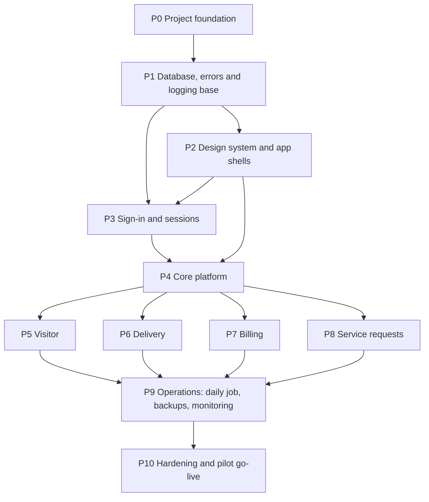
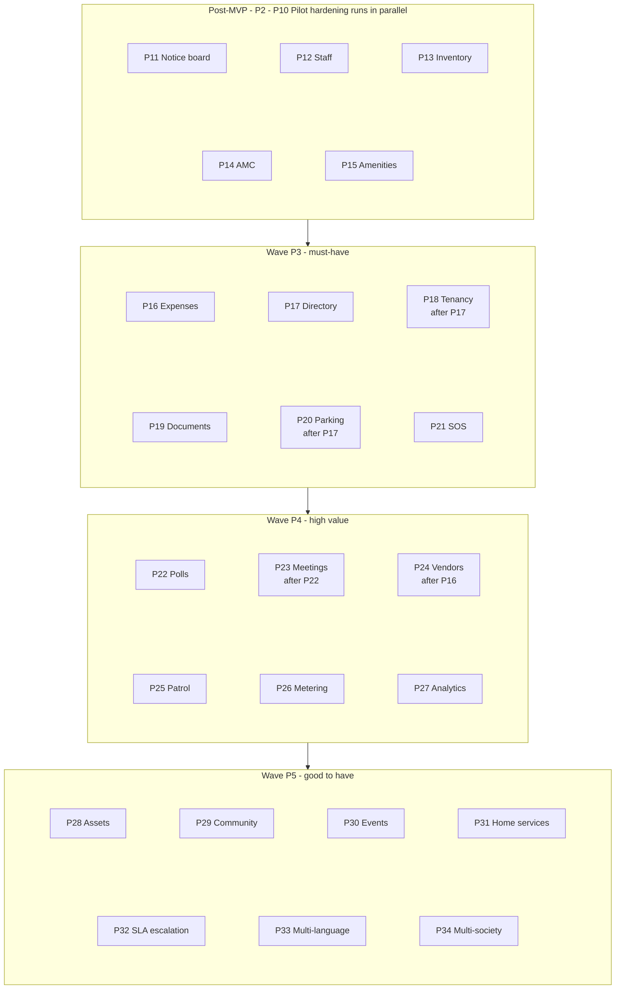

# Homeish — Implementation Plan (IMPLEMENTATION_PLAN.md)

| Field      | Value                                                                                                                                                                   |
| ---------- | ----------------------------------------------------------------------------------------------------------------------------------------------------------------------- |
| Product    | Homeish (PRD D-01 approved 2026-11-09)                                                                                                                                  |
| Version    | 0.2 (P11–P34 restructured into per-phase sections)                                                                                                                      |
| Date       | 2026-11-15 (first draft 2026-11-09)                                                                                                                                     |
| Depends on | [PRD.md](./PRD.md), [DESIGN.md](./DESIGN.md), [ARCHITECTURE.md](./ARCHITECTURE.md), [DATABASE.md](./DATABASE.md), [API.md](./API.md), [AGENTS.md](./AGENTS.md)          |
| Scope      | MVP: Core, Visitor, Delivery, Billing, Service Request (PRD D-02, approved). Post-MVP modules (P11–P15) and the approved expansion phases P16–P34 (PRD D-38) follow P10 |

**How to read this plan**

- Phases are in build order. A phase starts only when its prerequisites are complete. Tasks inside a phase are small enough to implement, verify and review on their own.
- Task IDs: `P<phase>.<task>` (e.g., `P5.4`). Sizes are relative effort, not time: **S** small, **M** medium, **L** large (split further if it grows).
- Every phase uses the same sections: goal, prerequisites (with kickoff decisions from P11), task table, database and API changes, tests, completion criteria and status. Built phases (P11–P18) show no size. Phases planned in 6-hour blocks (Section 2.5) show the block each task belongs to (for example T1, D1). Tasks for P23–P34 are **drafts** written from the PRD and are revisited at each phase's kickoff.
- **Status marks** (every task table and both overview tables): ✅ done and released to `main` (owner UAT and live enablement are tracked separately in each phase's Status); 🟡 built and tested locally, or partly done, and waiting for owner UAT, release or a remaining step; ⬜ not done.
- Requirement IDs (e.g., `VIS-4`), screen IDs (e.g., `G-02`) and operation names (e.g., `visitor.decide`) come from the PRD, DESIGN and API documents.
- **No code is described here.** Each task says _what_ to deliver and _how to know it is done_.
- The agent follows [AGENTS.md](./AGENTS.md) for every task: inspect existing code first, smallest change, tests, documents updated in the same task, ask the owner when something is unclear.
- **No new features or technologies** appear in this plan beyond those in the project documents.

---

## 1. Plan at a Glance

| Phase | Name                              | Delivers                                                                               | PRD release | Status |
| ----- | --------------------------------- | -------------------------------------------------------------------------------------- | ----------- | ------ |
| P0    | Project foundation                | Running skeleton, tooling, pipelines, development database (AD-13)                     | MVP-0       | ✅     |
| P1    | Database, errors and logging base | Core tables, security helpers, error/audit logging, rate limits                        | MVP-0       | ✅     |
| P2    | Design system and app shells      | Tokens, shared components, navigation shells                                           | MVP-0       | ✅     |
| P3    | Sign-in and sessions              | Email-code login, sessions, developer MFA                                              | MVP-0       | ✅     |
| P4    | Core platform                     | Developer console, structure, people, registration, guards, notifications, files, jobs | MVP-0       | ✅     |
| P5    | Visitor                           | Visitor module                                                                         | MVP-1       | ✅     |
| P6    | Delivery                          | Delivery module                                                                        | MVP-2       | ✅     |
| P7    | Billing                           | Charges, bills, UPI payments, ledger, receipts, reports                                | MVP-3       | ✅     |
| P8    | Service requests                  | Requests module                                                                        | MVP-4       | ✅     |
| P9    | Operations                        | Daily job, retention, backup export, monitoring                                        | MVP         | 🟡     |
| P10   | Hardening and pilot               | Security/accessibility/performance review, production setup, pilot                     | MVP         | 🟡     |

P5, P6, P7 and P8 depend only on P4, not on each other. They are listed in the PRD's order; the owner may re-order them.

### 1.1 Post-MVP and expansion phases (P11–P34)

Arrows are recommended build order; "after Pxx" inside a box marks a phase that builds on another phase. At runtime every module works on its own; links to other optional modules activate only when those are enabled (PRD A-36). Blocks are 6-hour work blocks (Section 2.5).

| Phase | Module / enhancement              | Key               | PRD           | Size | Blocks | Builds on                                   | Status                                                                           |
| ----- | --------------------------------- | ----------------- | ------------- | ---- | ------ | ------------------------------------------- | -------------------------------------------------------------------------------- |
| P11   | Notice board                      | `notice`          | §5.8, D-21    | —    | —      | Core                                        | ✅ Released to beta and main; migrated to testdb; owner UAT pending              |
| P12   | Staff                             | `staff`           | §5.5, P2-1    | —    | —      | Core                                        | ✅ Released to beta and main; migrated to testdb; owner UAT pending              |
| P13   | Housekeeping inventory            | `housekeeping`    | §5.6, P2-2    | —    | —      | Core                                        | ✅ Released to beta and main; migrated to testdb; owner UAT pending              |
| P14   | AMC                               | `amc`             | §5.7, P2-3    | —    | —      | Core                                        | ✅ Released to beta and main; migrated to testdb; owner UAT pending              |
| P15   | Amenity booking                   | `amenity`         | §5.9, D-22    | —    | —      | Core; `billing` for paid amenities          | ✅ Released to beta and main; migrated to testdb; owner UAT pending              |
| P16   | Society expenses & accounts       | `expense`         | 5.10.1, P3-1  | L    | —      | Core; reads `billing` payments when enabled | ✅ Released to beta and main (2026-11-15); migrated to testdb; owner UAT pending |
| P17   | Resident & vehicle directory      | `directory`       | 5.10.2, P3-2  | M    | —      | Core unit occupants                         | ✅ Released to beta and main (2026-11-15); migrated to testdb; owner UAT pending |
| P18   | Move-in / move-out & tenancy      | `tenancy`         | 5.10.3, P3-3  | L    | 3      | Core occupants, files; `billing` dues check | ✅ Released to beta and main (2026-11-15); migrated to testdb; owner UAT pending |
| P19   | Document repository               | `document`        | 5.10.4, P3-4  | M    | 2      | Core files                                  | ✅ Released to beta and main (2026-11-15); migrated to testdb; owner UAT pending |
| P20   | Parking management                | `parking`         | 5.10.5, P3-5  | M    | 2      | `directory` vehicles; `visitor` passes      | ✅ Released to beta and main (2026-11-15); migrated to testdb; owner UAT pending |
| P21   | Emergency & SOS                   | `sos`             | 5.10.6, P3-6  | M    | 2      | Core notifications and Realtime             | ✅ Released to beta and main (2026-11-15); migrated to testdb; owner UAT pending |
| P22   | Polls & voting (Civic Pulse port) | `poll`            | 5.10.7, P4-1  | L    | 3      | Core units/occupants                        | ⬜ Not started                                                                   |
| P23   | Meetings & AGM                    | `meeting`         | 5.10.8, P4-2  | M    | 2      | `poll` resolutions; `document` minutes      | ⬜ Not started                                                                   |
| P24   | Vendors & purchase approvals      | `vendor`          | 5.10.9, P4-3  | M    | 2      | `expense` drafts                            | 🟡 Built; local checks passed (2026-11-16); uncommitted, owner review pending    |
| P25   | Guard patrol & incident log       | `patrol`          | 5.10.10, P4-4 | M    | 2      | Core guards and gate settings               | 🟡 Built; local checks passed (2026-11-16); uncommitted, owner review pending    |
| P26   | Utility metering                  | `metering`        | 5.10.11, P4-5 | M    | 2      | `billing` charges                           | 🟡 Built; local checks passed (2026-11-16); uncommitted, owner review pending    |
| P27   | Committee analytics dashboard     | Core              | 5.10.12, P4-6 | M    | 2      | Read models of enabled modules              | ⬜ Not started                                                                   |
| P28   | Asset register                    | `asset`           | 5.10.13, P5-1 | S    | 1      | `amc` contracts                             | ⬜ Not started                                                                   |
| P29   | Resident community & marketplace  | `community`       | 5.10.13, P5-2 | L    | 3      | Core files, notifications                   | ⬜ Not started                                                                   |
| P30   | Events & RSVPs                    | `event`           | 5.10.13, P5-3 | M    | 2      | `billing` contributions                     | ⬜ Not started                                                                   |
| P31   | Home-services directory           | `home_services`   | 5.10.13, P5-4 | S    | 1      | Core                                        | ⬜ Not started                                                                   |
| P32   | Service-request SLA escalation    | `service_request` | 5.10.13, P5-5 | S    | 1      | `service_request`, daily runner             | ⬜ Not started                                                                   |
| P33   | Multi-language (Hindi first)      | Core              | 5.10.13, P5-6 | L    | 3+     | All screens                                 | ⬜ Not started                                                                   |
| P34   | Multi-society / federation view   | Core              | 5.10.13, P5-7 | L    | 3+     | Core memberships, tenancy model (D-24)      | ⬜ Not started                                                                   |

Block totals: P3 wave (P18–P21) 9 planned, all four phases released to beta and main; P4 wave 13 blocks; P5 wave about 14 blocks.

---

## 2. Rules That Apply to Every Phase

### 2.1 Task rules

1. Every task starts with the AGENTS.md start-of-task steps (read documents, inspect code, restate the task, ask if unclear).
2. One task = one focused change that builds, passes checks and can be reviewed alone. Split anything larger.
3. Tests are part of the task, not a later phase (AGENTS Section 13). A task is not finished until its tests pass.
4. Database changes: forward-only migrations with row-level security, constraints, indexes and generated types in the **same** change (AGENTS Section 11).
5. Documents are updated in the same task (AGENTS Section 15). No new markdown files.
6. Nothing runs against staging or production without the owner's approval.

### 2.2 Module completion gate (applies to P5–P8, the module phases P11–P34 and the platform modules in P4)

A module is **done** only when all of the following are true:

- [ ] Every PRD requirement for the module is implemented or explicitly marked deferred by the owner.
- [ ] All its screens exist with loading, empty, error and no-permission states (DESIGN Section 9).
- [ ] The DESIGN acceptance checklist (DESIGN Section 15) passes.
- [ ] Database tests prove tenant isolation, every role-permission cell (allowed and denied), module-disabled denial and the module's special rules.
- [ ] Automated end-to-end tests cover the main journeys on phone and desktop sizes; the automated accessibility check passes.
- [ ] Manual checks done and recorded: keyboard use, screen reader (TalkBack and VoiceOver), 200% text zoom, a low-end Android phone and iPhone Safari.
- [ ] The module ships **switched off** (disabled) and can be switched on for one pilot society by the developer.
- [ ] DATABASE.md, API.md, DESIGN.md and PRD.md match the code.
- [ ] The owner has tried it and approved it (approval is recorded; it is never assumed).

### 2.3 Owner decisions needed along the way

| Needed before         | Item                                                                                                                                                                                                   | Status                                                                                                                    |
| --------------------- | ------------------------------------------------------------------------------------------------------------------------------------------------------------------------------------------------------ | ------------------------------------------------------------------------------------------------------------------------- |
| P0                    | Accounts created (GitHub, Supabase, Vercel, Sentry, Brevo)                                                                                                                                             | Owner action                                                                                                              |
| P0.4                  | Docker Desktop cannot be installed; one free Supabase project `homeish-testdb` is used for development, testing and staging (synthetic data only)                                                      | **Approved and created 2026-11-09 (ARCHITECTURE AD-13)**                                                                  |
| P0.4                  | Three Supabase projects (`homeish-testdb`, `homeish-demo`, `homeish-live`), demo and live paused until needed; separate Vercel project `demo-homeish` for the demo                                     | **Approved and Supabase projects created 2026-11-09 (ARCHITECTURE AD-14)**; `demo-homeish` Vercel project not yet created |
| P0.7                  | Connect beta Vercel variables to `homeish-testdb` now or wait until backend work begins                                                                                                                | **Owner chose to defer until P1 on 2026-11-09**                                                                           |
| P3                    | How development sign-in emails are read without the local mail catcher (Docker-only)                                                                                                                   | Open; decide before P3.3                                                                                                  |
| P2                    | Product logo (DESIGN DD-07; Homeish wordmark + concept-15 mark)                                                                                                                                        | **Approved 2026-11-09:** selected logo asset added                                                                        |
| P3 (staging)          | Your own domain with email sender verification (SPF/DKIM) so login emails are not marked as spam                                                                                                       | Owner action                                                                                                              |
| P7                    | A pilot society's UPI ID and payee name for testing (a test UPI ID is fine until the real one is entered by the society's admin)                                                                       | Owner action                                                                                                              |
| P10                   | Production accounts; `homeish-live` resumed for go-live and upgraded to the paid plan when the first society starts paying (AD-06 amended); the first-ten no-subscription offer does not cover hosting | Owner action                                                                                                              |
| Before society eleven | Homeish subscription price and offer terms after the first ten free societies                                                                                                                          | Open                                                                                                                      |
| P10                   | Pilot society and admin contact                                                                                                                                                                        | Owner action                                                                                                              |

### 2.4 Post-MVP and expansion phases (P11–P34)

- **Pattern:** each module phase records its kickoff decisions with the owner first (PRD D-43; answers go in the PRD module section, as for P12–P15), then delivers one migration group with RLS and database tests, module registration and permission map, screens with all states, unit/integration/end-to-end/accessibility tests and the module completion gate (2.2). The module ships switched off.
- **Order:** P11–P15 follow the PRD and the owner's decision (2026-11-13). P16–P34 are the approved roadmap (PRD D-38, 2026-11-14); their requirements are in PRD Section 5.10.
- **Timing:** these phases may be built in parallel with P10 pilot hardening, but no expansion module is enabled for a live society until P10.5, P10.6 and the production Storage-file recovery plan are complete ([pilot-readiness audit](./audits/pilot-readiness-audit.md)). P10 work takes priority when both compete.
- **Release:** commit promotion and hosted migrations follow the owner-approved release process in [DEPLOYMENT.md](./DEPLOYMENT.md). Released post-MVP migrations are applied to `homeish-testdb` only; `homeish-live` stays paused and unmigrated until production go-live (Section 7 of DEPLOYMENT). Local verification does not constitute owner UAT or production go-live approval.
- **Deferred until triggered:** SMS/WhatsApp and mobile-number login (PRD D-06, A-35), payment gateway, native apps, offline mode (ARCHITECTURE Section 3). A reference draft for a future Android app is at the end of this plan ("Future — Android App"); it is not scheduled.

### 2.5 Working in 6-hour blocks

**Added 2026-11-15.** Remaining work is cut into blocks of about 6 focused hours. The sizes follow the observed P16/P17 pace: **S ≈ 1 block, M ≈ 2 blocks, L ≈ 3 blocks**. Each block must:

- start from a green baseline, with that phase's kickoff decisions already answered (asked before the block, not during it);
- end at a safe pause point: the local gate passes (`npm run check`, the phase's local integration tests, targeted Playwright with axe, `npm run build`) and docs record the status;
- cut screens or polish if time runs short, never privacy, role checks or tests;
- stay local: no commits, pushes, hosted migrations or live enablement without separate owner approval.

Block counts per phase are in Section 1.1. Phases without a block plan are split into tasks at kickoff.

Block codes in a phase's task table are the module's letter plus the block number, for example T1–T3 for Tenancy (P18), D1–D2 for Documents (P19), K1–K2 for parKing (P20) and S1–S2 for SOS (P21). They are for planning only; status lines describe the phase as a whole.

---

# Phase P0 — Project Foundation

**Goal:** an empty-but-correct project that builds, lints, tests and deploys to a preview, with the development database running and the rules in AGENTS.md enforced by tooling.

**Prerequisites:** owner actions in 2.3 (accounts, development Supabase project per AD-13). Documents LOCAL_SETUP.md (to be written alongside P0.4) and DEPLOYMENT.md (before P10).

| ID   | Task                                                                                                                                                                                                       | Size | Status |
| ---- | ---------------------------------------------------------------------------------------------------------------------------------------------------------------------------------------------------------- | ---- | ------ |
| P0.1 | Create the Next.js project (App Router, strict TypeScript) with the folder skeleton from ARCHITECTURE Section 9; record the real tool versions in README                                                   | M    | ✅     |
| P0.2 | Configure Tailwind (empty theme placeholder), formatter, linter with strict rules (no `any`, no suppressions), and the header-comment check                                                                | S    | ✅     |
| P0.3 | Build the validated configuration module: reads environment variables only here, fails fast with variable _names_, separates public from server-only (API Section 11); commit the placeholder example file | S    | ✅     |
| P0.4 | Set up the Supabase CLI (project dev dependency), link the development Supabase project (AD-13), the migration folder, naming rules and type generation; document the commands in LOCAL_SETUP.md           | M    | ✅     |
| P0.5 | Set up test tooling: unit test runner, database test runner (against the development database), end-to-end runner with accessibility check, a controllable clock for tests                                 | M    | ✅     |
| P0.6 | Create the continuous-integration pipeline: lint, typecheck, unit, database tests, build; checks for secrets in the repo and for secret-looking names with the public prefix                               | M    | ✅     |
| P0.7 | Connect Vercel preview deployments (staging variables only, no secrets in the repo) to the shared `homeish-testdb` Supabase project (AD-13)                                                                | S    | ✅     |
| P0.8 | Create the project README (setup, commands, structure, document links)                                                                                                                                     | S    | ✅     |
| P0.9 | D-34: build the marketing root, allow-listed demo and isolated beta entry; synthetic browser preview with resets; configure main/beta hosting and document actual external verification                    | M    | ✅     |

P0.9 local implementation includes public marketing, exact-host routing, an illustrative browser-memory demo and beta entry. It does not complete P1-P4 or activate real workflows. The owner approved implementation, documentation and live Git/Vercel setup on 2026-11-09, then deferred Maplewood onboarding until after MVP, when the owner will run the create-society script (`scripts/create-society.mjs`, OPERATIONS "Society onboarding"); its address is reserved in code as a disabled placeholder. External deployment status is recorded in README after verification. Full interactive society demo/reset jobs and real society activation remain gated on backend/auth/module completion and isolation tests. No real society data is seeded.

**P0.9 status, 2026-11-09:** the foundation passed local formatting/lint/type checks, 33 unit tests, four browser tests and production build. Projects `homeish`/`beta-homeish` are linked to `abhishek-r-patel/homeish` under team `arp-dev`, tracking `main`/`beta` respectively, with scaffold-only configuration. The owner approved resuming hosting after a temporary pause and committing/pushing the deployment changes through feature branch -> beta -> main. `vercel.json` enables the two release branches; the existing build gate isolates each project. Preview branch tracking is disabled and Production domain assignment is automatic. The attached addresses are `homeish.vercel.app` and `beta-homeish.vercel.app`; no nested demo/beta or Maplewood host is attached. Verify both automatic releases and hosted HTTPS/routing during this release sequence. Full backend/auth workflows and real society launch approval remain open.

**P0.4 status, 2026-11-09:** done. The Supabase CLI (dev dependency) is initialised in `supabase/` and linked to `homeish-testdb`; `supabase/migrations/` and `seed/` exist; migration naming is enforced by `npm run check:migrations` (part of `npm run check`); `npm run db:new`, `db:list`, `db:push`, `db:types` and `db:types:check` run against the profile's database and refuse `homeish-live`. Empty-schema types are generated into `src/core/db/database.types.ts`. Commands and the company-network certificate workaround (`NODE_USE_SYSTEM_CA=1`) are documented in LOCAL_SETUP.md.

**P0.5 status, 2026-11-09:** done. Vitest covers unit tests, Playwright covers browser smoke and axe accessibility checks, and tests use the controllable clock fixture. Database integration tests are Vitest files in `tests/integration/` run against a throwaway local PostgreSQL 17 (`npm run test:integration:local`), replacing the earlier `psql` SQL tests against testdb.

**P0.6 status, 2026-11-09:** done. CI runs three parallel jobs with timeouts and no persisted Git credentials: Gitleaks full-history secret scan, static checks and build; database integration tests on a disposable `postgres:17` service container with a Supabase stand-in (same approach as Civic Pulse; replaces the slower Supabase CLI stack); and browser tests. A separate CodeQL workflow runs on pushes, pull requests and weekly. CI holds no database credentials. A deliberately broken migration was confirmed to fail the integration tests locally.

**P0.7 status, 2026-11-09:** deferred by the owner until P1. Beta remains scaffold-only; connect its environment to testdb when backend work begins.

**Files/modules affected:** repository root configuration, `src/core/config/`, `src/core/db/`, `supabase/`, `scripts/`, `tests/`, `.github/workflows/`, README, LOCAL_SETUP.md.

**Database/API changes:** none (empty migration folder and generated types only).

**Tests required:** configuration validation unit tests (missing, malformed, public/server mix-up); a smoke test proving the app starts; the pipeline itself must fail on a deliberately bad sample (lint error, type error, leaked-secret pattern) and then be returned to green.

**Completion criteria:**

- A fresh checkout runs the app, the unit tests, the database tests and the end-to-end smoke test with the documented commands.
- The pipeline is green on the main branch and blocks bad changes.
- No secrets exist in the repository; the example file contains names and placeholders only.
- Scaffold hosting is approved: verify the website at `homeish.vercel.app` and beta at `beta-homeish.vercel.app`, with unknown hosts failing closed. Nested demo/beta domains require separate attachment and verification. Real society launch is not approved by this scaffold release.

## P0.9 follow-up — Public homepage refresh

**Status (2026-11-15): H1/H2 locally implemented and verified; owner approved the copy and three synthetic screenshots.** Real-device/manual acceptance, release, demo hosting and live activation remain pending. The owner requested inspiration from [Multi-School ERP](https://multischoolerp.com/) for Homeish's society-management homepage and confirmed the kickoff choices below. The reference observations, section hierarchy and product/brand/privacy guardrails are in PRD Section 4.0.1. This is a bounded follow-up to P0.9, not a new numbered phase or society module.

**Scope:** the existing public marketing homepage only, with **Try demo** as its only marketing CTA. **Owner clarification 2026-11-15 (D-49):** the separate demo is not set up; set it up after product readiness and connect it then. Until a separately authorised rollout verifies it, show native disabled **Try demo** buttons with **Demo coming soon**, no demo URL and no inline substitute. Preserve D-34 host routing, society-address utility entry and synthetic-demo boundaries. No request-walkthrough/contact CTA, enquiry form, new society activation, authentication flow, backend module, lead-storage system, tracking service or pricing decision is included.

**Authorised homepage work:**

1. **Content and evidence:** inventory what is released, awaiting owner UAT/live activation, in development or planned using the phase records and release evidence. Record the actual linked demo's behavior and reachable destination; do not assume an example nested demo domain is live. Prepare original Homeish copy for committees/admins with resident benefits, synthetic product screenshots only and a compact wireframe following PRD 4.0.1; get owner approval of the final claims and assets.
2. **Design and delivery:** update DESIGN Section 18 before or alongside a separate homepage implementation task. Reuse approved Homeish branding, tokens/components and responsive patterns; do not reproduce the reference's text, assets, brand or pixel layout. Put planned modules in a separate clearly labelled roadmap section; no promised release dates or fabricated social proof. Use **Try demo** only as the marketing CTA; no enquiry/contact flow.
3. **Homepage acceptance:** verify every **Try demo** action is disabled with the coming-soon note and no destination; check existing-society entry, policy links, synthetic screenshot labels, correct availability wording and unchanged public/demo/society host behavior. Preserve and test the existing local sample's resets; hosted demo interactions/reset verification wait for the separately authorised setup. Run targeted phone/desktop browser and accessibility checks; record keyboard, screen-reader, 200% zoom/320px reflow and reduced-motion checks. Confirm screenshot-only proof, no testimonials/customer logos/society references or fabricated adoption/statistics, no enquiry form, and no real society/resident data or new third-party collection.

**Homepage kickoff decisions (owner-confirmed 2026-11-14; delivery authorised 2026-11-15):** no unresolved implementation kickoff questions remain. D-49 authorises H1/H2 only, not demo hosting, release or live activation. Approved branding, platform, pricing boundaries and society-activation gates are unchanged.

1. **Lead audience — Approved:** society committees/admins first, with resident benefits.
2. **Marketing CTA — Approved:** **Try demo** only, disabled with **Demo coming soon** until the separately verified demo is ready (D-49). No request-walkthrough/contact CTA or enquiry form in this refresh; existing-society entry remains utility navigation.
3. **Enquiry destination — Deliberately deferred:** decide later, outside this demo-only scope. This is not a blocker for the homepage refresh or directory work.
4. **Roadmap prominence — Approved:** show planned modules in a separate clearly labelled roadmap section, distinct from delivered functionality.
5. **Public proof and assets — Approved:** synthetic product screenshots only, while retaining approved Homeish branding. No testimonials, customer/society logos or references, or fabricated adoption/statistics in this refresh.

**Tasks (2 blocks, Section 2.5):**

| ID     | Block | Task                                                                                                                                                                                                                            | Status |
| ------ | ----- | ------------------------------------------------------------------------------------------------------------------------------------------------------------------------------------------------------------------------------- | ------ |
| P0.9.1 | H1    | Inventory released vs. planned modules and the real demo destination; update DESIGN §18; new committee-first copy; hero with **Try demo**, delivered-module sections, resident benefits, separate labelled roadmap, FAQ refresh | 🟡     |
| P0.9.2 | H2    | Synthetic product screenshots from fixture pages, screenshot gallery, disabled closing CTA, final polish; homepage acceptance checks above                                                                                      | 🟡     |

**H1/H2 evidence (2026-11-15):** local engineering complete. The owner explicitly approved the final copy and three synthetic screenshots. `npm run check` passed (60 files, 447 unit tests); 14 focused browser/accessibility tests passed; the production build and 3 additional production-server smoke tests passed; `git diff --check` passed. Tests cover disabled demo actions, availability wording, actual screenshot decoding, utility/policy navigation, keyboard/skip link, native FAQs, reduced motion, axe and 320/390/768/1280px reflow, existing host boundaries and manual/15-minute browser-demo resets. No database changes were made, so database integration tests were not run for this refresh. Real-device TalkBack/VoiceOver, actual 200% zoom/enlarged text, low-end Android/iPhone Safari, release and live enablement remain pending.

**Availability evidence:** P5-P8 and P11-P15 code is on the recorded main release; P11-P15 release/testdb status is recorded in their phases. Expenses, directory and the subsequent P18 implementation are local-only work, not beta releases. P18-P34 remain public roadmap entries, not usable or enabled features. Neither code on main nor a passed local test is live enablement. Retrieval attempts for the old `https://demo.homeish.vercel.app/` destination failed at the transport/TLS level; the owner explicitly deferred setup instead of authorising an inline substitute. Demo hosting and CTA connection require separate approval and verification.

---

# Phase P1 — Database, Errors and Logging Base

**Goal:** the database foundation and the error/logging backbone every later feature relies on.

**Prerequisites:** P0 complete. [ERROR_LOGGING.md](./ERROR_LOGGING.md) (written before P1.6).

| ID    | Task                                                                                                                                                                                                                                                                                                            | Size | Status |
| ----- | --------------------------------------------------------------------------------------------------------------------------------------------------------------------------------------------------------------------------------------------------------------------------------------------------------------- | ---- | ------ |
| P1.1  | Migration group 1: extensions (UUID/crypto, case-insensitive text), the `private` schema, shared triggers (updated-at, reject-update/delete for append-only tables)                                                                                                                                             | S    | ✅     |
| P1.2  | Migration group 2: security helper functions in `private` as fail-closed stubs; membership/role, module-enabled and society-writable checks are completed with P1.8, while the developer/MFA check stays closed until P3.7                                                                                      | M    | ✅     |
| P1.3  | Migration group 3: `profiles` (including `font_preference`), `developers`, `societies` (including `unit_label`, `gate_login_mode`, `guard_identification`, `join_code`), `modules` (reference rows for all ten module keys), `module_configs`, with constraints, indexes, RLS and grants per DATABASE Section 3 | L    | ✅     |
| P1.4  | Migration group 5 (part): `audit_logs`, `error_logs`, `rate_limits`, `job_run_keys`, `jobs` per DATABASE 3.13–3.17                                                                                                                                                                                              | M    | ✅     |
| P1.5  | Error model: error classes, the response envelope, the closed lists of error codes and conflict reasons (API 3.2, 3.5); request ID creation                                                                                                                                                                     | M    | ✅     |
| P1.6  | Logging core: the scrubber, the error-log writer (best effort, never throws), the audit-log writer, Sentry adapter with scrubbing                                                                                                                                                                               | L    | ✅     |
| P1.7  | Privileged module isolation (service-role client only in `src/core/privileged/`) with an automated check that nothing else imports it                                                                                                                                                                           | S    | ✅     |
| P1.8  | Request context builder (verified user, active society, roles, enabled modules) and the authorization pipeline helper (API 2.5), with the per-module permission-map framework; membership schema/helpers pulled forward from P3.1/P3.8                                                                          | L    | ✅     |
| P1.9  | Rate-limit service on the `rate_limits` table with the fail-closed / fail-open rules (API Section 10)                                                                                                                                                                                                           | M    | ✅     |
| P1.10 | Routes: `/api/health` and `/api/client-errors`; the browser error boundary showing the reference ID                                                                                                                                                                                                             | M    | ✅     |
| P1.11 | CI database checks from DATABASE 14.1: every table has RLS and a policy, no grants to the anonymous role, every tenant table indexed by society, foreign keys indexed, append-only triggers present                                                                                                             | M    | ✅     |

**Files/modules affected:** `supabase/migrations/`, `tests/integration/`, `src/core/{errors,logging,privileged,permissions,tenancy,db,config}/`, `src/app/api/{health,client-errors}/`.

**Database changes:** tables `profiles`, `developers`, `societies`, `modules`, `module_configs`, `audit_logs`, `error_logs`, `rate_limits`, `job_run_keys`, `jobs`; helper functions; triggers; seed of `modules` reference data in migrations.

**API changes:** routes `/api/health`, `/api/client-errors`; shared envelope and error codes.

**Tests required:**

- Unit: scrubber (codes, tokens, phones, UPI IDs, bodies removed), error mapping, envelope, rate-limit windows and fail-closed/open behavior, permission-map framework.
- Database: RLS on every new table (a user of one society cannot read another's; anonymous role gets nothing); append-only tables reject update/delete; `module_configs` core row cannot be disabled; unique and check constraints; helper functions return correct answers for each role.
- Integration: a thrown error becomes a logged entry with a reference ID and a safe user message; logging failure does not break the request.

**Completion criteria:**

- Every new table passes the CI database checks.
- An intentionally raised server error and client error each appear in the error log with a reference ID, and nothing sensitive is stored.
- The privileged-import guard fails the build when misused.
- DATABASE.md and API.md match what was built.

---

# Phase P2 — Design System and App Shells

**Goal:** the shared look, components and navigation frames so every later screen is built from the same parts (DESIGN Sections 2–6, 9, 14).

**Prerequisites:** P0 complete; brand colour, product name and logo approved on 2026-11-09 (DD-06, DD-07, D-01). P1.8 for permission-aware navigation (P2.8 only).

| ID    | Task                                                                                                                                                                                        | Size | Status |
| ----- | ------------------------------------------------------------------------------------------------------------------------------------------------------------------------------------------- | ---- | ------ |
| P2.1  | Design tokens in the Tailwind theme: colour, type scale, spacing, radius, motion, breakpoints, containers; bundled Manrope/Sora fonts and device-default preference                         | M    | ✅     |
| P2.2  | Core controls: button variants (with loading), text input and specialised inputs (email, code, phone, amount, search), select/combobox, checkbox/radio/switch/option card                   | L    | ✅     |
| P2.3  | Overlays and feedback: dialog/bottom sheet, confirm dialog (with required-reason variant), banner, toast, error summary, error panel with reference ID, empty state, skeleton, spinner      | L    | ✅     |
| P2.4  | Data display: status chip with the single mapping table (DESIGN 4.4), list item, stat tile, card, avatar, timeline, code display                                                            | M    | ✅     |
| P2.5  | Tables and lists: data table with stacked mobile rows, pagination, filter bar with applied-filter chips, tabs/segmented control, sort headers (API Section 3.8)                             | L    | ✅     |
| P2.6  | Forms: field layout, validation display, error summary focus handling, unsaved-changes prompt, file upload component (UI only), date/time pickers                                           | L    | ✅     |
| P2.7  | Module registry skeleton in `core/modules/` (key, name, navigation items, permission map, settings schema hooks) and the module-disabled page                                               | M    | ✅     |
| P2.8  | App shells and navigation per role: top bar, bottom tabs/More, sidebar/rail, guard home frame, developer dark shell; navigation built from enabled modules + permissions with no empty gaps | L    | ✅     |
| P2.9  | Installable-app basics: manifest and icons (no offline caching, offline banner only)                                                                                                        | S    | ✅     |
| P2.10 | Component states fixture page (excluded from production builds) used by automated visual and accessibility tests                                                                            | M    | ✅     |

**Files/modules affected:** `src/styles/`, `src/components/ui/`, `src/core/modules/`, `src/app/` layouts for each role group, `public/`.

**Database/API changes:** none.

**Tests required:** component tests for each state (default, hover, pressed, focus, disabled, loading, error); automated accessibility check on every component and shell; keyboard and focus-return tests for dialogs and sheets; responsive checks at the DESIGN widths (320, 390, 768, 1280, 1440, 200% text); navigation test proving a disabled module leaves no item or gap.

**Completion criteria:**

- Every component in DESIGN Section 19 "Foundation" exists, uses tokens only and passes accessibility checks.
- All five shells render with the correct navigation for a sample set of roles and module settings.
- No raw colour values or arbitrary sizes exist in component code (automated check).

---

# Phase P3 — Sign-in and Sessions

**Goal:** people can sign in with an emailed code, stay signed in, switch societies; developers sign in separately with a second factor.

**Prerequisites:** P1 and P2 complete. Staging email sender verified (owner action in 2.3); the local mail catcher is used for development.

| ID   | Task                                                                                                                                                                                  | Size | Status |
| ---- | ------------------------------------------------------------------------------------------------------------------------------------------------------------------------------------- | ---- | ------ |
| P3.1 | First-sign-in membership linking and the service-role-only invitation-check function (ARCHITECTURE 8.4 item 4); the `memberships` table and read policies were pulled forward to P1.8 | M    | ✅     |
| P3.2 | Automatic profile creation and email synchronisation from the auth service                                                                                                            | S    | ✅     |
| P3.3 | Auth service configuration: sign-up closed, email code template (code only, no links), session lifetimes; Brevo SMTP configured on staging; local mail catcher for development        | M    | ✅     |
| P3.4 | Operations `auth.requestCode`, `auth.verifyCode`, `auth.signOut` with the generic answers and rate limits from API Section 10                                                         | L    | ✅     |
| P3.5 | Screens S-01 and S-02 (email entry, code entry, resend cooldown, lockout messages, spam hint) with all states                                                                         | M    | ✅     |
| P3.6 | `session.get`, `session.switchSociety`, society picker S-03, no-membership and waiting-for-approval screens, session-expired page returning to the original destination               | M    | ✅     |
| P3.7 | Developer sign-in route (S-05): password, authenticator enrolment and verification, short sessions, the "developer with recent MFA" check in the helper functions                     | L    | ✅     |
| P3.8 | Complete the developer/MFA helper from P1.2 and verify the full role combinations; membership, module and society helpers were implemented and tested in P1.8                         | M    | ✅     |

**Files/modules affected:** `src/core/auth/`, `src/core/tenancy/`, `src/app/(auth)/`, `src/app/developer/` (sign-in only), `supabase/migrations/`, auth-service settings documented in LOCAL_SETUP.md.

**Database changes:** `memberships`; linking and invitation-check functions; policies using the real helpers.

**API changes:** `auth.requestCode`, `auth.verifyCode`, `auth.signOut`, `auth.developerSignIn`, `auth.developerVerifyMfa`, `session.get`, `session.switchSociety`.

**Tests required:**

- Unit/integration: unknown email gets the identical response as a known one; code single use; five wrong tries invalidate; resend cooldown; rate limits trigger and fail closed; invited membership links on first sign-in; closed sign-up (no account without invitation or registration flow).
- Database: membership policies (self sees own rows; admin sees society rows; no cross-society); helper functions per role.
- End-to-end: full sign-in with the mail catcher; developer cannot reach developer operations without MFA; session expiry returns to the saved destination.
- Security: no code or email appears in logs; no redirect to a client-supplied address.

**Completion criteria:**

- An invited person can sign in with the emailed code on staging and lands in the right place; an uninvited email gets no access and no information.
- A developer account (created by direct database action) signs in with MFA; without MFA it is refused.
- All role-combination tests for the helper functions pass.

---

# Phase P4 — Core Platform

**Goal:** everything the modules stand on: the developer console, society structure, people and roles, registration, guards, notifications, files, jobs and the daily-job runner. Built as sub-phases that each end working and tested.

**Prerequisites:** P1, P2, P3 complete.

## P4A — Developer console and module registry

| ID    | Task                                                                                                                                                                                                                                    | Size | Status |
| ----- | --------------------------------------------------------------------------------------------------------------------------------------------------------------------------------------------------------------------------------------- | ---- | ------ |
| P4A.1 | `developer.societies.*`: list, create (creates the core module row, default settings; default request categories are added in P8), update, set status (standard confirmation stating the effect of suspend/archive); screens D-01, D-02 | L    | ✅     |
| P4A.2 | Module toggle function (one transaction + audit) and `developer.modules.list/toggle/updateSettings`; Society Config → Modules screen D-03 with confirm dialogs; settings validated against each module's schema                         | L    | ✅     |
| P4A.3 | Enforce module-enabled in navigation, server checks and database policies; module-disabled responses                                                                                                                                    | M    | ✅     |
| P4A.4 | `developer.members.createFirstAdmin` (invitation for the first admin) and screen D-04                                                                                                                                                   | M    | ✅     |
| P4A.5 | Error log viewer D-05 (filters, reference-ID lookup, detail, resolve/ignore) and audit viewer D-06                                                                                                                                      | L    | ✅     |
| P4A.6 | Health summary D-07 built from the error log                                                                                                                                                                                            | S    | ✅     |

_Files:_ `src/modules/` registry entries for `core`, `src/app/developer/`, `src/core/modules/`, `src/core/logging/`.
_Database:_ toggle and society-creation functions; policies for developer reads; no new tables.
_API:_ `developer.*` operations (API 5.4).
_Tests:_ developer-only access, MFA requirement, toggle takes effect on the next request in navigation, API and database; toggle is audited; disabled module data untouched; error lookup by reference ID returns the right entry.
_Done when:_ a developer can create a society, switch modules on and off and find an error by reference ID; a non-developer cannot do any of it.

## P4B — Society structure

| ID    | Task                                                                                                                                          | Size | Status |
| ----- | --------------------------------------------------------------------------------------------------------------------------------------------- | ---- | ------ |
| P4B.1 | Migration: `blocks`, `units` with same-society keys, uniqueness and indexes; RLS                                                              | M    | ✅     |
| P4B.2 | `structure.blocks.*` and `structure.units.*` operations and admin screen A-02                                                                 | M    | ✅     |
| P4B.3 | Jobs list screen and `jobs.list/get`                                                                                                          | S    | ✅     |
| P4B.4 | CSV units import: template download, validate-only preview with per-row errors, confirm creating a job, results and downloadable error report | L    | ✅     |

_Database:_ `blocks`, `units`. _API:_ `structure.*`, `jobs.*`.
_Tests:_ duplicate unit numbers (with and without block), deactivate-only when history exists, tenant isolation, CSV edge cases (bad rows, duplicates, huge file limit), preview writes nothing.
_Done when:_ an admin imports 300 sample units and sees correct results and an error report for bad rows.

## P4C — People, roles and households

| ID    | Task                                                                                                                                            | Size | Status |
| ----- | ----------------------------------------------------------------------------------------------------------------------------------------------- | ---- | ------ |
| P4C.1 | Migration: `unit_occupants` with the one-active-primary rule; indexes; RLS                                                                      | M    | ✅     |
| P4C.2 | `members.*` operations: invite by email, list, change roles, deactivate (immediate revoke), occupancy assign/move/end; all audited; screen A-03 | L    | ✅     |
| P4C.3 | `members.importPreview/importConfirm` (resident CSV)                                                                                            | M    | ✅     |
| P4C.4 | Household screen R-08 (`household.members.*`) and profile screen S-12 with `profile.update`, including account-saved font preference            | M    | ✅     |
| P4C.5 | Permission maps for `core` operations wired to the helper functions and tests                                                                   | M    | ✅     |

_Database:_ `unit_occupants`; role-change and deactivate functions. _API:_ `members.*`, `household.*`, `profile.update`.
_Tests:_ only one active primary per unit; deactivation takes effect on the next request; family cannot become approver by default; role changes audited; resident sees only own household; matrix tests for A/C/R.
_Done when:_ an admin invites residents, assigns them to units and deactivates one, with the change taking effect immediately and recorded in the audit history.

## P4D — Self-registration with society code

| ID    | Task                                                                                                             | Size | Status |
| ----- | ---------------------------------------------------------------------------------------------------------------- | ---- | ------ |
| P4D.1 | `society.rotateJoinCode/disableJoinCode` and the admin setting screen                                            | S    | ✅     |
| P4D.2 | `registration.lookupSociety`, `registration.submit`, screen S-04 and the waiting-for-approval state; rate limits | M    | ✅     |
| P4D.3 | `members.approve/reject` with notifications to admins and the applicant                                          | M    | ✅     |

_Database:_ uses `societies.join_code` and pending membership/occupancy rows. _API:_ `registration.*`, `members.approve/reject`.
_Tests:_ wrong or disabled code returns nothing useful; lookup rate limits fail closed; approval activates access immediately; rejected user has no access; no society list is ever exposed.
_Done when:_ a new resident registers with the code, an admin approves, and the resident can sign in to that society.

## P4E — Guards and gate settings

| ID    | Task                                                                                                                                                 | Size | Status |
| ----- | ---------------------------------------------------------------------------------------------------------------------------------------------------- | ---- | ------ |
| P4E.1 | Migration: `guard_roster` (hashed PIN, never readable by the API roles); RLS                                                                         | M    | ✅     |
| P4E.2 | `guards.*` operations: add/update/deactivate, set PIN, society gate settings (`society.updateGateSettings`) with the admin settings screen           | M    | ✅     |
| P4E.3 | `guards.identify` (name pick or PIN), the signed on-duty cookie, `GUARD_NOT_IDENTIFIED` handling and the "Handled by" control; `guards.unitContacts` | L    | ✅     |

_Database:_ `guard_roster`. _API:_ `guards.*`, `society.updateGateSettings`.
_Tests:_ PIN stored only as hash and never returned or logged; five failures lock for 15 minutes; cookie expires and is tied to the session; individual-mode guard resolves automatically; `unitContacts` returns only approvers' name and phone.
_Done when:_ in both gate-login modes, a guard can be identified and a test entry would record the correct guard.

## P4F — Notifications (in-app, push, email adapter)

| ID    | Task                                                                                                                               | Size | Status |
| ----- | ---------------------------------------------------------------------------------------------------------------------------------- | ---- | ------ |
| P4F.1 | Migration: `notifications`, `push_subscriptions`; RLS (owner only; no key reads)                                                   | M    | ✅     |
| P4F.2 | In-app inbox: `notifications.*`, screen S-11, unread badge, Realtime inbox channel                                                 | M    | ✅     |
| P4F.3 | Web Push: service worker, subscribe/unsubscribe route, privileged sender with retry/prune rules, minimal payloads (DESIGN 8.3)     | L    | ✅     |
| P4F.4 | Email adapter for the transactional email API (timeout, one retry, scrubbing) and the daily email-quota counter with the 80% alert | M    | ✅     |
| P4F.5 | Notification creation helper used inside transactions (so a notification row commits with its event)                               | S    | ✅     |

_Database:_ `notifications`, `push_subscriptions`. _API:_ `notifications.*`, `/api/push/subscriptions`.
_Tests:_ a user only sees and updates own notifications; subscription keys never returned; expired subscriptions deleted; push and email failures never break the user's action; payload contains no sensitive data; adapter fakes for timeout and error cases.
_Done when:_ a test event creates an inbox item and a push to a subscribed device, and failures of push/email are invisible to the user but logged.

## P4G — Files

| ID    | Task                                                                                                                                | Size | Status |
| ----- | ----------------------------------------------------------------------------------------------------------------------------------- | ---- | ------ |
| P4G.1 | Private storage buckets and path-based policies using the same helper functions (DATABASE Section 12)                               | M    | ✅     |
| P4G.2 | `/api/files/upload-url` and `/api/files/url` with type/size/count checks; the attach-time re-check helper used by owning operations | L    | ✅     |
| P4G.3 | Wire the upload component to the routes (per-file progress, retry, remove) and the society logo upload                              | M    | ✅     |

_API:_ the two file routes. _Tests:_ cross-society paths denied; wrong type/size rejected twice (issue time and attach time); links expire; storage policy tests per bucket; failed upload leaves no row.
_Done when:_ a test image uploads, is viewable only by permitted roles and fails safely for everyone else.

## P4H — Daily job runner skeleton

| ID    | Task                                                                                                                             | Size | Status |
| ----- | -------------------------------------------------------------------------------------------------------------------------------- | ---- | ------ |
| P4H.1 | `/api/jobs/daily` with the secret-token check, run-key idempotency and per-task isolation; each module registers its tasks later | M    | ✅     |

_Tests:_ wrong/missing token rejected and logged; second call same day does nothing; one failing task does not stop others.
_Done when:_ the route runs an empty task list safely and idempotently on staging.

**P4 completion criteria (whole phase):**

- Developer, admin, committee, resident and guard shells work end to end for the Core module with correct permissions.
- A full onboarding journey works: developer creates a society → invites first admin → admin imports units and residents → guards added → resident registers by code and is approved.
- The module completion gate (2.2) passes for `core`.

---

# Phase P5 — Visitor Module (`visitor`)

**Goal:** guards log visitors, residents approve from their phone, pre-approved codes work, and the gate has a reliable audit trail (PRD 5.1, VIS-1 to VIS-10).

**Prerequisites:** P4 complete (units, occupants, guard roster, notifications, files, Realtime channel basics).

| ID    | Task                                                                                                                                                                                                                                            | Size | Status |
| ----- | ----------------------------------------------------------------------------------------------------------------------------------------------------------------------------------------------------------------------------------------------- | ---- | ------ |
| P5.1  | Migration: `visitor_entries`, `visitor_pre_approvals`, `visitor_blacklist` with checks, partial unique code index, `client_request_id`, indexes from DATABASE Section 16, RLS including the module-enabled rule                                 | L    | ✅     |
| P5.2  | Module registration (`visitor`), permission map, settings schema (timeout, overstay hours, photo required, override allowed, phone required)                                                                                                    | S    | ✅     |
| P5.3  | Functions: create entry (blacklist warning, notify approvers, response deadline), decide (row lock, first response wins), guard override (reason required), check-in, check-out, lazy expiry on read                                            | L    | ✅     |
| P5.4  | Pre-approval functions and operations: create (code generation with collision handling and QR encoding that same code), cancel, list, validate (typed or scanned code; distinct invalid/expired/used reasons, rate limited), check-in from code | L    | ✅     |
| P5.5  | Blacklist operations and admin screen section                                                                                                                                                                                                   | S    | ✅     |
| P5.6  | Guard screens: gate home G-01, new visitor G-02 with waiting panel, validate QR by camera or code manually in G-03, inside now / today G-04, "Can't reach server" banner and the on-screen retry that never drops an entry                      | L    | ✅     |
| P5.7  | Resident screens: approval card via notification deep link and pending list, pre-approve form with QR and matching code plus share/copy, history (R-02), final-status view for stale alerts                                                     | L    | ✅     |
| P5.8  | Admin visitor log A-05 with filters, "still inside" overstay indicator, dashboard tile                                                                                                                                                          | M    | ✅     |
| P5.9  | Realtime visitor channel with 5-second polling fallback; guard alert sound/haptic setting with a global mute control (DESIGN DD-03 approved 2026-11-09)                                                                                         | M    | ✅     |
| P5.10 | Notification wording and deep links for visitor events                                                                                                                                                                                          | S    | ✅     |

**Database changes:** the three visitor tables, their functions and policies. **API changes:** `visitor.*` operations (API 5.5).

**Tests required:**

- Database: a resident cannot read another unit's visitors; guard cannot read pre-approval rows directly; first response wins under simultaneous approval; override requires reason; checked-in time rules; code unique among active codes and its QR represents that same code; module disabled blocks all access; suspended society blocks writes.
- Integration: end-to-end lifecycle (create → approve → check in → check out); expiry derived correctly; duplicate submit via the same `clientRequestId` creates one entry; notifications created in the same transaction.
- End-to-end: walk-in journey and pre-approval journey on phone sizes; guard flow completable under 30 seconds with realistic input; failure and offline banner states; accessibility check.
- Security: code-guessing limits; visitor phone masked in lists for roles that do not need it; nothing personal in URLs or logs.

**Completion criteria:** module gate (2.2) passes; PRD acceptance examples met (resident approval visible to the guard within 5 seconds in normal conditions; expired code rejected and logged); both gate-login modes record the handling guard.

---

# Phase P6 — Delivery Module (`delivery`)

**Goal:** guards log deliveries; residents choose allow, leave at gate or deny; parcels left at the gate are tracked until collected (PRD 5.2, DEL-1 to DEL-7).

**Prerequisites:** P4 complete. P5 is not required (modules are independent, PRD A-05) but its gate-screen patterns are reused if already built.

| ID   | Task                                                                                                                           | Size | Status |
| ---- | ------------------------------------------------------------------------------------------------------------------------------ | ---- | ------ |
| P6.1 | Migration: `delivery_entries`, `delivery_preferences` with constraints, indexes, RLS                                           | M    | ✅     |
| P6.2 | Module registration, permission map, settings (response timeout, uncollected days, leave-at-gate toggle)                       | S    | ✅     |
| P6.3 | Functions and operations: create (applies the unit's standing rule automatically), respond, override, mark collected, list/get | L    | ✅     |
| P6.4 | Delivery preference screen for approvers of a unit                                                                             | S    | ✅     |
| P6.5 | Guard screens: new delivery G-05, waiting list, uncollected parcels with Mark Collected                                        | M    | ✅     |
| P6.6 | Resident screens: respond via notification, history R-03; admin log A-06                                                       | M    | ✅     |
| P6.7 | Realtime delivery channel and notifications                                                                                    | S    | ✅     |

**Database:** the two delivery tables and functions. **API:** `delivery.*` (API 5.6).

**Tests:** preference rule produces the right decision source; only `left_at_gate` parcels can be collected; first response wins; tenant and unit isolation; module-disabled denial; duplicate-submit protection; end-to-end journeys; accessibility; uncollected-parcel list uses the configured threshold.

**Completion criteria:** module gate (2.2) passes; PRD DEL-1 to DEL-7 verified; works in both gate-login modes.

---

# Phase P7 — Billing Module (`billing`)

**Goal:** societies bill residents, residents pay the society's UPI directly and submit the reference, admins confirm, and everyone sees an exact, append-only statement (PRD 5.3, BIL-1 to BIL-17).

**Prerequisites:** P4 complete (units, occupants, notifications, files for screenshots, jobs). Test UPI details (owner action).

This is the largest module; it is built in nine sub-steps that each work and are tested.

### P7A — Charges and payment details

| ID    | Task                                                                                                                                                               | Size | Status |
| ----- | ------------------------------------------------------------------------------------------------------------------------------------------------------------------ | ---- | ------ |
| P7A.1 | Migration: `billing_charge_types`, `billing_payment_details`, `billing_receipt_counters`; RLS                                                                      | M    | ✅     |
| P7A.2 | Module registration, permission map, settings schema (due day, grace days, late fee rule, reminders, alert days)                                                   | S    | ✅     |
| P7A.3 | `billing.charges.*` and screen (Charge Types tab)                                                                                                                  | M    | ✅     |
| P7A.4 | `billing.paymentDetails.get/update`: UPI ID format check, audit with old/new values, notify all admins and committee, "last changed" date; Payment Settings screen | M    | ✅     |

### P7B — Bills and ledger

| ID    | Task                                                                                                                                                                                                                   | Size | Status |
| ----- | ---------------------------------------------------------------------------------------------------------------------------------------------------------------------------------------------------------------------- | ---- | ------ |
| P7B.1 | Migration: `billing_bills` (generated status), `billing_bill_lines` (composite key and duplicate-charge rule), `billing_ledger_entries`, `billing_payment_allocations`; immutability and append-only triggers; indexes | L    | ✅     |
| P7B.2 | Preview function and `billing.bills.preview` (fixed, per sq ft, custom methods; rounding rules written down and tested)                                                                                                | M    | ✅     |
| P7B.3 | Generation function: set-based, idempotent, ledger debits, automatic use of existing credit, job record, notifications after commit; `billing.bills.generate` and the four-step generator screen                       | L    | ✅     |
| P7B.4 | `billing.bills.list/get`, `billing.ledger.get` with running balance                                                                                                                                                    | M    | ✅     |

**Approved billing rules (D-36):** each society may set the monthly due day to 1–31 or the last day of the month, and choose nearest-rupee or nearest-paise rounding for per-square-foot charges; ties round up. New societies default to the 10th and nearest rupee.

### P7C — Payments

| ID    | Task                                                                                                                                                                                                                                        | Size | Status |
| ----- | ------------------------------------------------------------------------------------------------------------------------------------------------------------------------------------------------------------------------------------------- | ---- | ------ |
| P7C.1 | Migration: `billing_payments` with duplicate-reference rule and `client_request_id`; indexes; RLS                                                                                                                                           | M    | ✅     |
| P7C.2 | `billing.submitPayment` (resident, optional screenshot path re-checked, reference format, duplicate protection, notify admins)                                                                                                              | M    | ✅     |
| P7C.3 | Confirm function: lock, oldest-first allocation, ledger credit, receipt number, optional amount correction (audited), notify payer; `billing.confirmPayment`, `billing.rejectPayment` (reason), `billing.recordPayment` (confirmed at once) | L    | ✅     |
| P7C.4 | `billing.payments.list/get` and the admin review queue with stale highlighting                                                                                                                                                              | M    | ✅     |

### P7D — Fines, waivers, late fees

| ID    | Task                                                                                                                | Size | Status |
| ----- | ------------------------------------------------------------------------------------------------------------------- | ---- | ------ |
| P7D.1 | `billing.fines.add` and `billing.bills.waive` (reason, partial/full, cancel only when unpaid), audit                | M    | ✅     |
| P7D.2 | Late-fee task for the daily runner (one per overdue bill and month, per the society rule; late fees never compound) | M    | ✅     |

### P7E — Screens

| ID    | Task                                                                                                                                                  | Size | Status |
| ----- | ----------------------------------------------------------------------------------------------------------------------------------------------------- | ---- | ------ |
| P7E.1 | Resident dues R-04: amount-due hero, bills, ledger, receipts tabs, bill detail                                                                        | L    | ✅     |
| P7E.2 | UPI payment screen: exact amount, payee, UPI ID with Copy, QR, "Pay with UPI App" button, last-changed line, reference form, awaiting/rejected states | L    | ✅     |
| P7E.3 | Admin billing A-07: tabs, review queue, record payment, fines/waive dialogs                                                                           | L    | ✅     |

### P7F — Reminders, receipts, reports

| ID    | Task                                                                                                                                                | Size | Status |
| ----- | --------------------------------------------------------------------------------------------------------------------------------------------------- | ---- | ------ |
| P7F.1 | Reminder and stale-payment tasks for the daily runner (BIL-10, BIL-17)                                                                              | M    | ✅     |
| P7F.2 | Receipt and bill PDFs (`/api/billing/receipts/{id}`, `/api/billing/bills/{id}`), print layout, receipt email to the payer through the email adapter | L    | ✅     |
| P7F.3 | `billing.dashboard` and `billing.reports.export` (CSV job, formula-safe, audited)                                                                   | M    | ✅     |

**Database changes:** the eight billing tables, functions (preview, generate, confirm, reject, record, waive, fine, late fee, credit apply, UPI update) and policies per DATABASE Section 6. **API changes:** `billing.*` operations and the two PDF routes, plus `/api/exports/{jobId}`.

**Implementation status:** P7A–P7F are implemented in five migrations (`20261110183000` to `20261110203000`; see DATABASE 6.10) and validated against a local PostgreSQL integration run. Approved decisions made during the build:

- Admins waive or cancel directly with a required reason and audit entry; there is no committee approval step.
- Billing rules are developer-configured; there is no settings editor in P7.
- PDFs are generated with `pdf-lib` standard fonts, so amounts print as "Rs." and non-Latin text is replaced.

Tests cover the module gate's required set: unit tests (money, CSV, PDFs, validation, log safety), database tests in `tests/integration/database-billing*.test.ts` (300-unit generation, concurrent confirms, partial and corrected payments, visibility, suspended and disabled states, the DATABASE 15.3 consistency checks) and Playwright journeys on synthetic fixture pages (`/fixtures/billing`, `/fixtures/billing-payments`). Only the owner walkthrough remains before the module gate.

**Tests required (in addition to the module gate):**

- Unit: bill calculation for each method; rounding; allocation oldest-first; credit application; late-fee month logic and non-compounding behavior; receipt numbering.
- Database: duplicate bill-line rule; duplicate UTR blocked while pending/confirmed and allowed after rejection; paid + waived never exceed total; ledger and payments immutable; allocations never exceed payment; two admins confirming simultaneously produce one confirmation; resident sees only own unit; guard sees nothing; committee read-only; module disabled; suspended society read-only.
- Invariant checks from DATABASE 15.3 implemented as automated tests: bill paid equals allocations; bill total equals lines; ledger balance equals bills minus payments minus waivers plus adjustments.
- Integration: full cycle: generate → submit → confirm → receipt; reject → resubmit; partial payment; overpayment becomes credit and applies to the next generation; UPI detail change audited and notified.
- End-to-end: resident pay-and-submit journey and admin review journey; phone layouts; accessibility; failure states for screenshot upload and PDF generation.
- Security: UPI details editable only by admin; amounts never taken from the browser; no UTR, UPI ID or amounts in logs; CSV formula safety; receipt PDFs only for permitted users.

**Completion criteria:** module gate (2.2) passes; PRD acceptance (admin generates 300-unit bills in under 30 minutes of effort; no duplicates on re-run; every confirmed payment has a receipt and appears in the ledger); the owner has walked through the money flow with a test society and approves wording on every payment screen.

---

# Phase P8 — Service Requests Module (`service_request`)

**Goal:** residents raise requests, admins assign and track them against SLA, residents confirm and rate (PRD 5.4, SRQ-1 to SRQ-9).

**Prerequisites:** P4 complete (files, notifications, jobs, daily runner).

| ID   | Task                                                                                                                                                                                                                                                                     | Size | Status |
| ---- | ------------------------------------------------------------------------------------------------------------------------------------------------------------------------------------------------------------------------------------------------------------------------ | ---- | ------ |
| P8.1 | Migration: `service_request_categories`, `service_requests`, `service_request_comments`, `service_request_attachments`, `service_request_events`; checks, indexes, RLS (including common-area visibility)                                                                | L    | ✅     |
| P8.2 | Module registration, permission map, settings (auto-close days); default categories created by the society-creation function (update P4A.1)                                                                                                                              | S    | ✅     |
| P8.3 | Functions and operations: create (SLA due time, up to 3 attachments), assign (member or vendor), update status, reject (reason), confirm close, reopen, rate, add comment (requester, admin or assignee only); timeline events and notifications in the same transaction | L    | ✅     |
| P8.4 | Categories admin screen and operations                                                                                                                                                                                                                                   | S    | ✅     |
| P8.5 | Resident screens R-05: new request, my requests, detail with timeline, comments, attachments, rating/reopen prompt                                                                                                                                                       | L    | ✅     |
| P8.6 | Admin screen A-08: filters, SLA overdue highlighting, assign, status change, comments; dashboard tiles                                                                                                                                                                   | L    | ✅     |
| P8.7 | Auto-close task for the daily runner                                                                                                                                                                                                                                     | S    | ✅     |
| P8.8 | Request report (counts by category/status, average resolution time and rating)                                                                                                                                                                                           | S    | ✅     |

**Database changes:** five tables and functions per DATABASE Section 7. **API changes:** `request.*` operations (API 5.8).

**Tests:** only valid status transitions; timeline event and notification on every change; resident sees own-unit and common-area requests only; other residents may read common-area requests but cannot comment; unit consistency check; attachment limits; assignee access; auto-close timing with the controllable clock; rating only once and only after closing; matrix tests; end-to-end resident and admin journeys; accessibility.

**Completion criteria:** module gate (2.2) passes; PRD SRQ-1 to SRQ-9 verified; overdue requests visible on the admin dashboard.

---

# Phase P9 — Operations: Daily Job, Retention, Backups, Monitoring

**Goal:** the unattended parts run reliably and the developer can see when they do not.

**Prerequisites:** P5–P8 (or whichever modules exist) complete. OPERATIONS.md and ERROR_LOGGING.md written.

**Status: complete for the approved testdb/staging scope (2026-11-13).** Scheduled
backups remain paused; production backup activation and Storage-file backup
remain explicitly deferred as described below.

| ID   | Task                                                                                                                                                                                                                                                        | Size | Status |
| ---- | ----------------------------------------------------------------------------------------------------------------------------------------------------------------------------------------------------------------------------------------------------------- | ---- | ------ |
| P9.1 | Register every module's daily tasks in the runner (late fees, reminders, stale payments, expired visitor entries, request auto-close); delivery overdue status is computed on read, not by a daily task. Verify run-key idempotency across the tasks        | M    | ✅     |
| P9.2 | Retention and anonymisation task per DATABASE 11.3 (visitor/delivery anonymise, pre-approvals, requests, notifications, logs, jobs, rate-limit counters, orphan file report)                                                                                | L    | ✅     |
| P9.3 | Developer-run user erasure: delete Auth identity, retain an anonymized profile tombstone, revoke access, preserve historical content, and audit                                                                                                             | M    | ✅     |
| P9.4 | Google Drive encrypted database export and compatible restore drill verified for homeish-testdb; scheduled backups remain paused pending production safeguards. Weekly file copy is deferred for lack of an approved least-privilege credential             | M    | 🟡     |
| P9.5 | Health and developer surfaces expose daily-job freshness; uptime, Sentry, and email-quota alerts are configured. The day cycle, idempotency, resident reminder, uptime outage/recovery email, and application-originated critical alert/email were verified | M    | ✅     |
| P9.6 | Read-only integrity suite, deliberate-corruption tests, and monthly workflow implemented; guarded testdb workflow passed in GitHub Actions on 2026-11-12                                                                                                    | M    | ✅     |

**Database changes:** retention/anonymise functions; no new tables. **API changes:** none beyond the daily route's task list.

**Tests:** each task idempotent (run twice, same result); retention removes exactly what the schedule says and keeps money records; anonymise keeps history valid; integrity checks detect a deliberately corrupted sample on a test database; alert rules fire in staging.

**Completion criteria:** a full day cycle runs on staging with representative test data and no unintended real notifications; a missed run is detected; a backup restores to a new isolated compatible target (DATABASE 15.2). The approved testdb backup/restore drill is complete; production backup activation and Storage-file backup remain explicitly deferred.

**P9 external setup status, 2026-11-13:** beta (`beta-homeish`, on the shared
`homeish-testdb` project) has the P8/P9 release, an external uptime monitor, a
Sentry critical-error alert, Brevo transactional email, and the daily schedule.
The monitor's setup notification, Sentry's synthetic critical event, and a
real Brevo delivery were verified (OPERATIONS.md). The active validation
society's 2026-11-13 IST cycle completed all six tasks; two authenticated local
repeats skipped them, confirming run-key idempotency. The INR 1 test bill was
generated after that cycle; its reminder was later run directly and appeared in
the resident Notifications page. The stale-health test returned 503 and
recovered to 200; the owner confirmed receipt of its UptimeRobot outage/recovery
email. A one-off synthetic failure through the real application runner locally,
using testdb and staging Sentry configuration, persisted a critical log and
reached Sentry. The owner confirmed its alert email; the matching Sentry issue
and Developer Console error were resolved (OPERATIONS.md). All six real job
keys were unchanged by that drill. The guarded testdb integrity workflow passed
on 2026-11-12. The request-dashboard grouping error was fixed by migration
`20261113060000` and verified against the existing synthetic request.

**Backup status:** a manual encrypted homeish-testdb archive was downloaded,
authenticated, restored into a disposable Supabase-compatible PostgreSQL 17
target, and passed all 13 integrity checks in GitHub Actions run 43222943511. Keep scheduled backups disabled. Before production activation,
verify the production source and recovery path and isolate production retention
from test archives. Weekly Storage-file backup remains deferred as noted in
DATABASE 15.2.

---

# Phase P10 — Hardening and Pilot Go-Live

**Goal:** prove the MVP is safe, accessible, fast enough and operable, then enable it for one pilot society.

**Prerequisites:** P9 complete; owner actions in 2.3; DEPLOYMENT.md and OPERATIONS.md finished; LOCAL_SETUP.md current.

| ID    | Task                                                                                                                                                                                                                                                                                                                                                     | Size | Status |
| ----- | -------------------------------------------------------------------------------------------------------------------------------------------------------------------------------------------------------------------------------------------------------------------------------------------------------------------------------------------------------- | ---- | ------ |
| P10.1 | Security review: row-level security audit of every table, cross-society attack tests on every operation, header and cookie checks, secrets scan, dependency vulnerability scan, privileged-usage review                                                                                                                                                  | L    | ✅     |
| P10.2 | Accessibility pass: manual keyboard, TalkBack, VoiceOver, 200% zoom, outdoor-brightness contrast check on a guard device; fix findings                                                                                                                                                                                                                   | L    | 🟡     |
| P10.3 | Performance check with generated data at target scale (1,500 units, large visitor/log tables): list queries, bill generation, dashboards; add indexes only where measured slow                                                                                                                                                                           | M    | ✅     |
| P10.4 | Failure drills: database unreachable, realtime down, email/push failure, scheduler missed, duplicate submissions, concurrent decisions; confirm the documented behavior                                                                                                                                                                                  | M    | ✅     |
| P10.5 | Production setup: resume `homeish-live` (AD-14); paid plan with backups once the first society pays, with the own nightly off-site copy verified before the first society (AD-06 amended); Vercel plan per the owner's decision, your domain and sender verification, production secrets set, regions chosen (API APA-04), Sentry and uptime alerts live | M    | ⬜     |
| P10.6 | Restore drill from the production-like backup; integrity checks pass                                                                                                                                                                                                                                                                                     | M    | 🟡     |
| P10.7 | Seed a demo/test society (synthetic) and run the full UAT script per module with the owner                                                                                                                                                                                                                                                               | M    | 🟡     |
| P10.8 | Go-live: create the pilot society, enable modules one at a time (visitor, delivery, billing, requests) as each passes UAT, onboard the admin, monitor errors daily                                                                                                                                                                                       | M    | ⬜     |
| P10.9 | Pilot review against PRD success criteria (PRD 14.4) and a prioritised list of fixes and post-MVP items                                                                                                                                                                                                                                                  | S    | ⬜     |

**Tests/verification:** all earlier suites green on staging; manual checklists recorded; PRD success metrics collected.

**Status (2026-11-14):**

| ID    | Status                                                                                                                                                                                                                                                                          |
| ----- | ------------------------------------------------------------------------------------------------------------------------------------------------------------------------------------------------------------------------------------------------------------------------------- |
| P10.1 | Done; see OPERATIONS.md "Security re-check". No open critical or high findings; four low findings fixed.                                                                                                                                                                        |
| P10.2 | Automated part done: `tests/e2e/accessibility.spec.ts` (WCAG 2.2 AA with axe, 640px and 320px reflow, visible focus) passes on all public and fixture pages. Owner's TalkBack, VoiceOver and outdoor checks pending ([ACCESSIBILITY_CHECKLIST.md](ACCESSIBILITY_CHECKLIST.md)). |
| P10.3 | Done; see OPERATIONS.md "Performance at target scale". One migration fixed per-row checks; no indexes needed.                                                                                                                                                                   |
| P10.4 | Done; see OPERATIONS.md "Failure drills". Five fixes made.                                                                                                                                                                                                                      |
| P10.5 | Not started (production; waits for the first society).                                                                                                                                                                                                                          |
| P10.6 | Local drill from a testdb dump and the guarded GitHub drill both passed (OPERATIONS.md "Restore drill results"). Repeat from the production backup during P10.5.                                                                                                                |
| P10.7 | Script ready ([UAT_SCRIPT.md](UAT_SCRIPT.md)); the owner runs it on Beta.                                                                                                                                                                                                       |
| P10.8 | Not started. Onboarding script ready (`npm run society:create`, OPERATIONS.md "Society onboarding").                                                                                                                                                                            |
| P10.9 | Not started.                                                                                                                                                                                                                                                                    |

**Completion criteria:**

- No open critical or high security findings; no cross-tenant leakage in tests.
- Manual accessibility and low-end-device checks recorded for every module.
- Restore drill passed and the integrity checks are clean.
- The pilot society's admin can run daily operations; errors are being captured with reference IDs and reviewed.
- The owner signs off the MVP.

**MVP+ in-module additions (owner-approved, 2026-11-14):** frequent visitors (A-10), delivery pre-announce (A-14 / DEL-4) and upvotes on common-area service requests (D-17 / SRQ-7). Each one adds a single migration and its database tests, and stays behind its module toggle. The P10.4 duplicate-submission drill found that a lost unique-key race (`23505`) showed "already decided". The visitor, delivery and service-request create calls now retry once, so the user gets the original record.

---

# Phase P11 — Notice Board (`notice`)

**Goal:** admins and committee publish notices to chosen audiences; residents read them with pinned notices first; authors see aggregate read counts (PRD 5.8, D-21, NTC-1 to NTC-3).

**Prerequisites:** P4 complete (structure, people, notifications, files). Kickoff decisions recorded in PRD 5.8 "P11 decisions (owner, 2026-11-13)": audiences, unlimited pins, edits labelled without re-notifying, push and in-app only, expiry and archive, optional attachment, author permissions, withdraw-never-delete.

| ID    | Task                                                                                                                                                                                                                                                                     | Status |
| ----- | ------------------------------------------------------------------------------------------------------------------------------------------------------------------------------------------------------------------------------------------------------------------------ | ------ |
| P11.1 | Migration `20261115110000_notice_board.sql`: `notices`, `notice_blocks` and `notice_reads`, the private `notice-files` bucket, and the RPCs `notice_create`, `notice_update`, `notice_set_pinned`, `notice_withdraw`, `notice_list`, `notice_get` and `notice_mark_read` | ✅     |
| P11.2 | Core layer in `src/core/notices/` and permissions `notice:list`, `notice:create`, `notice:manage` and `notice:archive`                                                                                                                                                   | ✅     |
| P11.3 | Resident screens `/notices` and `/notices/{id}`                                                                                                                                                                                                                          | ✅     |
| P11.4 | Admin and committee screens `/admin/notices` (current and archive), `/admin/notices/new`, `/admin/notices/{id}` and `/admin/notices/{id}/edit`                                                                                                                           | ✅     |

**Database changes:** the three notice tables, the private bucket and the RPCs above. **API changes:** `notice.*` operations.

**Tests:** `tests/integration/database-notices.test.ts`, `tests/unit/notice-board.test.ts`, `tests/e2e/notices.spec.ts` and the `/fixtures/notices` screen in the accessibility sweep.

**Completion criteria:** module gate (2.2) passes; PRD NTC-1 to NTC-3 and the P11 decisions verified; ships disabled.

**Status:** released to beta and main on 2026-11-14 with CI and CodeQL green; migrated to `homeish-testdb` only; owner UAT pending.

---

# Phase P12 — Staff Management (`staff`)

**Goal:** residents register domestic staff, guards record explicit entry and exit, admins manage society staff and shift attendance (PRD 5.5, P2-1, STF-1 to STF-12).

**Prerequisites:** P4 complete (units, occupants, guards, files). Kickoff decisions recorded in PRD 5.5 (D-18, D-19, STF-9 to STF-12).

| ID    | Task                                                                                                                                                                                         | Status |
| ----- | -------------------------------------------------------------------------------------------------------------------------------------------------------------------------------------------- | ------ |
| P12.1 | Migration `20261115130000_staff_module.sql`: domestic and society staff profiles, unit links and review state, private photos, unit-day blocks, gate attendance and society-shift attendance | ✅     |
| P12.2 | Resident workflows under `/staff`: approval required by default; duplicate-phone matches create pending unit links; resident day blocks are unit-only                                        | ✅     |
| P12.3 | Admin workflows under `/admin/staff`: review, society-wide blocks and society-shift attendance                                                                                               | ✅     |
| P12.4 | Guard workflows under `/guard/staff`: guards receive no phone or ID details; entry and exit are explicit                                                                                     | ✅     |

**Database changes:** the staff tables, private photo storage and their RPCs. **API changes:** `staff.*` operations.

**Tests:** `tests/integration/database-staff.test.ts`, `tests/unit/staff-validation.test.ts` and `tests/e2e/staff.spec.ts`. Staff browser workflows use a development-only in-memory fixture; database integration tests exercise the RPCs against local PostgreSQL.

**Completion criteria:** module gate (2.2) passes; PRD STF-1 to STF-12 verified; ships disabled.

**Status:** released to beta and main on 2026-11-14; migrated to `homeish-testdb` only; owner UAT pending. Local validation passed: the full repository gate (including 411 unit tests), 105 PostgreSQL integration tests (9 skipped), 71 browser tests and the optimized production build.

---

# Phase P13 — Housekeeping Inventory (`housekeeping`)

**Goal:** supervisors and admins track cleaning and consumable stock, get low-stock alerts and report usage (PRD 5.6, P2-2, HKP-1 to HKP-7).

**Prerequisites:** P4 complete. Kickoff decisions recorded in PRD 5.6 "P13 owner decisions" (D-20 scope).

| ID    | Task                                                                                                                                        | Status |
| ----- | ------------------------------------------------------------------------------------------------------------------------------------------- | ------ |
| P13.1 | Migration `20261115140000_housekeeping_inventory.sql`: items and exact three-decimal, historically nonnegative, append-only stock movements | ✅     |
| P13.2 | Signed adjustments with a reason; low-stock notifications per the P13 owner decisions                                                       | ✅     |
| P13.3 | Supervisor screen `/housekeeping` and admin screen `/admin/housekeeping`; read-only committee access                                        | ✅     |

**Database changes:** inventory tables and RPCs. **API changes:** `housekeeping.*` operations.

**Tests:** `tests/integration/database-housekeeping.test.ts`, `tests/unit/housekeeping-validation.test.ts` and `tests/e2e/housekeeping.spec.ts` (unit, PostgreSQL and development-only browser workflow tests).

**Completion criteria:** module gate (2.2) passes; PRD HKP-1 to HKP-7 verified; ships disabled.

**Status:** released to beta and main on 2026-11-14; migrated to `homeish-testdb` only; owner UAT pending. Evidence is the combined P13–P15 local gate recorded under P15.

---

# Phase P14 — AMC Management (`amc`)

**Goal:** admins track annual maintenance contracts, visits and renewals so contracts do not lapse (PRD 5.7, P2-3, AMC-1 to AMC-7).

**Prerequisites:** P4 complete. Kickoff decisions recorded in PRD 5.7 "P14 owner decisions".

| ID    | Task                                                                                                                                         | Status |
| ----- | -------------------------------------------------------------------------------------------------------------------------------------------- | ------ |
| P14.1 | Migration `20261115150000_amc_management.sql`: contracts with preserved successor contracts, audited visit corrections and private documents | ✅     |
| P14.2 | Renewal reminders with catch-up reminders per the P14 owner decisions; optional service-request link when both modules are enabled           | ✅     |
| P14.3 | Admin screen `/admin/amc`; read-only committee access                                                                                        | ✅     |

**Database changes:** AMC tables, private document storage and RPCs. **API changes:** `amc.*` operations.

**Tests:** `tests/integration/database-amc.test.ts`, `tests/unit/amc-validation.test.ts` and `tests/e2e/amc.spec.ts`.

**Completion criteria:** module gate (2.2) passes; PRD AMC-1 to AMC-7 verified; ships disabled.

**Status:** released to beta and main on 2026-11-14; migrated to `homeish-testdb` only; owner UAT pending. Evidence is the combined P13–P15 local gate recorded under P15.

---

# Phase P15 — Amenity Booking (`amenity`)

**Goal:** admins define amenities and slots; residents book and cancel; paid bookings post to the unit ledger (PRD 5.9, D-22, AMN-1 to AMN-3).

**Prerequisites:** P4 complete; `billing` for paid amenities. Kickoff decisions recorded in PRD 5.9 "P15 owner decisions".

| ID    | Task                                                                                                                     | Status |
| ----- | ------------------------------------------------------------------------------------------------------------------------ | ------ |
| P15.1 | Migration `20261115160000_amenity_booking.sql`: amenities with exclusive recurring slots and immutable booking snapshots | ✅     |
| P15.2 | Atomic unit-ledger debit and full-credit entries for paid bookings and cancellations                                     | ✅     |
| P15.3 | Resident screen `/amenities` and admin screen `/admin/amenities`; read-only committee access                             | ✅     |

**Database changes:** amenity tables and RPCs with ledger integration. **API changes:** `amenity.*` operations.

**Tests:** `tests/integration/database-amenity.test.ts`, `tests/unit/amenity-validation.test.ts` and `tests/e2e/amenity.spec.ts`. Amenity database cases include concurrent booking/cancellation, full credits after billing is disabled, unlimited horizon, cancellation at the start boundary and DST-invalid local slots.

**Completion criteria:** module gate (2.2) passes; PRD AMN-1 to AMN-3 and the P15 decisions verified; ships disabled.

**Status:** released to beta and main on 2026-11-14; migrated to `homeish-testdb` only; owner UAT pending.

**Combined P13–P15 evidence:** the final combined local gate passed: `npm run check` (Prettier, ESLint, TypeScript, 425 unit tests and repository boundary checks), `npm run test:integration:local` (108 passed, 9 skipped), `npx playwright test` (74 passed) and `npm run build`. Browser fixtures use simulated actions; real RPC authorization, concurrency, history and financial behavior are tested against disposable local PostgreSQL.

---

# Phase P16 — Society Expenses and Accounts (`expense`)

**Goal:** simple society bookkeeping — expenses, receipts, cash and bank books, billing income and reports — without double-entry accounting (PRD 5.10.1, P3-1, D-39, EXP-1 to EXP-6).

**Prerequisites:** Core; reads `billing` payments when enabled. **Kickoff decisions (resolved, D-44):** standard categories; cash and one or more banks with opening balances; committee approval over ₹50,000 (society-configurable); closed months locked, admin reopen with audited reason; financial year 1 April–31 March. Decisions taken at kickoff (2026-11-15): any one other committee member approves; billing income posts to an admin-chosen account; residents see nothing.

| ID    | Task                                                                                                                                                                                                                                                                                   | Status |
| ----- | -------------------------------------------------------------------------------------------------------------------------------------------------------------------------------------------------------------------------------------------------------------------------------------- | ------ |
| P16.1 | Migration `20261115190000_expense_foundation.sql`: account, category and expense tables (the draft table later became `expenses`); storage only, staged after the P17 local gate passed                                                                                                | 🟡     |
| P16.2 | Migration `20261115200000_expense_workflows.sql`: registers `expense`, seeds the ten standard categories on enable, adds the append-only cash and bank book, month locks, the `expense-files` receipt bucket, billing-income posting and audited RPCs (DATABASE.md §9.7, API.md §5.15) | 🟡     |
| P16.3 | Admin workflows: record expenses and income, reverse entries, manage accounts/categories/settings and close or reopen finished months                                                                                                                                                  | 🟡     |
| P16.4 | Committee workflows: read everything and approve or reject expenses above the threshold that someone else recorded                                                                                                                                                                     | 🟡     |
| P16.5 | Screens `/admin/expenses`, `/admin/expenses/reports` and `/admin/expenses/setup`, with CSV/PDF export                                                                                                                                                                                  | 🟡     |

**Database changes:** two migrations above. **API changes:** `expense.*` operations (API.md §5.15).

**Tests:** `tests/integration/database-expense.test.ts`, `tests/unit/expense.test.ts` and `tests/e2e/expense.spec.ts` (setup, threshold approval, reversal, 320–1280 px, zero axe violations).

**Assumptions to confirm in UAT:** billing payments confirmed before the income account was chosen are not backfilled; expenses are corrected by reversal, not edits; an expense above the threshold stays pending if no other committee member exists.

**Completion criteria:** module gate (2.2) passes; PRD EXP-1 to EXP-6 verified; ships disabled.

**Status (2026-11-15): implemented and verified locally; owner UAT, hosted migration and enablement pending.** Evidence: full disposable-PostgreSQL suite (45 files passed, 1 skipped; 111 tests passed, 9 skipped), `npm run check`, the full Playwright suite (82 tests, including the expense flow) and the production build; types were generated from a disposable local schema. No hosted migrations, live enablement, commits or pushes were performed.

---

# Phase P17 — Resident and Vehicle Directory (`directory`)

**Goal:** residents manage household vehicles and emergency contacts with privacy controls; admins verify; committee reviews read-only; guards identify resident vehicles without seeing phones (PRD 5.10.2, P3-2, DIR-1 to DIR-6).

**Prerequisites:** Core unit occupants. **Kickoff decisions (resolved, D-45/D-46/D-47/D-48, 2026-11-14):** name and unit visible by default; phone hidden unless opted in; admins and committee may see verified phone data despite resident-directory opt-out; committee remains read-only; guards see vehicle unit but no phone and cannot see emergency contacts; no vehicle cap; Core occupancy end deactivates directory access immediately and the one-year retention clock uses recorded `ended_at`; use the standard authenticated-action guard lookup rate limit; the target society size is unknown, so add database-side pagination; when a resident moves units within a society, transfer active vehicles and emergency contacts with audited changes, require vehicle re-verification and keep visibility preference attached to the person. No kickoff decisions remain open.

| ID    | Task                                                                                                                                                                                                                                                                                                                                                                                                                                                                                                                                                                     | Status |
| ----- | ------------------------------------------------------------------------------------------------------------------------------------------------------------------------------------------------------------------------------------------------------------------------------------------------------------------------------------------------------------------------------------------------------------------------------------------------------------------------------------------------------------------------------------------------------------------------ | ------ |
| P17.1 | Migrations `20261115170000_directory_foundation.sql` and `20261115180000_directory_lifecycle_pagination.sql`; direct directory-table access remains revoked                                                                                                                                                                                                                                                                                                                                                                                                              | 🟡     |
| P17.2 | Resident self-service under `/directory`: privacy settings and active-household vehicle/emergency-contact add, edit and deactivate                                                                                                                                                                                                                                                                                                                                                                                                                                       | 🟡     |
| P17.3 | Admin directory workspace and management under `/admin/directory`; committee read-only review. Manager target selection uses bounded resident search pages rather than an unbounded Core member download                                                                                                                                                                                                                                                                                                                                                                 | 🟡     |
| P17.4 | Guard exact-registration lookup under `/guard/directory` with the standard authenticated-action rate limit; only verified vehicle type and unit are exposed                                                                                                                                                                                                                                                                                                                                                                                                              | 🟡     |
| P17.5 | Core integration: unit moves transfer only the moving person's active vehicles/contacts, clear verification and preserve visibility preferences; occupancy end deactivates records immediately and anchors one-year retention to recorded `ended_at`, including backdated/future dates and previously inactive records; lifecycle cleanup also runs with the module disabled; membership deactivation/erasure schedules cleanup; reactivation clears old purge dates; the daily service-role purge protects active memberships/occupancies and validates deletion counts | 🟡     |
| P17.6 | Database-side pagination: filtering/counting/pagination in PostgreSQL (1–100 rows); the UI uses 10/25/50/100 rows, explicit search submission, clear/reset behavior and recoverable read errors; types generated from a disposable local schema                                                                                                                                                                                                                                                                                                                          | 🟡     |

**Database changes:** the two directory migrations, lifecycle hooks into Core occupancy and the daily purge. **API changes:** `directory.*` operations.

**Tests:** `tests/integration/database-directory.test.ts`, `tests/unit/directory-operations.test.ts` and `tests/e2e/directory.spec.ts`. Local database tests cover transfers/re-verification, co-occupants, move-out timing, cutoff boundary, repeat runs and audit PII exclusions; required audits exclude names, phones, plates and free-text contact relationships. Seven targeted Chromium cases cover CRUD/retry-ID preservation, read-error recovery, admin verification/editing, committee read-only UI, guard field minimization, search/paging, focus, responsive layout and zero axe violations.

**Completion criteria:** module gate (2.2) passes; PRD DIR-1 to DIR-6 verified; ships disabled.

**Status (2026-11-15): local engineering gate passed; owner UAT and live enablement pending.** Evidence: `npm run check` passed with 441 unit tests and all formatting/lint/type/boundary checks. The full disposable-PostgreSQL suite passed (44 files; 109 tests passed, 9 skipped); a later re-verification passed 45 files (1 skipped; 110 tests passed, 9 skipped) with all 7 directory Playwright tests and `npm run build`. Resident browsing was checked at 320/390/768/1280 pixels; all four workflow roles at 320/1280 pixels. Database types were generated from the migrated disposable local schema, not hosted Supabase. Owner UAT, real-device assistive-technology checks and launch/enablement approval remain outstanding; local checks do not replace them.

---

# Phase P18 — Tenancy: Move-in and Move-out (`tenancy`)

**Goal:** residents and admins run move-in and move-out requests with owner consent, private proofs, a dues check, a NOC and Core occupancy changes on actual completion (PRD 5.10.3, P3-3, TEN-1 to TEN-5).

**Prerequisites:** Core occupants and files; `billing` dues check when enabled. **Kickoff decisions (resolved, D-50, 2026-11-15):** rental agreement required, police proof configurable/off by default; private 5 MiB PDF/JPG/PNG with one-year/30-day file retention; admin approval and actual-completion step, one active owner consent for move-in; no fee/deposit; positive dues block completion/NOC when Billing is on, otherwise explicitly not checked; approved NOC text in PRD §5.10.3. The owner approved all policies in PRD §5.10.3, the narrow police-proof storage exception and the NOC template. Approval schedules a move; admin-confirmed actual completion changes Core occupancy/access. Any one active unit owner must consent to move-in, without bypass; move-out needs no separate owner consent. Core invitations cannot activate a tenant occupancy early. Preserve existing Core/P17 lifecycle guarantees. Authorised as a local five-hour block (T1 first, then only complete, verified T2/T3 slices): the necessary local tenancy schema, RPCs, private storage and authenticated screens, not dependencies, hosted changes, live enablement, commits or pushes.

| ID    | Block | Task                                                                                                                                                                              | Status |
| ----- | ----- | --------------------------------------------------------------------------------------------------------------------------------------------------------------------------------- | ------ |
| P18.1 | T1    | Module registration (disabled by default) and settings (rental agreement required, police proof configurable, admin approval, no fees/deposits)                                   | 🟡     |
| P18.2 | T1    | Forward-only schema/RPCs and scoped selectors; move-request state machine; owner consent and lifecycle rules; atomic Core occupancy activation/ending on actual completion        | 🟡     |
| P18.3 | T2    | Private proof handling; authoritative billing dues check when enabled; the approved NOC with server-only exact-byte artifact attestation                                          | 🟡     |
| P18.4 | T2    | Scheduled-move guard notifications; agreement-expiry reminders in the daily job; Storage-first retention; server operations and actions                                           | 🟡     |
| P18.5 | T3    | Resident/owner, admin/committee and guard schedules; resident/admin private details; loading and other required states; confirmations; private-file controls; thin Server Actions | 🟡     |
| P18.6 | T3    | Development-only synthetic fixture `/fixtures/tenancy`; docs                                                                                                                      | 🟡     |

**Database changes:** migrations `20261115210000_tenancy_foundation.sql`, `20261115220000_tenancy_documents_and_jobs.sql` and `20261115230000_tenancy_workspace_options.sql`. **API changes:** `tenancy.*` operations. Screens: `/tenancy`, `/tenancy/{id}`, `/admin/tenancy`, `/admin/tenancy/{id}` and `/guard/tenancy`.

**Tests:** `tests/integration/database-tenancy.test.ts`, `tests/unit/tenancy-operations.test.ts`, `tests/unit/tenancy-documents.test.ts` and `tests/e2e/tenancy.spec.ts`. Database tests cover roles, society isolation, module-off denial, retries, concurrent changes, consent, state transitions and the existing directory lifecycle; unit and database tests cover uploads, dues check with billing on/off, NOC content, reminders and repeat runs; Playwright covers flows per role with axe and 320 px.

**NOC font boundary:** the owner chose to preserve font-supported NFC text and explicitly block unsupported scripts before upload; full-script fonts remain a follow-up, and saved names are never changed. Committee/guard projections remain status-only. Responsive tests also caught and fixed clipped native time selections without weakening shared control semantics.

**Completion criteria:** module gate (2.2) passes; PRD TEN-1 to TEN-5 and D-50 verified; ships disabled.

**Status (2026-11-15): local engineering checks passed; provider checks, owner UAT and release pending.** This is local engineering, not owner acceptance or deployment. Evidence on the final implementation: `npm run check` passed (64 files, **548 unit tests**). The complete database suite ran against the actual migrations on a uniquely owned disposable local PostgreSQL instance: **46 files passed, 1 skipped; 130 tests passed, 9 skipped**. The nine skipped cases are the existing opt-in P10.3 performance-scale suite (`PERF_SCALE=1`), not Storage/Auth coverage. Local generated-type drift verification passed. The complete Playwright suite passed (**102 tests**), including synthetic tenancy journeys, role/privacy states, file failure/retry cases, axe, keyboard focus and 320/390/768/1280px coverage. `npm run build` passed and included all five authenticated tenancy pages without fixture routes. Three additional public production-server smoke cases passed, including actual preview-image decoding; `/fixtures/tenancy` returned **404** in production.

**Still required before rollout/acceptance:** owner UAT of the new tenancy screens; explicitly authorised real Storage HTTP and Auth/provider verification; real-device TalkBack/VoiceOver, actual 200% zoom/enlarged text and low-end-phone checks. Synthetic fixture transport and disposable PostgreSQL stand-ins do not establish provider behaviour. No new dependency, commit, push, hosted migration or live enablement was performed. The module remains off by default.

---

# Phase P19 — Document Repository (`document`)

**Goal:** admins publish society documents to the right audience with versions and audited access; residents download documents issued to their unit (PRD 5.10.4, P3-4, DOC-1 to DOC-4).

**Prerequisites:** Core files. Size M, about 2 blocks. **Kickoff decisions (resolved, PRD D-51, 2026-11-15):** admin-managed folders seeded with Bylaws, Minutes, Audit reports, Circulars and NOCs; one audience per folder (all residents, owners only, committee and admins); PDF/JPEG/PNG up to 5 MB; every download audited; no resident uploads or requests; unit-issued documents for all occupants or owners only; P18 NOCs shown read-only when Tenancy is enabled; versions kept, archive never delete; signed private links.

| ID    | Block | Task                                                         | Status |
| ----- | ----- | ------------------------------------------------------------ | ------ |
| P19.1 | D1    | Folders and audiences (all/owners/committee)                 | ✅     |
| P19.2 | D1    | Versions and archive-not-delete                              | ✅     |
| P19.3 | D1    | Private storage, signed links and download audit             | ✅     |
| P19.4 | D2    | Admin and resident screens                                   | ✅     |
| P19.5 | D2    | Unit-issued documents (links P18 NOCs when both are enabled) | ✅     |

**Database changes:** migrations `20261116000000_core_register_safety_modules.sql` (shared P19–P21 registration) and `20261116100000_document_foundation.sql`: `document_folders`, `documents`, `document_versions`, private `document-files` bucket whose read policy needs a recent `document.download` audit row, folder seeding on enable, and 24-hour cleanup of unattached uploads. **API changes:** `document.*` operations and admin upload/download actions (API §5.17). Screens: `/documents` and `/admin/documents`.

**Tests:** D1 — database tests for audience isolation, versioning and audit. D2 — Playwright + axe; full local gate. Added: `tests/integration/database-document.test.ts`, `tests/unit/document.test.ts` and `/fixtures/document` in `tests/e2e/accessibility.spec.ts`.

**Completion criteria:** module gate (2.2) passes; PRD DOC-1 to DOC-4 verified; ships disabled.

**Status (2026-11-15): released to beta and main and migrated to testdb (CI and CodeQL green); the module ships disabled.** Code implements every task above. The full local gate passed on the combined P19–P21 change (see P21 status for the evidence). Still required: dedicated Playwright journeys beyond the fixture axe/reflow/focus checks, owner UAT, real-device assistive-technology checks No live (production) migration or enablement was performed.

---

# Phase P20 — Parking Management (`parking`)

**Goal:** admins allocate parking slots with a fair waitlist; residents issue visitor passes; anyone can report wrong parking (PRD 5.10.5, P3-5, PRK-1 to PRK-4).

**Prerequisites:** `directory` vehicles; `visitor` passes. Size M, about 2 blocks. **Kickoff decisions (resolved, PRD D-52, 2026-11-15):** car, two-wheeler, visitor and EV slots; unlimited allocation per unit, no fees; FIFO waitlist per type, with an audited reason to skip; optional directory vehicle links (car/EV slot: at most one four-wheeler plus any two-wheelers; two-wheeler slot: two-wheelers only; visitor slots never allocated); visitor passes up to 24 hours linked to visitor entries, off when Visitor is off; wrong-parking reports by guards and residents notify the matched unit and admins, hiding the unit from a non-matched reporter; photos kept 3 days by default (1–90).

| ID    | Block | Task                                                        | Status |
| ----- | ----- | ----------------------------------------------------------- | ------ |
| P20.1 | K1    | Slots and allocation                                        | ✅     |
| P20.2 | K1    | Waitlist in request order                                   | ✅     |
| P20.3 | K1    | Links to directory vehicles                                 | ✅     |
| P20.4 | K2    | Visitor parking passes (with `visitor`)                     | ✅     |
| P20.5 | K2    | Wrong-parking reports with optional photo and notifications | ✅     |
| P20.6 | K2    | Screens                                                     | ✅     |

**Database changes:** migrations `20261116120000_parking_foundation.sql` and `20261116121000_parking_passes_reports.sql`: `parking_slots`, `parking_requests`, `parking_allocations`, `parking_vehicle_links`, `parking_visitor_passes`, `parking_reports`, private `parking-photos` bucket and photo retention. **API changes:** `parking.*` operations and the `parking-photos` file-route branches (API §5.18). Screens: `/parking`, `/admin/parking` and `/guard/parking`.

**Tests:** K1 — database tests for allocation, waitlist order and concurrency. K2 — Playwright + axe; module on/off combinations; full local gate. Added: `tests/integration/database-parking.test.ts`, `tests/unit/parking.test.ts` and `/fixtures/parking` in `tests/e2e/accessibility.spec.ts`.

**Completion criteria:** module gate (2.2) passes; PRD PRK-1 to PRK-4 verified; ships disabled.

**Status (2026-11-15): released to beta and main and migrated to testdb (CI and CodeQL green); the module ships disabled.** Code implements every task above. The full local gate passed on the combined P19–P21 change (see P21 status for the evidence). Still required: dedicated Playwright journeys (including module on/off combinations) beyond the fixture axe/reflow checks, owner UAT, real-device checks No live (production) migration or enablement was performed.

---

# Phase P21 — Emergency and SOS (`sos`)

**Goal:** a resident raises an SOS in one confirmed tap and on-duty responders see a persistent alert until it is acknowledged and closed (PRD 5.10.6, P3-6, SOS-1 to SOS-5). Delivered through in-app notifications and Realtime only (D-41).

**Prerequisites:** Core notifications and Realtime. Size M, about 2 blocks. **Kickoff decisions (resolved, PRD D-53, 2026-11-15):** residents and guards raise; medical, fire, security or other, unit attached automatically plus an optional note; admin-configurable recipients (guards on, admins on, committee off, residents off/floor/block/society); in-app and Realtime only (D-41); persistent banner until seen, with the guard sound every 30 seconds; audited acknowledge/update/close; close reasons Resolved, False alarm, Duplicate, Test, Other (note required for False alarm and Other); raiser may cancel before acknowledgement; one open SOS per unit and at most three per unit per hour; admin-managed emergency contacts seeded with 112, 108, 101 and 100; no guard shift concept.

| ID    | Block | Task                                                                                     | Status                                      |
| ----- | ----- | ---------------------------------------------------------------------------------------- | ------------------------------------------- |
| P21.1 | S1    | SOS table and RPCs: raise, acknowledge, update, close with reason; per-unit rate limit   | ✅                                          |
| P21.2 | S1    | Realtime and in-app alerts to on-duty guards, admins and committee                       | ✅ (all signed-in guards; no shift concept) |
| P21.3 | S2    | One-tap resident SOS with confirmation                                                   | ✅                                          |
| P21.4 | S2    | Persistent responder alert with sound                                                    | ✅                                          |
| P21.5 | S2    | Society emergency-contact list and the "not a replacement for emergency services" notice | ✅                                          |

**Database changes:** migration `20261116140000_sos_foundation.sql`: `sos_alerts`, `sos_alert_recipients`, `sos_alert_events`, `sos_contacts`, contact seeding on society creation and RPCs; residents beyond 5000 are dropped and audited (`sos.recipients_truncated`). **API changes:** `sos.*` operations (API §5.19) and the app-shell SOS alert banner. Screens: `/sos`, `/admin/sos` and `/guard/sos`.

**Tests:** S1 — database tests for routing, rate limit and audit trail. S2 — Playwright + axe including alert persistence and acknowledgement; full local gate. Added: `tests/integration/database-sos.test.ts`, `tests/unit/sos.test.ts` and `/fixtures/sos` in `tests/e2e/accessibility.spec.ts`.

**Completion criteria:** module gate (2.2) passes; PRD SOS-1 to SOS-5 verified; ships disabled.

**Status (2026-11-15): released to beta and main and migrated to testdb (CI and CodeQL green); the module ships disabled.** Code implements every task above; "on-duty guards" means all signed-in guards, as there is no shift concept. Evidence on the combined P19–P21 change: `npm run check` passed (67 files, **571 unit tests**); the complete database suite on a disposable local PostgreSQL passed (**49 files passed, 1 skipped; 160 tests passed, 9 skipped**, the skips being the opt-in performance suite); generated types were regenerated locally; `npm run build` passed; the complete Playwright suite passed (**114 tests**, including axe, 320/640px reflow and keyboard focus on `/fixtures/document`, `/fixtures/parking` and `/fixtures/sos`). A database safety review was done and its findings fixed. Still required: dedicated Playwright journeys for alert persistence and acknowledgement beyond the fixture axe/reflow checks, owner UAT, real-device checks of the banner and alarm sound, No live (production) migration or enablement was performed.

---

# Phase P22 — Polls and Voting (`poll`)

**Goal:** a native Homeish voting module ported from the Civic Pulse design: PUBLIC polls and PRIVATE elections with one vote per unit and zero duplicate, partial or late ballots (PRD 5.10.7, P4-1, D-40, D-42, POL-1 to POL-6).

**Prerequisites:** Core units/occupants. Size L, about 3 blocks.

**Port approach (PRD D-40):** Civic Pulse (`arp-civic-pulse`) remains a standalone product with one Supabase project per society. Homeish reuses its **design and rules**, not its runtime:

- **Reuse:** PUBLIC poll and PRIVATE election rules, lifecycle (Draft, Scheduled, Active, Completed, Cancelled) and freezing, atomic submission and deadline enforcement, the privacy boundary (participation stored separately from aggregate counters; no PRIVATE per-ballot rows), result visibility rules, export content rules, and its test cases as the acceptance baseline.
- **Adapt:** every table gains `society_id` with same-society foreign keys and Homeish RLS; Civic Pulse's household register is replaced by Homeish units and occupants; Civic Pulse roles map to Homeish roles (`rwa-admin` → admin, `rwa-readonly` → committee read-only, `voter` → the unit's voting representative); sign-in uses Homeish's existing email code and memberships; PDF exports use Homeish's existing `pdf-lib` instead of `pdfkit`, so no new dependency is added; notifications use Homeish's in-app channel.
- **Do not port:** per-society project provisioning, tenant routing, Civic Pulse's own sign-in, register CSV import (Homeish already has unit/resident import), SMTP relay and operator scripts.
- **No data migration** from Civic Pulse societies is planned. A society moving from Civic Pulse to Homeish starts new votes in Homeish; past results stay in Civic Pulse or are archived as PDFs in `document`.
- **Divergence:** after the port, the two codebases evolve separately. Security fixes to voting rules found in either product are reviewed for the other.

**Kickoff decisions (open):** how a unit's voting representative is designated (primary occupant by default, changeable by the owner?); tenant voting setting (off by default, D-42); whether committee observers see live turnout; retention of PUBLIC responses and participation records; the target scale for the load test (Civic Pulse targets 500 households and about 100 concurrent voters).

| ID    | Task                                                                                                                                       | Size | Status |
| ----- | ------------------------------------------------------------------------------------------------------------------------------------------ | ---- | ------ |
| P22.1 | Map Civic Pulse tables, functions and privacy rules to the Homeish schema; record the mapping in DATABASE.md; owner approves               | M    | ⬜     |
| P22.2 | Migration: votes, options, offices/candidates, electorate, participation, public responses, closed tallies; RLS and same-society keys      | L    | ⬜     |
| P22.3 | Lifecycle and submission functions (activate, schedule, submit, change PUBLIC response, complete, cancel) with atomic, deadline-safe rules | L    | ⬜     |
| P22.4 | Port Civic Pulse's database tests for duplicate, partial and late ballots and PRIVATE privacy; add cross-society and role-matrix tests     | L    | ⬜     |
| P22.5 | Admin screens (create, preview, schedule, monitor, results) and resident voting screens                                                    | L    | ⬜     |
| P22.6 | PDF/CSV exports with `pdf-lib`, following the Civic Pulse privacy rules                                                                    | M    | ⬜     |
| P22.7 | Load test at the agreed scale; module gate; ships disabled                                                                                 | M    | ⬜     |

**Database changes:** P22.2. **API changes:** `poll.*` operations.

**Tests:** P22.4 and P22.7, plus end-to-end admin and resident voting journeys with axe.

**Completion criteria:** module gate (2.2) passes; PRD POL-1 to POL-6 verified, including zero duplicate, partial or post-deadline ballots under load; ships disabled.

**Status:** not started.

---

# Phase P23 — Meetings and AGM (`meeting`)

**Goal:** admins schedule meetings with agenda and notice-period checks, record unit attendance and quorum, link resolutions to votes and publish minutes (PRD 5.10.8, P4-2, MTG-1 to MTG-4).

**Prerequisites:** `poll` resolutions and `document` minutes when enabled. Size M, about 2 blocks. **Kickoff decisions (open):** meeting types; quorum rule (percentage of units); notice period; proxy attendance allowed or not.

**Draft tasks — revisit at kickoff:**

| ID    | Task                                                                                                    | Status |
| ----- | ------------------------------------------------------------------------------------------------------- | ------ |
| P23.1 | Migration: meetings, agenda items, unit attendance, resolutions, minutes and action items; RLS          | ⬜     |
| P23.2 | Schedule a meeting (AGM, SGM, committee) with agenda, venue/online link and notice-period check (MTG-1) | ⬜     |
| P23.3 | Attendance by unit with a quorum indicator (MTG-2)                                                      | ⬜     |
| P23.4 | Link resolutions to a `poll` vote when enabled (MTG-3)                                                  | ⬜     |
| P23.5 | Minutes and action items with owners and due dates; publish minutes to `document` when enabled (MTG-4)  | ⬜     |
| P23.6 | Admin, committee and resident screens                                                                   | ⬜     |

**Tests:** quorum calculation, notice-period check, module on/off combinations for `poll` and `document`, role matrix, end-to-end journeys with axe.

**Completion criteria:** module gate (2.2) passes; PRD MTG-1 to MTG-4 verified; ships disabled.

**Status:** not started.

---

# Phase P24 — Vendors and Purchase Approvals (`vendor`)

**Goal:** a society vendor directory and quote-based purchase approvals that feed expenses (PRD 5.10.9, P4-3, VEN-1 to VEN-4).

**Prerequisites:** `expense` drafts. Size M, about 2 blocks. **Kickoff decisions:** approved 2026-11-16 (PRD D-54, §5.10.9).

**Draft tasks — revisit at kickoff:**

| ID    | Task                                                                                                          | Status |
| ----- | ------------------------------------------------------------------------------------------------------------- | ------ |
| P24.1 | Migration: vendors, private vendor documents, ratings, purchase requests, quotes and approvals; RLS           | ✅     |
| P24.2 | Vendor directory with category, contact, optional GST number, documents and an admin/committee rating (VEN-1) | ✅     |
| P24.3 | Purchase request with quotes; approval by a society-configured number of committee approvers (VEN-2)          | ✅     |
| P24.4 | Approved purchases create an expense draft when `expense` is enabled (VEN-3)                                  | ✅     |
| P24.5 | Admin and committee screens; no vendor logins (VEN-4)                                                         | ✅     |

**Tests:** approval count and separation of duties, quote thresholds, `expense` on/off combinations, role matrix, end-to-end journeys with axe.

**Completion criteria:** module gate (2.2) passes; PRD VEN-1 to VEN-4 verified; ships disabled.

**Status:** Built and local checks passed (2026-11-16); uncommitted, owner review pending.

**Assumptions for owner review:**

- Quotes lock when a request is submitted; to change them, cancel it and raise a new request.
- Whoever raised, submitted or overrode a request can never approve or reject it; the requester cancels instead. Admin approvals count toward "approvals required".
- With 0 approvals required, a different administrator approves alone. If not enough eligible approvers remain, an admin rejects or cancels the request.
- The threshold, quote count and approvals required are snapshotted at submission; later setting changes do not affect submitted requests.
- A vendor's quote counts once per request towards the quote rule.
- A quote-rule override is cleared (and audited) when the estimate, quotes or selected quote change.
- The expense draft is a `pending_approval` expense on a bank account (else any active account) under the matching category (else "Other", else the first alphabetically). Another committee member posts it through the existing expense approval; a pending expense blocks month close. When no account or category exists or the month is closed, the skip reason is shown and an admin can retry.

---

# Phase P25 — Guard Patrol and Incident Log (`patrol`)

**Goal:** guards complete checkpoint rounds, report incidents and hand over shifts; admins see missed checkpoints and serious incidents (PRD 5.10.10, P4-4, PAT-1 to PAT-4).

**Prerequisites:** Core guards and gate settings. Size M, about 2 blocks. **Kickoff decisions:** approved 2026-11-16 (PRD D-55, §5.10.10).

**Draft tasks — revisit at kickoff:**

| ID    | Task                                                                                                                  | Status |
| ----- | --------------------------------------------------------------------------------------------------------------------- | ------ |
| P25.1 | Migration: checkpoints, patrol schedules, rounds and scans, incidents with private photos, handover notes; RLS        | ✅     |
| P25.2 | Admin checkpoints with printable QR codes and patrol schedules (PAT-1)                                                | ✅     |
| P25.3 | Guard round scanning; missed checkpoints flagged (PAT-2)                                                              | ✅     |
| P25.4 | Incident reports with category, description, photos and follow-up; serious incidents notify admin immediately (PAT-3) | ✅     |
| P25.5 | Shift handover notes between guards (PAT-4); guard and admin screens                                                  | ✅     |

**Tests:** missed-checkpoint detection, incident notification routing, guard-only and admin access, end-to-end guard journeys on phone sizes with axe.

**Completion criteria:** module gate (2.2) passes; PRD PAT-1 to PAT-4 verified; ships disabled.

**Status:** Built and local checks passed (2026-11-16); uncommitted, owner review pending.

**Assumptions for owner review:**

- Missed checkpoints are computed on read from schedules and scans (no cron), only for round windows after the schedule's timing last changed; admins see the last 48 hours.
- Schedules repeat every 15–720 minutes with 0–120 minutes grace (never longer than the interval); caps are 200 checkpoints and 50 schedules per society, 1–50 checkpoints per schedule.
- Checkpoint codes are 6 characters without 0/O/1/I; the QR encodes only `homeish-patrol:<code>`. Guards never see the codes list.
- Every guard counts as on duty (no shift roster); handover notes show the last 7 days (up to 50) and only a different guard can acknowledge one.
- High and critical incidents alert admins in-app only, capped at 50 recipients with overflow audited; committee is read-only but can view photos.
- Per-user hourly limits: 240 scans, 20 incidents, 20 handover notes. Photos are kept 90 days by default (30–365); unattached uploads are removed after 24 hours.

---

# Phase P26 — Utility Metering (`metering`)

**Goal:** societies record meter readings and bill consumption through the existing bills (PRD 5.10.11, P4-5, MTR-1 to MTR-4).

**Prerequisites:** `billing` charges. Size M, about 2 blocks. **Kickoff decisions:** approved 2026-11-16 (PRD D-56, §5.10.11).

**Draft tasks — revisit at kickoff:**

| ID    | Task                                                                                                          | Status |
| ----- | ------------------------------------------------------------------------------------------------------------- | ------ |
| P26.1 | Migration: meters, rates, readings with optional photo and consumption; RLS                                   | ✅     |
| P26.2 | Meters (water, electricity, DG/gas) per unit or common area with a rate per unit of consumption (MTR-1)       | ✅     |
| P26.3 | Readings by staff, admin or resident (with photo); readings lower than the previous one need a reason (MTR-2) | ✅     |
| P26.4 | Consumption charges added to the next bill when `billing` is enabled (MTR-3)                                  | ✅     |
| P26.5 | Consumption reports and unusual-usage flags (MTR-4); screens                                                  | ✅     |

**Tests:** exact paise calculation, lower-reading reason rule, billing on/off combinations and repeat-run safety, role matrix, end-to-end journeys with axe.

**Completion criteria:** module gate (2.2) passes; PRD MTR-1 to MTR-4 verified; ships disabled.

**Status:** Built and local checks passed (2026-11-16); uncommitted, owner review pending.

**Assumptions for owner review:**

- Consumption = approved reading − previous approved reading (or the initial reading). A lower reading needs a reason, consumes 0 and becomes the new baseline (meter replaced or rolled over); readings must be on a later day than the latest approved one and never in the future.
- Rates are whole paise per unit (kWh, kL, SCM). The exact charge is consumption × rate rounded half up to whole paise; Billing's `rounding` setting is then applied per line (rupee by default), and a charge that rounds to ₹0 is closed as "No charge". The rate in force when a charge is billed applies.
- Monthly bill generation bills the generated units' utility charges automatically, as a separate "Utility charges – Mon YYYY" bill per unit; the admin's manual run is a catch-up. A reading is billed once even when both run. Readings approved while Billing is off are never billed later.
- Unusual usage: "Unusually high" is more than 2× the average of the previous 3 months that each had readings; "No usage" is zero consumption on an occupied unit's meter in a month with a non-reset reading. Computed on read; no notification.
- Reading photos (JPG/PNG, 5 MB) are kept with the reading with no automatic deletion; unattached uploads are removed after 24 hours. Admins, committee and the reading's creator can view an attached photo.
- One pending resident reading per meter; staff readings are approved immediately. The module has no settings.

---

# Phase P27 — Committee Analytics Dashboard (Core)

**Goal:** one aggregate dashboard for admin and committee covering only enabled modules (PRD 5.10.12, P4-6, ANL-1 to ANL-2).

**Prerequisites:** read models of enabled modules. Size M, about 2 blocks. **Kickoff decisions (open):** dashboard metrics and periods; whether committee sees financial figures.

**Draft tasks — revisit at kickoff:**

| ID    | Task                                                                                                                                    | Status |
| ----- | --------------------------------------------------------------------------------------------------------------------------------------- | ------ |
| P27.1 | Aggregate queries for dues ageing, collection trend, expense vs income, request SLA performance, amenity use and visitor trends (ANL-1) | ⬜     |
| P27.2 | Dashboard screen for admin and committee showing only sections for enabled modules                                                      | ⬜     |
| P27.3 | Privacy boundary: aggregate figures only; no personal data beyond what the viewer can already see (ANL-2)                               | ⬜     |

**Tests:** module on/off combinations, aggregate-only output, role visibility of financial figures, performance at target scale, accessibility.

**Completion criteria:** applicable parts of the module gate (2.2) pass; PRD ANL-1 to ANL-2 verified.

**Status:** not started.

---

# Phase P28 — Asset Register (`asset`)

**Goal:** a register of common assets with warranty details, AMC links and maintenance history (PRD 5.10.13, P5-1).

**Prerequisites:** `amc` contracts. Size S, about 1 block. **Kickoff decisions (open):** asset categories and depreciation (none recommended).

**Draft tasks — revisit at kickoff:**

| ID    | Task                                                                                           | Status |
| ----- | ---------------------------------------------------------------------------------------------- | ------ |
| P28.1 | Migration: assets (lifts, pumps, generators, CCTV) with location and purchase/warranty details | ⬜     |
| P28.2 | AMC link and maintenance history when `amc` is enabled                                         | ⬜     |
| P28.3 | Admin and committee screens                                                                    | ⬜     |

**Tests:** `amc` on/off combinations, role matrix, end-to-end journey with axe.

**Completion criteria:** module gate (2.2) passes; ships disabled.

**Status:** not started.

---

# Phase P29 — Resident Community and Marketplace (`community`)

**Goal:** moderated discussion groups and buy/sell/give-away and lost-and-found listings, with no payments (PRD 5.10.13, P5-2).

**Prerequisites:** Core files and notifications. Size L, about 3 blocks. **Kickoff decisions (open):** moderation model (pre- or post-moderation); allowed listing categories; reporting and ban rules; retention.

**Draft tasks — revisit at kickoff:**

| ID    | Task                                                                | Status |
| ----- | ------------------------------------------------------------------- | ------ |
| P29.1 | Migration: groups, posts, listings, private images and reports; RLS | ⬜     |
| P29.2 | Discussion groups and posts                                         | ⬜     |
| P29.3 | Buy/sell/give-away and lost-and-found listings; no payments         | ⬜     |
| P29.4 | Admin moderation, reporting and removal                             | ⬜     |
| P29.5 | Resident and admin screens                                          | ⬜     |

**Tests:** moderation states, reporting and removal, retention, role matrix, end-to-end journeys with axe.

**Completion criteria:** module gate (2.2) passes; ships disabled.

**Status:** not started.

---

# Phase P30 — Events and RSVPs (`event`)

**Goal:** event announcements with RSVPs and optional contributions billed through the existing bills (PRD 5.10.13, P5-3).

**Prerequisites:** `billing` contributions. Size M, about 2 blocks. **Kickoff decisions (open):** event visibility; RSVP limits; contribution handling.

**Draft tasks — revisit at kickoff:**

| ID    | Task                                                                         | Status |
| ----- | ---------------------------------------------------------------------------- | ------ |
| P30.1 | Migration: events and RSVPs with guest count; RLS                            | ⬜     |
| P30.2 | Event announcements and RSVP with guest count                                | ⬜     |
| P30.3 | Optional contribution recorded as a billing charge when `billing` is enabled | ⬜     |
| P30.4 | Admin and resident screens                                                   | ⬜     |

**Tests:** RSVP limits, billing on/off combinations, role matrix, end-to-end journeys with axe.

**Completion criteria:** module gate (2.2) passes; ships disabled.

**Status:** not started.

---

# Phase P31 — Home-Services Directory (`home_services`)

**Goal:** a society-curated list of local service providers with resident ratings; no provider logins or bookings (PRD 5.10.13, P5-4).

**Prerequisites:** Core. Size S, about 1 block. **Kickoff decisions (open):** who adds providers (admin only or residents with approval); rating rules.

**Draft tasks — revisit at kickoff:**

| ID    | Task                                                                  | Status |
| ----- | --------------------------------------------------------------------- | ------ |
| P31.1 | Migration: providers (plumber, electrician) and resident ratings; RLS | ⬜     |
| P31.2 | Curated provider list; no provider logins or bookings                 | ⬜     |
| P31.3 | Resident ratings and admin screens                                    | ⬜     |

**Tests:** rating rules, role matrix, end-to-end journey with axe.

**Completion criteria:** module gate (2.2) passes; ships disabled.

**Status:** not started.

---

# Phase P32 — Service-Request SLA Escalation (`service_request`)

**Goal:** service requests past their SLA escalate to the next level (assignee → admin → committee) at configurable intervals (PRD 5.10.13, P5-5).

**Prerequisites:** `service_request` and the daily runner. Size S, about 1 block. **Kickoff decisions (open):** escalation levels and intervals per category; notification channels.

**Draft tasks — revisit at kickoff:**

| ID    | Task                                                                                 | Status |
| ----- | ------------------------------------------------------------------------------------ | ------ |
| P32.1 | Escalation settings per category and level                                           | ⬜     |
| P32.2 | Daily-runner escalation task (assignee → admin → committee) with run-key idempotency | ⬜     |
| P32.3 | Escalation timeline events and notifications                                         | ⬜     |

**Tests:** interval boundaries with the controllable clock, repeat runs, notification routing, request timeline.

**Completion criteria:** escalation verified for every level; existing service-request tests stay green.

**Status:** not started.

---

# Phase P33 — Multi-language (Core)

**Goal:** a translated interface, Hindi first and then a regional language, chosen by each user; user-entered content is not translated (PRD 5.10.13, P5-6).

**Prerequisites:** all screens. Size L, 3+ blocks; plan only after kickoff answers because it touches every screen. **Kickoff decisions (open):** languages and order; translation source and review; date/number formats.

**Draft tasks — revisit at kickoff:**

| ID    | Task                                                                                                    | Status |
| ----- | ------------------------------------------------------------------------------------------------------- | ------ |
| P33.1 | Choose the translation approach (any new dependency needs owner approval) and move interface text to it | ⬜     |
| P33.2 | User language preference                                                                                | ⬜     |
| P33.3 | Hindi translation, then a regional language, with review                                                | ⬜     |
| P33.4 | Date and number formats; verify every screen in each language                                           | ⬜     |

**Tests:** missing-key checks, layout at 320 px with longer text, accessibility language attributes, end-to-end smoke in each language.

**Completion criteria:** every screen translated and reviewed; DESIGN acceptance checklist passes in each language.

**Status:** not started.

---

# Phase P34 — Multi-society / Federation View (Core)

**Goal:** a group account lets builders or management companies view and administer several authorised societies without weakening per-society isolation (PRD 5.10.13, P5-7).

**Prerequisites:** Core memberships and the tenancy model (D-24). Size L, 3+ blocks; plan only after kickoff answers because it touches the tenancy model. **Kickoff decisions (open):** who is a group operator; whether group users can act in societies or only view; how society admins consent; billing implications.

**Draft tasks — revisit at kickoff:**

| ID    | Task                                                                   | Status |
| ----- | ---------------------------------------------------------------------- | ------ |
| P34.1 | Group account and operator membership model with society-admin consent | ⬜     |
| P34.2 | Multi-society view across authorised societies                         | ⬜     |
| P34.3 | Group actions within societies, as decided at kickoff                  | ⬜     |
| P34.4 | Isolation tests proving per-society isolation is not weakened          | ⬜     |

**Tests:** cross-society isolation for every operation, consent and revocation, role matrix.

**Completion criteria:** security review of the tenancy change passes; no cross-tenant leakage in tests.

**Status:** not started.

---

# Future — Android App for Residents and Guards (reference only)

**Added 2026-11-15. Not scheduled, not numbered, no blocks.** This is a reference draft only. Building any part of it needs a separate owner decision that changes PRD D-23 and ARCHITECTURE Section 3 ("Mobile").

**Goal:** residents and guards get a Play Store app for their daily tasks, while the web portal stays the full product for every role. This follows the MultiSchoolERP pattern of web panels plus mobile apps (PRD Section 8.3).

**Decisions already taken (owner, 2026-11-15):**

- **One app, "Homeish".** After sign-in it shows resident or guard screens by role. A person with both roles switches roles inside the app, as on the web.
- **Staged approach.** Wrap the existing web app first; build fully native only if a stage-3 trigger is met.
- **Developer, admin and committee work stays on the web portal.** The app may open those screens, but it is designed and tested for resident and guard journeys.

**Why staged:** screens talk to the server through Next.js Server Actions, not a public API. A wrapper reuses every module, role check and test that already exists. A fully native app would need a new versioned API and every module built a second time.

**Stages:**

| Stage | What                                                                                                                                                                                                                                                                             | Uses                                                                                        | Rough size                         | Trigger to start                                                               |
| ----- | -------------------------------------------------------------------------------------------------------------------------------------------------------------------------------------------------------------------------------------------------------------------------------- | ------------------------------------------------------------------------------------------- | ---------------------------------- | ------------------------------------------------------------------------------ |
| A1    | **Trusted Web Activity (TWA)**: a thin Play Store app that opens the live web app full-screen. The existing Web Push, camera upload, Realtime and SOS banner work unchanged.                                                                                                     | Bubblewrap or PWABuilder, Digital Asset Links file on the live domain, Play Console account | S, about 1 block plus store review | Owner wants a Play Store listing or residents struggle to install the PWA      |
| A2    | **Capacitor shell**: the same web app inside a native shell. It adds native push, so alerts arrive even when Chrome is closed, an SOS alarm that plays while the phone is locked or silent, a native camera for gate photos, and the app's own splash and back-button behaviour. | Capacitor, Firebase Cloud Messaging (**new vendor, needs approval**), native plugins        | M, about 2–3 blocks                | Web Push or SOS sound proves unreliable on guard phones during the pilot       |
| A3    | **Native app** (Flutter or React Native): its own screens for resident and guard journeys, with an offline queue for guard entries.                                                                                                                                              | New public versioned API (or Supabase functions called directly), second codebase           | L, many blocks per module          | Wrapper performance or offline needs block real use (PRD D-25 offline changes) |

**Draft tasks — revisit when a stage is approved:**

| ID    | Task                                                                                                                                                 | Status |
| ----- | ---------------------------------------------------------------------------------------------------------------------------------------------------- | ------ |
| AND.1 | Owner decisions: start stage, Play Console account owner, app name and listing, privacy-policy wording, which domain the app opens                   | ⬜     |
| AND.2 | A1: generate the TWA project, sign the release key (stored outside the repo), publish `/.well-known/assetlinks.json`, add the internal-testing track | ⬜     |
| AND.3 | A1: confirm sign-in by email code, Web Push, camera upload, file downloads and the SOS banner inside the app on a low-end Android phone              | ⬜     |
| AND.4 | A2: Capacitor shell, FCM push adapter beside Web Push (one notification record, two delivery channels), locked-screen SOS alarm for guards           | ⬜     |
| AND.5 | A2: native camera and file picker plugins behind the existing private-file upload flow; no new storage path                                          | ⬜     |
| AND.6 | A3 only: versioned API contract in API.md, native resident and guard screens, offline guard queue with conflict rules                                | ⬜     |
| AND.7 | Store release checklist: data-safety form, content rating, screenshots, update and rollback process in DEPLOYMENT.md                                 | ⬜     |

**Rules that still apply:** every permission and society check stays on the server (RLS and database functions); the app holds only the user's session, like the browser. No secrets are shipped in the app. Modules still ship disabled and are enabled per society. Accessibility rules (DESIGN.md) apply inside the app, including TalkBack.

**Tests:** for A1 and A2, manual UAT on a low-end Android phone and a guard device for sign-in, push, SOS sound, camera and downloads, plus the existing Playwright suite against the web app. A3 needs its own unit and device tests per module.

**Completion criteria:** the stage's app is on the Play Store internal track, owner UAT passes, and guard alerts are delivered reliably on a guard device.

**Status:** reference only; not started.

---

# Documents to Write Alongside the Build

| Document         | Needed before | Purpose                                                                                                          |
| ---------------- | ------------- | ---------------------------------------------------------------------------------------------------------------- |
| LOCAL_SETUP.md   | P0.4          | Step-by-step machine setup on Windows (development Supabase project per AD-13, CLI, environment files, commands) |
| ERROR_LOGGING.md | P1.6          | Log fields, severities, scrubbing rules, reference IDs, viewer use                                               |
| DEPLOYMENT.md    | P10.5         | Environments, pipeline, migrations order, rollback, secrets, go-live checklist                                   |
| OPERATIONS.md    | P9.5          | Runbooks: find an error by reference ID, restore a backup, rotate a secret, suspend a society, disable a module  |

---

# Assumptions and Decisions (Plan)

| ID    | Item                                                                                                                                                      | Status                                                                                                                |
| ----- | --------------------------------------------------------------------------------------------------------------------------------------------------------- | --------------------------------------------------------------------------------------------------------------------- |
| IPA-1 | Phase order follows dependencies; P5–P8 can be re-ordered by the owner after P4                                                                           | Assumption                                                                                                            |
| IPA-2 | Each module is released to the pilot only when it passes its completion gate, one at a time                                                               | Assumption                                                                                                            |
| IPD-1 | Free tiers only for local/staging synthetic data; paid production hosting before the first live society, including the first-ten free offer (AD-06, D-33) | **Approved 2026-11-09; amended 2026-11-09:** production upgrades to paid when the first society starts paying (AD-06) |
| IPD-2 | Whether the guard alert sound/haptic (DESIGN DD-03) is built in P5.9                                                                                      | **Approved 2026-11-09:** include it with a mute control                                                               |
| IPD-3 | Brand colour and name final before P2                                                                                                                     | **Approved 2026-11-09:** Homeish and the documented brand palette                                                     |
| IPD-4 | Expansion phases P16–P34 may run in parallel with P10; none is enabled for a live society before the pilot go-live gates close                            | **Approved 2026-11-14** (PRD D-38)                                                                                    |

---

# Current Next Steps

- **P24–P26:** built (2026-11-16) with the decisions in PRD D-54 to D-56; local checks passed. Uncommitted until the owner reviews the assumptions in each phase and approves a commit, testdb migration and release.
- **Owner-only:** UAT for P11–P21; P10.2 TalkBack/VoiceOver and outdoor checks; P10.5, P10.8 and P10.9 go-live steps. These gate live-society enablement, not local builds.
- **P16–P21:** released to beta and main and migrated to testdb (2026-11-15); owner UAT pending.
- **Subscription:** decide the subscription price and offer terms after the first ten free societies before inviting society eleven.
