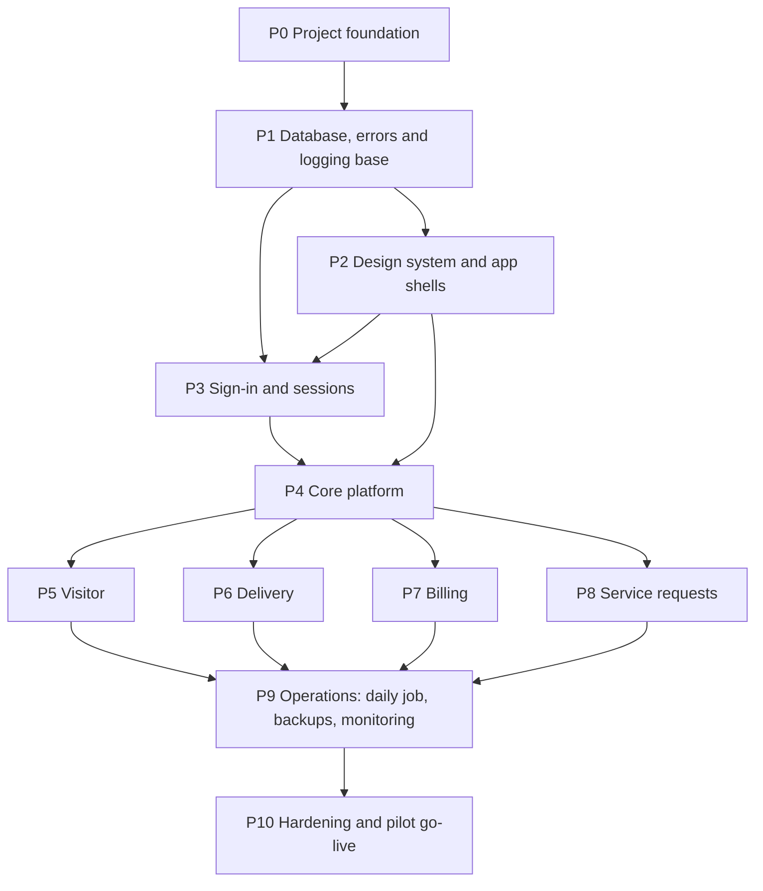

# Homeish — Implementation Plan (IMPLEMENTATION_PLAN.md)

| Field      | Value                                                                                                                                                          |
| ---------- | -------------------------------------------------------------------------------------------------------------------------------------------------------------- |
| Product    | Homeish (PRD D-01 approved 2026-11-09)                                                                                                                         |
| Version    | 0.1 (Draft for approval)                                                                                                                                       |
| Date       | 2026-11-09                                                                                                                                                     |
| Depends on | [PRD.md](./PRD.md), [DESIGN.md](./DESIGN.md), [ARCHITECTURE.md](./ARCHITECTURE.md), [DATABASE.md](./DATABASE.md), [API.md](./API.md), [AGENTS.md](./AGENTS.md) |
| Scope      | MVP only: Core, Visitor, Delivery, Billing, Service Request (PRD D-02, approved). Post-MVP modules are outlined at the end                                     |

**How to read this plan**

- Phases are in build order. A phase starts only when its prerequisites are complete. Tasks inside a phase are small enough to implement, verify and review on their own.
- Task IDs: `P<phase>.<task>` (e.g., `P5.4`). Sizes are relative effort, not time: **S** small, **M** medium, **L** large (split further if it grows).
- Requirement IDs (e.g., `VIS-4`), screen IDs (e.g., `G-02`) and operation names (e.g., `visitor.decide`) come from the PRD, DESIGN and API documents.
- **No code is described here.** Each task says _what_ to deliver and _how to know it is done_.
- The agent follows [AGENTS.md](./AGENTS.md) for every task: inspect existing code first, smallest change, tests, documents updated in the same task, ask the owner when something is unclear.
- **No new features or technologies** appear in this plan beyond those in the project documents.

---

## 1. Plan at a Glance

| Phase | Name                              | Delivers                                                                               | PRD release |
| ----- | --------------------------------- | -------------------------------------------------------------------------------------- | ----------- |
| P0    | Project foundation                | Running skeleton, tooling, pipelines, development database (AD-13)                     | MVP-0       |
| P1    | Database, errors and logging base | Core tables, security helpers, error/audit logging, rate limits                        | MVP-0       |
| P2    | Design system and app shells      | Tokens, shared components, navigation shells                                           | MVP-0       |
| P3    | Sign-in and sessions              | Email-code login, sessions, developer MFA                                              | MVP-0       |
| P4    | Core platform                     | Developer console, structure, people, registration, guards, notifications, files, jobs | MVP-0       |
| P5    | Visitor                           | Visitor module                                                                         | MVP-1       |
| P6    | Delivery                          | Delivery module                                                                        | MVP-2       |
| P7    | Billing                           | Charges, bills, UPI payments, ledger, receipts, reports                                | MVP-3       |
| P8    | Service requests                  | Requests module                                                                        | MVP-4       |
| P9    | Operations                        | Daily job, retention, backup export, monitoring                                        | MVP         |
| P10   | Hardening and pilot               | Security/accessibility/performance review, production setup, pilot                     | MVP         |

P5, P6, P7 and P8 depend only on P4, not on each other. They are listed in the PRD's order; the owner may re-order them.

---

## 2. Rules That Apply to Every Phase

### 2.1 Task rules

1. Every task starts with the AGENTS.md start-of-task steps (read documents, inspect code, restate the task, ask if unclear).
2. One task = one focused change that builds, passes checks and can be reviewed alone. Split anything larger.
3. Tests are part of the task, not a later phase (AGENTS Section 13). A task is not finished until its tests pass.
4. Database changes: forward-only migrations with row-level security, constraints, indexes and generated types in the **same** change (AGENTS Section 11).
5. Documents are updated in the same task (AGENTS Section 15). No new markdown files.
6. Nothing runs against staging or production without the owner's approval.

### 2.2 Module completion gate (applies to P5–P8 and the platform modules in P4)

A module is **done** only when all of the following are true:

- [ ] Every PRD requirement for the module is implemented or explicitly marked deferred by the owner.
- [ ] All its screens exist with loading, empty, error and no-permission states (DESIGN Section 9).
- [ ] The DESIGN acceptance checklist (DESIGN Section 15) passes.
- [ ] Database tests prove tenant isolation, every role-permission cell (allowed and denied), module-disabled denial and the module's special rules.
- [ ] Automated end-to-end tests cover the main journeys on phone and desktop sizes; the automated accessibility check passes.
- [ ] Manual checks done and recorded: keyboard use, screen reader (TalkBack and VoiceOver), 200% text zoom, a low-end Android phone and iPhone Safari.
- [ ] The module ships **switched off** (disabled) and can be switched on for one pilot society by the developer.
- [ ] DATABASE.md, API.md, DESIGN.md and PRD.md match the code.
- [ ] The owner has tried it and approved it (approval is recorded; it is never assumed).

### 2.3 Owner decisions needed along the way

| Needed before         | Item                                                                                                                                                                                                   | Status                                                                                                                    |
| --------------------- | ------------------------------------------------------------------------------------------------------------------------------------------------------------------------------------------------------ | ------------------------------------------------------------------------------------------------------------------------- |
| P0                    | Accounts created (GitHub, Supabase, Vercel, Sentry, Brevo)                                                                                                                                             | Owner action                                                                                                              |
| P0.4                  | Docker Desktop cannot be installed; one free Supabase project `homeish-testdb` is used for development, testing and staging (synthetic data only)                                                      | **Approved and created 2026-11-09 (ARCHITECTURE AD-13)**                                                                  |
| P0.4                  | Three Supabase projects (`homeish-testdb`, `homeish-demo`, `homeish-live`), demo and live paused until needed; separate Vercel project `demo-homeish` for the demo                                     | **Approved and Supabase projects created 2026-11-09 (ARCHITECTURE AD-14)**; `demo-homeish` Vercel project not yet created |
| P0.7                  | Connect beta Vercel variables to `homeish-testdb` now or wait until backend work begins                                                                                                                | **Owner chose to defer until P1 on 2026-11-09**                                                                           |
| P3                    | How development sign-in emails are read without the local mail catcher (Docker-only)                                                                                                                   | Open; decide before P3.3                                                                                                  |
| P2                    | Product logo (DESIGN DD-07; Homeish wordmark + concept-15 mark)                                                                                                                                        | **Approved 2026-11-09:** selected logo asset added                                                                        |
| P3 (staging)          | Your own domain with email sender verification (SPF/DKIM) so login emails are not marked as spam                                                                                                       | Owner action                                                                                                              |
| P7                    | A pilot society's UPI ID and payee name for testing (a test UPI ID is fine until the real one is entered by the society's admin)                                                                       | Owner action                                                                                                              |
| P10                   | Production accounts; `homeish-live` resumed for go-live and upgraded to the paid plan when the first society starts paying (AD-06 amended); the first-ten no-subscription offer does not cover hosting | Owner action                                                                                                              |
| Before society eleven | Homeish subscription price and offer terms after the first ten free societies                                                                                                                          | Open                                                                                                                      |
| P10                   | Pilot society and admin contact                                                                                                                                                                        | Owner action                                                                                                              |

---

# Phase P0 — Project Foundation

**Goal:** an empty-but-correct project that builds, lints, tests and deploys to a preview, with the development database running and the rules in AGENTS.md enforced by tooling.

**Prerequisites:** owner actions in 2.3 (accounts, development Supabase project per AD-13). Documents LOCAL_SETUP.md (to be written alongside P0.4) and DEPLOYMENT.md (before P10).

| ID   | Task                                                                                                                                                                                                       | Size |
| ---- | ---------------------------------------------------------------------------------------------------------------------------------------------------------------------------------------------------------- | ---- |
| P0.1 | Create the Next.js project (App Router, strict TypeScript) with the folder skeleton from ARCHITECTURE Section 9; record the real tool versions in README                                                   | M    |
| P0.2 | Configure Tailwind (empty theme placeholder), formatter, linter with strict rules (no `any`, no suppressions), and the header-comment check                                                                | S    |
| P0.3 | Build the validated configuration module: reads environment variables only here, fails fast with variable _names_, separates public from server-only (API Section 11); commit the placeholder example file | S    |
| P0.4 | Set up the Supabase CLI (project dev dependency), link the development Supabase project (AD-13), the migration folder, naming rules and type generation; document the commands in LOCAL_SETUP.md           | M    |
| P0.5 | Set up test tooling: unit test runner, database test runner (against the development database), end-to-end runner with accessibility check, a controllable clock for tests                                 | M    |
| P0.6 | Create the continuous-integration pipeline: lint, typecheck, unit, database tests, build; checks for secrets in the repo and for secret-looking names with the public prefix                               | M    |
| P0.7 | Connect Vercel preview deployments (staging variables only, no secrets in the repo) to the shared `homeish-testdb` Supabase project (AD-13)                                                                | S    |
| P0.8 | Create the project README (setup, commands, structure, document links)                                                                                                                                     | S    |
| P0.9 | D-34: build the marketing root, allow-listed demo and isolated beta entry; synthetic browser preview with resets; configure main/beta hosting and document actual external verification                    | M    |

P0.9 local implementation includes public marketing, exact-host routing, an illustrative browser-memory demo and beta entry. It does not complete P1-P4 or activate real workflows. The owner approved implementation, documentation and live Git/Vercel setup on 2026-11-09, then deferred Maplewood onboarding until after MVP, when the owner will run the create-society script (`scripts/create-society.mjs`, OPERATIONS "Society onboarding"); its address is reserved in code as a disabled placeholder. External deployment status is recorded in README after verification. Full interactive society demo/reset jobs and real society activation remain gated on backend/auth/module completion and isolation tests. No real society data is seeded.

**P0.9 status, 2026-11-09:** the foundation passed local formatting/lint/type checks, 33 unit tests, four browser tests and production build. Projects `homeish`/`beta-homeish` are linked to `abhishek-r-patel/homeish` under team `arp-dev`, tracking `main`/`beta` respectively, with scaffold-only configuration. The owner approved resuming hosting after a temporary pause and committing/pushing the deployment changes through feature branch -> beta -> main. `vercel.json` enables the two release branches; the existing build gate isolates each project. Preview branch tracking is disabled and Production domain assignment is automatic. The attached addresses are `homeish.vercel.app` and `beta-homeish.vercel.app`; no nested demo/beta or Maplewood host is attached. Verify both automatic releases and hosted HTTPS/routing during this release sequence. Full backend/auth workflows and real society launch approval remain open.

**P0.4 status, 2026-11-09:** done. The Supabase CLI (dev dependency) is initialised in `supabase/` and linked to `homeish-testdb`; `supabase/migrations/` and `seed/` exist; migration naming is enforced by `npm run check:migrations` (part of `npm run check`); `npm run db:new`, `db:list`, `db:push`, `db:types` and `db:types:check` run against the profile's database and refuse `homeish-live`. Empty-schema types are generated into `src/core/db/database.types.ts`. Commands and the company-network certificate workaround (`NODE_USE_SYSTEM_CA=1`) are documented in LOCAL_SETUP.md.

**P0.5 status, 2026-11-09:** done. Vitest covers unit tests, Playwright covers browser smoke and axe accessibility checks, and tests use the controllable clock fixture. Database integration tests are Vitest files in `tests/integration/` run against a throwaway local PostgreSQL 17 (`npm run test:integration:local`), replacing the earlier `psql` SQL tests against testdb.

**P0.6 status, 2026-11-09:** done. CI runs three parallel jobs with timeouts and no persisted Git credentials: Gitleaks full-history secret scan, static checks and build; database integration tests on a disposable `postgres:17` service container with a Supabase stand-in (same approach as Civic Pulse; replaces the slower Supabase CLI stack); and browser tests. A separate CodeQL workflow runs on pushes, pull requests and weekly. CI holds no database credentials. A deliberately broken migration was confirmed to fail the integration tests locally.

**P0.7 status, 2026-11-09:** deferred by the owner until P1. Beta remains scaffold-only; connect its environment to testdb when backend work begins.

**Files/modules affected:** repository root configuration, `src/core/config/`, `src/core/db/`, `supabase/`, `scripts/`, `tests/`, `.github/workflows/`, README, LOCAL_SETUP.md.

**Database/API changes:** none (empty migration folder and generated types only).

**Tests required:** configuration validation unit tests (missing, malformed, public/server mix-up); a smoke test proving the app starts; the pipeline itself must fail on a deliberately bad sample (lint error, type error, leaked-secret pattern) and then be returned to green.

**Completion criteria:**

- A fresh checkout runs the app, the unit tests, the database tests and the end-to-end smoke test with the documented commands.
- The pipeline is green on the main branch and blocks bad changes.
- No secrets exist in the repository; the example file contains names and placeholders only.
- Scaffold hosting is approved: verify the website at `homeish.vercel.app` and beta at `beta-homeish.vercel.app`, with unknown hosts failing closed. Nested demo/beta domains require separate attachment and verification. Real society launch is not approved by this scaffold release.

---

# Phase P1 — Database, Errors and Logging Base

**Goal:** the database foundation and the error/logging backbone every later feature relies on.

**Prerequisites:** P0 complete. [ERROR_LOGGING.md](./ERROR_LOGGING.md) (written before P1.6).

| ID    | Task                                                                                                                                                                                                                                                                                                            | Size |
| ----- | --------------------------------------------------------------------------------------------------------------------------------------------------------------------------------------------------------------------------------------------------------------------------------------------------------------- | ---- |
| P1.1  | Migration group 1: extensions (UUID/crypto, case-insensitive text), the `private` schema, shared triggers (updated-at, reject-update/delete for append-only tables)                                                                                                                                             | S    |
| P1.2  | Migration group 2: security helper functions in `private` as fail-closed stubs; membership/role, module-enabled and society-writable checks are completed with P1.8, while the developer/MFA check stays closed until P3.7                                                                                      | M    |
| P1.3  | Migration group 3: `profiles` (including `font_preference`), `developers`, `societies` (including `unit_label`, `gate_login_mode`, `guard_identification`, `join_code`), `modules` (reference rows for all ten module keys), `module_configs`, with constraints, indexes, RLS and grants per DATABASE Section 3 | L    |
| P1.4  | Migration group 5 (part): `audit_logs`, `error_logs`, `rate_limits`, `job_run_keys`, `jobs` per DATABASE 3.13–3.17                                                                                                                                                                                              | M    |
| P1.5  | Error model: error classes, the response envelope, the closed lists of error codes and conflict reasons (API 3.2, 3.5); request ID creation                                                                                                                                                                     | M    |
| P1.6  | Logging core: the scrubber, the error-log writer (best effort, never throws), the audit-log writer, Sentry adapter with scrubbing                                                                                                                                                                               | L    |
| P1.7  | Privileged module isolation (service-role client only in `src/core/privileged/`) with an automated check that nothing else imports it                                                                                                                                                                           | S    |
| P1.8  | Request context builder (verified user, active society, roles, enabled modules) and the authorization pipeline helper (API 2.5), with the per-module permission-map framework; membership schema/helpers pulled forward from P3.1/P3.8                                                                          | L    |
| P1.9  | Rate-limit service on the `rate_limits` table with the fail-closed / fail-open rules (API Section 10)                                                                                                                                                                                                           | M    |
| P1.10 | Routes: `/api/health` and `/api/client-errors`; the browser error boundary showing the reference ID                                                                                                                                                                                                             | M    |
| P1.11 | CI database checks from DATABASE 14.1: every table has RLS and a policy, no grants to the anonymous role, every tenant table indexed by society, foreign keys indexed, append-only triggers present                                                                                                             | M    |

**Files/modules affected:** `supabase/migrations/`, `tests/integration/`, `src/core/{errors,logging,privileged,permissions,tenancy,db,config}/`, `src/app/api/{health,client-errors}/`.

**Database changes:** tables `profiles`, `developers`, `societies`, `modules`, `module_configs`, `audit_logs`, `error_logs`, `rate_limits`, `job_run_keys`, `jobs`; helper functions; triggers; seed of `modules` reference data in migrations.

**API changes:** routes `/api/health`, `/api/client-errors`; shared envelope and error codes.

**Tests required:**

- Unit: scrubber (codes, tokens, phones, UPI IDs, bodies removed), error mapping, envelope, rate-limit windows and fail-closed/open behavior, permission-map framework.
- Database: RLS on every new table (a user of one society cannot read another's; anonymous role gets nothing); append-only tables reject update/delete; `module_configs` core row cannot be disabled; unique and check constraints; helper functions return correct answers for each role.
- Integration: a thrown error becomes a logged entry with a reference ID and a safe user message; logging failure does not break the request.

**Completion criteria:**

- Every new table passes the CI database checks.
- An intentionally raised server error and client error each appear in the error log with a reference ID, and nothing sensitive is stored.
- The privileged-import guard fails the build when misused.
- DATABASE.md and API.md match what was built.

---

# Phase P2 — Design System and App Shells

**Goal:** the shared look, components and navigation frames so every later screen is built from the same parts (DESIGN Sections 2–6, 9, 14).

**Prerequisites:** P0 complete; brand colour, product name and logo approved on 2026-11-09 (DD-06, DD-07, D-01). P1.8 for permission-aware navigation (P2.8 only).

| ID    | Task                                                                                                                                                                                        | Size |
| ----- | ------------------------------------------------------------------------------------------------------------------------------------------------------------------------------------------- | ---- |
| P2.1  | Design tokens in the Tailwind theme: colour, type scale, spacing, radius, motion, breakpoints, containers; bundled Manrope/Sora fonts and device-default preference                         | M    |
| P2.2  | Core controls: button variants (with loading), text input and specialised inputs (email, code, phone, amount, search), select/combobox, checkbox/radio/switch/option card                   | L    |
| P2.3  | Overlays and feedback: dialog/bottom sheet, confirm dialog (with required-reason variant), banner, toast, error summary, error panel with reference ID, empty state, skeleton, spinner      | L    |
| P2.4  | Data display: status chip with the single mapping table (DESIGN 4.4), list item, stat tile, card, avatar, timeline, code display                                                            | M    |
| P2.5  | Tables and lists: data table with stacked mobile rows, pagination, filter bar with applied-filter chips, tabs/segmented control, sort headers (API Section 3.8)                             | L    |
| P2.6  | Forms: field layout, validation display, error summary focus handling, unsaved-changes prompt, file upload component (UI only), date/time pickers                                           | L    |
| P2.7  | Module registry skeleton in `core/modules/` (key, name, navigation items, permission map, settings schema hooks) and the module-disabled page                                               | M    |
| P2.8  | App shells and navigation per role: top bar, bottom tabs/More, sidebar/rail, guard home frame, developer dark shell; navigation built from enabled modules + permissions with no empty gaps | L    |
| P2.9  | Installable-app basics: manifest and icons (no offline caching, offline banner only)                                                                                                        | S    |
| P2.10 | Component states fixture page (excluded from production builds) used by automated visual and accessibility tests                                                                            | M    |

**Files/modules affected:** `src/styles/`, `src/components/ui/`, `src/core/modules/`, `src/app/` layouts for each role group, `public/`.

**Database/API changes:** none.

**Tests required:** component tests for each state (default, hover, pressed, focus, disabled, loading, error); automated accessibility check on every component and shell; keyboard and focus-return tests for dialogs and sheets; responsive checks at the DESIGN widths (320, 390, 768, 1280, 1440, 200% text); navigation test proving a disabled module leaves no item or gap.

**Completion criteria:**

- Every component in DESIGN Section 19 "Foundation" exists, uses tokens only and passes accessibility checks.
- All five shells render with the correct navigation for a sample set of roles and module settings.
- No raw colour values or arbitrary sizes exist in component code (automated check).

---

# Phase P3 — Sign-in and Sessions

**Goal:** people can sign in with an emailed code, stay signed in, switch societies; developers sign in separately with a second factor.

**Prerequisites:** P1 and P2 complete. Staging email sender verified (owner action in 2.3); the local mail catcher is used for development.

| ID   | Task                                                                                                                                                                                  | Size |
| ---- | ------------------------------------------------------------------------------------------------------------------------------------------------------------------------------------- | ---- |
| P3.1 | First-sign-in membership linking and the service-role-only invitation-check function (ARCHITECTURE 8.4 item 4); the `memberships` table and read policies were pulled forward to P1.8 | M    |
| P3.2 | Automatic profile creation and email synchronisation from the auth service                                                                                                            | S    |
| P3.3 | Auth service configuration: sign-up closed, email code template (code only, no links), session lifetimes; Brevo SMTP configured on staging; local mail catcher for development        | M    |
| P3.4 | Operations `auth.requestCode`, `auth.verifyCode`, `auth.signOut` with the generic answers and rate limits from API Section 10                                                         | L    |
| P3.5 | Screens S-01 and S-02 (email entry, code entry, resend cooldown, lockout messages, spam hint) with all states                                                                         | M    |
| P3.6 | `session.get`, `session.switchSociety`, society picker S-03, no-membership and waiting-for-approval screens, session-expired page returning to the original destination               | M    |
| P3.7 | Developer sign-in route (S-05): password, authenticator enrolment and verification, short sessions, the "developer with recent MFA" check in the helper functions                     | L    |
| P3.8 | Complete the developer/MFA helper from P1.2 and verify the full role combinations; membership, module and society helpers were implemented and tested in P1.8                         | M    |

**Files/modules affected:** `src/core/auth/`, `src/core/tenancy/`, `src/app/(auth)/`, `src/app/developer/` (sign-in only), `supabase/migrations/`, auth-service settings documented in LOCAL_SETUP.md.

**Database changes:** `memberships`; linking and invitation-check functions; policies using the real helpers.

**API changes:** `auth.requestCode`, `auth.verifyCode`, `auth.signOut`, `auth.developerSignIn`, `auth.developerVerifyMfa`, `session.get`, `session.switchSociety`.

**Tests required:**

- Unit/integration: unknown email gets the identical response as a known one; code single use; five wrong tries invalidate; resend cooldown; rate limits trigger and fail closed; invited membership links on first sign-in; closed sign-up (no account without invitation or registration flow).
- Database: membership policies (self sees own rows; admin sees society rows; no cross-society); helper functions per role.
- End-to-end: full sign-in with the mail catcher; developer cannot reach developer operations without MFA; session expiry returns to the saved destination.
- Security: no code or email appears in logs; no redirect to a client-supplied address.

**Completion criteria:**

- An invited person can sign in with the emailed code on staging and lands in the right place; an uninvited email gets no access and no information.
- A developer account (created by direct database action) signs in with MFA; without MFA it is refused.
- All role-combination tests for the helper functions pass.

---

# Phase P4 — Core Platform

**Goal:** everything the modules stand on: the developer console, society structure, people and roles, registration, guards, notifications, files, jobs and the daily-job runner. Built as sub-phases that each end working and tested.

**Prerequisites:** P1, P2, P3 complete.

## P4A — Developer console and module registry

| ID    | Task                                                                                                                                                                                                                                    | Size |
| ----- | --------------------------------------------------------------------------------------------------------------------------------------------------------------------------------------------------------------------------------------- | ---- |
| P4A.1 | `developer.societies.*`: list, create (creates the core module row, default settings; default request categories are added in P8), update, set status (standard confirmation stating the effect of suspend/archive); screens D-01, D-02 | L    |
| P4A.2 | Module toggle function (one transaction + audit) and `developer.modules.list/toggle/updateSettings`; Society Config → Modules screen D-03 with confirm dialogs; settings validated against each module's schema                         | L    |
| P4A.3 | Enforce module-enabled in navigation, server checks and database policies; module-disabled responses                                                                                                                                    | M    |
| P4A.4 | `developer.members.createFirstAdmin` (invitation for the first admin) and screen D-04                                                                                                                                                   | M    |
| P4A.5 | Error log viewer D-05 (filters, reference-ID lookup, detail, resolve/ignore) and audit viewer D-06                                                                                                                                      | L    |
| P4A.6 | Health summary D-07 built from the error log                                                                                                                                                                                            | S    |

_Files:_ `src/modules/` registry entries for `core`, `src/app/developer/`, `src/core/modules/`, `src/core/logging/`.
_Database:_ toggle and society-creation functions; policies for developer reads; no new tables.
_API:_ `developer.*` operations (API 5.4).
_Tests:_ developer-only access, MFA requirement, toggle takes effect on the next request in navigation, API and database; toggle is audited; disabled module data untouched; error lookup by reference ID returns the right entry.
_Done when:_ a developer can create a society, switch modules on and off and find an error by reference ID; a non-developer cannot do any of it.

## P4B — Society structure

| ID    | Task                                                                                                                                          | Size |
| ----- | --------------------------------------------------------------------------------------------------------------------------------------------- | ---- |
| P4B.1 | Migration: `blocks`, `units` with same-society keys, uniqueness and indexes; RLS                                                              | M    |
| P4B.2 | `structure.blocks.*` and `structure.units.*` operations and admin screen A-02                                                                 | M    |
| P4B.3 | Jobs list screen and `jobs.list/get`                                                                                                          | S    |
| P4B.4 | CSV units import: template download, validate-only preview with per-row errors, confirm creating a job, results and downloadable error report | L    |

_Database:_ `blocks`, `units`. _API:_ `structure.*`, `jobs.*`.
_Tests:_ duplicate unit numbers (with and without block), deactivate-only when history exists, tenant isolation, CSV edge cases (bad rows, duplicates, huge file limit), preview writes nothing.
_Done when:_ an admin imports 300 sample units and sees correct results and an error report for bad rows.

## P4C — People, roles and households

| ID    | Task                                                                                                                                            | Size |
| ----- | ----------------------------------------------------------------------------------------------------------------------------------------------- | ---- |
| P4C.1 | Migration: `unit_occupants` with the one-active-primary rule; indexes; RLS                                                                      | M    |
| P4C.2 | `members.*` operations: invite by email, list, change roles, deactivate (immediate revoke), occupancy assign/move/end; all audited; screen A-03 | L    |
| P4C.3 | `members.importPreview/importConfirm` (resident CSV)                                                                                            | M    |
| P4C.4 | Household screen R-08 (`household.members.*`) and profile screen S-12 with `profile.update`, including account-saved font preference            | M    |
| P4C.5 | Permission maps for `core` operations wired to the helper functions and tests                                                                   | M    |

_Database:_ `unit_occupants`; role-change and deactivate functions. _API:_ `members.*`, `household.*`, `profile.update`.
_Tests:_ only one active primary per unit; deactivation takes effect on the next request; family cannot become approver by default; role changes audited; resident sees only own household; matrix tests for A/C/R.
_Done when:_ an admin invites residents, assigns them to units and deactivates one, with the change taking effect immediately and recorded in the audit history.

## P4D — Self-registration with society code

| ID    | Task                                                                                                             | Size |
| ----- | ---------------------------------------------------------------------------------------------------------------- | ---- |
| P4D.1 | `society.rotateJoinCode/disableJoinCode` and the admin setting screen                                            | S    |
| P4D.2 | `registration.lookupSociety`, `registration.submit`, screen S-04 and the waiting-for-approval state; rate limits | M    |
| P4D.3 | `members.approve/reject` with notifications to admins and the applicant                                          | M    |

_Database:_ uses `societies.join_code` and pending membership/occupancy rows. _API:_ `registration.*`, `members.approve/reject`.
_Tests:_ wrong or disabled code returns nothing useful; lookup rate limits fail closed; approval activates access immediately; rejected user has no access; no society list is ever exposed.
_Done when:_ a new resident registers with the code, an admin approves, and the resident can sign in to that society.

## P4E — Guards and gate settings

| ID    | Task                                                                                                                                                 | Size |
| ----- | ---------------------------------------------------------------------------------------------------------------------------------------------------- | ---- |
| P4E.1 | Migration: `guard_roster` (hashed PIN, never readable by the API roles); RLS                                                                         | M    |
| P4E.2 | `guards.*` operations: add/update/deactivate, set PIN, society gate settings (`society.updateGateSettings`) with the admin settings screen           | M    |
| P4E.3 | `guards.identify` (name pick or PIN), the signed on-duty cookie, `GUARD_NOT_IDENTIFIED` handling and the "Handled by" control; `guards.unitContacts` | L    |

_Database:_ `guard_roster`. _API:_ `guards.*`, `society.updateGateSettings`.
_Tests:_ PIN stored only as hash and never returned or logged; five failures lock for 15 minutes; cookie expires and is tied to the session; individual-mode guard resolves automatically; `unitContacts` returns only approvers' name and phone.
_Done when:_ in both gate-login modes, a guard can be identified and a test entry would record the correct guard.

## P4F — Notifications (in-app, push, email adapter)

| ID    | Task                                                                                                                               | Size |
| ----- | ---------------------------------------------------------------------------------------------------------------------------------- | ---- |
| P4F.1 | Migration: `notifications`, `push_subscriptions`; RLS (owner only; no key reads)                                                   | M    |
| P4F.2 | In-app inbox: `notifications.*`, screen S-11, unread badge, Realtime inbox channel                                                 | M    |
| P4F.3 | Web Push: service worker, subscribe/unsubscribe route, privileged sender with retry/prune rules, minimal payloads (DESIGN 8.3)     | L    |
| P4F.4 | Email adapter for the transactional email API (timeout, one retry, scrubbing) and the daily email-quota counter with the 80% alert | M    |
| P4F.5 | Notification creation helper used inside transactions (so a notification row commits with its event)                               | S    |

_Database:_ `notifications`, `push_subscriptions`. _API:_ `notifications.*`, `/api/push/subscriptions`.
_Tests:_ a user only sees and updates own notifications; subscription keys never returned; expired subscriptions deleted; push and email failures never break the user's action; payload contains no sensitive data; adapter fakes for timeout and error cases.
_Done when:_ a test event creates an inbox item and a push to a subscribed device, and failures of push/email are invisible to the user but logged.

## P4G — Files

| ID    | Task                                                                                                                                | Size |
| ----- | ----------------------------------------------------------------------------------------------------------------------------------- | ---- |
| P4G.1 | Private storage buckets and path-based policies using the same helper functions (DATABASE Section 12)                               | M    |
| P4G.2 | `/api/files/upload-url` and `/api/files/url` with type/size/count checks; the attach-time re-check helper used by owning operations | L    |
| P4G.3 | Wire the upload component to the routes (per-file progress, retry, remove) and the society logo upload                              | M    |

_API:_ the two file routes. _Tests:_ cross-society paths denied; wrong type/size rejected twice (issue time and attach time); links expire; storage policy tests per bucket; failed upload leaves no row.
_Done when:_ a test image uploads, is viewable only by permitted roles and fails safely for everyone else.

## P4H — Daily job runner skeleton

| ID    | Task                                                                                                                             | Size |
| ----- | -------------------------------------------------------------------------------------------------------------------------------- | ---- |
| P4H.1 | `/api/jobs/daily` with the secret-token check, run-key idempotency and per-task isolation; each module registers its tasks later | M    |

_Tests:_ wrong/missing token rejected and logged; second call same day does nothing; one failing task does not stop others.
_Done when:_ the route runs an empty task list safely and idempotently on staging.

**P4 completion criteria (whole phase):**

- Developer, admin, committee, resident and guard shells work end to end for the Core module with correct permissions.
- A full onboarding journey works: developer creates a society → invites first admin → admin imports units and residents → guards added → resident registers by code and is approved.
- The module completion gate (2.2) passes for `core`.

---

# Phase P5 — Visitor Module (`visitor`)

**Goal:** guards log visitors, residents approve from their phone, pre-approved codes work, and the gate has a reliable audit trail (PRD 5.1, VIS-1 to VIS-10).

**Prerequisites:** P4 complete (units, occupants, guard roster, notifications, files, Realtime channel basics).

| ID    | Task                                                                                                                                                                                                                                            | Size |
| ----- | ----------------------------------------------------------------------------------------------------------------------------------------------------------------------------------------------------------------------------------------------- | ---- |
| P5.1  | Migration: `visitor_entries`, `visitor_pre_approvals`, `visitor_blacklist` with checks, partial unique code index, `client_request_id`, indexes from DATABASE Section 16, RLS including the module-enabled rule                                 | L    |
| P5.2  | Module registration (`visitor`), permission map, settings schema (timeout, overstay hours, photo required, override allowed, phone required)                                                                                                    | S    |
| P5.3  | Functions: create entry (blacklist warning, notify approvers, response deadline), decide (row lock, first response wins), guard override (reason required), check-in, check-out, lazy expiry on read                                            | L    |
| P5.4  | Pre-approval functions and operations: create (code generation with collision handling and QR encoding that same code), cancel, list, validate (typed or scanned code; distinct invalid/expired/used reasons, rate limited), check-in from code | L    |
| P5.5  | Blacklist operations and admin screen section                                                                                                                                                                                                   | S    |
| P5.6  | Guard screens: gate home G-01, new visitor G-02 with waiting panel, validate QR by camera or code manually in G-03, inside now / today G-04, "Can't reach server" banner and the on-screen retry that never drops an entry                      | L    |
| P5.7  | Resident screens: approval card via notification deep link and pending list, pre-approve form with QR and matching code plus share/copy, history (R-02), final-status view for stale alerts                                                     | L    |
| P5.8  | Admin visitor log A-05 with filters, "still inside" overstay indicator, dashboard tile                                                                                                                                                          | M    |
| P5.9  | Realtime visitor channel with 5-second polling fallback; guard alert sound/haptic setting with a global mute control (DESIGN DD-03 approved 2026-11-09)                                                                                         | M    |
| P5.10 | Notification wording and deep links for visitor events                                                                                                                                                                                          | S    |

**Database changes:** the three visitor tables, their functions and policies. **API changes:** `visitor.*` operations (API 5.5).

**Tests required:**

- Database: a resident cannot read another unit's visitors; guard cannot read pre-approval rows directly; first response wins under simultaneous approval; override requires reason; checked-in time rules; code unique among active codes and its QR represents that same code; module disabled blocks all access; suspended society blocks writes.
- Integration: end-to-end lifecycle (create → approve → check in → check out); expiry derived correctly; duplicate submit via the same `clientRequestId` creates one entry; notifications created in the same transaction.
- End-to-end: walk-in journey and pre-approval journey on phone sizes; guard flow completable under 30 seconds with realistic input; failure and offline banner states; accessibility check.
- Security: code-guessing limits; visitor phone masked in lists for roles that do not need it; nothing personal in URLs or logs.

**Completion criteria:** module gate (2.2) passes; PRD acceptance examples met (resident approval visible to the guard within 5 seconds in normal conditions; expired code rejected and logged); both gate-login modes record the handling guard.

---

# Phase P6 — Delivery Module (`delivery`)

**Goal:** guards log deliveries; residents choose allow, leave at gate or deny; parcels left at the gate are tracked until collected (PRD 5.2, DEL-1 to DEL-7).

**Prerequisites:** P4 complete. P5 is not required (modules are independent, PRD A-05) but its gate-screen patterns are reused if already built.

| ID   | Task                                                                                                                           | Size |
| ---- | ------------------------------------------------------------------------------------------------------------------------------ | ---- |
| P6.1 | Migration: `delivery_entries`, `delivery_preferences` with constraints, indexes, RLS                                           | M    |
| P6.2 | Module registration, permission map, settings (response timeout, uncollected days, leave-at-gate toggle)                       | S    |
| P6.3 | Functions and operations: create (applies the unit's standing rule automatically), respond, override, mark collected, list/get | L    |
| P6.4 | Delivery preference screen for approvers of a unit                                                                             | S    |
| P6.5 | Guard screens: new delivery G-05, waiting list, uncollected parcels with Mark Collected                                        | M    |
| P6.6 | Resident screens: respond via notification, history R-03; admin log A-06                                                       | M    |
| P6.7 | Realtime delivery channel and notifications                                                                                    | S    |

**Database:** the two delivery tables and functions. **API:** `delivery.*` (API 5.6).

**Tests:** preference rule produces the right decision source; only `left_at_gate` parcels can be collected; first response wins; tenant and unit isolation; module-disabled denial; duplicate-submit protection; end-to-end journeys; accessibility; uncollected-parcel list uses the configured threshold.

**Completion criteria:** module gate (2.2) passes; PRD DEL-1 to DEL-7 verified; works in both gate-login modes.

---

# Phase P7 — Billing Module (`billing`)

**Goal:** societies bill residents, residents pay the society's UPI directly and submit the reference, admins confirm, and everyone sees an exact, append-only statement (PRD 5.3, BIL-1 to BIL-17).

**Prerequisites:** P4 complete (units, occupants, notifications, files for screenshots, jobs). Test UPI details (owner action).

This is the largest module; it is built in nine sub-steps that each work and are tested.

### P7A — Charges and payment details

| ID    | Task                                                                                                                                                               | Size |
| ----- | ------------------------------------------------------------------------------------------------------------------------------------------------------------------ | ---- |
| P7A.1 | Migration: `billing_charge_types`, `billing_payment_details`, `billing_receipt_counters`; RLS                                                                      | M    |
| P7A.2 | Module registration, permission map, settings schema (due day, grace days, late fee rule, reminders, alert days)                                                   | S    |
| P7A.3 | `billing.charges.*` and screen (Charge Types tab)                                                                                                                  | M    |
| P7A.4 | `billing.paymentDetails.get/update`: UPI ID format check, audit with old/new values, notify all admins and committee, "last changed" date; Payment Settings screen | M    |

### P7B — Bills and ledger

| ID    | Task                                                                                                                                                                                                                   | Size |
| ----- | ---------------------------------------------------------------------------------------------------------------------------------------------------------------------------------------------------------------------- | ---- |
| P7B.1 | Migration: `billing_bills` (generated status), `billing_bill_lines` (composite key and duplicate-charge rule), `billing_ledger_entries`, `billing_payment_allocations`; immutability and append-only triggers; indexes | L    |
| P7B.2 | Preview function and `billing.bills.preview` (fixed, per sq ft, custom methods; rounding rules written down and tested)                                                                                                | M    |
| P7B.3 | Generation function: set-based, idempotent, ledger debits, automatic use of existing credit, job record, notifications after commit; `billing.bills.generate` and the four-step generator screen                       | L    |
| P7B.4 | `billing.bills.list/get`, `billing.ledger.get` with running balance                                                                                                                                                    | M    |

**Approved billing rules (D-36):** each society may set the monthly due day to 1–31 or the last day of the month, and choose nearest-rupee or nearest-paise rounding for per-square-foot charges; ties round up. New societies default to the 10th and nearest rupee.

### P7C — Payments

| ID    | Task                                                                                                                                                                                                                                        | Size |
| ----- | ------------------------------------------------------------------------------------------------------------------------------------------------------------------------------------------------------------------------------------------- | ---- |
| P7C.1 | Migration: `billing_payments` with duplicate-reference rule and `client_request_id`; indexes; RLS                                                                                                                                           | M    |
| P7C.2 | `billing.submitPayment` (resident, optional screenshot path re-checked, reference format, duplicate protection, notify admins)                                                                                                              | M    |
| P7C.3 | Confirm function: lock, oldest-first allocation, ledger credit, receipt number, optional amount correction (audited), notify payer; `billing.confirmPayment`, `billing.rejectPayment` (reason), `billing.recordPayment` (confirmed at once) | L    |
| P7C.4 | `billing.payments.list/get` and the admin review queue with stale highlighting                                                                                                                                                              | M    |

### P7D — Fines, waivers, late fees

| ID    | Task                                                                                                                | Size |
| ----- | ------------------------------------------------------------------------------------------------------------------- | ---- |
| P7D.1 | `billing.fines.add` and `billing.bills.waive` (reason, partial/full, cancel only when unpaid), audit                | M    |
| P7D.2 | Late-fee task for the daily runner (one per overdue bill and month, per the society rule; late fees never compound) | M    |

### P7E — Screens

| ID    | Task                                                                                                                                                  | Size |
| ----- | ----------------------------------------------------------------------------------------------------------------------------------------------------- | ---- |
| P7E.1 | Resident dues R-04: amount-due hero, bills, ledger, receipts tabs, bill detail                                                                        | L    |
| P7E.2 | UPI payment screen: exact amount, payee, UPI ID with Copy, QR, "Pay with UPI App" button, last-changed line, reference form, awaiting/rejected states | L    |
| P7E.3 | Admin billing A-07: tabs, review queue, record payment, fines/waive dialogs                                                                           | L    |

### P7F — Reminders, receipts, reports

| ID    | Task                                                                                                                                                | Size |
| ----- | --------------------------------------------------------------------------------------------------------------------------------------------------- | ---- |
| P7F.1 | Reminder and stale-payment tasks for the daily runner (BIL-10, BIL-17)                                                                              | M    |
| P7F.2 | Receipt and bill PDFs (`/api/billing/receipts/{id}`, `/api/billing/bills/{id}`), print layout, receipt email to the payer through the email adapter | L    |
| P7F.3 | `billing.dashboard` and `billing.reports.export` (CSV job, formula-safe, audited)                                                                   | M    |

**Database changes:** the eight billing tables, functions (preview, generate, confirm, reject, record, waive, fine, late fee, credit apply, UPI update) and policies per DATABASE Section 6. **API changes:** `billing.*` operations and the two PDF routes, plus `/api/exports/{jobId}`.

**Implementation status:** P7A–P7F are implemented in five migrations (`20261110183000` to `20261110203000`; see DATABASE 6.10) and validated against a local PostgreSQL integration run. Approved decisions made during the build:

- Admins waive or cancel directly with a required reason and audit entry; there is no committee approval step.
- Billing rules are developer-configured; there is no settings editor in P7.
- PDFs are generated with `pdf-lib` standard fonts, so amounts print as "Rs." and non-Latin text is replaced.

Tests cover the module gate's required set: unit tests (money, CSV, PDFs, validation, log safety), database tests in `tests/integration/database-billing*.test.ts` (300-unit generation, concurrent confirms, partial and corrected payments, visibility, suspended and disabled states, the DATABASE 15.3 consistency checks) and Playwright journeys on synthetic fixture pages (`/fixtures/billing`, `/fixtures/billing-payments`). Only the owner walkthrough remains before the module gate.

**Tests required (in addition to the module gate):**

- Unit: bill calculation for each method; rounding; allocation oldest-first; credit application; late-fee month logic and non-compounding behavior; receipt numbering.
- Database: duplicate bill-line rule; duplicate UTR blocked while pending/confirmed and allowed after rejection; paid + waived never exceed total; ledger and payments immutable; allocations never exceed payment; two admins confirming simultaneously produce one confirmation; resident sees only own unit; guard sees nothing; committee read-only; module disabled; suspended society read-only.
- Invariant checks from DATABASE 15.3 implemented as automated tests: bill paid equals allocations; bill total equals lines; ledger balance equals bills minus payments minus waivers plus adjustments.
- Integration: full cycle: generate → submit → confirm → receipt; reject → resubmit; partial payment; overpayment becomes credit and applies to the next generation; UPI detail change audited and notified.
- End-to-end: resident pay-and-submit journey and admin review journey; phone layouts; accessibility; failure states for screenshot upload and PDF generation.
- Security: UPI details editable only by admin; amounts never taken from the browser; no UTR, UPI ID or amounts in logs; CSV formula safety; receipt PDFs only for permitted users.

**Completion criteria:** module gate (2.2) passes; PRD acceptance (admin generates 300-unit bills in under 30 minutes of effort; no duplicates on re-run; every confirmed payment has a receipt and appears in the ledger); the owner has walked through the money flow with a test society and approves wording on every payment screen.

---

# Phase P8 — Service Requests Module (`service_request`)

**Goal:** residents raise requests, admins assign and track them against SLA, residents confirm and rate (PRD 5.4, SRQ-1 to SRQ-9).

**Prerequisites:** P4 complete (files, notifications, jobs, daily runner).

| ID   | Task                                                                                                                                                                                                                                                                     | Size |
| ---- | ------------------------------------------------------------------------------------------------------------------------------------------------------------------------------------------------------------------------------------------------------------------------ | ---- |
| P8.1 | Migration: `service_request_categories`, `service_requests`, `service_request_comments`, `service_request_attachments`, `service_request_events`; checks, indexes, RLS (including common-area visibility)                                                                | L    |
| P8.2 | Module registration, permission map, settings (auto-close days); default categories created by the society-creation function (update P4A.1)                                                                                                                              | S    |
| P8.3 | Functions and operations: create (SLA due time, up to 3 attachments), assign (member or vendor), update status, reject (reason), confirm close, reopen, rate, add comment (requester, admin or assignee only); timeline events and notifications in the same transaction | L    |
| P8.4 | Categories admin screen and operations                                                                                                                                                                                                                                   | S    |
| P8.5 | Resident screens R-05: new request, my requests, detail with timeline, comments, attachments, rating/reopen prompt                                                                                                                                                       | L    |
| P8.6 | Admin screen A-08: filters, SLA overdue highlighting, assign, status change, comments; dashboard tiles                                                                                                                                                                   | L    |
| P8.7 | Auto-close task for the daily runner                                                                                                                                                                                                                                     | S    |
| P8.8 | Request report (counts by category/status, average resolution time and rating)                                                                                                                                                                                           | S    |

**Database changes:** five tables and functions per DATABASE Section 7. **API changes:** `request.*` operations (API 5.8).

**Tests:** only valid status transitions; timeline event and notification on every change; resident sees own-unit and common-area requests only; other residents may read common-area requests but cannot comment; unit consistency check; attachment limits; assignee access; auto-close timing with the controllable clock; rating only once and only after closing; matrix tests; end-to-end resident and admin journeys; accessibility.

**Completion criteria:** module gate (2.2) passes; PRD SRQ-1 to SRQ-9 verified; overdue requests visible on the admin dashboard.

---

# Phase P9 — Operations: Daily Job, Retention, Backups, Monitoring

**Goal:** the unattended parts run reliably and the developer can see when they do not.

**Prerequisites:** P5–P8 (or whichever modules exist) complete. OPERATIONS.md and ERROR_LOGGING.md written.

**Status: complete for the approved testdb/staging scope (2026-11-13).** Scheduled
backups remain paused; production backup activation and Storage-file backup
remain explicitly deferred as described below.

| ID   | Task                                                                                                                                                                                                                                                        | Size |
| ---- | ----------------------------------------------------------------------------------------------------------------------------------------------------------------------------------------------------------------------------------------------------------- | ---- |
| P9.1 | Register every module's daily tasks in the runner (late fees, reminders, stale payments, expired visitor entries, request auto-close); delivery overdue status is computed on read, not by a daily task. Verify run-key idempotency across the tasks        | M    |
| P9.2 | Retention and anonymisation task per DATABASE 11.3 (visitor/delivery anonymise, pre-approvals, requests, notifications, logs, jobs, rate-limit counters, orphan file report)                                                                                | L    |
| P9.3 | Developer-run user erasure: delete Auth identity, retain an anonymized profile tombstone, revoke access, preserve historical content, and audit                                                                                                             | M    |
| P9.4 | Google Drive encrypted database export and compatible restore drill verified for homeish-testdb; scheduled backups remain paused pending production safeguards. Weekly file copy is deferred for lack of an approved least-privilege credential             | M    |
| P9.5 | Health and developer surfaces expose daily-job freshness; uptime, Sentry, and email-quota alerts are configured. The day cycle, idempotency, resident reminder, uptime outage/recovery email, and application-originated critical alert/email were verified | M    |
| P9.6 | Read-only integrity suite, deliberate-corruption tests, and monthly workflow implemented; guarded testdb workflow passed in GitHub Actions on 2026-11-12                                                                                                    | M    |

**Database changes:** retention/anonymise functions; no new tables. **API changes:** none beyond the daily route's task list.

**Tests:** each task idempotent (run twice, same result); retention removes exactly what the schedule says and keeps money records; anonymise keeps history valid; integrity checks detect a deliberately corrupted sample on a test database; alert rules fire in staging.

**Completion criteria:** a full day cycle runs on staging with representative test data and no unintended real notifications; a missed run is detected; a backup restores to a new isolated compatible target (DATABASE 15.2). The approved testdb backup/restore drill is complete; production backup activation and Storage-file backup remain explicitly deferred.

**P9 external setup status, 2026-11-13:** beta (`beta-homeish`, on the shared
`homeish-testdb` project) has the P8/P9 release, an external uptime monitor, a
Sentry critical-error alert, Brevo transactional email, and the daily schedule.
The monitor's setup notification, Sentry's synthetic critical event, and a
real Brevo delivery were verified (OPERATIONS.md). The active validation
society's 2026-11-13 IST cycle completed all six tasks; two authenticated local
repeats skipped them, confirming run-key idempotency. The INR 1 test bill was
generated after that cycle; its reminder was later run directly and appeared in
the resident Notifications page. The stale-health test returned 503 and
recovered to 200; the owner confirmed receipt of its UptimeRobot outage/recovery
email. A one-off synthetic failure through the real application runner locally,
using testdb and staging Sentry configuration, persisted a critical log and
reached Sentry. The owner confirmed its alert email; the matching Sentry issue
and Developer Console error were resolved (OPERATIONS.md). All six real job
keys were unchanged by that drill. The guarded testdb integrity workflow passed
on 2026-11-12. The request-dashboard grouping error was fixed by migration
`20261113060000` and verified against the existing synthetic request.

**Backup status:** a manual encrypted homeish-testdb archive was downloaded,
authenticated, restored into a disposable Supabase-compatible PostgreSQL 17
target, and passed all 13 integrity checks in GitHub Actions run 43222943511. Keep scheduled backups disabled. Before production activation,
verify the production source and recovery path and isolate production retention
from test archives. Weekly Storage-file backup remains deferred as noted in
DATABASE 15.2.

---

# Phase P10 — Hardening and Pilot Go-Live

**Goal:** prove the MVP is safe, accessible, fast enough and operable, then enable it for one pilot society.

**Prerequisites:** P9 complete; owner actions in 2.3; DEPLOYMENT.md and OPERATIONS.md finished; LOCAL_SETUP.md current.

| ID    | Task                                                                                                                                                                                                                                                                                                                                                     | Size |
| ----- | -------------------------------------------------------------------------------------------------------------------------------------------------------------------------------------------------------------------------------------------------------------------------------------------------------------------------------------------------------- | ---- |
| P10.1 | Security review: row-level security audit of every table, cross-society attack tests on every operation, header and cookie checks, secrets scan, dependency vulnerability scan, privileged-usage review                                                                                                                                                  | L    |
| P10.2 | Accessibility pass: manual keyboard, TalkBack, VoiceOver, 200% zoom, outdoor-brightness contrast check on a guard device; fix findings                                                                                                                                                                                                                   | L    |
| P10.3 | Performance check with generated data at target scale (1,500 units, large visitor/log tables): list queries, bill generation, dashboards; add indexes only where measured slow                                                                                                                                                                           | M    |
| P10.4 | Failure drills: database unreachable, realtime down, email/push failure, scheduler missed, duplicate submissions, concurrent decisions; confirm the documented behavior                                                                                                                                                                                  | M    |
| P10.5 | Production setup: resume `homeish-live` (AD-14); paid plan with backups once the first society pays, with the own nightly off-site copy verified before the first society (AD-06 amended); Vercel plan per the owner's decision, your domain and sender verification, production secrets set, regions chosen (API APA-04), Sentry and uptime alerts live | M    |
| P10.6 | Restore drill from the production-like backup; integrity checks pass                                                                                                                                                                                                                                                                                     | M    |
| P10.7 | Seed a demo/test society (synthetic) and run the full UAT script per module with the owner                                                                                                                                                                                                                                                               | M    |
| P10.8 | Go-live: create the pilot society, enable modules one at a time (visitor, delivery, billing, requests) as each passes UAT, onboard the admin, monitor errors daily                                                                                                                                                                                       | M    |
| P10.9 | Pilot review against PRD success criteria (PRD 14.4) and a prioritised list of fixes and post-MVP items                                                                                                                                                                                                                                                  | S    |

**Tests/verification:** all earlier suites green on staging; manual checklists recorded; PRD success metrics collected.

**Status (2026-11-14):**

| ID    | Status                                                                                                                                                                                                                                                                          |
| ----- | ------------------------------------------------------------------------------------------------------------------------------------------------------------------------------------------------------------------------------------------------------------------------------- |
| P10.1 | Done; see OPERATIONS.md "Security re-check". No open critical or high findings; four low findings fixed.                                                                                                                                                                        |
| P10.2 | Automated part done: `tests/e2e/accessibility.spec.ts` (WCAG 2.2 AA with axe, 640px and 320px reflow, visible focus) passes on all public and fixture pages. Owner's TalkBack, VoiceOver and outdoor checks pending ([ACCESSIBILITY_CHECKLIST.md](ACCESSIBILITY_CHECKLIST.md)). |
| P10.3 | Done; see OPERATIONS.md "Performance at target scale". One migration fixed per-row checks; no indexes needed.                                                                                                                                                                   |
| P10.4 | Done; see OPERATIONS.md "Failure drills". Five fixes made.                                                                                                                                                                                                                      |
| P10.5 | Not started (production; waits for the first society).                                                                                                                                                                                                                          |
| P10.6 | Local drill from a testdb dump and the guarded GitHub drill both passed (OPERATIONS.md "Restore drill results"). Repeat from the production backup during P10.5.                                                                                                                |
| P10.7 | Script ready ([UAT_SCRIPT.md](UAT_SCRIPT.md)); the owner runs it on Beta.                                                                                                                                                                                                       |
| P10.8 | Not started. Onboarding script ready (`npm run society:create`, OPERATIONS.md "Society onboarding").                                                                                                                                                                            |
| P10.9 | Not started.                                                                                                                                                                                                                                                                    |

**Completion criteria:**

- No open critical or high security findings; no cross-tenant leakage in tests.
- Manual accessibility and low-end-device checks recorded for every module.
- Restore drill passed and the integrity checks are clean.
- The pilot society's admin can run daily operations; errors are being captured with reference IDs and reviewed.
- The owner signs off the MVP.

**MVP+ in-module additions (owner-approved, 2026-11-14):** frequent visitors (A-10), delivery pre-announce (A-14 / DEL-4) and upvotes on common-area service requests (D-17 / SRQ-7). Each one adds a single migration and its database tests, and stays behind its module toggle. The P10.4 duplicate-submission drill found that a lost unique-key race (`23505`) showed "already decided". The visitor, delivery and service-request create calls now retry once, so the user gets the original record.

---

# Post-MVP phases (P11–P15)

Each follows the same pattern: a migration group, module registration, permission map, screens, tests, module gate, ships disabled. Order per PRD and owner decision (2026-11-13):

| Phase | Module                      | PRD        | Status                                                                          |
| ----- | --------------------------- | ---------- | ------------------------------------------------------------------------------- |
| P11   | Notice board (`notice`)     | §5.8, D-21 | Built on `feature-build-1`; awaiting the testdb migration push and owner review |
| P12   | Staff (`staff`)             | §5.5, P2-1 | Built and locally verified on `feature-build-1`; hosted migration awaits approval |
| P13   | Housekeeping inventory      | §5.6, P2-2 | Not started                                                                     |
| P14   | AMC (`amc`)                 | §5.7, P2-3 | Not started                                                                     |
| P15   | Amenity booking (`amenity`) | §5.9, D-22 | Not started                                                                     |

**P11 Notice board** delivers:

- Migration `20261115110000_notice_board.sql`: `notices`, `notice_blocks` and `notice_reads`, the private `notice-files` bucket, and the RPCs `notice_create`, `notice_update`, `notice_set_pinned`, `notice_withdraw`, `notice_list`, `notice_get` and `notice_mark_read`.
- Core layer in `src/core/notices/` and permissions `notice:list`, `notice:create`, `notice:manage` and `notice:archive`.
- Screens: `/notices` and `/notices/{id}` for residents; `/admin/notices` (current and archive), `/admin/notices/new`, `/admin/notices/{id}` and `/admin/notices/{id}/edit` for admin and committee.
- Tests: `tests/integration/database-notices.test.ts`, `tests/unit/notice-board.test.ts`, `tests/e2e/notices.spec.ts` and the `/fixtures/notices` screen in the accessibility sweep.

**P12 Staff management** is implemented and locally verified; the hosted testdb migration remains pending separate approval:

- Migration `20261115130000_staff_module.sql`: domestic and society staff profiles, unit links and review state, private photos, unit-day blocks, gate attendance and society-shift attendance.
- Resident/admin/guard workflows are available under `/staff`, `/admin/staff` and `/guard/staff`. Approval is required by default; duplicate-phone matches create pending unit links; resident day blocks are unit-only; guards receive no phone or ID details; entry and exit are explicit.
- Local validation passed: the full repository gate (including 411 unit tests), 105 PostgreSQL integration tests (9 skipped), 71 browser tests and the optimized production build. Staff browser workflows use a development-only in-memory fixture; database integration tests exercise the RPCs against local PostgreSQL.
- Do not apply this migration to `homeish-testdb` until separately approved.

Also deferred until triggered: SMS/WhatsApp and mobile-number login (PRD D-06, A-35), payment gateway, native apps, offline mode (ARCHITECTURE Section 3).

---

# Documents to Write Alongside the Build

| Document         | Needed before | Purpose                                                                                                          |
| ---------------- | ------------- | ---------------------------------------------------------------------------------------------------------------- |
| LOCAL_SETUP.md   | P0.4          | Step-by-step machine setup on Windows (development Supabase project per AD-13, CLI, environment files, commands) |
| ERROR_LOGGING.md | P1.6          | Log fields, severities, scrubbing rules, reference IDs, viewer use                                               |
| DEPLOYMENT.md    | P10.5         | Environments, pipeline, migrations order, rollback, secrets, go-live checklist                                   |
| OPERATIONS.md    | P9.5          | Runbooks: find an error by reference ID, restore a backup, rotate a secret, suspend a society, disable a module  |

---

# Assumptions and Decisions (Plan)

| ID    | Item                                                                                                                                                      | Status                                                                                                                |
| ----- | --------------------------------------------------------------------------------------------------------------------------------------------------------- | --------------------------------------------------------------------------------------------------------------------- |
| IPA-1 | Phase order follows dependencies; P5–P8 can be re-ordered by the owner after P4                                                                           | Assumption                                                                                                            |
| IPA-2 | Each module is released to the pilot only when it passes its completion gate, one at a time                                                               | Assumption                                                                                                            |
| IPD-1 | Free tiers only for local/staging synthetic data; paid production hosting before the first live society, including the first-ten free offer (AD-06, D-33) | **Approved 2026-11-09; amended 2026-11-09:** production upgrades to paid when the first society starts paying (AD-06) |
| IPD-2 | Whether the guard alert sound/haptic (DESIGN DD-03) is built in P5.9                                                                                      | **Approved 2026-11-09:** include it with a mute control                                                               |
| IPD-3 | Brand colour and name final before P2                                                                                                                     | **Approved 2026-11-09:** Homeish and the documented brand palette                                                     |

---

# Recommended First Task

**P0.1 — Create the project skeleton** (Next.js with strict TypeScript and the folder structure from ARCHITECTURE Section 9), followed immediately by P0.2 to P0.8.

Before it starts, the owner should complete two small actions (nothing technical to decide):

1. Create the accounts listed in Section 2.3 (GitHub, Supabase free project for staging, Vercel, Sentry, Brevo).
2. Create a separate free Supabase development project (Docker Desktop cannot be installed; AD-13).

The product name, brand, typography, society unit label, guard alert, Homeish logo and production-hosting boundaries are approved. Decide the subscription price and offer terms after the first ten free societies before inviting society eleven.
