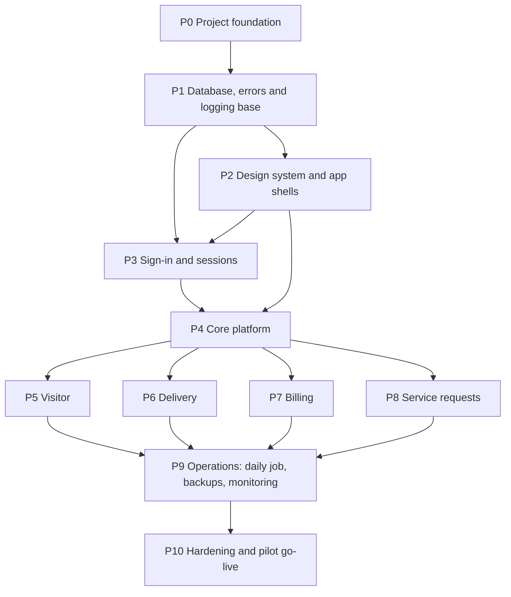
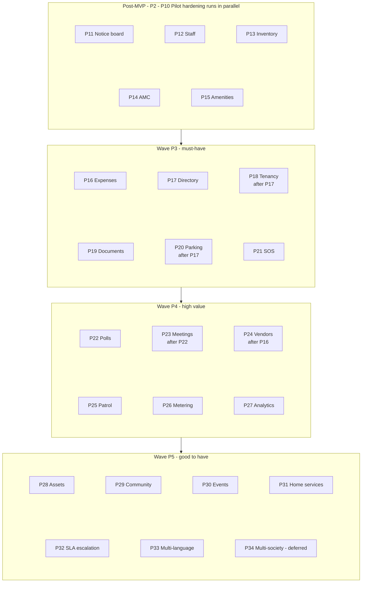
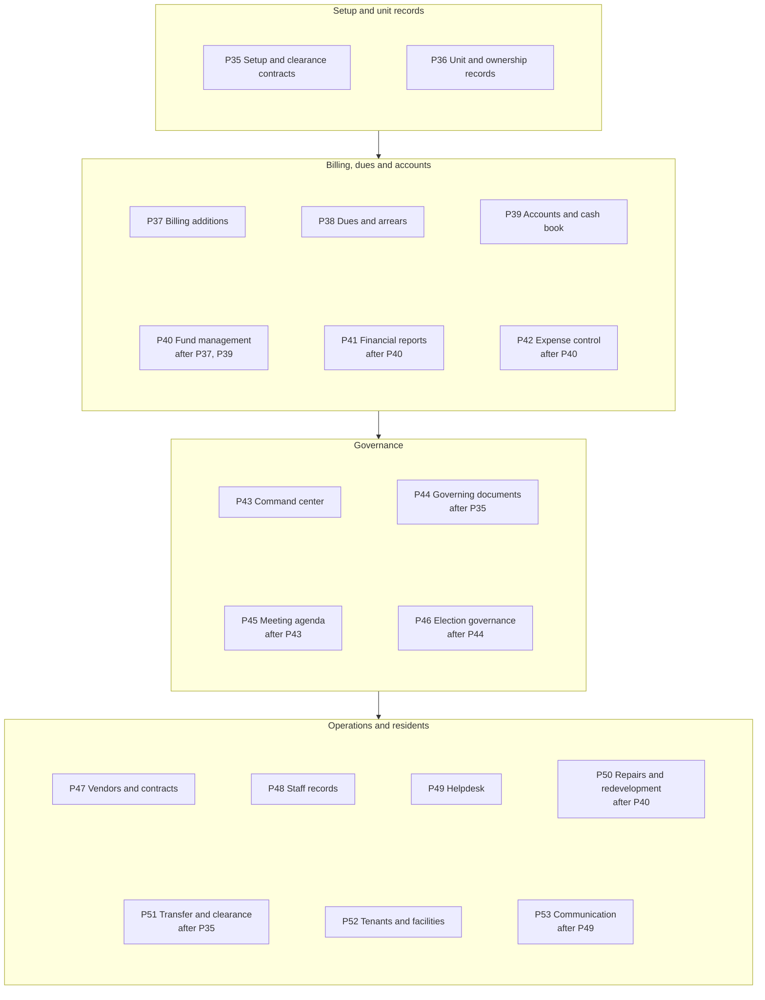

# Homeish — Implementation Plan (IMPLEMENTATION_PLAN.md)

| Field      | Value                                                                                                                                                                                                                                                                                                                                                                                                                                                                                                                                                                                                                                                                                                                                                                                                                                                                                                                                                                                                                                                                                                                                                                                                                      |
| ---------- | -------------------------------------------------------------------------------------------------------------------------------------------------------------------------------------------------------------------------------------------------------------------------------------------------------------------------------------------------------------------------------------------------------------------------------------------------------------------------------------------------------------------------------------------------------------------------------------------------------------------------------------------------------------------------------------------------------------------------------------------------------------------------------------------------------------------------------------------------------------------------------------------------------------------------------------------------------------------------------------------------------------------------------------------------------------------------------------------------------------------------------------------------------------------------------------------------------------------------- |
| Product    | Homeish (PRD D-01 approved 2026-11-09)                                                                                                                                                                                                                                                                                                                                                                                                                                                                                                                                                                                                                                                                                                                                                                                                                                                                                                                                                                                                                                                                                                                                                                                     |
| Version    | 0.14 (P35–P53 build batches and owner decisions added; planning only)                                                                                                                                                                                                                                                                                                                                                                                                                                                                                                                                                                                                                                                                                                                                                                                                                                                                                                                                                                                                                                                                                                                                                      |
| Date       | 2026-11-19 (first draft 2026-11-09)                                                                                                                                                                                                                                                                                                                                                                                                                                                                                                                                                                                                                                                                                                                                                                                                                                                                                                                                                                                                                                                                                                                                                                                        |
| Depends on | [PRD.md](./PRD.md), [DESIGN.md](./DESIGN.md), [ARCHITECTURE.md](./ARCHITECTURE.md), [DATABASE.md](./DATABASE.md), [API.md](./API.md), [AGENTS.md](./AGENTS.md)                                                                                                                                                                                                                                                                                                                                                                                                                                                                                                                                                                                                                                                                                                                                                                                                                                                                                                                                                                                                                                                             |
| Scope      | MVP: Core, Visitor, Delivery, Billing, Service Request (PRD D-02, approved). Post-MVP modules (P11–P15) and the approved expansion phases P16–P34 (PRD D-38) follow P10. Accepted M25 housing-toolkit additions are planned in P35, M03 unit/ownership additions in P36, M08 billing additions in P37, M09 dues additions in P38, M11 accounts additions in P39, M10 funds additions in P40, M12 financial-report additions in P41, M13 expense-control additions in P42, M01 command-center additions in P43, M04 registration/governing-document additions in P44, M06 agenda additions in P45, and M07 election-governance/gated official-voting additions in P46, M14 vendor/contract/AMC additions in P47, M15 non-pay staff-record additions in P48, M16 helpdesk additions in P49, M17 repairs/redevelopment additions in P50, M18 transfer/clearance additions in P51, M19 tenant/parking/facility additions in P52, and M23 communication additions in P53 and P35.13; M24 insurance/legal items were all rejected; M06's meeting-summary addition extends P43.5, and M20 audit/compliance additions extend P41/P43/P44. Budget management remains out of MVP. This does not authorize implementation or release. |

**How to read this plan**

- Phases are in build order. A phase starts only when its prerequisites are complete. Tasks inside a phase are small enough to implement, verify and review on their own.
- Task IDs: `P<phase>.<task>` (e.g., `P5.4`). Sizes are relative effort, not time: **S** small, **M** medium, **L** large (split further if it grows).
- Every phase uses the same sections: goal, prerequisites (with kickoff decisions from P11), task table, database and API changes, tests, completion criteria and status. Built phases (P11–P18) show no size. Phases planned in 6-hour blocks (Section 2.5) show the block each task belongs to (for example T1, D1). P23–P34 descriptions began as drafts from the PRD; their current status lines below show what was implemented, released or deferred. Any remaining work is revisited at the relevant phase kickoff.
- **Status marks** (every task table and overview tables), in the order work moves through them:
  - ⬜ **Planned:** accepted, not started.
  - 🔵 **In progress:** being built on a feature branch.
  - 🟡 **Built locally:** implemented and tested locally; not pushed or released.
  - 🟠 **On beta:** merged to `beta` with CI green; waiting for owner testing.
  - ✅ **Released:** on `main`; any pending owner acceptance is noted beside the mark.
  - 🏁 **Accepted:** released and signed off by the owner after testing.
  - ⏸ **Deferred:** parked by an owner decision; may return later.
  - ⛔ **Blocked:** cannot continue until a named decision, phase or external step happens.
  - ❌ **Dropped:** decided not to build; the row stays for history.

  A row with mixed parts shows the mark that best describes where it is now, with a short note naming any part still ⬜, ⏸ or ⛔ (for example `🟡 Built locally; P39.5 ⬜ in B4`). Each phase's Status line still records the detail: remaining module-gate checks, owner UAT/manual acceptance and live enablement.

- Requirement IDs (e.g., `VIS-4`), screen IDs (e.g., `G-02`) and operation names (e.g., `visitor.decide`) come from the PRD, DESIGN and API documents.
- **No code is described here.** Each task says _what_ to deliver and _how to know it is done_.
- The agent follows [AGENTS.md](./AGENTS.md) for every task: inspect existing code first, smallest change, tests, documents updated in the same task, ask the owner when something is unclear.
- No feature or technology is added to the plan without project documentation or an explicit owner decision. Accepted toolkit work is planned below; it does not replace the owning documents. P35–P53 sizes (Section 1.2 and each task table) are proposals using the Section 2.5 rule, not approved estimates; they are confirmed or re-split at each slice's kickoff (Section 2.6).
- **Toolkit planning:** accepted toolkit decisions are recorded in this plan for future work, not as changes already made to the app. Before implementing them, update and obtain any required approval for the owning PRD/DESIGN/DATABASE/API contracts. Existing guarantees remain in force until the corresponding replacement is approved and built.

---

## 1. Plan at a Glance

| Phase | Name                              | Delivers                                                                               | PRD release | Status                                                                  |
| ----- | --------------------------------- | -------------------------------------------------------------------------------------- | ----------- | ----------------------------------------------------------------------- |
| P0    | Project foundation                | Running skeleton, tooling, pipelines, development database (AD-13)                     | MVP-0       | ✅                                                                      |
| P1    | Database, errors and logging base | Core tables, security helpers, error/audit logging, rate limits                        | MVP-0       | ✅                                                                      |
| P2    | Design system and app shells      | Tokens, shared components, navigation shells                                           | MVP-0       | ✅                                                                      |
| P3    | Sign-in and sessions              | Email-code login, sessions, developer MFA                                              | MVP-0       | ✅                                                                      |
| P4    | Core platform                     | Developer console, structure, people, registration, guards, notifications, files, jobs | MVP-0       | ✅                                                                      |
| P5    | Visitor                           | Visitor module                                                                         | MVP-1       | ✅                                                                      |
| P6    | Delivery                          | Delivery module                                                                        | MVP-2       | ✅                                                                      |
| P7    | Billing                           | Charges, bills, UPI payments, ledger, receipts, reports                                | MVP-3       | ✅                                                                      |
| P8    | Service requests                  | Requests module                                                                        | MVP-4       | ✅                                                                      |
| P9    | Operations                        | Daily job, retention, backup export, monitoring                                        | MVP         | ✅ Released; production backups ⏸                                       |
| P10   | Hardening and pilot               | Security/accessibility/performance review, production setup, pilot                     | MVP         | ⛔ Waits for owner checks and the first society; P10.5, P10.8, P10.9 ⬜ |

P5, P6, P7 and P8 depend only on P4, not on each other. They are listed in the PRD's order; the owner may re-order them.

### 1.1 Post-MVP and expansion phases (P11–P34)

Arrows are recommended build order; "after Pxx" inside a box marks a phase that builds on another phase. At runtime every module works on its own; links to other optional modules activate only when those are enabled (PRD A-36). Blocks are 6-hour work blocks (Section 2.5).

| Phase | Module / enhancement              | Key               | PRD           | Size | Blocks | Builds on                                   | Status                                |
| ----- | --------------------------------- | ----------------- | ------------- | ---- | ------ | ------------------------------------------- | ------------------------------------- |
| P11   | Notice board                      | `notice`          | §5.8, D-21    | —    | —      | Core                                        | ✅                                    |
| P12   | Staff                             | `staff`           | §5.5, P2-1    | —    | —      | Core                                        | ✅                                    |
| P13   | Housekeeping inventory            | `housekeeping`    | §5.6, P2-2    | —    | —      | Core                                        | ✅                                    |
| P14   | AMC                               | `amc`             | §5.7, P2-3    | —    | —      | Core                                        | ✅                                    |
| P15   | Amenity booking                   | `amenity`         | §5.9, D-22    | —    | —      | Core; `billing` for paid amenities          | ✅                                    |
| P16   | Society expenses & accounts       | `expense`         | 5.10.1, P3-1  | L    | —      | Core; reads `billing` payments when enabled | ✅                                    |
| P17   | Resident & vehicle directory      | `directory`       | 5.10.2, P3-2  | M    | —      | Core unit occupants                         | ✅                                    |
| P18   | Move-in / move-out & tenancy      | `tenancy`         | 5.10.3, P3-3  | L    | 3      | Core occupants, files; `billing` dues check | ✅                                    |
| P19   | Document repository               | `document`        | 5.10.4, P3-4  | M    | 2      | Core files                                  | ✅                                    |
| P20   | Parking management                | `parking`         | 5.10.5, P3-5  | M    | 2      | `directory` vehicles; `visitor` passes      | ✅                                    |
| P21   | Emergency & SOS                   | `sos`             | 5.10.6, P3-6  | M    | 2      | Core notifications and Realtime             | ✅                                    |
| P22   | Polls & voting (Civic Pulse port) | `poll`            | 5.10.7, P4-1  | L    | 3      | Core units/occupants                        | ✅                                    |
| P23   | Meetings & AGM                    | `meeting`         | 5.10.8, P4-2  | M    | 2      | `poll` resolutions; `document` minutes      | ✅                                    |
| P24   | Vendors & purchase approvals      | `vendor`          | 5.10.9, P4-3  | M    | 2      | `expense` drafts                            | ✅                                    |
| P25   | Guard patrol & incident log       | `patrol`          | 5.10.10, P4-4 | M    | 2      | Core guards and gate settings               | ✅                                    |
| P26   | Utility metering                  | `metering`        | 5.10.11, P4-5 | M    | 2      | `billing` charges                           | ✅                                    |
| P27   | Committee analytics dashboard     | Core              | 5.10.12, P4-6 | M    | 2      | Read models of enabled modules              | ✅                                    |
| P28   | Asset register                    | `asset`           | 5.10.13, P5-1 | S    | 1      | `amc` contracts                             | ✅                                    |
| P29   | Resident community & marketplace  | `community`       | 5.10.13, P5-2 | L    | 3      | Core files, notifications                   | ✅                                    |
| P30   | Events & RSVPs                    | `event`           | 5.10.13, P5-3 | M    | 2      | `billing` contributions                     | ✅                                    |
| P31   | Home-services directory           | `home_services`   | 5.10.13, P5-4 | S    | 1      | Core                                        | ✅                                    |
| P32   | Service-request SLA escalation    | `service_request` | 5.10.13, P5-5 | S    | 1      | `service_request`, daily runner             | ✅                                    |
| P33   | Multi-language (Hindi first)      | Core              | 5.10.13, P5-6 | L    | 3+     | All screens                                 | ✅ Released; owner acceptance pending |
| P34   | Multi-society overview            | Core              | 5.10.13, P5-7 | —    | —      | Existing admin/committee memberships        | ⏸ Deferred                            |

Block totals: P3 wave (P18–P21) 9 planned, all four phases released to beta and main; P4 wave (P22–P27) 13 blocks, all six phases released to beta and main; P5 wave about 11 blocks, with P28–P33 released and P34 deferred to the future (PRD D-65).

### 1.2 Accepted toolkit additions (P35–P53)

Arrows only stack the groups for reading; they are not a build order (Section 2.6). "after Pxx" inside a box marks a selected task-level prerequisite: P35 profile inputs for P44 and clearance-contract work for P51; P37's estimate source and P39's shared fund map and deposit register for P40; P40's approved measures for P41, sanction source for P42 and repair forecast for P50; P43's meeting-summary source for P45; P44's governing-document source for P46; and P49's definitions and source records for P53. It does not mean finishing every task in one phase before starting another. The phase task tables remain authoritative; phases without a mark have no direct phase dependency shown here. P35.10 uses the M18 policy decisions recorded in P51 as planning input, not as a dependency on P51 implementation. P51.3/P51.4 clearance implementation coordinates with P35.10–P35.12 after the clearance contracts are approved. M23 template formats extend P35.13 but do not gate P53.1–P53.3.

| Phase | Module / enhancement                           | Key                             | PRD                                | Size          | Blocks | Builds on                                                              | Source                        | Status                                                   |
| ----- | ---------------------------------------------- | ------------------------------- | ---------------------------------- | ------------- | ------ | ---------------------------------------------------------------------- | ----------------------------- | -------------------------------------------------------- |
| P35   | Toolkit housing additions                      | Core; `amenity`, `tenancy`      | Not yet; changes D-50              | 2 S, 8 M, 3 L | 27     | Core registry, units, files; P51 clearance policy                      | Toolkit-M25                   | ⬜ Planned only                                          |
| P36   | Unit and ownership records                     | Core                            | Not yet                            | 2 S, 7 M, 1 L | 19     | Core units/occupants; `tenancy`, `document`, `billing`, `parking`, P26 | Toolkit-M03                   | ⬜ Planned only                                          |
| P37   | Billing additions                              | `billing`                       | Not yet; changes D-12, D-06        | 2 S, 2 M, 1 L | 9      | `billing` charges, bills and ledger; P35.1                             | Toolkit-M08                   | ⬜ Planned only                                          |
| P38   | Dues and arrears                               | `billing`                       | Not yet                            | 3 M, 1 L      | 9      | `billing` due dates, payments and unit ledger                          | Toolkit-M09                   | ⬜ Planned only                                          |
| P39   | Accounts and cash book                         | `expense`                       | Not yet                            | 3 S, 3 M      | 9      | P16 books and reports; P40 fund map                                    | Toolkit-M11                   | 🟡 Built locally; P39.5 ⬜ in B4                         |
| P40   | Fund management                                | `expense`                       | Not yet                            | 2 S, 6 M, 1 L | 17     | P16; P39.5; P37.3; M17 review                                          | Toolkit-M10 + Toolkit-M13     | ⬜ Planned only                                          |
| P41   | Financial statements and reports               | `expense`; Core analytics       | Not yet; re-check D-39             | 2 S, 5 M      | 12     | P16, P27; P39, P40; approved budget source                             | Toolkit-M12 + Toolkit-M20     | ⬜ Planned only                                          |
| P42   | Expense control and reporting                  | `expense`                       | Not yet                            | 3 S, 1 M      | 5      | P16, P24, P27; approved budget source                                  | Toolkit-M13                   | ⬜ Planned only                                          |
| P43   | Command center and governance summaries        | Core                            | Not yet                            | 2 S, 3 M      | 8      | P16, P23, P27; P38.4                                                   | Toolkit-M01 + Toolkit-M06/M20 | ⬜ Planned only                                          |
| P44   | Registration, bye-laws and governing documents | `document`                      | Not yet                            | 5 S, 2 M      | 9      | P19, P14, P23; P35.2/P35.3                                             | Toolkit-M04 + Toolkit-M20     | ⬜ Planned only                                          |
| P45   | Meeting agenda enhancements                    | `meeting`                       | Not yet                            | 1 M           | 2      | P23; P43.5                                                             | Toolkit-M06                   | ⬜ Planned only                                          |
| P46   | Election governance and gated official voting  | `meeting`, `poll`               | Not yet                            | 2 M, 1 L      | 7      | P19, P22, P23, P44; legal checks                                       | Toolkit-M07                   | ⬜ Planned only                                          |
| P47   | Vendor, contract and AMC additions             | `vendor`, `amc`                 | Not yet; changes AMC-2, AMC-7      | 3 S, 5 M      | 13     | P14, P24, P16, P28                                                     | Toolkit-M14                   | ⬜ Planned only                                          |
| P48   | Staff record additions                         | `staff`                         | Not yet                            | 2 S           | 2      | P12                                                                    | Toolkit-M15                   | 🟡 Built locally                                         |
| P49   | Helpdesk additions                             | `service_request`               | Not yet; changes SRQ-1/3/5/6, D-59 | 4 S, 4 M      | 12     | P8, P32, P24                                                           | Toolkit-M16                   | ⬜ Planned only  |
| P50   | Repairs and redevelopment                      | New optional module             | Not yet                            | 1 S, 5 M      | 11     | P40.9; P16, P24, P23                                                   | Toolkit-M17                   | ⬜ Planned only                                          |
| P51   | Transfer and clearance                         | `tenancy`                       | Not yet; changes TEN-3, D-50       | 1 S, 2 M, 1 L | 8      | P18, `billing`, P23; P35.10–P35.12                                     | Toolkit-M18                   | ⬜ Planned only                                          |
| P52   | Tenant, parking and facilities                 | `tenancy`, `parking`, `amenity` | Not yet                            | 2 S, 3 M      | 8      | P18, P20, P15, P14, P28, P16                                           | Toolkit-M19                   | ⬜ Planned only                                          |
| P53   | Communication additions                        | `notice`                        | Not yet                            | 1 S, 2 M      | 5      | P11, P8/P32/P49, P21, P23, P30                                         | Toolkit-M23                   | ⬜ Planned only                                          |

Proposed totals: 110 tasks, about 192 blocks. Sizes and blocks are first estimates using the Section 2.5 rule (S ≈ 1, M ≈ 2, L ≈ 3 blocks per task); **Size** shows the mix of task sizes. They are not approved and are confirmed or re-split at each slice's kickoff. **Key** shows the existing module or Core area a phase extends; the only new module is P50's optional "Major repairs & redevelopment" module (owner decision 2026-11-19; key name set at P50 kickoff). The build order is in the Section 2.6 build batches. **PRD** “Not yet” means the PRD has no requirement for this work; listed IDs are existing PRD rules the phase would change or must re-check, and they must be updated and approved before implementation. Phase scope, planning notes, gates and task sizes are in each phase section. Acceptance is planning only and does not authorize implementation, release or live use (Section 2.6).

---

## 2. Rules That Apply to Every Phase

### 2.1 Task rules

1. Every task starts with the AGENTS.md start-of-task steps (read documents, inspect code, restate the task, ask if unclear).
2. One task = one focused change that builds, passes checks and can be reviewed alone. Split anything larger.
3. Tests are part of the task, not a later phase (AGENTS Section 13). A task is not finished until its tests pass.
4. Database changes: forward-only migrations with row-level security, constraints, indexes and generated types in the **same** change (AGENTS Section 11).
5. Documents are updated in the same task (AGENTS Section 15). No new markdown files.
6. Nothing runs against staging or production without the owner's approval.

### 2.2 Module completion gate (applies to P5–P8, the module phases P11–P34, toolkit additions P35–P53 and the platform modules in P4)

A module is **done** only when all of the following are true:

- [ ] Every PRD requirement for the module is implemented or explicitly marked deferred by the owner.
- [ ] All its screens exist with loading, empty, error and no-permission states (DESIGN Section 9).
- [ ] The DESIGN acceptance checklist (DESIGN Section 15) passes.
- [ ] Database tests prove tenant isolation, every role-permission cell (allowed and denied), module-disabled denial and the module's special rules.
- [ ] Automated end-to-end tests cover the main journeys on phone and desktop sizes; the automated accessibility check passes.
- [ ] Manual checks done and recorded: keyboard use, screen reader (TalkBack and VoiceOver), 200% text zoom, a low-end Android phone and iPhone Safari.
- [ ] The module ships **switched off** (disabled) and can be switched on for one pilot society by the developer.
- [ ] DATABASE.md, API.md, DESIGN.md and PRD.md match the code.
- [ ] The owner has tried it and approved it (approval is recorded; it is never assumed).

### 2.3 Owner decisions needed along the way

| Needed before         | Item                                                                                                                                                                                                   | Status                                                                                                                    |
| --------------------- | ------------------------------------------------------------------------------------------------------------------------------------------------------------------------------------------------------ | ------------------------------------------------------------------------------------------------------------------------- |
| P0                    | Accounts created (GitHub, Supabase, Vercel, Sentry, Brevo)                                                                                                                                             | Owner action                                                                                                              |
| P0.4                  | Docker Desktop cannot be installed; one free Supabase project `homeish-testdb` is used for development, testing and staging (synthetic data only)                                                      | **Approved and created 2026-11-09 (ARCHITECTURE AD-13)**                                                                  |
| P0.4                  | Three Supabase projects (`homeish-testdb`, `homeish-demo`, `homeish-live`), demo and live paused until needed; separate Vercel project `demo-homeish` for the demo                                     | **Approved and Supabase projects created 2026-11-09 (ARCHITECTURE AD-14)**; `demo-homeish` Vercel project not yet created |
| P0.7                  | Connect beta Vercel variables to `homeish-testdb` now or wait until backend work begins                                                                                                                | **Owner chose to defer until P1 on 2026-11-09**                                                                           |
| P3                    | How development sign-in emails are read without the local mail catcher (Docker-only)                                                                                                                   | Open; decide before P3.3                                                                                                  |
| P2                    | Product logo (DESIGN DD-07; Homeish wordmark + concept-15 mark)                                                                                                                                        | **Approved 2026-11-09:** selected logo asset added                                                                        |
| P3 (staging)          | Your own domain with email sender verification (SPF/DKIM) so login emails are not marked as spam                                                                                                       | Owner action                                                                                                              |
| P7                    | A pilot society's UPI ID and payee name for testing (a test UPI ID is fine until the real one is entered by the society's admin)                                                                       | Owner action                                                                                                              |
| P10                   | Production accounts; `homeish-live` resumed for go-live and upgraded to the paid plan when the first society starts paying (AD-06 amended); the first-ten no-subscription offer does not cover hosting | Owner action                                                                                                              |
| Before society eleven | Homeish subscription price and offer terms after the first ten free societies                                                                                                                          | Open                                                                                                                      |
| P10                   | Pilot society and admin contact                                                                                                                                                                        | Owner action                                                                                                              |

### 2.4 Post-MVP and expansion phases (P11–P34)

- **Pattern:** each module phase records its kickoff decisions with the owner first (PRD D-43; answers go in the PRD module section, as for P12–P15), then delivers one migration group with RLS and database tests, module registration and permission map, screens with all states, unit/integration/end-to-end/accessibility tests and the module completion gate (2.2). The module ships switched off.
- **Order:** P11–P15 follow the PRD and the owner's decision (2026-11-13). P16–P34 are the approved roadmap (PRD D-38, 2026-11-14); their requirements are in PRD Section 5.10.
- **Timing:** these phases may be built in parallel with P10 pilot hardening, but no expansion module is enabled for a live society until P10.5, P10.6 and the production Storage-file recovery plan are complete ([pilot-readiness audit](./audits/pilot-readiness-audit.md)). P10 work takes priority when both compete.
- **Release:** commit promotion and hosted migrations follow the owner-approved release process in [DEPLOYMENT.md](./DEPLOYMENT.md). Released post-MVP migrations are applied to `homeish-testdb` only; `homeish-live` stays paused and unmigrated until production go-live (Section 7 of DEPLOYMENT). Local verification does not constitute owner UAT or production go-live approval.
- **Deferred until triggered:** SMS/WhatsApp and mobile-number login (PRD D-06, A-35), payment gateway, native apps, offline mode (ARCHITECTURE Section 3). A reference draft for a future Android app is at the end of this plan ("Future — Android App"); it is not scheduled.

### 2.5 Working in 6-hour blocks

**Added 2026-11-15.** Remaining work is cut into blocks of about 6 focused hours. The sizes follow the observed P16/P17 pace: **S ≈ 1 block, M ≈ 2 blocks, L ≈ 3 blocks**. Each block must:

- start from a green baseline, with that phase's kickoff decisions already answered (asked before the block, not during it);
- end at a safe pause point: the local gate passes (`npm run check`, the phase's local integration tests, targeted Playwright with axe, `npm run build`) and docs record the status;
- cut screens or polish if time runs short, never privacy, role checks or tests;
- stay local: no commits, pushes, hosted migrations or live enablement without separate owner approval.

Block counts per phase are in Section 1.1; P35–P53 proposed counts are in Section 1.2. Phases without a block plan are split into tasks at kickoff.

Block codes in a phase's task table are the module's letter plus the block number, for example T1–T3 for Tenancy (P18), D1–D2 for Documents (P19), K1–K2 for parKing (P20) and S1–S2 for SOS (P21). They are for planning only; status lines describe the phase as a whole.

### 2.6 Toolkit addition phases (P35–P53)

- **What they are:** accepted toolkit-review decisions that extend existing modules and Core. They add no new module key, dependency or privileged-client expansion unless the owner approves one; the owner approved P50 as a new optional module on 2026-11-19, and a WhatsApp Business provider for P37.5 still needs its own approval (see Build batches below). Acceptance is planning only and does not authorize implementation, release or live use.
- **Pattern:** each slice first closes its named kickoff gates, then updates the owning PRD/DESIGN/DATABASE/API contracts and obtains approval (the PRD has no requirements for these phases yet; Section 1.2 lists the existing PRD rules each phase would change). It then delivers forward-only, society-scoped migrations with row-level security, generated types and database tests; screens with all states; unit, integration, end-to-end and accessibility tests; and the Section 2.2 gate. New capabilities ship off where applicable, and existing data keeps its agreed meaning.
- **Order:** work follows the build batches below. Task-level prerequisites in the Section 1.2 diagram and each task table still apply inside and across batches.
- **Sizing:** task sizes are proposals using the Section 2.5 rule (S ≈ 1, M ≈ 2, L ≈ 3 blocks). Re-estimate and split at kickoff, especially blocked or legally gated tasks whose scope may change.
- **Priority and release:** P10 pilot/go-live gates and all existing release approvals remain unchanged. Legal or statutory points are verified against the state co-operative act and the society's bye-laws before use.

#### Build batches (owner decisions 2026-11-19)

The owner approved this build order and these decisions on 2026-11-19. They are a plan for building, not approval to release or enable anything live. Each phase follows the Pattern above: its PRD, DESIGN, DATABASE and API changes are written and approved before coding starts.

**How the work runs**

- All work happens on one branch, `feature-build-2`. One worker writes code; up to two helpers may read, draft contract changes and review in parallel, but do not edit code.
- Only the lead worker changes migrations, the module registry (`src/core/modules/index.ts`) and generated database types, one change at a time and in order.
- Full checks run one at a time, because the local test database and Playwright use fixed ports.
- Gather the current phase's foreseeable questions first and obtain the owner's approval for its contract changes before coding. Pause and ask if a new consequential decision appears during implementation.
- Complete and verify the agreed phase scope before proposing local commits; do not make intermediate documentation or code commits. After committing with the owner's approval, wait for a separate go-ahead before starting the next phase. Pushes, `beta`/`main` merges and `homeish-testdb` changes happen only when the owner asks.
- No P35–P53 capability is enabled for a live society until P10 pilot hardening is complete (Section 2.4).

| Batch       | Order                      | Tasks                                                                   | Blocks |
| ----------- | -------------------------- | ----------------------------------------------------------------------- | ------ |
| B1          | P48 → P39 → P49            | P48; P39 except P39.5; P49                                              | 21     |
| B2          | P47 → P38 → P35 core       | P47; P38; P35.1–P35.7 and P35.13                                        | 38     |
| B3          | P37 → P53 → P36            | P37.1–P37.4; P53; P36 except P36.4, P36.5 and P36.7                     | 25     |
| B4          | P40 with P39.5 → P43 → P44 | P40.1–P40.8 and P39.5; P43; P44 except P44.4 and P44.7                  | 32     |
| B5          | P45 → P41 → clearance      | P45; P41 except P41.3; P35.10–P35.12 with P51                           | 26     |
| B6          | P42 → P52 → P46            | P42 except P42.2; P52; P46 including P46.2 official voting              | 18     |
| B7          | P50 and follow-ups         | P50; P40.9; P35.8–P35.9 deposits; P36.7; P41.3 and P42.2 budgets; P37.5 | 25     |
| Pro version | Not scheduled              | P36.4, P36.5, P44.4, P44.7                                              | 7      |

B1–B7 hold 185 blocks and the Pro version 7, matching the 192 proposed blocks in Section 1.2. Batches run in order, starting with B1; inside a batch, phases follow the order shown.

**Owner decisions for the batches.** These become proposed PRD and contract changes in each batch's paperwork and still need that approval.

- **P46.2 official voting (B6):** the app counts the votes and the returning officer declares the result; ballots are secret; the admin prepares the voter list, which is locked before voting opens. A society switches official voting on with an admin confirmation that its rules allow online voting; no proof is uploaded.
- **P50 (B7):** a new optional module, "Major repairs & redevelopment" (key name set at kickoff). For P50.2 the committee sets the criteria and weights for each project, the app never picks the winner, and the admin may leave a project or quote out of scoring. P50.3 levies are what-if scenarios only and never create a bill. P50.4–P50.5 redevelopment records are visible only to admins and the committee; each member sees only their own consent status.
- **P40.9 forecast (B7):** a 10-year forecast from admin-entered cost, repair cycle and inflation %, always shown as an estimate.
- **Deposits, P35.8–P35.9 (B7):** deposits are paid outside the app, recorded by an admin and linked to the matching P16 accounts entry. A deposit is held money, not income; only the deducted part becomes income. Each deduction needs a reason and evidence, and the resident sees the breakdown. The existing P15 amenity usage fee stays a separate line on the same booking and keeps its current cancellation rule (full credit on any allowed cancellation); on cancellation the deposit is returned in full. Example: a clubhouse booking has a ₹5,000 deposit and a ₹1,500 usage fee; after the event ₹500 is deducted for damage, so ₹4,500 is refunded, ₹500 becomes income and the ₹1,500 fee is not refunded.
- **P37.5 bill sharing (B7):** each society's admin chooses one of two modes: a free "Share on WhatsApp" button that sends a sign-in-protected link, or automatic sending through a WhatsApp Business provider. The provider is a new paid dependency that would see residents' phone numbers, so a named provider needs owner approval and PRD D-06 must change. The email-bill privacy review also goes ahead.
- **Budgets, P41.3 and P42.2 (B7):** built in B7; the B7 paperwork defines the separate budget source and scope these tasks wait for. Budgets stay out of MVP.
- **P36.7 handover (B7):** built in B7.
- **Pro version:** P36.4, P36.5, P44.4 and P44.7 move to a possible future paid Pro version and are not scheduled.

**Risks to close before live use**

1. Official voting relies on an admin confirmation only, not checked proof that the society's rules allow online voting.
2. Fixed-deposit rules (P39.5, P40.6–P40.7) follow the owner's answers instead of an accountant review; an accountant should check them before live use.
3. P41.2 goes beyond PRD D-39; D-39 is updated in the B5 paperwork.
4. A WhatsApp Business provider is a paid service with access to residents' phone numbers.
5. Issued certificates and staff notes are kept until an admin deletes them; the app should record who deleted what and when.
6. P38.1 interest: the app stores the rate and its bye-law reference; whether the rate is lawful remains the society's responsibility.

---

# Phase P0 — Project Foundation

**Goal:** an empty-but-correct project that builds, lints, tests and deploys to a preview, with the development database running and the rules in AGENTS.md enforced by tooling.

**Prerequisites:** owner actions in 2.3 (accounts, development Supabase project per AD-13). Documents LOCAL_SETUP.md (to be written alongside P0.4) and DEPLOYMENT.md (before P10).

| ID   | Task                                                                                                                                                                                                       | Size | Status |
| ---- | ---------------------------------------------------------------------------------------------------------------------------------------------------------------------------------------------------------- | ---- | ------ |
| P0.1 | Create the Next.js project (App Router, strict TypeScript) with the folder skeleton from ARCHITECTURE Section 9; record the real tool versions in README                                                   | M    | ✅     |
| P0.2 | Configure Tailwind (empty theme placeholder), formatter, linter with strict rules (no `any`, no suppressions), and the header-comment check                                                                | S    | ✅     |
| P0.3 | Build the validated configuration module: reads environment variables only here, fails fast with variable _names_, separates public from server-only (API Section 11); commit the placeholder example file | S    | ✅     |
| P0.4 | Set up the Supabase CLI (project dev dependency), link the development Supabase project (AD-13), the migration folder, naming rules and type generation; document the commands in LOCAL_SETUP.md           | M    | ✅     |
| P0.5 | Set up test tooling: unit test runner, database test runner (against the development database), end-to-end runner with accessibility check, a controllable clock for tests                                 | M    | ✅     |
| P0.6 | Create the continuous-integration pipeline: lint, typecheck, unit, database tests, build; checks for secrets in the repo and for secret-looking names with the public prefix                               | M    | ✅     |
| P0.7 | Connect Vercel preview deployments (staging variables only, no secrets in the repo) to the shared `homeish-testdb` Supabase project (AD-13)                                                                | S    | ✅     |
| P0.8 | Create the project README (setup, commands, structure, document links)                                                                                                                                     | S    | ✅     |
| P0.9 | D-34: build the marketing root, allow-listed demo and isolated beta entry; synthetic browser preview with resets; configure main/beta hosting and document actual external verification                    | M    | ✅     |

P0.9 local implementation includes public marketing, exact-host routing, an illustrative browser-memory demo and beta entry. It does not complete P1-P4 or activate real workflows. The owner approved implementation, documentation and live Git/Vercel setup on 2026-11-09, then deferred Maplewood onboarding until after MVP, when the owner will run the create-society script (`scripts/create-society.mjs`, OPERATIONS "Society onboarding"); its address is reserved in code as a disabled placeholder. External deployment status is recorded in README after verification. Full interactive society demo/reset jobs and real society activation remain gated on backend/auth/module completion and isolation tests. No real society data is seeded.

**P0.9 status, 2026-11-09:** the foundation passed local formatting/lint/type checks, 33 unit tests, four browser tests and production build. Projects `homeish`/`beta-homeish` are linked to `abhishek-r-patel/homeish` under team `arp-dev`, tracking `main`/`beta` respectively, with scaffold-only configuration. The owner approved resuming hosting after a temporary pause and committing/pushing the deployment changes through feature branch -> beta -> main. `vercel.json` enables the two release branches; the existing build gate isolates each project. Preview branch tracking is disabled and Production domain assignment is automatic. The attached addresses are `homeish.vercel.app` and `beta-homeish.vercel.app`; no nested demo/beta or Maplewood host is attached. Verify both automatic releases and hosted HTTPS/routing during this release sequence. Full backend/auth workflows and real society launch approval remain open.

**P0.4 status, 2026-11-09:** done. The Supabase CLI (dev dependency) is initialised in `supabase/` and linked to `homeish-testdb`; `supabase/migrations/` and `seed/` exist; migration naming is enforced by `npm run check:migrations` (part of `npm run check`); `npm run db:new`, `db:list`, `db:push`, `db:types` and `db:types:check` run against the profile's database and refuse `homeish-live`. Empty-schema types are generated into `src/core/db/database.types.ts`. Commands and the company-network certificate workaround (`NODE_USE_SYSTEM_CA=1`) are documented in LOCAL_SETUP.md.

**P0.5 status, 2026-11-09:** done. Vitest covers unit tests, Playwright covers browser smoke and axe accessibility checks, and tests use the controllable clock fixture. Database integration tests are Vitest files in `tests/integration/` run against a throwaway local PostgreSQL 17 (`npm run test:integration:local`), replacing the earlier `psql` SQL tests against testdb.

**P0.6 status, 2026-11-09:** done. CI runs three parallel jobs with timeouts and no persisted Git credentials: Gitleaks full-history secret scan, static checks and build; database integration tests on a disposable `postgres:17` service container with a Supabase stand-in (same approach as Civic Pulse; replaces the slower Supabase CLI stack); and browser tests. A separate CodeQL workflow runs on pushes, pull requests and weekly. CI holds no database credentials. A deliberately broken migration was confirmed to fail the integration tests locally.

**P0.7 status, 2026-11-09:** deferred by the owner until P1. Beta remains scaffold-only; connect its environment to testdb when backend work begins.

**Files/modules affected:** repository root configuration, `src/core/config/`, `src/core/db/`, `supabase/`, `scripts/`, `tests/`, `.github/workflows/`, README, LOCAL_SETUP.md.

**Database/API changes:** none (empty migration folder and generated types only).

**Tests required:** configuration validation unit tests (missing, malformed, public/server mix-up); a smoke test proving the app starts; the pipeline itself must fail on a deliberately bad sample (lint error, type error, leaked-secret pattern) and then be returned to green.

**Completion criteria:**

- A fresh checkout runs the app, the unit tests, the database tests and the end-to-end smoke test with the documented commands.
- The pipeline is green on the main branch and blocks bad changes.
- No secrets exist in the repository; the example file contains names and placeholders only.
- Scaffold hosting is approved: verify the website at `homeish.vercel.app` and beta at `beta-homeish.vercel.app`, with unknown hosts failing closed. Nested demo/beta domains require separate attachment and verification. Real society launch is not approved by this scaffold release.

## P0.9 follow-up — Public homepage refresh

**Status (2026-11-15): H1/H2 implemented, verified and released to `main` on 2026-11-15; owner approved the copy and three synthetic screenshots.** Real-device/manual acceptance, demo hosting and live activation remain pending. The owner requested inspiration from [Multi-School ERP](https://multischoolerp.com/) for Homeish's society-management homepage and confirmed the kickoff choices below. The reference observations, section hierarchy and product/brand/privacy guardrails are in PRD Section 4.0.1. This is a bounded follow-up to P0.9, not a new numbered phase or society module.

**Scope:** the existing public marketing homepage only, with **Try demo** as its only marketing CTA. **Owner clarification 2026-11-15 (D-49):** the separate demo is not set up; set it up after product readiness and connect it then. Until a separately authorised rollout verifies it, show native disabled **Try demo** buttons with **Demo coming soon**, no demo URL and no inline substitute. Preserve D-34 host routing, society-address utility entry and synthetic-demo boundaries. No request-walkthrough/contact CTA, enquiry form, new society activation, authentication flow, backend module, lead-storage system, tracking service or pricing decision is included.

**Authorised homepage work:**

1. **Content and evidence:** inventory what is released, awaiting owner UAT/live activation, in development or planned using the phase records and release evidence. Record the actual linked demo's behavior and reachable destination; do not assume an example nested demo domain is live. Prepare original Homeish copy for committees/admins with resident benefits, synthetic product screenshots only and a compact wireframe following PRD 4.0.1; get owner approval of the final claims and assets.
2. **Design and delivery:** update DESIGN Section 18 before or alongside a separate homepage implementation task. Reuse approved Homeish branding, tokens/components and responsive patterns; do not reproduce the reference's text, assets, brand or pixel layout. Put planned modules in a separate clearly labelled roadmap section; no promised release dates or fabricated social proof. Use **Try demo** only as the marketing CTA; no enquiry/contact flow.
3. **Homepage acceptance:** verify every **Try demo** action is disabled with the coming-soon note and no destination; check existing-society entry, policy links, synthetic screenshot labels, correct availability wording and unchanged public/demo/society host behavior. Preserve and test the existing local sample's resets; hosted demo interactions/reset verification wait for the separately authorised setup. Run targeted phone/desktop browser and accessibility checks; record keyboard, screen-reader, 200% zoom/320px reflow and reduced-motion checks. Confirm screenshot-only proof, no testimonials/customer logos/society references or fabricated adoption/statistics, no enquiry form, and no real society/resident data or new third-party collection.

**Homepage kickoff decisions (owner-confirmed 2026-11-14; delivery authorised 2026-11-15):** no unresolved implementation kickoff questions remain. D-49 authorises H1/H2 only, not demo hosting, release or live activation. Approved branding, platform, pricing boundaries and society-activation gates are unchanged.

1. **Lead audience — Approved:** society committees/admins first, with resident benefits.
2. **Marketing CTA — Approved:** **Try demo** only, disabled with **Demo coming soon** until the separately verified demo is ready (D-49). No request-walkthrough/contact CTA or enquiry form in this refresh; existing-society entry remains utility navigation.
3. **Enquiry destination — Deliberately deferred:** decide later, outside this demo-only scope. This is not a blocker for the homepage refresh or directory work.
4. **Roadmap prominence — Approved:** show planned modules in a separate clearly labelled roadmap section, distinct from delivered functionality.
5. **Public proof and assets — Approved:** synthetic product screenshots only, while retaining approved Homeish branding. No testimonials, customer/society logos or references, or fabricated adoption/statistics in this refresh.

**Tasks (2 blocks, Section 2.5):**

| ID     | Block | Task                                                                                                                                                                                                                            | Status                                                 |
| ------ | ----- | ------------------------------------------------------------------------------------------------------------------------------------------------------------------------------------------------------------------------------- | ------------------------------------------------------ |
| P0.9.1 | H1    | Inventory released vs. planned modules and the real demo destination; update DESIGN §18; new committee-first copy; hero with **Try demo**, delivered-module sections, resident benefits, separate labelled roadmap, FAQ refresh | ✅ Released 2026-11-15; real-device acceptance pending |
| P0.9.2 | H2    | Synthetic product screenshots from fixture pages, screenshot gallery, disabled closing CTA, final polish; homepage acceptance checks above                                                                                      | ✅ Released 2026-11-15; real-device acceptance pending |

**H1/H2 evidence (2026-11-15):** local engineering complete. The owner explicitly approved the final copy and three synthetic screenshots. `npm run check` passed (60 files, 447 unit tests); 14 focused browser/accessibility tests passed; the production build and 3 additional production-server smoke tests passed; `git diff --check` passed. Tests cover disabled demo actions, availability wording, actual screenshot decoding, utility/policy navigation, keyboard/skip link, native FAQs, reduced motion, axe and 320/390/768/1280px reflow, existing host boundaries and manual/15-minute browser-demo resets. No database changes were made, so database integration tests were not run for this refresh. Real-device TalkBack/VoiceOver, actual 200% zoom/enlarged text, low-end Android/iPhone Safari, release and live enablement remain pending.

**Availability evidence:** P5-P8 and P11-P33 code has been released to beta and main, with the corresponding testdb migration status recorded in each phase. Some released modules remain disabled by default and require owner UAT or separate live approval before use by a real society; a release is not live enablement. Retrieval attempts for the old `https://demo.homeish.vercel.app/` destination failed at the transport/TLS level; the owner explicitly deferred setup instead of authorising an inline substitute. Demo hosting and CTA connection require separate approval and verification.

---

# Phase P1 — Database, Errors and Logging Base

**Goal:** the database foundation and the error/logging backbone every later feature relies on.

**Prerequisites:** P0 complete. [ERROR_LOGGING.md](./ERROR_LOGGING.md) (written before P1.6).

| ID    | Task                                                                                                                                                                                                                                                                                                            | Size | Status |
| ----- | --------------------------------------------------------------------------------------------------------------------------------------------------------------------------------------------------------------------------------------------------------------------------------------------------------------- | ---- | ------ |
| P1.1  | Migration group 1: extensions (UUID/crypto, case-insensitive text), the `private` schema, shared triggers (updated-at, reject-update/delete for append-only tables)                                                                                                                                             | S    | ✅     |
| P1.2  | Migration group 2: security helper functions in `private` as fail-closed stubs; membership/role, module-enabled and society-writable checks are completed with P1.8, while the developer/MFA check stays closed until P3.7                                                                                      | M    | ✅     |
| P1.3  | Migration group 3: `profiles` (including `font_preference`), `developers`, `societies` (including `unit_label`, `gate_login_mode`, `guard_identification`, `join_code`), `modules` (reference rows for all ten module keys), `module_configs`, with constraints, indexes, RLS and grants per DATABASE Section 3 | L    | ✅     |
| P1.4  | Migration group 5 (part): `audit_logs`, `error_logs`, `rate_limits`, `job_run_keys`, `jobs` per DATABASE 3.13–3.17                                                                                                                                                                                              | M    | ✅     |
| P1.5  | Error model: error classes, the response envelope, the closed lists of error codes and conflict reasons (API 3.2, 3.5); request ID creation                                                                                                                                                                     | M    | ✅     |
| P1.6  | Logging core: the scrubber, the error-log writer (best effort, never throws), the audit-log writer, Sentry adapter with scrubbing                                                                                                                                                                               | L    | ✅     |
| P1.7  | Privileged module isolation (service-role client only in `src/core/privileged/`) with an automated check that nothing else imports it                                                                                                                                                                           | S    | ✅     |
| P1.8  | Request context builder (verified user, active society, roles, enabled modules) and the authorization pipeline helper (API 2.5), with the per-module permission-map framework; membership schema/helpers pulled forward from P3.1/P3.8                                                                          | L    | ✅     |
| P1.9  | Rate-limit service on the `rate_limits` table with the fail-closed / fail-open rules (API Section 10)                                                                                                                                                                                                           | M    | ✅     |
| P1.10 | Routes: `/api/health` and `/api/client-errors`; the browser error boundary showing the reference ID                                                                                                                                                                                                             | M    | ✅     |
| P1.11 | CI database checks from DATABASE 14.1: every table has RLS and a policy, no grants to the anonymous role, every tenant table indexed by society, foreign keys indexed, append-only triggers present                                                                                                             | M    | ✅     |

**Files/modules affected:** `supabase/migrations/`, `tests/integration/`, `src/core/{errors,logging,privileged,permissions,tenancy,db,config}/`, `src/app/api/{health,client-errors}/`.

**Database changes:** tables `profiles`, `developers`, `societies`, `modules`, `module_configs`, `audit_logs`, `error_logs`, `rate_limits`, `job_run_keys`, `jobs`; helper functions; triggers; seed of `modules` reference data in migrations.

**API changes:** routes `/api/health`, `/api/client-errors`; shared envelope and error codes.

**Tests required:**

- Unit: scrubber (codes, tokens, phones, UPI IDs, bodies removed), error mapping, envelope, rate-limit windows and fail-closed/open behavior, permission-map framework.
- Database: RLS on every new table (a user of one society cannot read another's; anonymous role gets nothing); append-only tables reject update/delete; `module_configs` core row cannot be disabled; unique and check constraints; helper functions return correct answers for each role.
- Integration: a thrown error becomes a logged entry with a reference ID and a safe user message; logging failure does not break the request.

**Completion criteria:**

- Every new table passes the CI database checks.
- An intentionally raised server error and client error each appear in the error log with a reference ID, and nothing sensitive is stored.
- The privileged-import guard fails the build when misused.
- DATABASE.md and API.md match what was built.

---

# Phase P2 — Design System and App Shells

**Goal:** the shared look, components and navigation frames so every later screen is built from the same parts (DESIGN Sections 2–6, 9, 14).

**Prerequisites:** P0 complete; brand colour, product name and logo approved on 2026-11-09 (DD-06, DD-07, D-01). P1.8 for permission-aware navigation (P2.8 only).

| ID    | Task                                                                                                                                                                                        | Size | Status |
| ----- | ------------------------------------------------------------------------------------------------------------------------------------------------------------------------------------------- | ---- | ------ |
| P2.1  | Design tokens in the Tailwind theme: colour, type scale, spacing, radius, motion, breakpoints, containers; bundled Manrope/Sora fonts and device-default preference                         | M    | ✅     |
| P2.2  | Core controls: button variants (with loading), text input and specialised inputs (email, code, phone, amount, search), select/combobox, checkbox/radio/switch/option card                   | L    | ✅     |
| P2.3  | Overlays and feedback: dialog/bottom sheet, confirm dialog (with required-reason variant), banner, toast, error summary, error panel with reference ID, empty state, skeleton, spinner      | L    | ✅     |
| P2.4  | Data display: status chip with the single mapping table (DESIGN 4.4), list item, stat tile, card, avatar, timeline, code display                                                            | M    | ✅     |
| P2.5  | Tables and lists: data table with stacked mobile rows, pagination, filter bar with applied-filter chips, tabs/segmented control, sort headers (API Section 3.8)                             | L    | ✅     |
| P2.6  | Forms: field layout, validation display, error summary focus handling, unsaved-changes prompt, file upload component (UI only), date/time pickers                                           | L    | ✅     |
| P2.7  | Module registry skeleton in `core/modules/` (key, name, navigation items, permission map, settings schema hooks) and the module-disabled page                                               | M    | ✅     |
| P2.8  | App shells and navigation per role: top bar, bottom tabs/More, sidebar/rail, guard home frame, developer dark shell; navigation built from enabled modules + permissions with no empty gaps | L    | ✅     |
| P2.9  | Installable-app basics: manifest and icons (no offline caching, offline banner only)                                                                                                        | S    | ✅     |
| P2.10 | Component states fixture page (excluded from production builds) used by automated visual and accessibility tests                                                                            | M    | ✅     |

**Files/modules affected:** `src/styles/`, `src/components/ui/`, `src/core/modules/`, `src/app/` layouts for each role group, `public/`.

**Database/API changes:** none.

**Tests required:** component tests for each state (default, hover, pressed, focus, disabled, loading, error); automated accessibility check on every component and shell; keyboard and focus-return tests for dialogs and sheets; responsive checks at the DESIGN widths (320, 390, 768, 1280, 1440, 200% text); navigation test proving a disabled module leaves no item or gap.

**Completion criteria:**

- Every component in DESIGN Section 19 "Foundation" exists, uses tokens only and passes accessibility checks.
- All five shells render with the correct navigation for a sample set of roles and module settings.
- No raw colour values or arbitrary sizes exist in component code (automated check).

---

# Phase P3 — Sign-in and Sessions

**Goal:** people can sign in with an emailed code, stay signed in, switch societies; developers sign in separately with a second factor.

**Prerequisites:** P1 and P2 complete. Staging email sender verified (owner action in 2.3); the local mail catcher is used for development.

| ID   | Task                                                                                                                                                                                  | Size | Status |
| ---- | ------------------------------------------------------------------------------------------------------------------------------------------------------------------------------------- | ---- | ------ |
| P3.1 | First-sign-in membership linking and the service-role-only invitation-check function (ARCHITECTURE 8.4 item 4); the `memberships` table and read policies were pulled forward to P1.8 | M    | ✅     |
| P3.2 | Automatic profile creation and email synchronisation from the auth service                                                                                                            | S    | ✅     |
| P3.3 | Auth service configuration: sign-up closed, email code template (code only, no links), session lifetimes; Brevo SMTP configured on staging; local mail catcher for development        | M    | ✅     |
| P3.4 | Operations `auth.requestCode`, `auth.verifyCode`, `auth.signOut` with the generic answers and rate limits from API Section 10                                                         | L    | ✅     |
| P3.5 | Screens S-01 and S-02 (email entry, code entry, resend cooldown, lockout messages, spam hint) with all states                                                                         | M    | ✅     |
| P3.6 | `session.get`, `session.switchSociety`, society picker S-03, no-membership and waiting-for-approval screens, session-expired page returning to the original destination               | M    | ✅     |
| P3.7 | Developer sign-in route (S-05): password, authenticator enrolment and verification, short sessions, the "developer with recent MFA" check in the helper functions                     | L    | ✅     |
| P3.8 | Complete the developer/MFA helper from P1.2 and verify the full role combinations; membership, module and society helpers were implemented and tested in P1.8                         | M    | ✅     |

**Files/modules affected:** `src/core/auth/`, `src/core/tenancy/`, `src/app/(auth)/`, `src/app/developer/` (sign-in only), `supabase/migrations/`, auth-service settings documented in LOCAL_SETUP.md.

**Database changes:** `memberships`; linking and invitation-check functions; policies using the real helpers.

**API changes:** `auth.requestCode`, `auth.verifyCode`, `auth.signOut`, `auth.developerSignIn`, `auth.developerVerifyMfa`, `session.get`, `session.switchSociety`.

**Tests required:**

- Unit/integration: unknown email gets the identical response as a known one; code single use; five wrong tries invalidate; resend cooldown; rate limits trigger and fail closed; invited membership links on first sign-in; closed sign-up (no account without invitation or registration flow).
- Database: membership policies (self sees own rows; admin sees society rows; no cross-society); helper functions per role.
- End-to-end: full sign-in with the mail catcher; developer cannot reach developer operations without MFA; session expiry returns to the saved destination.
- Security: no code or email appears in logs; no redirect to a client-supplied address.

**Completion criteria:**

- An invited person can sign in with the emailed code on staging and lands in the right place; an uninvited email gets no access and no information.
- A developer account (created by direct database action) signs in with MFA; without MFA it is refused.
- All role-combination tests for the helper functions pass.

---

# Phase P4 — Core Platform

**Goal:** everything the modules stand on: the developer console, society structure, people and roles, registration, guards, notifications, files, jobs and the daily-job runner. Built as sub-phases that each end working and tested.

**Prerequisites:** P1, P2, P3 complete.

## P4A — Developer console and module registry

| ID    | Task                                                                                                                                                                                                                                    | Size | Status |
| ----- | --------------------------------------------------------------------------------------------------------------------------------------------------------------------------------------------------------------------------------------- | ---- | ------ |
| P4A.1 | `developer.societies.*`: list, create (creates the core module row, default settings; default request categories are added in P8), update, set status (standard confirmation stating the effect of suspend/archive); screens D-01, D-02 | L    | ✅     |
| P4A.2 | Module toggle function (one transaction + audit) and `developer.modules.list/toggle/updateSettings`; Society Config → Modules screen D-03 with confirm dialogs; settings validated against each module's schema                         | L    | ✅     |
| P4A.3 | Enforce module-enabled in navigation, server checks and database policies; module-disabled responses                                                                                                                                    | M    | ✅     |
| P4A.4 | `developer.members.createFirstAdmin` (invitation for the first admin) and screen D-04                                                                                                                                                   | M    | ✅     |
| P4A.5 | Error log viewer D-05 (filters, reference-ID lookup, detail, resolve/ignore) and audit viewer D-06                                                                                                                                      | L    | ✅     |
| P4A.6 | Health summary D-07 built from the error log                                                                                                                                                                                            | S    | ✅     |

_Files:_ `src/modules/` registry entries for `core`, `src/app/developer/`, `src/core/modules/`, `src/core/logging/`.
_Database:_ toggle and society-creation functions; policies for developer reads; no new tables.
_API:_ `developer.*` operations (API 5.4).
_Tests:_ developer-only access, MFA requirement, toggle takes effect on the next request in navigation, API and database; toggle is audited; disabled module data untouched; error lookup by reference ID returns the right entry.
_Done when:_ a developer can create a society, switch modules on and off and find an error by reference ID; a non-developer cannot do any of it.

## P4B — Society structure

| ID    | Task                                                                                                                                          | Size | Status |
| ----- | --------------------------------------------------------------------------------------------------------------------------------------------- | ---- | ------ |
| P4B.1 | Migration: `blocks`, `units` with same-society keys, uniqueness and indexes; RLS                                                              | M    | ✅     |
| P4B.2 | `structure.blocks.*` and `structure.units.*` operations and admin screen A-02                                                                 | M    | ✅     |
| P4B.3 | Jobs list screen and `jobs.list/get`                                                                                                          | S    | ✅     |
| P4B.4 | CSV units import: template download, validate-only preview with per-row errors, confirm creating a job, results and downloadable error report | L    | ✅     |

_Database:_ `blocks`, `units`. _API:_ `structure.*`, `jobs.*`.
_Tests:_ duplicate unit numbers (with and without block), deactivate-only when history exists, tenant isolation, CSV edge cases (bad rows, duplicates, huge file limit), preview writes nothing.
_Done when:_ an admin imports 300 sample units and sees correct results and an error report for bad rows.

## P4C — People, roles and households

| ID    | Task                                                                                                                                            | Size | Status |
| ----- | ----------------------------------------------------------------------------------------------------------------------------------------------- | ---- | ------ |
| P4C.1 | Migration: `unit_occupants` with the one-active-primary rule; indexes; RLS                                                                      | M    | ✅     |
| P4C.2 | `members.*` operations: invite by email, list, change roles, deactivate (immediate revoke), occupancy assign/move/end; all audited; screen A-03 | L    | ✅     |
| P4C.3 | `members.importPreview/importConfirm` (resident CSV)                                                                                            | M    | ✅     |
| P4C.4 | Household screen R-08 (`household.members.*`) and profile screen S-12 with `profile.update`, including account-saved font preference            | M    | ✅     |
| P4C.5 | Permission maps for `core` operations wired to the helper functions and tests                                                                   | M    | ✅     |

_Database:_ `unit_occupants`; role-change and deactivate functions. _API:_ `members.*`, `household.*`, `profile.update`.
_Tests:_ only one active primary per unit; deactivation takes effect on the next request; family cannot become approver by default; role changes audited; resident sees only own household; matrix tests for A/C/R.
_Done when:_ an admin invites residents, assigns them to units and deactivates one, with the change taking effect immediately and recorded in the audit history.

## P4D — Self-registration with society code

| ID    | Task                                                                                                             | Size | Status |
| ----- | ---------------------------------------------------------------------------------------------------------------- | ---- | ------ |
| P4D.1 | `society.rotateJoinCode/disableJoinCode` and the admin setting screen                                            | S    | ✅     |
| P4D.2 | `registration.lookupSociety`, `registration.submit`, screen S-04 and the waiting-for-approval state; rate limits | M    | ✅     |
| P4D.3 | `members.approve/reject` with notifications to admins and the applicant                                          | M    | ✅     |

_Database:_ uses `societies.join_code` and pending membership/occupancy rows. _API:_ `registration.*`, `members.approve/reject`.
_Tests:_ wrong or disabled code returns nothing useful; lookup rate limits fail closed; approval activates access immediately; rejected user has no access; no society list is ever exposed.
_Done when:_ a new resident registers with the code, an admin approves, and the resident can sign in to that society.

## P4E — Guards and gate settings

| ID    | Task                                                                                                                                                 | Size | Status |
| ----- | ---------------------------------------------------------------------------------------------------------------------------------------------------- | ---- | ------ |
| P4E.1 | Migration: `guard_roster` (hashed PIN, never readable by the API roles); RLS                                                                         | M    | ✅     |
| P4E.2 | `guards.*` operations: add/update/deactivate, set PIN, society gate settings (`society.updateGateSettings`) with the admin settings screen           | M    | ✅     |
| P4E.3 | `guards.identify` (name pick or PIN), the signed on-duty cookie, `GUARD_NOT_IDENTIFIED` handling and the "Handled by" control; `guards.unitContacts` | L    | ✅     |

_Database:_ `guard_roster`. _API:_ `guards.*`, `society.updateGateSettings`.
_Tests:_ PIN stored only as hash and never returned or logged; five failures lock for 15 minutes; cookie expires and is tied to the session; individual-mode guard resolves automatically; `unitContacts` returns only approvers' name and phone.
_Done when:_ in both gate-login modes, a guard can be identified and a test entry would record the correct guard.

## P4F — Notifications (in-app, push, email adapter)

| ID    | Task                                                                                                                               | Size | Status |
| ----- | ---------------------------------------------------------------------------------------------------------------------------------- | ---- | ------ |
| P4F.1 | Migration: `notifications`, `push_subscriptions`; RLS (owner only; no key reads)                                                   | M    | ✅     |
| P4F.2 | In-app inbox: `notifications.*`, screen S-11, unread badge, Realtime inbox channel                                                 | M    | ✅     |
| P4F.3 | Web Push: service worker, subscribe/unsubscribe route, privileged sender with retry/prune rules, minimal payloads (DESIGN 8.3)     | L    | ✅     |
| P4F.4 | Email adapter for the transactional email API (timeout, one retry, scrubbing) and the daily email-quota counter with the 80% alert | M    | ✅     |
| P4F.5 | Notification creation helper used inside transactions (so a notification row commits with its event)                               | S    | ✅     |

_Database:_ `notifications`, `push_subscriptions`. _API:_ `notifications.*`, `/api/push/subscriptions`.
_Tests:_ a user only sees and updates own notifications; subscription keys never returned; expired subscriptions deleted; push and email failures never break the user's action; payload contains no sensitive data; adapter fakes for timeout and error cases.
_Done when:_ a test event creates an inbox item and a push to a subscribed device, and failures of push/email are invisible to the user but logged.

## P4G — Files

| ID    | Task                                                                                                                                | Size | Status |
| ----- | ----------------------------------------------------------------------------------------------------------------------------------- | ---- | ------ |
| P4G.1 | Private storage buckets and path-based policies using the same helper functions (DATABASE Section 12)                               | M    | ✅     |
| P4G.2 | `/api/files/upload-url` and `/api/files/url` with type/size/count checks; the attach-time re-check helper used by owning operations | L    | ✅     |
| P4G.3 | Wire the upload component to the routes (per-file progress, retry, remove) and the society logo upload                              | M    | ✅     |

_API:_ the two file routes. _Tests:_ cross-society paths denied; wrong type/size rejected twice (issue time and attach time); links expire; storage policy tests per bucket; failed upload leaves no row.
_Done when:_ a test image uploads, is viewable only by permitted roles and fails safely for everyone else.

## P4H — Daily job runner skeleton

| ID    | Task                                                                                                                             | Size | Status |
| ----- | -------------------------------------------------------------------------------------------------------------------------------- | ---- | ------ |
| P4H.1 | `/api/jobs/daily` with the secret-token check, run-key idempotency and per-task isolation; each module registers its tasks later | M    | ✅     |

_Tests:_ wrong/missing token rejected and logged; second call same day does nothing; one failing task does not stop others.
_Done when:_ the route runs an empty task list safely and idempotently on staging.

**P4 completion criteria (whole phase):**

- Developer, admin, committee, resident and guard shells work end to end for the Core module with correct permissions.
- A full onboarding journey works: developer creates a society → invites first admin → admin imports units and residents → guards added → resident registers by code and is approved.
- The module completion gate (2.2) passes for `core`.

---

# Phase P5 — Visitor Module (`visitor`)

**Goal:** guards log visitors, residents approve from their phone, pre-approved codes work, and the gate has a reliable audit trail (PRD 5.1, VIS-1 to VIS-10).

**Prerequisites:** P4 complete (units, occupants, guard roster, notifications, files, Realtime channel basics).

| ID    | Task                                                                                                                                                                                                                                            | Size | Status |
| ----- | ----------------------------------------------------------------------------------------------------------------------------------------------------------------------------------------------------------------------------------------------- | ---- | ------ |
| P5.1  | Migration: `visitor_entries`, `visitor_pre_approvals`, `visitor_blacklist` with checks, partial unique code index, `client_request_id`, indexes from DATABASE Section 16, RLS including the module-enabled rule                                 | L    | ✅     |
| P5.2  | Module registration (`visitor`), permission map, settings schema (timeout, overstay hours, photo required, override allowed, phone required)                                                                                                    | S    | ✅     |
| P5.3  | Functions: create entry (blacklist warning, notify approvers, response deadline), decide (row lock, first response wins), guard override (reason required), check-in, check-out, lazy expiry on read                                            | L    | ✅     |
| P5.4  | Pre-approval functions and operations: create (code generation with collision handling and QR encoding that same code), cancel, list, validate (typed or scanned code; distinct invalid/expired/used reasons, rate limited), check-in from code | L    | ✅     |
| P5.5  | Blacklist operations and admin screen section                                                                                                                                                                                                   | S    | ✅     |
| P5.6  | Guard screens: gate home G-01, new visitor G-02 with waiting panel, validate QR by camera or code manually in G-03, inside now / today G-04, "Can't reach server" banner and the on-screen retry that never drops an entry                      | L    | ✅     |
| P5.7  | Resident screens: approval card via notification deep link and pending list, pre-approve form with QR and matching code plus share/copy, history (R-02), final-status view for stale alerts                                                     | L    | ✅     |
| P5.8  | Admin visitor log A-05 with filters, "still inside" overstay indicator, dashboard tile                                                                                                                                                          | M    | ✅     |
| P5.9  | Realtime visitor channel with 5-second polling fallback; guard alert sound/haptic setting with a global mute control (DESIGN DD-03 approved 2026-11-09)                                                                                         | M    | ✅     |
| P5.10 | Notification wording and deep links for visitor events                                                                                                                                                                                          | S    | ✅     |

**Database changes:** the three visitor tables, their functions and policies. **API changes:** `visitor.*` operations (API 5.5).

**Tests required:**

- Database: a resident cannot read another unit's visitors; guard cannot read pre-approval rows directly; first response wins under simultaneous approval; override requires reason; checked-in time rules; code unique among active codes and its QR represents that same code; module disabled blocks all access; suspended society blocks writes.
- Integration: end-to-end lifecycle (create → approve → check in → check out); expiry derived correctly; duplicate submit via the same `clientRequestId` creates one entry; notifications created in the same transaction.
- End-to-end: walk-in journey and pre-approval journey on phone sizes; guard flow completable under 30 seconds with realistic input; failure and offline banner states; accessibility check.
- Security: code-guessing limits; visitor phone masked in lists for roles that do not need it; nothing personal in URLs or logs.

**Completion criteria:** module gate (2.2) passes; PRD acceptance examples met (resident approval visible to the guard within 5 seconds in normal conditions; expired code rejected and logged); both gate-login modes record the handling guard.

---

# Phase P6 — Delivery Module (`delivery`)

**Goal:** guards log deliveries; residents choose allow, leave at gate or deny; parcels left at the gate are tracked until collected (PRD 5.2, DEL-1 to DEL-7).

**Prerequisites:** P4 complete. P5 is not required (modules are independent, PRD A-05) but its gate-screen patterns are reused if already built.

| ID   | Task                                                                                                                           | Size | Status |
| ---- | ------------------------------------------------------------------------------------------------------------------------------ | ---- | ------ |
| P6.1 | Migration: `delivery_entries`, `delivery_preferences` with constraints, indexes, RLS                                           | M    | ✅     |
| P6.2 | Module registration, permission map, settings (response timeout, uncollected days, leave-at-gate toggle)                       | S    | ✅     |
| P6.3 | Functions and operations: create (applies the unit's standing rule automatically), respond, override, mark collected, list/get | L    | ✅     |
| P6.4 | Delivery preference screen for approvers of a unit                                                                             | S    | ✅     |
| P6.5 | Guard screens: new delivery G-05, waiting list, uncollected parcels with Mark Collected                                        | M    | ✅     |
| P6.6 | Resident screens: respond via notification, history R-03; admin log A-06                                                       | M    | ✅     |
| P6.7 | Realtime delivery channel and notifications                                                                                    | S    | ✅     |

**Database:** the two delivery tables and functions. **API:** `delivery.*` (API 5.6).

**Tests:** preference rule produces the right decision source; only `left_at_gate` parcels can be collected; first response wins; tenant and unit isolation; module-disabled denial; duplicate-submit protection; end-to-end journeys; accessibility; uncollected-parcel list uses the configured threshold.

**Completion criteria:** module gate (2.2) passes; PRD DEL-1 to DEL-7 verified; works in both gate-login modes.

---

# Phase P7 — Billing Module (`billing`)

**Goal:** societies bill residents, residents pay the society's UPI directly and submit the reference, admins confirm, and everyone sees an exact, append-only statement (PRD 5.3, BIL-1 to BIL-17).

**Prerequisites:** P4 complete (units, occupants, notifications, files for screenshots, jobs). Test UPI details (owner action).

This is the largest module; it is built in nine sub-steps that each work and are tested.

### P7A — Charges and payment details

| ID    | Task                                                                                                                                                               | Size | Status |
| ----- | ------------------------------------------------------------------------------------------------------------------------------------------------------------------ | ---- | ------ |
| P7A.1 | Migration: `billing_charge_types`, `billing_payment_details`, `billing_receipt_counters`; RLS                                                                      | M    | ✅     |
| P7A.2 | Module registration, permission map, settings schema (due day, grace days, late fee rule, reminders, alert days)                                                   | S    | ✅     |
| P7A.3 | `billing.charges.*` and screen (Charge Types tab)                                                                                                                  | M    | ✅     |
| P7A.4 | `billing.paymentDetails.get/update`: UPI ID format check, audit with old/new values, notify all admins and committee, "last changed" date; Payment Settings screen | M    | ✅     |

### P7B — Bills and ledger

| ID    | Task                                                                                                                                                                                                                   | Size | Status |
| ----- | ---------------------------------------------------------------------------------------------------------------------------------------------------------------------------------------------------------------------- | ---- | ------ |
| P7B.1 | Migration: `billing_bills` (generated status), `billing_bill_lines` (composite key and duplicate-charge rule), `billing_ledger_entries`, `billing_payment_allocations`; immutability and append-only triggers; indexes | L    | ✅     |
| P7B.2 | Preview function and `billing.bills.preview` (fixed, per sq ft, custom methods; rounding rules written down and tested)                                                                                                | M    | ✅     |
| P7B.3 | Generation function: set-based, idempotent, ledger debits, automatic use of existing credit, job record, notifications after commit; `billing.bills.generate` and the four-step generator screen                       | L    | ✅     |
| P7B.4 | `billing.bills.list/get`, `billing.ledger.get` with running balance                                                                                                                                                    | M    | ✅     |

**Approved billing rules (D-36):** each society may set the monthly due day to 1–31 or the last day of the month, and choose nearest-rupee or nearest-paise rounding for per-square-foot charges; ties round up. New societies default to the 10th and nearest rupee.

### P7C — Payments

| ID    | Task                                                                                                                                                                                                                                        | Size | Status |
| ----- | ------------------------------------------------------------------------------------------------------------------------------------------------------------------------------------------------------------------------------------------- | ---- | ------ |
| P7C.1 | Migration: `billing_payments` with duplicate-reference rule and `client_request_id`; indexes; RLS                                                                                                                                           | M    | ✅     |
| P7C.2 | `billing.submitPayment` (resident, optional screenshot path re-checked, reference format, duplicate protection, notify admins)                                                                                                              | M    | ✅     |
| P7C.3 | Confirm function: lock, oldest-first allocation, ledger credit, receipt number, optional amount correction (audited), notify payer; `billing.confirmPayment`, `billing.rejectPayment` (reason), `billing.recordPayment` (confirmed at once) | L    | ✅     |
| P7C.4 | `billing.payments.list/get` and the admin review queue with stale highlighting                                                                                                                                                              | M    | ✅     |

### P7D — Fines, waivers, late fees

| ID    | Task                                                                                                                | Size | Status |
| ----- | ------------------------------------------------------------------------------------------------------------------- | ---- | ------ |
| P7D.1 | `billing.fines.add` and `billing.bills.waive` (reason, partial/full, cancel only when unpaid), audit                | M    | ✅     |
| P7D.2 | Late-fee task for the daily runner (one per overdue bill and month, per the society rule; late fees never compound) | M    | ✅     |

### P7E — Screens

| ID    | Task                                                                                                                                                  | Size | Status |
| ----- | ----------------------------------------------------------------------------------------------------------------------------------------------------- | ---- | ------ |
| P7E.1 | Resident dues R-04: amount-due hero, bills, ledger, receipts tabs, bill detail                                                                        | L    | ✅     |
| P7E.2 | UPI payment screen: exact amount, payee, UPI ID with Copy, QR, "Pay with UPI App" button, last-changed line, reference form, awaiting/rejected states | L    | ✅     |
| P7E.3 | Admin billing A-07: tabs, review queue, record payment, fines/waive dialogs                                                                           | L    | ✅     |

### P7F — Reminders, receipts, reports

| ID    | Task                                                                                                                                                | Size | Status |
| ----- | --------------------------------------------------------------------------------------------------------------------------------------------------- | ---- | ------ |
| P7F.1 | Reminder and stale-payment tasks for the daily runner (BIL-10, BIL-17)                                                                              | M    | ✅     |
| P7F.2 | Receipt and bill PDFs (`/api/billing/receipts/{id}`, `/api/billing/bills/{id}`), print layout, receipt email to the payer through the email adapter | L    | ✅     |
| P7F.3 | `billing.dashboard` and `billing.reports.export` (CSV job, formula-safe, audited)                                                                   | M    | ✅     |

**Database changes:** the eight billing tables, functions (preview, generate, confirm, reject, record, waive, fine, late fee, credit apply, UPI update) and policies per DATABASE Section 6. **API changes:** `billing.*` operations and the two PDF routes, plus `/api/exports/{jobId}`.

**Implementation status:** P7A–P7F are implemented in five migrations (`20261110183000` to `20261110203000`; see DATABASE 6.10) and validated against a local PostgreSQL integration run. Approved decisions made during the build:

- Admins waive or cancel directly with a required reason and audit entry; there is no committee approval step.
- Billing rules are developer-configured; there is no settings editor in P7.
- PDFs are generated with `pdf-lib` standard fonts, so amounts print as "Rs." and non-Latin text is replaced.

Tests cover the module gate's required set: unit tests (money, CSV, PDFs, validation, log safety), database tests in `tests/integration/database-billing*.test.ts` (300-unit generation, concurrent confirms, partial and corrected payments, visibility, suspended and disabled states, the DATABASE 15.3 consistency checks) and Playwright journeys on synthetic fixture pages (`/fixtures/billing`, `/fixtures/billing-payments`). Only the owner walkthrough remains before the module gate.

**Tests required (in addition to the module gate):**

- Unit: bill calculation for each method; rounding; allocation oldest-first; credit application; late-fee month logic and non-compounding behavior; receipt numbering.
- Database: duplicate bill-line rule; duplicate UTR blocked while pending/confirmed and allowed after rejection; paid + waived never exceed total; ledger and payments immutable; allocations never exceed payment; two admins confirming simultaneously produce one confirmation; resident sees only own unit; guard sees nothing; committee read-only; module disabled; suspended society read-only.
- Invariant checks from DATABASE 15.3 implemented as automated tests: bill paid equals allocations; bill total equals lines; ledger balance equals bills minus payments minus waivers plus adjustments.
- Integration: full cycle: generate → submit → confirm → receipt; reject → resubmit; partial payment; overpayment becomes credit and applies to the next generation; UPI detail change audited and notified.
- End-to-end: resident pay-and-submit journey and admin review journey; phone layouts; accessibility; failure states for screenshot upload and PDF generation.
- Security: UPI details editable only by admin; amounts never taken from the browser; no UTR, UPI ID or amounts in logs; CSV formula safety; receipt PDFs only for permitted users.

**Completion criteria:** module gate (2.2) passes; PRD acceptance (admin generates 300-unit bills in under 30 minutes of effort; no duplicates on re-run; every confirmed payment has a receipt and appears in the ledger); the owner has walked through the money flow with a test society and approves wording on every payment screen.

---

# Phase P8 — Service Requests Module (`service_request`)

**Goal:** residents raise requests, admins assign and track them against SLA, residents confirm and rate (PRD 5.4, SRQ-1 to SRQ-9).

**Prerequisites:** P4 complete (files, notifications, jobs, daily runner).

| ID   | Task                                                                                                                                                                                                                                                                     | Size | Status |
| ---- | ------------------------------------------------------------------------------------------------------------------------------------------------------------------------------------------------------------------------------------------------------------------------ | ---- | ------ |
| P8.1 | Migration: `service_request_categories`, `service_requests`, `service_request_comments`, `service_request_attachments`, `service_request_events`; checks, indexes, RLS (including common-area visibility)                                                                | L    | ✅     |
| P8.2 | Module registration, permission map, settings (auto-close days); default categories created by the society-creation function (update P4A.1)                                                                                                                              | S    | ✅     |
| P8.3 | Functions and operations: create (SLA due time, up to 3 attachments), assign (member or vendor), update status, reject (reason), confirm close, reopen, rate, add comment (requester, admin or assignee only); timeline events and notifications in the same transaction | L    | ✅     |
| P8.4 | Categories admin screen and operations                                                                                                                                                                                                                                   | S    | ✅     |
| P8.5 | Resident screens R-05: new request, my requests, detail with timeline, comments, attachments, rating/reopen prompt                                                                                                                                                       | L    | ✅     |
| P8.6 | Admin screen A-08: filters, SLA overdue highlighting, assign, status change, comments; dashboard tiles                                                                                                                                                                   | L    | ✅     |
| P8.7 | Auto-close task for the daily runner                                                                                                                                                                                                                                     | S    | ✅     |
| P8.8 | Request report (counts by category/status, average resolution time and rating)                                                                                                                                                                                           | S    | ✅     |

**Database changes:** five tables and functions per DATABASE Section 7. **API changes:** `request.*` operations (API 5.8).

**Tests:** only valid status transitions; timeline event and notification on every change; resident sees own-unit and common-area requests only; other residents may read common-area requests but cannot comment; unit consistency check; attachment limits; assignee access; auto-close timing with the controllable clock; rating only once and only after closing; matrix tests; end-to-end resident and admin journeys; accessibility.

**Completion criteria:** module gate (2.2) passes; PRD SRQ-1 to SRQ-9 verified; overdue requests visible on the admin dashboard.

---

# Phase P9 — Operations: Daily Job, Retention, Backups, Monitoring

**Goal:** the unattended parts run reliably and the developer can see when they do not.

**Prerequisites:** P5–P8 (or whichever modules exist) complete. OPERATIONS.md and ERROR_LOGGING.md written.

**Status: complete for the approved testdb/staging scope (2026-11-13).** Scheduled
backups remain paused; production backup activation and Storage-file backup
remain explicitly deferred as described below.

| ID   | Task                                                                                                                                                                                                                                                        | Size | Status                                              |
| ---- | ----------------------------------------------------------------------------------------------------------------------------------------------------------------------------------------------------------------------------------------------------------- | ---- | --------------------------------------------------- |
| P9.1 | Register every module's daily tasks in the runner (late fees, reminders, stale payments, expired visitor entries, request auto-close); delivery overdue status is computed on read, not by a daily task. Verify run-key idempotency across the tasks        | M    | ✅                                                  |
| P9.2 | Retention and anonymisation task per DATABASE 11.3 (visitor/delivery anonymise, pre-approvals, requests, notifications, logs, jobs, rate-limit counters, orphan file report)                                                                                | L    | ✅                                                  |
| P9.3 | Developer-run user erasure: delete Auth identity, retain an anonymized profile tombstone, revoke access, preserve historical content, and audit                                                                                                             | M    | ✅                                                  |
| P9.4 | Google Drive encrypted database export and compatible restore drill verified for homeish-testdb; scheduled backups remain paused pending production safeguards. Weekly file copy is deferred for lack of an approved least-privilege credential             | M    | ✅ testdb scope; production backups and file copy ⏸ |
| P9.5 | Health and developer surfaces expose daily-job freshness; uptime, Sentry, and email-quota alerts are configured. The day cycle, idempotency, resident reminder, uptime outage/recovery email, and application-originated critical alert/email were verified | M    | ✅                                                  |
| P9.6 | Read-only integrity suite, deliberate-corruption tests, and monthly workflow implemented; guarded testdb workflow passed in GitHub Actions on 2026-11-12                                                                                                    | M    | ✅                                                  |

**Database changes:** retention/anonymise functions; no new tables. **API changes:** none beyond the daily route's task list.

**Tests:** each task idempotent (run twice, same result); retention removes exactly what the schedule says and keeps money records; anonymise keeps history valid; integrity checks detect a deliberately corrupted sample on a test database; alert rules fire in staging.

**Completion criteria:** a full day cycle runs on staging with representative test data and no unintended real notifications; a missed run is detected; a backup restores to a new isolated compatible target (DATABASE 15.2). The approved testdb backup/restore drill is complete; production backup activation and Storage-file backup remain explicitly deferred.

**P9 external setup status, 2026-11-13:** beta (`beta-homeish`, on the shared
`homeish-testdb` project) has the P8/P9 release, an external uptime monitor, a
Sentry critical-error alert, Brevo transactional email, and the daily schedule.
The monitor's setup notification, Sentry's synthetic critical event, and a
real Brevo delivery were verified (OPERATIONS.md). The active validation
society's 2026-11-13 IST cycle completed all six tasks; two authenticated local
repeats skipped them, confirming run-key idempotency. The INR 1 test bill was
generated after that cycle; its reminder was later run directly and appeared in
the resident Notifications page. The stale-health test returned 503 and
recovered to 200; the owner confirmed receipt of its UptimeRobot outage/recovery
email. A one-off synthetic failure through the real application runner locally,
using testdb and staging Sentry configuration, persisted a critical log and
reached Sentry. The owner confirmed its alert email; the matching Sentry issue
and Developer Console error were resolved (OPERATIONS.md). All six real job
keys were unchanged by that drill. The guarded testdb integrity workflow passed
on 2026-11-12. The request-dashboard grouping error was fixed by migration
`20261113060000` and verified against the existing synthetic request.

**Backup status:** a manual encrypted homeish-testdb archive was downloaded,
authenticated, restored into a disposable Supabase-compatible PostgreSQL 17
target, and passed all 13 integrity checks in GitHub Actions run 43222943511. Keep scheduled backups disabled. Before production activation,
verify the production source and recovery path and isolate production retention
from test archives. Weekly Storage-file backup remains deferred as noted in
DATABASE 15.2.

---

# Phase P10 — Hardening and Pilot Go-Live

**Goal:** prove the MVP is safe, accessible, fast enough and operable, then enable it for one pilot society.

**Prerequisites:** P9 complete; owner actions in 2.3; DEPLOYMENT.md and OPERATIONS.md finished; LOCAL_SETUP.md current.

| ID    | Task                                                                                                                                                                                                                                                                                                                                                     | Size | Status                                                 |
| ----- | -------------------------------------------------------------------------------------------------------------------------------------------------------------------------------------------------------------------------------------------------------------------------------------------------------------------------------------------------------- | ---- | ------------------------------------------------------ |
| P10.1 | Security review: row-level security audit of every table, cross-society attack tests on every operation, header and cookie checks, secrets scan, dependency vulnerability scan, privileged-usage review                                                                                                                                                  | L    | ✅                                                     |
| P10.2 | Accessibility pass: manual keyboard, TalkBack, VoiceOver, 200% zoom, outdoor-brightness contrast check on a guard device; fix findings                                                                                                                                                                                                                   | L    | ⛔ Automated part ✅; waits for owner device checks    |
| P10.3 | Performance check with generated data at target scale (1,500 units, large visitor/log tables): list queries, bill generation, dashboards; add indexes only where measured slow                                                                                                                                                                           | M    | ✅                                                     |
| P10.4 | Failure drills: database unreachable, realtime down, email/push failure, scheduler missed, duplicate submissions, concurrent decisions; confirm the documented behavior                                                                                                                                                                                  | M    | ✅                                                     |
| P10.5 | Production setup: resume `homeish-live` (AD-14); paid plan with backups once the first society pays, with the own nightly off-site copy verified before the first society (AD-06 amended); Vercel plan per the owner's decision, your domain and sender verification, production secrets set, regions chosen (API APA-04), Sentry and uptime alerts live | M    | ⬜                                                     |
| P10.6 | Restore drill from the production-like backup; integrity checks pass                                                                                                                                                                                                                                                                                     | M    | ⛔ testdb drills ✅; production repeat waits for P10.5 |
| P10.7 | Seed a demo/test society (synthetic) and run the full UAT script per module with the owner                                                                                                                                                                                                                                                               | M    | ⛔ Script ready; waits for owner UAT run on beta       |
| P10.8 | Go-live: create the pilot society, enable modules one at a time (visitor, delivery, billing, requests) as each passes UAT, onboard the admin, monitor errors daily                                                                                                                                                                                       | M    | ⬜                                                     |
| P10.9 | Pilot review against PRD success criteria (PRD 14.4) and a prioritised list of fixes and post-MVP items                                                                                                                                                                                                                                                  | S    | ⬜                                                     |

**Tests/verification:** all earlier suites green on staging; manual checklists recorded; PRD success metrics collected.

**Status (2026-11-14):**

| ID    | Status                                                                                                                                                                                                                                                                          |
| ----- | ------------------------------------------------------------------------------------------------------------------------------------------------------------------------------------------------------------------------------------------------------------------------------- |
| P10.1 | Done; see OPERATIONS.md "Security re-check". No open critical or high findings; four low findings fixed.                                                                                                                                                                        |
| P10.2 | Automated part done: `tests/e2e/accessibility.spec.ts` (WCAG 2.2 AA with axe, 640px and 320px reflow, visible focus) passes on all public and fixture pages. Owner's TalkBack, VoiceOver and outdoor checks pending ([ACCESSIBILITY_CHECKLIST.md](ACCESSIBILITY_CHECKLIST.md)). |
| P10.3 | Done; see OPERATIONS.md "Performance at target scale". One migration fixed per-row checks; no indexes needed.                                                                                                                                                                   |
| P10.4 | Done; see OPERATIONS.md "Failure drills". Five fixes made.                                                                                                                                                                                                                      |
| P10.5 | Not started (production; waits for the first society).                                                                                                                                                                                                                          |
| P10.6 | Local drill from a testdb dump and the guarded GitHub drill both passed (OPERATIONS.md "Restore drill results"). Repeat from the production backup during P10.5.                                                                                                                |
| P10.7 | Script ready ([UAT_SCRIPT.md](UAT_SCRIPT.md)); the owner runs it on Beta.                                                                                                                                                                                                       |
| P10.8 | Not started. Onboarding script ready (`npm run society:create`, OPERATIONS.md "Society onboarding").                                                                                                                                                                            |
| P10.9 | Not started.                                                                                                                                                                                                                                                                    |

**Completion criteria:**

- No open critical or high security findings; no cross-tenant leakage in tests.
- Manual accessibility and low-end-device checks recorded for every module.
- Restore drill passed and the integrity checks are clean.
- The pilot society's admin can run daily operations; errors are being captured with reference IDs and reviewed.
- The owner signs off the MVP.

**MVP+ in-module additions (owner-approved, 2026-11-14):** frequent visitors (A-10), delivery pre-announce (A-14 / DEL-4) and upvotes on common-area service requests (D-17 / SRQ-7). Each one adds a single migration and its database tests, and stays behind its module toggle. The P10.4 duplicate-submission drill found that a lost unique-key race (`23505`) showed "already decided". The visitor, delivery and service-request create calls now retry once, so the user gets the original record.

---

# Phase P11 — Notice Board (`notice`)

**Goal:** admins and committee publish notices to chosen audiences; residents read them with pinned notices first; authors see aggregate read counts (PRD 5.8, D-21, NTC-1 to NTC-3).

**Prerequisites:** P4 complete (structure, people, notifications, files). Kickoff decisions recorded in PRD 5.8 "P11 decisions (owner, 2026-11-13)": audiences, unlimited pins, edits labelled without re-notifying, push and in-app only, expiry and archive, optional attachment, author permissions, withdraw-never-delete.

| ID    | Task                                                                                                                                                                                                                                                                     | Status |
| ----- | ------------------------------------------------------------------------------------------------------------------------------------------------------------------------------------------------------------------------------------------------------------------------ | ------ |
| P11.1 | Migration `20261115110000_notice_board.sql`: `notices`, `notice_blocks` and `notice_reads`, the private `notice-files` bucket, and the RPCs `notice_create`, `notice_update`, `notice_set_pinned`, `notice_withdraw`, `notice_list`, `notice_get` and `notice_mark_read` | ✅     |
| P11.2 | Core layer in `src/core/notices/` and permissions `notice:list`, `notice:create`, `notice:manage` and `notice:archive`                                                                                                                                                   | ✅     |
| P11.3 | Resident screens `/notices` and `/notices/{id}`                                                                                                                                                                                                                          | ✅     |
| P11.4 | Admin and committee screens `/admin/notices` (current and archive), `/admin/notices/new`, `/admin/notices/{id}` and `/admin/notices/{id}/edit`                                                                                                                           | ✅     |

**Database changes:** the three notice tables, the private bucket and the RPCs above. **API changes:** `notice.*` operations.

**Tests:** `tests/integration/database-notices.test.ts`, `tests/unit/notice-board.test.ts`, `tests/e2e/notices.spec.ts` and the `/fixtures/notices` screen in the accessibility sweep.

**Completion criteria:** module gate (2.2) passes; PRD NTC-1 to NTC-3 and the P11 decisions verified; ships disabled.

**Status:** released to beta and main on 2026-11-14 with CI and CodeQL green; migrated to `homeish-testdb` only; owner UAT pending.

---

# Phase P12 — Staff Management (`staff`)

**Goal:** residents register domestic staff, guards record explicit entry and exit, admins manage society staff and shift attendance (PRD 5.5, P2-1, STF-1 to STF-12).

**Prerequisites:** P4 complete (units, occupants, guards, files). Kickoff decisions recorded in PRD 5.5 (D-18, D-19, STF-9 to STF-12).

| ID    | Task                                                                                                                                                                                         | Status |
| ----- | -------------------------------------------------------------------------------------------------------------------------------------------------------------------------------------------- | ------ |
| P12.1 | Migration `20261115130000_staff_module.sql`: domestic and society staff profiles, unit links and review state, private photos, unit-day blocks, gate attendance and society-shift attendance | ✅     |
| P12.2 | Resident workflows under `/staff`: approval required by default; duplicate-phone matches create pending unit links; resident day blocks are unit-only                                        | ✅     |
| P12.3 | Admin workflows under `/admin/staff`: review, society-wide blocks and society-shift attendance                                                                                               | ✅     |
| P12.4 | Guard workflows under `/guard/staff`: guards receive no phone or ID details; entry and exit are explicit                                                                                     | ✅     |

**Database changes:** the staff tables, private photo storage and their RPCs. **API changes:** `staff.*` operations.

**Tests:** `tests/integration/database-staff.test.ts`, `tests/unit/staff-validation.test.ts` and `tests/e2e/staff.spec.ts`. Staff browser workflows use a development-only in-memory fixture; database integration tests exercise the RPCs against local PostgreSQL.

**Completion criteria:** module gate (2.2) passes; PRD STF-1 to STF-12 verified; ships disabled.

**Status:** released to beta and main on 2026-11-14; migrated to `homeish-testdb` only; owner UAT pending. Local validation passed: the full repository gate (including 411 unit tests), 105 PostgreSQL integration tests (9 skipped), 71 browser tests and the optimized production build.

---

# Phase P13 — Housekeeping Inventory (`housekeeping`)

**Goal:** supervisors and admins track cleaning and consumable stock, get low-stock alerts and report usage (PRD 5.6, P2-2, HKP-1 to HKP-7).

**Prerequisites:** P4 complete. Kickoff decisions recorded in PRD 5.6 "P13 owner decisions" (D-20 scope).

| ID    | Task                                                                                                                                        | Status |
| ----- | ------------------------------------------------------------------------------------------------------------------------------------------- | ------ |
| P13.1 | Migration `20261115140000_housekeeping_inventory.sql`: items and exact three-decimal, historically nonnegative, append-only stock movements | ✅     |
| P13.2 | Signed adjustments with a reason; low-stock notifications per the P13 owner decisions                                                       | ✅     |
| P13.3 | Supervisor screen `/housekeeping` and admin screen `/admin/housekeeping`; read-only committee access                                        | ✅     |

**Database changes:** inventory tables and RPCs. **API changes:** `housekeeping.*` operations.

**Tests:** `tests/integration/database-housekeeping.test.ts`, `tests/unit/housekeeping-validation.test.ts` and `tests/e2e/housekeeping.spec.ts` (unit, PostgreSQL and development-only browser workflow tests).

**Completion criteria:** module gate (2.2) passes; PRD HKP-1 to HKP-7 verified; ships disabled.

**Status:** released to beta and main on 2026-11-14; migrated to `homeish-testdb` only; owner UAT pending. Evidence is the combined P13–P15 local gate recorded under P15.

---

# Phase P14 — AMC Management (`amc`)

**Goal:** admins track annual maintenance contracts, visits and renewals so contracts do not lapse (PRD 5.7, P2-3, AMC-1 to AMC-7).

**Prerequisites:** P4 complete. Kickoff decisions recorded in PRD 5.7 "P14 owner decisions".

| ID    | Task                                                                                                                                         | Status |
| ----- | -------------------------------------------------------------------------------------------------------------------------------------------- | ------ |
| P14.1 | Migration `20261115150000_amc_management.sql`: contracts with preserved successor contracts, audited visit corrections and private documents | ✅     |
| P14.2 | Renewal reminders with catch-up reminders per the P14 owner decisions; optional service-request link when both modules are enabled           | ✅     |
| P14.3 | Admin screen `/admin/amc`; read-only committee access                                                                                        | ✅     |

**Database changes:** AMC tables, private document storage and RPCs. **API changes:** `amc.*` operations.

**Tests:** `tests/integration/database-amc.test.ts`, `tests/unit/amc-validation.test.ts` and `tests/e2e/amc.spec.ts`.

**Completion criteria:** module gate (2.2) passes; PRD AMC-1 to AMC-7 verified; ships disabled.

**Status:** released to beta and main on 2026-11-14; migrated to `homeish-testdb` only; owner UAT pending. Evidence is the combined P13–P15 local gate recorded under P15.

---

# Phase P15 — Amenity Booking (`amenity`)

**Goal:** admins define amenities and slots; residents book and cancel; paid bookings post to the unit ledger (PRD 5.9, D-22, AMN-1 to AMN-3).

**Prerequisites:** P4 complete; `billing` for paid amenities. Kickoff decisions recorded in PRD 5.9 "P15 owner decisions".

| ID    | Task                                                                                                                     | Status |
| ----- | ------------------------------------------------------------------------------------------------------------------------ | ------ |
| P15.1 | Migration `20261115160000_amenity_booking.sql`: amenities with exclusive recurring slots and immutable booking snapshots | ✅     |
| P15.2 | Atomic unit-ledger debit and full-credit entries for paid bookings and cancellations                                     | ✅     |
| P15.3 | Resident screen `/amenities` and admin screen `/admin/amenities`; read-only committee access                             | ✅     |

**Database changes:** amenity tables and RPCs with ledger integration. **API changes:** `amenity.*` operations.

**Tests:** `tests/integration/database-amenity.test.ts`, `tests/unit/amenity-validation.test.ts` and `tests/e2e/amenity.spec.ts`. Amenity database cases include concurrent booking/cancellation, full credits after billing is disabled, unlimited horizon, cancellation at the start boundary and DST-invalid local slots.

**Completion criteria:** module gate (2.2) passes; PRD AMN-1 to AMN-3 and the P15 decisions verified; ships disabled.

**Status:** released to beta and main on 2026-11-14; migrated to `homeish-testdb` only; owner UAT pending.

**Combined P13–P15 evidence:** the final combined local gate passed: `npm run check` (Prettier, ESLint, TypeScript, 425 unit tests and repository boundary checks), `npm run test:integration:local` (108 passed, 9 skipped), `npx playwright test` (74 passed) and `npm run build`. Browser fixtures use simulated actions; real RPC authorization, concurrency, history and financial behavior are tested against disposable local PostgreSQL.

---

# Phase P16 — Society Expenses and Accounts (`expense`)

**Goal:** simple society bookkeeping — expenses, receipts, cash and bank books, billing income and reports — without double-entry accounting (PRD 5.10.1, P3-1, D-39, EXP-1 to EXP-6).

**Prerequisites:** Core; reads `billing` payments when enabled. **Kickoff decisions (resolved, D-44):** standard categories; cash and one or more banks with opening balances; committee approval over ₹50,000 (society-configurable); closed months locked, admin reopen with audited reason; financial year 1 April–31 March. Decisions taken at kickoff (2026-11-15): any one other committee member approves; billing income posts to an admin-chosen account; residents see nothing.

| ID    | Task                                                                                                                                                                                                                                                                                   | Status |
| ----- | -------------------------------------------------------------------------------------------------------------------------------------------------------------------------------------------------------------------------------------------------------------------------------------- | ------ |
| P16.1 | Migration `20261115190000_expense_foundation.sql`: account, category and expense tables (the draft table later became `expenses`); storage only, staged after the P17 local gate passed                                                                                                | ✅     |
| P16.2 | Migration `20261115200000_expense_workflows.sql`: registers `expense`, seeds the ten standard categories on enable, adds the append-only cash and bank book, month locks, the `expense-files` receipt bucket, billing-income posting and audited RPCs (DATABASE.md §9.7, API.md §5.15) | ✅     |
| P16.3 | Admin workflows: record expenses and income, reverse entries, manage accounts/categories/settings and close or reopen finished months                                                                                                                                                  | ✅     |
| P16.4 | Committee workflows: read everything and approve or reject expenses above the threshold that someone else recorded                                                                                                                                                                     | ✅     |
| P16.5 | Screens `/admin/expenses`, `/admin/expenses/reports` and `/admin/expenses/setup`, with CSV/PDF export                                                                                                                                                                                  | ✅     |

**Database changes:** two migrations above. **API changes:** `expense.*` operations (API.md §5.15).

**Tests:** `tests/integration/database-expense.test.ts`, `tests/unit/expense.test.ts` and `tests/e2e/expense.spec.ts` (setup, threshold approval, reversal, 320–1280 px, zero axe violations).

**Assumptions to confirm in UAT:** billing payments confirmed before the income account was chosen are not backfilled; expenses are corrected by reversal, not edits; an expense above the threshold stays pending if no other committee member exists.

**Completion criteria:** module gate (2.2) passes; PRD EXP-1 to EXP-6 verified; ships disabled.

**Local verification before release:** full disposable-PostgreSQL suite (45 files passed, 1 skipped; 111 tests passed, 9 skipped), `npm run check`, the full Playwright suite (82 tests, including the expense flow) and the production build; types were generated from a disposable local schema.

**Status (2026-11-15):** released to beta and main and migrated to `homeish-testdb`. Owner review of the assumptions and UAT remain pending. The module remains disabled by default; no live migration or enablement was performed.

---

# Phase P17 — Resident and Vehicle Directory (`directory`)

**Goal:** residents manage household vehicles and emergency contacts with privacy controls; admins verify; committee reviews read-only; guards identify resident vehicles without seeing phones (PRD 5.10.2, P3-2, DIR-1 to DIR-6).

**Prerequisites:** Core unit occupants. **Kickoff decisions (resolved, D-45/D-46/D-47/D-48, 2026-11-14):** name and unit visible by default; phone hidden unless opted in; admins and committee may see verified phone data despite resident-directory opt-out; committee remains read-only; guards see vehicle unit but no phone and cannot see emergency contacts; no vehicle cap; Core occupancy end deactivates directory access immediately and the one-year retention clock uses recorded `ended_at`; use the standard authenticated-action guard lookup rate limit; the target society size is unknown, so add database-side pagination; when a resident moves units within a society, transfer active vehicles and emergency contacts with audited changes, require vehicle re-verification and keep visibility preference attached to the person. No kickoff decisions remain open.

| ID    | Task                                                                                                                                                                                                                                                                                                                                                                                                                                                                                                                                                                     | Status |
| ----- | ------------------------------------------------------------------------------------------------------------------------------------------------------------------------------------------------------------------------------------------------------------------------------------------------------------------------------------------------------------------------------------------------------------------------------------------------------------------------------------------------------------------------------------------------------------------------ | ------ |
| P17.1 | Migrations `20261115170000_directory_foundation.sql` and `20261115180000_directory_lifecycle_pagination.sql`; direct directory-table access remains revoked                                                                                                                                                                                                                                                                                                                                                                                                              | ✅     |
| P17.2 | Resident self-service under `/directory`: privacy settings and active-household vehicle/emergency-contact add, edit and deactivate                                                                                                                                                                                                                                                                                                                                                                                                                                       | ✅     |
| P17.3 | Admin directory workspace and management under `/admin/directory`; committee read-only review. Manager target selection uses bounded resident search pages rather than an unbounded Core member download                                                                                                                                                                                                                                                                                                                                                                 | ✅     |
| P17.4 | Guard exact-registration lookup under `/guard/directory` with the standard authenticated-action rate limit; only verified vehicle type and unit are exposed                                                                                                                                                                                                                                                                                                                                                                                                              | ✅     |
| P17.5 | Core integration: unit moves transfer only the moving person's active vehicles/contacts, clear verification and preserve visibility preferences; occupancy end deactivates records immediately and anchors one-year retention to recorded `ended_at`, including backdated/future dates and previously inactive records; lifecycle cleanup also runs with the module disabled; membership deactivation/erasure schedules cleanup; reactivation clears old purge dates; the daily service-role purge protects active memberships/occupancies and validates deletion counts | ✅     |
| P17.6 | Database-side pagination: filtering/counting/pagination in PostgreSQL (1–100 rows); the UI uses 10/25/50/100 rows, explicit search submission, clear/reset behavior and recoverable read errors; types generated from a disposable local schema                                                                                                                                                                                                                                                                                                                          | ✅     |

**Database changes:** the two directory migrations, lifecycle hooks into Core occupancy and the daily purge. **API changes:** `directory.*` operations.

**Tests:** `tests/integration/database-directory.test.ts`, `tests/unit/directory-operations.test.ts` and `tests/e2e/directory.spec.ts`. Local database tests cover transfers/re-verification, co-occupants, move-out timing, cutoff boundary, repeat runs and audit PII exclusions; required audits exclude names, phones, plates and free-text contact relationships. Seven targeted Chromium cases cover CRUD/retry-ID preservation, read-error recovery, admin verification/editing, committee read-only UI, guard field minimization, search/paging, focus, responsive layout and zero axe violations.

**Completion criteria:** module gate (2.2) passes; PRD DIR-1 to DIR-6 verified; ships disabled.

**Local verification before release:** `npm run check` passed with 441 unit tests and all formatting/lint/type/boundary checks. The full disposable-PostgreSQL suite passed (44 files; 109 tests passed, 9 skipped); a later re-verification passed 45 files (1 skipped; 110 tests passed, 9 skipped) with all 7 directory Playwright tests and `npm run build`. Resident browsing was checked at 320/390/768/1280 pixels; all four workflow roles at 320/1280 pixels. Database types were generated from the migrated disposable local schema, not hosted Supabase.

**Status (2026-11-15):** released to beta and main and migrated to `homeish-testdb`. Owner UAT, real-device assistive-technology checks and live enablement remain outstanding; the module remains disabled by default. No live migration or enablement was performed.

---

# Phase P18 — Tenancy: Move-in and Move-out (`tenancy`)

**Goal:** residents and admins run move-in and move-out requests with owner consent, private proofs, a dues check, a NOC and Core occupancy changes on actual completion (PRD 5.10.3, P3-3, TEN-1 to TEN-5).

**Prerequisites:** Core occupants and files; `billing` dues check when enabled. **Kickoff decisions (resolved, D-50, 2026-11-15):** rental agreement required, police proof configurable/off by default; private 5 MiB PDF/JPG/PNG with one-year/30-day file retention; admin approval and actual-completion step, one active owner consent for move-in; no fee/deposit; positive dues block completion/NOC when Billing is on, otherwise explicitly not checked; approved NOC text in PRD §5.10.3. The owner approved all policies in PRD §5.10.3, the narrow police-proof storage exception and the NOC template. Approval schedules a move; admin-confirmed actual completion changes Core occupancy/access. Any one active unit owner must consent to move-in, without bypass; move-out needs no separate owner consent. Core invitations cannot activate a tenant occupancy early. Preserve existing Core/P17 lifecycle guarantees. The initial implementation was authorised as a local five-hour block (T1 first, then only complete, verified T2/T3 slices), limited to the necessary local tenancy schema, RPCs, private storage and authenticated screens; release required and received separate approval, recorded below.

| ID    | Block | Task                                                                                                                                                                              | Status |
| ----- | ----- | --------------------------------------------------------------------------------------------------------------------------------------------------------------------------------- | ------ |
| P18.1 | T1    | Module registration (disabled by default) and settings (rental agreement required, police proof configurable, admin approval, no fees/deposits)                                   | ✅     |
| P18.2 | T1    | Forward-only schema/RPCs and scoped selectors; move-request state machine; owner consent and lifecycle rules; atomic Core occupancy activation/ending on actual completion        | ✅     |
| P18.3 | T2    | Private proof handling; authoritative billing dues check when enabled; the approved NOC with server-only exact-byte artifact attestation                                          | ✅     |
| P18.4 | T2    | Scheduled-move guard notifications; agreement-expiry reminders in the daily job; Storage-first retention; server operations and actions                                           | ✅     |
| P18.5 | T3    | Resident/owner, admin/committee and guard schedules; resident/admin private details; loading and other required states; confirmations; private-file controls; thin Server Actions | ✅     |
| P18.6 | T3    | Development-only synthetic fixture `/fixtures/tenancy`; docs                                                                                                                      | ✅     |

**Database changes:** migrations `20261115210000_tenancy_foundation.sql`, `20261115220000_tenancy_documents_and_jobs.sql` and `20261115230000_tenancy_workspace_options.sql`. **API changes:** `tenancy.*` operations. Screens: `/tenancy`, `/tenancy/{id}`, `/admin/tenancy`, `/admin/tenancy/{id}` and `/guard/tenancy`.

**Tests:** `tests/integration/database-tenancy.test.ts`, `tests/unit/tenancy-operations.test.ts`, `tests/unit/tenancy-documents.test.ts` and `tests/e2e/tenancy.spec.ts`. Database tests cover roles, society isolation, module-off denial, retries, concurrent changes, consent, state transitions and the existing directory lifecycle; unit and database tests cover uploads, dues check with billing on/off, NOC content, reminders and repeat runs; Playwright covers flows per role with axe and 320 px.

**NOC font boundary:** the owner chose to preserve font-supported NFC text and explicitly block unsupported scripts before upload; full-script fonts remain a follow-up, and saved names are never changed. Committee/guard projections remain status-only. Responsive tests also caught and fixed clipped native time selections without weakening shared control semantics.

**Completion criteria:** module gate (2.2) passes; PRD TEN-1 to TEN-5 and D-50 verified; ships disabled.

**Local verification before release:** `npm run check` passed (64 files, **548 unit tests**). The complete database suite ran against the actual migrations on a uniquely owned disposable local PostgreSQL instance: **46 files passed, 1 skipped; 130 tests passed, 9 skipped**. The nine skipped cases are the existing opt-in P10.3 performance-scale suite (`PERF_SCALE=1`), not Storage/Auth coverage. Local generated-type drift verification passed. The complete Playwright suite passed (**102 tests**), including synthetic tenancy journeys, role/privacy states, file failure/retry cases, axe, keyboard focus and 320/390/768/1280px coverage. `npm run build` passed and included all five authenticated tenancy pages without fixture routes. Three additional public production-server smoke cases passed, including actual preview-image decoding; `/fixtures/tenancy` returned **404** in production.

**Status (2026-11-15):** released to beta and main and migrated to `homeish-testdb`. **Still required before owner acceptance/live enablement:** owner UAT of the new tenancy screens; explicitly authorised real Storage HTTP and Auth/provider verification; real-device TalkBack/VoiceOver, actual 200% zoom/enlarged text and low-end-phone checks. Synthetic fixture transport and disposable PostgreSQL stand-ins do not establish provider behaviour. The module remains off by default; no live migration or enablement was performed.

---

# Phase P19 — Document Repository (`document`)

**Goal:** admins publish society documents to the right audience with versions and audited access; residents download documents issued to their unit (PRD 5.10.4, P3-4, DOC-1 to DOC-4).

**Prerequisites:** Core files. Size M, about 2 blocks. **Kickoff decisions (resolved, PRD D-51, 2026-11-15):** admin-managed folders seeded with Bylaws, Minutes, Audit reports, Circulars and NOCs; one audience per folder (all residents, owners only, committee and admins); PDF/JPEG/PNG up to 5 MB; every download audited; no resident uploads or requests; unit-issued documents for all occupants or owners only; P18 NOCs shown read-only when Tenancy is enabled; versions kept, archive never delete; signed private links.

| ID    | Block | Task                                                         | Status |
| ----- | ----- | ------------------------------------------------------------ | ------ |
| P19.1 | D1    | Folders and audiences (all/owners/committee)                 | ✅     |
| P19.2 | D1    | Versions and archive-not-delete                              | ✅     |
| P19.3 | D1    | Private storage, signed links and download audit             | ✅     |
| P19.4 | D2    | Admin and resident screens                                   | ✅     |
| P19.5 | D2    | Unit-issued documents (links P18 NOCs when both are enabled) | ✅     |

**Database changes:** migrations `20261116000000_core_register_safety_modules.sql` (shared P19–P21 registration) and `20261116100000_document_foundation.sql`: `document_folders`, `documents`, `document_versions`, private `document-files` bucket whose read policy needs a recent `document.download` audit row, folder seeding on enable, and 24-hour cleanup of unattached uploads. **API changes:** `document.*` operations and admin upload/download actions (API §5.17). Screens: `/documents` and `/admin/documents`.

**Tests:** D1 — database tests for audience isolation, versioning and audit. D2 — Playwright + axe; full local gate. Added: `tests/integration/database-document.test.ts`, `tests/unit/document.test.ts` and `/fixtures/document` in `tests/e2e/accessibility.spec.ts`.

**Completion criteria:** module gate (2.2) passes; PRD DOC-1 to DOC-4 verified; ships disabled.

**Status (2026-11-15): released to beta and main and migrated to testdb (CI and CodeQL green); the module ships disabled.** Code implements every task above. The full local gate passed on the combined P19–P21 change (see P21 status for the evidence). Still required: dedicated Playwright journeys beyond the fixture axe/reflow/focus checks, owner UAT and real-device assistive-technology checks. No live (production) migration or enablement was performed.

---

# Phase P20 — Parking Management (`parking`)

**Goal:** admins allocate parking slots with a fair waitlist; residents issue visitor passes; anyone can report wrong parking (PRD 5.10.5, P3-5, PRK-1 to PRK-4).

**Prerequisites:** `directory` vehicles; `visitor` passes. Size M, about 2 blocks. **Kickoff decisions (resolved, PRD D-52, 2026-11-15):** car, two-wheeler, visitor and EV slots; unlimited allocation per unit, no fees; FIFO waitlist per type, with an audited reason to skip; optional directory vehicle links (car/EV slot: at most one four-wheeler plus any two-wheelers; two-wheeler slot: two-wheelers only; visitor slots never allocated); visitor passes up to 24 hours linked to visitor entries, off when Visitor is off; wrong-parking reports by guards and residents notify the matched unit and admins, hiding the unit from a non-matched reporter; photos kept 3 days by default (1–90).

| ID    | Block | Task                                                        | Status |
| ----- | ----- | ----------------------------------------------------------- | ------ |
| P20.1 | K1    | Slots and allocation                                        | ✅     |
| P20.2 | K1    | Waitlist in request order                                   | ✅     |
| P20.3 | K1    | Links to directory vehicles                                 | ✅     |
| P20.4 | K2    | Visitor parking passes (with `visitor`)                     | ✅     |
| P20.5 | K2    | Wrong-parking reports with optional photo and notifications | ✅     |
| P20.6 | K2    | Screens                                                     | ✅     |

**Database changes:** migrations `20261116120000_parking_foundation.sql` and `20261116121000_parking_passes_reports.sql`: `parking_slots`, `parking_requests`, `parking_allocations`, `parking_vehicle_links`, `parking_visitor_passes`, `parking_reports`, private `parking-photos` bucket and photo retention. **API changes:** `parking.*` operations and the `parking-photos` file-route branches (API §5.18). Screens: `/parking`, `/admin/parking` and `/guard/parking`.

**Tests:** K1 — database tests for allocation, waitlist order and concurrency. K2 — Playwright + axe; module on/off combinations; full local gate. Added: `tests/integration/database-parking.test.ts`, `tests/unit/parking.test.ts` and `/fixtures/parking` in `tests/e2e/accessibility.spec.ts`.

**Completion criteria:** module gate (2.2) passes; PRD PRK-1 to PRK-4 verified; ships disabled.

**Status (2026-11-15): released to beta and main and migrated to testdb (CI and CodeQL green); the module ships disabled.** Code implements every task above. The full local gate passed on the combined P19–P21 change (see P21 status for the evidence). Still required: dedicated Playwright journeys (including module on/off combinations) beyond the fixture axe/reflow checks, owner UAT and real-device checks. No live (production) migration or enablement was performed.

---

# Phase P21 — Emergency and SOS (`sos`)

**Goal:** a resident raises an SOS in one confirmed tap and on-duty responders see a persistent alert until it is acknowledged and closed (PRD 5.10.6, P3-6, SOS-1 to SOS-5). Delivered through in-app notifications and Realtime only (D-41).

**Prerequisites:** Core notifications and Realtime. Size M, about 2 blocks. **Kickoff decisions (resolved, PRD D-53, 2026-11-15):** residents and guards raise; medical, fire, security or other, unit attached automatically plus an optional note; admin-configurable recipients (guards on, admins on, committee off, residents off/floor/block/society); in-app and Realtime only (D-41); persistent banner until seen, with the guard sound every 30 seconds; audited acknowledge/update/close; close reasons Resolved, False alarm, Duplicate, Test, Other (note required for False alarm and Other); raiser may cancel before acknowledgement; one open SOS per unit and at most three per unit per hour; admin-managed emergency contacts seeded with 112, 108, 101 and 100; no guard shift concept.

| ID    | Block | Task                                                                                     | Status                                      |
| ----- | ----- | ---------------------------------------------------------------------------------------- | ------------------------------------------- |
| P21.1 | S1    | SOS table and RPCs: raise, acknowledge, update, close with reason; per-unit rate limit   | ✅                                          |
| P21.2 | S1    | Realtime and in-app alerts to on-duty guards, admins and committee                       | ✅ (all signed-in guards; no shift concept) |
| P21.3 | S2    | One-tap resident SOS with confirmation                                                   | ✅                                          |
| P21.4 | S2    | Persistent responder alert with sound                                                    | ✅                                          |
| P21.5 | S2    | Society emergency-contact list and the "not a replacement for emergency services" notice | ✅                                          |

**Database changes:** migration `20261116140000_sos_foundation.sql`: `sos_alerts`, `sos_alert_recipients`, `sos_alert_events`, `sos_contacts`, contact seeding on society creation and RPCs; residents beyond 5000 are dropped and audited (`sos.recipients_truncated`). **API changes:** `sos.*` operations (API §5.19) and the app-shell SOS alert banner. Screens: `/sos`, `/admin/sos` and `/guard/sos`.

**Tests:** S1 — database tests for routing, rate limit and audit trail. S2 — Playwright + axe including alert persistence and acknowledgement; full local gate. Added: `tests/integration/database-sos.test.ts`, `tests/unit/sos.test.ts` and `/fixtures/sos` in `tests/e2e/accessibility.spec.ts`.

**Completion criteria:** module gate (2.2) passes; PRD SOS-1 to SOS-5 verified; ships disabled.

**Status (2026-11-15): released to beta and main and migrated to testdb (CI and CodeQL green); the module ships disabled.** Code implements every task above; "on-duty guards" means all signed-in guards, as there is no shift concept. Evidence on the combined P19–P21 change: `npm run check` passed (67 files, **571 unit tests**); the complete database suite on a disposable local PostgreSQL passed (**49 files passed, 1 skipped; 160 tests passed, 9 skipped**, the skips being the opt-in performance suite); generated types were regenerated locally; `npm run build` passed; the complete Playwright suite passed (**114 tests**, including axe, 320/640px reflow and keyboard focus on `/fixtures/document`, `/fixtures/parking` and `/fixtures/sos`). A database safety review was done and its findings fixed. Still required: dedicated Playwright journeys for alert persistence and acknowledgement beyond the fixture axe/reflow checks, owner UAT and real-device checks of the banner and alarm sound. No live (production) migration or enablement was performed.

---

# Phase P22 — Polls and Voting (`poll`)

**Goal:** a native Homeish voting module ported from the Civic Pulse design: PUBLIC polls and PRIVATE elections with one vote per unit and zero duplicate, partial or late ballots (PRD 5.10.7, P4-1, D-40, D-42, POL-1 to POL-6).

**Prerequisites:** Core units/occupants. Size L, about 3 blocks.

**Port approach (PRD D-40):** Civic Pulse (`arp-civic-pulse`) remains a standalone product with one Supabase project per society. Homeish reuses its **design and rules**, not its runtime:

- **Reuse:** PUBLIC poll and PRIVATE election rules, lifecycle (Draft, Scheduled, Active, Completed, Cancelled) and freezing, atomic submission and deadline enforcement, the privacy boundary (participation stored separately from aggregate counters; no PRIVATE per-ballot rows), result visibility rules, export content rules, and its test cases as the acceptance baseline.
- **Adapt:** every table gains `society_id` with same-society foreign keys and Homeish RLS; Civic Pulse's household register is replaced by Homeish units and occupants; Civic Pulse roles map to Homeish roles (`rwa-admin` → admin, `rwa-readonly` → committee read-only, `voter` → the unit's voting representative); sign-in uses Homeish's existing email code and memberships; PDF exports use Homeish's existing `pdf-lib` instead of `pdfkit`, so no new dependency is added; notifications use Homeish's in-app channel.
- **Do not port:** per-society project provisioning, tenant routing, Civic Pulse's own sign-in, register CSV import (Homeish already has unit/resident import), SMTP relay and operator scripts.
- **No data migration** from Civic Pulse societies is planned. A society moving from Civic Pulse to Homeish starts new votes in Homeish; past results stay in Civic Pulse or are archived as PDFs in `document`.
- **Divergence:** after the port, the two codebases evolve separately. Security fixes to voting rules found in either product are reviewed for the other.

**Kickoff decisions (resolved 2026-11-16, PRD D-60):** representative = primary occupant, else earliest owner, changeable by admin or owner; tenant voting follows the society setting (off by default, D-42), can be overridden per vote while a draft and is fixed when the vote is scheduled or immediately activated; committee sees live turnout counts only; per-person records deleted 2 years after completion or cancellation, totals kept; load test at 500 units and 100 concurrent voters. See PRD §5.10.7.

| ID    | Task                                                                                                                                       | Size | Status |
| ----- | ------------------------------------------------------------------------------------------------------------------------------------------ | ---- | ------ |
| P22.1 | Map Civic Pulse tables, functions and privacy rules to the Homeish schema; record the mapping in DATABASE.md; owner approves               | M    | ✅     |
| P22.2 | Migration: votes, options, offices/candidates, electorate, participation, public responses, closed tallies; RLS and same-society keys      | L    | ✅     |
| P22.3 | Lifecycle and submission functions (activate, schedule, submit, change PUBLIC response, complete, cancel) with atomic, deadline-safe rules | L    | ✅     |
| P22.4 | Port Civic Pulse's database tests for duplicate, partial and late ballots and PRIVATE privacy; add cross-society and role-matrix tests     | L    | ✅     |
| P22.5 | Admin screens (create, preview, schedule, monitor, results) and resident voting screens                                                    | L    | ✅     |
| P22.6 | PDF/CSV exports with `pdf-lib`, following the Civic Pulse privacy rules                                                                    | M    | ✅     |
| P22.7 | Load test at the agreed scale; module gate; ships disabled                                                                                 | M    | ✅     |

**Database changes:** P22.2. **API changes:** `poll.*` operations.

**Tests:** P22.4 and P22.7, plus end-to-end admin and resident voting journeys with axe.

**Completion criteria:** module gate (2.2) passes; PRD POL-1 to POL-6 verified, including zero duplicate, partial or post-deadline ballots under load; ships disabled.

**Status (2026-11-16): released to beta and main and migrated to testdb (CI and CodeQL green); the module ships disabled.** The owner approved the database mapping. Owner UAT and manual screen-reader/zoom checks remain pending. No live (production) migration or enablement was performed.

**Verification:** `npm run check` passed (638 unit tests); `npm run test:integration:local` passed (61 files, 245 tests; 2 files and 10 tests skipped as configured); `$env:PERF_POLL='1'; npm run test:integration:local -- tests/integration/performance-poll.test.ts` passed with the opt-in 500-unit/100-voter capacity check (62 files, 246 tests; 1 file and 9 tests skipped); `npx playwright test --workers=4` passed (140 tests); and `npm run build` passed. A first full browser run exposed a 320px overflow in the Polls list, which was fixed and verified by the passing full suite. The focused Polls journey covers resident private-ballot review/submission without choice leakage, administrator draft editing and committee read-only access. The database mapping is in DATABASE.md.

---

# Phase P23 — Meetings and AGM (`meeting`)

**Goal:** admins schedule meetings with agenda and notice-period checks, record unit attendance and quorum, link resolutions to votes and publish minutes (PRD 5.10.8, P4-2, MTG-1 to MTG-4).

**Prerequisites:** `poll` resolutions and `document` minutes when enabled. Size M, about 2 blocks. **Kickoff decisions:** approved 2026-11-16 (PRD D-61, §5.10.8).

**Tasks:**

| ID    | Task                                                                                                    | Status |
| ----- | ------------------------------------------------------------------------------------------------------- | ------ |
| P23.1 | Migration: meetings, agenda items, unit attendance, resolutions, minutes and action items; RLS          | ✅     |
| P23.2 | Schedule a meeting (AGM, SGM, committee) with agenda, venue/online link and notice-period check (MTG-1) | ✅     |
| P23.3 | Attendance by unit with a quorum indicator (MTG-2)                                                      | ✅     |
| P23.4 | Link resolutions to a `poll` vote when enabled (MTG-3)                                                  | ✅     |
| P23.5 | Minutes and action items with owners and due dates; publish minutes to `document` when enabled (MTG-4)  | ✅     |
| P23.6 | Admin, committee and resident screens                                                                   | ✅     |

**Tests:** quorum calculation, notice-period check, module on/off combinations for `poll` and `document`, role matrix, end-to-end journeys with axe.

**Completion criteria:** module gate (2.2) passes; PRD MTG-1 to MTG-4 verified; ships disabled.

**Status (2026-11-16): released to beta and main and migrated to testdb (CI and CodeQL green); the module ships disabled.** A database-safety review found no critical or high issues; its one medium and three low findings (resident visibility through action items, self check-in existence leak, draft polls in resident reads, unaudited attendance removal) were fixed with tests, and the resolution limit was aligned to 50. Owner UAT and manual screen-reader/zoom checks remain pending. No live (production) migration or enablement was performed. Deferred: a poll picker for linking resolutions (the admin pastes a poll ID) and a test of the 2000-recipient notification cap.

**Verification:** `npm run check` passed (661 unit tests); `npm run test:integration:local` passed (66 files, 290 tests; 2 files and 10 tests skipped as configured); `npx playwright test --workers=4` passed (146 tests), and after the final fixes the meeting and accessibility specs passed again (90 tests); `npm run build` passed.

---

# Phase P24 — Vendors and Purchase Approvals (`vendor`)

**Goal:** a society vendor directory and quote-based purchase approvals that feed expenses (PRD 5.10.9, P4-3, VEN-1 to VEN-4).

**Prerequisites:** `expense` drafts. Size M, about 2 blocks. **Kickoff decisions:** approved 2026-11-16 (PRD D-54, §5.10.9).

**Draft tasks — revisit at kickoff:**

| ID    | Task                                                                                                          | Status |
| ----- | ------------------------------------------------------------------------------------------------------------- | ------ |
| P24.1 | Migration: vendors, private vendor documents, ratings, purchase requests, quotes and approvals; RLS           | ✅     |
| P24.2 | Vendor directory with category, contact, optional GST number, documents and an admin/committee rating (VEN-1) | ✅     |
| P24.3 | Purchase request with quotes; approval by a society-configured number of committee approvers (VEN-2)          | ✅     |
| P24.4 | Approved purchases create an expense draft when `expense` is enabled (VEN-3)                                  | ✅     |
| P24.5 | Admin and committee screens; no vendor logins (VEN-4)                                                         | ✅     |

**Tests:** approval count and separation of duties, quote thresholds, `expense` on/off combinations, role matrix, end-to-end journeys with axe.

**Completion criteria:** module gate (2.2) passes; PRD VEN-1 to VEN-4 verified; ships disabled.

**Status (2026-11-16): released to beta and main and migrated to testdb (CI and CodeQL green); the module ships disabled.** The full local gate passed on the combined P24–P26 change: `npm run check` (**606 unit tests**), the complete database suite on a disposable local PostgreSQL (**186 tests passed, 9 skipped**), `npm run build` and the complete Playwright suite (**126 tests**). Database safety reviews were done and their findings fixed. Still required: owner review of the assumptions below, owner UAT and real-device checks. No live (production) migration or enablement was performed.

**Assumptions for owner review:**

- Quotes lock when a request is submitted; to change them, cancel it and raise a new request.
- Whoever raised, submitted or overrode a request can never approve or reject it; the requester cancels instead. Admin approvals count toward "approvals required".
- With 0 approvals required, a different administrator approves alone. If not enough eligible approvers remain, an admin rejects or cancels the request.
- The threshold, quote count and approvals required are snapshotted at submission; later setting changes do not affect submitted requests.
- A vendor's quote counts once per request towards the quote rule.
- A quote-rule override is cleared (and audited) when the estimate, quotes or selected quote change.
- The expense draft is a `pending_approval` expense on a bank account (else any active account) under the matching category (else "Other", else the first alphabetically). Another committee member posts it through the existing expense approval; a pending expense blocks month close. When no account or category exists or the month is closed, the skip reason is shown and an admin can retry.

---

# Phase P25 — Guard Patrol and Incident Log (`patrol`)

**Goal:** guards complete checkpoint rounds, report incidents and hand over shifts; admins see missed checkpoints and serious incidents (PRD 5.10.10, P4-4, PAT-1 to PAT-4).

**Prerequisites:** Core guards and gate settings. Size M, about 2 blocks. **Kickoff decisions:** approved 2026-11-16 (PRD D-55, §5.10.10).

**Draft tasks — revisit at kickoff:**

| ID    | Task                                                                                                                  | Status |
| ----- | --------------------------------------------------------------------------------------------------------------------- | ------ |
| P25.1 | Migration: checkpoints, patrol schedules, rounds and scans, incidents with private photos, handover notes; RLS        | ✅     |
| P25.2 | Admin checkpoints with printable QR codes and patrol schedules (PAT-1)                                                | ✅     |
| P25.3 | Guard round scanning; missed checkpoints flagged (PAT-2)                                                              | ✅     |
| P25.4 | Incident reports with category, description, photos and follow-up; serious incidents notify admin immediately (PAT-3) | ✅     |
| P25.5 | Shift handover notes between guards (PAT-4); guard and admin screens                                                  | ✅     |

**Tests:** missed-checkpoint detection, incident notification routing, guard-only and admin access, end-to-end guard journeys on phone sizes with axe.

**Completion criteria:** module gate (2.2) passes; PRD PAT-1 to PAT-4 verified; ships disabled.

**Status (2026-11-16): released to beta and main and migrated to testdb (CI and CodeQL green); the module ships disabled.** The full local gate passed on the combined P24–P26 change: `npm run check` (**606 unit tests**), the complete database suite on a disposable local PostgreSQL (**186 tests passed, 9 skipped**), `npm run build` and the complete Playwright suite (**126 tests**). Database safety reviews were done and their findings fixed. Still required: owner review of the assumptions below, owner UAT and real-device checks. No live (production) migration or enablement was performed.

**Assumptions for owner review:**

- Missed checkpoints are computed on read from schedules and scans (no cron), only for round windows after the schedule's timing last changed; admins see the last 48 hours.
- Schedules repeat every 15–720 minutes with 0–120 minutes grace (never longer than the interval); caps are 200 checkpoints and 50 schedules per society, 1–50 checkpoints per schedule.
- Checkpoint codes are 6 characters without 0/O/1/I; the QR encodes only `homeish-patrol:<code>`. Guards never see the codes list.
- Every guard counts as on duty (no shift roster); handover notes show the last 7 days (up to 50) and only a different guard can acknowledge one.
- High and critical incidents alert admins in-app only, capped at 50 recipients with overflow audited; committee is read-only but can view photos.
- Per-user hourly limits: 240 scans, 20 incidents, 20 handover notes. Photos are kept 90 days by default (30–365); unattached uploads are removed after 24 hours.

---

# Phase P26 — Utility Metering (`metering`)

**Goal:** societies record meter readings and bill consumption through the existing bills (PRD 5.10.11, P4-5, MTR-1 to MTR-4).

**Prerequisites:** `billing` charges. Size M, about 2 blocks. **Kickoff decisions:** approved 2026-11-16 (PRD D-56, §5.10.11).

**Draft tasks — revisit at kickoff:**

| ID    | Task                                                                                                          | Status |
| ----- | ------------------------------------------------------------------------------------------------------------- | ------ |
| P26.1 | Migration: meters, rates, readings with optional photo and consumption; RLS                                   | ✅     |
| P26.2 | Meters (water, electricity, DG/gas) per unit or common area with a rate per unit of consumption (MTR-1)       | ✅     |
| P26.3 | Readings by staff, admin or resident (with photo); readings lower than the previous one need a reason (MTR-2) | ✅     |
| P26.4 | Consumption charges added to the next bill when `billing` is enabled (MTR-3)                                  | ✅     |
| P26.5 | Consumption reports and unusual-usage flags (MTR-4); screens                                                  | ✅     |

**Tests:** exact paise calculation, lower-reading reason rule, billing on/off combinations and repeat-run safety, role matrix, end-to-end journeys with axe.

**Completion criteria:** module gate (2.2) passes; PRD MTR-1 to MTR-4 verified; ships disabled.

**Status (2026-11-16): released to beta and main and migrated to testdb (CI and CodeQL green); the module ships disabled.** The full local gate passed on the combined P24–P26 change: `npm run check` (**606 unit tests**), the complete database suite on a disposable local PostgreSQL (**186 tests passed, 9 skipped**), `npm run build` and the complete Playwright suite (**126 tests**). Database safety reviews were done and their findings fixed. Still required: owner review of the assumptions below, owner UAT and real-device checks. No live (production) migration or enablement was performed.

**Assumptions for owner review:**

- Consumption = approved reading − previous approved reading (or the initial reading). A lower reading needs a reason, consumes 0 and becomes the new baseline (meter replaced or rolled over); readings must be on a later day than the latest approved one and never in the future.
- Rates are whole paise per unit (kWh, kL, SCM). The exact charge is consumption × rate rounded half up to whole paise; Billing's `rounding` setting is then applied per line (rupee by default), and a charge that rounds to ₹0 is closed as "No charge". The rate in force when a charge is billed applies.
- Monthly bill generation bills the generated units' utility charges automatically, as a separate "Utility charges – Mon YYYY" bill per unit; the admin's manual run is a catch-up. A reading is billed once even when both run. Readings approved while Billing is off are never billed later.
- Unusual usage: "Unusually high" is more than 2× the average of the previous 3 months that each had readings; "No usage" is zero consumption on an occupied unit's meter in a month with a non-reset reading. Computed on read; no notification.
- Reading photos (JPG/PNG, 5 MB) are kept with the reading with no automatic deletion; unattached uploads are removed after 24 hours. Admins, committee and the reading's creator can view an attached photo.
- One pending resident reading per meter; staff readings are approved immediately. The module has no settings.

---

# Phase P27 — Committee Analytics Dashboard (Core)

**Goal:** one aggregate dashboard for admin and committee covering only enabled modules (PRD 5.10.12, P4-6, ANL-1 to ANL-2).

**Prerequisites:** read models of enabled modules. Size M, about 2 blocks (the D-62 metric catalogue makes it closer to L). **Kickoff decisions:** approved 2026-11-16 (PRD D-62, §5.10.12).

**Tasks:**

| ID    | Task                                                                                                                                    | Status |
| ----- | --------------------------------------------------------------------------------------------------------------------------------------- | ------ |
| P27.1 | Aggregate queries for dues ageing, collection trend, expense vs income, request SLA performance, amenity use and visitor trends (ANL-1) | ✅     |
| P27.2 | Dashboard screen for admin and committee showing only sections for enabled modules                                                      | ✅     |
| P27.3 | Privacy boundary: aggregate figures only; no personal data beyond what the viewer can already see (ANL-2)                               | ✅     |

**Tests:** module on/off combinations, aggregate-only output, role visibility of financial figures, performance at target scale, accessibility.

**Completion criteria:** applicable parts of the module gate (2.2) pass; PRD ANL-1 to ANL-2 verified.

**Status (2026-11-16): released to beta and main and migrated to testdb (CI and CodeQL green).** Analytics is part of Core: the admin picks from the 49-metric catalogue in PRD §5.10.12 (six on by default), the committee can view, and only the admin can change settings or export CSV/PDF. Figures are calculated live; no summary tables. Evidence: `npm run check` (**683 unit tests**), the complete database suite on a disposable local PostgreSQL (**316 tests passed, 11 skipped**), the opt-in performance test (full dashboard about 1.2 s at 500 units; target under 2 s), `npm run build` and the complete Playwright suite (**155 tests**, including axe, reflow and keyboard checks on `/fixtures/analytics`). A database-safety review found no critical or high issues; the blocking audit-log index was removed and the export audit now lists only metrics of enabled modules. Still required: owner review of the metric catalogue and its assumptions (DATABASE §9.19) and owner UAT. Not fixed: dashboard reads are not rate limited (like other reads), and retrying an already-saved settings change shows the version-conflict message. No live (production) migration was performed.

---

# Phase P28 — Asset Register (`asset`)

**Goal:** a register of common assets with warranty details, AMC links and maintenance history (PRD 5.10.13, P5-1).

**Prerequisites:** `amc` contracts. Size S, about 1 block. **Kickoff decisions:** closed by PRD D-57 (society-defined categories; admin edits, committee views, residents and guards cannot see; history is manual entries plus AMC visits; no depreciation).

| ID    | Task                                                                                                                                                                       | Status |
| ----- | -------------------------------------------------------------------------------------------------------------------------------------------------------------------------- | ------ |
| P28.1 | Migration `20261117110000_asset_foundation.sql`: society-defined categories, assets with location, purchase and warranty details, maintenance entries; RLS (DATABASE 9.15) | ✅     |
| P28.2 | Same-society AMC contract link; maintenance history merges manual entries with AMC visits when `amc` is enabled; stale-form guard keeps the link (API 5.23)                | ✅     |
| P28.3 | Admin screens under `/admin/assets` (register, detail, form, categories); committee read-only; fixture `/fixtures/asset` (DESIGN 12.13)                                    | ✅     |

**Tests:** `amc` on/off combinations, role matrix, end-to-end journey with axe.

**Completion criteria:** module gate (2.2) passes; ships disabled.

**Status (2026-11-16): released to beta and main and migrated to testdb (CI and CodeQL green); the module ships disabled.** The full local gate passed on the combined P28/P31/P32 change: `npm run check` (**627 unit tests**), the complete database suite on a disposable local PostgreSQL (**216 tests passed, 9 skipped**), `npm run build` and the complete Playwright suite (**134 tests**, including axe, 320/640px reflow and keyboard focus on `/fixtures/asset` and `/fixtures/home-services`). A database safety review was done and its findings fixed (stale-form AMC link guard, linked contract always in the picker, 200-category cap, `truncated` flag, full update audit, race-safe creates). Still required: owner review of the assumptions below and owner UAT. No live (production) migration or enablement was performed.

**Assumptions for owner review:**

- Statuses are Active, Under repair and Retired; assets are retired, never deleted. Category names are unique per society (up to 200 categories).
- "Warranty ending soon" means within 30 days. Purchase and maintenance dates cannot be in the future.
- Removing a maintenance entry hides it from history but keeps it in the audit log. AMC visits cannot be edited from the asset screen.
- When AMC is turned off, the link is kept but hidden, and returns when AMC is turned on again.

---

# Phase P29 — Resident Community and Marketplace (`community`)

**Goal:** moderated discussion groups and buy/sell/give-away and lost-and-found listings, with no payments (PRD 5.10.13, P5-2).

**Prerequisites:** Core files and notifications. Size L, about 3 blocks. **Kickoff decisions (settled, D-64):** pre-moderation by the admin only (replies are not pre-moderated); admin-created groups residents join; sale, give-away, wanted, lost and found listings with up to 3 private photos and no payments; reports from 3 different flats hide an item until review; mutes for 7 days, 30 days or until lifted; listings expire after 30 days and can be renewed; rejected, removed and withdrawn content deleted after 30 days; new-listing alerts residents can turn off.

| ID    | Task                                                                                                                                               | Status |
| ----- | -------------------------------------------------------------------------------------------------------------------------------------------------- | ------ |
| P29.1 | Migrations `20261122100000`–`20261122130000` and follow-up `20261123110000`: community data, mute settings, RLS and private bucket (DATABASE 9.21) | ✅     |
| P29.2 | Discussion groups with join/leave, pre-moderated posts and replies                                                                                 | ✅     |
| P29.3 | Sale, give-away, wanted, lost and found listings with close, renew and 30-day expiry; no payments                                                  | ✅     |
| P29.4 | Admin moderation, reports, mutes, configurable muted actions, restore notices and retention (API 5.29)                                             | ✅     |
| P29.5 | Resident `/community` and admin `/admin/community` screens; fixture `/fixtures/community`                                                          | ✅     |

**Tests:** moderation states, reporting and removal, retention, role matrix, end-to-end journeys with axe.

**Completion criteria:** module gate (2.2) passes; ships disabled.

**Status (2026-11-18): base phase and approved follow-up released to beta and main and migrated to testdb (CI and CodeQL green).** The combined P33/follow-up release gate passed: `npm run check` (**799 unit tests**), the complete database suite on disposable local PostgreSQL (**410 passed, 11 skipped**), `npm run build` and Playwright (**182 passed**). A database safety review found one low-severity documentation mismatch, which was corrected; no blocking findings. The exact code-release revisions and workflow runs are recorded under P33 below. The module remains disabled by default. No live (production) migration or enablement was performed.

**Owner-approved follow-up behavior:**

- Muted residents cannot edit pending items, report items or renew listings unless an admin enables each action; withdrawal and close always remain available.
- Restoring a hidden item notifies its author.
- Retention runs for every society even when the module is turned off, because it only deletes content that is already due.

---

# Phase P30 — Events and RSVPs (`event`)

**Goal:** event announcements with RSVPs and optional contributions billed through the existing bills (PRD 5.10.13, P5-3).

**Prerequisites:** `billing` contributions. Size M, about 2 blocks. **Kickoff decisions (settled, D-63):** admin and committee manage events for the whole society or chosen blocks; one answer per flat (Going with a headcount, or Not going); optional capacity, per-flat limit and deadline, no waitlist; optional per-flat or per-person contribution charged to the flat's bill when `billing` is on, refunded on withdrawal before the deadline or cancellation; in-app and push notices plus a day-before reminder; records kept permanently.

| ID    | Task                                                                                                                                        | Status |
| ----- | ------------------------------------------------------------------------------------------------------------------------------------------- | ------ |
| P30.1 | Migrations `20261121100000`–`20261121130000` and follow-up `20261123100000`: events, RSVPs, audience withdrawal and refunds (DATABASE 9.20) | ✅     |
| P30.2 | Publish, edit, cancel and RSVP with headcount, capacity, per-flat limit and deadline; notifications and the `event.reminders` daily job     | ✅     |
| P30.3 | Contribution charged and refunded through billing ledger adjustments when `billing` is enabled (API 5.28)                                   | ✅     |
| P30.4 | Resident `/events` and admin `/admin/events` screens; fixture `/fixtures/event`                                                             | ✅     |

**Tests:** RSVP limits, billing on/off combinations, role matrix, end-to-end journeys with axe.

**Completion criteria:** module gate (2.2) passes; ships disabled.

**Status (2026-11-18): base phase and approved follow-up released to beta and main and migrated to testdb (CI and CodeQL green).** The combined P33/follow-up release gate passed: `npm run check` (**799 unit tests**), the complete database suite on disposable local PostgreSQL (**410 passed, 11 skipped**), `npm run build` and Playwright (**182 passed**). A database safety review found one low-severity documentation mismatch, which was corrected; no blocking findings. The exact code-release revisions and workflow runs are recorded under P33 below. The module remains disabled by default. No live (production) migration or enablement was performed.

**Owner-approved follow-up behavior:**

- Narrowing the audience automatically withdraws excluded flats, refunds each full outstanding contribution, and ends their access to the event.
- Cancelling refunds every paid answer even if `billing` was switched off after people answered.
- Changing the start time sends a fresh day-before reminder.

---

# Phase P31 — Home-Services Directory (`home_services`)

**Goal:** a society-curated list of local service providers with resident ratings; no provider logins or bookings (PRD 5.10.13, P5-4).

**Prerequisites:** Core. Size S, about 1 block. **Kickoff decisions:** closed by PRD D-58 (admins add; committee suggests, admin approves; residents rate 1–5 once per provider, editable, optional comment an admin can hide; raters named to admins and committee; hidden text visible to admins and the author only).

| ID    | Task                                                                                                                                                              | Status |
| ----- | ----------------------------------------------------------------------------------------------------------------------------------------------------------------- | ------ |
| P31.1 | Migration `20261117120000_home_services_foundation.sql`: providers with suggestion review and archive, one rating per resident per provider; RLS (DATABASE 9.16)  | ✅     |
| P31.2 | Curated provider list; no provider logins or bookings (API 5.24)                                                                                                  | ✅     |
| P31.3 | Resident directory and ratings under `/home-services`; admin and committee screens under `/admin/home-services`; fixture `/fixtures/home-services` (DESIGN 12.14) | ✅     |

**Tests:** rating rules, role matrix, end-to-end journey with axe.

**Completion criteria:** module gate (2.2) passes; ships disabled.

**Status (2026-11-16): released to beta and main and migrated to testdb (CI and CodeQL green); the module ships disabled.** The full local gate passed on the combined P28/P31/P32 change: `npm run check` (**627 unit tests**), the complete database suite on a disposable local PostgreSQL (**216 tests passed, 9 skipped**), `npm run build` and the complete Playwright suite (**134 tests**, including axe, 320/640px reflow and keyboard focus on `/fixtures/asset` and `/fixtures/home-services`). A database safety review was done and its findings fixed (committee sees rater names, hidden comment text limited to admins and the author, race-safe rating audit and creates, `truncated` flag on lists). Still required: owner review of the assumptions below and owner UAT. No live (production) migration or enablement was performed.

**Assumptions for owner review:**

- Service types are Plumber, Electrician, Carpenter, Painter, Pest control, Appliance repair, Cleaning and Other.
- Archived providers disappear from the residents' list; their ratings are kept. A rejected suggestion keeps the admin's reason.
- Suggestions notify up to 20 admins in the app; rating changes notify nobody.
- Guards have no access; the phone number is shown as a tap-to-call link.

---

# Phase P32 — Service-Request SLA Escalation (`service_request`)

**Goal:** service requests past their SLA escalate to the next level (admin → committee, PRD D-59) at configurable intervals (PRD 5.10.13, P5-5).

**Prerequisites:** `service_request` and the daily runner. Size S, about 1 block. **Kickoff decisions:** closed by PRD D-59 (admins first, then committee after N days per category, default 2; daily job; always in-app, admin may add email; requester sees the timeline entry).

| ID    | Task                                                                                                                                           | Status |
| ----- | ---------------------------------------------------------------------------------------------------------------------------------------------- | ------ |
| P32.1 | Migration `20261117130000_service_request_sla_escalation.sql`: committee interval per category and the society delivery setting (DATABASE 7.7) | ✅     |
| P32.2 | Daily task `service_request.escalate` (admin → committee) with run-key and per-request-level idempotency                                       | ✅     |
| P32.3 | Escalation timeline events, chips and notifications (in-app, plus email when chosen) (API 5.8, DESIGN 12.15)                                   | ✅     |

**Tests:** interval boundaries with the controllable clock, repeat runs, notification routing, request timeline.

**Completion criteria:** escalation verified for every level; existing service-request tests stay green.

**Status (2026-11-16): released to beta and main and migrated to testdb (CI and CodeQL green).** The full local gate passed on the combined P28/P31/P32 change: `npm run check` (**627 unit tests**), the complete database suite on a disposable local PostgreSQL (**216 tests passed, 9 skipped**), `npm run build` and the complete Playwright suite (**134 tests**, including axe, 320/640px reflow and keyboard focus on `/fixtures/asset` and `/fixtures/home-services`). A database safety review was done and its findings fixed (escalation rows cascade with retention, `request_list` keeps the P10.3 paged query, in-app always sent, bounded run date, suspended societies skipped, constraint changes added without a long lock). Still required: owner review of the assumptions below and owner UAT. No live (production) migration or enablement was performed.

**Assumptions for owner review:**

- Up to 10 active admins and 10 active committee members are notified per escalation; up to 200 requests per level per society per day.
- A society with no committee members still records the committee step, silently.
- Each request escalates at most once per level for its whole life; a reopened request is not escalated to admins again, and the committee wait counts from the admin escalation date.
- Requests without an SLA never escalate; escalation stops once a request is resolved, closed or rejected.

---

# Phase P33 — Multi-language (Core)

**Goal:** English/Hindi for all society-facing screens, chosen by each user (PRD 5.10.13, P5-6, D-66). Hindi is available to signed-in society users only when the developer enables the Language Support module and an admin allows Hindi for that society (D-67). Regional languages require a later decision; user content is never translated.

**Prerequisites:** existing screens and approved D-66 scope. Size L; reserve roughly 3-5 six-hour blocks (18-30 hours, provisional, not a deadline). Re-estimate after the string/screen inventory; parallel workers do not divide the shared integration and review work by three.

**Kickoff decisions:** answered on 2026-11-17 (D-66). Include residents, guards, admins, committee, housekeeping supervisors, login/registration, account settings and all user-facing screen states. Keep developer/logs, marketing/privacy and the synthetic demo English. Keep notification bodies, push, emails, PDFs, CSV and print outputs English, with translated controls and an explanation where needed. No historical content rewrite. Default English; no browser auto-detection. Saved account preference spans devices/roles/societies; signed-out/shared-gate device choice stays separate. Confirm before changing language with unsaved edits; failed saves retain the old language and display an error. Use 0-9 digits, Indian grouping, rupee amounts, translated month names and a 12-hour clock without changing time zones, calculations or storage.

**Implementation (released; owner acceptance tracked separately):**

| ID    | Task                                                                                                                         | Status                                         |
| ----- | ---------------------------------------------------------------------------------------------------------------------------- | ---------------------------------------------- |
| P33.1 | Inventory in-scope strings; establish typed English/Hindi dictionaries, server/client access and missing-key checks          | ✅ Released                                    |
| P33.2 | Add profile language preference and separate device choice; reuse existing selectors/settings routes; preserve unsaved edits | ✅ Released                                    |
| P33.3 | Translate all in-scope screens/states and accessible labels; bundle approved Noto font/licence; preserve English outputs     | ✅ Released; Hindi draft awaiting owner review |
| P33.4 | Apply approved display formats; verify both languages, tenant/role boundaries, layouts and failure handling                  | ✅ Released; manual acceptance pending         |

The profile and availability migrations, locally regenerated types, account/device save paths, selectors, shared controls, reusable domain components, society-facing routes, display formats and local Noto font assets/licence are integrated. Feedback follows language changes without translating user data or rewriting English-only outputs. Role-group error boundaries retain the active language. The shared upload control no longer uses timestamp-based IDs; same-time selections remain independently removable. Unsaved-form checks cover early login edits, SOS drafts and newly rendered prefilled selects without warning for untouched choices.

**Verified local release gate:**

- `npm run check`: passed, including **799 unit tests**, formatting, lint, types and repository checks. Literal catalog coverage is split by source area without excluding files or increasing test timeouts.
- `npm run test:integration:local`: **410 passed, 11 pre-existing skips** on a fresh disposable local PostgreSQL with UTC connections. Hindi tests cover authenticated reads even with the module off, cross-society denial, restricted-column denial, role permissions, audit and concurrent edits. The narrow `hindi_available` read grant was corrected before this clean run. Two additional billing date-boundary regressions cover the approved timezone repair below.
- `npm run build`: passed using loopback services and synthetic local configuration; development-only fixtures remain excluded.
- `npx playwright test --workers=3`: **182 passed**, including Hindi event/directory journeys and ten language regressions for save failure, draft preservation, upload feedback/IDs, local font delivery, critical SOS text, keyboard/axe and 320px/200% zoom checks.
- Redacted local Gitleaks scanning and the managed pre-commit scans found no secrets. Local gates used synthetic app configuration and disposable databases; the separately approved testdb rollout is recorded below.

**Still required:** owner Hindi wording review, physical-device and screen-reader acceptance. Hindi remains an unreviewed local/beta draft, not approved for live societies. Live database changes and Hindi activation need separate explicit approval. Local and CI results are not deployment verification or owner acceptance.

**Code-release and testdb evidence (2026-11-18):**

- Verified code-release revisions: feature `350ba86`, beta `168e934` and main `5ee2f5a`, all with the same tested tree.
- Beta [CI](https://github.com/abhishek-r-patel/homeish/actions/runs/44176960039) (checks, database and e2e) and [CodeQL](https://github.com/abhishek-r-patel/homeish/actions/runs/44176960140) passed on `168e934`.
- Main [CI](https://github.com/abhishek-r-patel/homeish/actions/runs/44178320359) (checks, database and e2e) and [CodeQL](https://github.com/abhishek-r-patel/homeish/actions/runs/44178321216) passed on `5ee2f5a`.
- Testdb applied the five explicitly approved versions: `20261123100000` (event audience/refunds), `20261123110000` (community mute/restore), `20261123120000` (profile language), `20261123130000` (language availability) and `20261123140000` (billing payment dates). `npm run db:list` confirmed migration parity and `npm run db:types:check` passed. No seeds, resets, roles or Vault updates were performed.
- The first beta CI exposed a database-day/society-day mismatch. The approved repair uses the society day for payment-date limits, UTC integration connections and the India job date in request/tenancy fixtures. Both new payment boundary tests failed before the repair and passed afterwards; no permissions changed in that repair.

**Data flow and permissions:** a developer enables the optional module, then an admin may allow Hindi for the society; both default off. A signed-in choice -> validate and save only the caller's profile -> use Hindi dictionaries only when both gates are on, otherwise render English without changing the saved preference. Signed-out/shared-gate choice stays in its separate device cookie. Committee members can read the setting but cannot change it. Authentication and authorisation stay unchanged; language is a display preference, not access to a society. Reuse the current profile/font-preference pattern. Never share user-specific rendered language through another user's cache or include another person's preference in a shared gate session.

**Technical scope delivered:** existing React/Intl with typed dictionaries, forward-only migrations for the profile preference and two-stage society availability gate, regenerated database types and controls on existing routes. No new dependency/vendor/route structure or top-level folder. Official Noto Sans Devanagari assets and their SIL Open Font License 1.1 are bundled locally. DESIGN, ARCHITECTURE, DATABASE, API and PRD are updated alongside implementation.

**Delivery split (at most three concurrent contributors):**

1. The coordinator established the shared dictionary, preference and formatting contracts and owned shared controls, authentication/settings, operational domains and documentation.
2. One worker completed the engagement domains (events, polls, meetings, community, home services and patrol); a second completed management domains (billing, vendors, directory, members, structure, guards, tenancy and documents), with disjoint component/catalog/test ownership.
3. The coordinator integrated the work, resolved catalog/feedback and browser regressions, repaired the database-safety finding and ran the complete local gate. No worker committed, pushed or touched hosted resources.

**States/failures:** keep current loading, empty, error, no-permission and module-disabled behaviour, with translated text. Language saving has explicit pending/success/error feedback; failure retains the old choice. Unsaved edits are not discarded without confirmation. Unsupported stored/device values must not break sign-in; validate and handle them with the standard logged error path. Missing dictionary keys fail static/tests rather than creating a partly English screen. Outputs deliberately retained in English are not missing translations.

**Tests:** dictionary coverage, interpolation/plurals and missing-key checks; locale resolution and account/device isolation; authenticated-only preference writes and another-user denial; role/society switches; failed saves and unsaved-form confirmation; amounts/dates unchanged except display; English-only output boundaries; module-off and permission denials in both languages; correct document and untranslated-content language attributes; no server/client rendering mismatch; 320px reflow, 200% zoom, keyboard/focus and axe checks with longer Hindi text. Run `npm run check`, `npm run test:integration:local`, `npm run build` and the complete Playwright suite before calling the implementation locally verified.

**Rollout:** the owner-approved testdb rollout applied the event/community follow-ups and both additive language migrations, `20261123120000_core_profile_language_preference.sql` then `20261123130000_core_language_module.sql`, before their code promotion. The later approved billing date repair was also migrated before promotion. Existing accounts default to English and both availability gates default off; neither gate was activated. Local browser tests verified bundled font delivery without third-party font requests. Keep Hindi available for local/beta review but unavailable on live until the owner's explicit language approval. Roll back application code if necessary while retaining the additive fields; do not reverse/drop data. No live migration or activation was performed or authorised; a future live rollout needs separate approval.

**Completion criteria:** every in-scope screen translated and locally verified with the DESIGN checklist in both languages. AI-drafted translations are labelled unreviewed until owner review. Manual Hindi/device acceptance and live enablement are separate from implementation verification. Regional languages remain future work.

**Status (2026-11-18): code released to beta and main with green CI and CodeQL; approved testdb migrations and type parity verified.** P33 is green for code release under this plan's status legend. Owner Hindi wording, physical-device and screen-reader acceptance remain pending, separately from implementation verification. Both signed-in Hindi availability gates default off and were not activated by this release. Live database changes and Hindi activation are not authorised.

---

# Phase P34 — Multi-society Overview (Deferred)

**Status:** ⏸ deferred to the future on 2026-11-17 (PRD D-65). The owner is not sure it is needed. Not planned, not estimated, no tasks. The number stays reserved so earlier references still make sense.

The scope options (existing-admin overview, outside operator accounts, read-only admin screens), their rough effort, the figures the owner had selected and the open questions are kept in [deferred-features.md](roadmap/deferred-features.md#multi-society-overview-and-operators-was-p34). Users with several society memberships keep using the existing society switcher. Bring it back only on an explicit owner decision, then re-plan it at kickoff.

---

# Phase P35 — Toolkit Housing Additions (M25 review)

**Goal:** enrich the existing app with the accepted setup/help/working tools and the explicitly selected financial/clearance additions, without replacing working modules or treating workbook examples as requirements.

**Prerequisites:** existing Core, module registry, units/memberships, files, role checks and current domain services. P34 is not a dependency. Build in independently verified slices; estimate and split into 6-hour blocks only after each slice's kickoff decisions are resolved. **Proposed size:** about 27 blocks (2 S, 8 M, 3 L tasks); not approved, confirm or re-split at kickoff.

**Source and approval:** M25 Tools 289–300, reviewed at detail level; decisions accepted for planning on 2026-11-18 in the [Toolkit Review Decisions](#toolkit-review-decisions) register below. Tools 293/294 add no work: synthetic housing examples are already covered at feature level; credit examples are outside scope. Narrow Tool 85/98 and M18 follow-ups are evidence, not completed reviews of those modules.

**Planning notes:** Scope — Society reference/setup, manual adoption, committee action plan, help, scoped letters, optional booking deposits and exit/owner-sale clearance. P35 is the first accepted toolkit batch, not approval of all other housing modules. Financial and clearance work waits for its named review gates; independent items need not wait for unrelated deferred work. P10 pilot/go-live gates and all existing release approvals remain unchanged.

**Kickoff gates:** agree access, purpose and retention for new data; map the society-profile fields to existing authoritative sources before adding fields. Resolve deposit accounting/receipt/deduction/refund rules through M11/M19. For clearance, use the policy decisions recorded in P51, then resolve remaining unit/member/ownership mappings with M02/M03 and approve the affected requirements/contracts before changing current behavior. No affected implementation starts with unanswered policy questions.

**Tasks:**

| ID                        | Task                                                                                                       | Size | Depends on                                                                                                                                                             | Sources                                                | Status |
| ------------------------- | ---------------------------------------------------------------------------------------------------------- | ---- | ---------------------------------------------------------------------------------------------------------------------------------------------------------------------- | ------------------------------------------------------ | ------ |
| P35.1   | Record unchanged finance, controlled-list and tenant-privacy rules in the implementation kickoff/contracts | S    | Existing behavior; GAP-M25-03-A/04-A/08-A                                                                                                                              | 291, 292, 300 Template 10; 85/98 clarification         | ⬜     |
| P35.2   | Society reference-profile mapping and permitted data/operations                                            | M    | P35.1; field-purpose/access decisions                                                                                                                                  | 291                                                    | ⬜     |
| P35.3   | Reference-profile and advisory setup-completeness screens/reports                                          | M    | P35.2                                                                                                                                                                  | 291                                                    | ⬜     |
| P35.4   | Manual capability-adoption register and progress summaries                                                 | M    | Existing society/module data; agreed access                                                                                                                            | 289                                                    | ⬜     |
| P35.5   | Standalone committee action-plan records and date/status rules                                             | M    | Existing memberships and meeting-action patterns; agreed access                                                                                                        | 297                                                    | ⬜     |
| P35.6   | Committee plan screens, weekly timeline and summaries                                                      | M    | P35.5; P35.3 only for a setup-readiness link                                                                                                                           | 297                                                    | ⬜     |
| P35.7   | Searchable app-specific help and getting-started content                                                   | M    | Existing routes, role checks and language approach; future-feature topics wait for delivery                                                                            | 290, 295, 296, 298, 299                                | ⬜     |
| P35.8   | Optional booking-deposit configuration, original-term snapshots and accounting contracts                   | M    | P35.1; existing amenity/billing; M11/M19 decisions                                                                                                                     | 300 Template 11                                        | ⬜     |
| P35.9   | Deposit receipt, deduction and refund records, authorized screens and reconciliation                       | L    | P35.8; approved financial rules                                                                                                                                        | 300 Template 11                                        | ⬜     |
| P35.10 | Update and approve clearance contracts using the M18 decisions recorded in P51                             | S    | M18 decisions in P51 are planning input, not a P51 implementation dependency; M02/M03 ownership/member mapping; approve contracts before P35.11–P35.12 and P51.3–P51.4 | 300 Template 6 distinction; 207, 208, 209, 214         | ⬜     |
| P35.11 | Clearance cases, settlement/handover evidence, scoped approvals and completion integration                 | L    | P35.10; existing authoritative unit dues, Core occupancy/access and tenancy services                                                                                   | 207, 209, 214                                          | ⬜     |
| P35.12 | Separately identified no-dues/conditional-clearance outputs and issue history                              | M    | P35.11; approved legal wording, access and file policy                                                                                                                 | 208, 209, 214; 300 application/certificate distinction | ⬜     |
| P35.13 | Supported correspondence formats using existing rendering/download patterns                                | L    | Existing source records; P35.2 only for new letterhead fields; P35.9 for deposit-specific booking output; P35.12 owns clearance outputs                                | 300; M23 266–271, 273–275                              | ⬜     |

**Acceptance by task:**

- **P35.1 — keep current rules (GAP-M25-03-A/04-A/08-A).** Preserve fixed, per-area and manually entered per-unit charge heads; optional monthly flat/percentage late fees after due date plus grace, at most once per source bill/calendar month, on eligible regular bills/manual fines and never fee-on-fee; percentage uses outstanding, not daily proration. Preserve current permissions, immutable published history and April–March expense-report defaults. P35.1 does not adopt annual daily interest; optional future-bill simple interest is separately planned under P38.1, subject to its gates. The optional fourth percentage-of-Maintenance basis is planned separately in P37.1; no other charge basis is adopted. Keep domain category editors and validated payment/role/relationship/workflow values, not a central free-list editor. Legal membership is not occupancy. Keep digital tenancy and its existing permitted evidence/access/retention; add no extra tenant-information sheet, printable summary, ID-copy request or other personal fields. Future clearance changes are separately gated under P35.10–P35.12.
- **P35.2 — reference data (GAP-M25-02).** Map all 39 source fields instead of creating 39 duplicate columns. Identity: society name/type, registration number/date/authority, society PAN, address/city/state/PIN and official email/phone. Governance: bye-laws adoption, committee size/term, last AGM/election, auditor/category and financial-year start. Property: wings/units/statutory members/parking counts, construction year and built-up area. Finance: maintenance/sinking-fund rates, annual-arrears-interest/grace references, bank name, last four account digits only and IFSC. Office bearers: chairman/secretary/treasurer names and mobiles. Existing profile/configuration/registers remain authoritative: no single summary rate overrides charge heads or current late-fee rules; no reference financial-year field changes reporting. Do not equate resident count with legal members or the current area field with verified built-up area. Protect sensitive fields with agreed purpose/visibility before collection; no full bank-account number. Statutory/profile mappings await their relevant module reviews; missing sources remain unavailable, not invented zero.
- **P35.3 — completeness (GAP-M25-02).** Show source-linked, advisory Filled/Missing/Optional/Not applicable information and section/required-field completion. Source rule: `=IF(D8<>"","Filled",IF(E8="Yes","Missing","Optional"))`; approve applicable required fields instead of copying blanket workbook flags. Existing societies are not blocked by missing reference data, and co-operative-only fields are not mandatory for every RWA. Do not invent an AGM/election deadline or default term.
- **P35.4 — manual adoption (GAP-M25-01).** Persist per-society capability, `Adoption Status` (`Not Started, Exploring, In Use, Mastered`), `Priority` (`High, Medium, Low`), responsible owner, review date and notes. Show module-wise progress and in-use/mastered, exploring, review-pending and high-priority-pending summaries. Clarify what is built/enabled/unavailable; do not present all 300 tools as app features. Adoption status never toggles a module, grants access or proves readiness. No usage tracking is introduced.
- **P35.5 — action-plan rules (GAP-M25-05).** Plans stand alone without a fake meeting. Include plan start; task/action, phase/category, owner/priority, start/end day, start/due date, status, progress, notes and evidence/link. Statuses: `Not Started, In Progress, Done, Blocked`; priorities: `High, Medium, Low`; categories: `Governance, Finance, Compliance, Operations, Communication, Technology, Safety`. Start/due date = plan start + respective day offset − 1; days left = due date − today. Timeline precedence: Done, otherwise Overdue after due date, Upcoming before start, otherwise On Track. Foundation/Systems/Growth at start-day ≤30/≤60/later are editable planning examples, not legal periods.
- **P35.6 — action-plan use (GAP-M25-05).** Provide weekly timeline and total/completed/in-progress/overdue/high-priority-open, progress and next-seven-day summaries. Link/reuse an existing meeting action instead of keeping conflicting completion states. Preserve existing meeting `open/done` behavior; users see only evidence they may access. Source tasks are editable suggestions, not approval to build their referenced payroll/funds/redevelopment features. A plan never enables a module or alters financial/legal history.
- **P35.7 — help (GAP-M25-06).** Search/filter by category and relevant role/module using Tool 299's category, question, answer, applies-to, level (`Beginner, Intermediate, Advanced`) and added-on concepts. Resolve personal-note visibility if retained. Adapt “set up once → enter data → read dashboard” to real app screens and current English/Hindi patterns. Existing marketing FAQ/runbooks remain; no new search service or translation platform. Do not present spreadsheet cell instructions, unavailable features, unconfirmed payments or deferred messaging/demo features as working app functionality.
- **P35.8 — deposit opt-in (GAP-M25-09-D).** Deposits are optional and off by default. When off, retain current fee-only booking and permitted full-cancellation-credit behavior. Prior bookings retain their original terms. Separately model agreed deposit amounts/terms and approved accounting/access rules; do not treat a booking confirmation as payment received. M11/M19 must resolve receipt, deduction, refund, cancellation, account mapping and correction rules before the affected work starts.
- **P35.9 — deposit history (GAP-M25-09-D).** Track amounts received/refunded/deducted/outstanding separately with authorized actions, evidence/audit and reconciliation to approved accounting records. Keep money append-only and prevent duplicate financial actions. Merely switching the option off must not erase or falsely settle earlier deposits; agree how their outstanding lifecycle remains manageable at kickoff. No payment gateway, platform-held funds or automatic bank refund is authorized.
- **P35.10 — clearance policy (GAP-M25-10-E).** Scope is tenant move-out and owner sale/transfer, not general mortgage/loan applications. M18 recorded the selected scope and roles in P51: outgoing/incoming parties agree, the unit owner also consents for tenant handover, and society admin approves. Owner consent here is for handover, not an added requirement for every settled tenant move-out. P51 also records that only verified money owed blocks; other pending action items do not; Billing-off paperwork is conditional and says “Not checked,” while failed checks block for retry. Define eligible incoming parties, dues/responsibility mapping, approval evidence, access/retention and legal text at kickoff. An app ownership relationship or NOC is not proof or execution of legal title transfer.
- **P35.11 — clearance workflow (GAP-M25-10-E).** Subject to the finalized contracts, support settlement or the owner-approved, society-approved conditional handover of identified obligations recorded in P51. Keep agreement and approval history tied to the unit, parties and authoritative dues; expose only the relevant agreed obligations, not unrestricted previous-occupant history. Handover is not payment, waiver or deletion of the unit balance. Coordinate with existing Core owner/access changes and tenant actual-completion rules; issuing a document alone does not grant/remove occupancy or access. Replace D-50's no-override dues block only through deliberate, documented implementation after the P51 owning-contract approvals; no behavior changes before then.
- **P35.12 — honest certificates (GAP-M25-10-E).** Allow a distinctly labelled conditional NOC listing outstanding obligations and accepted handover; reserve no-dues claims for verified clearance, and unconditional exit clearance for all applicable obligations being settled. For either selected case type, Billing-off paperwork says “Not checked / conditional”; it never means zero/cleared. A failed check blocks for retry. These are the M18 directions recorded in P51; current app behavior stays unchanged until the P51 owning-contract updates are approved and implemented. Identify case/purpose, parties/unit, issue date, issuing authority, dues/obligation snapshot, conditions and agreement/approval reference. Keep issue history and old PDF wording/meaning; do not relabel or regenerate past certificates. Preserve existing private-file, exact-artifact and font-support safeguards. A request/application is not an issued certificate.
- **P35.13 — correspondence (GAP-M25-07).** Reuse existing meeting notices/minutes and financial PDFs. Adapt supported source formats for dues reminders/final notices, member welcome, complaint acknowledgement, rule-violation warnings, hall confirmation, vendor work order and water/power shutdown. Exclude source Template 10 under 08-A; do not enable Template 6 as a generic mortgage/loan application. Required clearance outputs belong to P35.12. Booking confirmations reflect actual saved fee/deposit terms and confirmed amounts only, not assumed receipts/refunds. Authorized users preview/download drafts using permitted records and society letterhead; rendering does not publish money, approve recovery action, widen repository requests or introduce a sending channel. Use actual app priorities. Approve applicable legal wording/deadlines before statutory or rights-affecting use. GAP-M23-03 (2026-11-19) adds circular, festival/event announcement and annual newsletter formats; meeting invitations reuse existing P23 meeting notices. These remain preview/download drafts only: no sending channel, and P37.5/D-06 are unchanged.

**Database and API changes:** planned only. Reuse existing domain/Core boundaries and the single registry; finalize only the necessary profile, adoption, action-plan, deposit and clearance records/operations at the relevant kickoff. Future schema changes are forward-only, society-scoped, protected by row-level security and accompanied by generated types and database tests; money/history stays append-only. No schema, route, new module key, dependency or privileged-client expansion is authorized by this planning entry.

**Tests to add when implementing:** targeted regressions for unchanged policy/defaults and old booking/certificate meaning; setup-source/completeness and action-date boundaries; role/society/module isolation; deposit lifecycle, duplicates and reconciliation; clearance agreement/approval, fresh dues checks, unpaid-versus-cleared and failed/disabled-check behavior, concurrent changes and historical documents; authorized phone/desktop journeys with all required states and accessibility checks. Reuse the app's local runners and synthetic data; these tests have not been implemented or run for P35.

**Completion criteria:** each delivered slice satisfies Section 2.2 and its approved acceptance criteria; owning documents match the implemented behavior; unresolved slice-specific gates are closed explicitly. New module capabilities ship dark/off as applicable; defaults and existing data retain their agreed meaning. Legal/statutory points: **verify against the state co-operative act / our bye-laws**. No live collection, rollout or financial action follows from plan acceptance.

**Build batch:** B2 — P35.1–P35.7 and P35.13; B5 — P35.10–P35.12 with P51; B7 — P35.8–P35.9 deposits, using the owner's deposit decisions in the Section 2.6 build batches.

**Status:** ⬜ Accepted for planning only, 2026-11-18. Not implemented, not tested as new functionality, not scheduled, sized only as a proposal, not released, not owner-UAT-approved and not enabled live. M19 booking-deposit details remain open; M18 selected a conditional-clearance direction in P51, but legal and contract gates remain. Current app behavior is unchanged.

---

# Phase P36 — Unit and Ownership Records (M03 review)

**Goal:** enrich Core unit records and provide linked property/occupancy views while keeping app access, occupancy, legal ownership, documents and financial records distinct.

**Prerequisites:** Core blocks/units, memberships/occupants, existing Tenancy, Document Repository, Billing, Parking, P26 Metering and analytics. Accepted planning decisions on 2026-11-18; source tools 25–36. Review M02/M04/M08/M10/M11/M18/M19 decisions and the P26 meter-record contract where relevant before affected implementation. M25 P35 stays separate; coordinate its future exit/owner-sale conditional NOC but do not duplicate that workflow. **Proposed size:** about 19 blocks (2 S, 7 M, 1 L tasks); not approved, confirm or re-split at kickoff.

**Owner decision boundary:** all ten items are accepted for planning. GAP-M03-04 waits for M02/M18 title/member decisions; GAP-M03-05 waits for M10/M11 accounting decisions; GAP-M03-07 waits for M18/M19 workflow decisions and an approved handoff to existing P26 meter records. Tool examples are not law, mandatory checklists, area standards, authority to collect IDs or evidence that amounts were paid.

**Planning notes:** Scope — Verified area profile, unit layout, tenancy summary, title/share records, allotments, agreement index, handover, document index, vacancy follow-up and Unit 360 view. P36 records all ten accepted M03 items. Acceptance is not a legal determination, money-posting approval, implementation authorization or permission to collect additional identity data. Resolve each named gate before its affected work; unrelated slices may proceed independently after their own kickoff decisions.

**Tasks:**

| ID                        | Task                                                                                   | Size | Depends on                                                                                   | Sources | Status |
| ------------------------- | -------------------------------------------------------------------------------------- | ---- | -------------------------------------------------------------------------------------------- | ------- | ------ |
| P36.1   | Add a source-aware measured-area profile and verification history                      | M    | Core units; M08/by-law decision before area changes affect any charge                        | 25, 28  | ⬜     |
| P36.2   | Add a read-only wing/floor layout from the Core unit register                          | M    | Confirm physical layout/position source and role visibility; no assumed tower geometry       | 26      | ⬜     |
| P36.3   | Add a role-limited tenancy-status summary derived from Tenancy                         | S    | Existing Tenancy/Directory data and approved projections; M19 may consolidate reports        | 27      | ⬜     |
| P36.4   | Decide and, if approved at M02/M18 kickoff, add legal title-transfer/co-holder history | L    | M02 legal membership and M18 transfer decisions; M04 bye-laws; authority and history policy  | 29, 30  | ⬜     |
| P36.5   | Add allotment-letter lifecycle with audited links to approved accounting evidence      | M    | M10 funds and M11 accounting/receipts; M02/M18 allotment authority                           | 31      | ⬜     |
| P36.6   | Add restricted agreement-copy metadata linked to the existing repository               | S    | Existing Document Repository; M04/M18 agreement categories and legal text                    | 32      | ⬜     |
| P36.7   | Add a unit possession/handover event and checklist                                     | M    | M18 transfer, M19 tenancy/facilities, P26 meter records; Core occupancy stays authoritative  | 33      | ⬜     |
| P36.8   | Add a linked per-unit document availability/completeness index                         | M    | M04/M18 approved categories; existing private-file audiences; no ID-proof collection         | 34      | ⬜     |
| P36.9   | Add a private vacancy/locked-unit follow-up lifecycle                                  | M    | Core unit/occupant records; M02 owner mapping; M08/M09 before money figures                  | 35      | ⬜     |
| P36.10 | Add a live, read-only Unit 360 view from authorized enabled modules                    | M    | Core; Billing/Parking/Documents only when enabled and permitted; existing analytics patterns | 36      | ⬜     |

**Acceptance by task:**

- **P36.1 — measured area (GAP-M03-01).** Store separately when provided: carpet area, built-up area and optional balcony/terrace area, each in square feet; measurement/verification status (`Verified, Pending, Re-measure`) with verifier and date. Show units on derived conversions and label unverified values. Preserve the existing `area_sqft`, billing settings and every published bill. No loading/share-of-total/maintenance formula becomes the billing basis without the M08 and applicable governing-rule decision. Missing is unknown, never zero or certified area.
- **P36.2 — building layout (GAP-M03-02).** Read blocks, unit numbers, floors and any later-approved position fields from the authoritative unit records. Support societies without blocks and irregular floors; show unknown positions instead of fabricating a regular grid. Do not copy the example wing/floor/position values as defaults. Derive owner/tenant display only from permitted current occupancy and approved status; do not infer vacant/locked/renovation from `unit.active`. The map never grants access or exposes residents to unauthorized roles.
- **P36.3 — tenancy summary (GAP-M03-03).** Show supported occupancy, agreement-expiry, configured police-proof and actual request/NOC statuses from existing Tenancy records. Do not create a second tenant register or conflicting hand-entered data. Do not label agreements “registered/notarised,” call optional proof noncompliant, or use sample 60-day rules as legal deadlines unless the owner approves the rule and it is supported by authoritative app evidence. Preserve current admin, committee and guard projections; no identities/files for roles that cannot already see them.
- **P36.4 — ownership/co-holders (GAP-M03-04).** At M02/M18 kickoff, first choose whether the product stores authoritative legal title/share entries or only an index of society-confirmed transfer records, then approve who can attest/correct them, effective-date and history behavior, permitted share fields, and relation to actual app membership/owner access. Never infer title from an `owner` occupant or turn co-holder status into an app role/vote without M02/M04/M07 legal decisions. Tool 30's ID-proof type/copy/status fields are explicitly excluded; no Aadhaar or other government-ID collection is authorized here. Do not market a record as legal title proof.
- **P36.5 — allotment letters (GAP-M03-05).** Track letter number, unit/allottee link, date and draft/issued/acknowledged/cancelled lifecycle only after allotment authority is agreed. Model allotment value/amount received/balance only according to M10/M11 accounting decisions, in integer paise and reconciled to authoritative entries. A typed amount is not a payment, receipt, unit-bill credit or confirmed society income. Corrections, cancellation and reporting follow the approved append-only money policy; no automatic charge/collection is created.
- **P36.6 — agreement metadata (GAP-M03-06).** Link structured agreement type/date/registration-office and copy-held/digitized/storage metadata to the existing private document version where present. Physical copy location and registration identifiers are staff-restricted; metadata does not change underlying file audience/download permission. No unsupported stamp-duty, legal-validity or compliance conclusion; documents remain private, versioned and auditable under the existing repository rules.
- **P36.7 — property handover (GAP-M03-07).** Record the agreed handover type/date/parties, condition, snags and checklist answers as an auditable event linked to a unit and relevant transfer/tenancy context. Link meter readings to P26 Metering rather than duplicating authoritative readings. Do not use the toolkit's manual `Dues Cleared` field; settlement and conditional NOC follow authoritative Billing and the separately gated P35 clearance policy. A checklist cannot change occupancy/access, prove title/possession, alter bills or settle dues. The M18/M19 decisions and the approved P26 meter-record handoff must define who records/accepts and what event closes the workflow.
- **P36.8 — document index (GAP-M03-08).** Provide only an explicitly approved unit-record checklist and statuses distinguishing digital file present, physical copy confirmed, not checked and not applicable. Link to existing records/files; do not store a second file or duplicate tenant proof. The toolkit's ID-proof row is excluded. No missing item blocks services, tenancy completion, billing, voting or member rights without a separate approved lawful rule. Unknown is not missing; no legal completeness score is implied.
- **P36.9 — vacancy lifecycle (GAP-M03-09).** Track only approved minimal vacancy/locked dates, status, assigned follow-up, inspection date and next follow-up, with narrowly scoped access and retention. Treat sample reasons/contact fields as optional and do not collect extra owner details by default. A unit without an occupant is not automatically vacant/locked; vacancy does not deactivate the unit, stop billing, imply absence of an owner or calculate “maintenance at risk.” No sensitive dispute/owner-tracing details appear in guard, resident, committee or public views absent an approved purpose.
- **P36.10 — Unit 360 (GAP-M03-10).** Build a live read-only view from normalized unit, current occupancy and the enabled/authorized Billing, Parking and Document sources. No copied master row or manually entered amount/status. If a module is disabled, show unavailable/not checked, not zero or cleared. Default person-level details to authorized admin; committee receives only its existing aggregate/specific permissions; no cross-unit resident lookup. Test that linked source access rules are preserved.

**Database and API changes:** planned only. Reuse existing Core and module boundaries; do not add a competing member/title source until P36.4's kickoff outcome. Any future schema work is a forward-only migration with same-society keys, row-level security, minimal grants, generated types, audit/history behavior and database tests. New operations/pages follow the existing contracts. No ID collection, new dependency or live financial integration is approved by this plan.

**Tests to add when implementing:** targeted area source/verification and unchanged-billing regressions; layouts with no block/irregular/unknown positions; tenancy summary role projections and disabled/optional proof; title/co-holder audit/access/history; allotment receipt reconciliation and no payment-shaped manual entry; agreement file audience preservation; handover idempotency and no automatic access/dues effect; document-index unknown/missing distinctions and no ID fields; vacancy vs inactive/occupant/charge boundaries; Unit 360 role/module combinations and live authoritative amounts. Add local database isolation/append-only/concurrency tests and phone/desktop accessible journeys for changed screens. These new tests have not been implemented or run.

**Completion criteria:** each slice closes its named review gate, obtains any required owner approval, updates its owning PRD/DESIGN/DATABASE/API documents, passes Section 2.2 checks, and preserves existing role, module-toggle, privacy, retention and financial-history guarantees. Legal/statutory points: **verify against the state co-operative act / our bye-laws**. No live collection, legal determination or production enablement follows from acceptance of the plan.

**Build batch:** B3 — P36.1–P36.3, P36.6 and P36.8–P36.10; B7 — P36.7 handover. P36.4 and P36.5 move to a possible future Pro version and are not scheduled (Section 2.6 build batches).

**Status:** ⬜ Accepted for planning only, 2026-11-18. Not implemented, not tested as new functionality, sized only as a proposal, not released, not owner-UAT-approved and not enabled live. P36.4 remains gated by M02/M18; P36.5 by M10/M11; P36.7 by M18/M19 decisions and the P26 meter-record handoff. Other unresolved per-slice privacy/access/legal decisions remain kickoff gates.

---

# Phase P37 — Billing Additions (M08 review)

**Goal:** Plan the accepted billing additions without changing existing bills, payment behavior, parking rules or delivery channels unless the required owner and contract approvals are completed.

**Prerequisites:** Existing billing charge configuration, bill generation, unit/occupancy records, confirmed-payment and unit-ledger services, and billing reports. P37 slices may proceed independently after their own kickoff gates; no unrelated module review is an automatic dependency. **Proposed size:** about 9 blocks (2 S, 2 M, 1 L tasks); not approved, confirm or re-split at kickoff.

**Source and approval:** M08 Tools 85–96, compared at detail level; all seven decisions accepted for planning on 2026-11-18 in the [Toolkit Review Decisions](#toolkit-review-decisions) register. Tools 86/87's primary bill-generation and printing workflows are already covered; this is not a claim of full workbook parity. No implementation is authorized.

**Planning notes:** Scope — Optional percentage-of-Maintenance basis, occupancy eligibility, read-only area estimate and billing summaries; gated channel review. P37 records all seven accepted M08 decisions. The percentage method changes the D-12 billing contract and requires its approval before implementation. Preserve the selected parking, payment and delivery behavior; acceptance is planning only and does not authorize implementation, release or live use.

**Kickoff gates:** Update and approve D-12 and the affected billing contracts before adding the percentage method. Establish an authoritative historical occupancy source for the first day of each billed month; preserve D-29's unit/current-owner liability. Keep parking fees and payment-clearing behavior unchanged. Derive summaries only from authoritative bills, confirmed payments and unit-ledger entries; do not exceed D-62's 2–3 analytics metrics per module. Keep bill email/WhatsApp blocked until purpose, channel, privacy, access and retention are approved; WhatsApp also requires a D-06 change. No affected implementation starts before its gates close.

**Tasks:**

| ID                      | Task                                                                                    | Size | Depends on                                                                                         | Sources        | Status |
| ----------------------- | --------------------------------------------------------------------------------------- | ---- | -------------------------------------------------------------------------------------------------- | -------------- | ------ |
| P37.1 | Add an optional percentage-of-Maintenance method per charge head                        | M    | P35.1; D-12 and billing contracts approved before implementation; unambiguous same-unit/month base | 85             | ⬜     |
| P37.2 | Add charge eligibility by occupancy at the first day of the billed month                | L    | Authoritative effective-dated occupancy source; preserve D-29 unit/current-owner liability         | 85             | ⬜     |
| P37.3 | Add a non-persistent area/flat charge estimate                                          | S    | Existing calculation service; P37.1/P37.2 only for estimates using those rules                     | 88             | ⬜     |
| P37.4 | Add read-only billing summaries from authoritative bills, payments and unit-ledger data | M    | BIL-11/12 and ledger; D-62 review for any P27 metric                                               | 92, 93, 95, 96 | ⬜     |
| P37.5 | Reassess bill email/WhatsApp only after purpose, channel and privacy approval           | S    | D-06 decision; approved purpose, recipients, access and retention; no sending provider by default  | 94             | ⬜     |

### Current-behavior decisions

- **GAP-M08-04-A:** Keep D-52's no-parking-fees rule. P15 amenity-booking fees remain separate; no recurring parking/facility fee is planned.
- **GAP-M08-05-A:** Keep current payment modes and statuses, admin-confirmation behavior, confirmed-credit timing, receipts and existing payment history. No pending/cleared/bounced lifecycle is planned.
- **GAP-M08-07-A-now/C-later:** Keep current bill PDFs and notifications, with no delivery ledger or new channel now. A later channel review is gated by P37.5; its acceptance does not authorize sending.

**Acceptance by task:**

- **P37.1 — percentage-of-Maintenance (GAP-M08-01).** Add an optional fourth method selectable per charge head, with a configured percentage rate, while retaining fixed-per-unit, per-sq-ft and custom-per-unit methods. Calculate from the designated Maintenance charge line for the same unit and billed month, independent of row position; make the base unambiguous and prevent self-reference/cycles. Apply existing per-charge rounding to future calculations only. Published bills and their history remain unchanged.
- **P37.2 — occupancy eligibility (GAP-M08-02).** Snapshot occupancy effective on the first calendar day of the billed month. `All` includes every active unit, including vacant units; `Owner` and `Tenant` include only matching occupancy. Resolve how multiple simultaneous occupants are classified at kickoff. Keep bills and unpaid balances attached to the unit/current owner under D-29; do not recalculate published bills or make tenants personally liable based on eligibility alone.
- **P37.3 — area estimate (GAP-M08-03).** Accept an area and, where needed, an occupancy category; calculate only from the society's configured active charge rules and existing rounding. Label the result as an estimate. Do not create or change a unit, charge, bill or ledger entry. Use P37.1/P37.2 only when the scenario includes those methods; never use toolkit sample rates or invent charge heads.
- **P37.4 — read-only summaries (GAP-M08-06).** Add only missing billing-report detail: confirmed collections by supported payment mode, aggregate wing totals, bill-status summaries and unapplied unit credit derived from the authoritative ledger. Keep pending/rejected submissions out of confirmed totals. Do not create editable balance fields, duplicate BIL-11/12, or expose names, phone numbers or unit-level balances in analytics. Add no P27 metric unless an existing metric is replaced after owner review under D-62.
- **P37.5 — gated delivery-channel review (GAP-M08-07).** No delivery ledger or channel change is made now. Reconsider bill email/WhatsApp only after separate approval of purpose, channel, recipients, access and retention; WhatsApp additionally needs an explicit D-06 change. Do not add a sending provider or claim delivery based on a notification attempt.

**Database and API changes:** planned only. At kickoff, determine whether approved charge/occupancy/reporting contracts require a forward-only migration, generated types or API changes; include same-society constraints, row-level security and database tests as required. Do not alter published bill/payment history, duplicate ledger balances or introduce a delivery ledger under this plan.

**Tests to add when implementing:** percentage calculation uses the same unit/month base, is independent of row ordering, rounds per existing rules and preserves the three current methods and published bills; occupancy uses the period-start snapshot, includes vacant units for `All` and preserves D-29; area estimates make no writes; summaries reconcile to confirmed payments and ledger credit while excluding pending/rejected submissions; role access and D-62 limits hold; parking, payment and delivery behavior remain unchanged unless separately approved. These tests are planned only and have not been implemented or run.

**Completion criteria:** each implemented slice closes its kickoff gates, updates and obtains approval for its owning contracts, passes Section 2.2 and its listed tests, and preserves existing role, privacy, immutable-history and financial guarantees. No fee, payment, delivery or live-society action follows from plan acceptance.

**Build batch:** B3 — P37.1–P37.4; B7 — P37.5, with the admin choosing a free share link or a paid WhatsApp Business provider (provider and D-06 change need approval; Section 2.6 build batches).

**Status:** ⬜ Accepted for planning only, 2026-11-18. Not implemented, not tested as new functionality, sized only as a proposal, not released, not owner-UAT-approved and not enabled live. P37.1 awaits D-12 and billing-contract approval; P37.2 awaits an authoritative historical occupancy source; P37.5 remains gated by D-06 and purpose/privacy decisions.

---

# Phase P38 — Dues and Arrears (M09 review)

**Goal:** Plan optional dues-management features while preserving current late fees, defaulter reporting, audited corrections, payment records and analytics definitions unless a separate rule is approved.

**Prerequisites:** Existing bill due dates, grace settings, confirmed-payment allocations, unit ledger, billing reports and role/permission patterns. Each P38 task needs its own kickoff gates; no unrelated module review is an automatic dependency. **Proposed size:** about 9 blocks (3 M, 1 L tasks); not approved, confirm or re-split at kickoff.

**Source and approval:** M09 Tools 97–108, compared at detail level; all six decisions accepted for planning on 2026-11-18 in the [Toolkit Review Decisions](#toolkit-review-decisions) register. Tools 97/99/107/108 are partly covered, Tools 101/102 overlap P35.13, and the M09-02/M09-05 choices preserve current behavior. No implementation is authorized.

**Planning notes:** Scope — Optional future-bill simple interest, payment-plan and recovery tracking, and a read-only as-of collection report. P38 records all six accepted M09 decisions. Daily interest is optional and future-bill-only; its rate, principal basis, effective rules and interaction with existing late fees remain implementation gates. Preserve the current defaulter rule and audited correction workflow.

**Kickoff gates:** For P38.1, approve the legal/bye-law basis, rate, principal, effective date, day-count, rounding, partial-payment and waiver rules, and decide whether interest may coexist with the current late fee. Until then, do not calculate or post interest. P38.2 must not alter bills, due dates, late fees, reminders, allocations or ledger balances; define who may approve an arrangement. P38.3 needs role/access and retention rules; D-06 remains unchanged, and a log is not proof of legal service. P38.4 must define partial-payment/waiver treatment, label the formula clearly and remain a report rather than a new P27 metric. Update and approve affected PRD/DATABASE/API contracts before implementation.

**Tasks:**

| ID                      | Task                                                  | Size | Depends on                                                                                              | Sources | Status |
| ----------------------- | ----------------------------------------------------- | ---- | ------------------------------------------------------------------------------------------------------- | ------- | ------ |
| P38.1 | Add optional simple annual interest for future bills  | L    | Existing due dates/payments; legal and calculation rules; explicit late-fee coexistence decision        | 98      | ⬜     |
| P38.2 | Add a payment-plan tracker linked to the unit ledger  | M    | Confirmed-payment source; approved role and arrangement authority; no bill/ledger mutation              | 103     | ⬜     |
| P38.3 | Add an internal recovery-action history and follow-up | M    | Unit-ledger dues; role/access and retention rules; D-06 unchanged; no legal-service or sending workflow | 104     | ⬜     |
| P38.4 | Add a read-only as-of collection-efficiency report    | M    | Billing source records; approved partial-payment/waiver definition; no P27 metric change                | 106–108 | ⬜     |

### Current-behavior decisions

- **GAP-M09-02-A:** Keep the existing any-overdue-bill defaulter rule. Do not add a threshold or hide overdue balances from dues/ageing views.
- **GAP-M09-05-A:** Do not add a separate dispute/hold register. Continue to use the existing audited billing correction paths; no dispute status or interest hold pauses fees, reminders or collection.
- **GAP-M09-01-B:** Plan optional simple interest for future bills only. Do not assume it replaces or coexists with current monthly late fees; owner approval of that interaction and all other calculation/legal gates is required first.

**Acceptance by task:**

- **P38.1 — optional simple interest (GAP-M09-01).** If all gates are approved, use `Principal × Rate ÷ 100 × interest-bearing days ÷ 365` with interest-bearing days starting after due date plus grace. This is simple, non-compounding interest. Calculate future bills only; never recalculate published bills or historical balances. Do not copy toolkit sample rates. Keep the existing late-fee rule unchanged until the owner explicitly approves its interaction with interest.
- **P38.2 — payment plans (GAP-M09-03).** Record Plan ID, unit, plan date, dues covered, down payment, installment count, first due date, installments paid and remarks. Derive total received from confirmed unit-ledger payments; show plan balance separately as an estimate and current ledger due from the authoritative ledger. A plan must not change contractual bill due dates, fees, payment allocations, reminders or balances.
- **P38.3 — recovery actions (GAP-M09-04).** Record action ID/date, unit, type, outcome, next-action date, assignee and open/closed state. Calculate follow-up as Overdue after the next-action date, Due Soon within seven days, Scheduled later, or Closed when closed. Any recovered amount must link to a confirmed payment; never post a manually typed amount. Do not send WhatsApp/legal notices or claim legal service. Any legal-notice action or wording requires separate authority review; no D-06 channel change follows.
- **P38.4 — collection report (GAP-M09-06).** Add a separately named, read-only as-of view using `Collected ÷ Billed for bills whose due date has passed (up to the As-On date)`. Show the as-of date and numerator/denominator. Keep BIL-11 and P27 definitions unchanged; do not add a P27 metric or duplicate existing dues/collection/defaulter summaries. Confirm how partial payments and waivers affect the calculation before implementation.

**Database and API changes:** planned only. At kickoff, determine whether approved tracker/report contracts need forward-only migrations, generated types or API changes; include same-society constraints, row-level security and database tests as required. Interest calculation requires its own approved persisted/audit model if needed; do not duplicate bill balances or treat tracker values as payments.

**Tests to add when implementing:** interest uses the approved rate/base and due-date-plus-grace day count, does not compound or recalculate historical bills, and respects the approved late-fee interaction; payment-plan totals reconcile to confirmed payments and make no bill/ledger writes; recovery follow-up boundaries are correct and no typed recovered amount posts money or sends a notice; the as-of report matches its approved formula, handles partial payments/waivers as defined, and leaves BIL-11/P27 unchanged. Verify role access, audit history and existing billing behavior.

**Completion criteria:** each implemented slice closes its kickoff gates, updates and obtains approval for its owning contracts, passes Section 2.2 and its listed tests, and preserves existing role, privacy, immutable-history and financial guarantees. Plan acceptance does not authorize interest charges, debt restructuring, collections, notices or live-society use.

**Build batch:** B2 — all tasks (Section 2.6 build batches).

**Status:** ⬜ Accepted for planning only, 2026-11-18. Not implemented, not tested as new functionality, sized only as a proposal, not released, not owner-UAT-approved and not enabled live. P38.1 remains blocked on rate, calculation, legal/bye-law and late-fee-interaction decisions; P38.2 on arrangement authority; P38.3 on role/access/retention; P38.4 on report calculation details.

---

# Phase P39 — Accounts & Cash Book (M11 review)

**Goal:** Add the accepted M11 book-detail, reconciliation, petty-cash, fixed-deposit and reporting features without changing P16's simple-bookkeeping model or cheque-posting behavior.

**Prerequisites:** Existing P16 accounts, opening balances, append-only entries, expense approvals/reversals, reports and permissions. P39.5 must use the single approved M10 fund map shared with P40.1 and receive accountant review. P39 does not include full double-entry accounting. **Proposed size:** about 9 blocks (3 S, 3 M tasks); not approved, confirm or re-split at kickoff.

**Source and approval:** M11 Tools 121–132, compared at detail level; six decisions accepted for planning and two conflicts rejected on 2026-11-18 in the [Toolkit Review Decisions](#toolkit-review-decisions) register. Tools 121/122 and 131's core workflows are already present; the accepted additions are scoped below. No implementation is authorized.

**Planning notes:** Scope — Cash/bank running balances, voucher register, bank reconciliation, linked petty-cash view, gated fixed deposits and net-flow report. P39 records six accepted M11 decisions and two rejected conflicts. Keep D-39's simple-bookkeeping boundary and current cheque posting behavior. Reconciliation, petty-cash and fixed-deposit records must not create duplicate or automatic P16 postings.

**Kickoff gates:** Agree deterministic same-day ordering for running balances; voucher-number scope and historical-entry treatment; statement/reconciliation fields, permissions and correction path; petty-cash custodian and physical-count handling; P40.1's shared M10 fund map and accountant approval of fixed-deposit interest/tax/posting treatment; and labels/calculation for monthly net flow. Any actual bank charge, interest receipt or other adjustment must use P16's approved append-only entry/reversal operations. Update and approve affected PRD/DATABASE/API contracts before implementation.

**Tasks:**

| ID                      | Task                                                                           | Size | Depends on                                                                                     | Sources  | Status |
| ----------------------- | ------------------------------------------------------------------------------ | ---- | ---------------------------------------------------------------------------------------------- | -------- | ------ |
| P39.1 | Show a derived running balance for each cash/bank book entry and export        | S    | P16 opening balances/entries; stable same-day order and reversal handling; no stored duplicate | 121, 122 | 🟡     |
| P39.2 | Add a human-readable voucher number/register linked to existing P16 entries    | M    | Agree numbering scope and historical-entry treatment; no duplicate posting or Journal/Contra   | 130      | 🟡     |
| P39.3 | Add a manual bank-reconciliation register with aged reconciling items          | M    | P16 bank entries; compare to statements; no automatic posting or book alteration               | 126      | 🟡     |
| P39.4 | Add a petty-cash/imprest view linked to the existing cash book                 | S    | P16 cash entries; approve custodian/access and physical-count handling; no second cash balance | 127      | 🟡     |
| P39.5 | Add a fixed-deposit register linked to M10 funds                               | M    | M10 fund mapping; accountant review of interest, tax and posting; no automatic P16 posting     | 129      | ⬜     |
| P39.6 | Add monthly and cumulative net surplus/deficit to the existing accounts report | S    | P16 posted entries; distinguish net flow from cash balance; no additional P27 metric           | 131, 132 | 🟡     |

### Current-behavior decisions

- **GAP-M11-03-A:** Keep P16's current approved-expense posting behavior. Do not add cheque-clearing tracking or delay/reverse a posted entry automatically.
- **GAP-M11-04-A:** Keep D-39's simple cash/bank bookkeeping boundary. Do not add full double-entry accounting, journal entries, a general ledger or trial balance.

**Acceptance by task:**

- **P39.1 — running balances (GAP-M11-01).** Derive each row's balance from the account opening balance and signed P16 entries in the approved stable order. The displayed sequence must reconcile to the existing account balance as of the selected date. Do not store a second balance or change posting, reversal or month-lock behavior.
- **P39.2 — voucher register (GAP-M11-02).** Give each existing source transaction one immutable, human-readable voucher number and expose its available source, approval, reference and proof details. Preserve the source ID; do not create a duplicate financial entry or add Journal/Contra posting. Approve the numbering scope and historical-entry treatment before implementation; do not silently renumber history.
- **P39.3 — bank reconciliation (GAP-M11-05).** Record statement/reconciling-item details, including date, reference, party, item type and amount; derive the effect, days outstanding and ageing flag. Keep the statement comparison separate from P16 entries. A discrepancy is not a posted income/expense; actual adjustments use the existing audited P16 operations.
- **P39.4 — petty cash (GAP-M11-06).** Link the custodian/imprest view to existing P16 cash entries and derive its book amount from them. Show any physical cash count separately from the book balance. Do not add a second editable cash balance, change expense approval thresholds or duplicate a posting.
- **P39.5 — fixed deposits (GAP-M11-07).** Link bank, fund and deposit receipt number with principal, rate, tenure, deposit/maturity dates, maturity value, accrued interest and status to the single M10 fund map shared with P40.1. Label computed maturity/accrual figures as estimates until confirmed. Do not automatically post principal, accrued interest or proceeds; actual receipts follow P16's approved entry path. Verify terms, tax and accounting treatment with an accountant and applicable bye-laws.
- **P39.6 — monthly/cumulative report (GAP-M11-08).** Derive monthly net and cumulative net flow from posted P16 entries; retain existing financial-year defaults and report definitions. Label net flow distinctly from available cash/account balances. Do not add a P27 metric or a manually keyed summary.

**Database and API changes:** P39.1–P39.4 and P39.6 use migration `20261124110000_expense_vouchers_reconciliation.sql` (DATABASE.md §9.7 P39 additions), the reconciliation and petty-cash operations in API.md and contracts EXP-7–EXP-11 (D-69). P39.5 stays planned for B4 with P40; no migration or API exists for it yet. No P39 record posts or changes a book entry.

**Tests to add when implementing:** running balances reconcile to existing as-of account balances across same-day entries and reversals; voucher numbers are unique/source-linked and do not duplicate or renumber financial history; reconciliation ageing is correct and creates no book entry; petty-cash views derive from linked entries and do not double-count; fixed-deposit estimates remain separate from received income and P16 balances; monthly/cumulative net flow matches posted entries and is distinct from account balances. Verify permissions, audit history, month locks and unchanged cheque posting.

**Tests (P39.1–P39.4, P39.6):** `tests/unit/expense.test.ts` (statement, count and custodian inputs; over/short wording; voucher column in the CSV), `tests/integration/database-expense.test.ts` (voucher numbers restarting each financial year and protected from change, running balance per account, monthly and year-to-date net, statement record/match/cancel rules and ageing, committee read-only and resident denial, custodian assignment with handover count, custodian counts audited without note text, kept statement items and counts) and `tests/e2e/expense.spec.ts` (voucher label, match and cancel, custodian change with handover, over/short display, mobile widths and accessibility); existing P16 tests stay green.

**Completion criteria:** each implemented slice closes its kickoff gates, updates and obtains approval for its owning contracts, passes Section 2.2 and its listed tests, and preserves P16's permissions, immutable history, single source of financial postings and simple-bookkeeping boundary. No financial or live-society action follows from plan acceptance.

**Build batch:** B1 — P39.1–P39.4 and P39.6; B4 — P39.5 with P40, following the owner's fixed-deposit answers pending an accountant check (Section 2.6 build batches). B1 kickoff answers recorded 2026-11-19 and approved as PRD D-69 (EXP-7–EXP-11); the petty-cash fixed float moves to a possible future Pro version.

**Status:** 🟡 P39.1–P39.4 and P39.6 implemented and tested locally on `feature-build-2`; generated database types are refreshed after the approved testdb push; owner UAT and release pending. ⬜ P39.5 remains planned for B4 and waits for the shared P40.1 fund map and an accountant check.

---

# Phase P40 — Fund Management (M10 review)

**Goal:** Add fund-level tracking and reports while keeping P16 as the only source of actual cash/bank entries and preserving D-39's simple-bookkeeping boundary.

**Prerequisites:** Existing P16 accounts, append-only entries, expenses, receipts and permissions; P37.3's planned estimate; P39.5's fixed-deposit register using the same approved fund map as P40.1. P40.3 waits for M02/M18 fee and transfer authority; P40.9 waits for the M17 repairs review. **Proposed size:** about 17 blocks (2 S, 6 M, 1 L tasks); not approved, confirm or re-split at kickoff.

**Source and approval:** M10 Tools 109–120, compared at detail level; all nine decisions accepted for planning on 2026-11-18. M13 GAP-M13-05 extends P40.4 with meeting/resolution and validity details. GAP-M10-04 uses Option B: sanctioned work is tracked separately, but actual spending is derived from linked P16 entries and existing P16 approvals remain unchanged. No implementation is authorized.

**Planning notes:** Scope — Fund allocations, contribution preview, corpus receipts, linked utilization, fund transfers, FD follow-up, interest details and repair forecast. P40 records all nine accepted M10 decisions, including GAP-M10-04 Option B. Keep P16 as the source for actual cash/bank spending and receipts; fund balances are allocations, not duplicate assets. No estimate, tracker or transfer may create a bill, receipt, expense, renewal, levy or legal obligation without the named approval.

**Kickoff gates:** Approve fund types/IDs, opening allocation, historical-entry mapping, whether entries can be split across funds, and how corrections/reversals affect allocations; approve per-fund rates, area basis, occupancy and tenant surcharge; verify corpus fees and event authority; define sanction/resolution links, meeting source, validity and lifecycle status; confirm allowed fund-transfer pairs and approvers; confirm FD contract calculations, interest/TDS recognition and renewal handling with an accountant; approve target/health definitions; and compare repair-planning scope with M17. Update and approve affected PRD/DATABASE/API contracts before implementation. All real receipts, expenses and reversals continue through P16.

**Tasks:**

| ID                      | Task                                                                                                     | Size | Depends on                                                                                                  | Sources  | Status |
| ----------------------- | -------------------------------------------------------------------------------------------------------- | ---- | ----------------------------------------------------------------------------------------------------------- | -------- | ------ |
| P40.1 | Add fund allocation views linked to existing P16 entries                                                 | L    | One approved fund map shared with P39.5; opening/historical mapping and split-allocation rules              | 109–111  | ⬜     |
| P40.2 | Add a per-unit fund contribution breakdown to the planned bill estimate                                  | S    | P37.3; approved rates, area, period, occupancy and tenant-surcharge authority; preview only                 | 113      | ⬜     |
| P40.3 | Add an authorized corpus-obligation and receipt tracker                                                  | M    | M02/M18 legal and fee authority; actual receipts linked to P16; no automatic bill, due or NOC block         | 112      | ⬜     |
| P40.4 | Add a sanctioned-work register with meeting/resolution and validity details; derive utilization from P16 | M    | GAP-M10-04 Option B; GAP-M13-05; P16 expense links/approvals; M06 resolution source; authority/access rules | 114, 150 | ⬜     |
| P40.5 | Add paired allocation transfers between approved funds                                                   | M    | P40.1; legal authority, allowed source/destination pairs, resolution and approval body                      | 116      | ⬜     |
| P40.6 | Add FD maturity countdown and renewal follow-up to P39.5                                                 | S    | P39.5; bank-confirmed terms; no automatic renewal or P16 posting                                            | 117      | ⬜     |
| P40.7 | Add fund/source interest and TDS details linked to actual P16 income                                     | M    | P40.1 and P39.5; accountant-approved gross/net/TDS and yield treatment                                      | 118      | ⬜     |
| P40.8 | Add derived fund-balance and monthly-movement reports                                                    | M    | P40.1, P40.4–P40.7; reconciled P16/FD sources and approved target definitions                               | 115, 120 | ⬜     |
| P40.9 | Add a multi-year major-repair funding forecast                                                           | M    | M17 review; P40.1/P40.8; approved planning assumptions; no levy or work approval                            | 119      | ⬜     |

### Current-behavior decision

- **GAP-M10-04-B:** Add a work-sanction/resolution record, but derive actual utilization only from linked P16 expense entries. Preserve P16's current expense approval and posting behavior; do not add a separately typed actual-spend amount or let the register approve/post expenses.

**Acceptance by task:**

- **P40.1 — fund allocations (GAP-M10-01).** Link approved fund allocations to P16 receipts, expenses and reversals; derive balances from those sources. Reconcile all allocations to real cash, bank and approved FD assets. Do not create a second cash/bank book or silently assign historical entries. Approve whether one P16 entry may be split across funds and ensure any split equals the source amount.
- **P40.2 — contribution breakdown (GAP-M10-02).** Extend P37.3's estimate to show each approved fund's contribution, total, monthly equivalent and share. If adopted after approval, use the toolkit's area × rate × months, per-unit reserve × months and tenant surcharge on the contribution subtotal; preserve agreed paise rounding. Keep it read-only: it creates no bill or ledger entry. No toolkit sample rate is a default.
- **P40.3 — corpus tracker (GAP-M10-03).** Record only a corpus amount and concession authorized for the approved event; show net due, confirmed received and remaining amount separately. Link actual receipts to P16. Do not create a charge, receipt, legal obligation, unit-ledger credit, transfer clearance or NOC block from tracker data. Verify admission/transfer events, fee authority and legal-heir treatment before implementation.
- **P40.4 — sanctioned work (GAP-M10-04, GAP-M13-05).** Store fund, work/category, sanction amount, meeting date/type, resolution reference, authority, validity and lifecycle status. Reuse an approved M06 meeting/resolution source where available. Derive utilized amount and variance only from linked P16 expenses; keep P16 approval status and posting authoritative. A sanction is not spending, and a register decision does not approve an expense.
- **P40.5 — inter-fund transfers (GAP-M10-06).** Record an authorized transfer as an equal allocation debit and credit between permitted funds, with resolution and approver. It does not change overall cash/bank, create income/expense or authorize a bank transfer. Corrections are audited; transfer restrictions and approvals require legal/accountant review.
- **P40.6 — FD follow-up (GAP-M10-07).** Extend P39.5 with maturity date countdown and a due/matured worklist. Derive estimates using the bank's actual contract; the toolkit's quarterly-compounding example is not a default. Do not renew, reinvest, notify through a new channel or post money automatically.
- **P40.7 — interest detail (GAP-M10-08).** Track fund/source, period, average balance, gross interest, TDS, net interest and approved yield calculation. Link confirmed net cash to the corresponding P16 income entry. Estimates, gross interest, benchmark comparisons and withheld tax do not post automatically; accountant review is required.
- **P40.8 — fund reports (GAP-M10-05).** Derive opening, contributions/collections, interest, transfers, utilization, closing balance and monthly net movement from approved linked sources. Show FD investments separately from cash/bank and reconcile to total assets. Targets and health labels are owner-approved; do not copy toolkit sample thresholds or accept a manually keyed summary.
- **P40.9 — repair forecast (GAP-M10-09).** Track repair item, category, priority, planned year, estimate, source and status. Any inflation forecast is a labelled estimate using an approved assumption. Do not approve work, promise funds, create a special levy or duplicate M17's repair planner.

**Database and API changes:** planned only. At kickoff, decide which linked records need a forward-only migration, generated types or operations; enforce same-society links, row-level security, minimal grants, audited changes and database tests. Preserve P16's append-only source entries; no duplicate or automatic financial postings are permitted.

**Tests to add when implementing:** fund allocations reconcile to P16 and FD assets, including splits/reversals; contribution and corpus formulas use approved rates/rounding and create no bill or receipt; utilization derives only from linked P16 entries and cannot bypass P16 approval; transfers balance without changing total assets; FD/interest estimates remain separate from received money and use approved bank/accounting terms; reports reconcile and distinguish cash, investments and fund allocations; repair projections create no levy or approval. Verify role access, audit history and unchanged P16 behavior.

**Completion criteria:** each task closes its legal, financial, access and source-of-truth gates, updates and obtains approval for its owning contracts, passes Section 2.2 and listed tests, and preserves P16's permissions, immutable history and simple-bookkeeping boundary. No financial or live-society action follows from plan acceptance.

**Build batch:** B4 — P40.1–P40.8; B7 — P40.9 as a 10-year estimate from admin-entered cost, cycle and inflation % (Section 2.6 build batches).

**Status:** ⬜ Accepted for planning only, 2026-11-18. Not implemented, not tested as new functionality, sized only as a proposal, not released, not owner-UAT-approved and not enabled live. P40.1 awaits fund/opening/historical allocation rules; P40.2 rates and surcharge authority; P40.3 M02/M18 fee authority; P40.4 M06 resolution source, validity and access rules; P40.5 legal transfer rules; P40.6/P40.7 accountant and bank terms; P40.8 target definitions; P40.9 M17 scope and forecast assumptions.

---

# Phase P41 — Financial Statements and Reports (M12 review)

**Goal:** Add useful, read-only financial reports from approved records while preserving P16's cash-basis books, P27's approved dashboard and D-39's simple-bookkeeping boundary.

**Prerequisites:** P16 posted entries, reports and permissions; P27/D-62 metric catalogue; P39.6 net-flow definition; P40 only for approved fund measures. M13-01 keeps budget management out of MVP; budget comparisons wait for a separate approved budget source and scope decision. M20 identifies the accepted audit-tracking scope, but applicable legal-case requirements and the appointed auditor's review remain gates; AGM content also waits for its relevant source-module reviews. **Proposed size:** about 12 blocks (2 S, 5 M tasks); not approved, confirm or re-split at kickoff.

**Source and approval:** M12 Tools 133–144, both editions; all eight decisions accepted for planning on 2026-11-18. GAP-M12-01 uses A+B additively: keep current reports and add P16-derived read-only views. GAP-M12-02 uses A: retain cash-basis reporting, with no accrual conversion. GAP-M12-03 uses B: only reconsider a limited financial-position summary after authoritative sources and rules exist; a formal balance sheet remains out of scope under D-39 unless separately approved. GAP-M12-08 uses A+B additively: keep P16/P27 and add only distinct, source-linked report figures. M20 GAP-M20-02 (Tools 230–233, both editions) was accepted on 2026-11-18 as an extension to P41.5. No implementation is authorized.

**Planning notes:** Scope — Source-linked cash statements, conditional financial-position summary, budget comparisons, trends, audit appointment/query/report follow-up and AGM draft. P41 records all eight accepted M12 decisions; M20 GAP-M20-02 extends P41.5's non-certifying audit tracking. Keep P16 as the source for actual cash and P27's approved live dashboard unchanged. GAP-M12-03 Option B is conditional: no formal balance sheet or work that conflicts with D-39, and no implementation until authoritative sources, rules and scope are approved. M13-01 keeps budget management out of MVP, so P41.3 remains blocked until a separate budget source and scope are explicitly approved; M13 does not create that source. M20 decisions do not close legal/auditor verification or AGM source gates.

**Kickoff gates:** Confirm the available P16 and related source fields; define report periods, head mapping, missing-history and zero/negative-base rules; do not start budget comparisons without a separately approved budget source and scope decision; agree any limited financial-position summary's exact meaning and confirm it does not cross D-39 (otherwise stop for explicit scope approval); obtain accountant/legal review where needed; confirm M20/auditor checklist requirements and M06/M17/M20 sources for the AGM draft. Update and approve any affected PRD/DESIGN/DATABASE/API contracts before implementation. Reports never create or change financial postings.

**Tasks:**

| ID                      | Task                                                                                           | Size | Depends on                                                                                 | Sources                         | Status |
| ----------------------- | ---------------------------------------------------------------------------------------------- | ---- | ------------------------------------------------------------------------------------------ | ------------------------------- | ------ |
| P41.1 | Add read-only cash statements and monthly head reports derived from P16                        | M    | Preserve current P16/P27 reports; no duplicate ledger or manual actuals                    | 133, 138–139                    | ⬜     |
| P41.2 | Reconsider a limited financial-position summary only after sources and rules are ready         | M    | D-39 scope check; authoritative sources; accountant/legal and owner approval               | 135                             | ⬜     |
| P41.3 | Add head-wise budget comparisons and monthly cash-flow schedules                               | M    | Separate approved budget source and scope decision; P16 actuals; P39.6/P40 definitions     | 136–137, 141                    | ⬜     |
| P41.4 | Add a derived multi-year income/expense comparison                                             | S    | P16 history and stable head mapping; approved horizon and growth edge-case rules           | 140                             | ⬜     |
| P41.5 | Extend the non-certifying audit checklist/tie-out with appointment, query and report follow-up | M    | Verified legal-case/auditor requirements, roles/year/access/retention; P19/P16/P39 sources | M12 Tool 142; M20 Tools 230–233 | ⬜     |
| P41.6 | Add a source-linked, non-statutory AGM report draft                                            | M    | P27 privacy boundary; M06/M17/M20 sources; M13/P40 for any budget/fund measures            | 143                             | ⬜     |
| P41.7 | Add distinct source-linked financial report figures                                            | S    | Keep P16/P27; D-62 review; no duplicate metric, manual score, target or weight             | 144                             | ⬜     |

### Current-behavior decisions

- **GAP-M12-01 A+B:** Keep all current P16/P27 reports and add only extra read-only cash views derived from P16. Do not create a second transaction ledger or replace source entries with typed totals.
- **GAP-M12-02 A:** Keep P16's cash-basis reports. Do not add accrual adjustments or change the accounting basis without a new, explicit owner decision and accountant-approved rules.
- **GAP-M12-03 B:** Do not build a formal balance sheet. Reconsider only a limited, clearly labelled financial-position summary after authoritative sources and rules are ready. If it would amount to a balance sheet or conflict with D-39, stop until the owner explicitly approves the scope change.
- **GAP-M12-08 A+B:** Keep P16 reports and P27's approved dashboard; add only distinct read-only figures derived from approved sources. Do not duplicate P27 metrics or add manual actuals, targets, weights or a financial-health score.

**Acceptance by task:**

- **P41.1 — cash statements (GAP-M12-01).** Derive statements and month-by-head reports only from posted P16 entries, preserving reversals and existing report behavior. Do not add editable voucher/month grids or a second ledger.
- **P41.2 — limited financial-position summary (GAP-M12-03).** First verify the authoritative sources and accounting rules, label the view narrowly, and show unavailable values as unavailable. Do not call it a balance sheet, imply solvency/compliance, or proceed if it changes D-39 without explicit approval.
- **P41.3 — budget schedules (GAP-M12-04).** Derive actuals from P16 and budgets only from a separately approved source. M13-01 does not approve a budget builder or source; do not begin P41.3 until a new explicit scope/source decision is made. Define income and expense variance signs separately; keep cash net flow distinct from budget variance and accrual surplus. Forecasts are estimates, never actuals.
- **P41.4 — multi-year comparison (GAP-M12-05).** Derive amounts from P16 history; agree the time horizon and stable category mapping. Mark missing history as unavailable, not zero, and define growth when the prior value is zero or negative.
- **P41.5 — audit tracking (GAP-M12-06; GAP-M20-02).** Extend the same checklist/tie-out with financial year, auditor/firm and appointment evidence; query number/date/area/description/assignee/due/response; report received/placed/filed dates; the opinion from the source report; and objections with owner, due date and correction/resolution evidence. Record only applicable, verified appointment/filing requirements; assess Karnataka apartment and co-operative cases separately. Derive calculated statuses from recorded facts. Do not generate an auditor's opinion, certify completion/compliance, submit records or post adjustments. Keep P41.2/D-39 unchanged: externally prepared statements may be linked as P19 evidence, but tracking/uploading them does not mean Homeish generated the required statutory accounts or that a legal audit passed. Confirm fields, role access, retention, year and requirements with the appointed auditor and qualified legal review where needed.
- **P41.6 — AGM report draft (GAP-M12-07).** Link every figure to an approved source and year; mark unavailable values clearly. Do not publish member-level data or claim statutory completeness or compliance.
- **P41.7 — finance figures (GAP-M12-08).** Add only distinct, read-only figures to P16 reporting after D-62 review. Keep the existing P27 catalogue and source data authoritative; add no copied scorecard or manual actuals/targets/weights.

**Database and API changes:** planned only. At kickoff, determine whether any approved source-linked records need a forward-only migration, generated types or operations. Reports must respect existing permissions and source-of-truth rules; no report may post, adjust or duplicate money.

**Tests to add when implementing:** report totals reconcile to posted P16 entries including reversals; head schedules use the approved M13 source and distinguish variance from net flow; historical reports handle missing/zero/negative periods as approved; any limited summary labels missing sources and cannot claim to be a balance sheet; audit/AGM drafts cannot claim certification or expose unauthorized details; new figures do not duplicate P27 or accept manual score inputs. Audit appointment/query/report/correction records must link to the approved year and P19 evidence, retain the source opinion and respect access/retention without claiming an audit passed, submitting filings or posting adjustments. Verify permissions, audit behavior and unchanged P16/P27 results.

**Completion criteria:** each task closes its source, accounting, legal, privacy and approval gates; updates and obtains approval for its owning contracts; passes Section 2.2 and its listed tests; and preserves P16's cash-basis books, P27's approved catalogue and D-39. No financial or statutory action follows from plan acceptance.

**Build batch:** B5 — P41.1–P41.2 and P41.4–P41.7 (D-39 updated in B5 paperwork); B7 — P41.3, with the budget source and scope defined in B7 paperwork (Section 2.6 build batches).

**Status:** ⬜ Accepted for planning only, 2026-11-18. Not implemented, not tested as new functionality, sized only as a proposal, not released, not owner-UAT-approved and not enabled live. P41.2 is conditional on authoritative sources, approved rules and a D-39 scope check; P41.3 is blocked pending a separate approved budget source and scope decision; P41.5 has an accepted M20 scope but still needs verified legal-case/auditor requirements, year, fields, access and retention; P41.6 waits for source and legal-content review; P41.7 waits for D-62 review.

---

# Phase P42 — Expense Control and Reporting Additions (M13 review)

**Goal:** Add narrowly scoped category metadata, source-linked expense reporting and savings follow-up while preserving P16/P24 financial workflows and P27's catalogue. Budget management remains out of MVP.

**Prerequisites:** P16 category management and posted expense entries; P24 vendor/purchase records; P27/D-62 metric catalogue; P40.4 for sanctioned-work references; M06 for meeting/resolution sources. P42.2 waits for a separate, explicitly approved budget source and scope decision. **Proposed size:** about 5 blocks (3 S, 1 M tasks); not approved, confirm or re-split at kickoff.

**Source and approval:** M13 Tools 145–156; five decisions accepted for planning and three conflicts rejected with Option A/current behavior confirmed on 2026-11-18. GAP-M13-05 extends P40.4 rather than creating a second sanction register. GAP-M13-03 is accepted but blocked: no budget builder or source is approved by this phase. No implementation is authorized.

**Planning notes:** Scope — Expense-category metadata, conditional budget alerts, vendor actual-spend reporting and cost-saving follow-up. P42 records five accepted M13 decisions; the M13-05 sanction-record extension is merged into P40.4. Keep budgets out of MVP, P16 as the source for actual cash/bank entries and P24's purchase approvals separate from P16 expense approvals. P42.2 remains blocked until a separate approved budget source, scope and alert rules exist.

**Kickoff gates:** Confirm category metadata values and visibility without changing category IDs, names or history; define reliable P16-to-P24 vendor matching and unmatched-payee handling; approve the evidence and access rules for realized savings; review any shared report figure under P27/D-62. P42.2 cannot start until a separate budget source, scope and alert/projection rules are approved. Update and approve affected PRD/DESIGN/DATABASE/API contracts before implementation. Keep all actual cash/bank entries in P16 and purchase approval in P24.

**Tasks:**

| ID                      | Task                                                                                       | Size | Depends on                                                                                       | Sources | Status |
| ----------------------- | ------------------------------------------------------------------------------------------ | ---- | ------------------------------------------------------------------------------------------------ | ------- | ------ |
| P42.1 | Add descriptive metadata to existing expense categories                                    | S    | P16 category rules; stable IDs/names/history; owner-approved visibility                          | 146     | ⬜     |
| P42.2 | Add budget overrun alerts and year-end projections only after an approved budget source    | M    | Separate scope/source approval; P16 posted actuals; P41.3; owner-approved alert/projection rules | 148     | ⬜     |
| P42.3 | Add a read-only vendor-wise actual-spend report                                            | S    | P16 posted expenses; reliable P24 vendor matching; P27/D-62 review for shared figures            | 151     | ⬜     |
| P42.4 | Add a cost-saving initiative tracker with separate expected and evidenced realized savings | S    | Owner-approved evidence, access and status rules; no accounting or budget changes                | 152     | ⬜     |

### Current-behavior decisions

- **GAP-M13-01 A:** Keep budget management out of MVP and leave D-39/P16 bookkeeping unchanged. Do not add a budget builder or treat P41.3/P42.2 as permission to create a budget source.
- **GAP-M13-04 A:** Preserve P16 D-44 expense approval and P24 D-54 purchase approval; do not add a second approval tracker or copy toolkit authority thresholds.
- **GAP-M13-08 A:** Keep P16 reports and P27/D-62 authoritative; do not add a separate manual budget dashboard or duplicate metrics.

**Acceptance by task:**

- **P42.1 — category metadata (GAP-M13-02).** Add only category group, cost nature (`Fixed`, `Variable`, `Periodic`), optional owner and description. Preserve existing category IDs, names, active state and historical entry links. Do not add annual budget, YTD actual, used percentage or alert fields as manual totals.
- **P42.2 — budget alerts (GAP-M13-03).** Only after a separate approved budget source, scope and alert rules exist, derive actual spending from posted P16 entries and compare it with the approved phased plan. Calculate only approved measures such as used percentage, burn rate (`actual ÷ plan`), projected year-end and projected overrun; label projections as estimates. Do not create a budget source, alter P16, or notify/approve spending automatically.
- **P42.3 — vendor actuals (GAP-M13-06).** Derive monthly vendor/category totals, share, active months and average per active month from posted P16 expenses. Link P24 vendor records only where matching is reliable; label unmatched payees and distinguish actual payments from approved quote amounts. Treat any dependency flag as a reporting signal, not a misconduct finding.
- **P42.4 — savings tracker (GAP-M13-07).** Track initiative, saving type, owner, baseline, expected amount, status (`Idea`, `Approved`, `Implementing`, `Realised`, `Dropped`) and evidenced realized-to-date separately. Estimates and tracker statuses create no income, expense reduction, budget change, contract change or P16 posting.

**Database and API changes:** planned only. At kickoff, determine whether category metadata, vendor links or tracker records need forward-only migrations, generated types or operations. Enforce existing society scoping, role access, audit history and source-of-truth rules; no tracker may create or adjust financial entries.

**Tests to add when implementing:** category metadata preserves IDs, names and historical reports; alerts refuse to run without an approved source and use only posted P16 actuals; projections remain labelled estimates; vendor reports reconcile to P16 and distinguish P24 quote values, including unmatched payees; savings estimates and evidence never alter P16 or budgets. Verify access, audit behavior and unchanged P16/P24/P27 workflows.

**Completion criteria:** each task closes its source, access, accounting and approval gates; updates and obtains approval for its owning contracts; passes Section 2.2 and its listed tests; and preserves P16 cash-basis posting, P24 purchase approval and P27 metric definitions. No financial or live-society action follows from plan acceptance.

**Build batch:** B6 — P42.1, P42.3 and P42.4; B7 — P42.2, after P41.3 (Section 2.6 build batches).

**Status:** ⬜ Accepted for planning only, 2026-11-18. Not implemented, not tested as new functionality, sized only as a proposal, not released, not owner-UAT-approved and not enabled live. P42.2 remains blocked pending a separate approved budget source, scope and alert/projection rules; P42.3 awaits reliable vendor matching; P42.4 awaits savings-evidence and access rules.

---

# Phase P43 — Command Center and Governance Summaries (M01 review)

**Goal:** Add a source-linked admin home and limited read-only reports while preserving existing financial definitions, access boundaries and legal safeguards.

**Prerequisites:** P16 billing sources, P23 meeting sources, P27/D-62 and existing request/billing workspaces. P43.2 must not duplicate P38.4; P43.4's base register still needs verified legal-case-specific obligations, authority, dates and access/retention. Link P44.5 filing and approved P23/P46 evidence only when those source records are available; P44.5/P46 are not prerequisites for creating factual obligations. Missing evidence remains unavailable, not proof of completion. M06 identifies P43.5's meeting-source scope; source completeness, audience and role/access still require kickoff approval. Each task must close its calculation, privacy, access and source gates before implementation. **Proposed size:** about 8 blocks (2 S, 3 M tasks); not approved, confirm or re-split at kickoff.

**Source and approval:** M01 Tools 1–12; all five merged decisions accepted for planning on 2026-11-18. GAP-M01-02 and GAP-M01-03 use Option B. M06 GAP-M06-02 was accepted on 2026-11-18 as an extension to P43.5. M20 GAP-M20-01, GAP-M20-05 A and GAP-M20-06 A were accepted on 2026-11-18 as extensions/boundaries to P43.4, not a second compliance module. No implementation is authorized.

**Planning notes:** Scope — Source-linked admin home, separate monthly collection report, gated billing details, factual compliance/calendar/filing links and committee/meeting summaries. P43 records all five accepted M01 decisions, including Option B for GAP-M01-02 and GAP-M01-03. M20 GAP-M20-01 extends P43.4's obligation/calendar and filing-evidence links; GAP-M20-05 A keeps facts only without risk ratings/scores, and GAP-M20-06 A reuses meeting/election evidence without a duplicate checklist. P27 remains aggregate-only and authoritative; calculation, source, access, privacy and legal gates remain open. Budgets stay out of MVP.

**Kickoff gates:** Confirm each home-page source and permission; approve the monthly ratio's period basis, partial-payment and waiver handling; approve the detail view's purpose, exact fields, access, audit and retention; verify compliance obligations and authority against M04/M20 and applicable advice; and confirm P43.5 source completeness, audience and role/access. Its M06 meeting sources are P23 meetings, attendance/quorum, resolutions, open actions and minutes status. Do not copy toolkit thresholds, sample dates or recovery actions. Update and approve any affected PRD/DESIGN/DATABASE/API contracts before implementation.

**Tasks:**

| ID                      | Task                                                                                                    | Size | Depends on                                                                                                            | Sources                                | Status |
| ----------------------- | ------------------------------------------------------------------------------------------------------- | ---- | --------------------------------------------------------------------------------------------------------------------- | -------------------------------------- | ------ |
| P43.1 | Add a source-linked admin command-center landing page                                                   | M    | P27/D-62; P23 and existing request/billing pages; preserve source permissions                                         | 1, 2, 7, 8                             | ⬜     |
| P43.2 | Add a separate, read-only monthly `Collected ÷ Billed` report                                           | S    | P16 sources; P27/D-62; P38.4 boundary; owner-approved period, partial-payment and waiver rules                        | 3                                      | ⬜     |
| P43.3 | Add a purpose-limited admin-only billing detail view                                                    | S    | BIL-11/BIL-12; approved purpose, exact fields, access, audit and retention                                            | 1, 10, 12                              | ⬜     |
| P43.4 | Extend factual compliance obligations/calendar with filing and existing meeting/election evidence links | M    | Verified obligations/authority/dates and access/retention; link P44.5/P23/P46 records when available; no risk scoring | M01 Tools 7, 9; M20 Tools 229, 234–236 | ⬜     |
| P43.5 | Add derived committee activity and meeting-governance summaries                                         | M    | M06 Tool 72; confirm source completeness, audience and role/access rules                                              | M01 Tool 11; M06 Tool 72               | ⬜     |

### Accepted-conflict choices

- **GAP-M01-02 B:** Add a separate monthly collection report after its period, partial-payment and waiver rules are approved. Preserve BIL-11/P27 measures and bill-age buckets; do not copy toolkit thresholds. The ratio may exceed 100% when payments arrive after the billed month.
- **GAP-M01-03 B:** Add only a separate, purpose-limited admin-only detail view after exact fields, access, audit and retention are approved. Keep P27 aggregate-only and committee visibility unchanged; no automatic recovery action or message.
- **GAP-M20-05 A:** Keep P43.4 factual: obligations, dates, responsible people, recorded statuses and evidence only. Omit compliance risk ratings, scores, weights and bands; keep P27's approved analytics unchanged.
- **GAP-M20-06 A:** Reuse approved P23/P46 meeting/election evidence links; do not create a second checklist/workflow. Existing source completeness, role/access and P46 legal-verification gates remain in force.

### Acceptance by task

- **P43.1 — admin home (GAP-M01-01).** Every displayed value has an authoritative source and links to its owning screen. Reuse existing calculations and permissions; omit disabled or unavailable sections rather than showing zero. Do not add a budget figure, personal/unit-level financial list or unverified compliance claim.
- **P43.2 — monthly ratio (GAP-M01-02).** Show numerator, denominator and approved month basis on a separate read-only report. Keep P27's catalogue and BIL-11 unchanged; do not add a fourth P27 billing metric or toolkit thresholds. Define partial payments and waivers before implementation and explain possible values above 100%.
- **P43.3 — billing detail (GAP-M01-03).** Restrict the approved fields to admins and the approved purpose; enforce and test access, audit and retention. Do not add member/contact fields to P27 or committee reports, duplicate source data, or generate/send recovery actions.
- **P43.4 — factual compliance records (GAP-M01-04; GAP-M20-01/05/06).** Keep one source-linked obligations register with provision/applicability basis, period, responsible person/role, verified due/completion dates, recorded status, evidence and next occurrence. Use P44.5 as the source for filing date/mode/acknowledgement rather than duplicating filing records. Create reminders/repeats only from a verified date and approved recurrence rule; do not populate toolkit sample obligations/deadlines or treat the 2026 Act's publication as its commencement. Link approved P23 meeting/P46 election records rather than maintaining a second checklist; unavailable or incomplete evidence cannot imply legal validity or completion. Facts/evidence only: no risk rating/score, weights, bands, compliance certification or change to P27. Assess the two Karnataka legal cases separately and verify current law/bye-laws, authority, fields, access and retention before implementation.
- **P43.5 — committee and meeting summaries (GAP-M01-05; GAP-M06-02).** Derive the meeting view from P23 meetings, attendance/quorum, resolutions, open actions and minutes status; agree source completeness, audience and access first. Link figures to their source records, preserve existing metric definitions and do not create duplicate logs or present incomplete data as an individual's performance score or legal-compliance claim.

**Database and API changes:** planned only. At kickoff, determine whether any approved records, audit behavior or operations require forward-only migrations, generated types or API changes. Preserve society scoping, source-of-truth rules and existing permissions; no report may post, adjust or duplicate money.

**Tests to add when implementing:** home-page values link to their sources and honor module/access states; monthly totals reconcile to approved source records including partial payments, waivers and late receipts; billing details deny non-admin access and meet approved audit/retention rules; compliance entries cannot claim certification or use unapproved sources, dates or recurrences; filing/meeting/election links preserve source permissions, avoid duplicate records and do not present incomplete evidence as a pass; no compliance risk rating/score is produced; committee/meeting summaries derive from approved, sufficiently complete records, link back to them and expose only approved fields to the approved audience. Verify unchanged BIL-11/P27 definitions and committee visibility.

**Completion criteria:** each task closes its calculation, source, legal, privacy and access gates; updates and obtains approval for its owning contracts; passes Section 2.2 and its listed tests; and preserves existing P27/BIL-11 behavior and the M13 budget exclusion. No financial or statutory action follows from plan acceptance.

**Build batch:** B4 — all tasks (Section 2.6 build batches).

**Status:** ⬜ Accepted for planning only, 2026-11-18. Not implemented, not tested as new functionality, sized only as a proposal, not released, not owner-UAT-approved and not enabled live. P43.2 awaits calculation rules; P43.3 awaits field/access/audit/retention approval; P43.4 has an accepted M20 scope but remains blocked pending applicable obligations, authority/dates, source/access/retention and legal verification; P43.5 has an M06-confirmed source scope but still needs source-completeness, audience and role/access approval.

---

# Phase P44 — Registration, Bye-laws & Governing Documents (M04 review)

**Goal:** Add source-linked records for society certificates, governing documents/register maintenance, amendment milestones and private official correspondence/filing/notice cases, plus tightly gated reference checklists, without implying legal compliance or changing money/enforcement behavior.

**Prerequisites:** P19 Document Repository, P14 AMC ownership, P23 meeting decisions and P35.2/P35.3 society-profile work. P43.4 supplies optional obligation links once those records exist; P44.5's base log does not require the compliance register, avoiding a circular prerequisite. M06/M20 decisions identify accepted scope, not verification of meeting authority or legal obligations. Existing P14 AMC records and P23 resolutions remain authoritative. **Proposed size:** about 9 blocks (5 S, 2 M tasks); not approved, confirm or re-split at kickoff.

**Source and approval:** M04 Tools 37–48; all seven merged decisions accepted for planning on 2026-11-18. Tools 37 and 48 overlap accepted P35/P43 work and have no duplicate P44 task. M20 GAP-M20-01/GAP-M20-03/GAP-M20-04 were accepted on 2026-11-18 as extensions to P44.2/P44.5, not new parallel registers/logs. No implementation is authorized.

**Planning notes:** Scope — Source-linked document validity/register maintenance, amendment records, private official correspondence/filing/notice cases, rules and gated checklists. P44 records all seven accepted M04 decisions for planning. M20 GAP-M20-03 extends P44.2's register-maintenance evidence; GAP-M20-01/GAP-M20-04 extend the same private P44.5 log with filing/acknowledgement and official notice/hearing/response records. Tools 37 and 48 overlap P35/P43 and do not create duplicate profile or dashboard work. Model-bye-law comparison and formation guidance cannot proceed until their jurisdiction-specific authoritative sources and qualified review are confirmed. Keep all records source-linked and non-certifying; no penalty enforcement, sending or submission of filings is approved.

**Kickoff gates:** Confirm the purpose, exact fields, audience, access, audit and retention for each record; verify document dates and legal sources; preserve P19 permissions and versions; agree any affected PRD/DESIGN/DATABASE/API changes before implementation. P44.4 and P44.7 cannot proceed until the applicable jurisdiction, exact authoritative source/version and qualified review are confirmed. Do not copy unspecified toolkit values or formulas. No task creates legal authority, sends or files correspondence, claims compliance, or automatically creates, charges, waives or enforces a penalty.

**Tasks:**

| ID                      | Task                                                                                            | Size | Depends on                                                                                                               | Sources                             | Status |
| ----------------------- | ----------------------------------------------------------------------------------------------- | ---- | ------------------------------------------------------------------------------------------------------------------------ | ----------------------------------- | ------ |
| P44.1 | Add verified validity dates and reminders linked to P19 documents                               | S    | P19; distinguish unknown expiry from confirmed perpetual validity; exclude P14 AMC                                       | 38, 45                              | ⬜     |
| P44.2 | Extend the governing-document index with source-linked register-maintenance evidence            | M    | P19 versions; approved applicability/register categories, fields, audience and access; no legal certification            | M04 Tools 39, 41, 46; M20 Tool 237  | ⬜     |
| P44.3 | Track evidence-backed bye-law amendment milestones                                              | S    | P19 evidence; P23 decisions; M06/M20 authority and legal-process gates                                                   | 40                                  | ⬜     |
| P44.4 | Add a manual, non-certifying model bye-law comparison checklist                                 | S    | Blocked pending jurisdiction, exact model/version and qualified review                                                   | 42                                  | ⬜     |
| P44.5 | Extend the private admin-only log with official correspondence, filing and notice/hearing cases | M    | P19; optional P43.4 link; approved authorities/dates/access/audit/retention; no sending, penalties or invented deadlines | M04 Tool 43; M20 Tools 234–235, 238 | ⬜     |
| P44.6 | Add a source-linked register of approved house-rule text                                        | S    | P23 approval evidence; no penalty amounts or financial/enforcement actions                                               | 44                                  | ⬜     |
| P44.7 | Add an optional, state-specific society-formation checklist                                     | S    | Blocked pending authoritative state-specific source and qualified review                                                 | 47                                  | ⬜     |

### Acceptance by task

- **P44.1 — document validity (GAP-M04-01).** Reminders link to an authorized P19 document and verified authority/date. Unknown, expired and confirmed perpetual validity are distinct; missing data is not compliance. Do not duplicate P14 AMC records, include renewal costs or imply that a reminder proves compliance.
- **P44.2 — document/register index (GAP-M04-02; GAP-M20-03).** Each reference points to an authorized current P19 version; amended/archived material remains distinguishable. Add register type/name, applicability/source basis, recorded maintenance state, format/location, custodian, last-reviewed date and evidence. Approve categories, clause/page/subject fields, custody/confidentiality, audience and access at kickoff. Do not invent a legally required register list or review interval, equate recorded maintenance with legal completeness, copy files, create another permission system or interpret the law.
- **P44.3 — amendment milestones (GAP-M04-03).** Record source and date for each milestone; distinguish meeting decisions, submission and verified Registrar approval. P23 remains authoritative for meeting records. A vote or filing is never shown as legal effectiveness without verified approval and applicable legal review.
- **P44.4 — model comparison (GAP-M04-04).** Every manually completed checklist item cites the applicable authoritative source/version and reviewer. No unsupported values, risk score, deadline or compliance certification; keep the checklist blocked until the source and qualified review are approved.
- **P44.5 — correspondence, filing and notice cases (GAP-M04-05; GAP-M20-01/04).** Extend the same society-scoped, admin-only, auditable log for approved official issuing authorities. Record period/year, source/reference, filing date/mode/acknowledgement and linked P43.4 obligation where relevant; add notice received date/subject, verified reply deadline, assigned reviewer, hearing date, response date/status and P19 notice/reply evidence. Keep dates manually sourced and distinguish records from actual sending/submission. Naming a reviewer grants no app access; preserve P19 source permissions and approve access/retention first. Do not create a second log, send/file correspondence, generate legal replies, record penalty amount/payment fields, calculate liabilities or claim compliance.
- **P44.6 — house rules (GAP-M04-06).** Record only approved rule text, its source and recorded approval/effective dates. Do not add penalty amounts, fines, charges, waivers, automatic billing or enforcement; BIL-4 remains unchanged.
- **P44.7 — formation checklist (GAP-M04-07).** Use only an owner-approved, state-specific authoritative source; keep dates manual/advisory, steps evidence-linked and use optional. Do not use toolkit sample steps/dates, submit filings or gate ordinary use of an existing society.

**Database and API changes:** planned only. At kickoff, determine whether approved metadata or records require forward-only migrations, generated types or API changes. Preserve society scoping, P19 source permissions and audit behavior; no legal or financial action follows from a record.

**Tests to add when implementing:** verify society isolation and role access; ensure references remain linked to authorized P19 versions; test unknown/perpetual/expired date handling; distinguish meeting, filing and verified approval milestones; prevent the checklists from presenting unsupported compliance scores; ensure house-rule records cannot create or enforce fines. Register-maintenance and filing/case evidence must link to the approved source without duplicate storage, invented legal intervals or completeness claims. Verify P44.5 remains admin-only, assigning a reviewer grants no access, dates/evidence are source-backed, and recording a case/filing cannot send a reply, submit a filing, calculate liabilities or record penalty payments.

**Completion criteria:** each task closes its source, legal, access, privacy and retention gates; updates and obtains approval for its owning contracts; passes Section 2.2 and its listed tests; and preserves P14/P19/P23 authority and existing BIL-4 behavior. No feature claims statutory compliance or takes a financial/enforcement action.

**Build batch:** B4 — P44.1–P44.3, P44.5 and P44.6. P44.4 and P44.7 move to a possible future Pro version and are not scheduled (Section 2.6 build batches).

**Status:** ⬜ Accepted for planning only, 2026-11-18. Not implemented, not tested as new functionality, sized only as a proposal, not released, not owner-UAT-approved and not enabled live. M20's register-maintenance and filing/notice-case scope is recorded, not legally verified or implemented. P44.4 and P44.7 remain blocked pending their jurisdiction-specific source and qualified review; all other tasks require their listed kickoff gates.

# Phase P45 — Meeting Agenda Enhancements (M06 review)

**Goal:** Add optional agenda time-boxing and reusable templates while preserving P23's meeting records and keeping advisory agenda content separate from statutory requirements.

**Prerequisites:** P23 meeting and agenda records. The P43.5 summary extension uses existing P23 sources and remains subject to P43.5's completeness, audience and access gates. **Proposed size:** about 2 blocks (1 M tasks); not approved, confirm or re-split at kickoff.

**Source and approval:** M06 Tools 61–72; two merged decisions accepted for planning on 2026-11-18. GAP-M06-01 is P45.1; GAP-M06-02 extends P43.5. No implementation is authorized.

**Planning notes:** Scope — Optional agenda-item timing and reusable templates; meeting-governance view added to P43.5. P45.1 adds optional agenda durations, derived start/end times and reusable templates without changing P23's meeting records. GAP-M06-02 is merged into P43.5 to avoid a duplicate dashboard; the summary derives from P23 meeting, attendance/quorum, resolution, open-action and minutes-status records. Source completeness, audience and access still require kickoff approval.

**Kickoff gates:** Confirm optional-duration behavior, how missing durations affect derived times, template ownership/access and any affected PRD/DESIGN/DATABASE/API contracts. Preserve P23 agenda and minutes behavior. Do not use toolkit timing or templates as legal defaults.

**Tasks:**

| ID                      | Task                                                                                        | Size | Depends on                                                                   | Sources | Status |
| ----------------------- | ------------------------------------------------------------------------------------------- | ---- | ---------------------------------------------------------------------------- | ------- | ------ |
| P45.1 | Add optional agenda-item durations, derived start/end times and reusable standard templates | M    | P23 agenda records; approve duration behavior, template ownership and access | 63      | ⬜     |

### Acceptance by task

- **P45.1 — agenda timing and templates (GAP-M06-01).** Duration is optional and recorded in minutes. Derived start/end times follow the existing meeting start and agenda order only under an owner-approved rule for missing durations; do not guess. Reusable templates keep ordered items and suggested durations. Preserve existing P23 records and minutes; do not make a template or timing value a legal-sufficiency claim or statutory default.

**Database and API changes:** planned only. At kickoff, determine whether approved templates or duration metadata need forward-only migrations, generated types or API changes. Preserve society scoping, P23 source-of-truth rules and existing permissions.

**Tests to add when implementing:** verify agenda ordering and derived times, missing/optional duration behavior under the approved rule, template save/reuse and role access; confirm existing meeting/minutes workflows remain unchanged and no legal-validity claim is produced.

**Completion criteria:** P45.1 closes its field, calculation, access and documentation gates; updates and obtains approval for its owning contracts; passes applicable Section 2.2 checks and its listed tests. No statutory timing or meeting-validity claim follows from the feature.

**Build batch:** B5 — all tasks (Section 2.6 build batches).

**Status:** ⬜ Accepted for planning only, 2026-11-18. Not implemented, not tested as new functionality, sized only as a proposal, not released, not owner-UAT-approved and not enabled live.

---

# Phase P46 — Election Governance and Gated Official Voting (M07 review)

**Goal:** Add source-linked election administration and follow-up, and plan a legally verified path to official in-app voting without presenting existing P22 polls as a statutory-election process.

**Prerequisites:** P19 document evidence, P22/D-60 polls, P23 meeting records, M04/P44 governing documents and existing P16/P39 expense/accounting sources; use P42 links only within their approved scope. Assess Karnataka apartment associations and registered housing co-operatives separately. M02 legal membership/share work remains deferred; dependent election work cannot proceed until the relevant decisions are separately reconsidered and approved. **Proposed size:** about 7 blocks (2 M, 1 L tasks); not approved, confirm or re-split at kickoff.

**Source and approval:** M07 Tools 73–84; all three merged decisions accepted for planning on 2026-11-18. The owner selected both Karnataka legal cases, compared separately, and future official in-app voting blocked pending legal verification. The preliminary [Karnataka source check](./toolkit-gap-review.md#karnataka-legal-source-check-preliminary) is research evidence, not proof of applicable law or permission to conduct online elections. No implementation is authorized.

**Planning notes:** Scope — Election schedule/notices/officers, sourced voter/candidate process, gated official in-app voting, outcomes/disputes and linked expense reports. P46 records all three accepted M07 decisions. Compare Karnataka apartment associations and registered housing co-operatives separately; do not make a universal legal rule set. Official in-app voting and official result calculations remain blocked pending legal verification, qualified review and approval of dependent product contracts. P22 stays unchanged, and M02 membership/share work remains deferred until separately reconsidered.

**Kickoff gates:** Confirm each society's applicable law, commencement/transition position, current registered governing documents/amendments and authoritative sources; obtain qualified local review of election authority and the permitted voting method. Publication of the Karnataka Apartment (Ownership and Management) Act, 2026 is not proof of its separately notified commencement. Samples and official explanatory extracts do not establish a current universal rule set. Approve voter/candidate definitions, seats/composition, nomination requirements, any dues/share effects, notice rules, outcome/dispute authority, exact fields, access, audit and retention before implementation. Explicitly review and approve any affected PRD/DESIGN/DATABASE/API contracts, including the P22 boundary. Do not copy toolkit dates, fees, categories or tie rules as law. Legal/statutory points: **verify against the state co-operative act / our bye-laws**, or the applicable Karnataka apartment/association framework.

**Tasks:**

| ID                      | Task                                                                                    | Size | Depends on                                                                                                                              | Sources                               | Status |
| ----------------------- | --------------------------------------------------------------------------------------- | ---- | --------------------------------------------------------------------------------------------------------------------------------------- | ------------------------------------- | ------ |
| P46.1 | Add an election schedule, preparation, notice and officer tracker                       | M    | P19/P23/P44; approved source, notice/officer authority, fields and access                                                               | 73, 77, 78, 81                        | ⬜     |
| P46.2 | Plan sourced voter/candidate eligibility, nominations, seats and official in-app voting | L    | Blocked pending applicable law/bye-laws, qualified review, permitted online voting/authority, M02 decisions and explicit P22/PRD review | 74–76; existing P22 ballot capability | ⬜     |
| P46.3 | Add outcome evidence, restricted disputes and source-linked election/expense reports    | M    | P46.2 for official result calculations; verified outcome/dispute authority; P19/P23 and existing P16/P39 accounts                       | 79–80, 82–84                          | ⬜     |

### Acceptance by task

- **P46.1 — administration (GAP-M07-01).** Track activities, owners, planned/actual dates, status, preparation checks, notice content/evidence and officer appointment/role/duty/confirmation/conflict records. Keep dates manually sourced/advisory until their authoritative basis is verified; do not invent deadlines or imply notice sufficiency. Reuse P23 notices/meeting records where applicable rather than duplicating them, and limit officer contact fields to the approved purpose and audience.
- **P46.2 — eligibility and official voting (GAP-M07-02).** Use only approved, source-backed legal voter/candidate definitions, committee seats/composition and nomination fields/states; preserve eligibility snapshots, scrutiny decisions and audit history. Assess the two Karnataka legal cases separately. Official in-app ballot casting and counting must remain blocked until the applicable law/bye-laws, permitted method, election authority, membership dependencies, privacy and retention are verified and approved. Do not silently reuse or change P22's unit representative, optional tenant voting, electorate freeze, lifecycle controls, ballot privacy or retention; existing polls remain unchanged until an explicit replacement/link is approved in the owning contracts. No signatures/thumbprints or sensitive proof documents without separate purpose, access and retention approval.
- **P46.3 — outcomes and follow-up (GAP-M07-03).** Distinguish an externally declared result entered as source evidence from a future official result process supported by in-app voting. Official result calculations remain blocked with P46.2; use tie/unopposed handling only under verified rules and authority. Restrict dispute details and approve status, assignee, resolution, dates, access and retention. Derive factual summaries from authoritative election/meeting records, preserve ballot privacy and do not infer statutory results from P22 aggregates. Link election expenses to existing P16/P39 records, with any P42 links within approved scope; create no second ledger, spending approval, accounting entry or compliance score.

**Database and API changes:** planned only. At kickoff, define the approved election records, snapshots, operations and any P22 link; determine forward-only migrations, generated types and access/audit/retention changes only after the legal and product gates close. Preserve society isolation, P19 evidence permissions and existing accounting authority. No record or setting alone authorizes an official election.

**Tests to add when implementing:** prove unverified official voting cannot open or accept ballots and unverified official result calculations cannot run; verify the approved legal-case-specific eligibility, nomination and seat rules, snapshots and audit history without treating occupancy/tenant access as legal membership. Verify ballot privacy, society isolation, role access, approved retention, source-linked externally declared results, restricted disputes and expense/report reconciliation. Confirm existing P22/P23 polls/meetings and P16/P39 accounting stay unchanged.

**Completion criteria:** each task closes its legal-source, authority, membership, access, privacy and retention gates; updates and obtains approval for its owning contracts; passes applicable Section 2.2 checks and its listed tests. Official voting/result execution remains unavailable until its legal verification is complete. No legal-compliance certification or live-society action follows from planning acceptance.

**Build batch:** B6 — all tasks, including P46.2 official voting under the owner's 2026-11-19 decisions: app count, returning-officer declaration, secret ballot, locked voter list and an admin confirmation in place of uploaded proof (accepted risk; Section 2.6 build batches).

**Status:** ⬜ Accepted for planning only, 2026-11-18. Not implemented, not tested as new functionality, sized only as a proposal, not released, not owner-UAT-approved and not enabled live. P46.2 and P46.3's official result calculations are blocked pending legal verification and dependent approvals. Current registered bye-laws, the 2026 commencement/transition position and permission for official online voting have not been verified. M02 remains deferred/backlog; other P46 work requires its named kickoff gates.

---

# Phase P47 — Vendor, Contract and AMC Additions (M14 review)

**Goal:** Give admins fuller vendor records, one place for all service contracts, a computable AMC service schedule, monthly agency staff-day checks, tracked work orders and a clear view of vendor bills owed, without the app paying anyone.

**Prerequisites:** P14 AMC, P24 vendors/purchase approvals, P16 expenses/cash book and P28 assets. Reuse P14's renewal-successor and reminder patterns; do not duplicate AMC contracts in the general register. **Proposed size:** about 13 blocks (3 S, 5 M tasks); not approved, confirm or re-split at kickoff.

**Source and approval:** M14 Tools 157–168; eight merged decisions accepted for planning on 2026-11-18, with Option B for GAP-M14-05 and GAP-M14-07. Tools 161/164 are covered by P24/D-54; Tool 167 was reviewed with M24 and rejected (GAP-M24-01/02). No implementation is authorized.

**Planning notes:** Scope — Vendor details, general contract register, structured AMC schedule and toolkit expiry bands, agency staff-day checks, work orders, vendor bills owed (paid only via cash book) and a vendor summary. P47 records all eight accepted M14 decisions. GAP-M14-05 B changes AMC-2's status labels; GAP-M14-07 B narrows the "vendor payments" exclusion to allow a bills-owed register whose paid amounts come only from P16 cash-book entries; no payment execution, gateway or double-entry accounting is approved, and GAP-M11-04 A (D-39) stays. Tools 161/164 remain covered by P24/D-54. Tool 167 was reviewed with M24 and rejected (GAP-M24-01/02).

**Kickoff gates:** Update and approve PRD AMC-2 (new labels), the AMC-7 and PRD "vendor payments" exclusion (bills-owed register only) and the DATABASE/API/DESIGN contracts. Approve band windows and defaults (toolkit 30/90 days are examples), blacklist reason/audit rules, contract-register fields, man-day deduction rules per contract, work-order numbering and how a bill is matched to P16 entries (including partial payments). Committee/admin visibility follows D-54 unless changed. Legal/statutory points: **verify against the state co-operative act / our bye-laws**.

**Tasks:**

| ID                      | Task                                                                                                                                                            | Size | Depends on                                                                                | Sources  | Status |
| ----------------------- | --------------------------------------------------------------------------------------------------------------------------------------------------------------- | ---- | ----------------------------------------------------------------------------------------- | -------- | ------ |
| P47.1 | Add vendor PAN, payment terms (days), onboarded date and `Blacklisted` status                                                                                   | S    | P24; blacklist reason/audit; keep history                                                 | 157      | ⬜     |
| P47.2 | Add a general (non-AMC) vendor-contract register with expiry status and renewal reminders                                                                       | M    | P47.1; reuse P14 patterns; no AMC duplication                                             | 158      | ⬜     |
| P47.3 | Structure the AMC service schedule: AMC type, asset type, services per year, next service due, service overdue                                                  | M    | P14, P28; handling of existing free-text `visit_frequency`                                | 159      | ⬜     |
| P47.4 | Replace AMC expiry labels with toolkit-style bands (Upcoming, Active, Due Soon, Urgent, Expired) with action text                                               | S    | P14; PRD AMC-2 change; approved windows; P27 metric review                                | 158, 160 | ⬜     |
| P47.5 | Monthly agency staff-day check: sanctioned vs actual man-days, shortfall, contracted amount, deduction, payable, bill raised, variance, flag                    | M    | P47.2; per-contract deduction rule; record only, no payment; not a D-20 cleaning schedule | 165, 166 | ⬜     |
| P47.6 | Work-order register after P24 approval: number, description, issue/due/completion dates, value, status, delay, days open                                        | M    | P24; the P35.13 printable letter reuses this record                                       | 162      | ⬜     |
| P47.7 | Vendor bills-owed register: invoice number/date/amount, due date = invoice date + vendor terms, outstanding, Due Soon/Overdue; paid only via linked P16 entries | M    | P47.1, P16; AMC-7/PRD exclusion change; matching rules; D-39 unchanged                    | 163      | ⬜     |
| P47.8 | Vendor/contract summary on vendor screens from P47 records                                                                                                      | S    | P47.1–P47.7; no new P27 metric (D-62)                                                     | 168      | ⬜     |

### Acceptance by task

- **P47.1 — vendor details (GAP-M14-01).** Fields are optional. Blacklisted needs a reason, is audited, warns on new purchase requests and never alters past purchases, quotes or ratings. PAN is shown only to admin/committee.
- **P47.2 — contract register (GAP-M14-02).** Fields: vendor, scope, start/end, annual value, payment frequency (`Monthly, Quarterly, Half-yearly, Yearly, One-time`), auto-renew, notice days and document. Expiry status uses the P47.4 bands. AMC contracts stay in P14 and are shown alongside, not copied.
- **P47.3 — AMC schedule (GAP-M14-03).** AMC type `Comprehensive / Non-comprehensive`; next service = last logged visit + (12 months ÷ services per year) under the approved rule; overdue when past due with no visit. Existing contracts keep their free-text frequency until an admin sets the structured value; no guessed conversion.
- **P47.4 — expiry bands (GAP-M14-05 B).** Status is computed: Upcoming (start in future), Active, Due Soon (within the approved window), Urgent (within the approved shorter window) and Expired (end passed). Windows are society settings; the existing `expiring_soon_days` setting is migrated to the approved setting. Reminder days (60/30/7) remain unchanged unless separately approved; P27's "contracts ending" metric is reviewed, not silently redefined.
- **P47.5 — agency staff-day check (GAP-M14-04).** Short = sanctioned − actual; deduction and payable follow the contract's approved rule; variance = bill raised − payable; flag when variance is not zero. Shows a check result only; creates no expense, payment or bill.
- **P47.6 — work orders (GAP-M14-06).** Status `Issued, In Progress, Completed, Cancelled`; delay and days open derived from dates. Links to its P24 purchase request and vendor; no payment.
- **P47.7 — bills owed (GAP-M14-07 B).** Status Pending / Partly paid / Paid / Due Soon / Overdue (Due Soon window approved at kickoff; toolkit 7 days is an example). Paid amounts come only from P16 cash-book payment entries linked to the bill; a manual "paid" mark is not allowed. The app never makes, schedules or initiates a payment. Admin/committee only.
- **P47.8 — vendor summary (GAP-M14-08).** Active vendors, active contract value, renewals due, average rating, open work orders, overdue AMC services and bills owed, each from its source record with a link. Not added to P27.

**Database and API changes:** planned only. Forward-only migrations, generated types and `vendor.*`/`amc.*` operation changes are decided at kickoff after the owning contracts are approved.

**Tests to add when implementing:** band boundaries and setting migration; next-service and overdue calculation; blacklist warning and preserved history; man-day calculations; work-order dates; bills-owed status from linked P16 entries including partial payments, and proof that no path marks a bill paid without a P16 entry; role access and society isolation; existing P14/P24/P16 tests stay green.

**Completion criteria:** each task closes its gates, updates and obtains approval for its owning contracts, and passes applicable Section 2.2 checks and its listed tests.

**Build batch:** B2 — all tasks (Section 2.6 build batches).

**Status:** ⬜ Accepted for planning only, 2026-11-18. Not implemented, not tested as new functionality, sized only as a proposal, not released, not owner-UAT-approved and not enabled live.

---

# Phase P48 — Staff Record Additions (M15 review)

**Goal:** Fuller non-pay employment records and private, admin-only performance notes for society staff, keeping payroll out of scope.

**Prerequisites:** P12 staff. D-18 (no full ID documents) and D-19 (no payroll) stay in force. **Proposed size:** about 2 blocks (2 S tasks); not approved, confirm or re-split at kickoff.

**Source and approval:** M15 Tools 169–180; GAP-M15-01 and GAP-M15-04 accepted for planning on 2026-11-18. GAP-M15-02 A and GAP-M15-03 A keep current behavior; GAP-M15-05 C defers payroll to a possible future Pro version. Tool 180 is partly covered by the existing attendance-rate metric. No implementation is authorized.

**Planning notes:** Scope — Non-pay employment details and admin-only staff performance notes. P48 records GAP-M15-01 and GAP-M15-04. GAP-M15-02 A keeps P25's "every guard counts as on duty (no shift roster)"; GAP-M15-03 A keeps D-20 (housekeeping is stock only). GAP-M15-05 C places payroll in deferred/backlog for a possible future Pro version; D-19 stays in force.

**Kickoff gates:** Approve fields and which staff types they apply to (society staff only unless approved); performance-note readers, correction/audit and retention; PRD STF contract updates. Employment points: verify against applicable labour law / our bye-laws.

**Tasks:**

| ID                      | Task                                                                                                                     | Size | Depends on                      | Sources  | Status |
| ----------------------- | ------------------------------------------------------------------------------------------------------------------------ | ---- | ------------------------------- | -------- | ------ |
| P48.1 | Add department, designation, employment type, joining date, weekly off, status `Active / On Notice / Left` and exit date | S    | P12; no salary fields; D-18     | 169, 172 | 🟡     |
| P48.2 | Add admin-only staff performance notes with follow-up                                                                    | S    | P48.1; access, audit, retention | 179      | 🟡     |

### Acceptance by task

- **P48.1 — employment details (GAP-M15-01).** Employment type `Permanent, Contract, Daily Wage, Part-time`. "Left" with exit date is distinct from today's Active/Blocked entry status and does not change gate behavior unless approved. Attendance meanings are unchanged.
- **P48.2 — performance notes (GAP-M15-04).** Date, category (approved list; toolkit examples Training Needed, Warning, Appraisal), rating 1–5, note, action, follow-up date, recorded by and Open/Closed. Visible only to approved admins; never to residents, guards or the staff member's linked units; audited; deleted per approved retention.

**Database and API changes:** migration `20261124100000_staff_employment_notes.sql` (DATABASE.md §9.2 P48 additions); permissions and committee navigation in API.md; contract STF-13–STF-15 (D-68).

**Status:** 🟡 implemented and tested locally on `feature-build-2`; generated database types are refreshed after the approved testdb push; owner UAT and release pending.

**Tests:** `tests/unit/staff-validation.test.ts` (employment rules, note version and rating), `tests/integration/database-staff.test.ts` (domestic rejection, committee/admin views, note access, stale and other-writer edits, audits without note text) and `tests/e2e/staff.spec.ts` (employment chips, Left save, notes add/delete, committee read-only view); existing P12 tests stay green.

**Completion criteria:** each task closes its gates, updates and obtains approval for its owning contracts, and passes applicable Section 2.2 checks and its listed tests.

**Build batch:** B1 — all tasks (Section 2.6 build batches). Kickoff answers recorded 2026-11-19 and approved as PRD D-68 (STF-13–STF-15).

**Status:** ⬜ Accepted for planning only, 2026-11-18. Not implemented, not tested as new functionality, sized only as a proposal, not released, not owner-UAT-approved and not enabled live. Payroll is deferred/backlog with no planned work.

---

# Phase P49 — Helpdesk Additions (M16 review)

**Goal:** Priority-based response targets, a pausable On Hold state, better helpdesk reporting and feedback, escalation follow-up, off-app intake, daily common-area checks and vendor linking.

**Prerequisites:** P8 service requests, P32 SLA escalation and P24 vendors (for P49.8). **Proposed size:** about 12 blocks (4 S, 4 M tasks); not approved, confirm or re-split at kickoff.

**Source and approval:** M16 Tools 181–192; eight merged decisions accepted for planning on 2026-11-18, with Option B for GAP-M16-01 and GAP-M16-02. Tool 186 is covered. No implementation is authorized.

**Planning notes:** Scope — Four-level priority with priority-based targets, On Hold that pauses the clock, performance report, escalation responses, detailed feedback, intake source, daily common-area checks and vendor picking. P49 records all eight accepted M16 decisions. GAP-M16-01 B and GAP-M16-02 B deliberately change approved request priority, SLA and lifecycle behavior; existing requests keep their recorded due times unless a kickoff-approved migration says otherwise. Tool 186 is covered.

**Kickoff gates:** Update and approve PRD SRQ-1, SRQ-3, SRQ-5, SRQ-6, SRQ-9, D-59 and the DATABASE/API/DESIGN contracts. Decide who sets priority (resident, admin or both); the target per priority (toolkit days are examples) and whether category still affects the committee-escalation wait; how existing Normal/Urgent requests map, without recomputing their recorded due times; who may place/release On Hold, the required reason, resident notification and any maximum hold; who records daily checks; and access to feedback and performance data.

**Tasks:**

| ID                      | Task                                                                            | Size | Depends on                                            | Sources                      | Status |
| ----------------------- | ------------------------------------------------------------------------------- | ---- | ----------------------------------------------------- | ---------------------------- | ------ |
| P49.1 | Replace Normal/Urgent with Critical/High/Medium/Low and set targets by priority | M    | SRQ-1/SRQ-6/D-59 change; mapping of existing requests | 181, 183                     | ⬜     |
| P49.2 | Add On Hold with a reason that pauses the target clock and escalation           | M    | P49.1; SRQ-3/D-59 change; hold rules                  | 181, 190, 192                | ⬜     |
| P49.3 | Read-only helpdesk performance report                                           | M    | P49.1–P49.2 definitions; no new P27 metric            | 182, 184, 185, 188, 190, 192 | ⬜     |
| P49.4 | Record escalation responses and outcomes                                        | S    | P32                                                   | 189                          | ⬜     |
| P49.5 | Detailed feedback scores and follow-up                                          | S    | SRQ-5 change; access                                  | 187                          | ⬜     |
| P49.6 | Record how a request arrived                                                    | S    | Admin logging for a unit; no channel integration      | 181, 190, 192                | ⬜     |
| P49.7 | Daily common-area check with issue-to-request link                              | M    | Recorder role; not P25 patrol or a D-20 cleaning log  | 191                          | ⬜     |
| P49.8 | Pick an assigned vendor from the P24 vendor list                                | S    | P24 enabled; free text remains the fallback           | 181; M16→M14 link            | ⬜     |

### Acceptance by task

- **P49.1 — priorities (GAP-M16-01 B).** Target due = logged time + approved target for the priority. New requests use the new levels; existing requests keep their recorded `sla_due_at` and are shown under the approved mapping. P32 escalation uses the new due time. The category list remains for classification.
- **P49.2 — On Hold (GAP-M16-02 B).** On Hold requires a reason, is recorded in the timeline and notifies the requester (SRQ-8). While on hold, the overdue flag and escalation stop; on release the due time moves later by the time held. Auto-close and reopen rules are unchanged.
- **P49.3 — performance report (GAP-M16-03).** Resolution %, on-time %, average days by category/priority/month, open load per assignee, repeat issues by unit/category, monthly volume and closing backlog = logged up to month end − resolved up to month end. Denominators are defined at kickoff; toolkit load bands (1–2/3–4/5+) are examples. Unit-level repeats are admin-only.
- **P49.4 — escalation responses (GAP-M16-04).** Status `Pending Response, Action Taken, Resolved, Further Escalated`, responder, response date, response days and outcome notes. Existing P32 levels and notifications are unchanged.
- **P49.5 — detailed feedback (GAP-M16-05).** Resolution Quality, Response Speed and Staff Behaviour (1–5 each), overall score and follow-up needed/done. Existing single ratings are kept and shown as overall; no inferred sub-scores or sentiment.
- **P49.6 — intake source (GAP-M16-06).** Source `Walk-in, Phone, WhatsApp, Email, Helpdesk App, Daily Rounds`; resident-created requests default to the app. A label only; no WhatsApp/SMS/email integration (deferred features, D-06).
- **P49.7 — daily common-area check (GAP-M16-07).** Society-defined inspection points, daily OK/Issue per point, OK rate and the points with most issues; an Issue can create or link a common-area request. Not QR patrol and not a cleaning schedule or area-cleaning log.
- **P49.8 — vendor picking (GAP-M16-08).** When P24 is enabled, admins pick an active vendor (blacklisted vendors warned per P47.1); name/phone are copied to the request. Free-text entry remains when P24 is off; existing requests are unchanged. Residents still see only what the SRQ rules allow.

**Database and API changes:** planned only. Forward-only migrations for priority/status/feedback/source/rounds, generated types and `request.*` changes are decided at kickoff after the owning contracts are approved.

**Tests to add when implementing:** priority targets and mapping of existing requests; hold pause/resume arithmetic and escalation suppression; report formulas; escalation response records; feedback validation; source labels; rounds-to-request link; vendor picker with P24 on/off; role access and society isolation; existing P8/P32 tests updated only where the approved contract changes.

**Completion criteria:** each task closes its gates, updates and obtains approval for its owning contracts, and passes applicable Section 2.2 checks and its listed tests.

**Build batch:** B1 — all tasks (Section 2.6 build batches).

**Status:** ⬜ Accepted for planning only, 2026-11-18. Not implemented, not tested as new functionality, sized only as a proposal, not released, not owner-UAT-approved and not enabled live.

---

# Phase P50 — Repairs and Redevelopment (M17 review)

**Goal:** Plan source-linked major repair and redevelopment records without creating a second repair forecast, asset/service history, spending ledger, levy process or legal-compliance claim.

**Prerequisites:** P40.9 repair forecast; P16 expense source; P40 funds; P24 vendors; P23 meetings/resolutions; Core units/members. Reuse P14/P28 asset/AMC records and existing sources rather than copies. **Proposed size:** about 11 blocks (1 S, 5 M tasks); not approved, confirm or re-split at kickoff.

**Source and approval:** M17 Tools 193–204; six merged cards accepted for planning on 2026-11-19. No implementation is authorized.

**Planning notes:** Scope — Major repair projects and audits, quote comparison, funding scenarios, redevelopment proposals/consent and source-linked project summaries. P50 records all six accepted M17 cards. P40.9 remains the forecast/source for planning estimates; P50 must not add another expense ledger, approve works, issue a levy or imply legal compliance. Toolkit thresholds, weights, costs and scores are examples only.

**Kickoff gates:** Agree the boundary with P40.9, P16/P40, P24/P28 and P23; approve roles and financial authority; define audit sources/cycles, tender comparison basis, redevelopment data visibility and consent evidence; confirm no levy or work approval is implied. Legal points: **verify against the state co-operative act / our bye-laws** and obtain qualified review.

**Tasks:**

| ID                      | Task                                                                                         | Size | Depends on                                                                     | Sources       | Status |
| ----------------------- | -------------------------------------------------------------------------------------------- | ---- | ------------------------------------------------------------------------------ | ------------- | ------ |
| P50.1 | Add major-repair project and structural-audit records with schedule, status, budget/progress | M    | P40.9, P16/P40, P24/P28; authority, audit source and cycle                     | 193, 194, 197 | ⬜     |
| P50.2 | Compare like-for-like contractor quotes and record a committee-guided scorecard              | M    | P24/P50.1; approved criteria, weight and decision authority                    | 195, 196      | ⬜     |
| P50.3 | Add repair funding-gap and optional unit-level levy scenarios                                | M    | P40.1/P40.9; legal levy authority and allocation basis                         | 198, 199      | ⬜     |
| P50.4 | Track redevelopment proposals, developer evidence and offer comparison                       | M    | P23; source/verification and legal-review gates                                | 200, 201      | ⬜     |
| P50.5 | Track restricted consent evidence and redevelopment milestones                               | M    | P50.4; eligible membership/area, consent method, access and retention approval | 202, 203      | ⬜     |
| P50.6 | Add a role-limited project summary from approved source records                              | S    | P50.1–P50.5; P27/D-62; privacy and reconciliation                              | 204           | ⬜     |

### Acceptance by task

- **P50.1 — major repair and structural-audit records (GAP-M17-01).** Track project ID/work, location, category, priority, estimate, separately approved budget, authority, planned start/end, status, progress and structural-audit findings/report/remedial status/next due. Do not duplicate P40.9 forecast estimates, P14 AMC, P28 asset history or P16 actual spend.
- **P50.2 — quote comparison (GAP-M17-02).** Compare estimate and up to three quotes on like-for-like quoted scope; record quote spread and selection basis. Any weights/score recommendation are advisory and do not replace committee approval.
- **P50.3 — funding scenarios (GAP-M17-03).** Estimate costs/funding gap and optional scenarios by area or equal per unit only after the basis is approved. A scenario creates no bill, receivable, collection, receipt, levy authority or work approval.
- **P50.4 — redevelopment proposals (GAP-M17-04).** Track developer, received date, stage, stated offer terms, evidence and decision due date; verification is source-linked, not a Homeish endorsement.
- **P50.5 — consent and milestones (GAP-M17-05).** Restrict member/unit consent evidence and stage dates to approved roles. No statutory percentage, eligible-voter rule or consent sufficiency claim until legal review.
- **P50.6 — project summary (GAP-M17-06).** Show source-linked budget/spend/progress/critical-open/delay figures only to approved roles; reconcile spend to P16; no duplicate P27 metric or exposed consent/document detail.

**Database and API changes:** planned only; decide records, authority, permissions, retention, migrations and operations at kickoff after the owning contracts are approved.

**Tests to add when implementing:** project/audit calculations and dates; like-for-like quote totals; scorecard bounds; funding/levy scenarios create no money records; consent access denial; dashboard reconciliation/source links and society isolation.

**Completion criteria:** each task closes its legal, financial, source and access gates; updates and obtains approval for its owning contracts; and passes applicable Section 2.2 checks and its listed tests.

**Build batch:** B7 — all tasks, as the new optional module "Major repairs & redevelopment"; the committee sets scoring criteria, levies are what-if only and redevelopment records are limited to admins and committee (Section 2.6 build batches).

**Status:** ⬜ Accepted for planning only, 2026-11-19. Not implemented, not tested as new functionality, sized only as a proposal, not released, not owner-UAT-approved or enabled live. No legal thresholds, levy or spending approval is established.

---

# Phase P51 — Transfer and Clearance Additions (M18 review)

**Goal:** Track owner transfers and related committee decisions, and define truthful conditional clearance without treating an NOC as legal title transfer.

**Prerequisites:** P18 tenancy; Core ownership/member records; Billing/P16; P23 committee records; M02/M03 ownership/member mapping. P51.1/P51.2 case tracking can proceed after their own gates; P51.3/P51.4 coordinate with P35.10–P35.12 clearance work and must not start before the shared contracts are approved. **Proposed size:** about 8 blocks (1 S, 2 M, 1 L tasks); not approved, confirm or re-split at kickoff.

**Source and approval:** M18 Tools 205–216; four merged decisions accepted for planning on 2026-11-19. No implementation is authorized.

**Planning notes:** Scope — Owner-transfer case tracking, case-scoped committee decisions, an agreed conditional-clearance path and separate issued-certificate history. P51 records all four accepted M18 decisions. M18-03 B changes current D-50/P35.10–12 behavior: both tenant move-out and owner sale/transfer may use an agreed, admin-approved conditional handover for identified verified obligations; only verified money owed blocks, not other pending actions. With Billing off, the planned document says “Not checked / conditional,” never “no dues”; failed checks still block for retry. Update and approve TEN-3, D-50 and affected P35/PRD/API/DATABASE/DESIGN contracts before implementation. This does not pay, waive or delete debt or transfer legal title.

**Owner policy recorded:** Both tenant move-out and owner sale/transfer are in scope. Outgoing and incoming parties agree; the unit owner also consents for tenant handover; society admin approves. Only verified money owed can block under the normal check; the selected conditional route may allow an identified obligation to remain outstanding when the parties agree and society admin approves, subject to the contracts finalized at kickoff. Other open checklist tasks do not block by themselves. Billing off produces “Not checked / conditional” paperwork for either case, never “no dues.” A failed check blocks for retry.

**Kickoff gates:** Update and approve TEN-3, D-50 and P35.10–P35.12 plus the owning PRD/DESIGN/DATABASE/API contracts. Define identified obligations, evidence of party agreement and admin approval, the conditional certificate wording, document validity/numbering/signatory authority, who can issue/correct, access, audit and retention. Keep past PDFs unchanged. Verify legal and title-transfer statements against the state co-operative act / bye-laws and qualified review.

**Tasks:**

| ID                      | Task                                                                  | Size | Depends on                                                       | Sources  | Status |
| ----------------------- | --------------------------------------------------------------------- | ---- | ---------------------------------------------------------------- | -------- | ------ |
| P51.1 | Track owner-transfer case stages and milestones separately from title | M    | Core owner/member mapping; P18; case types and access            | 205, 213 | ⬜     |
| P51.2 | Record case-scoped committee resolution, conditions and follow-up     | S    | P23; approved authority/quorum and retention                     | 214      | ⬜     |
| P51.3 | Replace the no-override clearance rule with approved conditional path | L    | P35.10–P35.12; TEN-3/D-50 changes; Billing and authority gates   | 207–209  | ⬜     |
| P51.4 | Keep distinct, immutable history for each actually issued document    | M    | P51.3; approved number, signatory, wording, access and retention | 207–209  | ⬜     |

### Acceptance by task

- **P51.1 — transfer case tracker (GAP-M18-01).** Track transferor/transferee, unit, case type, received date, stage, milestone dates, elapsed time and completion/rejection. It is an application tracker, not evidence that legal title moved.
- **P51.2 — committee decisions (GAP-M18-02).** Store resolution reference/date, decision, approved conditions, responsible party and follow-up on the transfer case; do not infer quorum or authority from toolkit examples.
- **P51.3 — clearance policy (GAP-M18-03 B).** Apply to tenant move-out and owner sale/transfer. Only verified money owed can block under the normal check; the selected conditional route may allow an identified obligation to remain outstanding when the parties agree and society admin approves, subject to the contracts finalized at kickoff. Other open checklist actions do not block by themselves. If Billing is disabled, show “Not checked / conditional”; no no-dues statement. If a check fails, block for retry. Handover does not pay, waive or erase debt. Do not silently reinterpret old records.
- **P51.4 — issued-document history (GAP-M18-04 B).** Distinguish application/request from issued document. For each issue, preserve exact artifact, number/date, purpose/case, authority, approval reference and checked/unchecked dues snapshot. Do not relabel or regenerate historical PDFs.

**Database and API changes:** planned only; define case types, status transitions, append-only issue history, Billing check outcomes and operation contracts at kickoff. Existing tenancy records/files need an explicit migration plan; no automatic status rewrite.

**Tests to add when implementing:** verified-dues block and explicitly approved conditional path; Billing-off label never maps to clear; failed check blocks/retry; scope and party/admin approvals; request vs issued-document history and preserved old artifacts; authority/role and society-isolation tests.

**Completion criteria:** each task closes legal, authority, Billing, document and access gates; updates and obtains approval for its owning contracts; and passes applicable Section 2.2 checks and its listed tests.

**Build batch:** B5 — all tasks, with P35.10–P35.12 (Section 2.6 build batches).

**Status:** ⬜ Accepted for planning only, 2026-11-19. Not implemented, not tested as new functionality, sized only as a proposal, not released, not owner-UAT-approved or enabled live. Legal wording/authority and affected contracts are not yet approved.

---

# Phase P52 — Tenant, Parking and Facilities Additions (M19 review)

**Goal:** Add only useful detail around existing tenancy, parking and amenity sources, without duplicating occupancy, adding parking fees or bypassing deposit accounting gates.

**Prerequisites:** P18 tenancy, P20 parking, P15 amenity bookings, Core units, P17 Directory, P14 AMC, P28 assets and P16 accounts as relevant. Reuse earlier M08/M09/M11/M13 decisions; no duplicate records. **Proposed size:** about 8 blocks (2 S, 3 M tasks); not approved, confirm or re-split at kickoff.

**Source and approval:** M19 Tools 217–228; five new cards accepted for planning on 2026-11-19. Tool 225 is covered by Visitor. M19-03 parking/non-occupancy/facility charges are not reopened; settled M08-04-A/P20 D-52 stays. No implementation is authorized.

**Planning notes:** Scope — Limited tenant/verification details, parking condition and vehicle summaries, booking calendar and facilities-use/service reporting. P52 records five new accepted M19 cards. M19-03 is not reopened: M08-04-A and P20 D-52 continue to exclude parking/non-occupancy fees, and P15 amenity charges stay distinct. M19-05 covers a calendar/clash view only; P35.8 optional booking deposits remain off by default, with receipt, deductions, refunds, cancellation and accounting rules unresolved. No deposit workflow starts before M11/M19 and P16 contracts are approved.

**Kickoff gates:** Define field purpose, audience and retention for tenant, verification, vehicle and usage records. Keep police proof optional/off by default and collect no full ID documents. Preserve P15/P20 behavior. P35.8 optional deposits stay off by default; receipt, deduction, refund, cancellation, reconciliation and accounting rules need M11/M19 and P16 approval before a deposit workflow can start. Verify legal claims against applicable law/bye-laws.

**Tasks:**

| ID                      | Task                                                                      | Size | Depends on                                                       | Sources  | Status |
| ----------------------- | ------------------------------------------------------------------------- | ---- | ---------------------------------------------------------------- | -------- | ------ |
| P52.1 | Add approved tenant details and move checklist/progress linked to P18     | M    | P18, Core/P36; fields, source and access                         | 217, 226 | ⬜     |
| P52.2 | Add optional verification status and expanded agreement metadata          | S    | P18; no ID copies; legal, source, access and retention           | 218, 219 | ⬜     |
| P52.3 | Add parking condition/status and read-only vacancy/vehicle summaries      | M    | P20/P17; purpose, access and retention; no fees                  | 221, 222 | ⬜     |
| P52.4 | Add a distinct amenity calendar/clash view over P15 bookings              | S    | P15; booking/payment rules unchanged; deposit rules remain gated | 223      | ⬜     |
| P52.5 | Add amenity-use/issue records and source-linked facilities/service report | M    | P15, P28, P14, P13 and P16; roles and source ownership           | 227, 228 | ⬜     |

### Acceptance by task

- **P52.1 — tenant register and move checklist (GAP-M19-01).** Any extra tenant fields and move checklist link to authoritative Core/P18 records; do not create a second occupancy or deposit ledger. No deposit refund is shown as payable without approved accounting.
- **P52.2 — verification/agreement tracking (GAP-M19-02).** Verification is optional/off by default, records status/dates/reference only as approved, and collects no full ID proof. Agreement metadata is not a legal-compliance assertion.
- **P52.3 — parking summaries (GAP-M19-04).** Show approved slot condition/status and vacancy/vehicle summaries; keep P20 allocation, waitlist, visitor-pass and no-fee behavior. Vehicle expiry fields need purpose/access/retention approval.
- **P52.4 — booking calendar (GAP-M19-05).** Calendar/clash view uses P15 as the booking source; do not change capacity, confirmation, cancellation, fee or payment behavior. No booking-deposit receipt/refund flow until P35.8–P35.9 gates close.
- **P52.5 — amenity use and facilities report (GAP-M19-06).** Usage/issue records and service summaries link to P15/P28/P14/P13/P16 sources; no second booking, asset, service or accounting ledger. Toolkit usage fee is not authority for a new charge.

**Database and API changes:** planned only; decide fields, view queries, access and operations at kickoff. Any schema work is forward-only and must preserve society isolation and existing financial history.

**Tests to add when implementing:** tenant/verification field access and off-by-default behavior; parking summaries without fees; calendar clash against P15 source; no deposit workflow before its gates; usage-to-source links; report reconciliation, role access and society isolation.

**Completion criteria:** each task closes its privacy, source and accounting gates; updates and obtains approval for its owning contracts; and passes applicable Section 2.2 checks and its listed tests.

**Build batch:** B6 — all tasks; P35.8–P35.9 deposits follow in B7 (Section 2.6 build batches).

**Status:** ⬜ Accepted for planning only, 2026-11-19. Not implemented, not tested as new functionality, sized only as a proposal, not released, not owner-UAT-approved or enabled live. Deposit accounting and legal/privacy details remain open.

---

# Phase P53 — Communication Additions (M23 review)

**Goal:** Help admins plan notices, record member contacts that are not service requests and see communication activity, without duplicating P11 notices or P8/P49 service requests and without adding a sending channel.

**Prerequisites:** P11 notice board; P8/P32 service requests and the P49 definitions where relevant; P21, P23 and P30 as read-only sources for the dashboard. Reuse existing notification, audit and module-registry patterns. **Proposed size:** about 5 blocks (1 S, 2 M tasks); not approved, confirm or re-split at kickoff.

**Source and approval:** M23 Tools 265, 272 and 276; three decisions accepted for planning on 2026-11-19, with GAP-M23-04 using a modified Option B (separate page, figures derived only from app records). Tools 266–271 and 273–275 extend [P35.13](#p35-13) under GAP-M23-03. No implementation is authorized.

**Planning notes:** Scope — Notice-planning fields, restricted member communication log and a separate derived communication dashboard. P53 records three accepted M23 decisions; GAP-M23-03 extends P35.13 instead of adding a template library. GAP-M23-04 uses a modified Option B: a separate admin communication dashboard counted only from app records, with no manually typed monthly totals and no new P27 metric (D-62 unchanged). No sending channel is added; P37.5/D-06 stay as recorded. All nine M24 insurance/legal/dispute items were rejected because those matters are handled outside the app.

**Kickoff gates:** Agree how new notice statuses map onto P11's existing publish/expiry/withdraw/archive lifecycle; approve the communication log's purpose, fields, audience, access, audit and retention; define each dashboard figure and its source. Do not collect message content beyond an approved summary. No WhatsApp, email or SMS sending; P37.5/D-06 stay unchanged. No new P27 metric (D-62 unchanged).

**Tasks:**

| ID                      | Task                                                                                                                             | Size | Depends on                                                                                       | Sources | Status |
| ----------------------- | -------------------------------------------------------------------------------------------------------------------------------- | ---- | ------------------------------------------------------------------------------------------------ | ------- | ------ |
| P53.1 | Add notice-planning fields: prepared by, physical display location, priority, draft/scheduled/posted/removed status, next action | S    | P11; status mapping to the existing lifecycle; no duplicate audience/pin/expiry/archive          | 265     | ⬜     |
| P53.2 | Add a restricted member communication log with follow-up dates and status                                                        | M    | Purpose, fields, access, audit and retention approval; links to, not copies of, service requests | 272     | ⬜     |
| P53.3 | Add a separate admin communication dashboard derived only from app records                                                       | M    | P11/P23/P30/P21/P8/P49 sources; P53.2 when built; figure definitions; no P27 metric              | 276     | ⬜     |

### Acceptance by task

- **P53.1 — notice planning (GAP-M23-01).** Record prepared by, physical display location, priority, a planning status (draft, scheduled, posted, removed) and next action date alongside existing notices. Reuse P11 audience, pinning, expiry, attachment, read counts and archive rather than adding parallel fields. Existing notices keep their current behavior; scheduled posting and removal must follow the existing publish/expiry rules once mapped at kickoff.
- **P53.2 — member communication log (GAP-M23-02).** Record date, unit, communication type, channel, direction (incoming/outgoing), short summary, handled by, follow-up date, status and days open for contacts that are not service requests. Link to a service request instead of duplicating it. A logged contact is not proof of delivery or receipt. Restrict to approved admin roles; society-scoped and audited; approved retention.
- **P53.3 — communication dashboard (GAP-M23-04, modified B).** A separate admin page, not P27. Count figures only from stored app records, for example notices published, meeting notices, event announcements, emergency alerts, complaints received/resolved and average response time (using the same definitions as P49.3), and P53.2 log entries. No manually typed monthly totals. WhatsApp, paper notices and other channels the app does not store are omitted until stored. Every figure reconciles with its source records.

**Database and API changes:** planned only. Decide at kickoff whether P53.1 needs new notice columns and whether P53.2 needs a new society-scoped table; any schema change is forward-only with row-level security, generated types and database tests. P53.3 reads existing records only.

**Tests to add when implementing:** existing P11 notice behavior unchanged; status mapping and scheduled/removed handling; communication-log role access, society isolation and audit; dashboard figures reconcile with source records and respect module enablement; P27 metrics unchanged; no message is sent.

**Completion criteria:** each task closes its lifecycle, privacy and figure-definition gates; updates and obtains approval for its owning contracts; and passes applicable Section 2.2 checks and its listed tests.

**Build batch:** B3 — all tasks (Section 2.6 build batches).

**Status:** ⬜ Accepted for planning only, 2026-11-19. Not implemented, not tested as new functionality, sized only as a proposal, not released, not owner-UAT-approved or enabled live.

---

# Future — Android App for Residents and Guards (reference only)

**Added 2026-11-15. Not scheduled, not numbered, no blocks.** This is a reference draft only. Building any part of it needs a separate owner decision that changes PRD D-23 and ARCHITECTURE Section 3 ("Mobile").

**Goal:** residents and guards get a Play Store app for their daily tasks, while the web portal stays the full product for every role. This follows the MultiSchoolERP pattern of web panels plus mobile apps (PRD Section 8.3).

**Decisions already taken (owner, 2026-11-15):**

- **One app, "Homeish".** After sign-in it shows resident or guard screens by role. A person with both roles switches roles inside the app, as on the web.
- **Staged approach.** Wrap the existing web app first; build fully native only if a stage-3 trigger is met.
- **Developer, admin and committee work stays on the web portal.** The app may open those screens, but it is designed and tested for resident and guard journeys.

**Why staged:** screens talk to the server through Next.js Server Actions, not a public API. A wrapper reuses every module, role check and test that already exists. A fully native app would need a new versioned API and every module built a second time.

**Stages:**

| Stage | What                                                                                                                                                                                                                                                                             | Uses                                                                                        | Rough size                         | Trigger to start                                                               |
| ----- | -------------------------------------------------------------------------------------------------------------------------------------------------------------------------------------------------------------------------------------------------------------------------------- | ------------------------------------------------------------------------------------------- | ---------------------------------- | ------------------------------------------------------------------------------ |
| A1    | **Trusted Web Activity (TWA)**: a thin Play Store app that opens the live web app full-screen. The existing Web Push, camera upload, Realtime and SOS banner work unchanged.                                                                                                     | Bubblewrap or PWABuilder, Digital Asset Links file on the live domain, Play Console account | S, about 1 block plus store review | Owner wants a Play Store listing or residents struggle to install the PWA      |
| A2    | **Capacitor shell**: the same web app inside a native shell. It adds native push, so alerts arrive even when Chrome is closed, an SOS alarm that plays while the phone is locked or silent, a native camera for gate photos, and the app's own splash and back-button behaviour. | Capacitor, Firebase Cloud Messaging (**new vendor, needs approval**), native plugins        | M, about 2–3 blocks                | Web Push or SOS sound proves unreliable on guard phones during the pilot       |
| A3    | **Native app** (Flutter or React Native): its own screens for resident and guard journeys, with an offline queue for guard entries.                                                                                                                                              | New public versioned API (or Supabase functions called directly), second codebase           | L, many blocks per module          | Wrapper performance or offline needs block real use (PRD D-25 offline changes) |

**Draft tasks — revisit when a stage is approved:**

| ID    | Task                                                                                                                                                 | Status |
| ----- | ---------------------------------------------------------------------------------------------------------------------------------------------------- | ------ |
| AND.1 | Owner decisions: start stage, Play Console account owner, app name and listing, privacy-policy wording, which domain the app opens                   | ⬜     |
| AND.2 | A1: generate the TWA project, sign the release key (stored outside the repo), publish `/.well-known/assetlinks.json`, add the internal-testing track | ⬜     |
| AND.3 | A1: confirm sign-in by email code, Web Push, camera upload, file downloads and the SOS banner inside the app on a low-end Android phone              | ⬜     |
| AND.4 | A2: Capacitor shell, FCM push adapter beside Web Push (one notification record, two delivery channels), locked-screen SOS alarm for guards           | ⬜     |
| AND.5 | A2: native camera and file picker plugins behind the existing private-file upload flow; no new storage path                                          | ⬜     |
| AND.6 | A3 only: versioned API contract in API.md, native resident and guard screens, offline guard queue with conflict rules                                | ⬜     |
| AND.7 | Store release checklist: data-safety form, content rating, screenshots, update and rollback process in DEPLOYMENT.md                                 | ⬜     |

**Rules that still apply:** every permission and society check stays on the server (RLS and database functions); the app holds only the user's session, like the browser. No secrets are shipped in the app. Modules still ship disabled and are enabled per society. Accessibility rules (DESIGN.md) apply inside the app, including TalkBack.

**Tests:** for A1 and A2, manual UAT on a low-end Android phone and a guard device for sign-in, push, SOS sound, camera and downloads, plus the existing Playwright suite against the web app. A3 needs its own unit and device tests per module.

**Completion criteria:** the stage's app is on the Play Store internal track, owner UAT passes, and guard alerts are delivered reliably on a guard device.

**Status:** reference only; not started.

---

# Documents to Write Alongside the Build

| Document         | Needed before | Purpose                                                                                                          |
| ---------------- | ------------- | ---------------------------------------------------------------------------------------------------------------- |
| LOCAL_SETUP.md   | P0.4          | Step-by-step machine setup on Windows (development Supabase project per AD-13, CLI, environment files, commands) |
| ERROR_LOGGING.md | P1.6          | Log fields, severities, scrubbing rules, reference IDs, viewer use                                               |
| DEPLOYMENT.md    | P10.5         | Environments, pipeline, migrations order, rollback, secrets, go-live checklist                                   |
| OPERATIONS.md    | P9.5          | Runbooks: find an error by reference ID, restore a backup, rotate a secret, suspend a society, disable a module  |

---

# Assumptions and Decisions (Plan)

| ID    | Item                                                                                                                                                      | Status                                                                                                                |
| ----- | --------------------------------------------------------------------------------------------------------------------------------------------------------- | --------------------------------------------------------------------------------------------------------------------- |
| IPA-1 | Phase order follows dependencies; P5–P8 can be re-ordered by the owner after P4                                                                           | Assumption                                                                                                            |
| IPA-2 | Each module is released to the pilot only when it passes its completion gate, one at a time                                                               | Assumption                                                                                                            |
| IPD-1 | Free tiers only for local/staging synthetic data; paid production hosting before the first live society, including the first-ten free offer (AD-06, D-33) | **Approved 2026-11-09; amended 2026-11-09:** production upgrades to paid when the first society starts paying (AD-06) |
| IPD-2 | Whether the guard alert sound/haptic (DESIGN DD-03) is built in P5.9                                                                                      | **Approved 2026-11-09:** include it with a mute control                                                               |
| IPD-3 | Brand colour and name final before P2                                                                                                                     | **Approved 2026-11-09:** Homeish and the documented brand palette                                                     |
| IPD-4 | Expansion phases P16–P34 may run in parallel with P10; none is enabled for a live society before the pilot go-live gates close                            | **Approved 2026-11-14** (PRD D-38)                                                                                    |

---

# Toolkit Review Decisions

**Review date:** 2026-11-18. **Scope:** housing only, all 22 available housing modules, detail level, one module at a time. M05 is missing and must not be reconstructed; M21/M22 are excluded; M12/M20 each have two versions to compare as one capability. Toolkit sample rates, fees, dates and rules are not authority.

**M25 complete:** all 12 tools (289–300) compared; ten merged decisions: 1 NEW, 4 ENHANCEMENT, 5 CONFLICT. All ten accepted for planning; none rejected or wholly deferred. Tool 293 housing examples are already covered at feature level; Tool 294 credit examples are not relevant. Acceptance does not mark new functionality built/tested or settle the named kickoff questions.

| ID         | Type        | Decision / option                                              | Date       | Owner reason / qualification                                                                                                                                                                                                                                                                                                                                              | Plan entry                                     |
| ---------- | ----------- | -------------------------------------------------------------- | ---------- | ------------------------------------------------------------------------------------------------------------------------------------------------------------------------------------------------------------------------------------------------------------------------------------------------------------------------------------------------------------------------- | ---------------------------------------------- |
| GAP-M25-01 | NEW         | Accept                                                         | 2026-11-18 | Owner selected Accept; no additional reason supplied                                                                                                                                                                                                                                                                                                                      | [P35.4 manual adoption](#p35-4)                |
| GAP-M25-02 | ENHANCEMENT | Accept                                                         | 2026-11-18 | Owner selected Accept; no additional reason supplied; source/privacy mapping gates apply                                                                                                                                                                                                                                                                                  | [P35.2–P35.3 profile and completeness](#p35-2) |
| GAP-M25-03 | CONFLICT    | Accept A — keep current behavior                               | 2026-11-18 | Preserve current finance behavior; compare optional additions separately in M08/M09                                                                                                                                                                                                                                                                                       | [P35.1 current-policy guardrails](#p35-1)      |
| GAP-M25-04 | CONFLICT    | Accept A — keep current editors/values                         | 2026-11-18 | Retain domain category editors and protected values                                                                                                                                                                                                                                                                                                                       | [P35.1 current-policy guardrails](#p35-1)      |
| GAP-M25-05 | ENHANCEMENT | Accept                                                         | 2026-11-18 | Owner selected Accept; no additional reason supplied                                                                                                                                                                                                                                                                                                                      | [P35.5–P35.6 committee action plan](#p35-5)    |
| GAP-M25-06 | ENHANCEMENT | Accept                                                         | 2026-11-18 | Owner selected Accept; no additional reason supplied                                                                                                                                                                                                                                                                                                                      | [P35.7 help](#p35-7)                           |
| GAP-M25-07 | ENHANCEMENT | Accept — scoped by 08-A/09-D/10-E                              | 2026-11-18 | Owner selected Accept; no additional reason supplied; no unsupported fields or promises                                                                                                                                                                                                                                                                                   | [P35.13 correspondence](#p35-13)               |
| GAP-M25-08 | CONFLICT    | Accept A — digital tenancy; no added form                      | 2026-11-18 | Keep digital tenancy; add no printable information form                                                                                                                                                                                                                                                                                                                   | [P35.1 current-policy guardrails](#p35-1)      |
| GAP-M25-09 | CONFLICT    | Accept D — optional deposits, off by default                   | 2026-11-18 | Plan deposits/deductions/refunds; preserve fee-only behavior when off; financial rules await M11/M19                                                                                                                                                                                                                                                                      | [P35.8–P35.9 optional deposits](#p35-8)        |
| GAP-M25-10 | CONFLICT    | Accept E — exit/owner-sale clearance with conditional handover | 2026-11-18 | M18 later confirmed both case types and admin approval: only verified money owed blocks under the normal check; an agreed, admin-approved conditional handover may leave an identified obligation outstanding, other pending actions do not block by themselves, and Billing-off paperwork says “Not checked / conditional.” Legal and contract approval remains required | [P35.10–P35.12 clearance](#p35-10)             |

**M03 complete:** all 12 tools (25–36) compared; ten merged decisions: 5 NEW, 5 ENHANCEMENT, 0 CONFLICT. All ten accepted for planning on 2026-11-18; none rejected or deferred. Several fields are explicitly excluded or gated below.

| ID         | Type        | Decision                      | Date       | Owner reason / qualification                                                                                             | Plan entry        |
| ---------- | ----------- | ----------------------------- | ---------- | ------------------------------------------------------------------------------------------------------------------------ | ----------------- |
| GAP-M03-01 | ENHANCEMENT | Accept                        | 2026-11-18 | Plan measured area and verification, but keep billing basis/history unchanged; no extra reason supplied                  | [P36.1](#p36-1)   |
| GAP-M03-02 | NEW         | Accept                        | 2026-11-18 | Plan read-only layout; no assumed geometry; no extra reason supplied                                                     | [P36.2](#p36-2)   |
| GAP-M03-03 | ENHANCEMENT | Accept                        | 2026-11-18 | Derive tenancy status; preserve privacy and current workflow; no extra reason supplied                                   | [P36.3](#p36-3)   |
| GAP-M03-04 | NEW         | Accept — gated by M02/M18     | 2026-11-18 | Owner accepted scoped feature with M02/M18 policy gates; no additional rationale supplied                                | [P36.4](#p36-4)   |
| GAP-M03-05 | NEW         | Accept — gated by M10/M11     | 2026-11-18 | Owner accepted scoped feature with M10/M11 accounting gates; no additional rationale supplied                            | [P36.5](#p36-5)   |
| GAP-M03-06 | ENHANCEMENT | Accept                        | 2026-11-18 | Link restricted agreement metadata to existing repository; no extra reason supplied                                      | [P36.6](#p36-6)   |
| GAP-M03-07 | NEW         | Accept — gated by M18/M19/P26 | 2026-11-18 | Owner accepted scoped feature with M18/M19 workflow and P26 meter-record handoff gates; no additional rationale supplied | [P36.7](#p36-7)   |
| GAP-M03-08 | ENHANCEMENT | Accept                        | 2026-11-18 | Linked document index; exclude ID proof and rights-blocking checklist; no extra reason supplied                          | [P36.8](#p36-8)   |
| GAP-M03-09 | NEW         | Accept                        | 2026-11-18 | Private follow-up only; no effect on activation or billing; no extra reason supplied                                     | [P36.9](#p36-9)   |
| GAP-M03-10 | ENHANCEMENT | Accept                        | 2026-11-18 | Live, read-only, authorized sources; no manual duplicated balances; no extra reason supplied                             | [P36.10](#p36-10) |

**M03 implementation gates:** keep M03.04 out of implementation until M02/M18 determine title/share scope and authority; M03.05 until M10/M11 determine accounting/receipt treatment; M03.07 until M18/M19 handover policy and the P26 meter-record handoff are defined. All P36 slices need their own access/privacy/legal kickoff. There is no M03 rejected-conflict behavior to preserve; no direct conflict was found.

**M02 complete:** all 12 tools (13–24) compared; ten merged decisions: 6 NEW, 2 ENHANCEMENT, 2 CONFLICT. All ten are deferred/backlog as of 2026-11-18; no M02 phase or implementation work is planned by this decision. Options B are recorded for GAP-M02-06 and GAP-M02-10, without authorizing either workflow.

**M02 deferred / backlog:** Owner reason for each item: “Features related to legal membership and share management are not currently supported. They may be introduced in future Pro versions, subject to sufficient customer demand.” Reconsider each capability when sufficient customer demand justifies evaluating it for a future Pro version, after the applicable gates below are resolved. No numeric demand threshold is assumed; this is a review trigger, not a delivery commitment.

| ID         | Type        | Decision / option                                                                                                                                                              | Date       | Owner reason / reconsideration gates                                                                                                                  | Plan entry                 |
| ---------- | ----------- | ------------------------------------------------------------------------------------------------------------------------------------------------------------------------------ | ---------- | ----------------------------------------------------------------------------------------------------------------------------------------------------- | -------------------------- |
| GAP-M02-01 | NEW         | Defer / backlog                                                                                                                                                                | 2026-11-18 | Shared owner reason above; M04/M18 define legal member categories, authority and fields; M20 privacy/compliance gates.                                | Deferred/backlog; no phase |
| GAP-M02-02 | NEW         | Defer / backlog                                                                                                                                                                | 2026-11-18 | Shared owner reason above; M04/M18 approve share rules; M10/M11 define authoritative receipts, accounting and reconciliation.                         | Deferred/backlog; no phase |
| GAP-M02-03 | NEW         | Defer / backlog                                                                                                                                                                | 2026-11-18 | Shared owner reason above; GAP-M02-01/02 and M04/M18 verify certificate, signatory and timing rules.                                                  | Deferred/backlog; no phase |
| GAP-M02-04 | ENHANCEMENT | Defer / backlog                                                                                                                                                                | 2026-11-18 | Shared owner reason above; M04/M20 confirm legal authority/statuses, M18 transfer links; M05 committee toolkit is missing and must not be inferred.   | Deferred/backlog; no phase |
| GAP-M02-05 | NEW         | Defer / backlog                                                                                                                                                                | 2026-11-18 | Shared owner reason above; M04/M18/M20 verify nominee meaning, allocation/guardian rules and privacy purpose.                                         | Deferred/backlog; no phase |
| GAP-M02-06 | CONFLICT    | Defer / backlog; Option B selected: integrated cessation/refund/setoff only after an explicit D-29 and legal/accounting decision                                               | 2026-11-18 | Shared owner reason above; M04/M10/M11/M18 gates. Do not offset unit dues or change D-29 without the explicit approval.                               | Deferred/backlog; no phase |
| GAP-M02-07 | NEW         | Defer / backlog                                                                                                                                                                | 2026-11-18 | Shared owner reason above; M04 confirms fee authority; M10/M11 define receipts/accounting; keep separate from unit dues and share capital.            | Deferred/backlog; no phase |
| GAP-M02-08 | NEW         | Defer / backlog                                                                                                                                                                | 2026-11-18 | Shared owner reason above; M04/M07/M18 define legal categories, voting and transfer effects; P22 remains unchanged absent approval.                   | Deferred/backlog; no phase |
| GAP-M02-09 | ENHANCEMENT | Defer / backlog                                                                                                                                                                | 2026-11-18 | Shared owner reason above; use approved data sources only; legal-member/share metrics wait on GAP-M02-01/02; P27 remains the source for app sign-ups. | Deferred/backlog; no phase |
| GAP-M02-10 | CONFLICT    | Defer / backlog; Option B selected: consider only a minimal checklist of individually approved non-ID records after legal/privacy review; government-ID copies remain excluded | 2026-11-18 | Shared owner reason above; approve specific purpose, access and retention before reconsideration; preserve D-50.                                      | Deferred/backlog; no phase |

**M08 complete:** all 12 tools (85–96) compared; seven merged decisions: 1 NEW, 2 ENHANCEMENT, 4 CONFLICT. All seven accepted for planning on 2026-11-18; Tools 86/87's primary bill-generation and printing workflows are covered, without claiming full workbook parity. No M08 behavior has changed.

| ID         | Type        | Decision / option                                                                                | Date       | Owner reason / qualification                                                                                        | Plan entry                                                     |
| ---------- | ----------- | ------------------------------------------------------------------------------------------------ | ---------- | ------------------------------------------------------------------------------------------------------------------- | -------------------------------------------------------------- |
| GAP-M08-01 | CONFLICT    | Accept B — optional percentage-of-Maintenance method; same-unit/month base and existing rounding | 2026-11-18 | Add the fourth method per charge head; retain the three current methods and published bills                         | [P37.1](#p37-1)                                                |
| GAP-M08-02 | ENHANCEMENT | Accept                                                                                           | 2026-11-18 | Use occupancy on the first day of the bill month; `All` includes vacant units; preserve D-29                        | [P37.2](#p37-2)                                                |
| GAP-M08-03 | NEW         | Accept                                                                                           | 2026-11-18 | Read-only area estimate; no unit, charge, bill or ledger writes                                                     | [P37.3](#p37-3)                                                |
| GAP-M08-04 | CONFLICT    | Accept A — keep D-52's no-parking-fees rule                                                      | 2026-11-18 | No recurring parking/facility fees; P15 amenity-booking fees remain separate                                        | [P37 current behavior](#p37-current-behavior)                  |
| GAP-M08-05 | CONFLICT    | Accept A — keep current payment behavior and modes                                               | 2026-11-18 | Preserve statuses, admin confirmation, ledger-credit timing, receipts and existing history                          | [P37 current behavior](#p37-current-behavior)                  |
| GAP-M08-06 | ENHANCEMENT | Accept                                                                                           | 2026-11-18 | Read-only summaries from authoritative records; no extra P27 metric unless an existing one is replaced after review | [P37.4](#p37-4)                                                |
| GAP-M08-07 | CONFLICT    | Accept A now/C later — keep current PDFs/notifications; gate any channel review                  | 2026-11-18 | No delivery ledger or new channel now; later email/WhatsApp needs separate purpose/privacy/channel approval         | [P37 current behavior](#p37-current-behavior), [P37.5](#p37-5) |

**M09 complete:** all 12 tools (97–108) compared; six merged decisions: 2 NEW, 0 ENHANCEMENT, 4 CONFLICT. All six accepted for planning on 2026-11-18; none rejected or deferred. Tools 97/99/107/108 are partly covered, Tools 101/102 overlap P35.13, and M09-02/M09-05 preserve current behavior.

| ID         | Type     | Decision / option                                         | Date       | Owner reason / qualification                                                                                       | Plan entry                                    |
| ---------- | -------- | --------------------------------------------------------- | ---------- | ------------------------------------------------------------------------------------------------------------------ | --------------------------------------------- |
| GAP-M09-01 | CONFLICT | Accept B — optional simple interest for future bills only | 2026-11-18 | Rate, principal, effective/calculation rules, legal authority and late-fee interaction remain implementation gates | [P38.1](#p38-1)                               |
| GAP-M09-02 | CONFLICT | Accept A — keep any-overdue-bill defaulter rule           | 2026-11-18 | Preserve the current defaulter list; no new threshold or change to balances                                        | [P38 current behavior](#p38-current-behavior) |
| GAP-M09-03 | NEW      | Accept — payment-plan tracker only                        | 2026-11-18 | Confirmed ledger payments remain authoritative; no bill, fee, due-date or balance changes                          | [P38.2](#p38-2)                               |
| GAP-M09-04 | NEW      | Accept — internal recovery-action history only            | 2026-11-18 | No sending, legal effect/service claim, manual payment posting or change to dues                                   | [P38.3](#p38-3)                               |
| GAP-M09-05 | CONFLICT | Accept A — no separate dispute/hold register              | 2026-11-18 | Continue audited correction paths; no automatic fee, reminder or collection pause                                  | [P38 current behavior](#p38-current-behavior) |
| GAP-M09-06 | CONFLICT | Accept B — separate, read-only as-of collection report    | 2026-11-18 | Keep BIL-11/P27 definitions and D-62 metric count unchanged; finalize partial-payment/waiver treatment at kickoff  | [P38.4](#p38-4)                               |

**M11 complete:** all 12 tools (121–132) compared; eight merged decisions: 2 NEW, 4 ENHANCEMENT, 2 CONFLICT. Six decisions are accepted for planning in P39; two conflicts are rejected with current behavior confirmed; none are deferred. Tool 131's core monthly summary is already covered. P39 is planning-only.

| ID         | Type        | Decision / option                  | Date       | Owner reason / qualification                                                 | Plan entry                                    |
| ---------- | ----------- | ---------------------------------- | ---------- | ---------------------------------------------------------------------------- | --------------------------------------------- |
| GAP-M11-01 | ENHANCEMENT | Accept                             | 2026-11-18 | Derive each entry balance; do not store a duplicate balance                  | [P39.1](#p39-1)                               |
| GAP-M11-02 | ENHANCEMENT | Accept                             | 2026-11-18 | Source-linked voucher number; numbering/history rules remain kickoff gates   | [P39.2](#p39-2)                               |
| GAP-M11-03 | CONFLICT    | Reject A — keep current behavior   | 2026-11-18 | Keep existing approved-expense posting; do not add a cheque-clearing tracker | [P39 current behavior](#p39-current-behavior) |
| GAP-M11-04 | CONFLICT    | Reject A — keep simple bookkeeping | 2026-11-18 | Keep D-39; do not add full double-entry accounting                           | [P39 current behavior](#p39-current-behavior) |
| GAP-M11-05 | NEW         | Accept                             | 2026-11-18 | Reconciliation is separate from P16 entries; no automatic posting            | [P39.3](#p39-3)                               |
| GAP-M11-06 | ENHANCEMENT | Accept                             | 2026-11-18 | Link to P16 cash entries; do not keep a second cash balance                  | [P39.4](#p39-4)                               |
| GAP-M11-07 | NEW         | Accept                             | 2026-11-18 | Gate on M10 fund mapping and accountant review; estimates do not post        | [P39.5](#p39-5)                               |
| GAP-M11-08 | ENHANCEMENT | Accept                             | 2026-11-18 | Derive report detail from P16; no P27 metric change                          | [P39.6](#p39-6)                               |

**M10 complete:** all 12 tools (109–120) compared; nine merged decisions: 4 NEW, 4 ENHANCEMENT, 1 CONFLICT. All nine are accepted for planning in P40, including GAP-M10-04 Option B; none are rejected or deferred. Tool 117's base fixed-deposit register is already covered by P39.5. P40 is planning-only.

| ID         | Type        | Decision / option                              | Date       | Owner reason / qualification                                                | Plan entry      |
| ---------- | ----------- | ---------------------------------------------- | ---------- | --------------------------------------------------------------------------- | --------------- |
| GAP-M10-01 | NEW         | Accept                                         | 2026-11-18 | Link allocations to P16; do not create duplicate cash/bank books            | [P40.1](#p40-1) |
| GAP-M10-02 | ENHANCEMENT | Accept                                         | 2026-11-18 | Preview only; rates, occupancy and tenant surcharge require approval        | [P40.2](#p40-2) |
| GAP-M10-03 | NEW         | Accept                                         | 2026-11-18 | Gate on M02/M18 authority; actual receipts link to P16                      | [P40.3](#p40-3) |
| GAP-M10-04 | CONFLICT    | Accept B — linked sanctioned work, P16 actuals | 2026-11-18 | Preserve P16 approvals and posting; derive utilization from linked expenses | [P40.4](#p40-4) |
| GAP-M10-05 | ENHANCEMENT | Accept                                         | 2026-11-18 | Derive reports from reconciled sources; no manually keyed summaries         | [P40.8](#p40-8) |
| GAP-M10-06 | NEW         | Accept                                         | 2026-11-18 | Require approved transfer authority, permitted fund pairs and resolution    | [P40.5](#p40-5) |
| GAP-M10-07 | ENHANCEMENT | Accept                                         | 2026-11-18 | Extend P39.5 with follow-up only; no automatic renewal or posting           | [P40.6](#p40-6) |
| GAP-M10-08 | ENHANCEMENT | Accept                                         | 2026-11-18 | Accountant review; confirmed net cash alone follows P16's entry path        | [P40.7](#p40-7) |
| GAP-M10-09 | NEW         | Accept                                         | 2026-11-18 | M17 reviewed; coordinate P40.9 forecast with P50; no levy or work approval  | [P40.9](#p40-9) |

**M12 complete:** all 12 tools (133–144), both editions, compared; eight merged decisions: 2 NEW, 2 ENHANCEMENT and 4 CONFLICT. All eight are accepted for planning in P41. GAP-M12-01 and GAP-M12-08 use additive A+B choices; GAP-M12-02 keeps cash basis (A); GAP-M12-03 conditionally defers a limited summary (B). None authorizes implementation.

| ID         | Type        | Decision / option                                      | Date       | Owner reason / qualification                                                                          | Plan entry                                    |
| ---------- | ----------- | ------------------------------------------------------ | ---------- | ----------------------------------------------------------------------------------------------------- | --------------------------------------------- |
| GAP-M12-01 | CONFLICT    | Accept A+B — preserve reports and add read-only views  | 2026-11-18 | Keep P16/P27; derive extra views from P16; no duplicate ledger                                        | [P41.1](#p41-1)                               |
| GAP-M12-02 | CONFLICT    | Accept A — keep cash-basis reports                     | 2026-11-18 | No accrual conversion; require a new owner decision and accountant-approved rules to reconsider       | [P41 current behavior](#p41-current-behavior) |
| GAP-M12-03 | CONFLICT    | Accept B — conditionally defer limited summary         | 2026-11-18 | Wait for authoritative sources/rules and D-39 scope check; no formal balance sheet                    | [P41.2](#p41-2)                               |
| GAP-M12-04 | ENHANCEMENT | Accept                                                 | 2026-11-18 | Wait for M13's approved budget source; distinguish budget variance, cash net flow and accrual surplus | [P41.3](#p41-3)                               |
| GAP-M12-05 | ENHANCEMENT | Accept                                                 | 2026-11-18 | Derive from P16; agree horizon, missing-history and zero/negative-base rules                          | [P41.4](#p41-4)                               |
| GAP-M12-06 | NEW         | Accept                                                 | 2026-11-18 | Non-certifying checklist only; M20 and auditor review required                                        | [P41.5](#p41-5)                               |
| GAP-M12-07 | NEW         | Accept                                                 | 2026-11-18 | Source-linked, non-statutory draft; verify sources and required content                               | [P41.6](#p41-6)                               |
| GAP-M12-08 | CONFLICT    | Accept A+B — preserve P16/P27 and add distinct figures | 2026-11-18 | Add only distinct read-only values; no duplicate metric or manual health score                        | [P41.7](#p41-7)                               |

**M13 complete:** all 12 tools (145–156) compared; eight merged decisions: 2 NEW, 3 ENHANCEMENT and 3 CONFLICT. Five decisions are accepted for planning in P42/P40.4; three conflicts are rejected with Option A/current behavior confirmed. P42.2 is accepted but blocked until a separate budget source, scope and alert rules are approved. M13-01 keeps budget management out of MVP; no budget builder or duplicate P16/P24/P27 workflow is approved.

| ID         | Type        | Decision / option                                         | Date       | Owner reason / qualification                                                                              | Plan entry                                    |
| ---------- | ----------- | --------------------------------------------------------- | ---------- | --------------------------------------------------------------------------------------------------------- | --------------------------------------------- |
| GAP-M13-01 | CONFLICT    | Reject A — keep budgeting out of scope                    | 2026-11-18 | Preserve the PRD out-of-MVP boundary and D-39/P16 bookkeeping; no budget source or builder is approved    | [P42 current behavior](#p42-current-behavior) |
| GAP-M13-02 | ENHANCEMENT | Accept                                                    | 2026-11-18 | Add descriptive category metadata only; preserve IDs, names, history and avoid manual budget totals       | [P42.1](#p42-1)                               |
| GAP-M13-03 | NEW         | Accept — blocked pending approved budget source and scope | 2026-11-18 | Planning only; no alerts/projections until source, scope and owner-approved rules exist                   | [P42.2](#p42-2)                               |
| GAP-M13-04 | CONFLICT    | Reject A — keep P16/P24 approval rules                    | 2026-11-18 | Preserve D-44/D-54; no second tracker or toolkit authority thresholds                                     | [P42 current behavior](#p42-current-behavior) |
| GAP-M13-05 | ENHANCEMENT | Accept                                                    | 2026-11-18 | Extend P40.4; derive utilization only from linked P16 expenses                                            | [P40.4](#p40-4)                               |
| GAP-M13-06 | ENHANCEMENT | Accept                                                    | 2026-11-18 | Derive actual vendor spend from posted P16 entries; distinguish P24 approved quotes and review under D-62 | [P42.3](#p42-3)                               |
| GAP-M13-07 | NEW         | Accept                                                    | 2026-11-18 | Keep expected and evidenced realized savings separate; no accounting entries or budget changes            | [P42.4](#p42-4)                               |
| GAP-M13-08 | CONFLICT    | Reject A — keep P16/P27 as-is                             | 2026-11-18 | Preserve the approved dashboard and reports; no duplicate manual budget dashboard                         | [P42 current behavior](#p42-current-behavior) |

**M01 complete:** all 12 tools (1–12) compared; five merged decisions: 1 NEW, 2 ENHANCEMENT and 2 CONFLICT. All five are accepted for planning; GAP-M01-02 and GAP-M01-03 use Option B. P43 is gated as recorded below; no implementation is authorized.

| ID         | Type        | Decision / option                                       | Date       | Owner reason / qualification                                                                              | Plan entry      |
| ---------- | ----------- | ------------------------------------------------------- | ---------- | --------------------------------------------------------------------------------------------------------- | --------------- |
| GAP-M01-01 | ENHANCEMENT | Accept                                                  | 2026-11-18 | Source-linked admin home; reuse P27 values, permissions and owning screens                                | [P43.1](#p43-1) |
| GAP-M01-02 | CONFLICT    | Accept B — separate monthly `Collected ÷ Billed` report | 2026-11-18 | Define period, partial-payment and waiver rules; preserve BIL-11/P27 and bill-age buckets                 | [P43.2](#p43-2) |
| GAP-M01-03 | CONFLICT    | Accept B — purpose-limited admin-only detail view       | 2026-11-18 | Approve exact fields, access, audit and retention; keep P27 aggregate-only and committee access unchanged | [P43.3](#p43-3) |
| GAP-M01-04 | NEW         | Accept — gated by M04/M20                               | 2026-11-18 | Manually sourced, non-certifying register; verify obligations, authority and dates before implementation  | [P43.4](#p43-4) |
| GAP-M01-05 | ENHANCEMENT | Accept — gated by M06                                   | 2026-11-18 | Derive only from approved, sufficiently complete sources; no duplicate activity log or performance score  | [P43.5](#p43-5) |

**M04 complete:** all 12 tools (37–48) compared; seven merged decisions: 5 NEW and 2 ENHANCEMENT. All seven are accepted for planning in P44; Tools 37 and 48 overlap existing P35/P43 work. P44.4 and P44.7 remain blocked by their source and qualified-review gates; no implementation is authorized.

All seven decisions were accepted for planning on 2026-11-18. No separate rationale was supplied; the qualifications below record the accepted scope and safeguards, not an inferred personal reason.

| ID         | Type        | Decision | Date       | Owner qualification                                                          | Plan entry      |
| ---------- | ----------- | -------- | ---------- | ---------------------------------------------------------------------------- | --------------- |
| GAP-M04-01 | ENHANCEMENT | Accept   | 2026-11-18 | Verify dates; distinguish unknown/perpetual; exclude P14 AMC                 | [P44.1](#p44-1) |
| GAP-M04-02 | ENHANCEMENT | Accept   | 2026-11-18 | Link to P19 versions; approve fields/audience; no legal interpretation       | [P44.2](#p44-2) |
| GAP-M04-03 | NEW         | Accept   | 2026-11-18 | Evidence-backed milestones; separate meeting decisions from Registrar status | [P44.3](#p44-3) |
| GAP-M04-04 | NEW         | Accept   | 2026-11-18 | Manual, non-certifying; exact model/source and qualified review required     | [P44.4](#p44-4) |
| GAP-M04-05 | NEW         | Accept   | 2026-11-18 | Admin-only source-linked log; no sending or invented deadlines               | [P44.5](#p44-5) |
| GAP-M04-06 | NEW         | Accept   | 2026-11-18 | Approved rule text only; no penalties, fines or enforcement                  | [P44.6](#p44-6) |
| GAP-M04-07 | NEW         | Accept   | 2026-11-18 | Optional, state-specific checklist; no guessed steps/dates or filings        | [P44.7](#p44-7) |

**M06 complete:** all 12 tools (61–72) compared; two merged decisions: 1 NEW and 1 ENHANCEMENT. Both are accepted for planning: GAP-M06-01 is P45.1, and GAP-M06-02 extends P43.5. Tools 61–62 and 64–69 overlap P23; Tools 70–71 have no distinct approved addition. P43.5's meeting source scope is identified, but completeness, audience and role/access remain kickoff gates. No separate owner rationale was supplied; the qualifications below record the accepted scope and safeguards.

| ID         | Type        | Decision | Date       | Owner qualification                                                            | Plan entry      |
| ---------- | ----------- | -------- | ---------- | ------------------------------------------------------------------------------ | --------------- |
| GAP-M06-01 | ENHANCEMENT | Accept   | 2026-11-18 | Optional duration/templates; preserve P23; no statutory defaults               | [P45.1](#p45-1) |
| GAP-M06-02 | NEW         | Accept   | 2026-11-18 | Extend P43.5 from P23; preserve source-completeness, audience and access gates | [P43.5](#p43-5) |

**M07 complete:** all 12 tools (73–84) compared; three merged ENHANCEMENT decisions, all accepted for planning in P46. Compare Karnataka apartment associations and registered housing co-operatives separately. Future official in-app voting and official result calculations remain blocked pending legal verification and dependent approvals. No separate owner rationale was supplied; the qualifications below record the accepted scope and safeguards, not an inferred personal reason.

| ID         | Type        | Decision                         | Date       | Owner qualification                                                                                                                       | Plan entry      |
| ---------- | ----------- | -------------------------------- | ---------- | ----------------------------------------------------------------------------------------------------------------------------------------- | --------------- |
| GAP-M07-01 | ENHANCEMENT | Accept                           | 2026-11-18 | Source-linked schedule/notices/officers; no invented deadlines or duplicate meeting notices                                               | [P46.1](#p46-1) |
| GAP-M07-02 | ENHANCEMENT | Accept — blocked future planning | 2026-11-18 | Separate legal cases; verify law/bye-laws, permitted voting/authority, membership, privacy and retention; preserve P22 and deferred M02   | [P46.2](#p46-2) |
| GAP-M07-03 | ENHANCEMENT | Accept                           | 2026-11-18 | Distinguish external result evidence from blocked official calculations; restrict disputes; preserve ballot privacy and existing accounts | [P46.3](#p46-3) |

**M20 complete:** all 12 tools (229–240), both editions, compared as one capability; six merged decisions: 1 NEW, 3 ENHANCEMENT and 2 CONFLICT. All six are accepted for planning, with Option A for GAP-M20-05 and GAP-M20-06. Merge the work into P41.5/P43.4/P44.2/P44.5; no separate compliance module or duplicate register/log is approved. No separate owner rationale was supplied; the qualifications below record the accepted scope and safeguards.

| ID         | Type        | Decision / option                                    | Date       | Owner qualification                                                                                                     | Plan entry                       |
| ---------- | ----------- | ---------------------------------------------------- | ---------- | ----------------------------------------------------------------------------------------------------------------------- | -------------------------------- |
| GAP-M20-01 | ENHANCEMENT | Accept                                               | 2026-11-18 | Sourced obligations/dates and filing/acknowledgement evidence; manual/non-certifying; no duplicate register             | [P43.4](#p43-4), [P44.5](#p44-5) |
| GAP-M20-02 | ENHANCEMENT | Accept                                               | 2026-11-18 | Appointment/query/report/correction evidence only; verify legal-case/auditor rules; preserve D-39 and existing accounts | [P41.5](#p41-5)                  |
| GAP-M20-03 | ENHANCEMENT | Accept                                               | 2026-11-18 | Source-linked register maintenance; no invented mandatory list, interval or legal-completeness claim                    | [P44.2](#p44-2)                  |
| GAP-M20-04 | NEW         | Accept                                               | 2026-11-18 | Extend the same admin-only official correspondence/case log; no sending, penalty fields or liability calculations       | [P44.5](#p44-5)                  |
| GAP-M20-05 | CONFLICT    | Accept A — facts only, no risk rating/score          | 2026-11-18 | Confirm the factual P43.4 boundary and unchanged P27; do not add the alternative scoring feature                        | [P43.4](#p43-4)                  |
| GAP-M20-06 | CONFLICT    | Accept A — reuse source links, no duplicate workflow | 2026-11-18 | Reuse P23/P46 records; keep source/access and P46 legal gates; no second meeting/election checklist                     | [P43.4](#p43-4)                  |

**M14 complete:** all 12 tools (157–168); eight merged decisions: 2 NEW, 4 ENHANCEMENT and 2 CONFLICT, all accepted for planning in P47 with Option B for both conflicts. Tools 161/164 are covered by P24/D-54; Tool 167 was reviewed with M24 and rejected (GAP-M24-01/02). No separate owner rationale was supplied; the qualifications record the accepted scope and safeguards.

| ID         | Type        | Decision / option                                 | Date       | Owner qualification                                                                          | Plan entry      |
| ---------- | ----------- | ------------------------------------------------- | ---------- | -------------------------------------------------------------------------------------------- | --------------- |
| GAP-M14-01 | ENHANCEMENT | Accept                                            | 2026-11-18 | Blacklist reason audited; past records preserved                                             | [P47.1](#p47-1) |
| GAP-M14-02 | NEW         | Accept                                            | 2026-11-18 | Non-AMC contracts; reuse P14 patterns; no AMC duplication                                    | [P47.2](#p47-2) |
| GAP-M14-03 | ENHANCEMENT | Accept                                            | 2026-11-18 | Structured schedule; no guessed conversion of free-text frequency                            | [P47.3](#p47-3) |
| GAP-M14-04 | ENHANCEMENT | Accept                                            | 2026-11-18 | Check only; no payment; not a D-20 cleaning schedule                                         | [P47.5](#p47-5) |
| GAP-M14-05 | CONFLICT    | Accept B — toolkit-style expiry bands             | 2026-11-18 | Changes AMC-2; windows are settings; reminders and P27 metric reviewed, not silently changed | [P47.4](#p47-4) |
| GAP-M14-06 | NEW         | Accept                                            | 2026-11-18 | Linked to P24 approval and P35.13 letter; no payment                                         | [P47.6](#p47-6) |
| GAP-M14-07 | CONFLICT    | Accept B — bills-owed register, paid only via P16 | 2026-11-18 | Narrows AMC-7/PRD vendor-payments exclusion; no payment execution; D-39 unchanged            | [P47.7](#p47-7) |
| GAP-M14-08 | ENHANCEMENT | Accept                                            | 2026-11-18 | Source-linked on vendor screens; no new P27 metric (D-62)                                    | [P47.8](#p47-8) |

**M15 complete:** all 12 tools (169–180); five merged decisions: 1 NEW, 1 ENHANCEMENT and 3 CONFLICT. Tool 180 is partly covered by the existing attendance-rate metric. No separate owner rationale was supplied.

| ID         | Type        | Decision / option                                 | Date       | Owner qualification                                                                                                                                           | Plan entry                 |
| ---------- | ----------- | ------------------------------------------------- | ---------- | ------------------------------------------------------------------------------------------------------------------------------------------------------------- | -------------------------- |
| GAP-M15-01 | ENHANCEMENT | Accept                                            | 2026-11-18 | Non-pay fields only; D-18 kept                                                                                                                                | [P48.1](#p48-1)            |
| GAP-M15-02 | CONFLICT    | Accept A — keep no shift roster                   | 2026-11-18 | P25 "every guard counts as on duty" confirmed as intended                                                                                                     | P25 current behavior       |
| GAP-M15-03 | CONFLICT    | Accept A — keep D-20                              | 2026-11-18 | Housekeeping remains stock only, confirmed as intended                                                                                                        | P13 current behavior       |
| GAP-M15-04 | NEW         | Accept                                            | 2026-11-18 | Admin-only; access, audit and retention gates                                                                                                                 | [P48.2](#p48-2)            |
| GAP-M15-05 | CONFLICT    | Accept C — future Pro version; Deferred / backlog | 2026-11-18 | D-19 stays in force; no phase. Reconsider only for a future Pro version with customer demand, after P16/D-39 accounting, salary-privacy and labour-law review | Deferred/backlog; no phase |

**M16 complete:** all 12 tools (181–192); eight merged decisions: 1 NEW, 5 ENHANCEMENT and 2 CONFLICT, all accepted for planning in P49 with Option B for both conflicts. Tool 186 is covered. No separate owner rationale was supplied.

| ID         | Type        | Decision / option                              | Date       | Owner qualification                                            | Plan entry      |
| ---------- | ----------- | ---------------------------------------------- | ---------- | -------------------------------------------------------------- | --------------- |
| GAP-M16-01 | CONFLICT    | Accept B — four priorities, target by priority | 2026-11-18 | Changes SRQ-1/SRQ-6/D-59; existing due times kept              | [P49.1](#p49-1) |
| GAP-M16-02 | CONFLICT    | Accept B — On Hold pauses clock and escalation | 2026-11-18 | Changes SRQ-3/D-59; reason and requester notification required | [P49.2](#p49-2) |
| GAP-M16-03 | ENHANCEMENT | Accept                                         | 2026-11-18 | Read-only; no new P27 metric                                   | [P49.3](#p49-3) |
| GAP-M16-04 | ENHANCEMENT | Accept                                         | 2026-11-18 | P32 levels and notifications unchanged                         | [P49.4](#p49-4) |
| GAP-M16-05 | ENHANCEMENT | Accept                                         | 2026-11-18 | Existing single ratings kept                                   | [P49.5](#p49-5) |
| GAP-M16-06 | ENHANCEMENT | Accept                                         | 2026-11-18 | Label only; no channel integration                             | [P49.6](#p49-6) |
| GAP-M16-07 | NEW         | Accept                                         | 2026-11-18 | Not patrol and not a cleaning log                              | [P49.7](#p49-7) |
| GAP-M16-08 | ENHANCEMENT | Accept                                         | 2026-11-18 | Free text remains the fallback when P24 is off                 | [P49.8](#p49-8) |

**M17 complete:** all 12 tools (193–204); six decisions: 3 NEW and 3 ENHANCEMENT, all accepted for planning in P50. No direct behavior conflict found. No owner reasons were supplied.

| ID         | Type        | Decision / option | Date       | Owner qualification                                       | Plan entry      |
| ---------- | ----------- | ----------------- | ---------- | --------------------------------------------------------- | --------------- |
| GAP-M17-01 | ENHANCEMENT | Accept            | 2026-11-19 | Reuse P40.9/P16/P24/P28 sources; no duplicate tracker     | [P50.1](#p50-1) |
| GAP-M17-02 | NEW         | Accept            | 2026-11-19 | Scores advisory; committee authority remains              | [P50.2](#p50-2) |
| GAP-M17-03 | ENHANCEMENT | Accept            | 2026-11-19 | Scenarios only; no levy/bill/collection without authority | [P50.3](#p50-3) |
| GAP-M17-04 | NEW         | Accept            | 2026-11-19 | Source-linked offer facts; no endorsement                 | [P50.4](#p50-4) |
| GAP-M17-05 | NEW         | Accept            | 2026-11-19 | Consent access and legal thresholds gated                 | [P50.5](#p50-5) |
| GAP-M17-06 | ENHANCEMENT | Accept            | 2026-11-19 | Role-limited; source-linked; no duplicate P27 metric      | [P50.6](#p50-6) |

**M18 complete:** all 12 tools (205–216); four decisions: 2 ENHANCEMENT and 2 CONFLICT, all accepted for planning in P51. M18-03 and M18-04 use Option B. Tool 206 fees, Tool 215 heir transfer, Tools 211–212 checklists and Tool 216 dashboard are not added; no owner reasons were supplied.

| ID         | Type        | Decision / option                 | Date       | Owner qualification                                                                                             | Plan entry      |
| ---------- | ----------- | --------------------------------- | ---------- | --------------------------------------------------------------------------------------------------------------- | --------------- |
| GAP-M18-01 | ENHANCEMENT | Accept                            | 2026-11-19 | Tracker does not transfer legal title                                                                           | [P51.1](#p51-1) |
| GAP-M18-02 | ENHANCEMENT | Accept                            | 2026-11-19 | Case-scoped; verify authority/quorum                                                                            | [P51.2](#p51-2) |
| GAP-M18-03 | CONFLICT    | Accept B — conditional handover   | 2026-11-19 | Both case types; specified roles; only verified money blocks; Billing-off conditional label; errors block/retry | [P51.3](#p51-3) |
| GAP-M18-04 | CONFLICT    | Accept B — separate issue history | 2026-11-19 | Record actual issued artifact; preserve historical wording                                                      | [P51.4](#p51-4) |

**M19 complete:** all 12 tools (217–228); five new decisions: 1 NEW and 4 ENHANCEMENT, all accepted for planning in P52. Tool 225 is covered. GAP-M19-03 is not a new decision: settled M08-04-A/P20 D-52 keeps parking fees out; do not reopen it. P35.8 deposit rules remain gated.

| ID         | Type        | Decision / option                                                  | Date                                  | Owner qualification                                      | Plan entry        |
| ---------- | ----------- | ------------------------------------------------------------------ | ------------------------------------- | -------------------------------------------------------- | ----------------- |
| GAP-M19-01 | ENHANCEMENT | Accept                                                             | 2026-11-19                            | Link to P18/Core; no duplicate occupancy/deposit ledger  | [P52.1](#p52-1)   |
| GAP-M19-02 | ENHANCEMENT | Accept                                                             | 2026-11-19                            | Optional/off by default; no full ID copies               | [P52.2](#p52-2)   |
| GAP-M19-03 | CONFLICT    | Settled earlier: M08-04-A/P20 D-52 — no parking fees; not reopened | 2026-11-19 review note; no new choice | Prior decision remains authoritative                     | No new plan entry |
| GAP-M19-04 | ENHANCEMENT | Accept                                                             | 2026-11-19                            | Operational view only; no parking charges                | [P52.3](#p52-3)   |
| GAP-M19-05 | ENHANCEMENT | Accept — calendar/clash view only                                  | 2026-11-19                            | P15 stays booking source; deposit accounting still gated | [P52.4](#p52-4)   |
| GAP-M19-06 | NEW         | Accept                                                             | 2026-11-19                            | Link sources; no duplicate ledger                        | [P52.5](#p52-5)   |

**M23 complete:** all 12 tools (265–276); four decisions: 1 NEW, 2 ENHANCEMENT and 1 CONFLICT, all accepted for planning in P53 and P35.13. GAP-M23-04 uses a modified Option B. No owner reasons were supplied.

| ID         | Type        | Decision / option                                                          | Date       | Owner qualification                                                                      | Plan entry        |
| ---------- | ----------- | -------------------------------------------------------------------------- | ---------- | ---------------------------------------------------------------------------------------- | ----------------- |
| GAP-M23-01 | ENHANCEMENT | Accept                                                                     | 2026-11-19 | Reuse P11 audience/pin/expiry/archive                                                    | [P53.1](#p53-1)   |
| GAP-M23-02 | NEW         | Accept                                                                     | 2026-11-19 | Restricted; not a service request; not proof of delivery                                 | [P53.2](#p53-2)   |
| GAP-M23-03 | ENHANCEMENT | Accept                                                                     | 2026-11-19 | Extends P35.13; preview/download only; no sending channel                                | [P35.13](#p35-13) |
| GAP-M23-04 | CONFLICT    | Accept B (modified) — keep existing dashboards and add a communication one | 2026-11-19 | Separate admin page; figures from app records only; no manual totals; P27/D-62 unchanged | [P53.3](#p53-3)   |

**M24 complete:** all 12 tools (277–288) plus held M14 Tool 167; nine decisions: 3 NEW, 4 ENHANCEMENT and 2 CONFLICT, all rejected. Owner reason: “Insurance and legal matters handled outside the app.” Not doing. Rejecting M24-04/06/07 does not change the already-accepted P44.2 document index or P44.5 notice/hearing log (M04/M20); built asset warranty dates and the P27 warranty metric stay as they are.

| ID         | Type        | Decision / option                               | Date       | Owner reason / note                                                                  | Plan entry |
| ---------- | ----------- | ----------------------------------------------- | ---------- | ------------------------------------------------------------------------------------ | ---------- |
| GAP-M24-01 | NEW         | Reject — Not doing                              | 2026-11-19 | Insurance and legal matters handled outside the app; covers Tool 167 policy tracking | None       |
| GAP-M24-02 | ENHANCEMENT | Reject — Not doing                              | 2026-11-19 | Same reason; no insurance renewal tracking; covers Tool 167 expiry alerts            | None       |
| GAP-M24-03 | NEW         | Reject — Not doing                              | 2026-11-19 | Same reason; no insurance claim tracker                                              | None       |
| GAP-M24-04 | ENHANCEMENT | Reject — Not doing                              | 2026-11-19 | Same reason; no legal case/hearing additions to P44.5                                | None       |
| GAP-M24-05 | NEW         | Reject — Not doing                              | 2026-11-19 | Same reason; no dispute register or resolution diary                                 | None       |
| GAP-M24-06 | ENHANCEMENT | Reject — Not doing                              | 2026-11-19 | Same reason; no legal-notice additions beyond existing P44.5 scope                   | None       |
| GAP-M24-07 | ENHANCEMENT | Reject — Not doing                              | 2026-11-19 | Same reason; no legal-document metadata beyond existing P19/P44.2 scope              | None       |
| GAP-M24-08 | CONFLICT    | Reject — current behavior confirmed as intended | 2026-11-19 | Legal/advocate bills stay ordinary P16 expenses; no advocate-fee tracker             | None       |
| GAP-M24-09 | CONFLICT    | Reject — current behavior confirmed as intended | 2026-11-19 | No legal dashboard                                                                   | None       |

**Keep-current choices:** M08-04-A, M08-05-A, M09-02-A, M09-05-A, M11-03-A, M11-04-A, M13-01-A, M13-04-A, M13-08-A, M15-02-A, M15-03-A, M20-05-A and M20-06-A confirm current behavior or the existing approved boundary as intended; do not re-raise the same conflicts without changed evidence/need. M19-03 is covered by settled M08-04-A/P20 D-52; parking charges are not reopened. M08-07 keeps existing delivery now and gates later channel review. Accepted GAP-M10-04-B adds a sanction record while keeping P16 expense approval and posting authoritative. M19 should reuse the M08/M09/M11/M13 choices, not reopen them by omission. Rejected M24-08 and M24-09 confirm current behavior: legal/advocate bills stay ordinary P16 expenses and there is no legal dashboard; do not re-raise the M24 insurance/legal/dispute items without a changed owner need.

**Still open, not decided by this register:** P41.3/P42.2 budget comparisons and alerts need a future, explicit PRD scope decision and separately approved budget source; M13-01 keeps budgets out of MVP, so neither task may start as things stand. M18's selected conditional-handover direction still needs legal review and approved TEN-3/D-50/P35/API/DATABASE/DESIGN wording, authority, access and retention before implementation. P35.8–P35.9 booking-deposit accounting and detailed receipt/deduction/refund/cancellation rules remain open; no deposit workflow starts until M11/M19 decisions and approved P16 accounting contracts settle them. P39.5's fixed-deposit register does not settle booking-deposit rules. Profile sensitive-field purpose/visibility and new-feature access remain kickoff gates. P37.5 bill email/WhatsApp remains blocked pending separate purpose, channel and privacy approval; WhatsApp also needs a D-06 change. P38.1's rate, principal, effective date, rounding, partial-payment/waiver treatment, legal authority and late-fee interaction; P38.2's arrangement approval authority; P38.3's access/retention and any legal-notice authority; and P38.4's partial-payment/waiver calculation remain unresolved implementation gates. P39.1 same-day ordering; P39.2 numbering/history; P39.3 statement, access and correction rules; P39.4 custodian/count rules; P39.5's shared P40.1 fund map and accounting/legal review; and P39.6 report labels remain implementation kickoff gates. P40.1's opening/historical allocation and split rules; P40.2 rates/occupancy/surcharge; P40.3 corpus authority; P40.4 M06 resolution source, validity and access; P40.5 transfer authority; P40.6/P40.7 bank and accounting terms; P40.8 target definitions; P40.9 P50 coordination, funding and forecast assumptions; P42.1 category metadata visibility; P42.3 vendor matching; and P42.4 savings evidence/access remain implementation kickoff gates. No default answer or implementation permission is implied.

**M01 implementation gates:** P43.2's month basis, partial-payment and waiver handling; P43.3's purpose, fields, access, audit and retention; P43.4's M04/M20-verified obligations, authority and dates; and P43.5's source completeness, audience and role/access remain open. M06 identifies P43.5's P23 source scope as meetings, attendance/quorum, resolutions, open actions and minutes status. No implementation or legal-compliance claim is authorized.

**M07 implementation gates:** P46's current law/commencement/transition, registered governing documents, qualified review, election authority, permitted online voting, legal membership, privacy/retention and owning-contract approvals remain open. P46.2 and official result calculations in P46.3 stay blocked; existing P22 behavior and M02 deferrals remain unchanged.

**M20 implementation gates:** The Karnataka apartment/co-operative cases need separate current-law/commencement/transition, registered governing-document, authority, auditor, filing/date, field/access/retention and owning-contract verification. The preliminary [audit-source comparison](./toolkit-gap-review.md#m20-karnataka-audit-source-comparison-and-proposal-boundaries) is not legal sign-off. M20 acceptance does not establish statutory accounting completeness, change D-39/P41.2, reopen deferred M02 work or unblock P46 official voting/results.

**M14–M16 implementation gates:** P47.4/P47.7 need approved PRD AMC-2, AMC-7 and vendor-payments exclusion changes; P49.1/P49.2 need approved SRQ-1/3/5/6/9 and D-59 changes, with existing requests keeping their recorded due times. P48.2 needs approved access, audit and retention. Payroll (GAP-M15-05) stays deferred with D-19 in force. Employment points: verify against applicable labour law / our bye-laws.

**M17–M19 implementation gates:** P50.1–P50.6 need source, role, funding and legal review; no levy or works approval. P51.3/P51.4 need approved TEN-3/D-50/P35 and document contracts; never claim cleared when Billing is off or a check fails. P52.1/P52.2/P52.3 need field purpose/access/retention; P52.4/P52.5 reuse P15/P28/P14/P13/P16. P35.8–P35.9 deposit receipt/deduction/refund/cancellation/accounting remains open. M19-03 reuses settled M08-04-A and is not reopened.

**M23 implementation gates:** P53.1's mapping onto P11's lifecycle; P53.2's purpose, fields, access, audit and retention; and P53.3's figure definitions and sources remain open. No sending channel; P37.5/D-06 and D-62 unchanged.

**Review status:** All 22 available housing modules are compared and every merged item is decided (Batches 1–4 complete; Tool 167 decided with M24). M06 is recorded in P45/P43.5, M07 in P46, M20 in P41.5/P43.4/P44.2/P44.5, M14 in P47, M15 in P48, M16 in P49, M17 in P50, M18 in P51, M19 in P52 and M23 in P53/P35.13; M24 was rejected; M25, M03, M02, M08, M09, M11, M10, M12, M13, M01 and M04 decisions are complete. Totals: 148 decisions — 123 accepted, 11 deferred and 14 rejected.

Future batches extend this register for every Accept/Reject/Defer. Rejected conflicts must explicitly confirm current behavior as intended; deferrals need owner reason and reconsideration trigger. Merge repeated capabilities into the existing accepted tasks. Legal/statutory points: **verify against the state co-operative act / our bye-laws**.

---

# Current Next Steps

- **P33 and P29/P30 follow-ups:** released to beta and main and migrated to testdb (2026-11-18), with CI and CodeQL green. Next: owner Hindi wording, physical-device and screen-reader review. Hindi availability was not activated; live rollout still needs separate approval.
- **P24–P26:** released to beta and main (2026-11-16) with the decisions in PRD D-54 to D-56, and migrated to `homeish-testdb`. Next: owner review of the assumptions listed in each phase, then owner UAT.
- **Owner-only:** UAT for P11–P21; P10.2 TalkBack/VoiceOver and outdoor checks; P10.5, P10.8 and P10.9 go-live steps. These gate live-society enablement, not local builds.
- **P16–P21:** released to beta and main and migrated to testdb (2026-11-15); owner UAT pending. P18 also needs approved Storage/Auth provider verification; P19–P21 still need the dedicated browser journeys noted in their phase statuses.
- **Subscription:** decide the subscription price and offer terms after the first ten free societies before inviting society eleven.
- **Toolkit review (planning only):** Batch 1's eleven decisions are recorded: M06 in P45.1/P43.5, M07 in P46 and M20 in P41.5/P43.4/P44.2/P44.5; both M20 conflicts use A. Batch 2's 21 decisions are recorded: M14 in P47, M15 in P48 (payroll deferred for a possible future Pro version; M15-02/M15-03 keep current behavior) and M16 in P49. Batch 3's 15 decisions are recorded: M17 in P50, M18 in P51 (both conflicts B) and M19 in P52; settled M19-03/M08-04-A no-parking-fees choice is not reopened. Batch 4's 13 decisions are recorded: M23 in P53 and P35.13 (M23-04 modified B: separate derived communication dashboard) and all nine M24 insurance/legal items rejected. The toolkit comparison is complete. M02 remains deferred/backlog with no planned delivery. M03's M02/M18 title/member, M10/M11 accounting and M18/M19/P26 metering-handoff gates, plus P38–P53 implementation gates, remain open. The M18 legal/contract gates and M19 booking-deposit accounting rules remain unresolved. The Karnataka legal cases still need separate verification, and official voting/result execution remains blocked pending P46 verification and dependent approvals. Preserve all existing release/UAT/go-live priorities.
